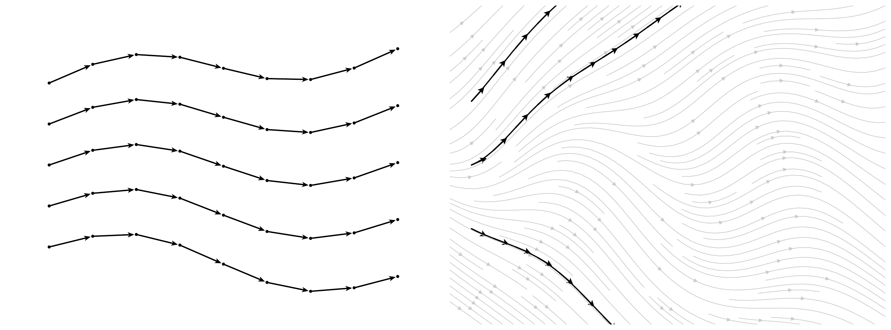

# A.1 Foundation of Ordinary Differential Equations {#app-ode-intro}

This section introduces the fundamental theory of ODEs, emphasizing the uniqueness of solutions given an initial condition. It also covers practical methods for solving ODEs using numerical solvers.

## A.1.1 Intuition of Ordinary Differential Equation {#intuition-of-ordinary-differential-equation}

The deterministic process is called an *ordinary differential equation* (ODE). In the multivariate case, we consider systems of the form:

$$
\frac{\mathop{}\!\mathrm{d} \mathbf{x}(t)}{\mathop{}\!\mathrm{d} t} = \mathbf{v}(\mathbf{x}(t), t),
\tag{A.1.1}
$$

where $\mathbf{x}(t) \in \mathbb{R}^D$ is a vector-valued function representing the state of the system at time $t$, and $\mathbf{v}: \mathbb{R}^D \times \mathbb{R} \to \mathbb{R}^D$ is a vector field specifying the direction and magnitude of change at each point in space and time.

**High-Level Intuition for Solving ODEs.**

**Figure A.1:** **ODE illustration.** A velocity field ${\mathbf{v}}({\mathbf{x}},t)$ assigns a drift vector at every point. A solution trajectory ${\mathbf{x}}(t)$ is a path whose tangent always matches the local drift. The left panel shows step-by-step solver updates (dots and arrows) approximating the path, while the right panel shows the exact trajectories (black) flowing consistently with the velocity field. Without specifying an initial state ${\mathbf{x}}(0)$, there are infinitely many trajectories whose instantaneous changes match the same velocity field. Once ${\mathbf{x}}(0)$ is fixed, however, the ODE determines a unique path ${\mathbf{x}}(t)$ that flows according to the drift.

Source: Created by the authors.

To build intuition, imagine the vector field $\mathbf{v}(\mathbf{x}, t)$ as a dynamic landscape of arrows that tells you how a point $\mathbf{x}$ should move at any given time $t$. Solving the differential equation means tracing out a curve $\mathbf{x}(t)$ through this field such that the tangent (i.e., the instantaneous velocity) of the curve at any point aligns with the vector given by $\mathbf{v}(\mathbf{x}(t), t)$.

-   **Vector Field Perspective:** The function $\mathbf{v}(\mathbf{x}, t)$ defines how things should move: it gives the local “instructions” for motion or change.

-   **Trajectory Perspective:** The solution $\mathbf{x}(t)$ is a path that a particle would follow if it obeys the rule set by the vector field $\mathbf{v}$ at every instant.

Thus, solving an ODE is like placing a particle in a flow field and observing where it goes over time.

## A.1.2 Existence and Uniqueness of Ordinary Differential Equations {#existence-and-uniqueness-of-ordinary-differential-equations}

So far, we have seen that solving an ODE means finding a path that follows the directions given by the vector field at every point. Intuitively, this is like tracing the trajectory of a particle as it moves along the flow defined by the velocities.

But this picture leads to an important question:

**Question A.1.1**

If we pick a starting point, can we be sure there really is a path that follows these directions? And if there is, is that path unique, or could the particle suddenly jump onto a different trajectory?

Answering these questions is essential because it tells us whether the system’s behavior can be reliably predicted from its starting position. The *Existence and Uniqueness Theorem* provides conditions on the vector field that guarantee exactly one path starting from any given initial point. This ensures the solution behaves consistently and forms a cornerstone of the theory of ODEs.

**Local (in Time) Existence and Uniqueness Theorem.**

Below, we state a *local* version of the theorem, which asserts existence and uniqueness of a solution in a neighborhood of the initial time for a given initial condition.

**Theorem A.1.1: Local Existence and Uniqueness**

Let $\mathbf{v}(\mathbf{x}, t)$ be a continuous function with respect to $\mathbf{x}$ and $t$ in a domain $D \subseteq \mathbb{R}^D \times \mathbb{R}$. If $\mathbf{v}$ satisfies the Lipschitz condition with respect to $\mathbf{x}$:

$$
\|\mathbf{v}(\mathbf{x}_1, t) - \mathbf{v}(\mathbf{x}_2, t)\| \leq L \|\mathbf{x}_1 - \mathbf{x}_2\| \quad \forall (\mathbf{x}_1, t), (\mathbf{x}_2, t) \in D,
$$

where $L > 0$ is a constant, then for every initial condition $\mathbf{x}(t_0) = \mathbf{x}_0$, there exists a unique solution $\mathbf{x}(t)$ to [Equation (A.1.1)](01-ordinary-differential-equations.md#eq-general-ode) defined on some interval $[t_0 - \delta, t_0 + \delta]$.

**Proof for Theorem.**

(Proof Outline) The Existence and Uniqueness Theorem can be demonstrated constructively using the Picard-Lindelöf iteration method. The method generates a sequence of functions $\{\mathbf{x}_n(t)\}$ that converges to the solution $\mathbf{x}(t)$. The iteration is defined as:

$$
\mathbf{x}_{n+1}(t) = \mathbf{x}_0 + \int_{t_0}^t \mathbf{v}(\mathbf{x}_n(s), s) \mathop{}\!\mathrm{d} s.
$$

-   Start with an initial guess $\mathbf{x}_0(t) = \mathbf{x}_0$.

-   Iteratively refine $\mathbf{x}_n(t)$ using the integral form.

-   Convergence is guaranteed under the Lipschitz condition by applying Contraction Mapping Theorem.

The essence of the proof is rooted in the Picard–Lindelöf iteration method, whose core idea is also leveraged in [Section 9.6](../../chapters/09-numerical-solvers/06-paradigms.md#sec-picard) to accelerate the sampling process of diffusion models.

**Global (in Time) Existence and Uniqueness Theorem.** While the Local Existence and Uniqueness Theorem guarantees the existence of solutions on a small time interval, the “global (in time) existence and uniqueness theorem” extends this result to the entire interval $[t_0, T]$ under additional regularity conditions. A well-known result in this category is the *Carathéodory theorem*, which ensures the global existence and uniqueness of solutions to ODEs under two key assumptions: local Lipschitz continuity in the state variable and a linear growth bound.

1.  **Local Lipschitz condition in $\mathbf{x}$:** There exists a function $\mathrm{Lip}(t)$, integrable on $[0, T]$, such that for all $\mathbf{x}_1, \mathbf{x}_2 \in \mathbb{R}^D$,

    $$
    \|{\mathbf{v}}(\mathbf{x}_1, t) - {\mathbf{v}}(\mathbf{x}_2, t)\| \leq \mathrm{Lip}(t) \|\mathbf{x}_1 - \mathbf{x}_2\|.
    $$

2.  **Linear growth condition:** There exists a function $M(t)$, integrable on $[0, T]$, such that for all $\mathbf{x} \in \mathbb{R}^D$,

    $$
    \|{\mathbf{v}}(\mathbf{x}, t)\| \leq M(t)(1 + \|\mathbf{x}\|).
    $$

We refer the reader to ([Reid, 1971](../../references.md#ref-reid1971ordinary)) for a comprehensive discussion of the assumptions, formal statement, and detailed proof of the theorem.

**Remark.**

To apply these theorems to the probability flow ODE in diffusion models (see [Equation (4.1.7)](../../chapters/04-score-sde-framework/01-score-sde-principles.md#eq-prob-ode-gt)), it may be necessary to impose additional assumptions, such as conditions (i) and (ii), on the score function $\nabla_{\mathbf{x}} \log p_t({\mathbf{x}})$. These assumptions can be reasonably accepted without further justification by readers not focused on technical details.

In summary, when an initial condition is given to an ODE defined by a time-dependent velocity field, the trajectory of the particle flow is uniquely determined.

**Uniqueness Implies Non-Intersection of Solutions** The uniqueness of solutions in ODEs, as guaranteed by the Local Existence and Uniqueness Theorem, implies a fundamental property: two different solution trajectories, starting from different initial conditions, cannot cross each other. This reflects the deterministic nature of ODEs, ensuring that each state evolves along a unique path. The following corollary formalizes this result.

**Corollary A.1.1: Non-Intersection of Solutions**

Consider two solutions ${\mathbf{x}}_1(t)$ and ${\mathbf{x}}_2(t)$ to the ODE

$$
\frac{\mathop{}\!\mathrm{d} {\mathbf{x}}(t)}{\mathop{}\!\mathrm{d} t} = {\mathbf{v}}\left({\mathbf{x}}(t),t\right), \quad t \in [0,T].
$$

Suppose they have distinct initial values ${\mathbf{x}}_1(0) \neq {\mathbf{x}}_2(0)$. Then, these solutions do not intersect on $[0,T]$, i.e.,

$$
{\mathbf{x}}_1(t) \neq {\mathbf{x}}_2(t) \quad \text{for all } t \in [0,T].
$$

**Proof for Corollary.**

Assume, for the sake of contradiction, that there exists some $t^* \in (0,T]$ such that

$$
\mathbf{x}_1(t^*) = \mathbf{x}_2(t^*).
$$

Define the first time at which the two solutions meet as

$$
t_0 := \inf \{ t \in [0,T]|\mathbf{x}_1(t) = \mathbf{x}_2(t) \}.
$$

Since $\mathbf{x}_1(0) \neq \mathbf{x}_2(0)$ and $t^*$ is contained in this set, it follows that $t_0 > 0$. By continuity of $\mathbf{x}_1$ and $\mathbf{x}_2$, we have

$$
\mathbf{x}_1(t_0) = \mathbf{x}_2(t_0).
$$

Consider the initial value problem

$$
\frac{\mathrm{d}\mathbf{x}(t)}{\mathrm{d}t} = \mathbf{v}(\mathbf{x}(t), t), \quad \mathbf{x}(t_0) = \mathbf{x}_1(t_0).
$$

By the uniqueness theorem for ODEs, both $\mathbf{x}_1$ and $\mathbf{x}_2$ must coincide on the interval $[t_0, T]$. Applying uniqueness backward in time similarly implies that the two solutions coincide on $[0, t_0]$. Therefore, the solutions satisfy

$$
\mathbf{x}_1(t) = \mathbf{x}_2(t) \quad \text{for all } t \in [0, T],
$$

which contradicts the assumption that $\mathbf{x}_1(0) \neq \mathbf{x}_2(0)$. Hence, we conclude that

$$
\mathbf{x}_1(t) \neq \mathbf{x}_2(t) \quad \text{for all } t \in [0, T].
$$

By guaranteeing non-intersecting solution paths, this theorem offers hidden yet crucial support for the flow map model (see [Chapter 10](../../chapters/10-distillation/index.md#ch-distillation) and [Chapter 11](../../chapters/11-fast-generators/index.md#ch-fast-scratch)).

## A.1.3 Exponential Integration Factor {#app-exp-int-factor}

Even an ODE determined by a general time-varying velocity ${\mathbf{v}}$ does not admit a closed-form solution, in some special cases, we can solve them analytically or by reducing its formulation to a better structural one.

**An Illustrative Example.** Consider the following linear scalar ODE:

$$
\frac{\mathop{}\!\mathrm{d} {\mathbf{x}}(t)}{\mathop{}\!\mathrm{d} t} = L(t){\mathbf{x}}(t),
$$

where $L(t) \in \mathbb{R}$ is a continuous function. This equation is solvable in closed form, and its solution is well known (for any $s$ and $t$):

$$
{\mathbf{x}}(t) = {\mathbf{x}}(s) \cdot \exp\left( \int_s^t L(\tau) \,\mathop{}\!\mathrm{d} \tau \right).
$$

This formula demonstrates how the solution evolves according to an exponential factor that accumulates the effect of the time-dependent coefficient $L(t)$. This motivates the use of *exponential integration factors*:

$$
\begin{aligned}
\mathcal{E}(s \shortrightarrow t) := \exp\left( \int_s^t L(\tau)\mathop{}\!\mathrm{d} \tau \right),
\end{aligned}
\tag{A.1.2}
$$

especially in more general settings where the dynamics include both linear and nonlinear components.

**Semilinear ODEs and Exponential Integration Factors.** We now consider a broader class of ODEs known as *semilinear* ODEs. These equations separate the dynamics into a linear part (in the state variable) and a nonlinear remainder:

$$
\begin{aligned}
\frac{\mathop{}\!\mathrm{d} {\mathbf{x}}(t)}{\mathop{}\!\mathrm{d} t} = L(t){\mathbf{x}}(t) + {\mathbf{N}}({\mathbf{x}}(t), t),
\end{aligned}
\tag{A.1.3}
$$

where ${\mathbf{x}}(t) \in \mathbb{R}^D$ is the state vector, $L(t)$ is a scalar-valued continuous function, and ${\mathbf{N}}: \mathbb{R}^D \times [0,T] \to \mathbb{R}^D$ is a nonlinear vector field. This semilinear structure arises naturally in many physical and engineering systems. In particular, it also appears in the probability flow ODE formulation of diffusion models (see [Equation (4.1.7)](../../chapters/04-score-sde-framework/01-score-sde-principles.md#eq-prob-ode-gt)). Recognizing this structure enables integrating-factor representations that handle the known linear dynamics analytically and leave the remaining term to be approximated numerically. This principle plays a central role in the diffusion ODE solvers studied in [Chapter 9](../../chapters/09-numerical-solvers/index.md#ch-numerical-solvers).

**Step 1: Isolate the Non-Linear Term via an Integration Factor.** Observing that we can isolate the nonlinear part by subtracting the linear drift from the semiliner ODE in [Equation (A.1.3)](01-ordinary-differential-equations.md#eq-semilinear-ode):

$$
\frac{\mathop{}\!\mathrm{d} {\mathbf{x}}(t)}{\mathop{}\!\mathrm{d} t} - L(t){\mathbf{x}}(t) = {\mathbf{N}}({\mathbf{x}}(t), t).
$$

To absorb the linear term, we multiply both sides by the inverse integration factor:

$$
\mathcal{E}^{-1}(s \shortrightarrow t) = \exp\left(-\int_s^t L(\tau)\mathop{}\!\mathrm{d} \tau \right).
$$

Now apply the product rule to the left-hand side:

$$
\begin{aligned}
\mathcal{E}^{-1}(s \shortrightarrow t) \left( \frac{\mathop{}\!\mathrm{d} {\mathbf{x}}(t)}{\mathop{}\!\mathrm{d} t} - L(t){\mathbf{x}}(t) \right)
&= \frac{\mathop{}\!\mathrm{d}}{\mathop{}\!\mathrm{d} t} \left[ \mathcal{E}^{-1}(s \shortrightarrow t) {\mathbf{x}}(t) \right].
\end{aligned}
$$

Hence, the equation becomes:

$$
\frac{\mathop{}\!\mathrm{d}}{\mathop{}\!\mathrm{d} t} \left[ \mathcal{E}^{-1}(s \shortrightarrow t) {\mathbf{x}}(t) \right]
= \mathcal{E}^{-1}(s \shortrightarrow t) {\mathbf{N}}({\mathbf{x}}(t), t).
$$

This transformation simplifies the original equation by isolating the nonlinear component, allowing us to focus entirely on the nonlinear dynamics in a transformed coordinate system.

**Step 2: Integrate Over Time.** We now integrate both sides from $s$ to $t$:

$$
\int_s^t \frac{\mathop{}\!\mathrm{d}}{\mathop{}\!\mathrm{d} \tau} \left[ \mathcal{E}^{-1}(s \shortrightarrow \tau) {\mathbf{x}}(\tau) \right] \mathop{}\!\mathrm{d} \tau
= \int_s^t \mathcal{E}^{-1}(s \shortrightarrow \tau) {\mathbf{N}}({\mathbf{x}}(\tau), \tau)\mathop{}\!\mathrm{d} \tau.
$$

The left-hand side is simply the difference of the transformed variable evaluated at $t$ and $s$:

$$
\mathcal{E}^{-1}(s \shortrightarrow t) {\mathbf{x}}(t) - {\mathbf{x}}(s).
$$

Hence, we obtain:

$$
\mathcal{E}^{-1}(s \shortrightarrow t) {\mathbf{x}}(t)
= {\mathbf{x}}(s) + \int_s^t \mathcal{E}^{-1}(s \shortrightarrow \tau) {\mathbf{N}}({\mathbf{x}}(\tau), \tau)\mathop{}\!\mathrm{d} \tau.
$$

**Step 3: Solve for ${\mathbf{x}}(t)$.** Multiplying both sides by the exponential flow $\mathcal{E}(s \shortrightarrow t)$ gives the solution:

$$
\begin{aligned}
{\mathbf{x}}(t) = \underbrace{\mathcal{E}(s \shortrightarrow t)  {\mathbf{x}}(s)}_{\text{linear part}} + \underbrace{\int_s^t \mathcal{E}(\tau \shortrightarrow t) {\mathbf{N}}({\mathbf{x}}(\tau), \tau)\mathop{}\!\mathrm{d} \tau}_{\text{nonlinear part}} .
\end{aligned}
\tag{A.1.4}
$$

The solution naturally separates into a linear and a nonlinear component. Exponential integrators exploit this structure by solving the linear part in exactly closed form and discretizing only the nonlinear residual. This ensures that the step size is dictated by the nonlinear dynamics rather than by the potentially large linear coefficient (see, for instance, the comparison between the exponential Euler update and the vanilla Euler update in [Section 9.1](../../chapters/09-numerical-solvers/01-prologue.md#sec-prologue-solvers)).

## A.1.4 Numerical Solvers of Ordinary Differential Equations {#app-de-solver}

We consider the ODE in [Equation (A.1.1)](01-ordinary-differential-equations.md#eq-general-ode),

$$
\frac{\mathop{}\!\mathrm{d}\mathbf{x}(t)}{\mathop{}\!\mathrm{d} t}
=
\mathbf{v}(\mathbf{x}(t),t),
$$

together with an initial condition. Solving the ODE means finding the continuous trajectory $\mathbf{x}(t)$ whose instantaneous change agrees with the velocity field $\mathbf{v}$ at every time.

Equivalently, the solution satisfies the integral equation

$$
\mathbf{x}(t)
=
\mathbf{x}(0)
+
\int_0^t
\mathbf{v}(\mathbf{x}(\tau),\tau)\mathop{}\!\mathrm{d}\tau.
\tag{A.1.5}
$$

If this integral cannot be evaluated in closed form, we approximate the trajectory numerically by evaluating the velocity field at finitely many points.

**From a Continuous Trajectory to Numerical Updates.** A numerical solver first chooses a discrete time grid

$$
t_0,t_1,\ldots,t_M
$$

and produces corresponding approximations

$$
\mathbf{x}_0,\mathbf{x}_1,\ldots,\mathbf{x}_M
$$

to the continuous trajectory.

The gap

$$
h_i:=t_{i+1}-t_i
$$

is the *step size*. Smaller steps generally provide more local information about the trajectory but require more function evaluations. The purpose of a numerical solver is therefore to use the available evaluations of $\mathbf{v}$ efficiently so that accurate trajectories can be obtained with relatively few steps.

Different solvers mainly differ in *where the information used for the next update comes from*. This leads to the following useful organization.

**A Structural View of Numerical Solvers.** For the methods relevant to this book, it is useful to distinguish two broad numerical viewpoints.

-   **Time-Stepping Methods:** Starting from the current state, the solver advances the trajectory from one time point to the next. Euler, Runge–Kutta, and Adams–Bashforth methods are representative examples.

    Within time-stepping methods, we further distinguish:

    -   a *single-step method*, which constructs the next state from the current state and any additional evaluations generated within the current interval; and

    -   a *multistep method*, which additionally reuses information from previous completed steps.

-   **Parallel-in-Time Viewpoint:** Instead of completing all time points strictly one after another, one may formulate the trajectory computation so that tentative states at several times can be updated together. Fixed-point constructions such as Picard iteration provide a basic mechanism for this idea.

A single-step method should not be confused with a single *function evaluation*. For example, Euler uses one velocity evaluation per step, whereas a Runge–Kutta method may evaluate the velocity several times at intermediate *stages* while still being a single-step method. The defining distinction is whether information from earlier completed steps is required.

**Mental Picture**

The numerical ODE solver ideas used later for diffusion sampling can be organized as follows:

$$
\begin{aligned}
\begin{array}{c}
\begin{array}{rcl}
\textbf{Time-stepping}
&\rightarrow&
\begin{cases}
\text{single-step: }
    & \text{Euler, Runge--Kutta},\\
\text{multistep}
    & \text{Adams--Bashforth},
\end{cases}
\\[12pt]
\textbf{Parallel-in-time}
&\rightarrow&
\text{Picard fixed-point iteration}.
\end{array}
\\[6pt]
\downarrow
\\[-2pt]
\text{The same numerical ideas can be applied forward or backward in time.}
\end{array}
\end{aligned}
\tag{A.1.6}
$$

The distinction is especially useful later in diffusion sampling: Runge–Kutta-type constructions obtain richer information by looking *within* the current step, whereas Adams–Bashforth-type constructions obtain it by looking *backward* at previously computed values.

**Solving ODEs in Forward and Reverse Time.** The taxonomy above does not depend on the direction in which the ODE is integrated. In ordinary forward integration,

$$
t_{n+1}>t_n,
\qquad
h_n=t_{n+1}-t_n>0.
$$

Diffusion sampling instead typically starts from a noisy terminal state and uses a decreasing time grid,

$$
t_{n+1}<t_n,
\qquad
h_n=t_{n+1}-t_n<0.
$$

The same numerical formulas apply in either direction when the step size is treated as a signed quantity. Thus, reverse-time integration of an ODE does not require a new family of numerical solvers; Euler, Runge–Kutta, multistep, and related methods can all be applied on a decreasing time grid.

This simple reversal should be distinguished from reversing an SDE, where the stochastic dynamics require additional analysis. We discuss that issue in the following section.

## A.1.5 Representative Numerical Solvers {#app-de-solver-examples}

The taxonomy above tells us where a solver obtains information for its next update. We now make these ideas concrete through a few representative examples.

We deliberately keep the list short. Euler illustrates the simplest single-step update; Runge–Kutta methods illustrate the use of additional stages within the current step; Adams–Bashforth illustrates reuse of past history; and Picard iteration illustrates the fixed-point viewpoint behind parallel-in-time methods.

Throughout the examples below, let

$$
t_{n+1}=t_n+h.
$$

The step size $h$ is signed: $h>0$ for forward integration and $h<0$ for reverse integration.

**Euler’s Method.** Euler’s method is the simplest single-step method. It uses only the velocity at the beginning of the current interval:

$$
\mathbf{x}_{n+1}
=
\mathbf{x}_n
+
h\,\mathbf{v}(\mathbf{x}_n,t_n).
$$

Geometrically, Euler looks at the current direction of motion and follows that direction for one complete step.

Under standard smoothness assumptions, Euler has local truncation error $\mathcal O(h^2)$ and global error $\mathcal O(h)$. Its simplicity makes it a useful first-order baseline, but its accuracy deteriorates when the velocity changes substantially over one step.

**Runge–Kutta Methods.** Euler uses only the velocity at the beginning of the interval. Runge–Kutta (RK) methods obtain more information by evaluating the velocity at additional *stages* generated within the same step.

They are therefore *single-step, multi-stage* methods: all information used to construct $\mathbf{x}_{n+1}$ is generated from the current starting point $\mathbf{x}_n$, but one step may contain several function evaluations.

We illustrate the basic RK principle using two second-order methods.

**Explicit Midpoint Method.** The explicit midpoint method first uses the current velocity to predict the state halfway through the interval:

$$
\mathbf{x}_{\mathrm{mid}}
=
\mathbf{x}_n
+
\frac{h}{2}
\mathbf{v}(\mathbf{x}_n,t_n).
$$

It then evaluates the velocity at this predicted midpoint and uses that direction for the complete update:

$$
\mathbf{x}_{n+1}
=
\mathbf{x}_n
+
h\,
\mathbf{v}
\left(
\mathbf{x}_{\mathrm{mid}},
t_n+\frac{h}{2}
\right).
$$

Thus, instead of assuming that the starting velocity remains representative over the entire interval, the midpoint method “looks inside” the step before deciding how to complete it.

**Heun’s Method (Improved Euler).** Heun’s method is another two-stage, second-order Runge–Kutta method. Instead of looking at the midpoint, it first uses Euler’s method to predict the endpoint:

$$
\mathbf{x}_{\mathrm{pred}}
=
\mathbf{x}_n
+
h\,\mathbf{v}(\mathbf{x}_n,t_n).
$$

It then evaluates the velocity at this predicted endpoint and averages the starting and predicted ending velocities:

$$
\mathbf{x}_{n+1}
=
\mathbf{x}_n
+
\frac{h}{2}
\left[
\mathbf{v}(\mathbf{x}_n,t_n)
+
\mathbf{v}(\mathbf{x}_{\mathrm{pred}},t_n+h)
\right].
$$

The explicit midpoint and Heun methods both use two stages and, under standard smoothness assumptions, have local truncation error $\mathcal O(h^3)$ and global error $\mathcal O(h^2)$. They differ only in how the additional within-step information is collected and combined.

Higher-order Runge–Kutta methods extend the same principle by using more stages; their standard formulas are omitted here. In diffusion sampling, [Karras et al. (2022)](../../references.md#ref-karras2022elucidating) use Heun’s method directly as an ODE solver.

**Adams–Bashforth Method.** Runge–Kutta methods obtain additional information by looking *within* the current step. A multistep method instead looks *backward* and reuses information from previous completed steps.

For example, with a uniform step size $h$, the second-order Adams–Bashforth method (AB2) is

$$
\mathbf{x}_{n+1}
=
\mathbf{x}_n
+
h
\left[
\frac{3}{2}
\mathbf{v}(\mathbf{x}_n,t_n)
-
\frac{1}{2}
\mathbf{v}(\mathbf{x}_{n-1},t_{n-1})
\right].
$$

The second piece of information is therefore a stored velocity from the previous step rather than a new evaluation inside the current interval.

Under standard smoothness assumptions and sufficiently accurate initialization, AB2 has local truncation error $\mathcal O(h^3)$ and global error $\mathcal O(h^2)$. Because the first step has no previous history, a multistep method must first be initialized using another solver.

The formula above assumes a uniform grid. On nonuniform grids, the multistep coefficients depend on the neighboring step sizes. This history-reuse principle will later reappear in the diffusion-specific multistep solvers in [Section 9.3](../../chapters/09-numerical-solvers/03-deis.md#sec-exponential) and [Section 9.5.4](../../chapters/09-numerical-solvers/05-dpm-solver-plus-plus.md#subsec-dpm-solver--multi).

**Picard Iteration.** The methods above approximate the trajectory by constructing local time-stepping updates. Picard iteration follows a different idea: it repeatedly refines an entire candidate trajectory through the integral form of the ODE.

Starting from an initial guess $\mathbf{x}^{(0)}(t)$ satisfying $\mathbf{x}^{(0)}(0)=\mathbf{x}(0)$, Picard iteration defines

$$
\mathbf{x}^{(k+1)}(t)
=
\mathbf{x}(0)
+
\int_0^t
\mathbf{v}
\bigl(
\mathbf{x}^{(k)}(s),s
\bigr)
\mathop{}\!\mathrm{d} s.
$$

Each iteration therefore evaluates the velocity along the previous candidate trajectory and uses those evaluations to construct a new one.

A fixed point of this iteration satisfies the original ODE integral equation. Under the standard conditions of the Picard–Lindelöf theorem, the iteration converges locally to the ODE solution.

For our later purposes, the important observation is computational: within one Picard iteration, the velocity at each time depends on the *previous* candidate trajectory. Evaluations at different time points can therefore be carried out independently, which opens the possibility of parallel-in-time computation. This viewpoint will be revisited in [Section 9.6](../../chapters/09-numerical-solvers/06-paradigms.md#sec-picard).
