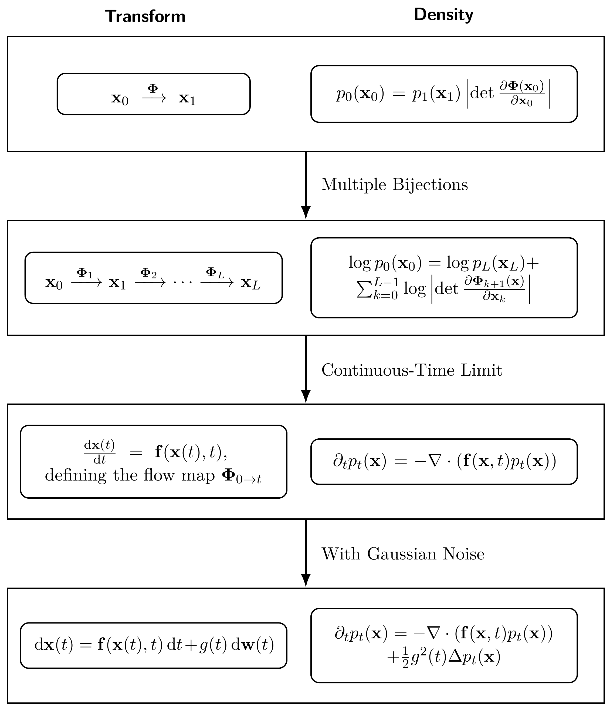

# B. Density Evolution: From Change of Variable to Fokker–Planck {#app-continuity}

Understanding how probability densities evolve under transformations is fundamental in both probability theory and generative modeling. In particular, diffusion models aim to construct generative processes whose induced density paths reverse a pre-defined forward process. This evolution is governed by the continuity equation or, in the stochastic case, the Fokker-Planck equation.

Although these names may sound unfamiliar or intimidating, they are in fact continuous-time analogues of the change-of-variable formula from basic calculus. In [Section B.1](01-change-of-variable.md#sec-cov), it builds up to them by presenting a progression of change-of-variable formulas, starting from deterministic bijections, and culminating in stochastic differential equations. This progression naturally bridges discrete mappings and continuous-time flow dynamics. See [Figure B.1](index.md#fig-unified-framework-cov) for an overview of this unified framework.

In [Section B.2](02-continuity-equation-intuition.md#sec-intuition-continuity), we provide a physical and intuitive interpretation of the continuity equation, emphasizing its connection to the conservation of density in dynamical systems.

**After this chapter, you will be able to...**

-   connect the change-of-variable formula to the continuity equation for ODEs and the Fokker–Planck equation for SDEs;

-   understand the continuity equation as conservation of probability mass, and distinguish particle motion from density evolution;

-   distinguish the Lagrangian and Eulerian views of transport, including why a density path alone need not determine a unique velocity field;

-   understand why an SDE and its probability-flow ODE can share the same marginal densities while having different sample paths.

**Reader route.** The key principle is that the change-of-variable formula describes how moving samples changes their probability distribution. This appendix develops that idea from deterministic maps to the continuity and Fokker–Planck equations, with Wasserstein gradient flow as an optional extension to distribution-level training.

**Figure B.1:** A unified *change-of-variables formula*. From top to bottom: (1) a single bijection; (2) composition of multiple bijections; (3) continuous-time deterministic flow governed by an ODE and the associated continuity equation; (4) stochastic flow modeled by an SDE and the corresponding Fokker–Planck equation.

Source: Created by the authors.

Continue with the sections below and the [appendix references](references.md#appendix-b-references).

[B.1 Change-of-Variable Formula: From Deterministic Maps to Stochastic Flows](01-change-of-variable.md#sec-cov)

[B.2 Intuition of the Continuity Equation](02-continuity-equation-intuition.md#sec-intuition-continuity)

[B.3 (Optional) Wasserstein Gradient Flows as Distribution-Level Training](03-wasserstein-gradient-flows.md#sec-wgf-distribution-level-training)

[Section B.1.2](01-change-of-variable.md#subsec-cov-continuity-eq)

[Equation (B.1.2)](01-change-of-variable.md#eq-cov-multi-layer-nolog)

[Section B.3](03-wasserstein-gradient-flows.md#sec-wgf-distribution-level-training)
