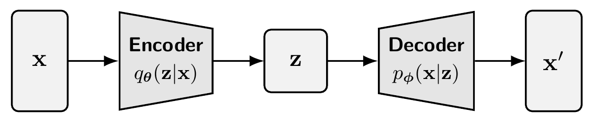
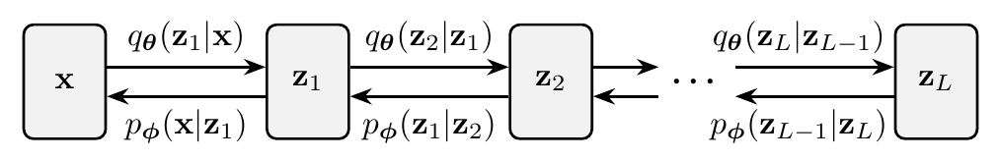

# 2.1 Variational Autoencoder {#sec-vae}

How can a neural network learn to generate realistic data? A natural starting point is the *autoencoder*, which consists of two networks: a deterministic *encoder* that compresses an input to a low-dimensional latent code, and a deterministic *decoder* that reconstructs the input from this code. Training minimizes the reconstruction error between the original input and its reconstruction. While this setup enables accurate reconstruction, the latent space is unstructured: randomly sampling latent codes usually produces meaningless outputs, limiting the model’s use for generation.

The *Variational Autoencoder (VAE)* ([Kingma and Welling, 2013](references.md#ref-kingma2013auto)) solves this by imposing a probabilistic structure on the latent space. This transforms the model from a simple reconstruction tool into a true generative model, capable of producing novel and realistic data.

## 2.1.1 Probabilistic Encoder and Decoder {#probabilistic-encoder-and-decoder}

**Figure 2.1:** **Illustration of a VAE.** It consists of a stochastic encoder $q_{\boldsymbol{\theta}}({\mathbf{z}}|{\mathbf{x}})$ that maps data ${\mathbf{x}}$ to a latent variable ${\mathbf{z}}$, and a decoder $p_{\boldsymbol{\phi}}({\mathbf{x}}|{\mathbf{z}})$ that reconstructs data from the latent.

Source: Created by the authors.

**Construction of Decoder (Generator).**

In VAEs, we distinguish between two types of variables: *observed variables* ${\mathbf{x}}$, which correspond to the data we see (e.g., an image), and *latent variables* ${\mathbf{z}}$, which capture the hidden factors of variation (e.g., object shape, color, or style). The model assumes that each observation ${\mathbf{x}}$ is generated from a latent variable sampled from a simple *prior distribution*, typically a standard Gaussian, ${\mathbf{z}} \sim p_{\text{prior}} := \mathcal{N}(\mathbf{0}, \mathbf{I})$.

To map ${\mathbf{z}}$ back to data space, we define a *decoder (generator)* distribution $p_{\boldsymbol{\phi}}({\mathbf{x}}|{\mathbf{z}})$. In practice, this decoder is kept simple, often a factorized Gaussian (see [Section 2.1.3](01-variational-autoencoder.md#subsec-optimization-vae)) or similar distribution, so that learning focuses on extracting useful latent features rather than memorizing data. Intuitively, directly generating pixels one by one is extremely hard; instead, the latent variable provides a compact representation, from which decoding the exact pixel arrangement becomes much easier. New samples are drawn by first sampling ${\mathbf{z}} \sim p_{\text{prior}}$ and then decoding via ${\mathbf{x}} \sim p_{\boldsymbol{\phi}}({\mathbf{x}}|{\mathbf{z}})$.

The VAE thereby defines a latent-variable generative model through the marginal likelihood:

$$
p_{\boldsymbol{\phi}}({\mathbf{x}}) = \int p_{\boldsymbol{\phi}}({\mathbf{x}}|{\mathbf{z}}) p({\mathbf{z}}) \mathop{}\!\mathrm{d} {\mathbf{z}}.
$$

Ideally, the decoder parameters $\boldsymbol{\phi}$ are learned by maximizing this marginal likelihood, as in maximum likelihood estimation (see [Equation (1.1.2)](../01-deep-generative-modeling/01-what-is-deep-generative-modeling.md#eq-mle)). However, because the integral over ${\mathbf{z}}$ is intractable for expressive, non-linear decoders, direct MLE is computationally infeasible, motivating the variational approach used in VAEs.

**Construction of Encoder (Inference Network).**

To connect our intractable generator to real data, consider the reverse question: given an observation ${\mathbf{x}}$, what latent codes ${\mathbf{z}}$ could have produced it? By Bayes’ rule, the posterior distribution is

$$
p_{\boldsymbol{\phi}}({\mathbf{z}}|{\mathbf{x}}) \;=\; \frac{p_{\boldsymbol{\phi}}({\mathbf{x}}|{\mathbf{z}}) p({\mathbf{z}})}{p_{\boldsymbol{\phi}}({\mathbf{x}})}.
$$

The difficulty is that the denominator involves the marginal likelihood $p_{\boldsymbol{\phi}}({\mathbf{x}})$, which requires integrating over all latent variables and is intractable for nonlinear decoders. Thus, exact inference of ${\mathbf{z}}$ from ${\mathbf{x}}$ is computationally prohibitive.

The “variational” step in VAEs addresses this by replacing the intractable posterior with a tractable approximation. We introduce an *encoder* (or inference network) $q_{\boldsymbol{\theta}}({\mathbf{z}}|{\mathbf{x}})$, parameterized by a neural network, whose role is to serve as a learnable proxy:

$$
q_{\boldsymbol{\theta}}({\mathbf{z}}|{\mathbf{x}}) \;\approx\; p_{\boldsymbol{\phi}}({\mathbf{z}}|{\mathbf{x}}).
$$

In practice, the encoder maps each observed data point ${\mathbf{x}}$ to a distribution over latent codes, providing a feasible and trainable pathway from ${\mathbf{x}}$ back to ${\mathbf{z}}$ that enables learning.

## 2.1.2 Training via the Evidence Lower Bound (ELBO) {#training-via-elbo}

We now define a computable training objective. While we cannot directly optimize $\log p_{\boldsymbol{\phi}}(\mathbf{x})$, we can maximize a lower bound on it—the *Evidence Lower Bound (ELBO)*:

**Theorem 2.1.1: Evidence Lower Bound (ELBO)**

For any data point $\mathbf{x}$, the log-likelihood satisfies:

$$
\log p_{\boldsymbol{\phi}}(\mathbf{x}) \geq \mathcal{L}_{\text{ELBO}}(\boldsymbol{\theta}, \boldsymbol{\phi}; \mathbf{x}),
$$

where the ELBO is given by:

$$
\begin{aligned}
\mathcal{L}_{\text{ELBO}} = \underbrace{\mathbb{E}_{\mathbf{z} \sim q_{\boldsymbol{\theta}}(\mathbf{z}|\mathbf{x})} \left[ \log p_{\boldsymbol{\phi}}(\mathbf{x}|\mathbf{z}) \right]}_{\text{Reconstruction Term}} - \underbrace{\mathcal{D}_{\mathrm{KL}}\left( q_{\boldsymbol{\theta}}(\mathbf{z}|\mathbf{x}) \| p(\mathbf{z}) \right)}_{\text{Latent Regularization}}.
\end{aligned}
\tag{2.1.1}
$$

**Proof for Theorem.**

The ELBO arises from Jensen’s inequality:

$$
\begin{aligned}
\log p_{\boldsymbol{\phi}}(\mathbf{x}) &= \log \int p_{\boldsymbol{\phi}}(\mathbf{x}, \mathbf{z})   \mathrm{d}\mathbf{z} = \log \int q_{\boldsymbol{\theta}}(\mathbf{z}|\mathbf{x}) \frac{p_{\boldsymbol{\phi}}(\mathbf{x}, \mathbf{z})}{q_{\boldsymbol{\theta}}(\mathbf{z}|\mathbf{x})}   \mathrm{d}\mathbf{z} \\
&= \log \mathbb{E}_{\mathbf{z} \sim q_{\boldsymbol{\theta}}(\mathbf{z}|\mathbf{x})} \left[ \frac{p_{\boldsymbol{\phi}}(\mathbf{x}, \mathbf{z})}{q_{\boldsymbol{\theta}}(\mathbf{z}|\mathbf{x})} \right] \geq \mathbb{E}_{\mathbf{z} \sim q_{\boldsymbol{\theta}}(\mathbf{z}|\mathbf{x})} \left[ \log \frac{p_{\boldsymbol{\phi}}(\mathbf{x}, \mathbf{z})}{q_{\boldsymbol{\theta}}(\mathbf{z}|\mathbf{x})} \right].
\end{aligned}
$$

The ELBO objective naturally decomposes into two parts:

-   **Reconstruction:** Encourages accurate recovery of $\mathbf{x}$ from its latent code $\mathbf{z}$. With Gaussian encoder and decoder assumptions, this term reduces exactly to the familiar reconstruction loss of an autoencoder (cf. [Section 2.1.3](01-variational-autoencoder.md#subsec-optimization-vae)). However, as in autoencoders, optimizing this term alone risks memorizing the training data, motivating an additional regularization.

-   **Latent KL:** Encourages the encoder distribution $q_{\boldsymbol{\theta}}(\mathbf{z}|\mathbf{x})$ to stay close to a simple Gaussian prior $p_{\mathrm{prior}}(\mathbf{z})$. This regularization shapes the latent space into a smooth and continuous structure, enabling meaningful generation by ensuring that samples drawn from the prior can be reliably decoded.

This trade-off ensures both faithful reconstructions and coherent sampling.

**Information-Theoretic View: ELBO as a Divergence Bound.**

The ELBO objective has a natural information-theoretic interpretation. Recall that maximum likelihood training amounts to minimizing the KL divergence

$$
\mathcal{D}_{\mathrm{KL}}(p_{\text{data}}({\mathbf{x}}) \| p_{\boldsymbol{\phi}}({\mathbf{x}})),
$$

which measures how well the model distribution approximates the data distribution. Since this term is intractable in general, the variational framework introduces a joint comparison.

Specifically, consider two joint distributions:

-   The **generative joint**, $p_{\boldsymbol{\phi}}({\mathbf{x}}, {\mathbf{z}}) = p({\mathbf{z}}) p_{\boldsymbol{\phi}}({\mathbf{x}}|{\mathbf{z}})$, which describes how the model generates data;

-   The **inference joint**, $q_{\boldsymbol{\theta}}({\mathbf{x}}, {\mathbf{z}}) = p_{\text{data}}({\mathbf{x}}) q_{\boldsymbol{\theta}}({\mathbf{z}}|{\mathbf{x}})$, which couples real data with its inferred latent.

Comparing these distributions yields the inequality

$$
\begin{aligned}
\mathcal{D}_{\mathrm{KL}}(p_{\text{data}}({\mathbf{x}}) \| p_{\boldsymbol{\phi}}({\mathbf{x}}))
    \leq \mathcal{D}_{\mathrm{KL}}(q_{\boldsymbol{\theta}}({\mathbf{x}},{\mathbf{z}}) \| p_{\boldsymbol{\phi}}({\mathbf{x}},{\mathbf{z}})),
\end{aligned}
\tag{2.1.2}
$$

sometimes referred to as the chain rule for KL divergence. Intuitively, comparing only marginals (${\mathbf{x}}$) can hide mismatches that are revealed when the full latent–data joint is considered.

Formally, one can expand the joint KL as

$$
\begin{aligned}
&\underbrace{\mathcal{D}_{\mathrm{KL}}(q_{\boldsymbol{\theta}}(\mathbf{x}, \mathbf{z}) \| p_{\boldsymbol{\phi}}(\mathbf{x}, \mathbf{z}))}_{\text{Total Error Bound}}
    \\=& \mathbb{E}_{q_{\boldsymbol{\theta}}(\mathbf{x}, \mathbf{z})} \left[ \log \frac{p_{\text{data}}(\mathbf{x}) q_{\boldsymbol{\theta}}(\mathbf{z}|\mathbf{x})}{p_{\boldsymbol{\phi}}(\mathbf{x}) p_{\boldsymbol{\phi}}(\mathbf{z}|\mathbf{x})} \right] \\=&\mathbb{E}_{p_{\text{data}}(\mathbf{x})} \left[ \log \frac{p_{\text{data}}(\mathbf{x})}{p_{\boldsymbol{\phi}}(\mathbf{x})} + \mathcal{D}_{\mathrm{KL}}\left( q_{\boldsymbol{\theta}}(\mathbf{z}|\mathbf{x}) \| p_{\boldsymbol{\phi}}(\mathbf{z}|\mathbf{x}) \right) \right] \\
    \\=&  \underbrace{\mathcal{D}_{\mathrm{KL}}(p_{\text{data}} \| p_{\boldsymbol{\phi}})}_{\text{True Modeling Error}} + \underbrace{\mathbb{E}_{p_{\text{data}}(\mathbf{x})} \big[ \mathcal{D}_{\mathrm{KL}}( q_{\boldsymbol{\theta}}(\mathbf{z}|\mathbf{x}) \| p_{\boldsymbol{\phi}}(\mathbf{z}|\mathbf{x}) ) \big]}_{\text{Inference Error}},
\end{aligned}
$$

where the first term is the true modeling error and the second is the inference error, i.e., the gap between the approximate and true posteriors. The latter is always non-negative, which explains [Equation (2.1.2)](01-variational-autoencoder.md#eq-joint-bound).

Finally, note that

$$
\log p_{\boldsymbol{\phi}}({\mathbf{x}}) - \mathcal{L}_{\text{ELBO}}(\boldsymbol{\theta},\boldsymbol{\phi};{\mathbf{x}})
= \mathcal{D}_{\mathrm{KL}} \left(q_{\boldsymbol{\theta}}({\mathbf{z}}|{\mathbf{x}})\|p_{\boldsymbol{\phi}}({\mathbf{z}}|{\mathbf{x}})\right).
$$

Thus the inference error is exactly the gap between the log-likelihood and the ELBO. Maximizing the ELBO therefore corresponds to directly reducing inference error, ensuring that training minimizes a meaningful part of the overall bound.

## 2.1.3 Gaussian VAE {#subsec-optimization-vae}

A standard formulation of the VAE employs Gaussian distributions for both the encoder and decoder.

**Encoder Part.** The encoder $q_{\boldsymbol{\theta}}(\mathbf{z} | \mathbf{x})$ is typically modeled as a Gaussian distribution as:

$$
q_{\boldsymbol{\theta}}(\mathbf{z} | \mathbf{x}) := \mathcal{N}\left(\mathbf{z}; \boldsymbol{\mu}_{\boldsymbol{\theta}}(\mathbf{x}), \operatorname{diag}(\boldsymbol{\sigma}_{\boldsymbol{\theta}}^2(\mathbf{x}))\right),
$$

where $\boldsymbol{\mu}_{\boldsymbol{\theta}} : \mathbb{R}^D \to \mathbb{R}^d$ and $\boldsymbol{\sigma}_{\boldsymbol{\theta}} : \mathbb{R}^D \to \mathbb{R}_+^d$ are deterministic outputs of the encoder network.

**Decoder Part.** The decoder is typically modeled as a Gaussian distribution with fixed variance:

$$
p_{\boldsymbol{\phi}}(\mathbf{x}|\mathbf{z}) := \mathcal{N}\bigl(\mathbf{x}; \boldsymbol{\mu}_{\boldsymbol{\phi}}(\mathbf{z}), \sigma^2 {\mathbf{I}}\bigr),
$$

where $\boldsymbol{\mu}_{\boldsymbol{\phi}} : \mathbb{R}^d \to \mathbb{R}^D$ is a neural network, and $\sigma > 0$ is a small constant controlling the variance.

Under this assumption, the reconstruction term in the ELBO simplifies as

$$
\mathbb{E}_{q_{\boldsymbol{\theta}}(\mathbf{z} | \mathbf{x})} \left[\log p_{\boldsymbol{\phi}}(\mathbf{x} | \mathbf{z})\right]
= - \frac{1}{2\sigma^2} \mathbb{E}_{q_{\boldsymbol{\theta}}(\mathbf{z} | \mathbf{x})} \left[\|\mathbf{x} - \boldsymbol{\mu}_{\boldsymbol{\phi}}(\mathbf{z})\|^2\right] + C,
$$

where $C$ is a constant independent of $\boldsymbol{\theta}$ and $\boldsymbol{\phi}$. The ELBO objective thus reduces to:

$$
\min_{\boldsymbol{\theta}, \boldsymbol{\phi}}  \mathbb{E}_{q_{\boldsymbol{\theta}}(\mathbf{z} | \mathbf{x})} \left[ \frac{1}{2\sigma^2} \|\mathbf{x} - \boldsymbol{\mu}_{\boldsymbol{\phi}}(\mathbf{z})\|^2 \right]
+ \mathcal{D}_{\mathrm{KL}}\big(q_{\boldsymbol{\theta}}(\mathbf{z} | \mathbf{x}) \| p_{\mathrm{prior}}(\mathbf{z})\big),
$$

where the KL term admits a closed-form solution due to the Gaussian assumption. Training the VAE therefore reduces to minimizing a regularized reconstruction loss.

## 2.1.4 Drawbacks of Standard VAE {#sec-drawback-standard-vae}

Despite the theoretical appeal of the VAE framework, it suffers from a critical drawback: it often produces blurry outputs[^1].

**Blurry Generations in VAEs.** To understand this phenomenon, consider a fixed Gaussian encoder $q_{\text{enc}}(\mathbf{z}|\mathbf{x})$, and a decoder of the form

$$
p_{\text{dec}}(\mathbf{x}|\mathbf{z}) = \mathcal{N}(\mathbf{x}; \boldsymbol{\mu}({\mathbf{z}}), \sigma^2 {\mathbf{I}}),
$$

where $\boldsymbol{\mu}({\mathbf{z}})$ denotes the decoder network. With an arbitrary encoder, optimizing the ELBO reduces (up to an additive constant) to minimizing the expected reconstruction error:

$$
\operatorname*{arg\,min}_{\boldsymbol{\mu}} \mathbb{E}_{p_{\text{data}}(\mathbf{x})q_{\text{enc}}(\mathbf{z}|\mathbf{x})} \left[ \| \mathbf{x} - \boldsymbol{\mu}({\mathbf{z}}) \|^2 \right].
$$

This is a standard least squares problem in $\boldsymbol{\mu}({\mathbf{z}})$, and its solution is given in closed form by the conditional mean:

$$
\boldsymbol{\mu}^*(\mathbf{z}) = \mathbb{E}_{q_{\text{enc}}(\mathbf{x}|\mathbf{z})}[\mathbf{x}],
$$

where $q_{\text{enc}}(\mathbf{x}|\mathbf{z})$ is the encoder-induced posterior on inputs given latents, defined via Bayes’ rule:

$$
q_{\text{enc}}(\mathbf{x}|\mathbf{z})
=
\frac{q_{\text{enc}}(\mathbf{z}|\mathbf{x})\, p_{\text{data}}(\mathbf{x})}{q_{\text{enc}}(\mathbf{z})},
\qquad
q_{\text{enc}}(\mathbf{z})
:=
\int q_{\text{enc}}(\mathbf{z}|\mathbf{x})\, p_{\text{data}}(\mathbf{x})\, \mathop{}\!\mathrm{d} \mathbf{x}.
$$

An equivalent form of the optimal generator via Bayes’ rule is:

$$
\boldsymbol{\mu}^*(\mathbf{z})
=
\frac{\mathbb{E}_{p_{\text{data}}(\mathbf{x})}\!\left[q_{\text{enc}}(\mathbf{z}|\mathbf{x}) \cdot \mathbf{x}\right]}
{q_{\text{enc}}(\mathbf{z})}
=
\frac{\mathbb{E}_{p_{\text{data}}(\mathbf{x})}\!\left[q_{\text{enc}}(\mathbf{z}|\mathbf{x}) \cdot \mathbf{x}\right]}
{\mathbb{E}_{p_{\text{data}}(\mathbf{x})}\!\left[q_{\text{enc}}(\mathbf{z}|\mathbf{x})\right]}.
$$

Now suppose that two distinct inputs $\mathbf{x} \neq \mathbf{x}'$ are mapped to overlapping regions in latent space, i.e., the supports of $q_{\text{enc}}(\cdot|\mathbf{x})$ and $q_{\text{enc}}(\cdot|\mathbf{x}')$ intersect. Then $\boldsymbol{\mu}^*(\mathbf{z})$ averages over multiple, potentially unrelated inputs, which leads to blurry, non-distinct outputs. This averaging effect over conflicting modes is a fundamental reason for the characteristic blurriness in VAE-generated samples.

## 2.1.5 (Optional) From Standard VAE to Hierarchical VAEs {#hierarchical-vaes}

To model complex data, Hierarchical Variational Autoencoders (HVAEs) ([Vahdat and Kautz, 2020](references.md#ref-vahdat2020nvae)) enhance VAEs by introducing a hierarchy of latent variables. This deep, layered structure allows the model to capture data features at multiple levels of abstraction, significantly boosting expressive power and mirroring the compositional nature of real-world data.

**Figure 2.2:** **Computation graph of the HVAE.** It has a hierarchical structure with stacked, trainable encoders and decoders across multiple latent layers.

Source: Created by the authors.

**HVAE’s Modeling.** Unlike standard VAEs that use a single latent code $\mathbf{z}$, hierarchical VAEs (HVAEs) introduce multiple layers of latent variables arranged in a top-down hierarchy. Each latent layer conditions the one below it, forming a chain of conditional priors that captures structure at progressively finer levels of abstraction. This leads to the following top-down factorization of the joint distribution:

$$
p_{\boldsymbol{\phi}}(\mathbf{x}, \mathbf{z}_{1:L}) = p_{\boldsymbol{\phi}}(\mathbf{x} | \mathbf{z}_1) \prod_{i=2}^{L} p_{\boldsymbol{\phi}}(\mathbf{z}_{i-1}|\mathbf{z}_i)   p(\mathbf{z}_L).
$$

This structure defines the marginal data distribution,

$$
p_{\text{HVAE}}(\mathbf{x}) := \int p_{\boldsymbol{\phi}}(\mathbf{x}, \mathbf{z}_{1:L}) \mathop{}\!\mathrm{d} \mathbf{z}_{1:L}.
$$

Generation proceeds progressively: starting from the top latent variable $\mathbf{z}_L$, each latent is decoded sequentially down to $\mathbf{z}_1$, followed by generating the final observation $\mathbf{x}$.

For encoding part, HVAEs utilize a structured, learnable variational encoder $q_{\boldsymbol{\theta}}(\mathbf{z}_{1:L}|\mathbf{x})$ that mirrors the generative hierarchy. A common choice is a bottom-up Markov factorization:

$$
q_{\boldsymbol{\theta}}(\mathbf{z}_{1:L} | \mathbf{x}) = q_{\boldsymbol{\theta}}(\mathbf{z}_1 | \mathbf{x}) \prod_{i=2}^{L} q_{\boldsymbol{\theta}}(\mathbf{z}_i | \mathbf{z}_{i-1}).
$$

**HVAE’s ELBO.** Similar to [Equation (2.1.1)](01-variational-autoencoder.md#eq-vae-elbo), ELBO is derived via Jensen’s inequality:

$$
\begin{aligned}
    \log p_{\text{HVAE}}(\mathbf{x})
&= \log \int p_{\boldsymbol{\phi}}(\mathbf{x}, \mathbf{z}_{1:L}) \mathop{}\!\mathrm{d} \mathbf{z}_{1:L} \\
&= \log \int \frac{p_{\boldsymbol{\phi}}(\mathbf{x}, \mathbf{z}_{1:L})}{q_{\boldsymbol{\theta}}(\mathbf{z}_{1:L}|\mathbf{x})}   q_{\boldsymbol{\theta}}(\mathbf{z}_{1:L}|\mathbf{x}) \mathop{}\!\mathrm{d} \mathbf{z}_{1:L} \\
&= \log \mathbb{E}_{q_{\boldsymbol{\theta}}(\mathbf{z}_{1:L}|\mathbf{x})} \left[ \frac{p_{\boldsymbol{\phi}}(\mathbf{x}, \mathbf{z}_{1:L})}{q_{\boldsymbol{\theta}}(\mathbf{z}_{1:L}|\mathbf{x})} \right] \\
&\geq \mathbb{E}_{q_{\boldsymbol{\theta}}(\mathbf{z}_{1:L}|\mathbf{x})} \left[ \log \frac{p_{\boldsymbol{\phi}}(\mathbf{x}, \mathbf{z}_{1:L})}{q_{\boldsymbol{\theta}}(\mathbf{z}_{1:L}|\mathbf{x})} \right]\\
&=:\mathcal{L}_{\text{ELBO}}(\boldsymbol{\phi}).
\end{aligned}
\tag{2.1.3}
$$

Substituting the factorized forms yields:

$$
\begin{aligned}
\mathcal{L}_{\text{ELBO}}
= \mathbb{E}_{q_{\boldsymbol{\theta}}(\mathbf{z}_{1:L}|\mathbf{x})} \left[
\log \frac{
p(\mathbf{z}_L) \prod_{i=2}^{L} p_{\boldsymbol{\phi}}(\mathbf{z}_{i-1} | \mathbf{z}_i)   p_{\boldsymbol{\phi}}(\mathbf{x} | \mathbf{z}_1)
}{
q_{\boldsymbol{\theta}}(\mathbf{z}_1|\mathbf{x}) \prod_{i=2}^{L} q_{\boldsymbol{\theta}}(\mathbf{z}_i|\mathbf{z}_{i-1})
}
\right].
\end{aligned}
$$

This hierarchical ELBO decomposes into interpretable terms, including a reconstruction term, adjacent-layer matching terms, and a top-level KL regularizer to the prior.

The leap from shallow to deep networks revolutionized machine learning, and a similar idea transformed generative models. HVAEs showed the power of using deep, stacked layers to build data. This concept of a layered hierarchy is a cornerstone of modern generative modeling, appearing again in score-based methods ([Section 3.4](../03-score-based-perspective/04-noise-conditional-score-networks.md#sec-smld)) and normalizing flows ([Section 5.1](../05-flow-based-perspective/index.md#sec-flow-based-method)). The core insight is simple yet powerful:

**Observation 2.1.1**

Stacking layers allows the model to generate data progressively, starting with coarse details and adding finer ones at each step. This process makes it far easier to capture the complex structure of high-dimensional data.

**Why Deeper Networks in a Flat VAE are Not Enough.** There are two fundamental limitations of a standard flat VAE that are not resolved by simply making the encoder and decoder deeper.

The first limitation is the variational family. In a standard VAE,

$$
q_{\boldsymbol{\theta}}({\mathbf{z}}| {\mathbf{x}})=\mathcal N \big({\mathbf{z}};\,\boldsymbol{\mu}_{{\boldsymbol{\theta}}}({\mathbf{x}}), \operatorname{diag}(\sigma_\theta^2({\mathbf{x}}))\big),
$$

so for each fixed ${\mathbf{x}}$ the encoder posterior is a single Gaussian with diagonal covariance. Greater network depth improves the accuracy of $\boldsymbol{\mu}_{{\boldsymbol{\theta}}}$ and $\sigma_{\boldsymbol{\theta}}$ but does not expand the family; even a full covariance remains one unimodal ellipsoid. When $p_{\boldsymbol{\phi}}({\mathbf{z}}| {\mathbf{x}})$ is multi-peaked, this family cannot match it, which loosens the ELBO and weakens inference. Addressing this requires a richer posterior class, not merely deeper networks.

Second, if the decoder is too expressive, the model may suffer from posterior collapse. To see why, let us recall that the objective of the VAE is

$$
\begin{aligned}
&\mathbb{E}_{p_{\text{data}}(\mathbf{x})}[\mathcal L_{\mathrm{ELBO}}({\mathbf{x}})]\\
&\quad\quad={\mathbb{E}}_{p_{\text{data}}(\mathbf{x})q_{\boldsymbol{\theta}}({\mathbf{z}}|{\mathbf{x}})}[\log p_{\boldsymbol{\phi}}({\mathbf{x}}|{\mathbf{z}})]
-\mathbb{E}_{p_{\text{data}}(\mathbf{x})}\big[\mathcal{D}_\mathrm{KL} \big(q_{\boldsymbol{\theta}}({\mathbf{z}}|{\mathbf{x}}) \| p({\mathbf{z}})\big)\big]\\
&\quad\quad={\mathbb{E}}_{p_{\text{data}}(\mathbf{x})q_{\boldsymbol{\theta}}({\mathbf{z}}|{\mathbf{x}})}[\log p_{\boldsymbol{\phi}}({\mathbf{x}}|{\mathbf{z}})]-\mathcal I_q({\mathbf{x}};{\mathbf{z}}) - \mathcal{D}_\mathrm{KL}(q_{\boldsymbol{\theta}}({\mathbf{z}}) \| p({\mathbf{z}})),
\end{aligned}
$$

where $\mathcal I_q({\mathbf{x}};{\mathbf{z}})$ is the mutual information defined by

$$
\mathcal I_q({\mathbf{x}};{\mathbf{z}})
={\mathbb{E}}_{q({\mathbf{x}},{\mathbf{z}})} \Big[\log \tfrac{q_{\boldsymbol{\theta}}({\mathbf{z}}|{\mathbf{x}})}{q({\mathbf{z}})}\Big]
={\mathbb{E}}_{p_{\mathrm{data}}({\mathbf{x}})} \big[\mathcal{D}_\mathrm{KL}(q_{\boldsymbol{\theta}}({\mathbf{z}}|{\mathbf{x}}) \| q({\mathbf{z}}))\big],
$$

and the aggregated posterior is $q_{\boldsymbol{\theta}}({\mathbf{z}})= \int p_{\mathrm{data}}({\mathbf{x}}) q_{\boldsymbol{\theta}}({\mathbf{z}}|{\mathbf{x}}) \mathop{}\!\mathrm{d}{\mathbf{x}}$.

If the decoder class can model the data well without using ${\mathbf{z}}$ (i.e., it contains some $p_{\boldsymbol{\phi}}({\mathbf{x}}|{\mathbf{z}})=r({\mathbf{x}})$ close to $p_{\mathrm{data}}$), then a maximizer of the ELBO sets $q_{\boldsymbol{\theta}}({\mathbf{z}}|{\mathbf{x}})=p({\mathbf{z}})$, so $\mathcal I_q({\mathbf{x}};{\mathbf{z}})=0$ and $q_{\boldsymbol{\theta}}({\mathbf{z}})=p({\mathbf{z}})$. This “ignore ${\mathbf{z}}$” solution does not disappear by making the networks deeper: (1) the learned code becomes independent of ${\mathbf{x}}$ (so it carries no data-dependent structure useful for downstream tasks), and (2) conditioning or moving in ${\mathbf{z}}$ has no effect on generated samples, so controllable generation fails.

**What Hierarchy Changes?** An HVAE introduces multiple latent levels,

$$
p_{\boldsymbol{\phi}}({\mathbf{x}},{\mathbf{z}}_{1:L})=p_{\boldsymbol{\phi}}({\mathbf{x}}|{\mathbf{z}}_1)\prod_{i=2}^L p_{\boldsymbol{\phi}}({\mathbf{z}}_{i-1}|{\mathbf{z}}_i) p({\mathbf{z}}_L),
$$

with ELBO

$$
\begin{aligned}
\mathcal L_{\mathrm{ELBO}}({\mathbf{x}})
&= {\mathbb{E}}_{q_{\boldsymbol{\theta}}({\mathbf{z}}_1|{\mathbf{x}})}[\log p_{\boldsymbol{\phi}}({\mathbf{x}}|{\mathbf{z}}_1)]
\\
&\quad - {\mathbb{E}}_{q_{\boldsymbol{\theta}}({\mathbf{z}}_{1:2}|{\mathbf{x}})}
\big[\log q_{\boldsymbol{\theta}}({\mathbf{z}}_1|{\mathbf{x}})-\log p_{\boldsymbol{\phi}}({\mathbf{z}}_1|{\mathbf{z}}_2)\big]
\\
&\quad - \sum_{i=2}^{L-1}
{\mathbb{E}}_{q_{\boldsymbol{\theta}}({\mathbf{z}}_{1:i+1}|{\mathbf{x}})}
\big[\log q_{\boldsymbol{\theta}}({\mathbf{z}}_i|{\mathbf{z}}_{i-1})-\log p_{\boldsymbol{\phi}}({\mathbf{z}}_i|{\mathbf{z}}_{i+1})\big]
\\
&\quad - {\mathbb{E}}_{q_{\boldsymbol{\theta}}({\mathbf{z}}_{L-1}|{\mathbf{x}})}
\Big[\mathcal{D}_{\mathrm{KL}}(q_{\boldsymbol{\theta}}({\mathbf{z}}_L|{\mathbf{z}}_{L-1}) \| p({\mathbf{z}}_L))\Big].
\end{aligned}
$$

Here, we denote ${\mathbb{E}}_q := {\mathbb{E}}_{p_{\mathrm{data}}({\mathbf{x}}) q_{{\boldsymbol{\theta}}}({\mathbf{z}}_{1:L}|{\mathbf{x}})}$. Each latent level interacts only with its neighboring levels in the hierarchy: the encoder passes information upward through $q_{\boldsymbol{\theta}}({\mathbf{z}}_i|{\mathbf{z}}_{i-1})$, while the decoder passes information downward through $p_{\boldsymbol{\phi}}({\mathbf{z}}_{i-1}|{\mathbf{z}}_i)$. Accordingly, the ELBO decomposes into a reconstruction term, adjacent-layer matching terms, and a top-level KL regularizer to the prior. These properties stem from the hierarchical latent graph, not from simply deepening networks in a flat VAE.

**What Will be Ahead?** While HVAEs extend the VAE framework with multiple latent layers for expressiveness, their training poses unique challenges. Because the encoder and decoder must be optimized jointly, learning becomes unstable: lower layers and the decoder can already reconstruct ${\mathbf{x}}$, leaving higher-level latents with little effective signal. Moreover, gradient information reaching deeper variables is often indirect and weak, making it difficult for them to contribute meaningfully. An additional difficulty lies in balancing model capacity, since overly expressive conditionals can dominate the reconstruction task and suppress the utility of higher latents.

Interestingly, the core idea of a deep, layered hierarchy finds a more powerful incarnation in variational diffusion models, a topic we explore in [Section 2.2](02-ddpm.md#sec-ddpm). Diffusion models inherit the progressive structure of HVAEs but elegantly sidestep their central weakness. By fixing the encoding process and focusing solely on learning the generative reversal, they unlock newfound stability and modeling flexibility, leading to a significant leap in the quality of generated outputs.

For notational simplicity, we deviate from the common VAE convention that uses $q$ for the encoder and $p$ for the generator. To avoid ambiguity, we denote distributions as $p$ and will always specify their roles through appropriate subscripts or superscripts, clarifying them in context.

[^1]: The limitation we study here is specific to the common VAE setup introduced above: a simple Gaussian decoder trained through a squared reconstruction error. In this setting, the population-optimal decoder returns a conditional mean. If several visually different inputs correspond to overlapping latent regions, this averaging can appear as blur. This should not be read as a universal statement about every VAE architecture or observation model.
