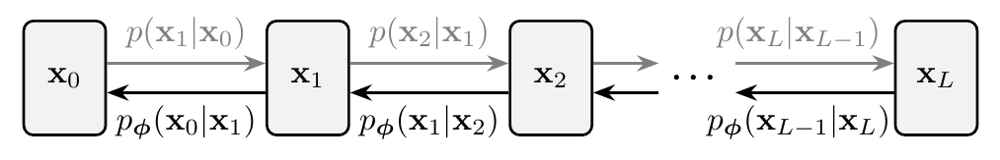
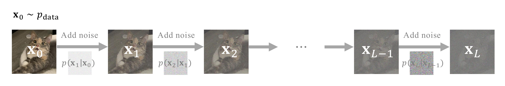
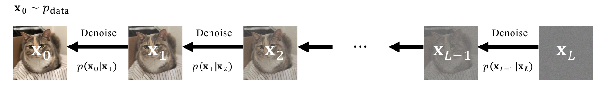
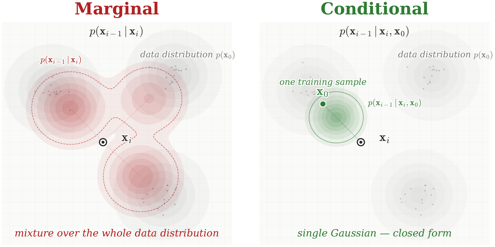
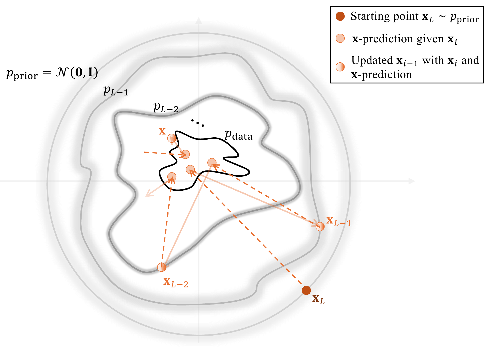

# 2.2 Variational Perspective: DDPM {#sec-ddpm}

Denoising Diffusion Probabilistic Models (DDPMs) ([Sohl-Dickstein et al., 2015](references.md#ref-sohl2015deep); [Ho et al., 2020](references.md#ref-ho2020denoising)) represent a cornerstone of diffusion modeling. Conceptually, they operate within a variational framework, much like VAEs and HVAEs. However, DDPMs introduce a clever twist that tackles some of the challenges faced by their predecessors.

At their core, DDPMs involve two distinct stochastic processes:

-   **The Forward Pass (Fixed Encoder):** This process gradually corrupts data by injecting Gaussian noise over multiple steps via a transition kernel $p(\mathbf{x}_{i}|\mathbf{x}_{i-1})$. The data evolves into an isotropic Gaussian distribution, effectively becoming pure noise. This means the encoder is fixed and not learned.

-   **The Reverse Denoising Process (Learnable Decoder):** Here, a neural network learns to reverse the noise corruption through a parameterized distribution $p_{\boldsymbol{\phi}}(\mathbf{x}_{i-1}|\mathbf{x}_{i})$. Starting from pure noise, this process iteratively denoises to generate realistic samples. Crucially, each individual denoising step is a more manageable task than generating a complete sample from scratch, as VAEs often attempt to do.

By fixing the encoder and concentrating learning on the gradual generative trajectory, DDPMs achieve remarkable stability and expressive power.

**Figure 2.3:** **Illustration of DDPM.** It consists of a fixed forward process (in gray) that gradually adds Gaussian noise to the data, and a learned reverse process that denoises step-by-step to generate new samples.

Source: Created by the authors.

In this section, we focus on DDPMs, postponing the broader discussion to [Section 4.5](../04-score-sde-framework/05-accumulated-perturbation-kernels.md#sec-variational-perspective), where we present a more general and flexible framework.

## 2.2.1 Forward Process (Fixed Encoder) {#forward-process}

In DDPMs, the forward process is a fixed, non-trainable operation that serves as an encoder. It progressively corrupts the original data by adding noise over multiple steps, eventually transforming it into a simple prior distribution $p_{\text{prior}} := \mathcal{N}(\mathbf{0}, \mathbf{I})$. This transformation is depicted as the forward chain in [Figure 2.3](02-ddpm.md#fig-vdm-grap) or as illustrated in [Figure 2.4](02-ddpm.md#fig-vdm-forward).

**Figure 2.4:** Illustration of the DDPM forward process, wherein Gaussian noise is incrementally added to corrupt a data sample into pure noise.

Source: Created by the authors.

Let us formalize this step-by-step degradation:

**Fixed Gaussian Transitions.** Each step in the forward process is governed by a fixed Gaussian transition kernel[^1]:

$$
p({\mathbf{x}}_i|{\mathbf{x}}_{i-1}) := \mathcal{N}({\mathbf{x}}_i; \sqrt{1 - \beta_i^2}   {\mathbf{x}}_{i-1}, \beta_i^2 {\mathbf{I}}).
$$

Here, the process begins with ${\mathbf{x}}_{0}$, representing a sample drawn from the real data distribution $p_{\text{data}}$. The sequence $\{\beta_i\}_{i=1}^L$ denotes a pre-determined, monotonically increasing noise schedule, where each $\beta_i \in (0, 1)$ controls the variance of the Gaussian noise injected at step $i$. For convenience, we define $\alpha_i := \sqrt{1 - \beta_i^2}$. This mathematical definition is precisely equivalent to the following intuitive iterative update:

$$
{\mathbf{x}}_i = \alpha_i {\mathbf{x}}_{i-1} + \beta_i \boldsymbol{\epsilon}_i,
$$

where $\boldsymbol{\epsilon}_i \sim \mathcal{N}(\boldsymbol{0}, {\mathbf{I}})$ are independently and identically distributed. This means at each step $i$, we scale down the previous state ${\mathbf{x}}_{i-1}$ by $\alpha_i$ and add a controlled amount of Gaussian noise scaled by $\beta_i$.

**Perturbation Kernel and Prior Distribution.** By recursively applying the transition kernels, we obtain a closed-form expression for the distribution of noisy samples at step $i$ given the original data ${\mathbf{x}}_0$:

$$
p_i({\mathbf{x}}_i|{\mathbf{x}}_0) = \mathcal{N}\left({\mathbf{x}}_i; \bar{\alpha}_i {\mathbf{x}}_0, (1 - \bar{\alpha}_i^2) {\mathbf{I}} \right),
$$

where

$$
\bar{\alpha}_i := \prod_{k=1}^i \sqrt{1-\beta_k^2} = \prod_{k=1}^i \alpha_k.
$$

This means we can sample ${\mathbf{x}}_i$ directly from ${\mathbf{x}}$ as

$$
\begin{aligned}
{\mathbf{x}}_i = \bar{\alpha}_i {\mathbf{x}}_0 + \sqrt{1-\bar{\alpha}_i^2}   \boldsymbol{\epsilon}, \quad \boldsymbol{\epsilon} \sim \mathcal{N}(\boldsymbol{0}, {\mathbf{I}}).
\end{aligned}
\tag{2.2.1}
$$

Let the noise schedule $\{\beta_i\}_{i=1}^L$ be an increasing sequence, then the marginal distribution of the forward process converges as

$$
p_L(\mathbf{x}_L | {\mathbf{x}}_0) \longrightarrow \mathcal{N}(\mathbf{0}, \mathbf{I}) \quad \text{as } L \to \infty,
$$

which motivates the choice of the prior distribution as

$$
p_{\text{prior}} := \mathcal{N}(\mathbf{0}, \mathbf{I})
$$

with no reliance on data ${\mathbf{x}}_0$.

## 2.2.2 Reverse Denoising Process (Learnable Decoder) {#reverse-denoising-process}

At its core, the essence of DDPMs lies in their ability to *reverse* the controlled degradation imposed by the forward diffusion process. Starting from pure, unstructured noise, $\mathbf{x}_L \sim p_{\text{prior}}$, the objective is to progressively *denoise* this randomness, step by step, until a coherent and meaningful data sample emerges. This reverse generation proceeds through a Markov chain, illustrated by [Figure 2.5](02-ddpm.md#fig-ddpm-sampling-formal-rev).

**Figure 2.5:** **Illustration of DDPM reverse (denoising) process.** Starting from noise $\mathbf{x}_L \sim p_{\mathrm{prior}}$, the model sequentially samples $\mathbf{x}_{i-1} \sim p(\mathbf{x}_{i-1}|\mathbf{x}_i)$ for $i=L,\ldots,1$ to obtain a newly generated data $\mathbf{x}_0$. The oracle transition $p(\mathbf{x}_{i-1}|\mathbf{x}_i)$ is unknown; thus, we aim to approximate it.

Source: Created by the authors.

The fundamental challenge, and the central question guiding DDPM development, then becomes:

**Question 2.2.1**

Can we precisely compute, or at least effectively approximate, these reverse transition kernels $p(\mathbf{x}_{i-1}|\mathbf{x}_i)$, especially when considering the complex distribution of $\mathbf{x}_i \sim p_i(\mathbf{x}_i)$?

Rather than diving immediately into the mathematically intricate derivation of the Evidence Lower Bound (ELBO), as the original DDPM paper does (for which a detailed discussion awaits in [Section 2.2.5](02-ddpm.md#subsec-ddpm-elbo)), we will instead approach the training objective from a more intuitive perspective: by leveraging conditional probabilities to achieve a tractable formulation.

**Overview: Modeling and Training Objective.** To enable the generative process, our goal is to approximate the unknown true reverse transition kernel, $p(\mathbf{x}_{i-1}|\mathbf{x}_i)$. We achieve this by introducing a learnable parametric model, $p_{\boldsymbol{\phi}}(\mathbf{x}_{i-1}|\mathbf{x}_i)$, and training it to minimize the expected KL divergence:

$$
\begin{aligned}
\mathbb{E}_{p_i(\mathbf{x}_i)} \left[
    \mathcal{D}_{\mathrm{KL}}\big(p(\mathbf{x}_{i-1}|\mathbf{x}_i) \| p_{\boldsymbol{\phi}}(\mathbf{x}_{i-1}|\mathbf{x}_i)\big)
    \right].
\end{aligned}
\tag{2.2.2}
$$

However, a direct computation of the target distribution $p(\mathbf{x}_{i-1}|\mathbf{x}_i)$ is challenging. By Bayes’ theorem, we would need to evaluate:

$$
p(\mathbf{x}_{i-1}|\mathbf{x}_i) = p(\mathbf{x}_i|\mathbf{x}_{i-1}) \underbrace{\frac{p_{i-1}(\mathbf{x}_{i-1})}{p_i(\mathbf{x}_i)}}_{\text{intractable}}.
$$

The marginals $p_i({\mathbf{x}}_i)$ and $p_{i-1}({\mathbf{x}}_{i-1})$ are expectations over the unknown data distribution $p_{\mathrm{data}}$, given by:

$$
p_i({\mathbf{x}}_i) = \int p_i({\mathbf{x}}_i | {\mathbf{x}}_0) p_{\mathrm{data}}({\mathbf{x}}_0) \mathrm{d}{\mathbf{x}}_0,
$$

and analogously for $p_{i-1}({\mathbf{x}}_{i-1})$. Since $p_{\mathrm{data}}$ is unknown, these integrals have no closed-form evaluation; at best they can be approximated from samples, so the exact densities are not available in practice.

**Figure 2.6:** **The conditioning trick in DDPM.** **(Left)** For a fixed noisy sample ${\mathbf{x}}_i$, the reverse distribution $p({\mathbf{x}}_{i-1}|{\mathbf{x}}_i)$ averages over all possible clean samples ${\mathbf{x}}_0$ that could have produced ${\mathbf{x}}_i$. It can therefore be a complicated mixture. **(Right)** During training, however, the clean sample ${\mathbf{x}}_0$ used to generate ${\mathbf{x}}_i$ is known. Conditioning on this sample gives $p({\mathbf{x}}_{i-1}|{\mathbf{x}}_i,{\mathbf{x}}_0)$, a Gaussian with closed-form mean and variance. DDPM can therefore use this tractable conditional distribution as a simple regression target. Although each training example conditions on only one clean sample, averaging the conditional training objective over all samples gives the same optimal model as directly learning the marginal reverse distribution; see [Theorem 2.2.1](02-ddpm.md#thm-equiv-marginal-kl). Thus, DDPM can learn the same optimal reverse prediction without directly regressing onto the complicated, generally intractable target induced by the marginal mixture.

Source: Created by the authors with AI-assisted coding.

**Overcoming Intractability with Conditioning.** A central insight in DDPMs resolves this intractability: we condition the reverse transition on a clean data sample $\mathbf{x}_0$. This subtle yet powerful step transforms the intractable kernel into one that is mathematically tractable:

$$
p(\mathbf{x}_{i-1}|\mathbf{x}_i, \mathbf{x}_0) = p(\mathbf{x}_i|\mathbf{x}_{i-1}) \frac{p(\mathbf{x}_{i-1}|\mathbf{x}_0)}{p_i(\mathbf{x}_i|\mathbf{x}_0)}.
$$

This tractability arises from two key properties of the forward process: its Markov property, meaning $p(\mathbf{x}_i|\mathbf{x}_{i-1}, \mathbf{x}_0) = p(\mathbf{x}_i|\mathbf{x}_{i-1})$, and the Gaussian nature of all involved distributions. As a result, $p(\mathbf{x}_{i-1}|\mathbf{x}_i, \mathbf{x}_0)$ itself is Gaussian and admits a closed-form expression (which we will see in [Equation (2.2.4)](02-ddpm.md#eq-ddpm-reverse-mean)). We visualize it in [Figure 2.6](02-ddpm.md#fig-conditional-trick). Crucially, this elegant conditioning strategy allows us to derive a tractable objective that is functionally equivalent to the seemingly intractable marginal KL divergence in [Equation (2.2.2)](02-ddpm.md#eq-marginal-kl-matching).

**Theorem 2.2.1: Equivalence Between Marginal and Conditional KL Minimization**

The following equality holds:

$$
\begin{aligned}
    &\mathbb{E}_{p_i({\mathbf{x}}_i)}\left[
        \mathcal{D}_{\mathrm{KL}}\big(p({\mathbf{x}}_{i-1}|{\mathbf{x}}_i) \| p_{\boldsymbol{\phi}}({\mathbf{x}}_{i-1}|{\mathbf{x}}_i)\big)
    \right] \\
    ={}&
    \mathbb{E}_{p_{\mathrm{data}}({\mathbf{x}}_0)}
    \mathbb{E}_{p_i({\mathbf{x}}_i|{\mathbf{x}}_0)} \left[
        \mathcal{D}_{\mathrm{KL}}\big(p({\mathbf{x}}_{i-1}|{\mathbf{x}}_i, {\mathbf{x}}_0) \| p_{\boldsymbol{\phi}}({\mathbf{x}}_{i-1}|{\mathbf{x}}_i)\big)
    \right] + C.
\end{aligned}
\tag{2.2.3}
$$

where $C$ is a constant independent of $\boldsymbol{\phi}$. Moreover, the minimizer of [Equation (2.2.3)](02-ddpm.md#eq-kl-matching) satisfies

$$
p^*(\mathbf{x}_{i-1}|\mathbf{x}_i) = \mathbb{E}_{p(\mathbf{x}_0|\mathbf{x}_i)} \big[p(\mathbf{x}_{i-1}|\mathbf{x}_i, \mathbf{x}_0)\big] = p(\mathbf{x}_{i-1}|\mathbf{x}_i), \quad \mathbf{x}_i \sim p_i.
$$

**Proof for Theorem.**

The proof rewrites a KL-divergence expectation by expanding definitions, applying the chain rule of probability, and using a logarithmic identity to decompose it into the sum of an expected conditional KL divergence and a marginal KL divergence. A complete derivation is in [Section D.1.1](../../appendices/d-supplementary-proofs/index.md#subsec-proof-equiv-marginal-kl).

This alternative viewpoint: conditioning to obtain a tractable objective, forms the foundation of DDPMs and reveals a profound commonality with other influential diffusion models, as we will explore in [Chapter 3](../03-score-based-perspective/index.md#ch-score-based) and [Chapter 5](../05-flow-based-perspective/index.md#ch-flow-based).

It reveals a powerful equivalence: minimizing the KL divergence between marginal distributions is mathematically identical to minimizing the KL divergence between specific conditional distributions. This latter formulation is exceptionally useful because the crucial conditional distribution, $p(\mathbf{x}_{i-1}|\mathbf{x}_i, \mathbf{x})$, possesses a convenient closed-form expression:

**Lemma 2.2.2: Reverse Conditional Transition Kernel**

$p(\mathbf{x}_{i-1} | \mathbf{x}_i, \mathbf{x})$ is Gaussian with the closed-form expression:

$$
\begin{aligned}
p({\mathbf{x}}_{i-1} | {\mathbf{x}}_i, {\mathbf{x}}) =\mathcal{N}\left({\mathbf{x}}_{i-1}; \boldsymbol{\mu}\left({\mathbf{x}}_i, {\mathbf{x}}, i\right), \sigma^2(i){\mathbf{I}} \right),
\end{aligned}
$$

where

$$
\begin{aligned}
            \boldsymbol{\mu}\left({\mathbf{x}}_i, {\mathbf{x}}, i\right):= \frac{\bar{\alpha}_{i-1}\beta_i^2}{1-\bar{\alpha}_i^2}{\mathbf{x}} + \frac{(1-\bar{\alpha}_{i-1}^2)\alpha_i }{1-\bar{\alpha}_i^2}{\mathbf{x}}_i,
\quad  \sigma^2(i) := \frac{1-\bar{\alpha}_{i-1}^2}{1-\bar{\alpha}_i^2}\beta_i^2.
\end{aligned}
\tag{2.2.4}
$$

Later in [Lemma 4.5.2](../04-score-sde-framework/05-accumulated-perturbation-kernels.md#reverse-kernel), we present a more general formula that extends beyond the DDPM noising process described in [Equation (2.2.1)](02-ddpm.md#eq-ddpm-forward).

## 2.2.3 Modeling of Reverse Transition Kernel $p_{\boldsymbol{\phi}}(\mathbf{x}_{i-1}|\mathbf{x}_i)$ {#modeling-reverse-transition}

Leveraging the gradient-level equivalence as in [Theorem 2.2.1](02-ddpm.md#thm-equiv-marginal-kl) and the Gaussian form of the reverse conditional $p(\mathbf{x}_{i-1}|\mathbf{x}_i, \mathbf{x})$ as in [Lemma 2.2.2](02-ddpm.md#ddpm-reverse-kernel), DDPM assumes that each reverse transition $p_{\boldsymbol{\phi}}({\mathbf{x}}_{i-1}| {\mathbf{x}}_i)$ is Gaussian, parameterized as

$$
\begin{aligned}
p_{\boldsymbol{\phi}}(\mathbf{x}_{i-1}|\mathbf{x}_i) := \mathcal{N}\big(\mathbf{x}_{i-1}; \boldsymbol{\mu}_{\boldsymbol{\phi}}(\mathbf{x}_i, i), \sigma^2(i) \mathbf{I}\big),
\end{aligned}
\tag{2.2.5}
$$

where $\boldsymbol{\mu}_{\boldsymbol{\phi}}(\cdot, i) \colon \mathbb{R}^D \to \mathbb{R}^D$ is a learnable mean function, and $\sigma^2(i) > 0$ is fixed as defined in [Equation (2.2.4)](02-ddpm.md#eq-ddpm-reverse-mean).

We denote the KL divergence, averaged over time steps $i$ and conditioned on data ${\mathbf{x}}_0 \sim p_{\text{data}}$, to match all layers of distributions as:

$$
\begin{aligned}
\mathcal{L}_{\text{diffusion}}({\mathbf{x}}_0;\boldsymbol{\phi}) := \sum_{i=2}^L \mathbb{E}_{p_i({\mathbf{x}}_i|{\mathbf{x}}_0)}\left[\mathcal{D}_{\text{KL}}\big(p({\mathbf{x}}_{i-1}|{\mathbf{x}}_i, {\mathbf{x}}_0)  \Vert  p_{\boldsymbol{\phi}}({\mathbf{x}}_{i-1}|{\mathbf{x}}_i)\big)\right].
\end{aligned}
\tag{2.2.6}
$$

Thanks to the Gaussian forms of both distributions and the parameterization defined in [Equation (2.2.5)](02-ddpm.md#eq-def-reverse), the objective admits a closed-form expression and can be simplified as:

$$
\begin{aligned}
\mathcal{L}_{\text{diffusion}}({\mathbf{x}}_0;\boldsymbol{\phi}) = \sum_{i=2}^L \frac{1}{2\sigma^2(i)}  \mathbb{E}_{p_i({\mathbf{x}}_i|{\mathbf{x}}_0)}\left\| \boldsymbol{\mu}_{\boldsymbol{\phi}}({\mathbf{x}}_i, i) - \boldsymbol{\mu}({\mathbf{x}}_i, {\mathbf{x}}_0, i) \right\|_2^2 + C,
\end{aligned}
\tag{2.2.7}
$$

where $C$ is a constant independent of $\boldsymbol{\phi}$. Averaging over the data distribution and omitting the constant $C$ (which does not affect the optimization), the final DDPM training objective is

$$
\begin{aligned}
    \mathcal{L}_{\text{DDPM}}(\boldsymbol{\phi}) := \sum_{i=2}^L \frac{1}{2\sigma^2(i)}  \mathbb{E}_{{\mathbf{x}}_0} \mathbb{E}_{p_i({\mathbf{x}}_i|{\mathbf{x}}_0)} \left[ \left\| \boldsymbol{\mu}_{\boldsymbol{\phi}}(\mathbf{x}_i, i) - \boldsymbol{\mu}(\mathbf{x}_i, {\mathbf{x}}_0, i) \right\|_2^2 \right],
\end{aligned}
\tag{2.2.8}
$$

where ${\mathbf{x}}_0\sim p_{\mathrm{data}}$.

We remark that the forward perturbation kernel $p_i({\mathbf{x}}_i | {\mathbf{x}}_0)$ plays an important computational role in the training objective. It gives the distribution of the noisy state ${\mathbf{x}}_i$ obtained from a clean sample ${\mathbf{x}}_0$ after $i$ forward steps. Because each forward transition is linear and Gaussian, their composition also has a closed-form Gaussian distribution; see the discussion around [Equation (2.2.1)](02-ddpm.md#eq-ddpm-forward). Consequently, after selecting a time step $i$, we can sample ${\mathbf{x}}_i \sim p_i({\mathbf{x}}_i | {\mathbf{x}}_0)$ directly from ${\mathbf{x}}_0$, without first generating the intermediate states ${\mathbf{x}}_1,\ldots,{\mathbf{x}}_{i-1}$. Thus, each loss term can be estimated using only a clean sample, a selected time step, and a directly corrupted sample, making stochastic training computationally efficient.

## 2.2.4 Practical Choices of Predictions and Loss {#subsec-ddpm-prediction}

**${\boldsymbol{\epsilon}}$-Prediction.** In typical DDPM implementations, training is not conducted directly using the original loss based on the *mean prediction* parameterization from [Equation (2.2.8)](02-ddpm.md#eq-ddpm-mean-loss). Instead, an equivalent reparameterization, known as the *${\boldsymbol{\epsilon}}$-prediction* (noise prediction) formulation, is commonly adopted.

Recall that in the DDPM forward process, a noisy sample ${\mathbf{x}}_i \sim p({\mathbf{x}}_i |{\mathbf{x}}_0)$ at noise level $i$ is generated by

$$
{\mathbf{x}}_i = \bar{\alpha}_i {\mathbf{x}}_0 + \sqrt{1 - \bar{\alpha}_i^2}   \boldsymbol{\epsilon}, \quad {\mathbf{x}}_0 \sim p_{\text{data}}, \quad \boldsymbol{\epsilon} \sim \mathcal{N}(\mathbf{0}, \mathbf{I}).
\tag{2.2.9}
$$

Using this expression, the reverse mean $\boldsymbol{\mu}({\mathbf{x}}_i, {\mathbf{x}}_0, i)$ from [Equation (2.2.4)](02-ddpm.md#eq-ddpm-reverse-mean) can be rewritten as:

$$
\boldsymbol{\mu}({\mathbf{x}}_i, {\mathbf{x}}_0, i) = \frac{1}{\alpha_i} \left( {\mathbf{x}}_i - \frac{1 - \alpha_i^2}{\sqrt{1 - \bar{\alpha}_i^2}} \boldsymbol{\epsilon} \right).
$$

This motivates a parameterization of the model mean $\boldsymbol{\mu}_{\boldsymbol{\phi}}$ using a neural network $\boldsymbol{\epsilon}_{\boldsymbol{\phi}}({\mathbf{x}}_i, i)$ that directly predicts the noise:

$$
\boldsymbol{\mu}_{\boldsymbol{\phi}}({\mathbf{x}}_i, i) = \frac{1}{\alpha_i} \left( {\mathbf{x}}_i - \frac{1 - \alpha_i^2}{\sqrt{1 - \bar{\alpha}_i^2}} \underbrace{\boldsymbol{\epsilon}_{\boldsymbol{\phi}}({\mathbf{x}}_i, i)}_{{\boldsymbol{\epsilon}}\text{-prediction}} \right).
$$

Substituting this into the original loss leads to a squared $\ell_2$ error between predicted and true noise:

$$
\left\| \boldsymbol{\mu}_{\boldsymbol{\phi}}({\mathbf{x}}_i, i) - \boldsymbol{\mu}({\mathbf{x}}_i, {\mathbf{x}}_0, i) \right\|_2^2 \propto \left\| \boldsymbol{\epsilon}_{\boldsymbol{\phi}}({\mathbf{x}}_i, i) - \boldsymbol{\epsilon} \right\|_2^2,
$$

up to a weighting factor depending on $i$. Intuitively, the model acts as a “noise detective”, estimating the random noise added at each step of the forward process. Subtracting this estimate from the corrupted sample moves it closer to the clean original, and repeating this step-by-step reconstructs the data from pure noise.

**Simplified Loss with ${\boldsymbol{\epsilon}}$-Prediction.** In practice, this expression is further simplified by omitting the weighting term, yielding the widely used DDPM training loss:

$$
\mathcal{L}_{\text{simple}}(\boldsymbol{\phi}) := \mathbb{E}_{i} \mathbb{E}_{{\mathbf{x}} \sim p_{\text{data}}({\mathbf{x}})} \mathbb{E}_{\boldsymbol{\epsilon} \sim \mathcal{N}(\mathbf{0}, \mathbf{I})} \left[ \left\| \boldsymbol{\epsilon}_{\boldsymbol{\phi}}({\mathbf{x}}_i, i) - \boldsymbol{\epsilon} \right\|_2^2 \right],
\tag{2.2.10}
$$

where ${\mathbf{x}}_i = \bar{\alpha}_i {\mathbf{x}}_0 + \sqrt{1 - \bar{\alpha}_i^2} \boldsymbol{\epsilon}$ with ${\mathbf{x}}_0 \sim p_{\text{data}}$. Since the target noise has unit variance at every timestep $t$, the $\ell_2$ loss in [Equation (2.2.10)](02-ddpm.md#eq-ddpm-simple-loss) maintains a consistent scale across all $t$. This prevents vanishing or exploding targets and eliminates the need for explicit loss weighting.

Importantly, both $\mathcal{L}_{\text{DDPM}}$ and $\mathcal{L}_{\text{simple}}$ share the same optimal solution $\boldsymbol{\epsilon}^*$, this is because [Equation (2.2.10)](02-ddpm.md#eq-ddpm-simple-loss) essentially reduces to a least-squares problem (as shown similarly in [Proposition 4.3.1](../04-score-sde-framework/03-training-and-sampling.md#dsm-minimizer) or [Proposition 6.3.1](../06-unified-perspective/03-equivalent-parameterizations.md#equi-para))[^2]:

$$
\boldsymbol{\epsilon}^*({\mathbf{x}}_i, i) = \mathbb{E}\left[ \boldsymbol{\epsilon}|{\mathbf{x}}_i \right], \quad {\mathbf{x}}_i \sim p_i.
$$

Intuitively, the ${\boldsymbol{\epsilon}}$-prediction network $\boldsymbol{\epsilon}_{\boldsymbol{\phi}}({\mathbf{x}}_i, i)$ estimates the noise added by the forward process to produce ${\mathbf{x}}_i$. At optimality, this estimate coincides with the conditional expectation of the true noise, even though ${\mathbf{x}}_i$ does not uniquely determine the original clean sample.

**Another Equivalent Parametrization: ${\mathbf{x}}$-Prediction.** [Equation (2.2.4)](02-ddpm.md#eq-ddpm-reverse-mean) motivates an alternative yet equivalent parameterization, known as *${\mathbf{x}}$-prediction* (clean prediction), in which a neural network ${\mathbf{x}}_{\boldsymbol{\phi}}({\mathbf{x}}_i, i)$ is trained to predict a clean (denoised) sample from a given noisy input ${\mathbf{x}}_i \sim p_i({\mathbf{x}}_i)$ at noise level $i$. Replacing the ground-truth clean sample ${\mathbf{x}}_0$ in the reverse mean expression with ${\mathbf{x}}_{\boldsymbol{\phi}}({\mathbf{x}}_i, i)$ leads to the following model:

$$
\begin{aligned}
\boldsymbol{\mu}_{\boldsymbol{\phi}}({\mathbf{x}}_i, i) = \frac{\bar{\alpha}_{i-1} \beta_i^2}{1 - \bar{\alpha}_i^2} {\mathbf{x}}_{\boldsymbol{\phi}}({\mathbf{x}}_i, i) + \frac{(1 - \bar{\alpha}_{i-1}^2)\alpha_i}{1 - \bar{\alpha}_i^2} {\mathbf{x}}_i.
\end{aligned}
$$

Analogous to the ${\boldsymbol{\epsilon}}$-prediction formulation, the training objective can be expressed as

$$
\left\| \boldsymbol{\mu}_{\boldsymbol{\phi}}({\mathbf{x}}_i, i) - \boldsymbol{\mu}({\mathbf{x}}_i, {\mathbf{x}}_0, i) \right\|_2^2 \propto \left\| {\mathbf{x}}_{\boldsymbol{\phi}}({\mathbf{x}}_i, i) - {\mathbf{x}}_0 \right\|_2^2, \quad {\mathbf{x}}_0 \sim p_{\text{data}},
$$

where the model is trained to predict the original data sample ${\mathbf{x}}_0$ from its noisy version ${\mathbf{x}}_i$. This equivalence reduces the mean-matching loss in [Equation (2.2.8)](02-ddpm.md#eq-ddpm-mean-loss) to

$$
\mathbb{E}_{i} \mathbb{E}_{{\mathbf{x}}_0 \sim p_{\text{data}}} \mathbb{E}_{\boldsymbol{\epsilon} \sim \mathcal{N}(\mathbf{0}, \mathbf{I})} \left[\omega_i \left\| {\mathbf{x}}_{\boldsymbol{\phi}}({\mathbf{x}}_i, i) - {\mathbf{x}}_0 \right\|_2^2 \right],
$$

for some weighting function $\omega_i$. Since this is a least-squares problem, the optimal solution is given by (see [Proposition 4.3.1](../04-score-sde-framework/03-training-and-sampling.md#dsm-minimizer) or [Proposition 6.3.1](../06-unified-perspective/03-equivalent-parameterizations.md#equi-para))

$$
\begin{aligned}
{\mathbf{x}}^*({\mathbf{x}}_i, i) = \mathbb{E}\left[ {\mathbf{x}}_0|{\mathbf{x}}_i \right], \quad {\mathbf{x}}_i \sim p_i,
\end{aligned}
\tag{2.2.11}
$$

that is, the model should predict the expected clean data given a noisy observation ${\mathbf{x}}_i$ at timestep $i$.

The ${\mathbf{x}}$-prediction and ${\boldsymbol{\epsilon}}$-prediction parameterizations are mathematically equivalent and connected via the forward process:

$$
{\mathbf{x}}_i = \bar{\alpha}_i {\mathbf{x}}_{\boldsymbol{\phi}}({\mathbf{x}}_i, i) + \sqrt{1 - \bar{\alpha}_i^2}   \boldsymbol{\epsilon}_{\boldsymbol{\phi}}({\mathbf{x}}_i, i).
\tag{2.2.12}
$$

That is, one may either predict the clean sample ${\mathbf{x}}_{\boldsymbol{\phi}}({\mathbf{x}}_i, i)$ or the noise $\boldsymbol{\epsilon}_{\boldsymbol{\phi}}({\mathbf{x}}_i, i)$, such that their combination reproduces ${\mathbf{x}}_i$ under the forward noising process.

## 2.2.5 DDPM's ELBO {#subsec-ddpm-elbo}

With the reverse transitions defined as in [Equation (2.2.5)](02-ddpm.md#eq-def-reverse), this leads to the definition of the joint generative distribution in DDPM as:

$$
p_{\boldsymbol{\phi}}({\mathbf{x}}_0, {\mathbf{x}}_{1:L}) := p_{\boldsymbol{\phi}}({\mathbf{x}}_0|{\mathbf{x}}_1)  p_{\boldsymbol{\phi}}({\mathbf{x}}_1|{\mathbf{x}}_2)\cdots p_{\boldsymbol{\phi}}({\mathbf{x}}_{L-1}|{\mathbf{x}}_L)   p_{\text{prior}}({\mathbf{x}}_L),
$$

and the marginal generative model for data is given by:

$$
\begin{aligned}
p_{\boldsymbol{\phi}}({\mathbf{x}}_0) := \int p_{\boldsymbol{\phi}}({\mathbf{x}}_0, {\mathbf{x}}_{1:L}) \mathop{}\!\mathrm{d} {\mathbf{x}}_{1:L}.
\end{aligned}
$$

Indeed, DDPM training via [Equation (2.2.6)](02-ddpm.md#eq-ddpm-diffusion) can be rigorously grounded in maximum likelihood estimation ([Equation (1.1.2)](../01-deep-generative-modeling/01-what-is-deep-generative-modeling.md#eq-mle)). Specifically, its objective forms an ELBO, similar to those in VAEs and HVAEs from [Section 2.1](01-variational-autoencoder.md#sec-vae), which serves as a lower bound on the log-density:

**Theorem 2.2.3: DDPM's ELBO**

$$
\begin{aligned}
        -\log p_{\boldsymbol{\phi}}({\mathbf{x}}_0)  &\leq-\mathcal{L}_{\text{ELBO}}({\mathbf{x}}_0; \boldsymbol{\phi})
        \\&:= \mathcal{L}_{\text{prior}}({\mathbf{x}}_0) + \mathcal{L}_{\text{recon.}}({\mathbf{x}}_0;\boldsymbol{\phi})  + \mathcal{L}_{\text{diffusion}}({\mathbf{x}}_0;\boldsymbol{\phi})
        \end{aligned}
\tag{2.2.13}
$$

Here, each component of losses are defined as:

$$
\begin{aligned}
\mathcal{L}_{\text{prior}}({\mathbf{x}}_0) &:= \mathcal{D}_{\text{KL}}\Big( p({\mathbf{x}}_L|{\mathbf{x}}_0) \Vert p_{\text{prior}}({\mathbf{x}}_L)\Big)\\
   \mathcal{L}_{\text{recon.}}({\mathbf{x}}_0;\boldsymbol{\phi}) &:= \mathbb{E}_{p({\mathbf{x}}_1|{\mathbf{x}}_0)}\left[-\log p_{\boldsymbol{\phi}}({\mathbf{x}}_0|{\mathbf{x}}_1)\right]\\
   \mathcal{L}_{\text{diffusion}}({\mathbf{x}}_0;\boldsymbol{\phi}) &= \sum_{i=2}^L  \mathbb{E}_{p_i({\mathbf{x}}_i|{\mathbf{x}}_0)}\left[\mathcal{D}_{\text{KL}}\Big(p({\mathbf{x}}_{i-1}|{\mathbf{x}}_i, {\mathbf{x}}_0) \Vert p_{\boldsymbol{\phi}}({\mathbf{x}}_{i-1}|{\mathbf{x}}_i) \Big)\right].
\end{aligned}
$$

**Proof for Theorem.**

The derivation applies Jensen’s inequality, as in the HVAE/VAE ELBO ([Equation (2.1.3)](01-variational-autoencoder.md#eq-hvae-elbo)), with further simplifications. The detailed proof is deferred to [Section D.1.2](../../appendices/d-supplementary-proofs/index.md#app-vlb-proof).

The ELBO $\mathcal{L}_{\text{ELBO}}$ consists of three terms:

-   $\mathcal{L}_{\text{prior}}$ can be made negligible by choosing the noise schedule $\{\beta_i\}$ such that $p(\cdot|{\mathbf{x}}_0) \approx p_{\text{prior}}(\cdot)$.

-   For $\mathcal{L}_{\text{recon.}}$, this can be approximated and optimized using a Monte Carlo estimate; see ([Ho et al., 2020](references.md#ref-ho2020denoising); [Kingma et al., 2021](references.md#ref-kingma2021variational)) for practical implementations.

-   $\mathcal{L}_{\text{diffusion}}$ (cf. [Equation (2.2.6)](02-ddpm.md#eq-ddpm-diffusion)) matches the reverse conditionals $p_{\boldsymbol{\phi}}(\mathbf{x}_{i-1}|\mathbf{x}_i)$ to $p(\mathbf{x}_{i-1}|\mathbf{x}_i)$ at all steps $i$.

The ELBO objective $\mathcal{L}_{\text{ELBO}}$ can also be interpreted through the lens of the Data Processing Inequality with latents ${\mathbf{z}} = {\mathbf{x}}_{1:L}$, as illustrated in [Equation (2.1.2)](01-variational-autoencoder.md#eq-joint-bound):

$$
\begin{aligned}
\mathcal{D}_{\mathrm{KL}}(p_{\mathrm{data}}({\mathbf{x}}_0) \| p_{\boldsymbol{\phi}}({\mathbf{x}}_0)) \leq \mathcal{D}_{\mathrm{KL}}\left(p({\mathbf{x}}_0, {\mathbf{x}}_{1:L}) \| p_{\boldsymbol{\phi}}({\mathbf{x}}_0, {\mathbf{x}}_{1:L})\right),
\end{aligned}
$$

where $p({\mathbf{x}}_0, {\mathbf{x}}_{1:L}) := p_{\mathrm{data}}({\mathbf{x}}_0) p({\mathbf{x}}_1|{\mathbf{x}}_0) p({\mathbf{x}}_2|{\mathbf{x}}_1) \cdots p({\mathbf{x}}_L|{\mathbf{x}}_{L-1})$ denotes the joint distribution along the forward process.

**Remark.**

Diffusion’s variational view fits the hierarchical latent-variable picture in a particularly convenient way: the “encoder” is the fixed forward noising chain, so there is no learned inference network. The ELBO nevertheless does decompose into per-step KL terms, together with the terminal-prior and reconstruction terms in [Equation (2.2.13)](02-ddpm.md#eq-ddpm-elbo). What makes DDPM training especially tractable is that, under the linear–Gaussian forward process, these per-step KL terms can be rewritten as simple denoising regression problems with closed-form conditional targets. Thus the key simplification is not the absence of per-level KL terms, but the fact that the forward process is fixed and turns them into supervised denoising objectives that can be sampled efficiently.

## 2.2.6 Sampling {#sampling}

After training the ${\boldsymbol{\epsilon}}$-prediction model, $\boldsymbol{\epsilon}_{\boldsymbol{\phi}^\times}({\mathbf{x}}_i, i)$[^3], sampling is performed sequentially as illustrated in [Figure 2.5](02-ddpm.md#fig-ddpm-sampling-formal-rev), using the parametrized transition $p_{\boldsymbol{\phi}^\times}({\mathbf{x}}_{i-1} | {\mathbf{x}}_i)$ instead.

More specifically, starting from a random seed ${\mathbf{x}}_L \sim p_{\text{prior}} = \mathcal{N}(\boldsymbol{0},{\mathbf{I}})$, we recursively sample from $p_{\boldsymbol{\phi}^\times}({\mathbf{x}}_{i-1} | {\mathbf{x}}_i)$ following the update rule below for $i = L, L-1, \dots, 1$:

$$
\begin{aligned}
{\mathbf{x}}_{i-1} \leftarrow \underbrace{\frac{1}{\alpha_i}\left( {\mathbf{x}}_i  - \frac{1-\alpha_i^2}{\sqrt{1-\bar{\alpha}_i^2}} \boldsymbol{\epsilon}_{\boldsymbol{\phi}^\times}({\mathbf{x}}_i, i)\right)}_{\boldsymbol{\mu}_{\boldsymbol{\phi}^\times}({\mathbf{x}}_i, i)} +\sigma(i) \boldsymbol{\epsilon}_i,\quad \boldsymbol{\epsilon}_i\sim  \mathcal{N}(\boldsymbol{0},{\mathbf{I}}).
\end{aligned}
\tag{2.2.14}
$$

This “denoising” process continues until ${\mathbf{x}}_0$ is obtained as the final clean generated sample.

**Another Interpretation of DDPM Sampling.**

A useful way to interpret DDPM sampling is to rewrite the update rule so that the noise-level structure becomes explicit. Recall from [Equation (2.2.12)](02-ddpm.md#eq-ddpm-clean-noise) that the predicted noise can be expressed in terms of the current sample ${\mathbf{x}}_i$ and the predicted clean sample ${\mathbf{x}}_{\boldsymbol{\phi}^\times}({\mathbf{x}}_i,i)$:

$$
\boldsymbol{\epsilon}_{\boldsymbol{\phi}^\times}({\mathbf{x}}_i,i)
=
\frac{{\mathbf{x}}_i - \bar{\alpha}_i\,{\mathbf{x}}_{\boldsymbol{\phi}^\times}({\mathbf{x}}_i,i)}
     {\sqrt{1-\bar{\alpha}_i^2}}.
$$

Substituting this into the DDPM sampling rule ([Equation (2.2.14)](02-ddpm.md#eq-ddpm-sampling)) and rearranging, we obtain

$$
{\mathbf{x}}_{i-1}
\;\leftarrow\;
\bar{\alpha}_{i-1}\,{\mathbf{x}}_{\boldsymbol{\phi}^\times}({\mathbf{x}}_i,i)
\;+\;
\underbrace{
  \sqrt{1-\bar{\alpha}_{i-1}^2 - \tilde{\beta}_i^2}\;
  \boldsymbol{\epsilon}_{\boldsymbol{\phi}^\times}({\mathbf{x}}_i,i)
  \;+\;
  \tilde{\beta}_i\,\boldsymbol{\epsilon}_i
}_{\text{combined std. }=\;\sqrt{1-\bar{\alpha}_{i-1}^2}},
\tag{2.2.15}
$$

where $\tilde{\beta}_i^2 = \frac{(1-\bar{\alpha}_{i-1}^2)(1-\alpha_i^2)}{1-\bar{\alpha}_i^2}$ is the DDPM posterior variance[^4]. Moreover, the residual coefficients satisfy

$$
\bigl(1-\bar{\alpha}_{i-1}^2-\tilde{\beta}_i^2\bigr)+\tilde{\beta}_i^2
=
1-\bar{\alpha}_{i-1}^2,
$$

so the update has the same noise-level structure as the forward marginal at level $i-1$. This returns to the first operational sampling template introduced in [Equation (1.4.1)](../../foundations/operational-view.md#eq-ddpm-first-try): predict the clean part and rewrite the sample at a lower noise level. DDPM carries out this rewrite stochastically, combining the noise direction estimated from ${\mathbf{x}}_i$ with a fresh Gaussian noise sample. A deterministic sampler follows the same basic idea, but removes the fresh randomness and adjusts the remaining noise coefficient accordingly. We will revisit this construction when studying diffusion samplers more systematically in [Section 9.2](../09-numerical-solvers/02-ddim.md#sec-revisit-ddim).

Compare [Equation (2.2.15)](02-ddpm.md#eq-ddpm-renoise) with the forward marginal ${\mathbf{x}}_{i-1} = \bar{\alpha}_{i-1}\,{\mathbf{x}}_0 + \sqrt{1-\bar{\alpha}_{i-1}^2}\,\bar{\boldsymbol{\epsilon}}$. The structure is identical: signal coefficient $\bar{\alpha}_{i-1}$ and noise standard deviation $\sqrt{1-\bar{\alpha}_{i-1}^2}$, except that the unknown ${\mathbf{x}}_0$ is replaced by the network prediction ${\mathbf{x}}_{\boldsymbol{\phi}^\times}({\mathbf{x}}_i,i)$. In other words, each DDPM step *predicts the clean data and then re-noises it to exactly noise level $i{-}1$*. One can therefore view DDPM sampling as iterating two operations:

1.  **Denoise.** Estimate the clean data ${\mathbf{x}}_{\boldsymbol{\phi}^\times}({\mathbf{x}}_i, i)$ from the current noisy input ${\mathbf{x}}_i$.

2.  **Re-noise.** Add back noise at the reduced level $i{-}1$ via [Equation (2.2.15)](02-ddpm.md#eq-ddpm-renoise), producing a sample ${\mathbf{x}}_{i-1}$ whose noise level matches the forward process at step $i{-}1$.

However, even if ${\mathbf{x}}_{\boldsymbol{\phi}^\times}$ is trained as the optimal denoiser (i.e., the conditional expectation minimizer; see [Equation (2.2.11)](02-ddpm.md#eq-ddpm-clean-minimizer)), it can only predict the *average* clean sample given ${\mathbf{x}}_i$. This limitation leads to blurry predictions, particularly at high noise levels, where recovering detailed structure from severely corrupted inputs becomes difficult. From this viewpoint, diffusion sampling moves from high to low noise and progressively refines an estimate of the clean signal. Early steps set the global structure, later steps add fine detail, and the sample becomes more realistic as the noise is removed.

**Figure 2.7:** **Illustration of the denoise-then-re-noise view of DDPM sampling.** From the current noisy sample $\mathbf{x}_i$, the model first estimates the underlying clean signal $\mathbf{x}_{\boldsymbol{\phi}^\times}(\mathbf{x}_i,i)$, and then samples a less noisy point $\mathbf{x}_{i-1}$ by re-noising this estimate to the $(i-1)$-th noise level.

Source: Created by the authors.

**Slow Sampling Speed of DDPM.** Sampling in DDPMs (i.e., diffusion models) is inherently slow. In the original formulation and implementation, generating a sample typically requires around $1{,}000$ denoising steps. This is because sampling proceeds through a long sequence of small refinements: at each step, the model updates the current noisy sample slightly toward a cleaner one, and the next update must start from the result of the previous step. As a result, standard DDPM sampling is time-stepping and strongly sequential, and good sample quality usually requires many such steps to closely track the reverse diffusion path.

[Theorem 2.2.1](02-ddpm.md#thm-equiv-marginal-kl) shows that an expressive $p_{\boldsymbol{\phi}}(\mathbf{x}_{i-1} | \mathbf{x}_i)$ can theoretically match the true reverse distribution $p(\mathbf{x}_{i-1} | \mathbf{x}_i)$. However, in practice, $p_{\boldsymbol{\phi}}(\mathbf{x}_{i-1} | \mathbf{x}_i)$ is typically modeled as a Gaussian to approximate $p(\mathbf{x}_{i-1} | \mathbf{x}_i)$, limiting its expressiveness.

For small forward noise scales $\beta_i$, the true reverse distribution is approximately Gaussian, enabling accurate approximation. Conversely, large $\beta_i$ induce multimodality or strong non-Gaussianity that a single Gaussian cannot capture. To maintain accuracy, DDPM employs many small $\beta_i$ steps, forming a sequential chain where each step depends on the previous and requires a neural network evaluation $\boldsymbol{\epsilon}_{\boldsymbol{\phi}^\times}(\mathbf{x}_i, i)$. This results in $\mathcal{O}(L)$ sequential passes, preventing parallelization and slowing generation.

Later in [Chapter 4](../04-score-sde-framework/index.md#ch-score-sde) we show a more principled interpretation of this inherent sampling bottleneck as a differential-equation problem, which motivates continuous-time numerical strategies for accelerating generation.

[^1]: This formulation, while potentially appearing different, is mathematically equivalent to the original DDPM transition kernel.

[^2]: We remark that removing the ELBO-derived weights in $\mathcal{L}_{\text{DDPM}}$ changes the training objective, but not its population-optimal prediction: ${\boldsymbol{\epsilon}}^*({\mathbf{x}}_i,i) = {\mathbb{E}}[{\boldsymbol{\epsilon}}| {\mathbf{x}}_i]$. Thus, the weighted and simplified DDPM losses have the same ideal predictor, but they emphasize different noise levels during training. In practice, this weighting can still affect optimization and performance.

[^3]: We use the symbol “$\times$” to indicate that the model has been trained and is now frozen.

[^4]: The coefficient $\sqrt{1-\bar{\alpha}_{i-1}^2 - \tilde{\beta}_i^2}$ simplifies to $\frac{\alpha_i(1-\bar{\alpha}_{i-1}^2)}{\sqrt{1-\bar{\alpha}_i^2}}$, which is always non-negative, so the square root is well-defined.
