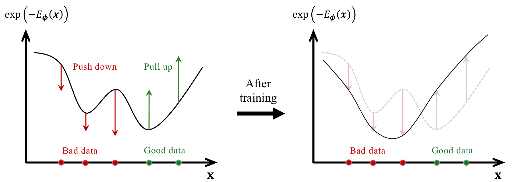
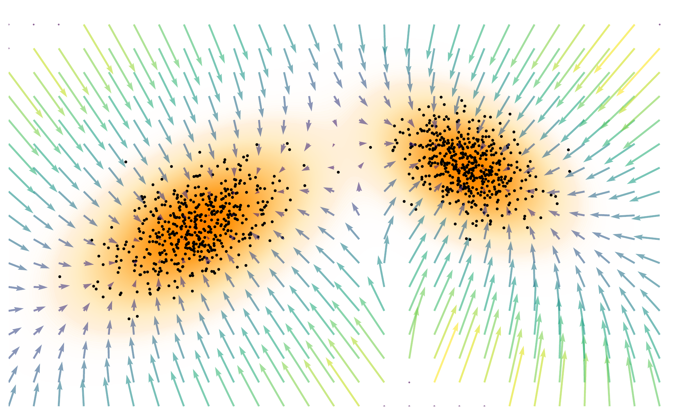
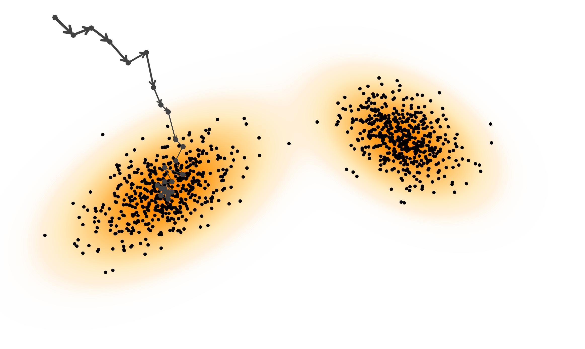

# 3.1 Energy-Based Models {#sec-ebm}

For readers already familiar with EBMs, this section is meant as a concise refresher and a bridge to the score-based view of diffusion.

## 3.1.1 Modeling Probability Distributions Using Energy Functions {#modeling-probability-distributions}

Let $\mathbf{x} \in \mathbb{R}^D$ denote a data point. EBMs define a probability density via an energy function $E_{\boldsymbol{\phi}}(\mathbf{x})$, parameterized by ${\boldsymbol{\phi}}$, which assigns lower energy to more likely configurations. The resulting distribution is given by

$$
\begin{aligned}
p_{{\boldsymbol{\phi}}}(\mathbf{x}) := \frac{\exp(-E_{\boldsymbol{\phi}}(\mathbf{x}))}{Z_{\boldsymbol{\phi}}}, \quad
    Z_{\boldsymbol{\phi}} := \int_{\mathbb{R}^D} \exp(-E_{\boldsymbol{\phi}}(\mathbf{x})) \mathop{}\!\mathrm{d}\mathbf{x},
\end{aligned}
$$

where $Z_{\boldsymbol{\phi}}$ is called the *partition function* ensuring normalization:

$$
\int_{\mathbb{R}^D} p_{{\boldsymbol{\phi}}}(\mathbf{x})  \mathop{}\!\mathrm{d}\mathbf{x} = 1.
$$

**Figure 3.1:** **Illustration of EBM training.** The model lowers density (raises energy) at “bad” data points (red arrows), and raises density (lowers energy) at “good” data points (green arrows).

Source: Created by the authors.

In this view, points with lower energy correspond to higher probability, much like a ball rolling down into a valley. The partition function $Z_{{\boldsymbol{\phi}}}$ ensures that all probabilities add up to one, and as a result only the *relative* values of energy matter. For instance, adding a constant to all energies multiplies both numerator and denominator by the same factor, leaving the distribution unchanged.

Moreover, because the partition function $Z_{{\boldsymbol{\phi}}}$ enforces that probabilities sum to one, it follows mathematically that decreasing the energy within a region increases its probability, while the probability of its complement decreases accordingly. Thus, EBMs obey a strict global trade-off: making one valley deeper inevitably makes others shallower, and probability mass is redistributed across the entire space rather than assigned independently to each region.

**Challenges of Maximum Likelihood Training in EBMs.** In principle, EBMs can be trained by maximum likelihood, which naturally balances fitting the data with global regularization (see [Equation (1.1.2)](../01-deep-generative-modeling/01-what-is-deep-generative-modeling.md#eq-mle)):

$$
\begin{aligned}
\mathcal{L}_{\text{MLE}}({\boldsymbol{\phi}})
&= \mathbb{E}_{p_{\text{data}}({\mathbf{x}})}  \left[ \log \frac{\exp(-E_{{\boldsymbol{\phi}}}({\mathbf{x}}))}{Z_{\boldsymbol{\phi}}} \right] \\
&= -  \underbrace{\mathbb{E}_{p_{\text{data}}}[E_{{\boldsymbol{\phi}}}({\mathbf{x}})]}_{\text{lowers energy of data}}
   -  \underbrace{\log \int \exp(-E_{{\boldsymbol{\phi}}}({\mathbf{x}}))\mathop{}\!\mathrm{d}{\mathbf{x}}}_{\text{global regularization}},
\end{aligned}
\tag{3.1.1}
$$

with $Z_{\boldsymbol{\phi}} = \int \exp(-E_{\boldsymbol{\phi}}({\mathbf{x}}))\mathop{}\!\mathrm{d}{\mathbf{x}}$. The first term lowers the energy of real data, while the second enforces normalization via the partition function.

However, in high dimensions computing $\log Z_{{\boldsymbol{\phi}}}$ and its gradient is intractable, as it requires expectations under the model distribution. This motivates alternative objectives that either approximate the term, such as contrastive divergence ([Hinton, 2002](references.md#ref-hinton2002training)), or avoid it altogether through *score matching*.

In what follows, we first introduce the notion of the score function in [Section 3.1.2](01-energy-based-models.md#subsec-motivation-score) and present score matching as a tractable training objective that bypasses the partition function in [Section 3.1.3](01-energy-based-models.md#subsec-training-ebm), and then discuss Langevin dynamics as a practical sampling method with score functions in [Section 3.1.4](01-energy-based-models.md#subsec-sampling-ebm).

## 3.1.2 Motivation: What Is the Score? {#subsec-motivation-score}

For a density $p({\mathbf{x}})$ on $\mathbb{R}^D$, the *score function* is the gradient of the log-density:

$$
{\mathbf{s}}({\mathbf{x}}) := \nabla_{{\mathbf{x}}} \log p({\mathbf{x}}), \qquad {\mathbf{s}} \colon \mathbb{R}^D \to \mathbb{R}^D.
$$

Intuitively, the score forms a vector field that points toward regions of higher probability, providing a local guide to where the data is most likely to occur (see [Figure 3.2](01-energy-based-models.md#fig-score-function)).

**Figure 3.2:** **Illustration of score vector fields.** Score vector fields $\nabla_{{\mathbf{x}}} \log p({\mathbf{x}})$ indicate directions of increasing density.

Source: Created by the authors.

**Why Model Scores Instead of Densities?** Modeling the score offers both theoretical and practical benefits:

**1. Freedom from Normalization Constants.** Many distributions are defined only up to an unnormalized density $\tilde{p}({\mathbf{x}})$, e.g., $\exp(-E_{\boldsymbol{\phi}}({\mathbf{x}}))$ in EBMs:

$$
p({\mathbf{x}}) = \frac{\tilde{p}({\mathbf{x}})}{Z},
    \qquad
    Z = \int \tilde{p}({\mathbf{x}})\mathop{}\!\mathrm{d}{\mathbf{x}}.
$$

While computing $Z$ is intractable, the score depends only on $\tilde{p}$:

$$
\begin{aligned}
\nabla_{{\mathbf{x}}}\log p({\mathbf{x}}) = \nabla_{{\mathbf{x}}}\log \tilde{p}({\mathbf{x}}) - \underbrace{\nabla_{{\mathbf{x}}}\log Z}_{=0} = \nabla_{{\mathbf{x}}}\log \tilde{p}({\mathbf{x}}),
\end{aligned}
\tag{3.1.2}
$$

since $Z$ is constant in ${\mathbf{x}}$. This bypasses the partition function entirely.

**2. A Complete Representation.** The score function fully characterizes the underlying distribution. Since it is the gradient of the log-density, the density can be recovered (up to a constant) via

$$
\log p({\mathbf{x}})
= \log p({\mathbf{x}}_0) + \int_0^1 {\mathbf{s}}({\mathbf{x}}_0 + t({\mathbf{x}} - {\mathbf{x}}_0))^\top ({\mathbf{x}} - {\mathbf{x}}_0)  \mathop{}\!\mathrm{d} t,
$$

where ${\mathbf{x}}_0$ is a reference point and $\log p({\mathbf{x}}_0)$ is fixed by normalization. Thus, modeling the score is as expressive as modeling $p({\mathbf{x}})$ itself, while often more tractable for generative modeling.

## 3.1.3 Training EBMs via Score Matching {#subsec-training-ebm}

In EBMs, the density is defined as $p_{{\boldsymbol{\phi}}}(\mathbf{x}) = \tfrac{\exp(-E_{\boldsymbol{\phi}}(\mathbf{x}))}{Z_{\boldsymbol{\phi}}}$. Maximum likelihood training requires computing $Z_{\boldsymbol{\phi}}$, which is generally intractable. A key observation is that the model score of $p_{{\boldsymbol{\phi}}}$ simplifies to: $-\nabla_{{\mathbf{x}}}E_{\boldsymbol{\phi}}({\mathbf{x}})$, independent of $Z_{\boldsymbol{\phi}}$ (see [Equation (3.1.2)](01-energy-based-models.md#eq-score-compute)).

*Score matching* ([Hyvärinen and Dayan, 2005](references.md#ref-hyvarinen2005estimation)) leverages the fact that scores depend only on the energy function. Instead of fitting normalized probabilities, it trains EBMs by aligning the model score with the (unknown) data score:

$$
\begin{aligned}
\mathcal{L}_{\mathrm{SM}}(\boldsymbol{\phi})
= \tfrac{1}{2}  \mathbb{E}_{p_{\mathrm{data}}(\mathbf{x})}
\big\| \nabla_{\mathbf{x}} \log p_{\boldsymbol{\phi}}(\mathbf{x})
- \nabla_{\mathbf{x}} \log p_{\mathrm{data}}(\mathbf{x}) \big\|_2^2.
\end{aligned}
\tag{3.1.3}
$$

Although the data score is inaccessible, integration by parts yields an equivalent expression involving only the energy and its derivatives (see [Proposition 3.2.1](02-score-based-models.md#sm-trace) for more details):

$$
\mathcal{L}_{\mathrm{SM}}(\boldsymbol{\phi}) =
\mathbb{E}_{p_{\mathrm{data}}(\mathbf{x})} \left[
-\operatorname{Tr} \big(\nabla_{\mathbf{x}}^2 E_{\boldsymbol{\phi}}({\mathbf{x}})\big)
+ \tfrac{1}{2}  \|\nabla_{\mathbf{x}} E_{\boldsymbol{\phi}}({\mathbf{x}})\|_2^2
\right] + C,
$$

where $\nabla_{\mathbf{x}}^2 E_{\boldsymbol{\phi}}({\mathbf{x}})$ is the Hessian of $E_{\boldsymbol{\phi}}$ and $C$ is a constant independent of $\boldsymbol{\phi}$.

This formulation is attractive because it eliminates the partition function and avoids sampling from the model during training. Its main drawback is the need for second-order derivatives: although one only needs the trace of the Hessian ($\operatorname{Tr} \big(\nabla_{\mathbf{x}}^2 E_{\boldsymbol{\phi}}\big)$), rather than the full Hessian matrix, exact computation of this term generally requires aggregating second-derivative information across input coordinates, so its cost typically increases with the input dimension $D$. We will revisit approaches to addressing this limitation later in the chapter.

## 3.1.4 Langevin Sampling with Score Functions {#subsec-sampling-ebm}

Sampling from EBMs, defined by the energy function $E_{\boldsymbol{\phi}}(\mathbf{x})$, can be performed using *Langevin dynamics*. We first present the discrete-time Langevin update and then its continuous-time limit as a stochastic differential equation (SDE). Finally, we discuss the physical intuition behind how Langevin dynamics enables efficient exploration of complex energy landscapes.

**Figure 3.3:** **Illustration of Langevin sampling.** Langevin sampling using the score function $\nabla_{\mathbf{x}} \log p_{\boldsymbol{\phi}}(\mathbf{x})$ to guide trajectories toward high-density regions via the update in [Equation (3.1.5)](01-energy-based-models.md#eq-discrete-langevin-score) (indicating by arrows).

Source: Created by the authors.

**Discrete-Time Langevin Dynamics.** The discrete-time Langevin update is

$$
\begin{aligned}
\mathbf{x}_{n+1} = \mathbf{x}_n - \eta \nabla_{\mathbf{x}} E_{\boldsymbol{\phi}}(\mathbf{x}_n) +  \sqrt{2 \eta} \boldsymbol{\epsilon}_n, \quad n=0,1,2,\ldots,
\end{aligned}
\tag{3.1.4}
$$

where $\mathbf{x}_0$ is initialized from some distribution (often Gaussian), $\eta > 0$ is the step size, and $\boldsymbol{\epsilon}_n \sim \mathcal{N}(\mathbf{0}, \mathbf{I})$ is Gaussian noise. The noise enables exploration beyond local minima by adding stochasticity.

Since the score function can be computed as

$$
\nabla_{\mathbf{x}} \log p_{\boldsymbol{\phi}}(\mathbf{x}) = -\nabla_{\mathbf{x}} E_{\boldsymbol{\phi}}({\mathbf{x}}).
$$

the update can equivalently be written as

$$
\begin{aligned}
\mathbf{x}_{n+1} = \mathbf{x}_n + \eta \nabla_{\mathbf{x}} \log p_{\boldsymbol{\phi}}(\mathbf{x}_n) + \sqrt{2 \eta}\boldsymbol{\epsilon}_n,
\end{aligned}
\tag{3.1.5}
$$

where the score function guides the samples toward high-density regions. This formulation is central to diffusion models, as will be detailed later.

**Continuous-Time Langevin Dynamics.** As the step size $\eta$ approaches zero, the discrete Langevin updates naturally converge to a continuous-time process described by the *Langevin Stochastic Differential Equation (SDE)*[^1] :

$$
\begin{aligned}
\mathop{}\!\mathrm{d} \mathbf{x}(t) = \nabla_{\mathbf{x}} \log p_{\boldsymbol{\phi}}(\mathbf{x}(t)) \mathop{}\!\mathrm{d} t + \sqrt{2} \mathop{}\!\mathrm{d} \mathbf{w}(t),
\end{aligned}
\tag{3.1.6}
$$

where $\mathbf{w}(t)$ denotes a standard Brownian motion (also known as a Wiener process[^2]). It is important to understand that the discrete update rule in [Equation (3.1.4)](01-energy-based-models.md#eq-discrete-langevin) serves as the Euler–Maruyama discretization of this continuous SDE.

Under standard regularity assumptions (e.g., $p_{\boldsymbol{\phi}}\propto e^{-E_{\boldsymbol{\phi}}}$ with a confining, sufficiently smooth $E_{\boldsymbol{\phi}}$), the distribution of $\mathbf{x}(t)$ converges (exponentially fast) to $p_{\boldsymbol{\phi}}$ as $t\to\infty$; thus we can sample by simulating (solving) the SDE [Equation (3.1.6)](01-energy-based-models.md#eq-continuous-langevin).

**Why Langevin Sampling?** A natural way to understand Langevin sampling is through the lens of physics, where the energy function $E_{\boldsymbol{\phi}}(\mathbf{x})$ defines a potential landscape that shapes the behavior of particles. According to Newtonian dynamics, the motion of a particle under the force field derived from this energy is described by the ordinary differential equation (ODE)

$$
\mathop{}\!\mathrm{d} \mathbf{x}(t) = -\nabla_{\mathbf{x}} E_{\boldsymbol{\phi}}\big(\mathbf{x}(t)\big)  \mathop{}\!\mathrm{d} t,
$$

which deterministically drives the particle downhill toward a local minimum of the energy function. However, such deterministic dynamics can become trapped in local minima, preventing exploration of the full data distribution.

To overcome this limitation, Langevin dynamics introduces stochastic perturbations, resulting in the SDE

$$
\mathop{}\!\mathrm{d} \mathbf{x}(t) = -\nabla_{\mathbf{x}} E_{\boldsymbol{\phi}}\big(\mathbf{x}(t)\big)  \mathop{}\!\mathrm{d} t + \underbrace{\sqrt{2 } \mathop{}\!\mathrm{d} {\mathbf{w}}(t)}_{\text{injected noise}},
$$

where ${\mathbf{w}}(t)$ is a standard Brownian motion.

The noise term allows the particle to escape local minima by crossing energy barriers, making the trajectory a stochastic process whose stationary distribution converges to the Boltzmann distribution

$$
p_{\boldsymbol{\phi}}(\mathbf{x}) \propto e^{-E_{\boldsymbol{\phi}}(\mathbf{x})}.
$$

From this perspective, EBMs can be viewed as learning a force field that pushes samples toward regions of high probability. Langevin sampling is particularly useful for EBMs because it provides a practical method to generate samples from the model distribution $p_{\boldsymbol{\phi}}(\mathbf{x})$ without explicitly computing the partition function. By iteratively applying the Langevin update, one obtains samples that approximate the target distribution.

**Inherent Challenges of Langevin Sampling.** Langevin dynamics, a widely used MCMC-based sampler, faces serious limitations in high-dimensional spaces. Its efficiency is highly sensitive to the choice of step size $\eta$, noise scale, and the number of iterations required to approximate the target distribution accurately.

At the heart of this inefficiency lies the issue of poor “mixing time”: In complex data distributions with many isolated modes, Langevin sampling often requires an extremely long time to transition between regions of high probability. This problem becomes significantly worse as dimensionality increases, leading to prohibitively slow convergence.

One can think of sampling as exploring a vast and rugged landscape with many distant valleys, each corresponding to a different data mode. Langevin dynamics, relying on local stochastic updates, struggles to traverse between these valleys efficiently. As a result, it often fails to capture the full diversity of the distribution.

This inefficiency hints the need for more structured and guided sampling methods that can navigate complex data manifolds more effectively than purely random exploration.

[^1]: With the factor $\sqrt{2}$, the Langevin dynamics leave $p_{\boldsymbol\phi}$ unchanged in time. Namely, $p_{\boldsymbol\phi}$ is stationary: if ${\mathbf{x}}(0)\sim p_{\boldsymbol\phi}$ then ${\mathbf{x}}(t)\sim p_{\boldsymbol\phi}$ for all $t\ge 0$. Equivalently, $p_{\boldsymbol\phi}$ is the stationary solution of the Fokker–Planck equation (see [Appendix B](../../appendices/b-density-evolution/index.md#app-continuity)):

    $$
    \partial_t \rho = -\nabla \cdot(\rho  \nabla\log p_{\boldsymbol\phi}) + \tfrac{\sigma^2}{2}\Delta \rho.
    $$

    Setting $\rho=p_{\boldsymbol\phi}$ gives $(\tfrac{\sigma^2}{2}-1)\Delta p_{\boldsymbol\phi}=0$, which holds only if $\sigma=\sqrt{2}$.

[^2]: Brownian increments satisfy $\mathbf{w}(t+\eta)-\mathbf{w}(t)\sim \mathcal{N}(\mathbf{0}, \eta \mathbf{I})$. Euler–Maruyama therefore uses a step noise $\sqrt{2} [\mathbf{w}(t+\eta)-\mathbf{w}(t)] = \sqrt{2\eta} \boldsymbol{\epsilon}_n$ with $\boldsymbol{\epsilon}_n \sim \mathcal{N}(\mathbf{0},\mathbf{I})$, which explains the $\sqrt{\eta}$ factor.; this is the source of the square-root scaling. For a detailed introduction to Brownian motion and SDEs, please refer to [Appendix A](../../appendices/a-differential-equations/index.md#app-de).
