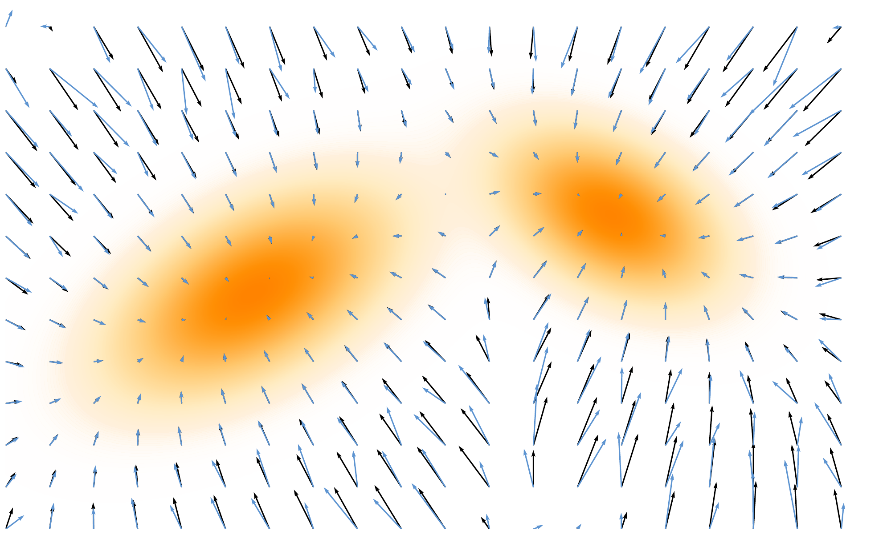

# 3.2 From Energy-Based to Score-Based Generative Models {#sec-ebm-to-score}

EBMs show that generation depends only on the score, which points toward regions of higher probability, rather than on the full normalized density. While score matching avoids the partition function, training through the energy still requires expensive second derivatives. The key idea is that since sampling with Langevin dynamics needs only the score, we can learn it directly with a neural network. This shift, from modeling energies to modeling scores, forms the foundation of score-based generative models.

**Figure 3.4:** **Illustration of Score Matching.** The neural network score ${\color{#5D94D1}{\mathbf{s}}_{\boldsymbol{\phi}}({\mathbf{x}})}$ is trained to match the ground truth score ${\mathbf{s}}({\mathbf{x}})$ using a MSE loss. Both are represented as vector fields.

Source: Created by the authors.

## 3.2.1 Training with Score Matching {#subsec-training-sm}

**Score Matching.** To approximate the score function ${\mathbf{s}}({\mathbf{x}}) = \nabla_{{\mathbf{x}}} \log p_{\mathrm{data}}({\mathbf{x}})$ from samples of $p_{\mathrm{data}}$, we approximate it directly as a vector field parameterized by a neural network ${\mathbf{s}}_{\boldsymbol{\phi}}({\mathbf{x}})$ (see [Figure 3.4](02-score-based-models.md#fig-sm-illustration)):

$$
{\mathbf{s}}_{\boldsymbol{\phi}}({\mathbf{x}}) \approx {\mathbf{s}}({\mathbf{x}}).
$$

*Score matching* fits this vector field by minimizing the mean squared error (MSE) between the true and estimated scores:

$$
\begin{aligned}
\mathcal{L}_{\mathrm{SM}}(\boldsymbol{\phi})
    := \frac{1}{2}  \mathbb{E}_{{\mathbf{x}} \sim p_{\mathrm{data}}}
    \Big[\| {\mathbf{s}}_{\boldsymbol{\phi}}({\mathbf{x}}) - {\mathbf{s}}({\mathbf{x}})\|_2^2\Big].
\end{aligned}
\tag{3.2.1}
$$

**Tractable Score Matching.** At first glance, this objective seems infeasible because the true score ${\mathbf{s}}({\mathbf{x}})$, which serves as the regression target, is unknown. Fortunately, [Hyvärinen and Dayan (2005)](../../references.md#ref-hyvarinen2005estimation) showed that integration by parts yields an equivalent objective that depends only on the model ${\mathbf{s}}_{\boldsymbol{\phi}}$ and the data samples, without requiring access to the true score. We state this key result in the following proposition:

**Proposition 3.2.1: Hyvärinen’s Tractable Form of SM**

We can express the following equation as:

$$
\begin{aligned}
\mathcal{L}_{\text{SM}}(\boldsymbol{\phi}) = \widetilde{\mathcal{L}}_{\text{SM}}(\boldsymbol{\phi}) + C.
\end{aligned}
$$

where

$$
\begin{aligned}
\widetilde{\mathcal{L}}_{\text{SM}}(\boldsymbol{\phi})
            := \mathbb{E}_{{\mathbf{x}} \sim p_{\text{data}}({\mathbf{x}})} \left[
            \operatorname{Tr}\left(\nabla_{{\mathbf{x}}}{\mathbf{s}}_{\boldsymbol{\phi}}({\mathbf{x}})\right)
            + \frac{1}{2} \left\lVert{\mathbf{s}}_{\boldsymbol{\phi}}({\mathbf{x}})\right\rVert_2^2
            \right].
\end{aligned}
\tag{3.2.2}
$$

and $C$ is a constant that does not depend on $\boldsymbol{\phi}$. The minimizer ${\mathbf{s}}^*$ is obtained as: ${\mathbf{s}}^*(\cdot) = \nabla_{{\mathbf{x}}} \log p(\cdot)$.

**Proof for Proposition.**

The result follows by expanding the MSE in $\mathcal{L}_{\text{SM}}$ and applying integration by parts. The proof is given in [Section D.2.1](../../appendices/d-supplementary-proofs/02-score-based-perspective.md#app-sec-sm-trace).

Using the equivalent objective in [Equation (3.2.2)](02-score-based-models.md#eq-sm-alternative), we train the score model ${\mathbf{s}}_{\boldsymbol{\phi}}({\mathbf{x}})$ solely from observed samples of $p_{\mathrm{data}}$, eliminating the need for the true score function.

**Intuition of [Equation (3.2.2)](02-score-based-models.md#eq-sm-alternative).** The alternative score matching objective $\widetilde{\mathcal{L}}_{\text{SM}}(\boldsymbol\phi)$ can be understood from its two terms. The norm term $\tfrac12\|{\mathbf{s}}_{\boldsymbol\phi}({\mathbf{x}})\|^2$ penalizes large score values, especially in regions where $p_{\mathrm{data}}$ is large. The divergence term $\operatorname{Tr}(\nabla_{{\mathbf{x}}} {\mathbf{s}}_{\boldsymbol\phi}({\mathbf{x}}))$ appears with a positive sign in the loss, so minimizing the objective also favors locally contracting behavior. Together, these two terms yield the population-optimal score field ${\mathbf{s}}^*({\mathbf{x}})=\nabla_{{\mathbf{x}}}\log p_{\mathrm{data}}({\mathbf{x}})$. We explain the geometric intuition in more detail below.

**Effect of the Magnitude Term.** Since the expectation in $\widetilde{\mathcal{L}}_{\mathrm{SM}}(\boldsymbol\phi)$ is taken under $p_{\mathrm{data}}$, regions where $p_{\mathrm{data}}({\mathbf{x}})$ is large (high data density) contribute more strongly to the loss. The magnitude term $\tfrac12\|{\mathbf{s}}_{\boldsymbol\phi}({\mathbf{x}})\|^2$ therefore places a stronger penalty on large score values in these regions. By itself, however, this term does not imply that ${\mathbf{s}}_{\boldsymbol\phi}({\mathbf{x}})=\mathbf{0}$ at every high-density point; at the population optimum,

$$
{\mathbf{s}}^*({\mathbf{x}})=\nabla_{{\mathbf{x}}}\log p_{\mathrm{data}}({\mathbf{x}}),
$$

which vanishes only at stationary points of the log-density.

**Concavity When the Field is (Approximately) a Gradient.** Because the divergence term $\operatorname{Tr}(\nabla_{{\mathbf{x}}} {\mathbf{s}}_{\boldsymbol\phi}({\mathbf{x}}))$ enters the loss with a positive sign, minimizing the objective favors negative divergence in regions emphasized by the data distribution. Negative divergence indicates net local contraction, although by itself it does not guarantee that a stationary point is a sink. To make this precise, assume ${\mathbf{s}}_{\boldsymbol\phi}=\nabla_{{\mathbf{x}}}u$ for a scalar function $u:{\mathbb{R}}^D\to{\mathbb{R}}$, as is natural when matching a log density. Then $\nabla_{{\mathbf{x}}}{\mathbf{s}}_{\boldsymbol\phi}=\nabla_{{\mathbf{x}}}^2 u$ (the Hessian) and $\nabla \cdot {\mathbf{s}}_{\boldsymbol\phi}({\mathbf{x}})=\operatorname{Tr}(\nabla_{{\mathbf{x}}}^2 u({\mathbf{x}}))$ (the divergence).

At a stationary point ${\mathbf{x}}_\star$, where ${\mathbf{s}}_{\boldsymbol\phi}({\mathbf{x}}_\star)=\nabla_{{\mathbf{x}}}u({\mathbf{x}}_\star)=\mathbf{0}$, a second order Taylor expansion gives

$$
u({\mathbf{x}})
= u({\mathbf{x}}_\star)
+ \tfrac12({\mathbf{x}}-{\mathbf{x}}_\star)^\top \nabla_{{\mathbf{x}}}^2 u({\mathbf{x}}_\star)({\mathbf{x}}-{\mathbf{x}}_\star)
+ o(\|{\mathbf{x}}-{\mathbf{x}}_\star\|^2).
$$

If the Hessian $\nabla_{{\mathbf{x}}}^2 u({\mathbf{x}}_\star)$ is negative definite, then $u$ is locally concave at ${\mathbf{x}}_\star$ and the log density attains a strict local maximum[^1] there. Because all eigenvalues of the Hessian are negative, the trace is also negative: $\operatorname{Tr}(\nabla_{{\mathbf{x}}}^2 u({\mathbf{x}}_\star))<0$. Thus, in this case, the stationary point is locally attracting under the score field: small perturbations are pulled back toward ${\mathbf{x}}_\star$.

## 3.2.2 Sampling with Langevin Dynamics {#sampling-with-langevin-dynamics}

Once trained by minimizing [Equation (3.2.2)](02-score-based-models.md#eq-sm-alternative), the score model ${\mathbf{s}}_{\boldsymbol{\phi}^\times}({\mathbf{x}})$ can replace the oracle score in Langevin dynamics for sampling:

$$
\begin{aligned}
\mathbf{x}_{n+1} = \mathbf{x}_n + \eta   {\mathbf{s}}_{\boldsymbol{\phi}^\times}({\mathbf{x}}_n) + \sqrt{2\eta}    \boldsymbol{\epsilon}_n, \quad \boldsymbol{\epsilon}_n \sim \mathcal{N}(\boldsymbol{0}, \boldsymbol{I}),
\end{aligned}
\tag{3.2.3}
$$

for $n=0,1,2,\dots$, initialized at ${\mathbf{x}}_0$. As in the EBM case [Equation (3.1.6)](01-energy-based-models.md#eq-continuous-langevin), this recursion is precisely the Euler–Maruyama discretization of the continuous-time Langevin SDE:

$$
\begin{aligned}
\mathop{}\!\mathrm{d} {\mathbf{x}}(t) = {\mathbf{s}}_{\boldsymbol{\phi}^\times}({\mathbf{x}}(t)) \mathop{}\!\mathrm{d} t + \sqrt{2} \mathop{}\!\mathrm{d} \mathbf{w}(t),
\end{aligned}
$$

with initialization ${\mathbf{x}}(0)$. Hence, in the limit of small step size, the discrete and continuous formulations coincide. In practice, one can either run the discrete sampler or directly simulate the SDE.

## 3.2.3 Prologue: Score-Based Generative Models {#prologue-score-based-generative-models}

In the remainder of this chapter, we examine the foundational role of the score function in modern diffusion models. Initially introduced to enable efficient training of EBMs, the score function has evolved into a central component of a new generation of generative models. Building on this foundation, we explore how the score function informs the theoretical formulation and practical implementation of *score-based diffusion models*, offering a principled framework for data generation via stochastic processes.

[^1]: We remark that strict concavity (and thus a strict local maximum of the log density) requires the entire Hessian $\nabla_{{\mathbf{x}}}^2 u$ to be negative definite, not merely to have negative trace. A negative trace guarantees that the sum of eigenvalues is negative, but some eigenvalues could still be positive, leading to a saddle point rather than a maximum.
