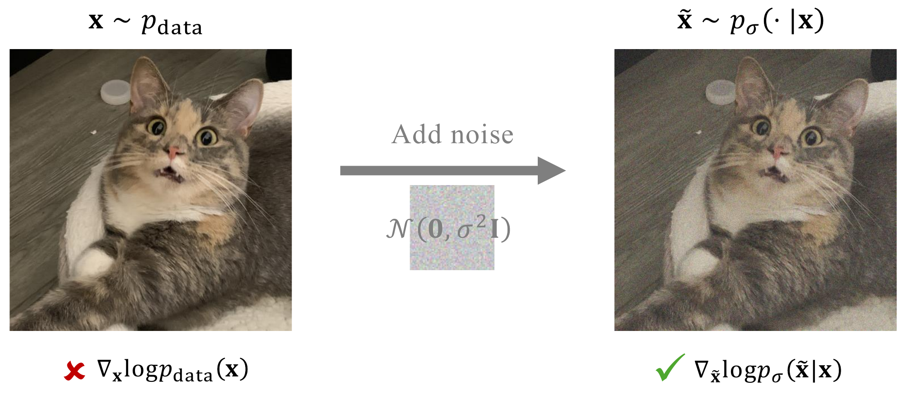

# 3.3 Denoising Score Matching {#sec-dsm}

## 3.3.1 Motivation {#motivation}

Although the alternative objective in [Equation (3.2.2)](02-score-based-models.md#eq-sm-alternative)

$$
\begin{aligned}
\widetilde{\mathcal{L}}_{\text{SM}}(\boldsymbol{\phi}) = \mathbb{E}_{{\mathbf{x}} \sim p_{\mathrm{data}}} \left[\mathrm{Tr}\big(\nabla_{{\mathbf{x}}}{\mathbf{s}}_{\boldsymbol{\phi}}({\mathbf{x}})\big) + \frac{1}{2} \|{\mathbf{s}}_{\boldsymbol{\phi}}({\mathbf{x}})\|_2^2 \right]
\end{aligned}
$$

is more tractable, it still requires computing the trace of the Jacobian, $\mathrm{Tr}(\nabla_{{\mathbf{x}}}{\mathbf{s}}_{\boldsymbol{\phi}}({\mathbf{x}}))$. Although this does not require forming the full Jacobian matrix, exact evaluation generally becomes more expensive as the input dimension $D$ increases, since it requires aggregating derivative information across input coordinates. This can therefore be computationally expensive in high dimensions.

To address this, sliced score matching ([Song et al., 2020](references.md#ref-song2020sliced)) replaces the trace term with a stochastic estimate based on random projections. We briefly outline the idea below.

**Sliced Score Matching and Hutchinson’s Estimator.** Sliced score matching replaces the trace in score matching by averaging directional derivatives along random “slices”. Let ${\mathbf{u}}\in{\mathbb{R}}^D$ be an *isotropic* random vector (e.g., Rademacher or standard Gaussian) with ${\mathbb{E}}[{\mathbf{u}}]=0$ and ${\mathbb{E}}[{\mathbf{u}}{\mathbf{u}}^\top]=\mathbf I$. By Hutchinson’s identity

$$
\operatorname{Tr}({\mathbf{A}})={\mathbb{E}}_{{\mathbf{u}}}[{\mathbf{u}}^\top {\mathbf{A}} {\mathbf{u}}],\quad\text{and}\quad{\mathbb{E}}_{{\mathbf{u}}}[({\mathbf{u}}^\top{\mathbf{s}}_{{\boldsymbol{\phi}}}({\mathbf{x}}))^2]=\|{\mathbf{s}}_{{\boldsymbol{\phi}}}({\mathbf{x}})\|_2^2,
$$

we obtain the exact form

$$
\widetilde{\mathcal{L}}_{\mathrm{SM}}({\boldsymbol{\phi}})
={\mathbb{E}}_{{\mathbf{x}},{\mathbf{u}}} \Big[{\mathbf{u}}^\top\big(\nabla_{{\mathbf{x}}}{\mathbf{s}}_{{\boldsymbol{\phi}}}({\mathbf{x}})\big){\mathbf{u}}+\tfrac12({\mathbf{u}}^\top{\mathbf{s}}_{{\boldsymbol{\phi}}}({\mathbf{x}}))^2\Big].
$$

This objective can be evaluated efficiently with automatic differentiation, using Jacobian- and vector-Jacobian-product operations (JVP/VJP) instead of explicitly computing large Jacobian or Hessian matrices. Averaging over $K$ random probes yields an unbiased estimator with variance $\mathcal{O}(1/K)$, and the directional term ${\mathbf{u}}^\top(\nabla_{{\mathbf{x}}}{\mathbf{s}}_{{\boldsymbol{\phi}}}){\mathbf{u}}$ can be computed efficiently using JVP/VJP routines without explicit Jacobians. Intuitively, this means we only check the model’s behavior along random directions: the projected score is nudged to align with regions of higher data density, so data points become stationary in expectation.

**From Sliced to Denoising Score Matching.** Sliced score matching sidesteps Jacobians but still relies on the raw data distribution. This makes it fragile: for image data lying on low-dimensional manifolds, the score $\nabla_{{\mathbf{x}}}\log p_{\mathrm{data}}({\mathbf{x}})$ may be undefined or unstable, and the method only constrains the vector field at observed points, providing weak control in their neighborhoods. It further suffers from probe-induced variance and repeated JVP/VJP costs.

A more robust alternative, which we focus on here, is *Denoising Score Matching* (DSM) ([Vincent, 2011](references.md#ref-vincent2011connection)), which offers a principled and scalable solution.

## 3.3.2 Training {#training}

Let us revisit the SM loss in [Equation (3.2.1)](02-score-based-models.md#eq-sm):

$$
\begin{aligned}
\mathcal{L}_{\text{SM}}(\boldsymbol{\phi}) =  \frac{1}{2} \mathbb{E}_{{\mathbf{x}} \sim p_{\text{data}}({\mathbf{x}})} \left[ \left\lVert{\mathbf{s}}_{\boldsymbol{\phi}}({\mathbf{x}}) - \nabla_{{\mathbf{x}}} \log p_{\text{data}}({\mathbf{x}})\right\rVert_2^2 \right],
\end{aligned}
$$

where the issue arises from the intractable term $\nabla_{{\mathbf{x}}} \log p_{\text{data}}({\mathbf{x}})$.

**[Vincent (2011)](references.md#ref-vincent2011connection)’s Solution by Conditioning.** To overcome the intractability of $\nabla_{{\mathbf{x}}} \log p_{\text{data}}({\mathbf{x}})$, [Vincent (2011)](references.md#ref-vincent2011connection) proposed injecting noise into the data ${\mathbf{x}} \sim p_{\text{data}}$ via a known conditional distribution $p_{\sigma}(\tilde{{\mathbf{x}}}|{\mathbf{x}})$ with scale $\sigma$. The neural network ${\mathbf{s}}_{\boldsymbol{\phi}}(\tilde{{\mathbf{x}}}, \sigma)$ is trained to approximate the score of the marginal perturbed distribution

$$
p_\sigma(\tilde{{\mathbf{x}}}) = \int p_{\sigma}(\tilde{{\mathbf{x}}}|{\mathbf{x}}) p_{\text{data}}({\mathbf{x}}) \mathop{}\!\mathrm{d} {\mathbf{x}}
$$

by minimizing the loss

$$
\begin{aligned}
\mathcal{L}_{\text{SM}}(\boldsymbol{\phi}; \sigma) := \frac{1}{2} \mathbb{E}_{\tilde{{\mathbf{x}}} \sim p_\sigma} \left[ \left\lVert{\mathbf{s}}_{\boldsymbol{\phi}}(\tilde{{\mathbf{x}}}, \sigma) - \nabla_{\tilde{{\mathbf{x}}}} \log p_\sigma(\tilde{{\mathbf{x}}})\right\rVert_2^2 \right].
\end{aligned}
\tag{3.3.1}
$$

Even though $\nabla_{\tilde{{\mathbf{x}}}} \log p_\sigma(\tilde{{\mathbf{x}}})$ is generally intractable, [Vincent (2011)](references.md#ref-vincent2011connection) showed that *conditioning* on ${\mathbf{x}} \sim p_{\text{data}}$ yields an equivalent, tractable objective—the *Denoising Score Matching* (DSM) loss:

$$
\begin{aligned}
\mathcal{L}_{\text{DSM}}(\boldsymbol{\phi}; \sigma) := \frac{1}{2} \mathbb{E}_{{\mathbf{x}} \sim p_{\text{data}}, \tilde{{\mathbf{x}}} \sim p_{\sigma}(\cdot|{\mathbf{x}})} \left[ \left\lVert{\mathbf{s}}_{\boldsymbol{\phi}}(\tilde{{\mathbf{x}}}, \sigma) - \nabla_{\tilde{{\mathbf{x}}}} \log p_{\sigma}(\tilde{{\mathbf{x}}}|{\mathbf{x}})\right\rVert_2^2 \right].
\end{aligned}
\tag{3.3.2}
$$

The optimal minimizer ${\mathbf{s}}^*$ of [Equation (3.3.2)](03-denoising-score-matching.md#eq-dsm-loss) satisfies

$$
{\mathbf{s}}^*(\tilde{{\mathbf{x}}}, \sigma) = \nabla_{\tilde{{\mathbf{x}}}} \log p_\sigma(\tilde{{\mathbf{x}}}),
$$

which is also optimal for [Equation (3.3.1)](03-denoising-score-matching.md#eq-sm-noise-loss).

For example, when $p_{\sigma}(\tilde{{\mathbf{x}}}|{\mathbf{x}})$ is Gaussian noise with variance $\sigma^2$,

$$
p_{\sigma}(\tilde{{\mathbf{x}}}|{\mathbf{x}}) = \mathcal{N}(\tilde{{\mathbf{x}}}; {\mathbf{x}}, \sigma^2 \mathbf{I}),
$$

the gradient $\nabla_{\tilde{{\mathbf{x}}}} \log p_{\sigma}(\tilde{{\mathbf{x}}}|{\mathbf{x}})$ has a closed form (see [Equation (3.3.4)](03-denoising-score-matching.md#eq-gaussian-dsm)), making the regression target explicit and computationally tractable.

Moreover, as $\sigma \approx 0$, $p_\sigma(\tilde{{\mathbf{x}}}) \approx p_{\text{data}}({\mathbf{x}})$ and

$$
{\mathbf{s}}^*(\tilde{{\mathbf{x}}}, \sigma) = \nabla_{\tilde{{\mathbf{x}}}} \log p_\sigma(\tilde{{\mathbf{x}}}) \approx \nabla_{{\mathbf{x}}} \log p_{\text{data}}({\mathbf{x}}),
$$

indicating the learned score approximates the original data score, enabling its use in generation.

We formalize this discussion on the gradient equivalence between $\mathcal{L}_{\text{SM}}$ and $\mathcal{L}_{\text{DSM}}$ in the following theorem:

**Theorem 3.3.1: Equivalence of $\mathcal{L}_{\text{SM}}$ and $\mathcal{L}_{\text{DSM}}$**

For any fixed noise scale $\sigma > 0$, the following holds:

$$
\begin{aligned}
\mathcal{L}_{\text{SM}}(\boldsymbol{\phi}; \sigma) = \mathcal{L}_{\text{DSM}}(\boldsymbol{\phi}; \sigma) + C,
\end{aligned}
\tag{3.3.3}
$$

where $C$ is a constant independent of the parameter $\boldsymbol{\phi}$. Furthermore, the minimizer ${\mathbf{s}}^*(\cdot, \sigma)$ of both losses satisfies

$$
{\mathbf{s}}^*(\tilde{{\mathbf{x}}}, \sigma) = \nabla_{\tilde{{\mathbf{x}}}} \log p_\sigma(\tilde{{\mathbf{x}}}), \quad \text{for almost every } \tilde{{\mathbf{x}}}.
$$

**Proof for Theorem.**

The equivalence follows from a direct computation: by expanding the MSE in $\mathcal{L}_{\text{SM}}$ and $\mathcal{L}_{\text{DSM}}$, all $\boldsymbol{\phi}$-dependent terms cancel, leaving only a constant difference independent of $\boldsymbol{\phi}$. 
The derivation of the minimizer follows the same argument as in [Proposition 4.3.1](../04-score-sde-framework/index.md#dsm-minimizer). We defer the detailed derivation to [Section D.2.2](../../appendices/d-supplementary-proofs/index.md#app-sec-sm-dsm).

This theorem, like [Theorem 2.2.1](../02-variational-perspective/02-ddpm.md#thm-equiv-marginal-kl) in DDPM, illustrates a key shared principle:

**Insight 3.3.1: Conditioning Technique**

The conditioning technique also appears in the variational view of diffusion models in DDPM (see [Theorem 2.2.1](../02-variational-perspective/02-ddpm.md#thm-equiv-marginal-kl)), where conditioning on a data point ${\mathbf{x}}$ turns an intractable loss into a tractable one for Monte Carlo estimation. A similar idea arises in the flow-based perspective (e.g., Flow Matching ([Lipman et al., 2022](references.md#ref-lipman2022flow))), as we will see in [Section 5.2](../05-flow-based-perspective/index.md#sec-flow-matching-framework).

**Figure 3.5:** **Illustration of DSM via the conditioning technique.** By perturbing the data distribution $p_{\mathrm{data}}$ with small additive Gaussian noise $\mathcal{N}(\mathbf{0}, \sigma^2 {\mathbf{I}})$, the resulting conditional distribution $p_{\sigma}(\tilde{{\mathbf{x}}}|{\mathbf{x}}) = \mathcal{N}(\tilde{{\mathbf{x}}}; {\mathbf{x}}, \sigma^2 {\mathbf{I}})$ admits a closed-form score function.

Source: Created by the authors.

**Special Case: Additive Gaussian Noise.** We now consider the common case where Gaussian noise $\mathcal{N}(\mathbf{0}, \sigma^2 {\mathbf{I}})$ with variance $\sigma^2$ is added to each data point ${\mathbf{x}} \sim p_{\text{data}}$:

$$
\tilde{{\mathbf{x}}} = {\mathbf{x}} + \sigma \boldsymbol{\epsilon}, \quad \boldsymbol{\epsilon} \sim \mathcal{N}(\mathbf{0}, {\mathbf{I}}),
$$

so that the corrupted data $\tilde{{\mathbf{x}}}$ follows

$$
p_{\sigma}(\tilde{{\mathbf{x}}}|{\mathbf{x}}) = \mathcal{N}(\tilde{{\mathbf{x}}}; {\mathbf{x}}, \sigma^2 {\mathbf{I}}).
$$

In this setting, the conditional score is analytically given by

$$
\nabla_{\tilde{{\mathbf{x}}}} \log p_{\sigma}(\tilde{{\mathbf{x}}}|{\mathbf{x}}) = \frac{{\mathbf{x}} - \tilde{{\mathbf{x}}}}{\sigma^2}.
$$

Hence, the DSM loss simplifies to:

$$
\begin{aligned}
    \mathcal{L}_{\text{DSM}}(\boldsymbol{\phi}; \sigma) &= \frac{1}{2} \mathbb{E}_{{\mathbf{x}}, \tilde{{\mathbf{x}}}|{\mathbf{x}}} \left[ \left\lVert{\mathbf{s}}_{\boldsymbol{\phi}}(\tilde{{\mathbf{x}}}, \sigma) - \frac{{\mathbf{x}} - \tilde{{\mathbf{x}}}}{\sigma^2}\right\rVert_2^2 \right] \\
    &= \frac{1}{2} \mathbb{E}_{{\mathbf{x}}, \boldsymbol{\epsilon}} \left[ \left\lVert{\mathbf{s}}_{\boldsymbol{\phi}}({\mathbf{x}} + \sigma \boldsymbol{\epsilon}, \sigma) + \frac{\boldsymbol{\epsilon}}{\sigma}\right\rVert_2^2 \right],
\end{aligned}
\tag{3.3.4}
$$

where $\boldsymbol{\epsilon} \sim \mathcal{N}(\mathbf{0}, {\mathbf{I}})$. This objective forms the core of the (score-based) Diffusion Model.

At a fixed noise level $\sigma>0$, DSM learns the score of the Gaussian-smoothed distribution

$$
p_\sigma
=
p_{\mathrm{data}} * \mathcal{N}(\boldsymbol{0},\sigma^2{\mathbf{I}}),
$$

rather than the score of $p_{\mathrm{data}}$ itself. When $\sigma$ is small, the corruption is mild, so $p_\sigma$ still closely preserves the local structure of the data distribution. Its score therefore provides a useful direction for moving noisy samples back toward likely data regions. As $\sigma$ becomes larger, the Gaussian smoothing progressively removes fine details and merges nearby modes. The corresponding score then captures mainly coarser, more global structure. This behavior is useful rather than undesirable: the multi-noise construction in [Section 3.4](04-noise-conditional-score-networks.md#sec-smld) deliberately combines many noise levels, using large noise for coarse exploration and small noise for fine refinement.

To better see why the objective naturally corresponds to a “denoising” process, we expand on the discussion in [Section 3.3.4](03-denoising-score-matching.md#subsec-why-dsm-denoising-tweedie) and [Section 3.3.5](03-denoising-score-matching.md#subsec-why-dsm-denoising-sure).

## 3.3.3 Sampling {#sampling}

Once we have a trained score model ${\mathbf{s}}_{\boldsymbol{\phi}^\times}(\tilde{{\mathbf{x}}}, \sigma)$ at noise level $\sigma$, we generate samples using Langevin dynamics by replacing the true score with the learned model. The update rule is:

$$
\begin{aligned}
\tilde{{\mathbf{x}}}_{n+1} = \tilde{{\mathbf{x}}}_n + \eta \underbrace{{\mathbf{s}}_{\boldsymbol{\phi}^\times}(\tilde{{\mathbf{x}}}_n, \sigma)}_{\approx \nabla_{\tilde{{\mathbf{x}}}} \log p_\sigma(\tilde{{\mathbf{x}}}_n)} + \sqrt{2\eta}    \boldsymbol{\epsilon}_n, \quad \boldsymbol{\epsilon}_n \sim \mathcal{N}(\mathbf{0}, {\mathbf{I}}),
\end{aligned}
\tag{3.3.5}
$$

for $n = 0, 1, 2, \dots$, starting from an initial value $\tilde{{\mathbf{x}}}_0$. If $\sigma$ is sufficiently small, then after enough iterations, $\tilde{{\mathbf{x}}}_n$ approximates samples from $p_{\text{data}}$.

**Advantages of Noise Injection.** We additionally remark that, compared to vanilla score matching in [Equation (3.2.1)](02-score-based-models.md#eq-sm), injecting Gaussian noise to form $p_\sigma$ (e.g., [Equation (3.3.4)](03-denoising-score-matching.md#eq-gaussian-dsm)) provides two key advantages ([Song and Ermon, 2019](references.md#ref-song2019generative)):

-   **Well-Defined Gradients.** The noise perturbs data away from its lower-dimensional manifold, resulting in a distribution $p_\sigma$ with full support in $\mathbb{R}^D$. Consequently, the score function $\nabla_{\tilde{{\mathbf{x}}}} \log p_\sigma(\tilde{{\mathbf{x}}})$ is well-defined everywhere.

-   **Improved Coverage.** The noise smooths out sparse regions between modes, enhancing training signal quality and facilitating Langevin dynamics to traverse low-density regions more effectively.

## 3.3.4 Why DSM is Denoising: Tweedie's Formula {#subsec-why-dsm-denoising-tweedie}

We begin with *Tweedie’s formula* ([Efron, 2011](references.md#ref-efron2011tweedie)), which provides a principled basis for denoising from noisy observations alone. Concretely, it states that: given a single Gaussian–corrupted observation $\tilde{{\mathbf{x}}}\sim\mathcal N(\,\cdot\,;\alpha{\mathbf{x}},\sigma^2\mathrm{I})$ from an unknown ${\mathbf{x}} \sim p_{\mathrm{data}}$, a denoised estimate (the average over all plausible clean signals given $\tilde{{\mathbf{x}}}$) is obtained by nudging $\tilde{{\mathbf{x}}}$ a step of size $\sigma^2$ in the direction of the score $\nabla_{\tilde{{\mathbf{x}}}}\log p_\sigma(\tilde{{\mathbf{x}}})$ of its noisy marginal defined as:

$$
p_\sigma(\tilde{{\mathbf{x}}}):= \int \mathcal{N}(\tilde{{\mathbf{x}}};\alpha {\mathbf{x}},\sigma^2\mathrm{I})p_{\mathrm{data}}({\mathbf{x}})\mathop{}\!\mathrm{d}{\mathbf{x}}.
$$

We present the proposition formally below.

**Lemma 3.3.2: Tweedie’s Formula**

Assume ${\mathbf{x}}\sim p_{\mathrm{data}}$ and, conditionally on ${\mathbf{x}}$, $\tilde{{\mathbf{x}}}\sim\mathcal N(\,\cdot\,;\alpha{\mathbf{x}},\sigma^2\mathrm{I})$ with $\alpha\neq0$. Then Tweedie’s formula states

$$
\begin{aligned}
\alpha   \mathbb{E}_{{\mathbf{x}} \sim p({\mathbf{x}} |\tilde{\mathbf{x}})}\big[{\mathbf{x}}  \big|  \tilde{\mathbf{x}}\big] = \tilde{\mathbf{x}} + \sigma^2 \nabla_{\tilde{\mathbf{x}}} \log p_\sigma(\tilde{\mathbf{x}}),
\end{aligned}
\tag{3.3.6}
$$

where the expectation is taken over the posterior distribution $p({\mathbf{x}} |\tilde{\mathbf{x}})$ of ${\mathbf{x}}$ given $\tilde{\mathbf{x}}$.

**Proof for Lemma.**

The proof proceeds by computing the score of the marginal

$$
p(\tilde{\mathbf{x}})=\int p(\tilde{\mathbf{x}}|{\mathbf{x}})p_{\mathrm{data}}({\mathbf{x}})\mathop{}\!\mathrm{d}{\mathbf{x}}.
$$

Differentiating under the integral and using the Gaussian form of the conditional density leads directly to an expression that rearranges into the desired identity linking the score with the posterior mean. See [Section D.2.3](../../appendices/d-supplementary-proofs/index.md#app-sec-tweedie) for details.

Tweedie’s formula plays a central role in diffusion models, where multiple layers of noise are introduced as in DDPM. It enables the estimation of clean samples from noisy observations via the score function, thereby establishing a fundamental link between score prediction and denoiser:

$$
\underbrace{\mathbb{E} \left[{\mathbf{x}}|\tilde{\mathbf{x}}\right]}_{\substack{\text{denoiser}\\\text{estimated from }\tilde{\mathbf{x}}}}
= \frac{1}{\alpha}\left(\tilde{\mathbf{x}} + \sigma^2 \nabla_{\tilde{\mathbf{x}}} \log p_\sigma(\tilde{\mathbf{x}})\right).
$$

Especially, a single gradient-ascent step on the noisy log-likelihood with the particular step size $\sigma^2$ is the denoised estimate (the conditional average clean signal). This makes DSM training and denoising tightly related: if ${\mathbf{s}}_{\boldsymbol{\phi}}(\tilde{{\mathbf{x}}})\approx \nabla_{\tilde{{\mathbf{x}}}}\log p_\sigma(\tilde{{\mathbf{x}}})$ trained from DSM, then

$$
\frac{1}{\alpha}\left(\tilde{{\mathbf{x}}}+\sigma^2 {\mathbf{s}}_{\boldsymbol{\phi}}(\tilde{{\mathbf{x}}})\right)
$$

is the denoiser.

**(Optional) Higher Order Tweedie’s Formula.** The classical Tweedie’s formula expresses the posterior mean ${\mathbb{E}}[{\mathbf{x}}_0|\tilde{{\mathbf{x}}}]$ through the gradient $\nabla_{\tilde{{\mathbf{x}}}}\log p(\tilde{{\mathbf{x}}})$. Higher order extensions ([Meng et al., 2021](references.md#ref-meng2021estimating)) express the posterior covariance and higher cumulants through higher derivatives of $\log p(\tilde{{\mathbf{x}}})$.

**Exponential Family Setup with the Log-Normalizer $\lambda(\tilde{{\mathbf{x}}})$.** Assume the conditional law of $\tilde{{\mathbf{x}}}$ given a latent natural parameter $\boldsymbol\eta\in{\mathbb{R}}^D$ belongs to a natural exponential family written as

$$
q_\sigma(\tilde{{\mathbf{x}}}|\boldsymbol\eta)
=\exp\!\big(\boldsymbol\eta^\top \tilde{{\mathbf{x}}}-\psi(\boldsymbol\eta)\big)\,q_0(\tilde{{\mathbf{x}}}).
$$

Here $q_0(\tilde{{\mathbf{x}}})$ is the *base measure*, namely the part that does not depend on $\boldsymbol\eta$; for additive Gaussian noise with variance $\sigma^2{\mathbf{I}}$ it equals $(2\pi\sigma^2)^{-D/2}\exp(-\|\tilde{{\mathbf{x}}}\|^2/2\sigma^2)$. Let $p(\boldsymbol\eta)$ be the pre-defined distribution of the latent natural parameter, which can be viewed as the reparameterized clean-data distribution (for Gaussian location, $\boldsymbol\eta={\mathbf{x}}/\sigma^2$). The observed noisy marginal is

$$
p_\sigma(\tilde{{\mathbf{x}}})=\int q_\sigma(\tilde{{\mathbf{x}}}|\boldsymbol\eta)\,p(\boldsymbol\eta)\mathop{}\!\mathrm{d}\boldsymbol\eta.
$$

Define the *log-partition* (log-normalizer) in $\tilde{{\mathbf{x}}}$ by

$$
\lambda(\tilde{{\mathbf{x}}}) := \log p_\sigma(\tilde{{\mathbf{x}}})-\log q_0(\tilde{{\mathbf{x}}}).
$$

Then the posterior of $\boldsymbol\eta$ given $\tilde{{\mathbf{x}}}$ is

$$
p(\boldsymbol\eta|\tilde{{\mathbf{x}}})
\ \propto\
\exp\!\big(\boldsymbol\eta^\top \tilde{{\mathbf{x}}}-\psi(\boldsymbol\eta)-\lambda(\tilde{{\mathbf{x}}})\big)\,p(\boldsymbol\eta),
$$

which shows that, as a function of $\tilde{{\mathbf{x}}}$, the posterior has exponential-family form with natural parameter $\tilde{{\mathbf{x}}}$, sufficient statistic $\boldsymbol\eta$, and log-partition $\lambda(\tilde{{\mathbf{x}}})$.

**Derivatives of $\lambda$ Produce Posterior Cumulants.** Two simple rules are at play. First, normalization: for every $\tilde{{\mathbf{x}}}$,

$$
\int \exp\!\big(\boldsymbol\eta^\top \tilde{{\mathbf{x}}}-\psi(\boldsymbol\eta)-\lambda(\tilde{{\mathbf{x}}})\big)\,p(\boldsymbol\eta)\mathop{}\!\mathrm{d}\boldsymbol\eta
=1.
$$

Differentiating this identity with respect to $\tilde{{\mathbf{x}}}$ brings down powers of $\boldsymbol\eta$ from the exponential and derivatives of $\lambda(\tilde{{\mathbf{x}}})$; setting the result to zero yields equalities between derivatives of $\lambda$ and posterior moments of $\boldsymbol\eta$. Second, a standard property of exponential families: the log-partition is the cumulant generating function of the sufficient statistic. Therefore

$$
\nabla_{\tilde{{\mathbf{x}}}}\lambda(\tilde{{\mathbf{x}}})={\mathbb{E}}[\boldsymbol\eta|\tilde{{\mathbf{x}}}],\quad
\nabla_{\tilde{{\mathbf{x}}}}^{2}\lambda(\tilde{{\mathbf{x}}})=\mathrm{Cov}[\boldsymbol\eta|\tilde{{\mathbf{x}}}],\quad
\nabla_{\tilde{{\mathbf{x}}}}^{(k)}\lambda(\tilde{{\mathbf{x}}})=\kappa_k(\boldsymbol\eta|\tilde{{\mathbf{x}}})\quad(k\ge 3),
$$

where $\kappa_k$ are the *conditional cumulants* of order $k$ of the random vector $\boldsymbol\eta$ given $\tilde{{\mathbf{x}}}$, obtained via the standard moment–cumulant relations.

These are the higher order Tweedie’s formulas. Specializing to the Gaussian location model with $\boldsymbol\eta={\mathbf{x}}/\sigma^2$ yields the familiar forms in terms of derivatives of $\log p_\sigma(\tilde{{\mathbf{x}}})$:

$$
{\mathbb{E}}[{\mathbf{x}}|\tilde{{\mathbf{x}}}]
=\tilde{{\mathbf{x}}}+\sigma^2\nabla_{\tilde{{\mathbf{x}}}}\log p_\sigma(\tilde{{\mathbf{x}}}),
\qquad
\mathrm{Cov}[{\mathbf{x}}|\tilde{{\mathbf{x}}}]
=\sigma^2\mathrm I+\sigma^4\nabla_{\tilde{{\mathbf{x}}}}^{2}\log p_\sigma(\tilde{{\mathbf{x}}}),
$$

and higher cumulants scale with higher derivatives of $\log p_\sigma(\tilde{{\mathbf{x}}})$.

Several studies have explored training neural networks to estimate higher order scores ([Meng et al., 2021](references.md#ref-meng2021estimating); [Lu et al., 2022](references.md#ref-lu2022maximum); [Lai et al., 2023](references.md#ref-lai2023fp)). In contrast, our aim is to clarify their relationship with statistical quantities, and we refer the reader to these works for methodological details.

## 3.3.5 (Optional) Why DSM is Denoising: SURE {#subsec-why-dsm-denoising-sure}

**SURE (Stein’s Unbiased Risk Estimator).** At a high level, Stein’s Unbiased Risk Estimator (SURE) is a technique that allows one to estimate the mean squared error (MSE) of a denoiser ${\mathbf{D}}$ *without knowing the clean signal*. In other words, SURE provides a way to select or train denoisers when only noisy data are available.

For clarity, consider the additive Gaussian noise setting:

$$
\tilde{{\mathbf{x}}} = {\mathbf{x}} + \sigma \boldsymbol{\epsilon},
\qquad \boldsymbol{\epsilon} \sim \mathcal{N}(\mathbf{0},{\mathbf{I}}),
$$

where ${\mathbf{x}} \in {\mathbb{R}}^D$ is the unknown clean signal and $\tilde{{\mathbf{x}}}$ is the observed noisy version. A denoiser is any (weakly differentiable) mapping ${\mathbf{D}}:{\mathbb{R}}^D \to {\mathbb{R}}^D$ that produces an estimate ${\mathbf{D}}(\tilde{{\mathbf{x}}})$ of ${\mathbf{x}}$.

The natural quality measure is the conditional MSE

$$
R({\mathbf{D}};{\mathbf{x}}) := {\mathbb{E}}_{\tilde{{\mathbf{x}}}|{\mathbf{x}}}\left[\|{\mathbf{D}}(\tilde{{\mathbf{x}}})-{\mathbf{x}}\|_2^2 \,\big|\, {\mathbf{x}}\right].
$$

This quantity depends on the unknown ground truth ${\mathbf{x}}$, and therefore cannot be computed directly. Stein’s identity (see [Section D.2.4](../../appendices/d-supplementary-proofs/index.md#app-sec-stein-identity)), however, yields the following *observable* surrogate:

$$
\begin{aligned}
\mathrm{SURE}({\mathbf{D}};\tilde{{\mathbf{x}}})
= \|{\mathbf{D}}(\tilde{{\mathbf{x}}})-\tilde{{\mathbf{x}}}\|_2^2
+ 2\sigma^2\,\nabla_{\tilde{{\mathbf{x}}}}\cdot {\mathbf{D}}(\tilde{{\mathbf{x}}})
- D\sigma^2,
\end{aligned}
\tag{3.3.7}
$$

where $\nabla_{\tilde{{\mathbf{x}}}}\cdot {\mathbf{D}}(\tilde{{\mathbf{x}}})$ denotes the divergence of ${\mathbf{D}}$. We emphasize that $\mathrm{SURE}({\mathbf{D}};\tilde{{\mathbf{x}}})$ requires only the noisy observation $\tilde{\mathbf{x}}$, not the clean ${\mathbf{x}}$.

Intuitively, $\mathrm{SURE}$ consists of two parts that complement each other. The term $\|{\mathbf{D}}(\tilde{{\mathbf{x}}})-\tilde{{\mathbf{x}}}\|^2$ measures how far the denoiser’s output is from the noisy input; by itself this underestimates the true error since $\tilde{{\mathbf{x}}}$ is already corrupted. The divergence term acts as a correction: it captures how sensitive the denoiser is to small perturbations in its input, effectively accounting for the variance introduced by the noise.

Importantly, for any fixed but unknown ${\mathbf{x}}$,

$$
{\mathbb{E}}_{\tilde{{\mathbf{x}}}|{\mathbf{x}}}\left[\mathrm{SURE}({\mathbf{D}};{\mathbf{x}}+\sigma{\boldsymbol{\epsilon}}) \,\big|\, {\mathbf{x}}\right]
= R({\mathbf{D}};{\mathbf{x}}),
$$

where the expectation is over the Gaussian noise ${\boldsymbol{\epsilon}}\sim\mathcal{N}(\boldsymbol{0},{\mathbf{I}})$. Thus, minimizing SURE (in expectation or empirically) is equivalent to minimizing the true MSE, while relying only on noisy data. In practice, averaging $\mathrm{SURE}$ over both ${\mathbf{x}}\sim p_{\mathrm{data}}$ and the corruption noise ${\boldsymbol{\epsilon}}$ yields an unbiased estimate of the global MSE risk.

**Link to Tweedie’s Formula and Bayes Optimality.** Let $p_\sigma(\tilde{{\mathbf{x}}}) = \big(p_{\mathrm{data}} * \mathcal{N}(\mathbf{0}, \sigma^2 {\mathbf{I}})\big)(\tilde{{\mathbf{x}}})$ denote the noisy marginal considered in this section.

SURE is an unbiased estimator of the mean squared error with respect to the noise, conditional on ${\mathbf{x}}$:

$$
\mathbb{E}_{\tilde{{\mathbf{x}}}| {\mathbf{x}}}\!\big[\mathrm{SURE}({\mathbf{D}}; \tilde{{\mathbf{x}}})\big]
=
\mathbb{E}_{\tilde{{\mathbf{x}}}| {\mathbf{x}}}\!\big[\|{\mathbf{D}}(\tilde{{\mathbf{x}}})-{\mathbf{x}}\|^2\big].
$$

Hence minimizing the expected SURE equals minimizing the Bayes risk $\mathbb{E}_{({\mathbf{x}}, \tilde{{\mathbf{x}}})}\big[\|{\mathbf{D}}(\tilde{{\mathbf{x}}})-{\mathbf{x}}\|^2\big] =\mathbb{E}_{\tilde{{\mathbf{x}}}}\!\big[\mathbb{E}_{{\mathbf{x}}| \tilde{{\mathbf{x}}}}\!\big[\|{\mathbf{D}}(\tilde{{\mathbf{x}}})-{\mathbf{x}}\|^2\big]\big]$ by the law of total expectation (tower property). This decomposition yields a pointwise optimization: for almost every $\tilde{{\mathbf{x}}}$,

$$
{\mathbf{D}}^*(\tilde{{\mathbf{x}}})
=\arg\min_{\mathbf z}\ \mathbb{E}_{{\mathbf{x}}| \tilde{{\mathbf{x}}}}\!\big[\|\mathbf z-{\mathbf{x}}\|^2\big]
=\mathbb{E}[{\mathbf{x}}| \tilde{{\mathbf{x}}}].
$$

Therefore the SURE-optimal denoiser coincides with the Bayes estimator in [Section 3.3.4](03-denoising-score-matching.md#subsec-why-dsm-denoising-tweedie), and by Tweedie’s identity:

$$
\begin{aligned}
{\mathbf{D}}^*(\tilde{{\mathbf{x}}})=\mathbb{E}[{\mathbf{x}}| \tilde{{\mathbf{x}}}]=\tilde{{\mathbf{x}}}+\sigma^2\nabla_{\tilde{{\mathbf{x}}}}\log p_\sigma(\tilde{{\mathbf{x}}}).
\end{aligned}
\tag{3.3.8}
$$

**Relationship of SURE and Score Matching.** The identity in [Equation (3.3.8)](03-denoising-score-matching.md#eq-sure-tweedie-denoiser) motivates parameterizing the denoiser ${\mathbf{D}}$ via a score field:

$$
{\mathbf{D}}(\tilde{{\mathbf{x}}})=\tilde{{\mathbf{x}}}+\sigma^2{\mathbf{s}}_{\boldsymbol\phi}(\tilde{{\mathbf{x}}}, \sigma),
$$

with ${\mathbf{s}}_{\boldsymbol\phi}(\cdot, \sigma)$ meant to approximate the noisy score $\nabla_{\tilde{{\mathbf{x}}}}\log p_\sigma(\cdot)$. Plugging ${\mathbf{D}}(\tilde{{\mathbf{x}}})=\tilde{{\mathbf{x}}}+\sigma^2 {\mathbf{s}}_{\boldsymbol\phi}(\tilde{{\mathbf{x}}}, \sigma)$ in [Equation (3.3.7)](03-denoising-score-matching.md#eq-sure-obj) gives

$$
\frac{1}{2\sigma^4}\,\mathrm{SURE}({\mathbf{D}};\tilde{{\mathbf{x}}})
=
\operatorname{Tr}\!\big(\nabla_{\tilde{{\mathbf{x}}}} s_{\boldsymbol\phi}(\tilde{{\mathbf{x}}}, \sigma)\big)
+\tfrac12\|{\mathbf{s}}_{\boldsymbol\phi}(\tilde{{\mathbf{x}}}, \sigma)\|_2^2
+\text{const}(\sigma).
$$

Therefore, taking expectation with respect to $\tilde{{\mathbf{x}}}\sim p_\sigma$, minimizing SURE is equivalent (up to an additive constant) to minimizing Hyvärinen’s alternative score matching objective at noise level $\sigma$, with the expectation taken under $p_\sigma$ (see [Equation (3.2.2)](02-score-based-models.md#eq-sm-alternative)). Consequently, both objectives share the same minimizer, namely the denoiser in [Equation (3.3.8)](03-denoising-score-matching.md#eq-sure-tweedie-denoiser).

## 3.3.6 (Optional) Generalized Score Matching {#generalized-score-matching}

**Motivation.** Classical score matching, denoising score matching, and higher order variants all target

$$
\frac{\mathcal L p({\mathbf{x}})}{p({\mathbf{x}})},\quad\text{for some density } p
$$

with a linear operator $\mathcal L$ acting on the density. In the classical case $\mathcal L=\nabla_{{\mathbf{x}}}$, this gives

$$
\nabla_{{\mathbf{x}}}\log p({\mathbf{x}}) = \frac{\nabla_{{\mathbf{x}}} p({\mathbf{x}})}{p({\mathbf{x}})}
$$

The $\frac{\mathcal L p}{p}$ structure allows integration by parts to remove normalizing constants, yielding a tractable objective that depends only on samples from $p$ and the learned field ${\mathbf{s}}_{\boldsymbol{\phi}}$. This viewpoint motivates the generalized score matching framework.

**Generalized Fisher Divergence.** Let $p$ be the data distribution and $q$ any model distribution. For a linear operator $\mathcal L$ on scalar functions of ${\mathbf{x}}$, define the generalized Fisher divergence

$$
\mathcal D_{\mathcal L}(p \,\|\, q)
:= \int p({\mathbf{x}})
\left\|
\frac{\mathcal L p({\mathbf{x}})}{p({\mathbf{x}})}
-
\frac{\mathcal L q({\mathbf{x}})}{q({\mathbf{x}})}
\right\|_2^2 \mathop{}\!\mathrm{d} {\mathbf{x}}.
$$

If $\mathcal L$ is *complete*, i.e.,

$$
\frac{\mathcal L p_1}{p_1}=\frac{\mathcal L p_2}{p_2} \text{ a.e.}\quad \text{implies}\quad p_1=p_2 \text{ a.e.,}
$$

then $\mathcal D_{\mathcal L}(p \,\|\, q)=0$ identifies $q=p$. For $\mathcal L=\nabla_{\tilde{\mathbf{x}}}$ this recovers the classical Fisher divergence (see [Equation (1.1.3)](../01-deep-generative-modeling/01-what-is-deep-generative-modeling.md#eq-fisher)).

**Score Parameterization.** In practice we do not model a normalized density $q$. Instead, we directly parameterize a vector field ${\mathbf{s}}_{\boldsymbol{\phi}}({\mathbf{x}})$ to approximate the generalized score $\frac{\mathcal L p({\mathbf{x}})}{p({\mathbf{x}})}$. Consider

$$
\mathcal D_{\mathcal L}\!\left(p \,\|\, {\mathbf{s}}_{\boldsymbol{\phi}}\right)
:= \mathbb E_{{\mathbf{x}}\sim p}\!\left[\left\|\,{\mathbf{s}}_{\boldsymbol{\phi}}({\mathbf{x}}) - \frac{\mathcal L p({\mathbf{x}})}{p({\mathbf{x}})}\right\|_2^2\right].
$$

Although $\frac{\mathcal L p({\mathbf{x}})}{p({\mathbf{x}})}$ is unknown, “integration by parts” makes the loss depend only on ${\mathbf{s}}_{\boldsymbol{\phi}}$. Let $\mathcal L^\dagger$ be the adjoint of $\mathcal L$, defined by

$$
\int \big(\mathcal L f\big)^\top g
= \int f\,(\mathcal L^\dagger g)
\quad\text{for all test functions } f,g,
$$

which formally “moves” $\mathcal L$ across the integral when boundary terms vanish. Expanding the square and applying this identity yields the tractable objective

$$
\mathcal L_{\text{GSM}}({\boldsymbol{\phi}})
= \mathbb E_{{\mathbf{x}}\sim p}\!\left[
\frac{1}{2}\,\|{\mathbf{s}}_{\boldsymbol{\phi}}({\mathbf{x}})\|_2^2
-
\big(\mathcal L^\dagger {\mathbf{s}}_{\boldsymbol{\phi}}\big)({\mathbf{x}})
\right] + \text{const},
$$

where the constant does not depend on ${\boldsymbol{\phi}}$. We use $p$ only through expectations, so the generalized score matching loss admits an empirical estimator from training data, exactly as in classical score matching.

For $\mathcal L=\nabla$ we have $\mathcal L^\dagger=-\nabla\!\,\cdot$, which recovers Hyvärinen’s score matching objective $\mathbb E_p\!\big[\tfrac{1}{2}\|{\mathbf{s}}_{\boldsymbol{\phi}}\|_2^2 + \nabla\!\cdot {\mathbf{s}}_{\boldsymbol{\phi}}\big]$ in [Equation (3.2.2)](02-score-based-models.md#eq-sm-alternative).

**Examples of Operators.**

-   **Classical Score Matching.** Consider $\mathcal L = \nabla_{{\mathbf{x}}}$. Then the generalized score reduces to the classical score function

    $$
    \frac{\mathcal L p({\mathbf{x}})}{p({\mathbf{x}})}
    = \nabla_{{\mathbf{x}}}\log p({\mathbf{x}}).
    $$

-   **Denoising Score Matching.** For additive Gaussian noise, define the operator

    $$
    (\mathcal L f)(\tilde{{\mathbf{x}}})
    = \tilde{{\mathbf{x}}}\,f(\tilde{{\mathbf{x}}}) + \sigma^2\nabla_{\tilde{{\mathbf{x}}}} f(\tilde{{\mathbf{x}}}).
    $$

    Then

    $$
    \frac{\mathcal L p_\sigma(\tilde{{\mathbf{x}}})}{p_\sigma(\tilde{{\mathbf{x}}})}
    = \tilde{{\mathbf{x}}} + \sigma^2\nabla_{\tilde{{\mathbf{x}}}}\log p_\sigma(\tilde{{\mathbf{x}}})
    = \mathbb E[{\mathbf{x}}_0|\tilde{{\mathbf{x}}}],
    $$

    with

    $$
    p_\sigma(\tilde{\mathbf{x}})
    :=
    \int
    \mathcal{N}(\tilde{\mathbf{x}};{\mathbf{x}}_0,\sigma^2{\mathbf{I}})
    \,p_{\mathrm{data}}({\mathbf{x}}_0)\,\mathop{}\!\mathrm{d}{\mathbf{x}}_0,
    \qquad
    \tilde{\mathbf{x}}={\mathbf{x}}_0+\sigma{\boldsymbol{\epsilon}}.
    $$

    This is exactly Tweedie’s identity for additive Gaussian noise. Minimizing $\mathcal{L}_{\mathrm{GSM}}$ with this operator therefore trains ${\mathbf{s}}_{{\boldsymbol{\phi}}}$ to approximate the posterior-mean denoiser. If one instead uses a scaled Gaussian location model $\tilde{\mathbf{x}}=\alpha{\mathbf{x}}_0+\sigma{\boldsymbol{\epsilon}}$, the corresponding identity contains the factor $\alpha$ as in [Equation (3.3.6)](03-denoising-score-matching.md#eq-tweedie).

-   **Higher Order Targets.** Stacking derivatives inside $\mathcal L$ exposes $\nabla^2\log p$ and higher derivatives, which align with posterior covariance and higher order cumulants.

**Extensions and Use Cases.** Generalized score matching extends beyond continuous variables to discrete settings, including language modeling ([Meng et al., 2022](references.md#ref-meng2022concrete); [Lou et al., 2024](references.md#ref-lou2024discrete)). It also motivates score inspired training that yields denoising style objectives. This operator view unifies a range of objectives, admits empirical estimation from data, and offers a general principle for designing loss functions through suitable choices of $\mathcal L$.
