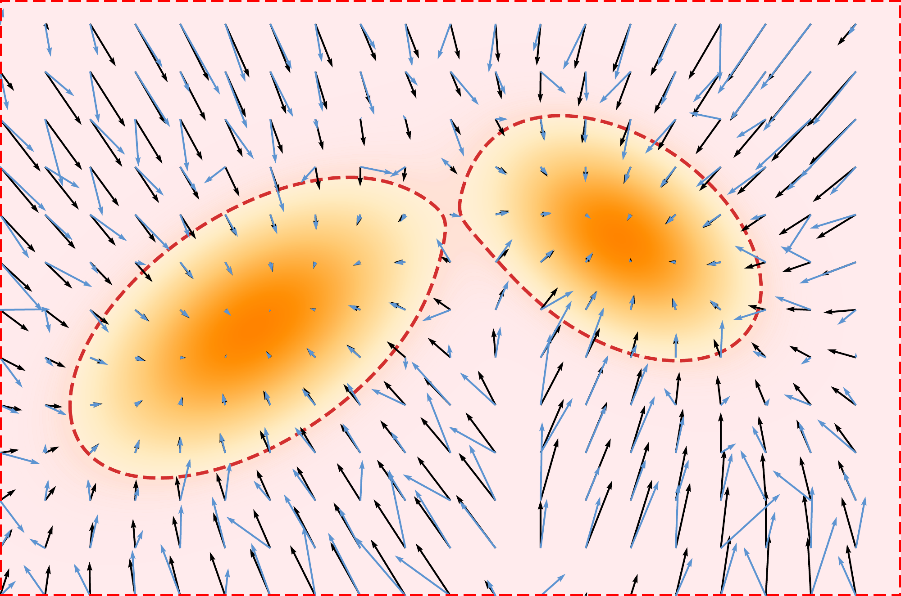
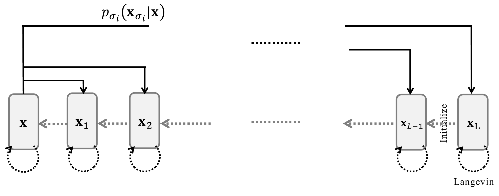

# 3.4 Multi-Noise Levels of Denoising Score Matching (NCSN) {#sec-smld}

## 3.4.1 Motivation {#motivation}

Adding Gaussian noise with a single fixed variance to the data distribution smooths it to a certain extent, but training a score-based model at only one noise level introduces key limitations. At low levels of injected noise, Langevin dynamics struggles to traverse modes in multi-modal distributions due to vanishing gradients in low-density regions. In contrast, at high noise levels, sampling becomes easier, but the model captures only coarse structures, resulting in blurry samples that lack fine detail. Furthermore, Langevin dynamics can be slow to converge or even fail in high-dimensional spaces. Since it depends on the gradient of the log-density for guidance, poor initialization, particularly in plateau regions or near saddle points, can impede exploration or cause the sampler to get trapped in a single mode.

**Figure 3.6:** **Illustration of SM inaccuracy (revisiting [Figure 3.4](02-score-based-models.md#fig-sm-illustration)).** the red region indicates low-density areas with potentially inaccurate score estimates due to limited sample coverage, while high-density regions tend to yield more accurate estimates.

Source: Created by the authors.

To address these challenges, [Song and Ermon (2019)](../../references.md#ref-song2019generative) propose injecting Gaussian noise at multiple levels into the data distribution and jointly training a noise-conditional score network (NCSN) to estimate score functions across a range of noise scales. During generation, Langevin dynamics is applied in a noise-annealed fashion: beginning with high-noise levels to enable coarse exploration, and gradually refining toward low-noise levels to recover fine details.

**Figure 3.7:** **Illustration of NCSN.** The forward process perturbs the data with multiple levels of additive Gaussian noise $p_{\sigma}({\mathbf{x}}_{\sigma} | {\mathbf{x}})$. Generation proceeds (in dash lines) via Langevin sampling at each noise level, using the result from the current level to initialize sampling at the next lower variance.

Source: Created by the authors.

## 3.4.2 Training {#training}

To overcome the limitations of score-based models trained at a single noise level, [Song and Ermon (2019)](../../references.md#ref-song2019generative) propose adding Gaussian noise at multiple levels to the data distribution. Specifically, a sequence of $L$ noise levels $\{\sigma_i\}_{i=1}^L$ is chosen such that

$$
0 < \sigma_1 < \sigma_2 < \cdots < \sigma_L,
$$

where $\sigma_1$ is small enough to preserve most of the data’s fine details, and $\sigma_L$ is large enough to sufficiently smooth the distribution, facilitating easier training.

Each noisy sample is constructed by perturbing a clean data point ${\mathbf{x}} \sim p_{\text{data}}$ as ${\mathbf{x}}_{\sigma} = {\mathbf{x}} + \sigma \boldsymbol{\epsilon}$ with $\boldsymbol{\epsilon} \sim \mathcal{N}(\boldsymbol{0}, {\mathbf{I}})$. This defines the

**Perturbation Kernel:**

$$
p_{\sigma}({\mathbf{x}}_{\sigma} | {\mathbf{x}}) := \mathcal{N}({\mathbf{x}}_{\sigma}; {\mathbf{x}}, \sigma^2 {\mathbf{I}}),
$$

which induces the

**Marginal Distribution:**

$$
p_\sigma({\mathbf{x}}_{\sigma}) = \int p_{\sigma} ({\mathbf{x}}_{\sigma} | {\mathbf{x}})    p_{\text{data}}({\mathbf{x}}) \mathop{}\!\mathrm{d} {\mathbf{x}},
$$

at each noise level $\sigma$. It presents the Gaussian smoothed data distribution.

**Training Objective of NCSN.**

The goal is to train a noise-conditional score network ${\mathbf{s}}_{\boldsymbol{\phi}}({\mathbf{x}}, \sigma)$ to estimate the score function $\nabla_{{\mathbf{x}}} \log p_\sigma({\mathbf{x}})$ for all $\sigma \in \{\sigma_i\}_{i=1}^L$. This is achieved by minimizing the DSM objective across all noise levels:

$$
\begin{aligned}
\mathcal{L}_{\text{NCSN}}(\boldsymbol{\phi}) := \sum_{i=1}^{L} \lambda(\sigma_i)   \mathcal{L}_{\text{DSM}}(\boldsymbol{\phi}; \sigma_i),
\end{aligned}
\tag{3.4.1}
$$

where

$$
\begin{aligned}
\mathcal{L}_{\text{DSM}}(\boldsymbol{\phi}; \sigma)
= \frac{1}{2} \mathbb{E}_{{\mathbf{x}} \sim p_{\text{data}}({\mathbf{x}}),   \tilde{{\mathbf{x}}} \sim p_{\sigma}(\tilde{{\mathbf{x}}} | {\mathbf{x}})}
\left[ \left\lVert{\mathbf{s}}_{\boldsymbol{\phi}}(\tilde{{\mathbf{x}}}, \sigma) - \left( \frac{{\mathbf{x}} - \tilde{{\mathbf{x}}}}{\sigma^2} \right)\right\rVert_2^2 \right],
\end{aligned}
$$

and $\lambda(\sigma_i)>0$ is a weighting function for each scale.

Minimizing this objective yields the score model ${\mathbf{s}}^*({\mathbf{x}}, \sigma)$ that recovers the true score at each noise level:

$$
{\mathbf{s}}^*(\cdot, \sigma) = \nabla_{{\mathbf{x}}} \log p_\sigma(\cdot),  \quad \text{for all } \sigma \in \{\sigma_i\}_{i=1}^L,
$$

as it is essentially DSM minimization (see [Theorem 3.3.1](03-denoising-score-matching.md#thm-sm-dsm)).

**Relationship with DDPM Loss.** Let ${\mathbf{x}}_\sigma={\mathbf{x}}+\sigma\boldsymbol{\epsilon}$ with $\boldsymbol{\epsilon}\sim\mathcal{N}(\mathbf{0},\mathbf{I})$ and let $p_\sigma$ denote the marginal distribution. By Tweedie’s formula,

$$
\nabla_{{\mathbf{x}}_\sigma}\log p_\sigma({\mathbf{x}}_\sigma)
= -\frac{1}{\sigma} {\mathbb{E}} \left[\boldsymbol{\epsilon} \middle|  {\mathbf{x}}_\sigma\right].
$$

Thus the NCSN optimum is the true score ${\mathbf{s}}^*({\mathbf{x}}_\sigma,\sigma)=\nabla_{{\mathbf{x}}_\sigma}\log p_\sigma({\mathbf{x}}_\sigma)$, while the Bayes optimal noise predictor under the DDPM loss [Equation (2.2.10)](../02-variational-perspective/02-ddpm.md#eq-ddpm-simple-loss) is $\boldsymbol{\epsilon}^*({\mathbf{x}}_\sigma,\sigma)={\mathbb{E}}[\boldsymbol{\epsilon}|{\mathbf{x}}_\sigma]$. They are exactly equivalent via

$$
{\mathbf{s}}^*({\mathbf{x}}_\sigma,\sigma) = - \frac{1}{\sigma} \boldsymbol{\epsilon}^*({\mathbf{x}}_\sigma,\sigma),
\qquad
\boldsymbol{\epsilon}^*({\mathbf{x}}_\sigma,\sigma) = - \sigma {\mathbf{s}}^*({\mathbf{x}}_\sigma,\sigma).
$$

In the DDPM setting, the noisy sample at step $i$ can be written as

$$
\sigma_i:=\sqrt{1-\bar{\alpha}_i^2},
\qquad
{\mathbf{x}}_i
=
\bar{\alpha}_i{\mathbf{x}}_0+\sigma_i{\boldsymbol{\epsilon}},
\qquad
{\boldsymbol{\epsilon}}\sim\mathcal{N}(\boldsymbol{0},{\mathbf{I}}).
$$

Therefore, the score and the optimal noise prediction contain the same information:

$$
{\mathbf{s}}^*({\mathbf{x}}_i,i)
=
-\frac{1}{\sigma_i}
{\mathbb{E}}\left[{\boldsymbol{\epsilon}}|{\mathbf{x}}_i\right].
$$

In other words, predicting the noise in DDPM is equivalent, up to the known scale factor $1/\sigma_i$, to predicting the score at noise level $i$.

We will systematically compare and summarize this equivalence of parameterizations in [Chapter 6](../06-unified-perspective/index.md#ch-unified-perspective).

## 3.4.3 Sampling {#sampling}

<section class="book-algorithm" id="alg-smld" aria-labelledby="alg-smld-title" markdown="1">

Algorithm 1: Annealed Langevin Dynamics

**Input:** Trained score ${\mathbf{s}}_{\boldsymbol{\phi}^\times}(\cdot,\sigma_\ell)$, step sizes $\eta_\ell$, and Langevin iteration budgets $N_\ell$ for each noise level $\ell=L,\ldots,1$; initialization distribution $p_{\mathrm{init}}$

1

${\mathbf{x}} \sim p_{\mathrm{init}}$

*Initialize from unstructured noise at the largest noise level*

2

**for** $\ell=L,L-1,\ldots,1$ **do**

3

$\tilde{{\mathbf{x}}}_0 \gets {\mathbf{x}}$

*Initialize this noise level from the previous level’s output*

4

**for** $n=0$ **to** $N_\ell-1$ **do**

5

$\boldsymbol{\epsilon}_n \sim \mathcal{N}(\boldsymbol{0},{\mathbf{I}})$

6

$\tilde{{\mathbf{x}}}_{n+1} \gets \tilde{{\mathbf{x}}}_n +\eta_\ell {\mathbf{s}}_{\boldsymbol{\phi}^\times}(\tilde{{\mathbf{x}}}_n,\sigma_\ell) +\sqrt{2\eta_\ell}\,\boldsymbol{\epsilon}_n$

7

**end for**

8

${\mathbf{x}} \gets \tilde{{\mathbf{x}}}_{N_\ell}$

*Pass the final state to the next smaller noise level, if any*

9

**end for**

**Output:** ${\mathbf{x}}$

</section>

With trained score networks available at multiple noise levels

$$
{\mathbf{s}}_{\boldsymbol{\phi}^\times}(\cdot, \sigma_1), \quad{\mathbf{s}}_{\boldsymbol{\phi}^\times}(\cdot, \sigma_2), \quad \cdots, \quad {\mathbf{s}}_{\boldsymbol{\phi}^\times}(\cdot, \sigma_{L-1}), \quad    {\mathbf{s}}_{\boldsymbol{\phi}^\times}(\cdot, \sigma_L),
$$

the sampling procedure known as *annealed Langevin dynamics* ([Song and Ermon, 2019](../../references.md#ref-song2019generative)) generates data by progressively denoising from a high noise level $\sigma_L$ down to a low noise level $\sigma_1 \approx 0$.

With trained scores at noise levels $0<\sigma_1<\cdots<\sigma_L$, annealed Langevin dynamics generates samples by moving gradually from high noise to low noise. Starting from a simple initialization ${\mathbf{x}}\sim p_{\mathrm{init}}$, it first applies Langevin dynamics at the largest noise level $\sigma_L$, whose score ${\mathbf{s}}_{\boldsymbol{\phi}^\times}(\cdot,\sigma_L)$ guides the samples toward the corresponding smoothed distribution $p_{\sigma_L}$. The resulting samples are then used to initialize Langevin dynamics at the next smaller noise level. Repeating this procedure progressively refines the samples until the smallest noise level $\sigma_1$ is reached.

At each noise level $\sigma_\ell$, Langevin dynamics performs the update

$$
\tilde{{\mathbf{x}}}_{n+1}
=
\tilde{{\mathbf{x}}}_n
+
\eta_\ell
{\mathbf{s}}_{\boldsymbol{\phi}^\times}(\tilde{{\mathbf{x}}}_n,\sigma_\ell)
+
\sqrt{2\eta_\ell}\,\boldsymbol{\epsilon}_n,
\qquad
\boldsymbol{\epsilon}_n\sim\mathcal{N}(\boldsymbol{0},{\mathbf{I}}),
$$

where the output from the previous noise level provides the initialization $\tilde{{\mathbf{x}}}_0$. A common choice is to scale the step size with the noise level as

$$
\eta_\ell
=
\delta\frac{\sigma_\ell^2}{\sigma_1^2},
\qquad
\delta>0.
$$

The algorithm performs Langevin updates at every noise level, including $\sigma_1$, so the final sample is obtained after refinement at the smallest noise level. [Algorithm 1](04-noise-conditional-score-networks.md#alg-smld) summarizes the procedure.

The initial distribution $p_{\mathrm{init}}$ simply provides a starting point for the Markov chain. At the largest noise level, Langevin dynamics moves this initial distribution toward $p_{\sigma_L}$, after which the successive noise levels gradually guide the samples toward increasingly less smoothed versions of the data distribution.

**Slow Sampling Speed of NCSN.** NCSN generates samples using annealed MCMC (commonly Langevin dynamics) across noise scales $\{\sigma_i\}_{i=1}^L$. For each scale $\sigma_i$, it performs $K$ iterative updates of the form “update $\tilde{\mathbf{x}}_n$ using the score ${\mathbf{s}}_{\boldsymbol{\phi}^\times}(\tilde{\mathbf{x}}_n,\sigma_i)$ plus a small random perturbation”, each requiring a forward pass through the score network. Two factors necessitate large $L \times K$:

-   **(i)** **Local Accuracy and Stability:** the learned score is reliable only for small perturbations, requiring small step sizes and many iterations per noise level to avoid bias or instability;

-   **(ii)** **Slow Mixing in High Dimensions:** local MCMC moves explore multimodal, high-dimensional targets inefficiently, demanding many iterations to reach typical data regions.

Because updates are strictly sequential (each iteration depends on the previous one) and each requires an expensive network evaluation, the overall cost is $\mathcal{O}(L K)$ sequential network passes, making sampling computationally slow.
