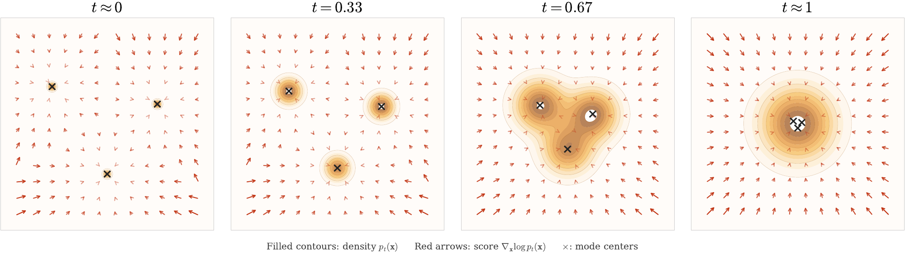
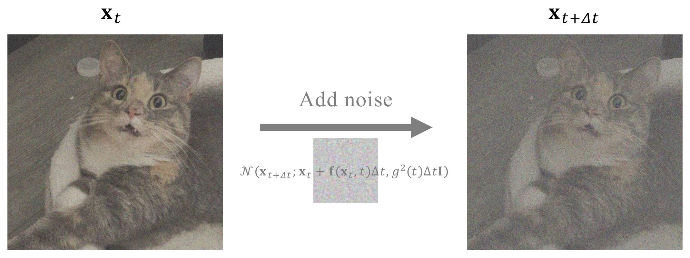
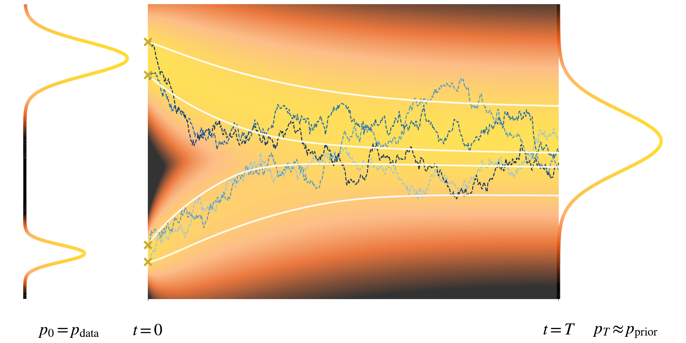
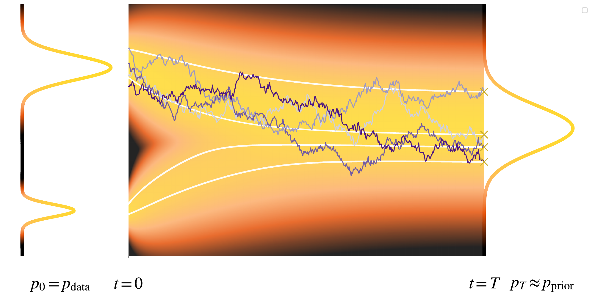

# 4.1 Score SDE: Its Principles {#sec-dm-today}

**Figure 4.1:** **Illustration of the time-dependent score landscape.** As the noise level increases, the perturbed density $p_t({\mathbf{x}})$ evolves from a multimodal distribution (data) concentrated near the data modes to a broad nearly unimodal distribution (prior). Accordingly, the score field $\nabla_{{\mathbf{x}}}\log p_t({\mathbf{x}})$ changes from a sharply local vector field that pulls samples toward nearby modes to a smooth global field that points toward the overall center of mass. This time-dependent score field is the key object learned in score-based diffusion models (i.e., Score SDE).

Source: Created by the authors with AI-assisted coding.

The use of multiple noise scales has been a crucial ingredient in the success of NCSN and DDPM frameworks. In this section, we introduce the foundation of the *Score SDE* ([Song et al., 2020](references.md#ref-song2020score)), which elevates this idea by considering a continuum of noise levels. A continuous-time limit of forward and reverse diffusion processes had already been noted by [Sohl-Dickstein et al. (2015)](references.md#ref-sohl2015deep), but [Song et al. (2020)](references.md#ref-song2020score) make this perspective central by formulating the data evolution as a stochastic/ordinary differential equation, where the noise level increases smoothly over time. Central to this formulation is the *time-dependent score function* $\nabla_{{\mathbf{x}}}\log p_t({\mathbf{x}})$: at each noise level $t$, it points toward regions of higher density under the current noisy distribution $p_t$, and it is precisely this quantity that determines how to reverse the diffusion. As [Figure 4.1](01-score-sde-principles.md#fig-time-dependent-score) illustrates, the score field evolves from sharply converging toward individual data modes at small $t$ to pointing gently toward the global center at large $t$. This continuous-time formulation not only unifies prior discrete-time models but also provides a principled and flexible foundation for generative modeling: learning this family of score functions across all noise levels reduces generation to the problem of solving differential equations.

## 4.1.1 Motivation: From Discrete to Continuous-Time Processes {#subsec-scoresde-motivation}

We revisit the forward noise injection schemes of NCSN and DDPM. NCSN uses a sequence of increasing noise levels $\{\sigma_i\}_{i=1}^L$. Each clean sample ${\mathbf{x}}_0 \sim p_{\mathrm{data}}$ is perturbed as

$$
{\mathbf{x}}_{\sigma_i} = {\mathbf{x}}_0 + \sigma_i \boldsymbol{\epsilon}_i,
\qquad \boldsymbol{\epsilon}_i \sim \mathcal{N}(\boldsymbol{0}, {\mathbf{I}}).
$$

DDPM instead injects noise incrementally with a variance schedule $\{\beta_i\}_{i=1}^L$[^1]:

$$
{\mathbf{x}}_i = \sqrt{1 - \beta_i}\, {\mathbf{x}}_{i-1} + \sqrt{\beta_i}\, \boldsymbol{\epsilon}_i,
\qquad \boldsymbol{\epsilon}_i \sim \mathcal{N}(\boldsymbol{0}, {\mathbf{I}}).
$$

We view them together on a discrete time grid, where the sequential update from ${\mathbf{x}}_t$ to ${\mathbf{x}}_{t+\Delta t}$ takes the form[^2]:

$$
\begin{aligned}
\text{\textbf{NCSN:}} \,\,
    & {\mathbf{x}}_{t+\Delta t} = {\mathbf{x}}_t + \sqrt{\sigma_{t+\Delta t}^2 - \sigma_t^2} \boldsymbol{\epsilon}_t
    &&\approx {\mathbf{x}}_t + \sqrt{\frac{\mathop{}\!\mathrm{d} \sigma_t^2}{\mathop{}\!\mathrm{d} t} \Delta t}  \boldsymbol{\epsilon}_t \\[0.5em]
    \text{\textbf{DDPM:}} \,\,
    & {\mathbf{x}}_{t+\Delta t} = \sqrt{1 - \beta(t)\Delta t} {\mathbf{x}}_t + \sqrt{\beta(t)\Delta t} \boldsymbol{\epsilon}_t
    &&\approx {\mathbf{x}}_t - \frac{1}{2} \beta(t) {\mathbf{x}}_t  \Delta t + \sqrt{\beta(t)\Delta t}  \boldsymbol{\epsilon}_t,
\end{aligned}
$$

where $\boldsymbol{\epsilon}_t \sim \mathcal{N}(\boldsymbol{0}, {\mathbf{I}})$. Interestingly, both noise injection processes follow a common structural pattern:

$$
\begin{aligned}
{\mathbf{x}}_{t+\Delta t} \approx {\mathbf{x}}_t + {\mathbf{f}}({\mathbf{x}}_t, t) \Delta t + g(t) \sqrt{\Delta t}\, \boldsymbol{\epsilon}_t,
\end{aligned}
\tag{4.1.1}
$$

with ${\mathbf{f}}: \mathbb{R}^D \times \mathbb{R} \to \mathbb{R}^D$ and $g: \mathbb{R} \to \mathbb{R}$ given by:

$$
\begin{aligned}
\text{\textbf{NCSN:}} \quad
    & {\mathbf{f}}({\mathbf{x}}, t) = 0, \qquad g(t) = \sqrt{\frac{\mathop{}\!\mathrm{d} \sigma^2(t)}{\mathop{}\!\mathrm{d} t}} \\[0.5em]
    \text{\textbf{DDPM:}} \quad
    & {\mathbf{f}}({\mathbf{x}}, t) = -\frac{1}{2} \beta(t)\, {\mathbf{x}}, \qquad g(t) = \sqrt{\beta(t)}.
\end{aligned}
$$

**Figure 4.2:** **Illustration of the discrete-time noise-adding step.** It adds noise from $t$ to $t + \Delta t$ with mean drift ${\mathbf{f}}({\mathbf{x}}_t, t)$ and diffusion coefficient $g(t)$.

Source: Created by the authors.

This formulation corresponds to the following Gaussian transition:

$$
\begin{aligned}
p({\mathbf{x}}_{t+\Delta t} |{\mathbf{x}}_t) := \mathcal{N}\!\left({\mathbf{x}}_{t+\Delta t}; {\mathbf{x}}_t + {\mathbf{f}}({\mathbf{x}}_t, t)\Delta t,\, g^2(t)\Delta t\, {\mathbf{I}}\right),
\end{aligned}
\tag{4.1.2}
$$

where, by a slight abuse of notation, we treat ${\mathbf{x}}_t$ as a fixed sample and ${\mathbf{x}}_{t+\Delta t}$ as a random variable.

As $\Delta t \to 0$ (which can be conceptually understood as preparing *infinitely many* layers of noises), the discrete-time process converges to a continuous time SDE evolving forward in time[^3]:

$$
\begin{aligned}
\mathop{}\!\mathrm{d} {\mathbf{x}}(t) = {\mathbf{f}}({\mathbf{x}}(t), t) \mathop{}\!\mathrm{d} t + g(t) \mathop{}\!\mathrm{d} {\mathbf{w}}(t),
\end{aligned}
$$

where ${\mathbf{w}}(t)$ is a standard Wiener process (or Brownian motion).

**Remark.**

While a full formal definition is not necessary here, a *Wiener process* is a continuous-time stochastic process ${\mathbf{w}}(t)$ that starts at zero, has independent increments, and satisfies that for any $s < t$, the increment ${\mathbf{w}}(t) - {\mathbf{w}}(s)$ is normally distributed with mean zero and variance $t - s$. It represents the accumulation of independent Gaussian fluctuations over time, and although it is almost surely continuous, it is nowhere differentiable.

Over an infinitesimal time interval $[t, t + \mathop{}\!\mathrm{d} t]$, the increment of a Wiener process is defined as

$$
\mathop{}\!\mathrm{d} {\mathbf{w}}(t) := {\mathbf{w}}(t + \mathop{}\!\mathrm{d} t) - {\mathbf{w}}(t),
$$

which is modeled as a Gaussian random variable with zero mean and variance $\mathop{}\!\mathrm{d} t$:

$$
\mathop{}\!\mathrm{d} {\mathbf{w}}(t) \sim \mathcal{N}(\boldsymbol{0}, \mathop{}\!\mathrm{d} t {\mathbf{I}}).
$$

A brief introduction to the foundations of SDEs is provided in [Section A.2](../../appendices/a-differential-equations/02-stochastic-differential-equations.md#app-sde-intro), with a more advanced discussion in [Appendix C](../../appendices/c-ito-calculus/index.md#app-ito). However, we can conceptually understand the connection between the discrete and continuous formulations as follows:

-   ${\mathbf{x}}(t+\Delta t) - {\mathbf{x}}(t) \approx \mathop{}\!\mathrm{d} {\mathbf{x}}(t)$,

-   $\Delta t \approx \mathop{}\!\mathrm{d} t$,

-   $\sqrt{\Delta t} \boldsymbol{\epsilon}_t \sim \mathcal{N}(\boldsymbol{0}, \Delta t {\mathbf{I}}) \approx \mathop{}\!\mathrm{d} {\mathbf{w}}(t)$.

Once the drift ${\mathbf{f}}({\mathbf{x}},t)$ and diffusion $g(t)$ are specified, the forward time SDE automatically induces a reverse time SDE that transports the terminal noise distribution back to the data distribution. The reverse dynamics involve only a single unknown term, surprisingly the *score function at each continuous-time level*. This identifies score matching as the training objective; once the score is learned, sampling amounts to numerically integrating the reverse time SDE with the learned score.

While [Section 4.3](03-training-and-sampling.md#sec-scoresde-training-sampling) presents practical implementations, we first examine the theoretical foundations of the forward and reverse processes in [Section 4.1.2](01-score-sde-principles.md#subsec-forward-sde) and [Section 4.1.3](01-score-sde-principles.md#subsec-reverse-sde).

## 4.1.2 Forward-Time SDEs: From Data to Noise {#subsec-forward-sde}

**Figure 4.3:** **(1D) Visualization of the forward process in a diffusion model.** The process starts from initial points sampled (denoted as “$\times$”) from a complex bimodal data distribution ($p_0 = p_{\mathrm{data}}$) and evolves toward a simple, unimodal Gaussian prior ($p_T \approx p_{\mathrm{prior}}$). The background heatmap illustrates the evolving marginal probability density, $p_t$, which smooths over time. Sample trajectories are shown evolving from $t=0$ to $t=T$, comparing the stochastic forward SDE process (blue paths) with its deterministic counterpart, the PF-ODE (white paths). Note that the PF-ODE is a deterministic transport map for densities, not generally the mean of sample paths started from a single point.

Source: Created by the authors.

With this formulation, earlier methods based on discrete time, such as NCSN ([Song and Ermon, 2019](references.md#ref-song2019generative)) and DDPM ([Sohl-Dickstein et al., 2015](references.md#ref-sohl2015deep); [Ho et al., 2020](references.md#ref-ho2020denoising)), can be unified under the *continuous-time* framework through a stochastic process ${\mathbf{x}}(t)$ governed by a forward SDE defined on the interval $[0, T]$:

$$
\mathop{}\!\mathrm{d}{\mathbf{x}}(t) = \mathbf{f}({\mathbf{x}}(t), t) \mathop{}\!\mathrm{d} t + g(t) \mathop{}\!\mathrm{d}{\mathbf{w}}(t), \quad {\mathbf{x}}(0) \sim p_{\mathrm{data}}.
\tag{4.1.3}
$$

Here, $\mathbf{f}(\cdot, t)\colon\mathbb{R}^D\to\mathbb{R}^D$ is the drift, $g(t) \in \mathbb{R}$ is the scalar diffusion coefficient, and ${\mathbf{w}}(t)$ denotes a standard Wiener process. We refer to this as the *forward SDE*, which describes how clean data is gradually perturbed into noise over time.

Once the drift $\mathbf{f}$ and diffusion coefficient $g$ are specified, the forward process is fully determined, describing how the data variable is progressively corrupted through the injection of Gaussian noise. In particular, two families of time-dependent densities are induced:

**Perturbation Kernels.** The conditional law

$$
p_t({\mathbf{x}}_t |{\mathbf{x}}_0)
$$

describes how a clean data sample ${\mathbf{x}}_0 \sim p_{\mathrm{data}}$ evolves into its noisy counterpart ${\mathbf{x}}_t$ at time $t$. In general, the drift term ${\mathbf{f}}({\mathbf{x}},t)$ in [Equation (4.1.3)](01-score-sde-principles.md#eq-sde-forward) can be an arbitrary function of ${\mathbf{x}}$, but a common and analytically convenient choice is to assume it is affine:

$$
{\mathbf{f}}({\mathbf{x}},t) = f(t) {\mathbf{x}},
\tag{4.1.4}
$$

where $f(t)$ is a scalar function of $t$, typically taken to be non-positive. Under this structure, the conditional process remains Gaussian given ${\mathbf{x}}_0$, and the perturbation kernel admits a closed-form solution obtained by solving the associated mean–variance ODEs ([Särkkä and Solin, 2019](references.md#ref-sarkka2019applied)) (see also [Section 4.4.3](04-sde-instantiations.md#subsec-scoresde-perturbation-kernel)).

In particular,

$$
p_t({\mathbf{x}}_t |{\mathbf{x}}_0) = \mathcal{N} \big({\mathbf{x}}_t; {\mathbf{m}}(t), P(t)\mathbf I_D\big),
$$

with

$$
{\mathbf{m}}(t) = \exp \Big(\int_0^t f(u) \mathop{}\!\mathrm{d} u\Big) {\mathbf{x}}_0,
\quad
P(t) = \int_0^t \exp \Big(2 \int_s^t f(u) \mathop{}\!\mathrm{d} u\Big) g^2(s) \mathop{}\!\mathrm{d} s,
$$

and initial conditions ${\mathbf{m}}(0)={\mathbf{x}}_0$, $P(0)=0$.

This explicit form allows one to sample ${\mathbf{x}}_t$ given ${\mathbf{x}}_0$ directly, without numerically integrating the SDE, hence the term *simulation-free*. Both NCSN and DDPM fall into this affine-drift setting.

In the remainder, we develop the general theory for arbitrary drifts ${\mathbf{f}}({\mathbf{x}},t)$, but will return to the affine drift when closed-form analysis is useful.

**Marginal Densities.** The time-marginal density $p_t({\mathbf{x}}_t)$ is obtained by integrating over the perturbation kernel:

$$
p_t({\mathbf{x}}_t) := \int p_t({\mathbf{x}}_t|{\mathbf{x}}_0) p_{\mathrm{data}}({\mathbf{x}}_0) \mathop{}\!\mathrm{d} {\mathbf{x}}_0, \quad \text{with } p_0 = p_{\mathrm{data}}.
\tag{4.1.5}
$$

By choosing the coefficients $f(t)$ and $g(t)$ appropriately, the forward process gradually adds noise until the influence of the initial state is effectively forgotten. As $T$ becomes large, the conditional distribution $p_T(\mathbf{x}_T |\mathbf{x}_0)$ no longer depends on $\mathbf{x}_0$, because its mean evolves as

$$
{\mathbf{m}}(T) = \exp\!\Big(\int_0^T f(u)\mathop{}\!\mathrm{d} u\Big) \mathbf{x}_0  \longrightarrow  \mathbf{0}, \quad \text{as } T\to\infty,
$$

provided $f(u)$ is non-positive so that the exponential factor decays. At the same time, the variance grows and stabilizes to match a chosen prior distribution. Consequently, the marginal

$$
p_T(\mathbf{x}_T) = \int p_T(\mathbf{x}_T |\mathbf{x}_0) p_{\mathrm{data}}(\mathbf{x}_0)\mathop{}\!\mathrm{d}\mathbf{x}_0,
$$

which initially represents a complicated mixture over data samples, converges to a simple prior $p_{\mathrm{prior}}$, typically Gaussian. In this limit,

$$
p_T(\mathbf{x}_T) \approx p_{\mathrm{prior}}(\mathbf{x}_T)
\quad \text{and} \quad
p_T(\mathbf{x}_T |\mathbf{x}_0) \approx p_{\mathrm{prior}}(\mathbf{x}_T),
$$

so the forward process maps any data distribution into a tractable prior, providing a convenient starting point for reversal and generation.

## 4.1.3 Reverse-Time Stochastic Process for Generation {#subsec-reverse-sde}

**Figure 4.4:** **Visualization of the reverse-time stochastic process for data generation.** It begins from samples drawn from a simple prior distribution ($p_{\mathrm{prior}}$) at $t=T$ (denoted as “$\times$”), which are evolved backward in time using a reverse-SDE. The resulting trajectories terminate at $t=0$ and collectively form the target bimodal data distribution ($p_0 = p_{\mathrm{data}}$). The background heatmap illustrates how the probability density is gradually transformed from a simple Gaussian into the complex target distribution.

Source: Created by the authors.

Intuitively, data generation from noise can be achieved by “reversing” the forward process: starting from a random point sampled from the prior distribution and evolving it backward in time to obtain a generated sample. For deterministic systems (that is, ODEs), this idea works naturally. Since no randomness is involved, reversing time simply means tracing the trajectory of a point in the opposite direction along the same path as in the forward process[^4]. In contrast, SDEs incorporate stochasticity at every time step, meaning that a single point can evolve along many plausible random trajectories. As a result, reversing such processes is more subtle[^5].

While individual stochastic trajectories are not reversible, the remarkable insight is that the distribution over these trajectories can be reversed. This is formalized by a foundational result from [Anderson (1982)](references.md#ref-anderson1982reverse), which shows that the time-reversed process $\{ \bar{{\mathbf{x}}}(t) \}_{t \in [0, T]}$[^6] of the forward process in [Equation (4.1.3)](01-score-sde-principles.md#eq-sde-forward) is itself governed by a well-defined SDE. This reverse-time process evolves from $T$ to $0$, and its dynamics are given by:

$$
\begin{aligned}[t]
    \mathop{}\!\mathrm{d}\bar{{\mathbf{x}}}(t) = \left[\mathbf{f}(\bar{{\mathbf{x}}}(t), t) {\color{orange} - g^2(t) \nabla_{{\mathbf{x}}} \log p_t(\bar{{\mathbf{x}}}(t))} \right] \mathop{}\!\mathrm{d} t + g(t) \mathop{}\!\mathrm{d} \bar{{\mathbf{w}}}(t), \\
    \bar{{\mathbf{x}}}(T) \sim p_{\mathrm{prior}} \approx p_T.
\end{aligned}
\tag{4.1.6}
$$

Here, $\bar{{\mathbf{w}}}(t)$ denotes a standard Wiener process in reverse time, defined as $\bar{{\mathbf{w}}}(t) := {\mathbf{w}}(T - t) - {\mathbf{w}}(T)$.

**Remark.**

Throughout this chapter, $t$ denotes the original diffusion clock: $t=0$ corresponds to data and $t=T$ to noise. Accordingly, the reverse-time SDE in [Equation (4.1.6)](01-score-sde-principles.md#eq-sde-backward) is integrated from $t=T$ down to $t=0$, so $\mathop{}\!\mathrm{d} t<0$ along the reverse process. Equivalently, one may introduce a forward-running reverse clock $s:=T-t$; unless stated otherwise, we keep the original clock $t$.

To build intuition for [Equation (4.1.6)](01-score-sde-principles.md#eq-sde-backward), we present a concrete example in [Section 4.2.2](02-matching-marginals.md#subsec-example-gaussian) with a Gaussian data distribution and linear–Gaussian dynamics. This setting is analytically tractable: one can derive the time-reversal formula directly using basic calculus and linear algebra, without invoking the full general theory of [Anderson (1982)](references.md#ref-anderson1982reverse).

Note that the presence of stochasticity ($g\neq 0$) introduces an additional correction term, $-g^2(t) \nabla_{{\mathbf{x}}} \log p_t(\bar{{\mathbf{x}}}(t))$, which accounts for the effect of diffusion and ensures that the reversed dynamics correctly reproduce the evolution of marginal distributions induced by the forward SDE (see [Section 4.2](02-matching-marginals.md#subsec-fpe-sde-ode)).

**Conceptually, Why Does the Reverse Process Work?** [Section 4.6.2](06-fokker-planck-and-reverse-sde.md#subsec-reverse-sde-reason) presents an intuitive derivation of the reverse-time SDE by connecting it to the DDPM variational framework (optional but insightful). Here, we provide complementary intuition for how the reverse-time dynamics recover structured data from noise.

At first glance, the presence of Brownian noise in the reverse time process may seem paradoxical. If the forward diffusion spreads data into increasingly noisy configurations, it is unclear how reversing this process, particularly one that introduces additional randomness through $\bar{{\mathbf{w}}}(t)$, can produce clean, structured samples concentrated near the data manifold. The key point is that the reverse time SDE does not inject arbitrary randomness. The diffusion term $g(t)\mathop{}\!\mathrm{d}\bar{{\mathbf{w}}}(t)$ is always coupled with the score–driven drift $- g^2(t)\nabla_{{\mathbf{x}}}\log p_t(\bar{{\mathbf{x}}}(t))$. Together, these terms balance one another: the score guides trajectories toward regions of higher density, while the noise introduces controlled stochasticity that allows exploration without overwhelming the dynamics.

To see this more clearly, return to the Langevin intuition in [Equation (3.1.6)](../03-score-based-perspective/01-energy-based-models.md#eq-continuous-langevin). When $f(t)\equiv 0$, [Equation (4.1.6)](01-score-sde-principles.md#eq-sde-backward) reads

$$
\mathop{}\!\mathrm{d}\bar{{\mathbf{x}}}(t)
= - g^2(t) \nabla_{{\mathbf{x}}}\log p_t\!\big(\bar{{\mathbf{x}}}(t)\big) \mathop{}\!\mathrm{d} t
+ g(t)  \mathop{}\!\mathrm{d}\bar{{\mathbf{w}}}(t).
$$

Reparameterize time forward via $s:=T-t$ (so $\mathop{}\!\mathrm{d} t=-\mathop{}\!\mathrm{d} s$), and rename the Brownian motion in law so that $\mathop{}\!\mathrm{d}\bar{{\mathbf{w}}}(t)=-\mathop{}\!\mathrm{d}{\mathbf{w}}_s$. Writing $\bar{{\mathbf{x}}}_s:=\bar{{\mathbf{x}}}(T-s)$ and $\pi_s:=p_{T-s}$ then gives

$$
\begin{aligned}
\mathop{}\!\mathrm{d}\bar{{\mathbf{x}}}_s
&= g^2(T-s) \nabla\log \pi_s \big(\bar{{\mathbf{x}}}_s\big) \mathop{}\!\mathrm{d} s
+ g(T-s) \mathop{}\!\mathrm{d}{\mathbf{w}}_s
\\&=
2\tau(s) \nabla\log \pi_s\!\big(\bar{{\mathbf{x}}}_s\big) \mathop{}\!\mathrm{d} s
+ \sqrt{2\tau(s)} \mathop{}\!\mathrm{d}{\mathbf{w}}_s,
\quad
\tau(s):=\tfrac{1}{2}g^2(T-s).
\end{aligned}
$$

This has the Langevin form with a time-varying temperature $\tau(s)$, targeting the evolving density $\pi_s$. By Tweedie’s formula ([Equation (3.3.6)](../03-score-based-perspective/03-denoising-score-matching.md#eq-tweedie)), the score direction $\nabla\log \pi_s$ points toward the conditional clean signal at each time slice, so the drift continually “pulls back” denoised structure.

Crucially, $g(t)$ is *annealing* along the reverse trajectory. Early on ($s\approx 0$, i.e., $t\approx T$), $g(T-s)$ is typically larger, so the injected noise is stronger and the process explores broadly. As $s$ increases, $g(T-s)$ decreases, the stochastic term weakens, and the score term dominates, pulling samples into high-density regions of $\pi_s$; by $s=T$ (i.e., $t=0$), trajectories concentrate near the data manifold.

**Overview of Reverse-Time SDE Capabilities.**

It is fascinating how the time-dependent score function

$$
{\mathbf{s}}({\mathbf{x}}, t) := \nabla_{{\mathbf{x}}} \log p_t({\mathbf{x}})
$$

naturally appears in [Equation (4.1.6)](01-score-sde-principles.md#eq-sde-backward). Once the forward coefficients $f(t)$ and $g(t)$ are specified, the score is the only remaining unknown in the reverse dynamics. This highlights its central role: with the score in hand, the reverse process is determined, and sampling amounts to numerically integrating [Equation (4.1.6)](01-score-sde-principles.md#eq-sde-backward) with the learned score.

Since the oracle score generally lacks a closed-form expression, we adopt the approach of [Chapter 3](../03-score-based-perspective/index.md#ch-score-based) and train a neural network $\mathbf{s}_{\boldsymbol{\phi}}({\mathbf{x}}, t)$ to approximate it via score matching; see [Section 4.3.1](03-training-and-sampling.md#subsec-sde-train) for details. Substituting ${\mathbf{s}}({\mathbf{x}}, t)$ with $\mathbf{s}_{\boldsymbol{\phi}}({\mathbf{x}}, t)$ in [Equation (4.1.6)](01-score-sde-principles.md#eq-sde-backward) then specifies the reverse dynamics completely.

Generation corresponds to solving the reverse-time SDE reversely from $t = T$, starting with ${\mathbf{x}}_T \sim p_{\mathrm{prior}}$, to $t = 0$. Importantly, [Anderson (1982)](references.md#ref-anderson1982reverse) proves that the marginal densities of the forward and reverse processes coincide, ensuring that samples at $t=0$ approximately follow $p_{\mathrm{data}}$ when $p_{\mathrm{prior}} \approx p_T$. We will explore this further in [Section 4.3.2](03-training-and-sampling.md#subsec-sde-sample).

## 4.1.4 Deterministic Process (Probability Flow ODE) for Generation {#subsec-pf-ode}

Although the SDE in [Equation (4.1.6)](01-score-sde-principles.md#eq-sde-backward) introduces stochasticity and potentially increases the diversity of generated samples, a question arises:

**Question 4.1.1**

Is it necessary to sample using the SDE in [Equation (4.1.6)](01-score-sde-principles.md#eq-sde-backward)?

Inspired by [Maoutsa et al. (2020)](references.md#ref-maoutsa2020interacting), [Song et al. (2020)](references.md#ref-song2020score) also introduced a deterministic process, an ODE, that evolves samples with the same marginal distributions as the forward SDE. This process $\{\tilde{\mathbf{x}}(t)\}_{t\in[0,T]}$[^7], called the *Probability Flow ODE (PF-ODE)*, is given by:

$$
\frac{\mathop{}\!\mathrm{d}}{\mathop{}\!\mathrm{d} t}\tilde{\mathbf{x}}(t) = \mathbf{f}(\tilde{\mathbf{x}}(t), t) - \frac{1}{2} g^2(t) \nabla_{{\mathbf{x}}} \log p_t(\tilde{\mathbf{x}}(t)).
\tag{4.1.7}
$$

Analogous to the SDE case, one can replace the true score with a learned approximation and integrate the reverse-time ODE from $t = T$ to $t = 0$ to generate samples. Concretely, the generated sample (solution of PF-ODE at time $t=0$) takes the form

$$
\tilde{\mathbf{x}}(T) + \int_{T}^{0} \Big[ \mathbf{f}(\tilde{\mathbf{x}}(\tau), \tau) - \frac{1}{2} g^2(\tau)  \nabla_{{\mathbf{x}}} \log p_\tau(\tilde{\mathbf{x}}(\tau)) \Big]   \mathop{}\!\mathrm{d} \tau,
$$

where the initial condition $\tilde{\mathbf{x}}(T) \sim p_{\mathrm{prior}}$. Since this integral is intractable in closed form, practical generation relies on numerical solvers (e.g., Euler method, see [Equation (4.3.4)](03-training-and-sampling.md#eq-euler-maruyama)).

Compared to the reverse-time SDE, the PF-ODE offers two key advantages:

-   The ODE can be integrated in either direction, from $t=0$ to $t=T$ or from $t=T$ to $t=0$, using the same formulation of the equation, provided the corresponding initial condition is specified at the chosen endpoint. This bidirectionality contrasts with SDEs, which generally admit only forward time integration.

-   It benefits from a wide range of well-established, off-the-shelf numerical solvers developed for ODEs.

We emphasize that the PF-ODE is not obtained by simply removing the diffusion term in [Equation (4.1.6)](01-score-sde-principles.md#eq-sde-backward); notably, the factor of $\frac{1}{2}$ in its drift term has a principled origin. At a high level, [Equation (4.1.7)](01-score-sde-principles.md#eq-prob-ode-gt) arises by choosing the drift of an ODE such that its evolution preserves the same marginal densities as the forward SDE in [Equation (4.1.3)](01-score-sde-principles.md#eq-sde-forward). The underlying principle (i.e., Fokker-Planck Equation ([Øksendal, 2003](references.md#ref-oksendal2003stochastic))) ensuring this alignment of marginals will be detailed in the next section.

[^1]: In [Section 2.2](../02-variational-perspective/02-ddpm.md#sec-ddpm), the DDPM forward step is written as ${\mathbf{x}}_i = \sqrt{1-\beta_i^2}\,{\mathbf{x}}_{i-1} + \beta_i\,\boldsymbol{\epsilon}_i$, where $\beta_i$ denotes the standard deviation of the injected noise and $\alpha_i := \sqrt{1-\beta_i^2}$. Here and throughout this chapter, we follow the convention of [Song et al. (2020)](references.md#ref-song2020score), where $\beta_i$ instead denotes the variance of the injected noise, so that ${\mathbf{x}}_i = \sqrt{1-\beta_i}\,{\mathbf{x}}_{i-1} + \sqrt{\beta_i}\,\boldsymbol{\epsilon}_i$. The two conventions are related by $\beta_i^{\text{(here)}} = \bigl(\beta_i^{\text{(Ch. 2)}}\bigr)^2$ and yield identical dynamics.

[^2]: For convenience, we use ${\mathbf{x}}(t)$ and ${\mathbf{x}}_t$ interchangeably (and similarly for other time-dependent variables) to denote samples at time $t$.

[^3]: The forward kernel in [Equation (4.1.2)](01-score-sde-principles.md#eq-transition-forward-f-g) converges, as $\Delta t\to0$, to the solution of the corresponding Itô SDE. A fully rigorous proof relies on advanced results which we defer to the literature.

[^4]: Technically, this corresponds to solving the ODE with a time-flipping substitution $t \leftrightarrow T - t$.

[^5]: Naively flipping time does not yield the correct reverse process.

[^6]: We use the “bar” notation to distinguish the reverse process $\{ \bar{{\mathbf{x}}}(t) \}_{t \in [0, T]}$ from the forward process $\{ {\mathbf{x}}(t) \}_{t \in [0, T]}$, defined by the forward-time SDE.

[^7]: We use a tilde to distinguish processes associated with the forward and reverse-time SDEs. Going forward, we omit this notational distinction for simplicity.
