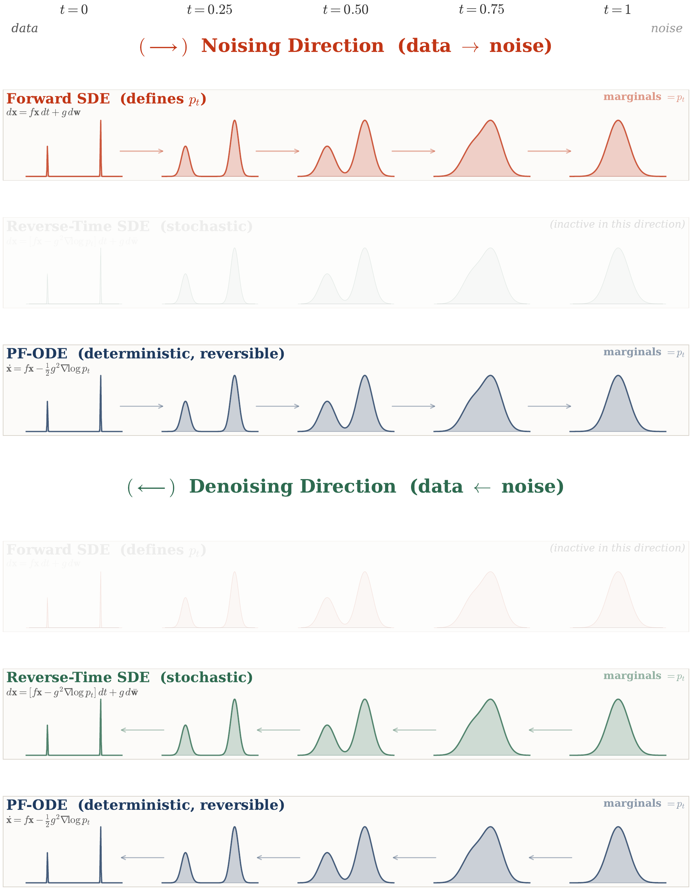

# 4.2 Matching Marginals in Forward/Reverse-Time SDEs and PF-ODE {#subsec-fpe-sde-ode}

**Figure 4.5:** **Three dynamics sharing the same marginals $p_t$.** **Upper panel: noising direction.** The forward SDE, which serves as an anchor reference, defines the marginals $p_t$ by diffusing data toward a Gaussian prior. The PF-ODE follows the same marginal path deterministically when *run forward in time*. **Lower panel: denoising direction.** The reverse-time SDE and the PF-ODE *run backward in time* yield the same marginals in reverse, as guaranteed by the Fokker–Planck equation. The reverse-time SDE gives a stochastic denoising process, whereas the PF-ODE gives a deterministic one. Thus, the repeated density snapshots are intentional: the processes agree at the level of one-time marginals, but differ in their sample-level dynamics. The PF-ODE appears in both panels because it is a deterministic flow that can be integrated in either time direction.

Source: Created by the authors with AI-assisted coding.

In this section, we present the *Fokker-Planck equation* as the central principle governing diffusion models. It describes how probability densities evolve under noisy dynamics and serves as the natural analogue of a change-of-variables formula when randomness is present (see [Appendix B](../../appendices/b-density-evolution/index.md#app-continuity)). Starting from the forward diffusion process, which defines the marginals $p_t$, we explain how both the reverse-time SDE and the PF-ODE are designed to reproduce the same marginal family. We then make this principle concrete through a Gaussian example, where the reverse-time SDE and the PF-ODE can be computed directly and explicitly.

## 4.2.1 Fokker-Planck Equation to Ensure Alignment of Marginal Densities {#alignment-of-marginal-densities}

A central concept in diffusion models is that *different processes can lead to the same sequence of marginal distributions* (as we will illustrate later in this subsection). The objective is to construct a process that transforms $p_{\mathrm{prior}}$ into $p_{\mathrm{data}}$ by aligning the marginals across time, and in particular at $t=0$. The exact form of the process is secondary, provided it is tractable and admits efficient sampling. This naturally leads to a fundamental question:

**Question 4.2.1**

How can we ensure that different processes yield identical marginal distributions?

Returning to our setup, once the forward SDE is specified, it defines the evolution of marginal densities from $p_{\mathrm{data}}$ to $p_{\mathrm{prior}}$. The reverse-time SDE and PF-ODE are then constructed so that their trajectories yield marginal distributions that exactly match those of the forward process. The key to this correspondence lies in the Fokker–Planck equation, which governs how marginal densities evolve under diffusion processes. An illustration is provided in [Figure 4.5](02-matching-marginals.md#fig-score-sde-three-dynamics). The following theorem ([Anderson, 1982](references.md#ref-anderson1982reverse); [Song et al., 2020](references.md#ref-song2020score)) establishes the foundation for this connection:

**Theorem 4.2.1: Marginal Alignment via the Fokker–Planck Equation**

Consider the forward SDE

$$
\mathop{}\!\mathrm{d} {\mathbf{x}}(t)
=
{\mathbf{f}}({\mathbf{x}}(t),t)\mathop{}\!\mathrm{d} t
+
g(t)\mathop{}\!\mathrm{d} {\mathbf{w}}(t),
\qquad
{\mathbf{x}}(0)\sim p_0=p_{\mathrm{data}}.
$$

Under standard regularity conditions, its marginal density $p_t$ evolves according to the Fokker–Planck equation

$$
\begin{aligned}
\partial_t p_t({\mathbf{x}})
&=
-\nabla_{{\mathbf{x}}}\cdot
\bigl[{\mathbf{f}}({\mathbf{x}},t)p_t({\mathbf{x}})\bigr]
+
\tfrac12 g^2(t)\Delta_{{\mathbf{x}}}p_t({\mathbf{x}})
\\
&=
-\nabla_{{\mathbf{x}}}\cdot
\bigl[{\mathbf{v}}({\mathbf{x}},t)p_t({\mathbf{x}})\bigr],
\end{aligned}
\tag{4.2.1}
$$

where $\Delta_{{\mathbf{x}}}$ denotes the Laplacian operator and

$$
{\mathbf{v}}({\mathbf{x}},t)
:=
{\mathbf{f}}({\mathbf{x}},t)
-
\tfrac12 g^2(t)
\nabla_{{\mathbf{x}}}\log p_t({\mathbf{x}}).
$$

Importantly, the same family of marginal distributions $\{p_t\}_{t\in[0,T]}$ can be realized by two different dynamics:

-   **(i)** The *PF-ODE*

    $$
    \frac{\mathop{}\!\mathrm{d}\tilde{\mathbf{x}}(t)}{\mathop{}\!\mathrm{d} t}
    =
    {\mathbf{v}}(\tilde{\mathbf{x}}(t),t).
    $$

    Starting from $\tilde{\mathbf{x}}(0)\sim p_0$ and solving forward from $0$ to $T$ gives $\tilde{\mathbf{x}}(t)\sim p_t$. Equivalently, starting from $\tilde{\mathbf{x}}(T)\sim p_T$ and solving the same ODE backward from $T$ to $0$ follows the same marginals in reverse.

-   **(ii)** The *reverse-time SDE*

    $$
    \mathop{}\!\mathrm{d}\bar{\mathbf{x}}(t)
    =
    \Bigl[
    {\mathbf{f}}(\bar{\mathbf{x}}(t),t)
    -
    g^2(t)\nabla_{{\mathbf{x}}}\log p_t(\bar{\mathbf{x}}(t))
    \Bigr]\mathop{}\!\mathrm{d} t
    +
    g(t)\mathop{}\!\mathrm{d}\bar{\mathbf{w}}(t).
    $$

    Starting from $\bar{\mathbf{x}}(T)\sim p_T$, this SDE is solved backward in time from $t=T$ to $t=0$. Along this reverse evolution, its marginal distribution at time $t$ is

    $$
    \bar{\mathbf{x}}(t)\sim p_t.
    $$

Thus, the reverse-time SDE and PF-ODE can have the same marginal distribution at every noise level even though one is stochastic and the other is deterministic.

**Proof for Theorem.**

The proof is provided in [Section D.2.5](../../appendices/d-supplementary-proofs/index.md#app-sec-scoresde-fpe-proof), while [Section 4.6.1](06-fokker-planck-and-reverse-sde.md#subsec-fpe-reason) offers further intuition behind the Fokker–Planck equation using the marginalization technique of probability.

**Multiple Conditional Distributions for a Fixed Marginal.** To understand how the PF-ODE transports $p_{\mathrm{data}}$ forward in time (or equivalently $p_{\mathrm{prior}}$ in reverse), consider the *flow map* ${\boldsymbol{\Psi}}_{s \to t}: \mathbb{R}^D \to \mathbb{R}^D$, where ${\boldsymbol{\Psi}}_{s \to t}({\mathbf{x}}_s)$ denotes the PF-ODE solution at time $t$ initialized from ${\mathbf{x}}_s$ at time $s$, for any time $s, t \in[0,T]$. In other words, this map takes an initial state ${\mathbf{x}}_s$ and directly jumps to its state at $t$:

$$
\begin{aligned}
{\boldsymbol{\Psi}}_{s \to t}({\mathbf{x}}_s) \coloneqq {\mathbf{x}}_s + \int_s^t {\mathbf{v}}({\mathbf{x}}_\tau, \tau)\mathrm{d}\tau,
\end{aligned}
\tag{4.2.2}
$$

with velocity field

$$
\begin{aligned}
{\mathbf{v}}({\mathbf{x}}, \tau) := {\mathbf{f}}({\mathbf{x}}, \tau) - \frac{1}{2} g^2(\tau)\nabla_{{\mathbf{x}}}\log p_\tau({\mathbf{x}}).
\end{aligned}
$$

Here, the integral captures the net displacement accumulated along the PF-ODE trajectory. The term *flow map* is indeed classical in differential equations, dynamical systems, and continuum mechanics: it denotes the map that carries a state from its position at time $s$ to its position at time $t$ under the given dynamics. The velocity field ${\mathbf{v}}({\mathbf{x}},t)$ describes the instantaneous motion, whereas the flow map ${\boldsymbol{\Psi}}_{s\to t}$ records the accumulated motion over a finite time interval ([Arnold, 1988](references.md#ref-arnold1988geometrical); [Chorin and Marsden, 1993](references.md#ref-chorin1993mathematical))[^1]. We use the term in this standard mathematical and physical sense throughout the book, particularly when discussing fast diffusion-based generators in [Chapter 10](../10-distillation/index.md#ch-distillation) and [Chapter 11](../11-fast-generators/index.md#ch-fast-scratch). Under mild smoothness assumptions on ${\mathbf{v}}$, the flow map ${\boldsymbol{\Psi}}_{s \to t}: \mathbb{R}^D \to \mathbb{R}^D$ is a smooth bijection[^2].

For any $t\in[0,T]$, the *pushforward density* is defined as

$$
p_t^{\mathrm{fwd}}({\mathbf{x}}_t) := \int \delta\bigl({\mathbf{x}}_t - {\boldsymbol{\Psi}}_{0 \to t}({\mathbf{x}}_0)\bigr)\, p_{\mathrm{data}}({\mathbf{x}}_0) \,\mathop{}\!\mathrm{d} {\mathbf{x}}_0,
$$

denoted $\boldsymbol{\Psi}_{0\to t} \sharp p_{\mathrm{data}}$, representing the distribution at time $t$ under $\boldsymbol{\Psi}_{0\to t}$. [Theorem 4.2.1](02-matching-marginals.md#thm-fpe) ensures $p_t^{\mathrm{fwd}} = p_t$, where $p_t$ is the marginal density of the forward SDE, equating the deterministic PF-ODE and stochastic kernel:

$$
p_t({\mathbf{x}}_t) = \int p_t({\mathbf{x}}_t |{\mathbf{x}}_0)\, p_{\mathrm{data}}({\mathbf{x}}_0)\,\mathop{}\!\mathrm{d} {\mathbf{x}}_0
= \int \delta\bigl({\mathbf{x}}_t - \boldsymbol{\Psi}_{0\to t}({\mathbf{x}}_0)\bigr)\, p_{\mathrm{data}}({\mathbf{x}}_0)\,\mathop{}\!\mathrm{d} {\mathbf{x}}_0.
$$

This implies infinitely many conditionals $Q_t({\mathbf{x}}_t |{\mathbf{x}}_0)$ yield the same $p_t({\mathbf{x}}_t)$, for instance:

-   **Stochastic (Simulation-Free):** $Q_t({\mathbf{x}}_t |{\mathbf{x}}_0) = p_t({\mathbf{x}}_t |{\mathbf{x}}_0)$,

-   **Deterministic (Requires ODE Solving):** $Q_t({\mathbf{x}}_t |{\mathbf{x}}_0) = \delta\bigl({\mathbf{x}}_t - \boldsymbol{\Psi}_{0\to t}({\mathbf{x}}_0)\bigr)$,

-   **Mixture:**

    $$
    Q_t({\mathbf{x}}_t |{\mathbf{x}}_0) = \lambda p_t({\mathbf{x}}_t |{\mathbf{x}}_0) + (1-\lambda)\delta\bigl({\mathbf{x}}_t - \boldsymbol{\Psi}_{0\to t}({\mathbf{x}}_0)\bigr),
    $$

    $\lambda\in[0,1]$.

This nonuniqueness of $Q_t({\mathbf{x}}_t |{\mathbf{x}}_0)$ arises from the fact that the marginal constraint does not uniquely determine the conditional distribution. This concept reappears in [Section 5.2.2](../05-flow-based-perspective/02-flow-matching-framework.md#subsec-fm-framework) and [Section 9.2.3](../09-numerical-solvers/index.md#subsec-ddim). In particular, there exists an entire family of reverse-time SDEs that are consistent with the same marginal $p_t$.

**Observation 4.2.1: Matching Prescribed Marginal Densities**

Multiple processes can give rise to the same sequence of marginal densities; what truly matters is satisfying the Fokker–Planck equation. This fundamental insight affords us remarkable flexibility in designing generative processes that transition from $p_{\mathrm{prior}}$ to $p_{\mathrm{data}}$, or vice versa.

The Fokker–Planck equation lies at the heart of diffusion models and is rooted in the fundamental *change-of-variable formula* for probability densities (see [Appendix B](../../appendices/b-density-evolution/index.md#app-continuity) for a systematic treatment). Far from being a minor technical detail, this principle recurs throughout our development, most notably in [Section 5.2](../05-flow-based-perspective/02-flow-matching-framework.md#sec-flow-matching-framework).

## 4.2.2 A Computable Example: Evolutions of Gaussian Dynamics {#subsec-example-gaussian}

When $p_{\mathrm{data}}$ is a normal distribution (or a mixture of Gaussians), the score function admits a closed-form expression. This makes it an ideal setting for building intuition about diffusion processes: we can explicitly derive the reverse-time SDE and the PF-ODE using only basic calculus, without resorting to advanced mathematical tools. In this subsection, we illustrate how these equations behave in such a tractable case.

**Exact Computation of the Reverse-Time SDE with a Gaussian.** When $p_{\mathrm{data}}$ is Gaussian, the formula in [Equation (4.1.6)](01-score-sde-principles.md#eq-sde-backward) can be derived directly, without relying on the general theory and proofs of [Anderson (1982)](references.md#ref-anderson1982reverse). To illustrate the core idea, we consider the one-dimensional case; the extension to higher dimensions follows in the same way.

Start from the forward SDE

$$
\mathop{}\!\mathrm{d} x(t)  =  f(t)  x(t)  \mathop{}\!\mathrm{d} t  +  g(t)  \mathop{}\!\mathrm{d} w_t,
$$

and take one small Euler step of size $\Delta t>0$:

$$
x_{t+\Delta t}  =  a  x_t  +  r  \epsilon,
$$

where $a:=1+f(t)\Delta t$, $r:=g(t)\sqrt{\Delta t}$, and $\epsilon\sim\mathcal N(0,1)$. Equivalently, the forward one-step transition kernel is Gaussian:

$$
x_{t+\Delta t}   |   x_t  \sim  \mathcal N\!\big(\cdot;a  x_t,   r^2\big).
$$

Since $p_{\mathrm{data}}$ is assumed to be Gaussian, the current marginal at time $t$ is also Gaussian, which takes the following form:

$$
x_t \sim \mathcal N(\cdot;m_t,   s_t^2),
$$

for some scalar $m_t$ and $s_t$. So conditioning will amount to multiplying two Gaussians and renormalizing. This keeps the algebra elementary.

By Bayes’ rule the conditional density is, up to a constant, the product of the prior and the transition kernel:

$$
\begin{aligned}
p(x_t   |   x_{t+\Delta t})  &\propto p(x_{t+\Delta t} | x_t   ) p_t({\mathbf{x}}_t) \\&\propto
\exp\Big(-\frac{(x_t-m_t)^2}{2s_t^2}\Big)
\exp\Big(-\frac{(x_{t+\Delta t}-a  x_t)^2}{2r^2}\Big).
\end{aligned}
$$

The exponent is a quadratic in $x_t$. Expanding both squares and grouping terms shows exactly which coefficients matter:

$$
-2\log p(x_t   |   x_{t+\Delta t})
 =
A  x_t^2  -  2 B  x_t  +  \text{const},
$$

with

$$
A:=\frac{1}{s_t^2}+\frac{a^2}{r^2},\quad
B:=\frac{m_t}{s_t^2}+\frac{a  x_{t+\Delta t}}{r^2}.
$$

Here $A$ is the sum of precisions (prior precision plus the transition-kernel precision transported through $a$), while $B$ is the corresponding precision-weighted sum of targets. With these in hand, completing the square gives the posterior in one line:

$$
A x_t^2 - 2 B x_t
  =
A\Big(x_t-\frac{B}{A}\Big)^2  -  \frac{B^2}{A},
$$

so the conditional distribution is Gaussian with variance $1/A$ and mean $B/A$:

$$
\operatorname{Var}(x_t   |   x_{t+\Delta t})   =   \frac{1}{\frac{1}{s_t^2}+\frac{a^2}{r^2}},
\qquad
\mathbb E[x_t   |   x_{t+\Delta t}]   =
\frac{\frac{m_t}{s_t^2}+\frac{a  x_{t+\Delta t}}{r^2}}{\frac{1}{s_t^2}+\frac{a^2}{r^2}}.
$$

These closed forms already describe the reverse transition for any small $\Delta t$. To read off a reverse-time SDE, we now expand them for small $\Delta t$.

Use $a=1+f(t)\Delta t$ and $r^2=g^2(t)\Delta t$. As $\Delta t\to 0$, the contribution $\frac{a^2}{r^2}\sim \frac{1}{g^2(t)\Delta t}$ dominates the precision, so the variance becomes

$$
\operatorname{Var}(x_t   |   x_{t+\Delta t})
= \left(\frac{1}{s_t^2}+\frac{a^2}{r^2}\right)^{-1}
= g^2(t)  \Delta t  +  \mathcal{O}(\Delta t^2),
$$

which tells us the reverse step has the same diffusion scale $g(t)$ as the forward step. For the mean, expand the ratio $B/A$ to first order:

$$
\mathbb E[x_t   |   x_{t+\Delta t}]
  =  x_{t+\Delta t}
 +  \Delta t\left[
-\left(f(t)+\frac{g^2(t)}{s_t^2}\right)  x_{t+\Delta t}
 +  \frac{g^2(t)}{s_t^2}  m_t
\right]  +  \mathcal{O}(\Delta t^2).
$$

Putting the mean and variance together yields the one-step reverse transition kernel

$$
x_t    |    x_{t+\Delta t}
 \sim
\mathcal N\!\left(
x_{t+\Delta t} + \Delta t\!\left[-\left(f+\frac{g^2}{s_t^2}\right)  x_{t+\Delta t} + \frac{g^2}{s_t^2}  m_t\right],
 g^2  \Delta t\right)
 +  \mathcal{O}(\Delta t^2).
$$

This is recognized as the Euler–Maruyama update, run backward from $t+\Delta t$ to $t$:

$$
x_t - x_{t+\Delta t}
= \Delta t\!\left[-\left(f+\frac{g^2}{s_t^2}\right) x_{t+\Delta t}
+ \frac{g^2}{s_t^2} m_t\right]
+ g\sqrt{\Delta t}\,\epsilon.
$$

This backward drift can be written with the score because for a Gaussian marginal $p_t=\mathcal N(m_t,s_t^2)$,

$$
\partial_x \log p_t(x) = -\frac{x-m_t}{s_t^2}
 \Longrightarrow
-\left(f+\frac{g^2}{s_t^2}\right)x
+\frac{g^2}{s_t^2}m_t
=
-\left[f x-g^2\partial_x\log p_t(x)\right].
$$

Therefore, letting $\Delta t\to0$ gives the reverse-time SDE on the original diffusion clock,

$$
\mathop{}\!\mathrm{d} \bar x(t)
=
\left[
f(t)\bar x(t)
-
g^2(t)\partial_x\log p_t(\bar x(t))
\right]\mathop{}\!\mathrm{d} t
+
g(t)\mathop{}\!\mathrm{d}\bar w(t),
\qquad t:T\to0.
$$

This exactly matches the general reverse-time SDE in [Equation (4.1.6)](01-score-sde-principles.md#eq-sde-backward). In vector form, the scalar derivative $\partial_x\log p_t$ is replaced by $\nabla_{{\mathbf{x}}}\log p_t$.

**Exact Computation of PF–ODE with a Gaussian.** When the data distribution is assumed to be Gaussian, we can also directly derive the PF-ODE formula, avoiding heavy machinery such as the Fokker–Planck equation. In the end, we will see that the marginal densities of the PF-ODE coincide with those of both the forward SDE and the reverse-time SDE, providing a constructive verification of the Fokker–Planck theory to be discussed in [Section 4.2](02-matching-marginals.md#subsec-fpe-sde-ode).

Assume $x_t\sim\mathcal N(\cdot;m_t,s_t^2)$ at time $t$. A small deterministic step of size $\Delta t$ can be written as a smooth map

$$
x_{t+\Delta t}=\Phi_{t,\Delta t}(x_t)
= x_t + \Delta t v_t(x_t) + \mathcal{O}(\Delta t^2),
$$

which is simply the first–order Taylor expansion in $\Delta t$. Our goal is to construct a velocity field whose deterministic flow reproduces the same Gaussian marginal evolution. A particularly simple choice is an affine velocity field

$$
v_t(x)=a_t x+b_t.
$$

Since affine dynamics preserve Gaussianity, we can determine $a_t$ and $b_t$ by matching the evolution of the mean and variance to those of the forward SDE. Plugging this back into the step gives

$$
x_{t+\Delta t}=(1+\alpha_t \Delta t) x_t+\beta_t \Delta t+\mathcal{O}(\Delta t^2),
\qquad
\alpha_t:=a_t,\ \ \beta_t:=b_t.
$$

We now push $x_t\sim\mathcal N(\cdot;m_t,s_t^2)$ through this map and track mean and variance to first order:

$$
\begin{aligned}
\mathbb E[x_{t+\Delta t}]
&= m_t+\Delta t(\alpha_t m_t+\beta_t)+\mathcal{O}(\Delta t^2),
\\
\operatorname{Var}(x_{t+\Delta t})
&= s_t^2+\Delta t (2\alpha_t s_t^2)+\mathcal{O}(\Delta t^2).
\end{aligned}
$$

On the other hand, the forward SDE $\mathop{}\!\mathrm{d} x=f(t) x \mathop{}\!\mathrm{d} t+g(t) \mathop{}\!\mathrm{d} w_t$ has the elementary moment formulas (see [Equation (4.4.3)](04-sde-instantiations.md#eq-mean-var-evolution)):

$$
m_t' = f(t) m_t,
\qquad
(s_t^2)' = 2 f(t) s_t^2 + g^2(t).
$$

Matching the coefficients of $\Delta t$ gives

$$
\alpha_t = f(t)+\frac{g^2(t)}{2 s_t^2},
\qquad
\beta_t = - \frac{g^2(t)}{2 s_t^2} m_t.
$$

With these choices, the step becomes

$$
x_{t+\Delta t}
= x_t + \Delta t\!\left[\Big(f(t)+\frac{g^2(t)}{2s_t^2}\Big)x_t
-\frac{g^2(t)}{2s_t^2} m_t\right]+\mathcal{O}(\Delta t^2).
$$

Since for a Gaussian $p_t=\mathcal N(m_t,s_t^2)$ we have $\partial_x\log p_t(x)=-(x-m_t)/s_t^2$, we can rewrite the bracket as $f(t) x_t - \tfrac12 g^2(t) \partial_x\log p_t(x_t)$. Therefore,

$$
x_{t+\Delta t}
= x_t + \Delta t\Big[f(t) x_t - \tfrac12 g^2(t) \partial_x\log p_t(x_t)\Big] + \mathcal{O}(\Delta t^2).
$$

Finally, dividing by $\Delta t$ and letting $\Delta t\to 0$ yields the PF-ODE

$$
x'(t)  =  f(t) x(t)  -  \tfrac12 g^2(t) \partial_x\log p_t\!\big(x(t)\big).
$$

To see why this ODE has the same marginals as the forward SDE (and the reverse–time SDE), observe that the drift above is linear plus a shift. Thus $x(t)$ depends affinely on $x(0)$, and affine maps send Gaussians to Gaussians. Moreover, the mean $m_t$ and variance $s_t^2$ along this ODE satisfy exactly the same two scalar ODEs as the forward SDE (by our matching), with the same initial values. Hence $p_t=\mathcal N(m_t,s_t^2)$ is identical for both evolutions at every time $t$.

[^1]: The physical idea underlying this map is much older. Eighteenth-century fluid mechanics already studied motion through velocity fields and by following the evolution of material particles, notably in the foundational works of Euler and Lagrange  ([Euler, 1757](references.md#ref-euler1757fluid); [Lagrange, 1783](references.md#ref-lagrange1783fluid)).

[^2]: Spoiler: the PF-ODE flow map ${\boldsymbol{\Psi}}_{s\to t}$ is exactly the Normalizing Flow (NF) bijection carrying $p_s$ to $p_t$ (to be detailed in [Section 5.1](../05-flow-based-perspective/01-normalizing-flows-and-neural-odes.md#sec-flow-based-method)). The difference is that, once the forward SDE and its marginal densities are fixed, the PF-ODE formula uniquely specifies its associated velocity field, ${\mathbf{v}}({\mathbf{x}},t) = {\mathbf{f}}({\mathbf{x}},t) -\frac{1}{2}g^2(t)\nabla_{{\mathbf{x}}}\log p_t({\mathbf{x}})$, whereas a normalizing flow, or continuous-time normalizing flow, parameterizes and learns a velocity field directly. Both rely on the same continuous change-of-variables principle.
