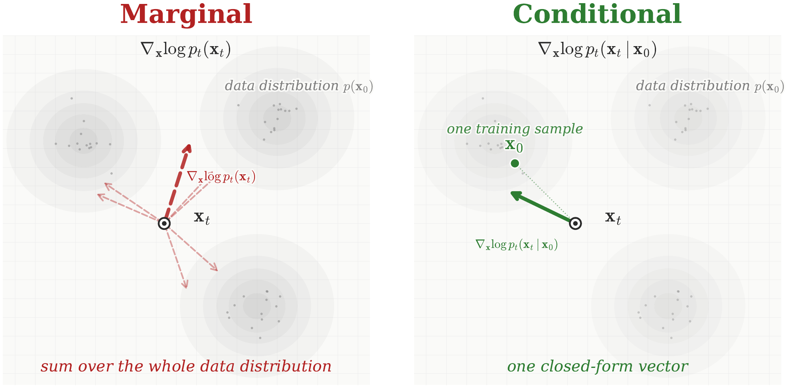
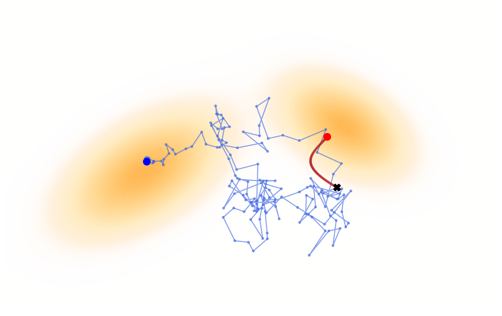

# 4.3 Score SDE: Its Training and Sampling {#sec-scoresde-training-sampling}

## 4.3.1 Training {#subsec-sde-train}

Building on the philosophy as in [Chapter 3](../03-score-based-perspective/index.md#ch-score-based), we approximate the oracle score $\nabla_{{\mathbf{x}}} \log p_t({\mathbf{x}})$ using a time-conditioned neural network

$$
\mathbf{s}_{\boldsymbol{\phi}} = \mathbf{s}_{\boldsymbol{\phi}}({\mathbf{x}}, t)
$$

across all $t\in[0,T]$, by minimizing a score-matching objective as in [Equation (3.2.1)](../03-score-based-perspective/02-score-based-models.md#eq-sm):

$$
\mathcal{L}_{\text{SM}}(\boldsymbol{\phi}; \omega(\cdot)) := \frac{1}{2} \mathbb{E}_{t\sim p_{\text{time}}}  \mathbb{E}_{{\mathbf{x}}_t \sim p_t}\left[\omega(t) \left\|\mathbf{s}_{\boldsymbol{\phi}}({\mathbf{x}}_t, t) - \nabla_{{\mathbf{x}}} \log p_t({\mathbf{x}}_t)\right\|_2^2\right],
$$

where $p_{\text{time}}$ is some time distribution (e.g., uniform on $[0,T]$), $\omega(\cdot)$ is a time-weighting function.

**Figure 4.6:** **The denoising score matching trick.** **(Left)** For a fixed noisy sample ${\mathbf{x}}_t$, the marginal score $\nabla_{{\mathbf{x}}_t}\log p_t({\mathbf{x}}_t)$ points toward regions where noisy samples are more likely. Computing it directly requires combining the contributions from all possible clean samples ${\mathbf{x}}_0$ that could have produced ${\mathbf{x}}_t$, which is generally intractable. **(Right)** During training, however, the clean sample ${\mathbf{x}}_0$ used to generate ${\mathbf{x}}_t$ is known. For Gaussian corruption, the corresponding conditional score $\nabla_{{\mathbf{x}}_t}\log p_t({\mathbf{x}}_t|{\mathbf{x}}_0)$ is available in closed form, providing one simple vector as the regression target. Across training examples, these conditional score vectors average to the marginal score. Thus, denoising score matching learns the desired marginal score without directly regressing on the generally intractable score $\nabla_{{\mathbf{x}}_t}\log p_t({\mathbf{x}}_t)$, whose evaluation requires averaging over all possible samples from the data distribution.

Source: Created by the authors with AI-assisted coding.

To avoid relying on the intractable oracle score $\nabla_{{\mathbf{x}}} \log p_t({\mathbf{x}})$, the DSM loss in [Equation (3.3.2)](../03-score-based-perspective/03-denoising-score-matching.md#eq-dsm-loss) is employed. Conditioned on a data point ${\mathbf{x}}_0$, this approach allows the use of the analytically tractable score $\nabla_{{\mathbf{x}}_t} \log p_t({\mathbf{x}}_t|{\mathbf{x}}_0)$ via [Equation (D.2.4)](../../appendices/d-supplementary-proofs/index.md#eq-score-gaussian-formula), with concrete examples given in [Section 4.4](04-sde-instantiations.md#sec-instances). Specifically, we exploit the following loss function:

$$
\begin{aligned}
     &\mathcal{L}_{\text{DSM}}(\boldsymbol{\phi}; \omega(\cdot)) := \\
     &\frac{1}{2} \mathbb{E}_{t}  \mathbb{E}_{{\mathbf{x}}_0} \mathbb{E}_{ p_t({\mathbf{x}}_t|{\mathbf{x}}_0)} \Big[\omega(t)\left\lVert\mathbf{s}_{\boldsymbol{\phi}}({\mathbf{x}}_t, t) - \nabla_{{\mathbf{x}}_t} \log p_t({\mathbf{x}}_t|{\mathbf{x}}_0)\right\rVert_2^2 \Big],
\end{aligned}
\tag{4.3.1}
$$

where ${\mathbf{x}}_0 \sim p_{\mathrm{data}}$. [Equation (4.3.1)](03-training-and-sampling.md#eq-conti-dsm-loss-real) can be interpreted as the continuous-time counterpart of [Equation (3.4.1)](../03-score-based-perspective/04-noise-conditional-score-networks.md#eq-nscn), with the summation in the discrete case replaced by integration.

Similar to the result in [Theorem 3.3.1](../03-score-based-perspective/03-denoising-score-matching.md#thm-sm-dsm), the minimizer of [Equation (4.3.1)](03-training-and-sampling.md#eq-conti-dsm-loss-real) is uniquely determined as follows:

**Proposition 4.3.1: Minimizer of DSM**

The minimizer $\mathbf{s}^*$ satisfies

$$
\begin{aligned}
    \mathbf{s}^*({\mathbf{x}}_t, t)
    = \mathbb{E}_{{\mathbf{x}}_0 \sim p({\mathbf{x}}_0 | {\mathbf{x}}_t)} \big[ \nabla_{{\mathbf{x}}_t} \log p_t({\mathbf{x}}_t | {\mathbf{x}}_0) \big]= \nabla_{{\mathbf{x}}_t} \log p_t({\mathbf{x}}_t),
\end{aligned}
\tag{4.3.2}
$$

for almost every ${\mathbf{x}}_t \sim p_t$ and $t \in [0,T]$.

**Proof for Proposition.**

DSM objective can be understood as a least-squares error problem. Specifically, at each time $t$, the optimal score function is given by the conditional expectation of the gradient of the log conditional density, which, under Bayes’ rule, is equivalent to the gradient of the log marginal density. For a detailed proof, see [Section D.2.6](../../appendices/d-supplementary-proofs/index.md#app-sec-min-dsm).

## 4.3.2 Sampling and Inference {#subsec-sde-sample}

**Figure 4.7:** **(2D) Illustration of sampling from the Score SDE.** The forward SDE is designed as $\mathop{}\!\mathrm{d}{\mathbf{x}}(t)=\sqrt{2t}\mathop{}\!\mathrm{d}{\mathbf{w}}(t)$, with drift $\mathbf{f}\equiv\mathbf{0}$ and diffusion coefficient $g(t)=\sqrt{2t}$ on $[0,T]$, evolves a two-mode Gaussian mixture $p_0=p_{\mathrm{data}}$ into $p_T\approx p_{\mathrm{prior}}:=\mathcal{N}(\mathbf{0},T^2\mathbf{I})$. Shown are sampling trajectories of the reverse-time SDE (blue; solved by [Equation (4.3.4)](03-training-and-sampling.md#eq-euler-maruyama)) and the PF-ODE (red; solved by [Equation (4.3.6)](03-training-and-sampling.md#eq-euler-ode)). Starting from a random point ${\mathbf{x}}_T\sim p_{\mathrm{prior}}$ (dark “$\times$”), both trajectories move toward the support of $p_{\mathrm{data}}$ as $t\to 0$.

Source: Created by the authors.

After learning

$$
\mathbf{s}_{\boldsymbol{\phi}^\times} := \mathbf{s}_{\boldsymbol{\phi}^\times}({\mathbf{x}}, t) \approx \nabla_{{\mathbf{x}}} \log p_t({\mathbf{x}}),
$$

we replace the intractable oracle score $\nabla_{{\mathbf{x}}} \log p_t({\mathbf{x}})$ in the reverse-time SDE ([Equation (4.1.6)](01-score-sde-principles.md#eq-sde-backward)) and PF-ODE ([Equation (4.1.7)](01-score-sde-principles.md#eq-prob-ode-gt)) with the learned proxy $\mathbf{s}_{\boldsymbol{\phi}^\times}({\mathbf{x}}, t)$. This substitution enables tractable inference via either the SDE or the ODE. For clarity, we distinguish the resulting processes as ${\mathbf{x}}^{\mathrm{SDE}}_{\boldsymbol{\phi}^\times}(t)$ and ${\mathbf{x}}^{\mathrm{ODE}}_{\boldsymbol{\phi}^\times}(t)$, respectively, but will omit this distinction in later sections.[^1]

**Empirical Reverse-Time SDE.** By substituting the trained score model $\mathbf{s}_{\boldsymbol{\phi}^\times}$ for the true score in [Equation (4.1.6)](01-score-sde-principles.md#eq-sde-backward), we obtain the parameterized reverse-time SDE used for generation:

$$
\mathop{}\!\mathrm{d} {\mathbf{x}}^{\mathrm{SDE}}_{\boldsymbol{\phi}^\times}(t) = \left[\mathbf{f}\left({\mathbf{x}}^{\mathrm{SDE}}_{\boldsymbol{\phi}^\times}(t), t\right) - g^2(t) \mathbf{s}_{\boldsymbol{\phi}^\times}\left({\mathbf{x}}^{\mathrm{SDE}}_{\boldsymbol{\phi}^\times}(t), t\right) \right] \mathop{}\!\mathrm{d} t + g(t) \mathop{}\!\mathrm{d} \bar{{\mathbf{w}}}(t).
\tag{4.3.3}
$$

To generate a sample, we first draw an initial value ${\mathbf{x}}_T$ from the prior distribution $p_{\mathrm{prior}}$ and then numerically solve [Equation (4.3.3)](03-training-and-sampling.md#eq-sde-backward-sub) backward in time from $t=T$ to $t=0$. A standard numerical solver for this is the Euler–Maruyama method, which provides the discrete update rule:

$$
{\mathbf{x}}_{t - \Delta t} \leftarrow {\mathbf{x}}_t - \left[ \mathbf{f}({\mathbf{x}}_t, t) - g^2(t)  \mathbf{s}_{\boldsymbol{\phi}^\times}({\mathbf{x}}_t, t) \right] \Delta t + g(t) \sqrt{\Delta t} \cdot \boldsymbol{\epsilon},
\tag{4.3.4}
$$

where $\boldsymbol{\epsilon} \sim \mathcal{N}(\boldsymbol{0}, \mathbf{I})$ and $\Delta t > 0$ is the step size.

Iterating this update rule yields a final sample ${\mathbf{x}}^{\mathrm{SDE}}_{\boldsymbol{\phi}^\times}(0)$. If the score model is accurate, the distribution of these generated samples, denoted $p_{\boldsymbol{\phi}^\times}^{\mathrm{SDE}}(\cdot; 0)$, provides a close approximation to the true data distribution[^2]:

$$
p_{\boldsymbol{\phi}^\times}^{\mathrm{SDE}}(\cdot; 0) \approx p_{\mathrm{data}}(\cdot).
$$

Indeed, for the VP construction, the DDPM sampling scheme in [Equation (2.2.14)](../02-variational-perspective/02-ddpm.md#eq-ddpm-sampling) has the same continuous-time reverse-SDE limit as the Euler–Maruyama discretization above; see [Section 4.4](04-sde-instantiations.md#sec-instances).

**Empirical PF-ODE.** The PF-ODE defines a continuous flow connecting $p_{\mathrm{prior}}$ and $p_{\mathrm{data}}$, enabling sampling, encoding, and exact likelihood evaluation. The following section provides further details on each of these operations.

**I. Sampling with PF-ODE.** Replacing the oracle score in [Equation (4.1.7)](01-score-sde-principles.md#eq-prob-ode-gt) with $\mathbf{s}_{\boldsymbol{\phi}^\times}$ yields the empirical PF-ODE:

$$
\frac{\mathop{}\!\mathrm{d}}{\mathop{}\!\mathrm{d} t} {\mathbf{x}}^{\mathrm{ODE}}_{\boldsymbol{\phi}^\times}(t) = \mathbf{f}\left({\mathbf{x}}^{\mathrm{ODE}}_{\boldsymbol{\phi}^\times}(t), t\right) - \frac{1}{2} g^2(t) \mathbf{s}_{\boldsymbol{\phi}^\times}\left({\mathbf{x}}^{\mathrm{ODE}}_{\boldsymbol{\phi}^\times}(t), t\right).
\tag{4.3.5}
$$

To generate samples, we begin by drawing an initial sample ${\mathbf{x}}_T$ from the prior distribution, $p_{\mathrm{prior}}$. We then numerically solve the PF-ODE from [Equation (4.3.5)](03-training-and-sampling.md#eq-prob-ode-sub) backward in time from $t=T$ to $t=0$. This process is equivalent to approximating the integral:

$$
{\mathbf{x}}^{\mathrm{ODE}}_{\boldsymbol{\phi}^\times}(0) = {\mathbf{x}}_T + \int_T^0 \left[ \mathbf{f}\left({\mathbf{x}}^{\mathrm{ODE}}_{\boldsymbol{\phi}^\times}(\tau), \tau\right) - \frac{1}{2} g^2(\tau) \mathbf{s}_{\boldsymbol{\phi}^\times}\left({\mathbf{x}}^{\mathrm{ODE}}_{\boldsymbol{\phi}^\times}(\tau), \tau\right) \right] \mathrm{d}\tau.
$$

Solving this integral yields a final sample, ${\mathbf{x}}^{\mathrm{ODE}}_{\boldsymbol{\phi}^\times}(0)$. The distribution of samples generated via this deterministic process, denoted $p_{\boldsymbol{\phi}^\times}^{\mathrm{ODE}}(\cdot; 0)$, provides an approximation to the data distribution, such that $p_{\boldsymbol{\phi}^\times}^{\mathrm{ODE}}(\cdot; 0) \approx p_{\mathrm{data}}$.

Let $\Delta t > 0$ denote a discretization step size. A standard numerical integration approach is the Euler method, which estimates

$$
\mathbf{f}({\mathbf{x}}_\tau, \tau) - \frac{1}{2} g^2(\tau)
\mathbf{s}_{\boldsymbol{\phi}^\times}({\mathbf{x}}_\tau, \tau) \approx \mathbf{f}({\mathbf{x}}_t, t) - \frac{1}{2} g^2(t)
\mathbf{s}_{\boldsymbol{\phi}^\times}({\mathbf{x}}_t, t), \quad \tau \in [t-\Delta t, t],
$$

leading to the following update rule:

$$
{\mathbf{x}}_{t - \Delta t} \leftarrow {\mathbf{x}}_t -
\left[ \mathbf{f}({\mathbf{x}}_t, t) - \frac{1}{2} g^2(t)
\mathbf{s}_{\boldsymbol{\phi}^\times}({\mathbf{x}}_t, t) \right] \Delta t.
\tag{4.3.6}
$$

This connection allows us to reframe the process of generation with the following core insight:

**Insight 4.3.1: Generation $\Leftrightarrow$ ODE/SDE Solving**

Sampling from diffusion models is fundamentally equivalent to solving a corresponding probability flow ODE or a reverse-time SDE.

This equivalence provides a clear explanation for the slow sampling speeds of diffusion models, as raised in [Question 3.5.1](../03-score-based-perspective/05-comparison.md#ques-dm-sampling-slow). Generation is computationally intensive because numerical solvers for these differential equations are inherently iterative, often requiring many steps to accurately approximate a solution trajectory[^3]. However, the PF-ODE formulation is also advantageous, as it allows us to leverage the extensive literature on accelerated numerical solvers. Exploring these techniques to speed up diffusion model sampling is the primary focus of [Chapter 9](../09-numerical-solvers/index.md#ch-numerical-solvers).

**II. Inversion with PF-ODE.** As discussed, unlike in the case of SDEs, we can solve the same [Equation (4.3.5)](03-training-and-sampling.md#eq-prob-ode-sub) both forward (from $0$ to $T$) and reverse (from $T$ to $0$) in time. When solving it forward, the ODE flow maps data to its (noisy) latent representations across all $t \in [0,T]$, which plays a role of an encoder. This concept enables powerful applications for controllable generation, such as image translation and editing and beyond ([Mokady et al., 2023](references.md#ref-mokady2023null); [Su et al., 2022](references.md#ref-su2022dual)).

**III. Log-Likelihood Evaluation via PF-ODE.** The PF-ODE also allows us to evaluate the likelihood of a data sample. Recall from [Equation (5.1.9)](../05-flow-based-perspective/01-normalizing-flows-and-neural-odes.md#eq-instant-change-of-var) that, for an ODE, the change in log-density along a trajectory is determined by the divergence of its velocity field.

For the learned PF-ODE, define

$$
{\mathbf{v}}_{\boldsymbol{\phi}^\times}({\mathbf{x}},t)
:=
{\mathbf{f}}({\mathbf{x}},t)
-\frac{1}{2}g^2(t){\mathbf{s}}_{\boldsymbol{\phi}^\times}({\mathbf{x}},t).
$$

If ${\mathbf{x}}(t)$ evolves according to

$$
\frac{\mathop{}\!\mathrm{d}}{\mathop{}\!\mathrm{d} t}{\mathbf{x}}(t)
=
{\mathbf{v}}_{\boldsymbol{\phi}^\times}({\mathbf{x}}(t),t),
$$

then its log-density satisfies

$$
\frac{\mathop{}\!\mathrm{d}}{\mathop{}\!\mathrm{d} t}
\log p^{\text{ODE}}_{\boldsymbol{\phi}^\times}({\mathbf{x}}(t);t)
=
-\nabla_{{\mathbf{x}}}\cdot
{\mathbf{v}}_{\boldsymbol{\phi}^\times}({\mathbf{x}}(t),t).
$$

To evaluate the likelihood of an observed sample ${\mathbf{x}}_0$, we run the PF-ODE forward from $t=0$ to $t=T$, mapping ${\mathbf{x}}_0$ to a terminal point where the model density is the tractable prior. We can simultaneously track the log-density change by defining

$$
\delta(t)
:=
\log p^{\text{ODE}}_{\boldsymbol{\phi}^\times}({\mathbf{x}}(t);t)
-
\log p^{\text{ODE}}_{\boldsymbol{\phi}^\times}({\mathbf{x}}_0;0).
$$

Thus, $\delta(0)=0$, and the state and log-density change can be computed together through

$$
\begin{aligned}
\frac{\mathop{}\!\mathrm{d}}{\mathop{}\!\mathrm{d} t}
\begin{bmatrix}
{\mathbf{x}}(t)\\
\delta(t)
\end{bmatrix}
=
\begin{bmatrix}
{\mathbf{v}}_{\boldsymbol{\phi}^\times}({\mathbf{x}}(t),t)\\
-\nabla_{{\mathbf{x}}}\cdot
{\mathbf{v}}_{\boldsymbol{\phi}^\times}({\mathbf{x}}(t),t)
\end{bmatrix},
\qquad
\begin{bmatrix}
{\mathbf{x}}(0)\\
\delta(0)
\end{bmatrix}
=
\begin{bmatrix}
{\mathbf{x}}_0\\
0
\end{bmatrix}.
\end{aligned}
\tag{4.3.7}
$$

After integrating to $t=T$, the terminal density is $p_{\mathrm{prior}}({\mathbf{x}}(T))$. Therefore,

$$
\log
p^{\text{ODE}}_{\boldsymbol{\phi}^\times}({\mathbf{x}}_0;0)
=
\log p_{\mathrm{prior}}({\mathbf{x}}(T))
-
\delta(T).
$$

Equivalently,

$$
\log
p^{\text{ODE}}_{\boldsymbol{\phi}^\times}({\mathbf{x}}_0;0)
=
\log p_{\mathrm{prior}}({\mathbf{x}}(T))
+
\int_0^T
\nabla_{{\mathbf{x}}}\cdot
{\mathbf{v}}_{\boldsymbol{\phi}^\times}({\mathbf{x}}(t),t)
\,\mathop{}\!\mathrm{d} t.
$$

Thus, the same PF-ODE used for generation and inversion also provides a continuous change-of-variables formula for likelihood evaluation.

[^1]: This is to simplify notation after this subsection.

[^2]: Theoretically, estimation accuracy depends on the discrepancy between $p_T$ and $p_{\mathrm{prior}}$ (typically negligible), model training error, and numerical discretization error ([De Bortoli, 2022](references.md#ref-de2022convergence); [Wang et al., 2024](references.md#ref-wang2024evaluating)). We do not pursue formal bounds here.

[^3]: For example, DDPM and Score SDE typically use $1,000$ function evaluations for generation.
