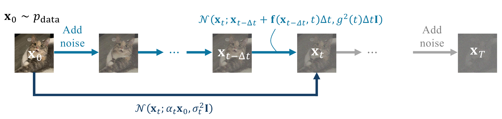

# 4.5 A Direct View Through Accumulated Perturbation Kernels {#sec-variational-perspective}

DDPM and Score SDE are commonly introduced by specifying how noise is added locally in time: through discrete forward transitions $p({\mathbf{x}}_t|{\mathbf{x}}_{t-\Delta t})$ in DDPM, or through a continuous-time SDE in Score SDE. For training, however, a particularly useful object is the *accumulated perturbation kernel*

$$
p_t({\mathbf{x}}_t|{\mathbf{x}}_0),
$$

which describes the distribution at time $t$ directly conditioned on the original data sample. This is precisely the form that appears naturally in the DDPM and continuous-time denoising objectives [Equation (2.2.8)](../02-variational-perspective/02-ddpm.md#eq-ddpm-mean-loss) and [Equation (4.3.1)](03-training-and-sampling.md#eq-conti-dsm-loss-real).

This suggests a complementary viewpoint: rather than beginning with the local noise injection and then deriving $p_t({\mathbf{x}}_t|{\mathbf{x}}_0)$, we can specify the accumulated perturbation kernel directly. For the linear-Gaussian processes considered below, an admissible accumulated kernel determines the corresponding linear SDE, and vice versa. This viewpoint makes the amount of signal and noise at each time explicit, connects directly to practical training objectives, and will also provide a useful bridge to the probability-path viewpoint of Flow Matching in [Chapter 5](../05-flow-based-perspective/index.md#ch-flow-based).

**Figure 4.8:** **Two views of the same affine forward process.** For an admissible affine diffusion schedule, incremental noise injection through a continuous-time linear SDE and direct specification of the accumulated perturbation kernel in [Equation (4.5.1)](05-accumulated-perturbation-kernels.md#eq-forward-kernel) describe the same conditional distributions $p_t({\mathbf{x}}_t|{\mathbf{x}}_0)$.

Source: Created by the authors.

**A General Affine Forward Process $p_t({\mathbf{x}}_t|{\mathbf{x}}_0)$.** We begin by defining the accumulated forward perturbation kernel

$$
p_t({\mathbf{x}}_t|{\mathbf{x}}_0)
:=
\mathcal{N}\bigl(
{\mathbf{x}}_t;
\alpha_t{\mathbf{x}}_0,
\sigma_t^2\mathbf{I}
\bigr),
\tag{4.5.1}
$$

where ${\mathbf{x}}_0\sim p_{\mathrm{data}}$, and $\alpha_t$ and $\sigma_t$ are nonnegative scalar functions of $t\in[0,T]$. In the standard forward diffusion setup, we take

$$
\alpha_0=1,
\qquad
\sigma_0=0,
$$

so that the process starts exactly from the data, and assume $\alpha_t>0$ and $\sigma_t>0$ for $t\in(0,T]$ whenever the corresponding ratios are used.

Equivalently, a sample from [Equation (4.5.1)](05-accumulated-perturbation-kernels.md#eq-forward-kernel) can be written as

$$
{\mathbf{x}}_t
=
\alpha_t{\mathbf{x}}_0
+
\sigma_t\boldsymbol{\epsilon},
\qquad
\boldsymbol{\epsilon}\sim\mathcal{N}(\mathbf{0},\mathbf{I}).
$$

This simple form includes several familiar probability paths:

-   **VE (NCSN):** $\alpha_t\equiv1$, with the noise scale $\sigma_t$ increasing over time;

-   **VP (DDPM):** $\alpha_t^2+\sigma_t^2=1$;

-   **Linear Gaussian interpolation:** $\alpha_t=1-t$ and $\sigma_t=t$ on $t\in[0,1]$, corresponding to the familiar linear path used in Flow Matching and Rectified Flow when written in the data-to-noise time convention.

## 4.5.1 Connection to Score SDE {#connection-to-score-sde}

For Score SDE, it is often more intuitive to specify the accumulated perturbation kernel $p_t({\mathbf{x}}_t|{\mathbf{x}}_0)$ first and then recover the corresponding SDE coefficients, rather than starting from the drift and diffusion terms and solving ODEs for the moments (see [Section 4.4.3](04-sde-instantiations.md#subsec-scoresde-perturbation-kernel)).

For an admissible affine schedule, the corresponding forward SDE takes the linear-in-${\mathbf{x}}$ form in [Equation (4.4.2)](04-sde-instantiations.md#eq-forward-linear-sde):

$$
\begin{aligned}
\mathop{}\!\mathrm{d} {\mathbf{x}}(t)
    =
    \underbrace{f(t){\mathbf{x}}(t)}_{{\mathbf{f}}({\mathbf{x}}(t),t)}
    \mathop{}\!\mathrm{d} t
    +
    g(t)\mathop{}\!\mathrm{d}{\mathbf{w}}(t),
\end{aligned}
$$

where $f,g\colon[0,T]\rightarrow\mathbb{R}$ are real-valued functions of time.

The coefficients $f(t)$ and $g(t)$ can be recovered analytically from $\alpha_t$ and $\sigma_t$. Importantly, not every choice of $\alpha_t$ and $\sigma_t$ defines a valid diffusion: the implied diffusion variance $g^2(t)$ must remain nonnegative. Equivalently, in this linear-Gaussian setting, the signal-to-noise ratio $\alpha_t^2/\sigma_t^2$ cannot increase with time. The following lemma makes this relationship precise.

**Lemma 4.5.1: Forward Perturbation Kernel $\Leftrightarrow$ Linear SDE**

Assume $\alpha_0=1$, $\sigma_0=0$, and that $\alpha_t>0$ and $\sigma_t>0$ are differentiable for $t\in(0,T]$. Define $\lambda_t:=\log\tfrac{\alpha_t}{\sigma_t}$.

Given the forward perturbation kernel

$$
{\mathbf{x}}_t=\alpha_t{\mathbf{x}}_0+\sigma_t{\boldsymbol{\epsilon}},
\qquad
{\boldsymbol{\epsilon}}\sim\mathcal N(\mathbf 0,{\mathbf{I}}),
$$

there exists a corresponding linear SDE

$$
\mathop{}\!\mathrm{d} {\mathbf{x}}(t)=f(t){\mathbf{x}}(t)\mathop{}\!\mathrm{d} t+g(t)\mathop{}\!\mathrm{d}{\mathbf{w}}(t)
$$

with the same conditional kernel $p_t({\mathbf{x}}_t|{\mathbf{x}}_0) =\mathcal N({\mathbf{x}}_t;\alpha_t{\mathbf{x}}_0,\sigma_t^2{\mathbf{I}})$ if and only if the coefficients

$$
\begin{aligned}
f(t)
&=\frac{\mathop{}\!\mathrm{d}}{\mathop{}\!\mathrm{d} t}\log\alpha_t,\\
g^2(t)
&=\frac{\mathop{}\!\mathrm{d}\sigma_t^2}{\mathop{}\!\mathrm{d} t}
-2\frac{\mathop{}\!\mathrm{d}}{\mathop{}\!\mathrm{d} t}\log\alpha_t\,\sigma_t^2
=-2\sigma_t^2\frac{\mathop{}\!\mathrm{d}}{\mathop{}\!\mathrm{d} t}\lambda_t
\end{aligned}
\tag{4.5.2}
$$

satisfy $g^2(t)\geq0$ for $t\in(0,T]$. Equivalently, $\lambda_t$ must be non-increasing.

Conversely, if a linear SDE has conditional kernels $\mathcal N({\mathbf{x}}_t;\alpha_t{\mathbf{x}}_0,\sigma_t^2{\mathbf{I}})$ with $\alpha_t>0$ and $\sigma_t>0$, then its coefficients necessarily satisfy [Equation (4.5.2)](05-accumulated-perturbation-kernels.md#eq-kernel-sde-equiv).

**Proof for Lemma.**

From [Section 4.4.3](04-sde-instantiations.md#subsec-scoresde-perturbation-kernel), the result follows by matching the mean and covariance ODEs ${\mathbf{m}}'(t)=f(t){\mathbf{m}}(t)$ and ${\mathbf{P}}'(t)=2f(t){\mathbf{P}}(t)+g^2(t){\mathbf{I}}$ with ${\mathbf{m}}(t)=\alpha_t{\mathbf{x}}_0$ and ${\mathbf{P}}(t)=\sigma_t^2{\mathbf{I}}$.

**Remark.**

To make the terminal conditional distribution independent of ${\mathbf{x}}_0$ and equal to a prescribed Gaussian prior, we need $\alpha_T=0$ and $\sigma_T^2$ equal to the prior variance. Since

$$
\alpha_t
=
\exp\Big(\int_0^t f(u)\mathop{}\!\mathrm{d} u\Big),
$$

achieving $\alpha_T=0$ at a finite terminal time requires

$$
\int_0^T f(u)\mathop{}\!\mathrm{d} u=-\infty.
$$

Thus, the contraction induced by the drift must become singular near the terminal time; in particular, $f$ cannot remain bounded on $[0,T]$.

The diffusion coefficient is related to the prescribed variance through

$$
g^2(t)
=
(\sigma_t^2)'
-
2\frac{\alpha_t'}{\alpha_t}\sigma_t^2.
$$

For the usual regular schedules in which $\sigma_t^2$ approaches a finite nonzero terminal variance, $(\sigma_t^2)'$ remains bounded, and $\alpha_t'/\alpha_t\to-\infty$, this also gives

$$
g^2(t)\to\infty
\qquad\text{as }t\to T.
$$

More generally, the precise behavior of $g(t)$ depends on the chosen schedule.

If $f$ and $g$ remain bounded on a finite interval $[0,T]$, then $\alpha_T>0$, so exact forgetting cannot occur at finite $T$. In practice, one therefore chooses a terminal time for which the residual dependence on ${\mathbf{x}}_0$ is negligible and $p_T\approx p_{\mathrm{prior}}$, or considers an infinite-time formulation in which $\alpha_t\to0$ asymptotically.

From the above lemma, specifying the incremental noise injection via a linear SDE with coefficients $f(t)$ and $g(t)$ is mathematically equivalent to defining the perturbation kernel with parameters $\alpha_t$ and $\sigma_t$. In the diffusion model literature, these two viewpoints are used interchangeably. Therefore, we conclude:

**Observation 4.5.1**

For a valid affine diffusion schedule, the two descriptions are equivalent: we may either specify the accumulated perturbation kernel $p_t({\mathbf{x}}_t|{\mathbf{x}}_0)$ through $\alpha_t$ and $\sigma_t$, or specify the corresponding linear SDE through $f(t)$ and $g(t)$.

## 4.5.2 Connection to Variational-Based Diffusion Model {#subsec-connection-vdm}

We revisit a core identity from DDPM, derived via Bayes’ rule:

$$
\begin{aligned}
p({\mathbf{x}}_{t-\Delta t}|{\mathbf{x}}_t, {\mathbf{x}}) = p({\mathbf{x}}_t|{\mathbf{x}}_{t-\Delta t}) \cdot \frac{p_{t-\Delta t}({\mathbf{x}}_{t-\Delta t}|{\mathbf{x}})}{p_t({\mathbf{x}}_t|{\mathbf{x}})},
\end{aligned}
\tag{4.5.3}
$$

for any ${\mathbf{x}}$ (usually ${\mathbf{x}}\sim p_{\mathrm{data}}$). This reverse conditional $p({\mathbf{x}}_{t-\Delta t} | {\mathbf{x}}_t, {\mathbf{x}})$ is central to modeling, enabling both tractable training targets and efficient sampling.

Although DDPM typically defines the incremental kernel $p({\mathbf{x}}_t|{\mathbf{x}}_{t-\Delta t})$ first, the accumulated transition $p_t({\mathbf{x}}_t|{\mathbf{x}}_0)$ often provides a more interpretable and practical formulation, especially for the prior and loss design.

**Deriving Transition Kernels.** We now extend this to the continuous-time setting. Let $0 \leq t < s \leq T$ be two (continuous) time points. Given the perturbation kernel $p_t({\mathbf{x}}_t|{\mathbf{x}}_0)$, we can compute the reverse conditional $p({\mathbf{x}}_t|{\mathbf{x}}_s, {\mathbf{x}})$ for any ${\mathbf{x}}$ by applying [Equation (4.5.3)](05-accumulated-perturbation-kernels.md#eq-ddpm-reverse-condition-kernel)[^1], using the forward kernel $p({\mathbf{x}}_s|{\mathbf{x}}_t)$ as an intermediate. The following lemma summarizes this derivation, extending [Lemma 2.2.2](../02-variational-perspective/02-ddpm.md#ddpm-reverse-kernel) without assuming $\alpha_t^2 + \sigma_t^2 = 1$.

**Lemma 4.5.2: Reverse Conditional Transition Kernels**

Let $0 \leq t < s \leq T$. The reverse *conditional* transition kernel is:

$$
p({\mathbf{x}}_t|{\mathbf{x}}_s, {\mathbf{x}}) = \mathcal{N}\left({\mathbf{x}}_t; \boldsymbol{\mu}({\mathbf{x}}_s, {\mathbf{x}}; s, t), \sigma^2(s, t) {\mathbf{I}}\right),
$$

where

$$
\begin{aligned}
    \boldsymbol{\mu}({\mathbf{x}}_s, {\mathbf{x}}; s, t) := \frac{\alpha_{s|t} \sigma_t^2}{\sigma_s^2} {\mathbf{x}}_s + \frac{\alpha_t \sigma^2_{s|t}}{\sigma_s^2} {\mathbf{x}}, \quad
    \sigma^2(s, t) := \sigma^2_{s|t} \frac{\sigma_t^2}{\sigma_s^2}.
\end{aligned}
\tag{4.5.4}
$$

Here, $\alpha_{s|t}$ and $\sigma_{s|t}$ are defined as:

$$
\alpha_{s|t} := \frac{\alpha_s}{\alpha_t}, \qquad \sigma^2_{s|t} := \sigma_s^2 - \alpha_{s|t}^2 \sigma_t^2.
$$

**Proof for Lemma.**

We first compute the forward transition kernel:

$$
p({\mathbf{x}}_s|{\mathbf{x}}_t) = \mathcal{N}\left({\mathbf{x}}_s; \alpha_{s|t} {\mathbf{x}}_t, \sigma^2_{s|t} {\mathbf{I}}\right).
\tag{4.5.5}
$$

The reverse kernel then follows from Bayes’ rule, and since all involved distributions are Gaussian, the result can be derived by direct computation. For further details, see Appendix A of ([Kingma et al., 2021](../../references.md#ref-kingma2021variational)).

Although $p({\mathbf{x}}_{t + \Delta t}|{\mathbf{x}}_t)$ and $p_t({\mathbf{x}}_t|{\mathbf{x}}_0)$ are theoretically equivalent, $p_t({\mathbf{x}}_t|{\mathbf{x}}_0)$ often takes a more central role. The step-wise transition in [Equation (4.5.5)](05-accumulated-perturbation-kernels.md#eq-zt-given-zs) mainly serves to obtain a closed-form reverse kernel. Recent works ([Kingma et al., 2021](../../references.md#ref-kingma2021variational)) thus favor directly specifying $p_t({\mathbf{x}}_t|{\mathbf{x}}_0)$ for its clarity and interpretability.

**Reverse Process Modeling, Training, and Sampling.** The training objective (ELBO in [Equation (2.2.13)](../02-variational-perspective/02-ddpm.md#eq-ddpm-elbo)) and the modeling framework introduced in [Section 2.2](../02-variational-perspective/02-ddpm.md#sec-ddpm) remain applicable under our generalized setting. For clarity, we adopt the ${\mathbf{x}}$-prediction formulation, denoted by ${\mathbf{x}}_{\boldsymbol{\phi}}({\mathbf{x}}_s, s)$, following [Kingma et al. (2021)](../../references.md#ref-kingma2021variational). However, the equivalent ${\boldsymbol{\epsilon}}$-prediction perspective, represented by $\boldsymbol{\epsilon}_{\boldsymbol{\phi}}({\mathbf{x}}_s, s)$, is also valid due to the relationship (as in [Equation (2.2.12)](../02-variational-perspective/02-ddpm.md#eq-ddpm-clean-noise))

$$
{\mathbf{x}}_s = \alpha_s {\mathbf{x}}_{\boldsymbol{\phi}}({\mathbf{x}}_s, s) + \sigma_s \boldsymbol{\epsilon}_{\boldsymbol{\phi}}({\mathbf{x}}_s, s),\quad \text{for any given } {\mathbf{x}}_s \sim q_s.
$$

**Modeling and Diffusion Loss $\mathcal{L}_{\text{diffusion}}$.** Similar to DDPM, the conditional distribution $p({\mathbf{x}}_t|{\mathbf{x}}_s, {\mathbf{x}})$ in [Equation (4.5.4)](05-accumulated-perturbation-kernels.md#eq-p-backward-mean-var) motivates replacing the clean signal ${\mathbf{x}}$ with a learnable predictor ${\mathbf{x}}_{\boldsymbol{\phi}}({\mathbf{x}}_s, s)$, yielding a parameterized reverse model of the form:

$$
\begin{aligned}
p_{\boldsymbol{\phi}}({\mathbf{x}}_t | {\mathbf{x}}_s) := \mathcal{N}\left({\mathbf{x}}_t; \boldsymbol{\mu}_{\boldsymbol{\phi}}({\mathbf{x}}_s, s, t), \sigma^2(s,t) \mathbf{I}\right),
\end{aligned}
\tag{4.5.6}
$$

with the mean parametrized as:

$$
\boldsymbol{\mu}_{\boldsymbol{\phi}}({\mathbf{x}}_s, s, t) = \frac{\alpha_{s|t} \sigma_t^2}{\sigma_s^2} {\mathbf{x}}_s + \frac{\alpha_t \sigma_{s|t}^2}{\sigma_s^2} {\mathbf{x}}_{\boldsymbol{\phi}}({\mathbf{x}}_s, s).
$$

Given the forward kernel in [Equation (4.5.1)](05-accumulated-perturbation-kernels.md#eq-forward-kernel), the KL divergence in $\mathcal{L}_{\text{diffusion}}({\mathbf{x}}; \boldsymbol{\phi})$ reduces to a weighted regression loss:

$$
\begin{aligned}
    \mathcal{D}_{\text{KL}}\big(p({\mathbf{x}}_t|{\mathbf{x}}_s, {\mathbf{x}}_0)  \| p_{\boldsymbol{\phi}}({\mathbf{x}}_t|{\mathbf{x}}_s)\big)
    &= \frac{1}{2\sigma^2(s,t)} \left\| \boldsymbol{\mu}({\mathbf{x}}_s, {\mathbf{x}}_0; s,t) - \boldsymbol{\mu}_{\boldsymbol{\phi}}({\mathbf{x}}_s, s, t) \right\|_2^2 \\
    &= \frac{1}{2} \big(\text{SNR}(t) - \text{SNR}(s)\big) \left\| {\mathbf{x}}_0 - {\mathbf{x}}_{\boldsymbol{\phi}}({\mathbf{x}}_s, s) \right\|_2^2,
\end{aligned}
\tag{4.5.7}
$$

where ${\mathbf{x}}_s = \alpha_s{\mathbf{x}}_0 + \sigma_s\boldsymbol{\epsilon}$, with ${\mathbf{x}}_0 \sim p_{\mathrm{data}}$, $\boldsymbol{\epsilon} \sim \mathcal{N}(\boldsymbol{0}, {\mathbf{I}})$, and $\text{SNR}(s) := \alpha_s^2 / \sigma_s^2$ denotes the signal-to-noise ratio at time $s$.

**Remark.**

In ([Kingma et al., 2021](../../references.md#ref-kingma2021variational)), the authors study the continuous-time limit of [Equation (4.5.7)](05-accumulated-perturbation-kernels.md#eq-snr-kl) as $t \to s$, yielding:

$$
\begin{aligned}
\mathcal{L}_{\text{VDM}}^\infty({\mathbf{x}}_0)
= -\frac{1}{2}  \mathbb{E}_{s, \boldsymbol{\epsilon} \sim \mathcal{N}(\boldsymbol{0}, {\mathbf{I}})}  \text{SNR}'(s)  \big\| {\mathbf{x}}_0 - {\mathbf{x}}_{\boldsymbol{\phi}}({\mathbf{x}}_s, s) \big\|_2^2.
\end{aligned}
$$

This setup also introduces a learnable noise schedule, and while it generalizes beyond continuous data, such extensions fall outside the scope of our current discussion.

**Sampling.** Sampling proceeds similarly to DDPM using the parameterized kernel from [Equation (4.5.6)](05-accumulated-perturbation-kernels.md#eq-general-ddpm-sampling):

$$
\begin{aligned}
{\mathbf{x}}_t = \underbrace{\frac{\alpha_{s|t} \sigma_t^2}{\sigma_s^2} {\mathbf{x}}_s + \frac{\alpha_t \sigma_{s|t}^2}{\sigma_s^2} {\mathbf{x}}_{\boldsymbol{\phi}^\times}({\mathbf{x}}_s, s)}_{\boldsymbol{\mu}_{\boldsymbol{\phi}^\times}({\mathbf{x}}_s, t, s)} + \sigma_{s|t} \frac{\sigma_t}{\sigma_s} \boldsymbol{\epsilon}_s,\quad  \boldsymbol{\epsilon}_s \sim \mathcal{N}(\boldsymbol{0}, {\mathbf{I}}).
\end{aligned}
\tag{4.5.8}
$$

[^1]: This identity extends naturally to continuous time by treating $s$ as a general earlier time.
