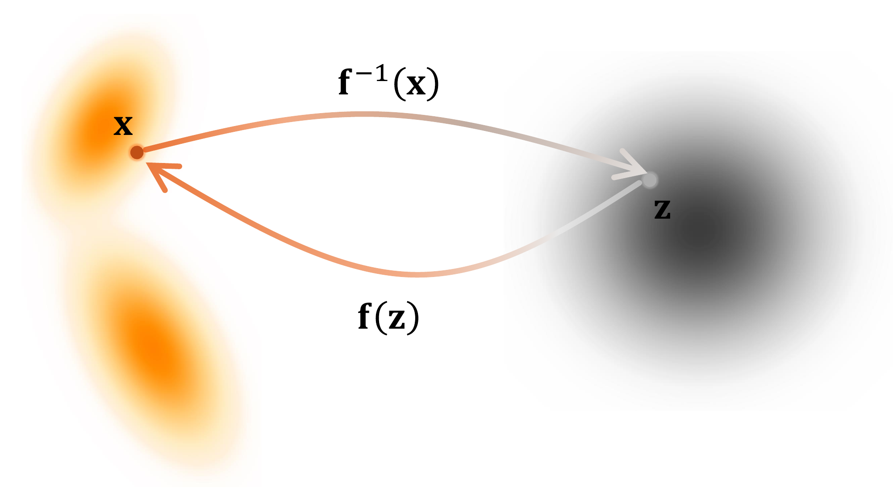
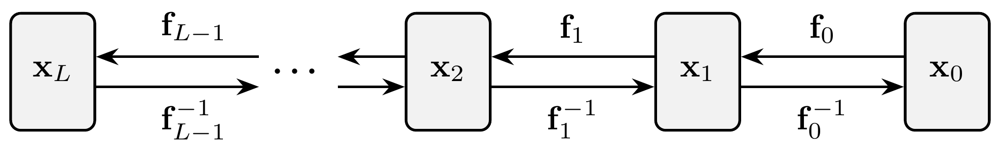
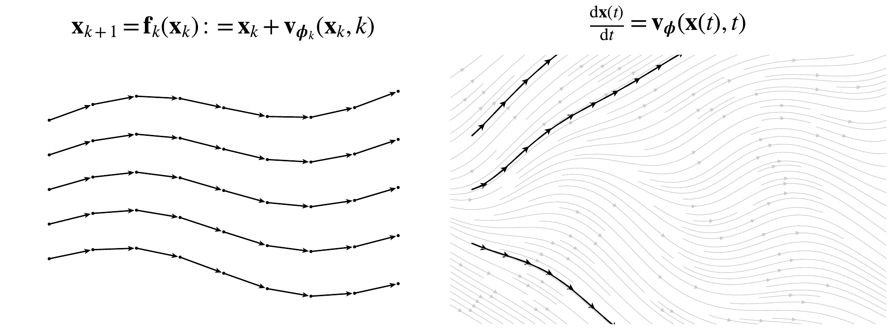
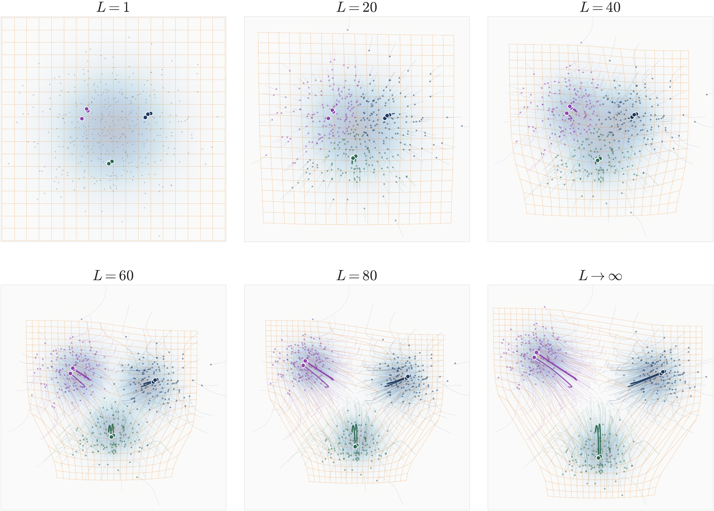

# 5.1 Flow-Based Models: Normalizing Flows and Neural ODEs {#sec-flow-based-method}

In this section, we will introduce Flow-Based Models, including Normalizing Flows (NFs) ([Rezende and Mohamed, 2015](../../references.md#ref-rezende2015variational)) and Neural Ordinary Differential Equations (NODEs) ([Chen et al., 2018](../../references.md#ref-chen2018neural)).

NFs enable flexible and tractable probability density estimation by applying a series of invertible transformations to a simple base distribution. NODEs extend this framework to continuous time, where the transformation is governed by an ODE. By treating the transformations as continuous-time dynamics, NODEs provide a smooth, scalable extension to the NF paradigm.

**Figure 5.2:** **Illustration of sample movement of NF under an invertible map.** It consists of a sequence of invertible functions ${\mathbf{f}}: {\mathbf{z}} \mapsto {\mathbf{x}}$ that transform latent variable ${\mathbf{z}}$ into a data ${\mathbf{x}}$, together with the inverse mapping ${\mathbf{f}}^{-1}: {\mathbf{x}} \mapsto {\mathbf{z}}$ that reconstructs the data. An NF resembles an encoder–decoder structure, but with the encoder realized as a smooth invertible map and the decoder given exactly by its inverse. The corresponding change in density can be computed via the change-of-variables formula, as given in [Equation (5.0.1)](index.md#eq-nf-change-of-var).

Source: Created by the authors.

## 5.1.1 Normalizing Flows {#normalizing-flows}

NFs ([Rezende and Mohamed, 2015](../../references.md#ref-rezende2015variational)) model a complex data distribution $p_{\text{data}}({\mathbf{x}})$ by transforming a simple prior $p_{\text{prior}}({\mathbf{z}})$ (e.g., standard Gaussian $\mathcal{N}(\boldsymbol{0}, {\mathbf{I}})$) via an invertible mapping

$$
{\mathbf{f}}_{\boldsymbol{\phi}}: \mathbb{R}^D \to \mathbb{R}^D,
$$

with ${\mathbf{x}} = {\mathbf{f}}_{\boldsymbol{\phi}}({\mathbf{z}})$ and ${\mathbf{z}} \sim p_{\text{prior}}$. Here, ${\mathbf{x}}$ and ${\mathbf{z}}$ share the same dimension. Using the change-of-variables formula in [Equation (5.0.1)](index.md#eq-nf-change-of-var), the model likelihood is[^1]

$$
\begin{aligned}
\log p_{\boldsymbol{\phi}}({\mathbf{x}}) = \log p_{\text{prior}}({\mathbf{z}}) + \log \left| \det \frac{\partial {\mathbf{f}}_{\boldsymbol{\phi}}^{-1}({\mathbf{x}})}{\partial {\mathbf{x}}} \right|.
\end{aligned}
\tag{5.1.1}
$$

**Training Objective.** Parameters $\boldsymbol{\phi}$ are learned by maximizing the likelihood over data:

$$
\begin{aligned}
\mathcal{L}_{\text{NF}}(\boldsymbol{\phi}) = \mathbb{E}_{{\mathbf{x}} \sim p_{\text{data}}} \left[ \log p_{\boldsymbol{\phi}}({\mathbf{x}}) \right].
\end{aligned}
\tag{5.1.2}
$$

Computing the Jacobian determinant in [Equation (5.1.1)](01-normalizing-flows-and-neural-odes.md#eq-nf-change-of-var-log) can be costly, scaling as $\mathcal{O}(D^3)$ in general.

**Constructing Invertible Transformations.**

A single complex invertible network can be expensive due to its Jacobian determinant. Conversely, simple transforms (e.g., linear) are efficient but lack expressivity.

To balance this, NFs employ a sequence of $L$ trainable invertible mappings $\{{\mathbf{f}}_k\}_{k=0}^{L-1}$, each with efficiently computable Jacobians:

$$
{\mathbf{f}}_{\boldsymbol{\phi}} = {\mathbf{f}}_{L-1} \circ {\mathbf{f}}_{L-2} \circ \cdots \circ {\mathbf{f}}_0.
$$

Each ${\mathbf{f}}_k$ is parameterized by a neural network, though we omit the explicit dependence on ${\boldsymbol{\phi}}$ for notational simplicity.

Samples transform via

$$
\begin{aligned}
{\mathbf{x}}_{k+1} = {\mathbf{f}}_k({\mathbf{x}}_k), \quad k = 0, \ldots, L-1,
\end{aligned}
\tag{5.1.3}
$$

with ${\mathbf{z}}={\mathbf{x}}_0 \sim p_{\text{prior}}$ and ${\mathbf{x}} = {\mathbf{x}}_L$, corresponding to data. The resulting (log-)density is derived as

$$
\begin{aligned}
    p_{\boldsymbol{\phi}}({\mathbf{x}}) &= p_{\text{prior}}({\mathbf{x}}_0) \prod_{k=0}^{L-1} \left| \det \frac{\partial {\mathbf{f}}_k}{\partial {\mathbf{x}}_k} \right|^{-1}, \text{ or equivalently,}\\
\log p_{\boldsymbol{\phi}}({\mathbf{x}}) &= \log p_{\text{prior}}({\mathbf{x}}_0) + \sum_{k=0}^{L-1} \log \left| \det \frac{\partial {\mathbf{f}}_k}{\partial {\mathbf{x}}_k} \right|^{-1}.
\end{aligned}
\tag{5.1.4}
$$

**Figure 5.3:** **Illustration of a NF.** An NF consists of a stack of invertible maps ${\mathbf{f}}_{\boldsymbol{\phi}} = {\mathbf{f}}_{L-1} \circ {\mathbf{f}}_{L-2} \circ \cdots \circ {\mathbf{f}}_0$. The transformation maps latent samples ${\mathbf{x}}_0 \sim p_{\mathrm{prior}}$ to data samples ${\mathbf{x}}_L \sim p_{\mathrm{data}}$.

Source: Created by the authors.

**Examples of Invertible Flows.** Extensive literature has focused on designing single-layer flow constructions that enable efficient computation of the Jacobian. Below, we introduce two representative types: Planar Flows ([Rezende and Mohamed, 2015](../../references.md#ref-rezende2015variational)) and Residual Flows ([Chen et al., 2019](../../references.md#ref-chen2019residual); [Behrmann et al., 2019](../../references.md#ref-behrmann2019invertible)), with the latter motivating the developments in [Section 5.1.2](01-normalizing-flows-and-neural-odes.md#subsec-node).

**Planar Flows:** Planar flows ([Rezende and Mohamed, 2015](../../references.md#ref-rezende2015variational)) apply a simple transformation

$$
{\mathbf{f}}({\mathbf{z}})
=
{\mathbf{z}}
+
{\mathbf{u}} h({\mathbf{w}}^\top{\mathbf{z}}+b),
$$

where ${\mathbf{u}},{\mathbf{w}}\in\mathbb{R}^D$, $b\in\mathbb{R}$, and $h(\cdot)$ is an activation function. The parameters are appropriately constrained or reparameterized to ensure that the transformation is invertible. Its Jacobian determinant has the simple form

$$
\left|
\det\frac{\partial{\mathbf{f}}({\mathbf{z}})}{\partial{\mathbf{z}}}
\right|
=
\left|
1+h'({\mathbf{w}}^\top{\mathbf{z}}+b)\,{\mathbf{w}}^\top{\mathbf{u}}
\right|,
$$

making the change-of-variables computation efficient.

**Residual Flows:** Define the transform ${\mathbf{f}}$ as

$$
\begin{aligned}
{\mathbf{f}}({\mathbf{z}}) = {\mathbf{z}} + {\mathbf{v}}({\mathbf{z}}),
\end{aligned}
\tag{5.1.5}
$$

with ${\mathbf{v}}$ contractive (Lipschitz constant $< 1$). This ensures invertibility via the Banach fixed-point theorem.

The log-determinant of the Jacobian reduces to a trace expansion:

$$
\begin{aligned}
\log \Bigg|\det \frac{\partial {\mathbf{f}}({\mathbf{z}})}{\partial {\mathbf{z}}} \Bigg| &= \log \left( \det \frac{\partial {\mathbf{f}}({\mathbf{z}})}{\partial {\mathbf{z}}} \right) \\
    &= \operatorname{Tr}\left(\log\left(\frac{\partial {\mathbf{f}}({\mathbf{z}})}{\partial {\mathbf{z}}}\right)\right) \\
    &= \operatorname{Tr}\left(\log\left({\mathbf{I}} + \frac{\partial {\mathbf{v}}({\mathbf{z}})}{\partial {\mathbf{z}}}\right)\right) \\
    &= \sum_{k=1}^{\infty} \frac{(-1)^{k+1}}{k} \operatorname{Tr}\left(\left(\frac{\partial {\mathbf{v}}({\mathbf{z}})}{\partial {\mathbf{z}}}\right)^k\right),
\end{aligned}
\tag{5.1.6}
$$

making evaluation efficient via trace estimators ([Hutchinson, 1989](../../references.md#ref-hutchinson1989stochastic)).

**Sampling and Inference.** Sampling from NFs is straightforward: draw ${\mathbf{x}}_0 \sim p_{\text{prior}}$ and compute ${\mathbf{x}} = {\mathbf{f}}_{\boldsymbol{\phi}}({\mathbf{x}}_0)$. Exact likelihoods are obtained from [Equation (5.1.4)](01-normalizing-flows-and-neural-odes.md#eq-multi-nf-density).

## 5.1.2 Neural ODEs {#subsec-node}

**Figure 5.4:** **Discrete- vs. continuous-time normalizing flows.** (Left) A discrete NF transports samples by a finite sequence of invertible maps $\mathbf{x}_{k+1} = \mathbf{f}_k(\mathbf{x}_k)$, yielding stepwise, non-crossing trajectories (dots with arrows). (Right) A continuous NF (Neural ODE) evolves states along integral curves of $\frac{\mathop{}\!\mathrm{d}\mathbf{x}(t)}{\mathop{}\!\mathrm{d} t} = \mathbf{v}_{\boldsymbol{\phi}}(\mathbf{x}(t),t)$, where black paths with tangent arrows are shown over the gray vector field.

Source: Created by the authors.

**From Discrete-Time NFs to Continuous-Time NFs (Neural ODEs).** A discrete NF transports samples through a composition of $L$ invertible maps. To obtain a meaningful continuous-depth limit, we write each layer as a small residual update:

$$
{\mathbf{x}}_{k+1}
=
{\mathbf{x}}_k+\Delta t\,{\mathbf{v}}_{\boldsymbol{\phi}}({\mathbf{x}}_k,t_k),
\qquad
t_k=k\Delta t,
\qquad
\Delta t=\frac{T}{L}.
$$

Here, ${\mathbf{v}}_{\boldsymbol{\phi}}$ specifies the direction in which each point is moved, while $\Delta t$ controls the size of one layer.

The geometric meaning of this limit is illustrated in [Figure 5.5](01-normalizing-flows-and-neural-odes.md#fig-bijection-continuity). As $L$ increases, the same source-to-target transport is divided into more near-identity bijections. The sample trajectories are resolved more finely, and the deformation of the surrounding reference grid becomes progressively smoother.

As $L\rightarrow\infty$ and $\Delta t\rightarrow 0$, the discrete layer index becomes continuous time, yielding the ODE

$$
\frac{\mathop{}\!\mathrm{d} {\mathbf{x}}(t)}{\mathop{}\!\mathrm{d} t}
=
{\mathbf{v}}_{\boldsymbol{\phi}}({\mathbf{x}}(t),t).
$$

This continuous-depth model is known as a Neural ODE or Continuous Normalizing Flow.

**Figure 5.5:** **From discrete bijections to a continuous transport flow.** Each panel shows a transport built by composing $L$ invertible layers. Starting from a source distribution (Gaussian), the layers gradually move the colored samples toward a target distribution with three modes. The orange reference grid shows how the surrounding space is deformed during this transport. With only a few layers, each layer makes a relatively large and discrete change. As $L$ increases, the transport is divided into more, smaller updates, so the sample trajectories and grid deformation become smoother. If the total transport time $T$ is fixed and each layer has step size $\Delta t=T/L$, then, as $L\rightarrow\infty$, the stacked bijections approach a continuous time-dependent flow. The transported density evolves according to the continuity equation in [Equation (5.2.8)](02-flow-matching-framework.md#eq-continuity-eq).

Source: Created by the authors with AI-assisted coding.

**Formal Setup of Neural ODEs.** A Neural ODE defines a continuous transformation through:

$$
\begin{aligned}
\frac{\mathop{}\!\mathrm{d} {\mathbf{x}}(t)}{\mathop{}\!\mathrm{d} t} = {\mathbf{v}}_{\boldsymbol{\phi}}({\mathbf{x}}(t), t),\quad t\in [0,T]
\end{aligned}
\tag{5.1.7}
$$

where:

-   ${\mathbf{x}}(t) \in \mathbb{R}^D$ is the state at time $t$; we sometimes write ${\mathbf{x}}_t$ for brevity;

-   ${\mathbf{v}}_{\boldsymbol{\phi}}({\mathbf{x}}(t), t)$ is a neural network parameterized by $\boldsymbol{\phi}$.

**Goal of NODE.** Starting from the initial condition ${\mathbf{x}}(0) \sim p_{\text{prior}}$, the ODE evolves the state continuously over time, inducing a family of marginal distributions $p_{\boldsymbol{\phi}}({\mathbf{x}}_t, t)$ (similar to PF-ODEs!)[^2].

The goal is to learn the neural vector field ${\mathbf{v}}_{\boldsymbol{\phi}}$, which intuitively represents a velocity that transports points along continuous trajectories in data space. By learning this velocity, the terminal distribution at $t=T$ matches the target distribution $p_{\mathrm{data}}(\cdot)$. This continuous transformation unifies discrete normalizing flows and neural ODEs within a single framework.

**Continuous-Time Change-of-Variables Formula.** Analogous to [Equation (5.0.1)](index.md#eq-nf-change-of-var) or [Equation (5.1.4)](01-normalizing-flows-and-neural-odes.md#eq-multi-nf-density), [Chen et al. (2018)](../../references.md#ref-chen2018neural) derived a continuous-time analogue of the change-of-variables formula. For the time-dependent density $p_{\boldsymbol{\phi}}({\mathbf{x}}(t),t)$ of a process ${\mathbf{x}}(t)$ evolving under [Equation (5.1.7)](01-normalizing-flows-and-neural-odes.md#eq-neural-ode), the so-called *Instantaneous Change-of-Variables Formula* is

$$
\frac{\mathop{}\!\mathrm{d}}{\mathop{}\!\mathrm{d} t}
\log p_{\boldsymbol{\phi}}({\mathbf{x}}(t),t)
=
-\nabla_{{\mathbf{x}}}\cdot
{\mathbf{v}}_{\boldsymbol{\phi}}({\mathbf{x}}(t),t).
$$

Here, the derivative is taken along the ODE trajectory ${\mathbf{x}}(t)$.

Therefore, if ${\mathbf{x}}(0)\sim p_{\mathrm{prior}}$ and the ODE transports the prior from $t=0$ to $t=T$, integrating this identity gives

$$
\begin{aligned}
\log p_{\boldsymbol{\phi}}({\mathbf{x}}(T),T)
=
\log p_{\mathrm{prior}}({\mathbf{x}}(0))
-
\int_0^T
\nabla_{{\mathbf{x}}}\cdot
{\mathbf{v}}_{\boldsymbol{\phi}}({\mathbf{x}}(t),t)
\,\mathop{}\!\mathrm{d} t.
\end{aligned}
\tag{5.1.8}
$$

This expression provides likelihood evaluation through numerical integration, which in turn enables maximum likelihood training of the model.

Although this formula may appear unfamiliar at first, it is closely connected to the Fokker–Planck equation. In particular, it can be understood as the along-trajectory form of the *continuity equation*, which is the deterministic, zero-diffusion case of the Fokker–Planck equation (see [Appendix B](../../appendices/b-density-evolution/index.md#app-continuity)). It can also be interpreted as the continuous-time limit of the discrete change-of-variables formula in [Equation (5.1.4)](01-normalizing-flows-and-neural-odes.md#eq-multi-nf-density). We summarize the result below.

**Lemma 5.1.1: Instantaneous Change of Variables**

Let ${\mathbf{z}}(t)$ be a continuous random process with time-dependent density $p({\mathbf{z}}(t),t)$, and suppose it evolves according to the ODE

$$
\begin{aligned}
\frac{\mathop{}\!\mathrm{d}{\mathbf{z}}(t)}{\mathop{}\!\mathrm{d} t}
=
\mathbf{F}({\mathbf{z}}(t),t).
\end{aligned}
$$

Assuming sufficient regularity so that the ODE flow and the evolving density are well defined, the log-density along the trajectory satisfies

$$
\begin{aligned}
\frac{\mathop{}\!\mathrm{d}}{\mathop{}\!\mathrm{d} t}
\log p({\mathbf{z}}(t),t)
=
-\nabla_{{\mathbf{z}}}\cdot
\mathbf{F}({\mathbf{z}}(t),t).
\end{aligned}
\tag{5.1.9}
$$

**Proof for Lemma.**

This follows from the continuity equation together with the chain rule. We present detailed alternative derivations in [Section D.3](../../appendices/d-supplementary-proofs/03-flow-based-perspective.md#app-sec-flow-proof).

**Connection to Discrete-Time Formula.** The NODE likelihood in [Equation (5.1.8)](01-normalizing-flows-and-neural-odes.md#eq-node-likelihood),

$$
\log p_{\boldsymbol{\phi}}({\mathbf{x}}(T), T) = \log p_{\text{prior}}({\mathbf{x}}(0), 0) - \int_0^T \nabla_{\mathbf{x}} \cdot {\mathbf{v}}_{\boldsymbol{\phi}}({\mathbf{x}}(t), t) \mathop{}\!\mathrm{d} t,
$$

can be seen as the continuous-time analogue of the discrete normalizing flow formulation in [Equation (5.1.4)](01-normalizing-flows-and-neural-odes.md#eq-multi-nf-density):

$$
\log p_{\boldsymbol{\phi}}({\mathbf{x}}_L) = \log p_{\text{prior}}({\mathbf{x}}_0) - \sum_{k=0}^{L-1} \log \left| \det \frac{\partial {\mathbf{f}}_k}{\partial {\mathbf{x}}_k} \right|.
$$

The integral mirrors the summation, and the trace operator replaces the log-determinant, as discussed in [Equation (5.1.6)](01-normalizing-flows-and-neural-odes.md#eq-log-det-tr). These parallels are further explored in the proof of the lemma.

**Training NODEs.** Based on [Equation (5.1.8)](01-normalizing-flows-and-neural-odes.md#eq-node-likelihood), NODEs learn a parameterized velocity field ${\mathbf{v}}_{\boldsymbol{\phi}}$ such that the terminal distribution

$$
p_{\boldsymbol{\phi}}(\cdot, T) \approx p_{\text{data}},
$$

where trajectories evolve from latent variables ${\mathbf{x}}(0) \sim p_{\text{prior}}$ via the ODE flow. Training follows the MLE framework from [Equation (1.1.2)](../01-deep-generative-modeling/01-what-is-deep-generative-modeling.md#eq-mle):

$$
\mathcal{L}_{\text{NODE}}(\boldsymbol{\phi}) := \mathbb{E}_{{\mathbf{x}} \sim p_{\text{data}}} \big[\log p_{\boldsymbol{\phi}}({\mathbf{x}}, T)\big].
$$

**Exact Log-Likelihood Computation.** To compute $\log p_{\boldsymbol{\phi}}(\mathbf{x}, T)$ for data point $\mathbf{x}$, we integrate the change-of-variables formula [Equation (5.1.8)](01-normalizing-flows-and-neural-odes.md#eq-node-likelihood):

$$
\begin{aligned}
\log p_{\boldsymbol{\phi}}(\mathbf{x}, T) = \log p_{\text{prior}}(\mathbf{z}(0)) - \int_0^T \nabla_{\mathbf{z}} \cdot \mathbf{v}_{\boldsymbol{\phi}}(\mathbf{z}(t), t) \mathop{}\!\mathrm{d} t.
\end{aligned}
\tag{5.1.10}
$$

Here, $\mathbf{z}(t)$ solves the ODE reversely from $t = T$ to $t = 0$:

$$
\frac{\mathop{}\!\mathrm{d}\mathbf{z}(t)}{\mathop{}\!\mathrm{d} t} = \mathbf{v}_{\boldsymbol{\phi}}(\mathbf{z}(t), t)
$$

with $\mathbf{z}(T) = \mathbf{x}$. The prior term $\log p_{\text{prior}}(\mathbf{z}(0))$ is tractable for standard distributions. This enables exact likelihood-based training and evaluation in neural ODEs.

**Gradient-Based Optimization.** Maximizing $\mathcal{L}_{\text{NODE}}$ requires backpropagation through the ODE solver. The adjoint sensitivity method ([Pontryagin, 2018](../../references.md#ref-pontryagin2018mathematical); [Chen et al., 2018](../../references.md#ref-chen2018neural)) computes gradients via an auxiliary ODE with $\mathcal{O}(1)$ memory complexity, but NODE training remains expensive due to numerical integration at each step.

**Inference with NODEs.** Sampling with a trained model ${\mathbf{v}}_{\boldsymbol{\phi}^\times}$ proceeds by drawing ${\mathbf{x}}(0) \sim p_{\text{prior}}$ and integrating forward (by numerical solvers):

$$
{\mathbf{x}}(T) = {\mathbf{x}}(0) + \int_0^T {\mathbf{v}}_{\boldsymbol{\phi}^\times}({\mathbf{x}}(t), t)   \mathop{}\!\mathrm{d} t.
$$

The terminal state ${\mathbf{x}}(T)$ approximates a sample from $p_{\text{data}}$.

Moreover, we note that for any vector field ${\mathbf{F}}$, the following identity holds:

$$
\operatorname{Tr}\left(\frac{\partial {\mathbf{F}}}{\partial {\mathbf{z}}(t)} \right) = \nabla_{{\mathbf{z}}} \cdot {\mathbf{F}}.
$$

Hence, the divergence can be estimated efficiently using stochastic trace estimators, such as Hutchinson’s estimator ([Hutchinson, 1989](../../references.md#ref-hutchinson1989stochastic)), without explicitly constructing the full Jacobian. This makes likelihood evaluation much more practical in high-dimensional settings. However, because the trace is then estimated from random samples, the resulting numerical log-likelihood estimate is stochastic rather than an exact evaluation of the divergence.

Having seen in [Figure 5.5](01-normalizing-flows-and-neural-odes.md#fig-bijection-continuity) how many small bijections approach a continuous transport flow, we now ask a practical question:

**Question 5.1.1**

How can we learn its velocity field without repeatedly solving an ODE during training?

This question leads naturally to Flow Matching, which learns the velocity field directly through a simulation-free regression objective and provides the flow-based perspective on diffusion models.

[^1]: If the map is further constrained to be the gradient of a convex potential, ${\mathbf{f}}_{\boldsymbol{\phi}} = \nabla \psi_{\boldsymbol{\phi}}$ with $\psi_{\boldsymbol{\phi}}$ convex, then [Equation (5.1.1)](01-normalizing-flows-and-neural-odes.md#eq-nf-change-of-var-log) reduces to the Monge–Ampère relation in [Equation (7.2.4)](../07-optimal-transport/02-transport-problem-setups.md#eq-monge-ampere). This PDE characterizes the optimal transformation of one distribution into another under the quadratic cost. See [Chapter 7](../07-optimal-transport/index.md#ch-ot-eot) and ([Huang et al., 2021](../../references.md#ref-huangconvex)) for further details.

[^2]: We adopt a flipped time convention, with $t = 0$ denoting the prior (source) and $t = 1$ the data (target) distribution. The prior is interchangeably written as $p_{\boldsymbol{\phi}}({\mathbf{x}}(0), 0)$, $p_{\text{prior}}({\mathbf{x}}(0), 0)$, or simply $p_{\text{prior}}({\mathbf{z}})$.
