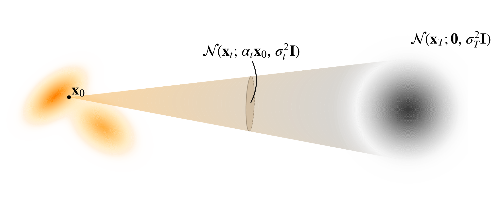
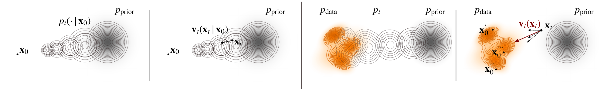
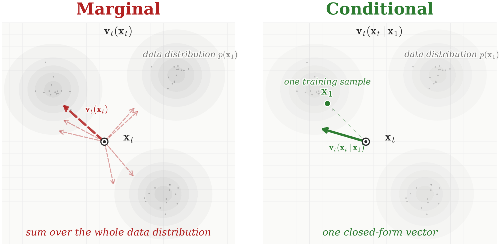

# 5.2 Flow Matching Framework {#sec-flow-matching-framework}

Both Score SDEs ([Chapter 4](../04-score-sde-framework/index.md#ch-score-sde)) and NODEs ([Section 5.1](01-normalizing-flows-and-neural-odes.md#sec-flow-based-method)) describe generative modeling as a continuous transport process. Score SDEs formulate this transport through stochastic dynamics together with an associated PF-ODE, whereas NODEs directly parameterize a deterministic ODE. In the standard generative setting, both aim to transport a simple Gaussian prior $p_{\mathrm{prior}}$ into the data distribution $p_{\mathrm{data}}$.

A practical limitation of NODEs is that likelihood-based training requires repeatedly solving an ODE. The *Flow Matching* (FM) framework ([Lipman et al., 2022](references.md#ref-lipman2022flow); [Lipman et al., 2024](references.md#ref-lipman2024flow); [Tong et al., 2024](references.md#ref-tongimproving)) avoids this cost by training a neural network to predict the velocity field directly through a regression objective. ODE integration is therefore needed for generation, but not inside the training loop, making FM training simulation-free.

More generally, FM is not restricted to Gaussian-to-data transport. It considers a source distribution $p_{\mathrm{src}}$ and a target distribution $p_{\mathrm{tgt}}$, both assumed to be easy to sample from. Standard generative modeling is recovered as the special case

$$
p_{\mathrm{src}}=p_{\mathrm{prior}},
\qquad
p_{\mathrm{tgt}}=p_{\mathrm{data}},
$$

where $p_{\mathrm{prior}}$ is typically Gaussian.

In this section, we adopt the FM viewpoint[^1] Its goal is to learn a time-dependent velocity field $\mathbf{v}_t({\mathbf{x}}_t)$ whose associated ODE transports samples along a prescribed probability path $\{p_t\}_{t\in[0,1]}$ satisfying

$$
p_0=p_{\mathrm{src}},
\qquad
p_1=p_{\mathrm{tgt}}.
$$

When $p_{\mathrm{src}}$ is Gaussian, we refer to this setting as *Gaussian Flow Matching*. Thus, FM provides both a simulation-free training method for generative modeling and a general framework for learning continuous transport between arbitrary endpoint distributions.

## 5.2.1 Lesson from Score-Based Methods {#subsec-lesson-score}

We revisit the Score SDE framework ([Chapter 4](../04-score-sde-framework/index.md#ch-score-sde)) using a slightly different but equivalent formulation to extract key insights that motivate the FM approach. This analysis reveals how diffusion models implicitly learn probability flows and motivates a more direct formulation.

**Step 1: Defining a Conditional Path and Its Marginal Densities.**

**Figure 5.6:** **Illustration of the conditional transition distribution.** $p_t({\mathbf{x}}_t | {\mathbf{x}}_0) = \mathcal{N}({\mathbf{x}}_t;\alpha_t {\mathbf{x}}_0,\sigma_t^2 \mathbf{I})$, defines a (Gaussian) conditional probability path from a data sample ${\mathbf{x}}_0 \sim p_{\text{data}}$ (left) towards the Gaussian prior $p_{\text{prior}}$ (right).

Source: Created by the authors.

A diffusion model specifies a continuous-time family of densities $\{p_t\}_{t \in [0,1]}$ that transports a simple prior $p_{\text{prior}}$ (e.g., Gaussian) at $t=1$, used as the source, to a target data distribution $p_{\text{data}}$ at $t=0$:

$$
p_1({\mathbf{x}}_1) = p_{\text{prior}}({\mathbf{x}}_1), \quad p_0({\mathbf{x}}_0) = p_{\text{data}}({\mathbf{x}}_0).
$$

This path is implicitly defined via the forward conditional distribution

$$
\begin{aligned}
p_t({\mathbf{x}}_t|{\mathbf{x}}_0) = \mathcal{N}({\mathbf{x}}_t; \alpha_t {\mathbf{x}}_0, \sigma_t^2 \mathbf{I}), \quad {\mathbf{x}}_0\sim p_{\text{data}}
\end{aligned}
\tag{5.2.1}
$$

which induces the marginal density

$$
p_t({\mathbf{x}}_t) := \int p_t({\mathbf{x}}_t |{\mathbf{x}}_0)  p_{\text{data}}({\mathbf{x}}_0) \mathrm{d}{\mathbf{x}}_0.
$$

The increasing variance $\sigma_t^2$ of the conditional Gaussian drives the evolution of $p_t$ toward the Gaussian prior.

**Step 2: Velocity Field.** The time evolution of the marginal density $p_t$ is governed by a velocity field ${\mathbf{v}}_t : \mathbb{R}^D \to \mathbb{R}^D$, derived from the Fokker-Planck equation:

$$
\begin{aligned}
{\mathbf{v}}_t({\mathbf{x}}) := f(t){\mathbf{x}} - \frac{1}{2}g^2(t)\nabla_{{\mathbf{x}}} \log p_t({\mathbf{x}}),
\end{aligned}
\tag{5.2.2}
$$

which defines a deterministic particle flow through the PF-ODE:

$$
\frac{\mathop{}\!\mathrm{d} {\mathbf{x}}(t)}{\mathop{}\!\mathrm{d} t} = \underbrace{f(t){\mathbf{x}}(t) - \frac{1}{2}g^2(t)\nabla_{{\mathbf{x}}} \log p_t\big({\mathbf{x}}(t)\big)}_{{\mathbf{v}}_t({\mathbf{x}}(t))}.
$$

This ODE transports an initial random variable ${\mathbf{x}}(0) \sim p_{\text{data}}$ forward in time or ${\mathbf{x}}(1) \sim p_{\text{prior}}$ backward in time, such that the evolving marginal density of ${\mathbf{x}}(t)$ matches $p_t$ at every $t \in [0,1]$ (see “Underlying Rule” below).

The scalar functions $f(t)$ and $g(t)$ are determined by the coefficients of the associated forward SDE, or equivalently the Gaussian kernel parameters $\alpha_t$ and $\sigma_t$ defined in the conditional path (see [Lemma 4.5.1](../04-score-sde-framework/05-accumulated-perturbation-kernels.md#forward-sde)).

**Step 3: Learning via the Conditional Strategy.** The PF-ODE velocity in [Equation (5.2.2)](02-flow-matching-framework.md#eq-dm-velocity) depends on the marginal score $\nabla_{{\mathbf{x}}_t}\log p_t({\mathbf{x}}_t)$, which is generally unknown. Score-based methods therefore learn this score using a neural network ${\mathbf{s}}_{\boldsymbol{\phi}}({\mathbf{x}}_t,t)$ through the ideal score-matching objective

$$
\mathcal{L}_{\text{SM}}(\boldsymbol{\phi})
=
\mathbb{E}_{t\sim\mathcal{U}[0,1],\,{\mathbf{x}}_t\sim p_t}
\left[
\left\|
{\mathbf{s}}_{\boldsymbol{\phi}}({\mathbf{x}}_t,t)
-
\nabla_{{\mathbf{x}}_t}\log p_t({\mathbf{x}}_t)
\right\|^2
\right].
$$

Once the score is learned, the PF-ODE velocity is obtained from it as

$$
{\mathbf{v}}_t({\mathbf{x}}_t)
=
f(t){\mathbf{x}}_t
-
\frac{1}{2}g^2(t)
\nabla_{{\mathbf{x}}_t}\log p_t({\mathbf{x}}_t),
$$

with ${\mathbf{s}}_{\boldsymbol{\phi}^\times}({\mathbf{x}},t) \approx \nabla_{{\mathbf{x}}_t}\log p_t({\mathbf{x}})$

The difficulty is that the marginal score itself is inaccessible when computing the regression target. As in [Chapter 3](../03-score-based-perspective/index.md#ch-score-based), we overcome this using the conditioning trick. The conditional distribution $p_t({\mathbf{x}}_t|{\mathbf{x}}_0)$ is tractable, and its conditional score satisfies

$$
\begin{aligned}
\nabla_{{\mathbf{x}}_t}\log p_t({\mathbf{x}}_t)
=
\mathbb{E}_{{\mathbf{x}}_0\sim p(\cdot|{\mathbf{x}}_t)}
\left[
\nabla_{{\mathbf{x}}_t}\log p_t({\mathbf{x}}_t|{\mathbf{x}}_0)
\right].
\end{aligned}
\tag{5.2.3}
$$

This motivates the denoising score matching objective

$$
\mathcal{L}_{\text{DSM}}(\boldsymbol{\phi})
:=
\mathbb{E}_{t,\,{\mathbf{x}}_0\sim p_{\mathrm{data}},\,
{\mathbf{x}}_t\sim p_t(\cdot|{\mathbf{x}}_0)}
\left[
\left\|
{\mathbf{s}}_{\boldsymbol{\phi}}({\mathbf{x}}_t,t)
-
\nabla_{{\mathbf{x}}_t}\log p_t({\mathbf{x}}_t|{\mathbf{x}}_0)
\right\|^2
\right].
$$

As shown in [Theorem 3.3.1](../03-score-based-perspective/03-denoising-score-matching.md#thm-sm-dsm), $\mathcal{L}_{\text{SM}}$ and $\mathcal{L}_{\text{DSM}}$ differ only by a constant independent of $\boldsymbol{\phi}$ and therefore have the same population minimizer:

$$
{\mathbf{s}}^*({\mathbf{x}}_t,t)
=
\mathbb{E}_{{\mathbf{x}}_0\sim p(\cdot|{\mathbf{x}}_t)}
\left[
\nabla_{{\mathbf{x}}_t}\log p_t({\mathbf{x}}_t|{\mathbf{x}}_0)
\right]
=
\nabla_{{\mathbf{x}}_t}\log p_t({\mathbf{x}}_t).
$$

Importantly, the same conditioning principle can also be expressed directly at the level of the PF-ODE velocity. Define the conditional velocity

$$
{\mathbf{v}}_t({\mathbf{x}}_t|{\mathbf{x}}_0)
:=
f(t){\mathbf{x}}_t
-
\frac{1}{2}g^2(t)
\nabla_{{\mathbf{x}}_t}\log p_t({\mathbf{x}}_t|{\mathbf{x}}_0).
$$

Using [Equation (5.2.3)](02-flow-matching-framework.md#eq-marginal-oracle-score), we immediately obtain

$$
{\mathbf{v}}_t({\mathbf{x}}_t)
=
\mathbb{E}_{{\mathbf{x}}_0\sim p(\cdot|{\mathbf{x}}_t)}
\left[
{\mathbf{v}}_t({\mathbf{x}}_t|{\mathbf{x}}_0)
\right].
$$

Thus, score-based diffusion learns the score through tractable conditional targets and then uses it to construct the PF-ODE velocity. Flow Matching will apply the same conditional-to-marginal principle directly to the velocity field.

**Figure 5.7:** **Illustration of conditional versus marginal perspectives in diffusion.** (This figure is motivated by [Lipman et al. (2024)](references.md#ref-lipman2024flow).) (1) Conditional Gaussian path $p_t(\cdot|\mathbf{x}_0)$, showing expanding densities from a fixed $\mathbf{x}_0$ toward the prior. (2) Conditional velocity

$$
\mathbf{v}_t(\mathbf{x}_t|\mathbf{x}_0)=f(t){\mathbf{x}}_t - \tfrac{1}{2}g^2(t) \nabla_{{\mathbf{x}}_t} \log p_t({\mathbf{x}}_t|{\mathbf{x}}_0).
$$

 (3) Marginal density $p_t$, transporting the data distribution $p_{\mathrm{data}}$ (orange) into the prior $p_{\mathrm{prior}}$ (gray). (4) Marginal velocity $\mathbf{v}_t(\mathbf{x}_t)=f(t){\mathbf{x}}_t - \tfrac{1}{2}g^2(t) \nabla_{{\mathbf{x}}_t} \log p_t({\mathbf{x}}_t)$, obtained by averaging conditional directions from $\mathbf{x}_t$ to multiple plausible origins (dashed), yielding the red arrow. In the FM framework with one-sided conditioning ${\mathbf{z}}={\mathbf{x}}_0$, the same illustration applies to ${\mathbf{v}}_t({\mathbf{x}}_t|{\mathbf{x}}_0)$ and ${\mathbf{v}}_t({\mathbf{x}}_t)$, without requiring them to be written explicitly in terms of the scores $\nabla_{{\mathbf{x}}_t}\log p_t({\mathbf{x}}_t|{\mathbf{x}}_0)$ or $\nabla_{{\mathbf{x}}_t}\log p_t({\mathbf{x}}_t)$.

Source: Created by the authors.

**Underlying Rule: The Fokker–Planck Equation.** The marginal density $p_t$ evolves according to the Fokker–Planck equation:

$$
\begin{aligned}
\frac{\partial p_t({\mathbf{x}})}{\partial t} + \nabla \cdot \Bigg( \underbrace{\left(f(t){\mathbf{x}} - \frac{1}{2}g^2(t) \nabla_{\mathbf{x}} \log p_t({\mathbf{x}})\right)}_{{\mathbf{v}}_t({\mathbf{x}})}  p_t({\mathbf{x}}) \Bigg) = 0.
\end{aligned}
$$

This PDE ensures that the density given by the PF-ODE matches the marginal distribution of the forward SDE. To see this, recall the *flow map* ${\boldsymbol{\Psi}}_{s \to t}({\mathbf{x}}_s)$ of the PF-ODE as defined in [Equation (4.2.2)](../04-score-sde-framework/02-matching-marginals.md#eq-flow-map-def), which carries an initial state ${\mathbf{x}}_s$ at time $s$ directly to its state at $t$. Running the PF-ODE backward from $t=1$ to $t=0$, starting with ${\mathbf{x}}_1 \sim p_{\mathrm{prior}}$, we obtain time-dependent densities through the pushforward formula:

$$
\begin{aligned}
p_t^{\mathrm{rev}}({\mathbf{x}})
    = \int \delta \left({\mathbf{x}} - {\boldsymbol{\Psi}}_{1 \to t}({\mathbf{x}}_1)\right)
      p_{\mathrm{prior}}({\mathbf{x}}_1) \mathrm{d}{\mathbf{x}}_1.
\end{aligned}
\tag{5.2.4}
$$

The Fokker–Planck equation ensures that the induced density path coincides with the same evolving density:

$$
\begin{aligned}
p_t^{\mathrm{rev}} = p_t.
\end{aligned}
\tag{5.2.5}
$$

In particular, this implies $p_0^{\mathrm{rev}} = p_0 = p_{\text{data}}$, thereby recovering the data distribution at time $t=0$. Since the ODE solution map is bidirectional, we can similarly consider initializing at ${\mathbf{x}}_0 \sim p_{\text{data}}$ and solving the ODE forward in time, enabling a parallel analysis.

## 5.2.2 Flow Matching Framework {#subsec-fm-framework}

The analysis in [Section 5.2.1](02-flow-matching-framework.md#subsec-lesson-score) reveals that diffusion models succeed by learning a velocity field, specifically, the score, that transports between distributions while satisfying boundary conditions. The design of the Gaussian conditional path in [Equation (5.2.1)](02-flow-matching-framework.md#eq-lesson-dm-conditional-path), with increasing variance $\sigma_t^2$, implicitly anchors one endpoint to a Gaussian prior while allowing the conditional density to be defined over the entire space, enabling score-based gradient computation.

In this subsection, we introduce the FM framework, which builds on this insight (the same illustration in [Figure 5.7](02-flow-matching-framework.md#fig-conditional-marginal) also applies to the FM framework) and extends it to learning continuous flows that transport samples between two arbitrary distributions, $p_{\text{src}}$ and $p_{\text{tgt}}$.

**Step 1: Defining a Conditional Path and Its Marginal Densities.** Consider arbitrary source and target probability distributions $p_{\mathrm{src}}$ and $p_{\mathrm{tgt}}$ on $\mathbb{R}^D$. We set[^2]

$$
\begin{aligned}
p_0(\mathbf{x}) = p_{\mathrm{src}}(\mathbf{x}), \quad p_1(\mathbf{x}) = p_{\mathrm{tgt}}(\mathbf{x}).
\end{aligned}
\tag{5.2.6}
$$

FM implicitly defines a continuous family of intermediate densities $\{ p_t \}_{t \in [0,1]}$ interpolating between these endpoints. Each marginal $p_t$ is expressed via a latent variable $\mathbf{z}$ drawn from a known distribution $\pi(\mathbf{z})$ and a conditional distribution $p_t(\mathbf{x}_t | \mathbf{z})$:

$$
p_t(\mathbf{x}_t) = \int p_t(\mathbf{x}_t | \mathbf{z}) \pi(\mathbf{z}) \mathop{}\!\mathrm{d} \mathbf{z},
\tag{5.2.7}
$$

with $(\pi(\mathbf{z}), \{p_t(\cdot|\mathbf{z})\})$ chosen to satisfy the boundary conditions in [Equation (5.2.6)](02-flow-matching-framework.md#eq-marginal-endpoint).

We remark that, in general, the marginal densities $p_t$ are not tractable, since they require integrating over $\pi(\mathbf{z})$, and both $\pi(\mathbf{z})$ and the conditional distributions $p_t(\mathbf{x}_t|\mathbf{z})$ can be complex. Nonetheless, conditioning on the latent $\mathbf{z}$ grants FM the flexibility to model a broad class of interpolation paths beyond those discussed in [Section 5.2.1](02-flow-matching-framework.md#subsec-lesson-score). Common choices for $\mathbf{z}$ include:

-   **Two-sided conditioning:** $\mathbf{z} = (\mathbf{x}_0, \mathbf{x}_1) \sim p_{\text{src}}(\mathbf{x}_0) p_{\text{tgt}}(\mathbf{x}_1)$, where $\pi$ couples source and target distributions. This allows FM to define transport between arbitrary distributions.

-   **One-sided conditioning:** $\mathbf{z} = \mathbf{x}_0$ or $\mathbf{z} = \mathbf{x}_1$. It especially recovers diffusion-like setups when the source distribution is chosen to be Gaussian.

In all cases, the conditional path $p_t(\mathbf{x}_t|\mathbf{z})$ should be efficiently sampleable, and the corresponding conditional velocity should be tractable. In the probability-path-first constructions below, we further use conditional distributions with tractable closed-form expressions. We present specific constructions in [Section 5.3.2](03-probability-paths-and-velocities.md#subsec-fm-instantiations), with illustrations in [Figure 5.9](03-probability-paths-and-velocities.md#fig-conditional-path).

**Step 2: Velocity Field.** A probability path $\{p_t\}_{t\in[0,1]}$ specifies how the distribution should evolve over time, but it does not generally specify how individual samples should move. In other words, the same sequence of marginal densities can be realized by different velocity fields[^3].

The goal of FM is therefore to find a velocity field $\mathbf{v}_t(\mathbf{x})$ whose induced ODE

$$
\frac{\mathop{}\!\mathrm{d} \mathbf{x}(t)}{\mathop{}\!\mathrm{d} t}
=
\mathbf{v}_t(\mathbf{x}(t)),
\qquad
t\in[0,1],
$$

produces marginal distributions that match the prescribed $p_t$ at every time $t$. When this holds, the ODE can transport samples forward from $\mathbf{x}(0)\sim p_{\text{src}}$ to $p_{\text{tgt}}$, or backward from $\mathbf{x}(1)\sim p_{\text{tgt}}$ to $p_{\text{src}}$ (see [Section 5.2.4](02-flow-matching-framework.md#subsec-fm-theory) for a more formal discussion).

This requirement is captured by the *continuity equation*[^4]:

$$
\frac{\partial p_t(\mathbf{x})}{\partial t}
    +
    \nabla\cdot
    \bigl(
    \mathbf{v}_t(\mathbf{x})p_t(\mathbf{x})
    \bigr)
    =
    0.
\tag{5.2.8}
$$

Any velocity field $\mathbf{v}_t$ satisfying [Equation (5.2.8)](02-flow-matching-framework.md#eq-continuity-eq), together with the initial condition $p_0=p_{\mathrm{src}}$, generates an ODE whose evolving marginals follow the prescribed path $\{p_t\}$, under suitable regularity conditions. Thus, solving the ODE provides a sample-wise transport between $p_{\mathrm{src}}$ and $p_{\mathrm{tgt}}$ while matching the intermediate distributions.

Importantly, the continuity equation constrains the evolution of probability density, but generally does not uniquely determine the velocity field. Different sample trajectories can therefore produce exactly the same marginal density evolution. For example, on regions where $p_t>0$, if $\mathbf{v}_t$ satisfies [Equation (5.2.8)](02-flow-matching-framework.md#eq-continuity-eq), then

$$
\mathbf{v}_t
+
\frac{1}{p_t}\tilde{\mathbf{v}}_t
$$

also satisfies it for any sufficiently regular divergence-free field $\tilde{\mathbf{v}}_t$ with $\nabla\cdot\tilde{\mathbf{v}}_t=0$.

FM therefore seeks *a* velocity field that realizes the prescribed probability path. For general source and target distributions, neither the marginal density $p_t$ nor such a velocity field is usually available in closed form. This motivates the conditional construction introduced next, where tractable conditional paths and velocities are used to learn a valid marginal velocity field.

As a concrete illustration, in [Section 5.3.1](03-probability-paths-and-velocities.md#subsec-special-fm-instantiations) we consider a Gaussian-to-Gaussian path together with a particular affine flow map, for which the corresponding velocity field can be computed explicitly.

**Step 3: Learning via the Conditional Strategy.** Once a probability path and a corresponding marginal velocity field ${\mathbf{v}}_t$ have been chosen, FM learns this velocity field directly using a neural network ${\mathbf{v}}_{\boldsymbol{\phi}}$. The ideal FM objective is

$$
\mathcal{L}_{\mathrm{FM}}(\boldsymbol{\phi})
=
\mathbb{E}_{t,\,{\mathbf{x}}_t\sim p_t}
\left[
\left\|
{\mathbf{v}}_{\boldsymbol{\phi}}({\mathbf{x}}_t,t)
-
{\mathbf{v}}_t({\mathbf{x}}_t)
\right\|^2
\right].
$$

We refer to this neural network parameterization as *${\mathbf{v}}$-prediction* (velocity prediction), since the network directly predicts the drift of the ODE. This differs from the score-based construction in [Section 5.2.1](02-flow-matching-framework.md#subsec-lesson-score), where the score is learned first and then used to construct the PF-ODE velocity.

The difficulty is that the marginal velocity ${\mathbf{v}}_t({\mathbf{x}}_t)$ is generally intractable. As in denoising score matching, we overcome this using a conditioning strategy. We introduce a latent variable ${\mathbf{z}}\sim\pi({\mathbf{z}})$ and construct a tractable conditional probability path $p_t({\mathbf{x}}_t|{\mathbf{z}})$ together with a corresponding conditional velocity field ${\mathbf{v}}_t({\mathbf{x}}_t|{\mathbf{z}})$.

If each conditional velocity field generates its corresponding conditional probability path, then marginalizing over ${\mathbf{z}}$ gives a valid marginal velocity field:

$$
\begin{aligned}
{\mathbf{v}}_t({\mathbf{x}}_t)
:=
\mathbb{E}_{{\mathbf{z}}\sim p(\cdot|{\mathbf{x}}_t)}
\left[
{\mathbf{v}}_t({\mathbf{x}}_t|{\mathbf{z}})
\right].
\end{aligned}
\tag{5.2.9}
$$

Thus, the generally intractable marginal velocity is the conditional average of tractable conditional velocities. This is directly analogous to the conditional-score identity in [Equation (5.2.3)](02-flow-matching-framework.md#eq-marginal-oracle-score).

This observation leads to the *conditional flow matching* (CFM) objective:

$$
\begin{aligned}
\mathcal{L}_{\mathrm{CFM}}(\boldsymbol{\phi})
:=
\mathbb{E}_{t,\,{\mathbf{z}}\sim\pi({\mathbf{z}}),\,
{\mathbf{x}}_t\sim{\color{orange}p_t(\cdot|{\mathbf{z}})}}
\left[
\left\|
{\mathbf{v}}_{\boldsymbol{\phi}}({\mathbf{x}}_t,t)
-
{\color{orange}{\mathbf{v}}_t({\mathbf{x}}_t|{\mathbf{z}})}
\right\|^2
\right].
\end{aligned}
\tag{5.2.10}
$$

Here, ${\mathbf{z}}$ is used to construct the training sample ${\mathbf{x}}_t$ and the conditional regression target ${\mathbf{v}}_t({\mathbf{x}}_t|{\mathbf{z}})$; it is not an additional input to the neural network ${\mathbf{v}}_{\boldsymbol{\phi}}({\mathbf{x}}_t,t)$. Importantly, the two objectives differ only by a constant $C\leq0$ independent of $\boldsymbol{\phi}$:

$$
\mathcal{L}_{\mathrm{FM}}(\boldsymbol{\phi})
=
\mathcal{L}_{\mathrm{CFM}}(\boldsymbol{\phi})
+
C.
$$

They therefore have the same population minimizer,

$$
\begin{aligned}
{\mathbf{v}}^*({\mathbf{x}}_t,t)
=
{\mathbf{v}}_t({\mathbf{x}}_t).
\end{aligned}
\tag{5.2.11}
$$

In other words, although each training example uses a conditional velocity ${\mathbf{v}}_t({\mathbf{x}}_t|{\mathbf{z}})$ as its target, averaging over these examples recovers the desired marginal velocity field.

For CFM to provide tractable, simulation-free training, two practical conditions are needed:

-   we can easily sample ${\mathbf{x}}_t\sim p_t(\cdot|{\mathbf{z}})$ without solving an ODE;

-   the conditional velocity ${\mathbf{v}}_t({\mathbf{x}}_t|{\mathbf{z}})$ has a tractable expression that can be used as the regression target.

We provide concrete constructions satisfying these conditions in [Section 5.3.2](03-probability-paths-and-velocities.md#subsec-fm-instantiations). Thus, just as denoising score matching learns an intractable marginal score through tractable conditional scores, Flow Matching learns an intractable marginal velocity through tractable conditional-velocity targets.

**Figure 5.8:** **The conditional trick in flow matching.** Here, ${\mathbf{x}}_1\sim p_{\mathrm{tgt}}$ denotes a target data sample. **(Left)** For a fixed intermediate sample ${\mathbf{x}}_t$, the marginal velocity ${\mathbf{v}}_t({\mathbf{x}}_t)$ averages the conditional velocities associated with all possible target samples ${\mathbf{x}}_1$ that could have produced ${\mathbf{x}}_t$. The contribution of each ${\mathbf{x}}_1$ is weighted by how compatible it is with the observed ${\mathbf{x}}_t$. Computing this average directly requires integrating over the whole target distribution and is generally intractable. **(Right)** During training, however, the particular target sample ${\mathbf{x}}_1$ used to construct ${\mathbf{x}}_t$ is known. Conditioning on this sample gives the closed-form velocity ${\mathbf{v}}_t({\mathbf{x}}_t|{\mathbf{x}}_1) = b_t'{\mathbf{x}}_1 + \frac{a_t'}{a_t} \bigl({\mathbf{x}}_t-b_t{\mathbf{x}}_1\bigr)$, which provides one simple vector as the regression target ([Proposition 5.3.1](03-probability-paths-and-velocities.md#closed-form-vf)). Although each training example conditions on only one target sample, averaging the conditional training objective over the data gives the same optimal marginal velocity field; see [Theorem 5.2.1](02-flow-matching-framework.md#thm-fm-cfm). Thus, conditional flow matching learns ${\mathbf{v}}_t({\mathbf{x}}_t)$ without directly regressing on the generally intractable marginal velocity. This is the same conditioning principle used in the variational perspective ([Theorem 2.2.1](../02-variational-perspective/02-ddpm.md#thm-equiv-marginal-kl)) and in denoising score matching ([Theorem 3.3.1](../03-score-based-perspective/03-denoising-score-matching.md#thm-sm-dsm)).

Source: Created by the authors with AI-assisted coding.

We summarize the above discussion as follows:

**Theorem 5.2.1: Equivalence of $\mathcal{L}_{\mathrm{FM}}$ and $\mathcal{L}_{\mathrm{CFM}}$**

The following holds:

$$
\begin{aligned}
\mathcal{L}_{\mathrm{FM}}(\boldsymbol{\phi}) = \mathcal{L}_{\mathrm{CFM}}(\boldsymbol{\phi}) + C,
\end{aligned}
$$

where $C$ is a constant independent of the parameter $\boldsymbol{\phi}$. Furthermore, the minimizer ${\mathbf{v}}^*$ of both losses satisfies

$$
{\mathbf{v}}^*({\mathbf{x}}_t, t) = {\mathbf{v}}_t({\mathbf{x}}_t), \quad \text{for almost every } {\mathbf{x}}_t \sim p_t,
$$

where ${\mathbf{v}}_t({\mathbf{x}}_t)$ is defined in [Equation (5.2.9)](02-flow-matching-framework.md#eq-marginal-oracle-velocity).

**Proof for Theorem.**

The argument and derivation of the minimizer follows exactly the same reasoning as in the score matching case of [Proposition 4.3.1](../04-score-sde-framework/03-training-and-sampling.md#dsm-minimizer).

This marks the third instance where the conditioning trick yields a tractable training objective, as illustrated in [Figure 5.8](02-flow-matching-framework.md#fig-cfm-illustration). Notably, the variational, score based, and flow based approaches all reflect the same underlying principle.

**Remark.**

Taking $\pi = p_{\mathrm{data}}$, we can apply Bayes’ rule:

$$
p({\mathbf{x}}_0|{\mathbf{x}}_t) = \frac{p_t({\mathbf{x}}_t|{\mathbf{x}}_0) p_{\mathrm{data}}({\mathbf{x}}_0)}{p_t({\mathbf{x}}_t)},
$$

a similar decomposition of [Equation (5.2.9)](02-flow-matching-framework.md#eq-marginal-oracle-velocity) appears in score-based models:

$$
\begin{aligned}
\nabla_{{\mathbf{x}}_t} \log p_t({\mathbf{x}}_t)
    &= \mathbb{E}_{{\mathbf{x}}_0 \sim p(\cdot|{\mathbf{x}}_t)} \left[ \nabla_{{\mathbf{x}}_t} \log p_t({\mathbf{x}}_t|{\mathbf{x}}_0) \right] \\
    &= \mathbb{E}_{{\mathbf{x}}_0 \sim p_{\text{data}}} \left[ \nabla_{{\mathbf{x}}_t} \log p_t({\mathbf{x}}_t|{\mathbf{x}}_0) \cdot \frac{p_t({\mathbf{x}}_t|{\mathbf{x}}_0)}{p_t({\mathbf{x}}_t)} \right],
\end{aligned}
$$

which mirrors the marginalization strategy in [Equation (5.2.9)](02-flow-matching-framework.md#eq-marginal-oracle-velocity).

As in [Section 5.2.1](02-flow-matching-framework.md#subsec-lesson-score), where the conditional density $p_t({\mathbf{x}}_t|{\mathbf{z}})$ and conditional velocity field ${\mathbf{v}}_t({\mathbf{x}}_t|{\mathbf{z}})$ must be explicitly specified, with $p_t({\mathbf{x}}_t|{\mathbf{x}}_0) = \mathcal{N}({\mathbf{x}}_t; \alpha_t {\mathbf{x}}_0, \sigma_t^2 {\mathbf{I}})$ and

$$
{\mathbf{v}}_t({\mathbf{x}}_t|{\mathbf{x}}_0) = f(t){\mathbf{x}}_t - \frac{1}{2}g^2(t)\nabla_{{\mathbf{x}}_t} \log p_t({\mathbf{x}}_t|{\mathbf{x}}_0),
$$

 the general conditional flow matching framework also requires these two components. However, we have not yet construct the conditional density $p_t({\mathbf{x}}_t|{\mathbf{z}})$ or the conditional velocity field ${\mathbf{v}}_t({\mathbf{x}}_t|{\mathbf{z}})$ in this general case. In [Section 5.3](03-probability-paths-and-velocities.md#sec-instance-fm), we introduce several common instantiations of these components.

## 5.2.3 Comparison of Diffusion Models, General Flow Matching, and NODEs {#subsec-compare-dm-general-fm}

**Comparison of Diffusion Models and General Flow Matching.** The insight from [Section 5.2.1](02-flow-matching-framework.md#subsec-lesson-score) leads to an extended FM framework that retains the same underlying principles. To highlight their similarities, we summarize them in [Table 5.1](02-flow-matching-framework.md#tab-framework-comparison).

**Table 5.1:** Comparison between diffusion models (or Gaussian FM) and the general FM framework. Here, the general FM framework refers to the setting with two-sided conditioning, where $\mathbf{x}_0 \sim p_{\text{src}}$ and $\mathbf{x}_1 \sim p_{\text{tgt}}$ are sampled independently.

<table markdown="1">
<tr markdown="1">
<th markdown="block">

**Aspect**

</th>
<th markdown="block">

**(Score-Based) Diffusion Model**

</th>
<th markdown="block">

**General FM**

</th>
</tr>
<tr markdown="1">
<td markdown="block">

Source dist. $p_{\mathrm{src}}$

</td>
<td markdown="block">

Gaussian prior

</td>
<td markdown="block">

Any

</td>
</tr>
<tr markdown="1">
<td markdown="block">

Target dist. $p_{\mathrm{tgt}}$

</td>
<td markdown="block">

Data distribution

</td>
<td markdown="block">

Any

</td>
</tr>
<tr markdown="1">
<td markdown="block">

Latent dist. $\pi({\mathbf{z}})$

</td>
<td markdown="block">

$p_{\text{data}}$

</td>
<td markdown="block">

See [Section 5.3.2](03-probability-paths-and-velocities.md#subsec-fm-instantiations)

</td>
</tr>
<tr markdown="1">
<td markdown="block">

Cond. dist. $p_t({\mathbf{x}}_t|{\mathbf{z}})$

</td>
<td markdown="block">

$\mathcal{N}({\mathbf{x}}_t;\alpha_t{\mathbf{x}}_0,\sigma_t^2{\mathbf{I}})$

</td>
<td markdown="block">

See [Section 5.3.2](03-probability-paths-and-velocities.md#subsec-fm-instantiations)

</td>
</tr>
<tr markdown="1">
<td markdown="block">

Marginal dist. $p_t({\mathbf{x}}_t)$

</td>
<td markdown="block">

$\int p_t({\mathbf{x}}_t|{\mathbf{x}}_0) p_{\mathrm{data}}({\mathbf{x}}_0) \mathop{}\!\mathrm{d}{\mathbf{x}}_0$

</td>
<td markdown="block">

$\int p_t({\mathbf{x}}_t|{\mathbf{z}}) \pi({\mathbf{z}}) \mathop{}\!\mathrm{d}{\mathbf{z}}$

</td>
</tr>
<tr markdown="1">
<td markdown="block">

Cond. velocity ${\mathbf{v}}_t({\mathbf{x}}|{\mathbf{z}})$

</td>
<td markdown="block">

$f(t) {\mathbf{x}} - \frac{1}{2} g^2(t) \nabla \log p_t({\mathbf{x}}|{\mathbf{x}}_0)$

</td>
<td markdown="block">

See [Section 5.3.2](03-probability-paths-and-velocities.md#subsec-fm-instantiations)

</td>
</tr>
<tr markdown="1">
<td markdown="block">

Marginal velocity ${\mathbf{v}}_t({\mathbf{x}})$

</td>
<td markdown="block">

$f(t) {\mathbf{x}} - \frac{1}{2} g^2(t) \nabla \log p_t({\mathbf{x}})$

</td>
<td markdown="block">

See [Equation (5.2.9)](02-flow-matching-framework.md#eq-marginal-oracle-velocity)

</td>
</tr>
<tr markdown="1">
<td markdown="block">

Learning objective

</td>
<td markdown="block">

$\mathcal{L}_{\text{SM}}=\mathcal{L}_{\text{DSM}}+C$

</td>
<td markdown="block">

$\mathcal{L}_{\mathrm{FM}}=\mathcal{L}_{\mathrm{CFM}}+C$

</td>
</tr>
<tr markdown="1">
<td markdown="block">

Underlying Rule

</td>
<td colspan="2" markdown="block">

Fokker-Planck / Continuity Equation

</td>
</tr>
</table>

We remark that, assuming the Gaussian schedule satisfies the diffusion-SDE compatibility condition in [Lemma 4.5.1](../04-score-sde-framework/05-accumulated-perturbation-kernels.md#forward-sde), Gaussian FM is essentially equivalent to the corresponding diffusion formulation (see more in [Chapter 6](../06-unified-perspective/index.md#ch-unified-perspective)); we therefore do not differentiate between them unless explicitly stated.

**Connection to NODEs.** FM can be viewed as a simulation-free alternative to NODEs, introduced in [Section 5.1.2](01-normalizing-flows-and-neural-odes.md#subsec-node). While CNFs require solving ODEs during maximum likelihood training, which is computationally intensive, FM bypasses this by directly regressing a prescribed velocity field through a simple regression loss. The key insight is that when the marginal density path connecting the source and target distributions is fixed, exact simulation during training becomes unnecessary.

## 5.2.4 (Optional) Underlying Rules {#subsec-fm-theory}

**Continuity Equation: Mass Conservation Criterion.** Similar to the PF-ODE and Fokker–Planck analysis in [Section 5.2.1](02-flow-matching-framework.md#subsec-lesson-score), we now present a criterion for verifying whether the density path induced by an ODE flow aligns with a prescribed path $\{p_t\}_{t \in [0,1]}$.

Consider the ODE describing the flow of particles under a time-dependent velocity field ${\mathbf{v}}_t$:

$$
\frac{\mathop{}\!\mathrm{d} {\mathbf{x}}(t)}{\mathop{}\!\mathrm{d} t} = {\mathbf{v}}_t\left({\mathbf{x}}(t)\right).
$$

As in [Equation (5.2.4)](02-flow-matching-framework.md#eq-pushforward-ode), this ODE defines a flow map $\boldsymbol{\Psi}_{s\to t}({\mathbf{x}}_0)$ for any $s,t \in [0,1]$, which in particular transports an initial point ${\mathbf{x}}_0 \sim p_{\mathrm{src}}$ at time $0$ to its state at time $t$. The induced distribution at time $t$ is given by the pushforward

$$
\begin{aligned}
p_t^{\mathrm{fwd}}({\mathbf{x}})
    = \int \delta \left({\mathbf{x}} - \boldsymbol{\Psi}_{0\to t}({\mathbf{x}}_0)\right)
      p_{\mathrm{src}}({\mathbf{x}}_0) \mathrm{d}{\mathbf{x}}_0=: \boldsymbol{\Psi}_{0\to t}\# p_{\mathrm{src}},
\end{aligned}
\tag{5.2.12}
$$

so that $\boldsymbol{\Psi}_{0\to t}({\mathbf{x}}_0) \sim p_t^{\mathrm{fwd}}$ whenever ${\mathbf{x}}_0 \sim p_{\mathrm{src}}$. Similarly, one can transport backward from ${\mathbf{x}}_1 \sim p_{\mathrm{tgt}}$ to $p_{\mathrm{src}}$ via $\boldsymbol{\Psi}_{1\to 0}({\mathbf{x}}_1)$.

Suppose we are given a prescribed density path $\{p_t\}_{t \in [0,1]}$, and we construct a velocity field $\{{\mathbf{v}}_t\}_{t \in [0,1]}$ to define a particle flow. This naturally raises the question:

**Question 5.2.1**

Under what conditions does the flow-induced density $p_t^{\mathrm{fwd}}$ exactly match the target density $p_t$ for all $t \in [0,1]$?

Once the two density evolutions align, we can leverage the ODE flow to flexibly transport samples between $p_{\mathrm{src}}$ and $p_{\mathrm{tgt}}$ by solving the ODE.

As in [Equation (5.2.5)](02-flow-matching-framework.md#eq-p-t-fwd-rev), a principled way to verify this alignment is via the *continuity equation*, which captures the conservation of mass in time-evolving densities:

**Theorem 5.2.2: Mass Conservation Criterion**

The flow-induced density $p_t^{\mathrm{fwd}}$ equals the prescribed path $p_t$ for all $t \in [0,1]$; i.e.,

$$
p_t^{\mathrm{fwd}} = p_t, \quad \text{for all } t \in [0,1],
$$

if and only if the pair $(p_t, {\mathbf{v}}_t)$ satisfies the continuity equation:

$$
\partial_t p_t({\mathbf{x}}) + \nabla_{\mathbf{x}} \cdot (p_t({\mathbf{x}}) {\mathbf{v}}_t({\mathbf{x}})) = 0,
$$

for all $t\in[0,1]$ and ${\mathbf{x}}$.

**Proof for Theorem.**

A conceptual derivation is provided in [Section D.3.2](../../appendices/d-supplementary-proofs/index.md#app-sec-mass-conservation), while a more rigorous treatment can be found in ([Villani and others, 2008](references.md#ref-villani2008optimal)) (see “Mass Conservation Formula”).

**From Conditional to Marginal Paths.** As seen in [Section 5.2.2](02-flow-matching-framework.md#subsec-fm-framework), we begin by defining a conditional probability path $p_t(\cdot| {\mathbf{z}})$ and a corresponding conditional velocity field ${\mathbf{v}}_t(\cdot| {\mathbf{z}})$. We then construct the marginal velocity field via:

$$
{\mathbf{v}}_t({\mathbf{x}})
    = \int {\mathbf{v}}_t({\mathbf{x}}| {\mathbf{z}}) \frac{p_t({\mathbf{x}}| {\mathbf{z}}) \pi({\mathbf{z}})}{p_t({\mathbf{x}})}   \mathop{}\!\mathrm{d} {\mathbf{z}},
$$

as in [Equation (5.2.9)](02-flow-matching-framework.md#eq-marginal-oracle-velocity). However, we still need to ensure that the resulting marginal velocity ${\mathbf{v}}_t$ induces an ODE flow whose density path aligns with the prescribed $p_t$. Fortunately, this verification can be done entirely at the conditional level: if each conditional velocity field ${\mathbf{v}}_t(\cdot| {\mathbf{z}})$ induces the conditional density path $p_t(\cdot| {\mathbf{z}})$, then the resulting marginal velocity ${\mathbf{v}}_t$ also induces the correct marginal path. Formally, we state the result below and provide the complete derivation in one place to show explicitly how the marginal velocity field takes this form:

**Proposition 5.2.3: Marginal VF Generates Given Marginal Density**

If the conditional velocity fields ${\mathbf{v}}_t(\cdot|{\mathbf{z}})$ induce conditional density paths that match $p_t(\cdot|{\mathbf{z}})$ (starting from $p_0(\cdot|{\mathbf{z}})$), then the marginal velocity field ${\mathbf{v}}_t(\cdot)$ defined in [Equation (5.2.9)](02-flow-matching-framework.md#eq-marginal-oracle-velocity) induces a marginal density path that aligns with $p_t(\cdot)$, starting from $p_0(\cdot)$.

**Proof for Proposition.**

This result follows by verifying that the pair $(p_t, {\mathbf{v}}_t)$ satisfies the Continuity Equation. We present the argument in a converse manner to provide intuition for why the marginalized velocity field takes the form in [Equation (5.2.9)](02-flow-matching-framework.md#eq-marginal-oracle-velocity). Since the conditional velocity fields ${\mathbf{v}}_t(\cdot|{\mathbf{z}})$ induce density paths matching the conditional densities $p_t(\cdot|{\mathbf{z}})$ for ${\mathbf{z}} \sim \pi$, the continuity equation holds for each conditional pair:

$$
\begin{aligned}
\frac{\mathop{}\!\mathrm{d}}{\mathop{}\!\mathrm{d} t} p_t({\mathbf{x}}|{\mathbf{z}}) =- \nabla_{\mathbf{x}} \cdot \big({\mathbf{v}}_t({\mathbf{x}}|{\mathbf{z}}) p_t({\mathbf{x}}|{\mathbf{z}})\big).
\end{aligned}
\tag{5.2.13}
$$

We aim to find a velocity field ${\color{orange}{\mathbf{v}}_t(\cdot)}$ whose induced densities align with the marginal density $p_t$, i.e., satisfy

$$
\begin{aligned}
\frac{\mathop{}\!\mathrm{d}}{\mathop{}\!\mathrm{d} t} p_t({\mathbf{x}}) =- \nabla_{\mathbf{x}} \cdot \big({\color{orange}{\mathbf{v}}_t({\mathbf{x}})} p_t({\mathbf{x}})\big).
\end{aligned}
\tag{5.2.14}
$$

Starting from the definition of $p_t$ in [Equation (5.2.7)](02-flow-matching-framework.md#eq-p-t),

$$
\begin{aligned}
\frac{\mathop{}\!\mathrm{d}}{\mathop{}\!\mathrm{d} t} p_t({\mathbf{x}}) &=\int \frac{\mathop{}\!\mathrm{d}}{\mathop{}\!\mathrm{d} t} p_t({\mathbf{x}}_t|{\mathbf{z}})\pi({\mathbf{z}})\mathop{}\!\mathrm{d} {\mathbf{z}} \\
  &=  - \int \nabla_{\mathbf{x}} \cdot\Big(  {\mathbf{v}}_t({\mathbf{x}}|{\mathbf{z}}) p_t({\mathbf{x}} | {\mathbf{z}})  \Big)\pi({\mathbf{z}}) \mathop{}\!\mathrm{d} {\mathbf{z}} \quad  \\
  &=  -\nabla_{\mathbf{x}} \cdot \Big( \int  {\mathbf{v}}_t({\mathbf{x}}|{\mathbf{z}}) p_t({\mathbf{x}} | {\mathbf{z}})
 \pi({\mathbf{z}}) \mathop{}\!\mathrm{d} {\mathbf{z}}\Big),
\end{aligned}
$$

where the second equality follows by applying [Equation (5.2.13)](02-flow-matching-framework.md#eq-continuity-conditional-pt). Comparing this with the right-hand side of [Equation (5.2.14)](02-flow-matching-framework.md#eq-p-t-continuity) shows that, up to a divergence-free term,

$$
{\color{orange}{\mathbf{v}}_t({\mathbf{x}})} p_t({\mathbf{x}}) = \int {\mathbf{v}}_t({\mathbf{x}}|{\mathbf{z}}) p_t({\mathbf{x}}|{\mathbf{z}}) \pi({\mathbf{z}}) \mathop{}\!\mathrm{d} {\mathbf{z}}.
$$

Therefore, we can define

$$
{\color{orange}{\mathbf{v}}_t({\mathbf{x}})} := \int {\mathbf{v}}_t({\mathbf{x}}|{\mathbf{z}}) \frac{p_t({\mathbf{x}}|{\mathbf{z}})}{p_t({\mathbf{x}})} \pi({\mathbf{z}}) \mathop{}\!\mathrm{d} {\mathbf{z}},
$$

which is precisely the form in [Equation (5.2.9)](02-flow-matching-framework.md#eq-marginal-oracle-velocity). The proof of this theorem essentially follows the reverse of this argument.

This connection allows us to reduce the construction of the potentially intractable marginal velocity field to defining simpler conditional fields ${\mathbf{v}}_t(\cdot| {\mathbf{z}})$, which are easier to work with by construction.

[^1]: Several related approaches share the core idea of transporting between endpoint distributions using a continuous-time flow, although their formulations differ slightly. These include Flow Matching (FM) ([Lipman et al., 2022](references.md#ref-lipman2022flow); [Neklyudov et al., 2023](references.md#ref-neklyudov2023action)), Rectified Flow (RF) ([Liu, 2022](references.md#ref-liu2022rectified); [Heitz et al., 2023](references.md#ref-heitz2023iterative)), and Stochastic Interpolants ([Albergo et al., 2023](references.md#ref-albergo2023stochastic); [Albergo and Vanden-Eijnden, 2023](references.md#ref-albergobuilding); [Ma et al., 2024](references.md#ref-ma2024sit)). Here, we use FM as a unifying terminology.

[^2]: To align with the standard notation in FM literature, we reverse the time axis compared to earlier sections: $t=0$ corresponds to the source distribution and $t=1$ to the target.

[^3]: The key distinction is that a probability path specifies the evolution of the *distribution*, but generally not the particle-level transport that realizes it. A particular velocity becomes determined only after additional transport structure is specified. For example, a sufficiently regular and invertible flow map ${\boldsymbol{\Psi}}_{0\to t}$ determines its Eulerian velocity through $\mathbf{v}_t=\partial_t{\boldsymbol{\Psi}}_{0\to t}\circ{\boldsymbol{\Psi}}_{0\to t}^{-1}$. Likewise, once a forward diffusion SDE is specified, its associated PF-ODE selects the particular velocity $\mathbf{v}_t(\mathbf{x}) = f(t)\mathbf{x} -\tfrac12g^2(t)\nabla_{\mathbf{x}}\log p_t(\mathbf{x})$. Thus, both cases add particle-level transport structure beyond the marginal path $\{p_t\}$ itself.

[^4]: The deterministic analogue of the Fokker–Planck equation, without the diffusion term.
