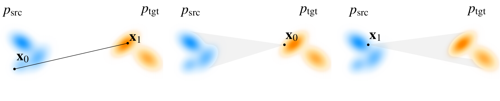
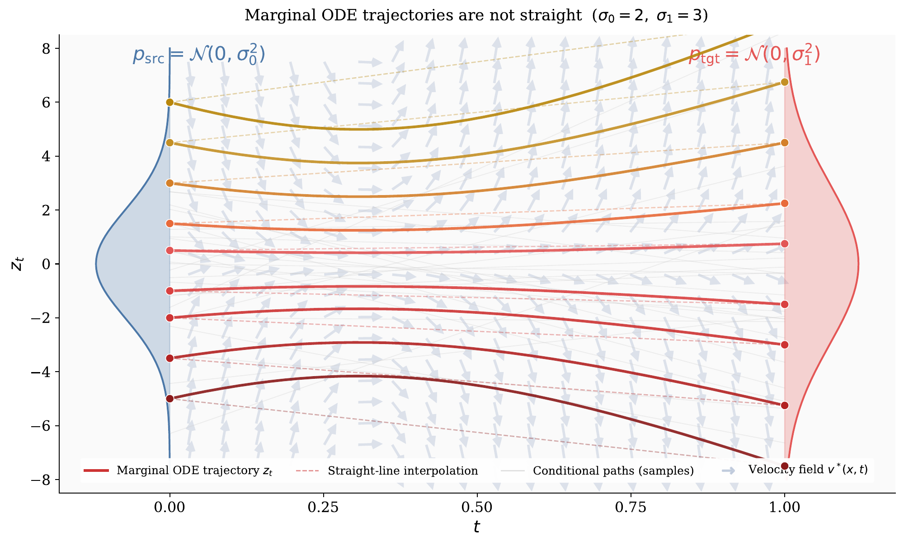

# 5.3 Constructing Probability Paths and Velocities Between Distributions {#sec-instance-fm}

The essence of flow matching lies in the gradual transformation of a source distribution into a target. To direct this transformation, two key elements are needed: the *probability path* $p_{t}$, which provides a snapshot of the evolving distribution at each time $t$, and the *velocity field* ${\mathbf{v}}_{t}$, which describes how individual particles move along the path. These two objects are not independent; they are linked through the continuity equation, which ensures that particle dynamics are consistent with the evolution of the distribution. Thus, the learning task reduces to finding a velocity field ${\mathbf{v}}_t$ that faithfully drives the process. The difficulty, however, is that for general and complex distributions, the true marginal velocity ${\mathbf{v}}_t$ is unknown, leaving us with an intractable target that cannot be accessed directly.

The core idea of Conditional Flow Matching is to address the intractability of the true marginal velocity by constructing an artificial but tractable process. To do this, we introduce a conditioning variable ${\mathbf{z}}$ and design either a conditional velocity ${\mathbf{v}}_t({\mathbf{x}}_t|{\mathbf{z}})$ and/or a conditional path $p_t({\mathbf{x}}_t|{\mathbf{z}})$, which are deliberately chosen to be simple.

Because these conditional objects are known in closed form, they serve as surrogate targets that the model can regress against. This leads to a valid training loss $\mathcal{L}_{\mathrm{CFM}}$, provided two practical requirements are met: (i) we can sample efficiently from $p_t(\cdot|{\mathbf{z}})$, and (ii) the corresponding velocity ${\mathbf{v}}_t(\cdot|{\mathbf{z}})$ admits a closed-form expression.

How should we design a well behaved conditional process? For inspiration, we turn to the one case that is fully understood: the Gaussian to Gaussian bridge ([Section 5.3.1](03-probability-paths-and-velocities.md#subsec-special-fm-instantiations)). This example highlights two natural design strategies: adopt a Gaussian probability path at each time $t$, or prescribe an affine velocity field, both of which are analytically tractable.

Guided by this insight, we extend to general endpoint distributions using two complementary construction views (see also [Section B.1.2](../../appendices/b-density-evolution/index.md#subsec-cov-continuity-eq)). These correspond to the classical Eulerian and Lagrangian descriptions of transport:

-   **Conditional Probability-Path First (Eulerian View).** We begin with the conditional density path $p_t(\cdot|{\mathbf{z}})$ and seek a conditional velocity field ${\mathbf{v}}_t(\cdot|{\mathbf{z}})$ satisfying the continuity equation. Since a density path alone generally does not determine a unique velocity, this construction also requires choosing a particular compatible velocity field.

-   **Conditional Flow First (Lagrangian View).** We instead specify how individual particles move through a conditional flow map ${\boldsymbol{\Psi}}_{0\to t}(\cdot|{\mathbf{z}})$. The induced density is obtained by pushforward, and, when the flow map is invertible, the corresponding Eulerian velocity field is

    $$
    {\mathbf{v}}_t
        =
        \partial_t{\boldsymbol{\Psi}}_{0\to t}
        \circ
        {\boldsymbol{\Psi}}_{0\to t}^{-1}.
    $$

In [Section 5.3.2](03-probability-paths-and-velocities.md#subsec-fm-instantiations), we detail the first approach, which shows its close analogy to diffusion model construction discussed in [Section 5.2.1](02-flow-matching-framework.md#subsec-lesson-score), while in [Section 5.3.3](03-probability-paths-and-velocities.md#subsec-prob-path-flow) we present the second. Together, these perspectives provide a practical framework for defining $p_t({\mathbf{x}}_t| {\mathbf{z}})$ and ${\mathbf{v}}_t({\mathbf{x}}_t| {\mathbf{z}})$, enabling simulation-free training and the construction of flows between arbitrary source and target distributions.

## 5.3.1 A Key Special Case: Marginal $p_t({\mathbf{x}}_t)$ and Velocity ${\mathbf{v}}_t({\mathbf{x}}_t)$ in the Gaussian-to-Gaussian Bridge {#subsec-special-fm-instantiations}

We begin with the Gaussian–endpoint case, where we can compute the marginal density $p_t({\mathbf{x}}_t)$ and velocity field ${\mathbf{v}}_t({\mathbf{x}}_t)$ analytically. This serves as a template for the general construction of the conditional density $p_t({\mathbf{x}}_t |{\mathbf{z}}_t)$ and velocity field ${\mathbf{v}}_t({\mathbf{x}}_t |{\mathbf{z}}_t)$.

When the source and target distributions, $p_{\text{src}}$ and $p_{\text{tgt}}$, are both Gaussian, the velocity field ${\mathbf{v}}_t(\cdot)$ admits a closed-form expression. We consider the interpolated marginal density path:

$$
\begin{aligned}
p_t({\mathbf{x}}_t) = \mathcal{N}\left({\mathbf{x}}_t; \boldsymbol{\mu}(t), \sigma^2(t) {\mathbf{I}}\right),
\end{aligned}
\tag{5.3.1}
$$

with time-varying mean $\boldsymbol{\mu}(t)$ and variance $\sigma^2(t)>0$. The two endpoints are given by

$$
p_{\text{src}} = p_0 =  \mathcal{N}\left({\mathbf{x}}; \boldsymbol{\mu}(0), \sigma^2(0) {\mathbf{I}}\right), \quad
p_{\text{tgt}} = p_1 =  \mathcal{N}\left({\mathbf{x}}; \boldsymbol{\mu}(1), \sigma^2(1) {\mathbf{I}}\right),
$$

so that the path $\{p_t\}_{t \in [0,1]}$ connects these distributions.

With the given path $\{p_t\}_{t \in [0,1]}$, there are indeed many velocity fields that induce an ODE flow $\boldsymbol{\Psi}_{0\to t}({\mathbf{x}})$ such that ${\mathbf{x}} \sim p_0$ implies $\boldsymbol{\Psi}_{0\to t}({\mathbf{x}}) \sim p_t$. For this Gaussian path, a particularly simple realization is given by[^1]:

$$
\begin{aligned}
\boldsymbol{\Psi}_{0\to t}({\mathbf{x}}) := \boldsymbol{\mu}(t) + \sigma(t) \left( \frac{{\mathbf{x}} - \boldsymbol{\mu}(0)}{\sigma(0)} \right).
\end{aligned}
\tag{5.3.2}
$$

For the defined Gaussian path $p_t$ (Gaussian for all $t$), the velocity field ${\mathbf{v}}_t(\cdot)$ inducing the ODE flow in [Equation (5.3.2)](03-probability-paths-and-velocities.md#eq-gaussian-sol-map) is uniquely and analytically characterized as follows ([Lipman et al., 2022](references.md#ref-lipman2022flow)):

**Proposition 5.3.1: Closed-Form Velocity Field for Gaussian Density Path**

Let $p_t$ be the Gaussian path in [Equation (5.3.1)](03-probability-paths-and-velocities.md#eq-gaussian-density-path). Then the velocity field ${\mathbf{v}}_t(\cdot)$ that generates the ODE flow [Equation (5.3.2)](03-probability-paths-and-velocities.md#eq-gaussian-sol-map) is unique for the defined ${\boldsymbol{\Psi}}_{0\to t}$ and has the closed-form expression:

$$
{\mathbf{v}}_t({\mathbf{x}}) = \frac{\sigma'(t)}{\sigma(t)} \left( {\mathbf{x}} - \boldsymbol{\mu}(t) \right) + \boldsymbol{\mu}'(t).
$$

**Proof for Proposition.**

Consider the ODE with initial condition ${\mathbf{y}}$:

$$
\frac{\mathop{}\!\mathrm{d}}{\mathop{}\!\mathrm{d} t} \boldsymbol{\Psi}_{0\to t}({\mathbf{y}}) = {\mathbf{v}}_t(\boldsymbol{\Psi}_{0\to t}({\mathbf{y}})).
$$

Since $\boldsymbol{\Psi}_{0\to t}$ is invertible (as $\sigma(t)>0$), we may set ${\mathbf{x}} = \boldsymbol{\Psi}_{0\to t}({\mathbf{y}})$ and ${\mathbf{y}} = \boldsymbol{\Psi}_{0\to t}^{-1}({\mathbf{x}}) = \boldsymbol{\Psi}_{t\to 0}({\mathbf{x}})$ to obtain

$$
\boldsymbol{\Psi}_{0\to t}'\big(\boldsymbol{\Psi}_{0\to t}^{-1}({\mathbf{x}})\big) = {\mathbf{v}}_t({\mathbf{x}}).
$$

Differentiating [Equation (5.3.2)](03-probability-paths-and-velocities.md#eq-gaussian-sol-map) with respect to $t$ gives

$$
\boldsymbol{\Psi}_{0\to t}'({\mathbf{x}}) = \boldsymbol{\mu}'(t) + \sigma'(t) \left( \frac{{\mathbf{x}} - \boldsymbol{\mu}(0)}{\sigma(0)} \right).
$$

Solving for ${\mathbf{y}} = \boldsymbol{\Psi}_{0\to t}^{-1}({\mathbf{x}})$ yields

$$
{\mathbf{y}} = \boldsymbol{\mu}(0) + \sigma(0) \left( \frac{{\mathbf{x}} - \boldsymbol{\mu}(t)}{\sigma(t)} \right).
$$

Substituting this into $\boldsymbol{\Psi}_{0\to t}'({\mathbf{x}})$ gives

$$
{\mathbf{v}}_t({\mathbf{x}}) = \frac{\sigma'(t)}{\sigma(t)} \left( {\mathbf{x}} - \boldsymbol{\mu}(t) \right) + \boldsymbol{\mu}'(t),
$$

as claimed.

We note that for a fixed flow map ${\boldsymbol{\Psi}}_{0\to t}$ (flow-first view), the velocity is uniquely determined by

$$
{\mathbf{v}}_t  =  \partial_t {\boldsymbol{\Psi}}_{0\to t} \circ {\boldsymbol{\Psi}}_{0\to t}^{-1}.
$$

Under this construction, the pair $(p_t,{\mathbf{v}}_t)$ automatically satisfies the continuity equation. By contrast, for a given density path $t\mapsto p_t$ without fixing ${\boldsymbol{\Psi}}_{0\to t}$ (probability-path-first view), the velocity field is not unique.

This distinction precisely characterizes the difference between the flow-first and probability-path-first perspectives.

This closed-form characterization remains valid when conditioning on a latent variable ${\mathbf{z}}$. In the following, we extend this insight to construct a conditional Gaussian path $p_t(\cdot|{\mathbf{z}})$ and derive the corresponding conditional velocity field ${\mathbf{v}}_t(\cdot|{\mathbf{z}})$ for the general marginal setting.

## 5.3.2 Conditional Probability-Path-First Construction of ${\mathbf{v}}_t(\cdot|{\mathbf{z}})$ and $p_t(\cdot|{\mathbf{z}})$ {#subsec-fm-instantiations}

**Figure 5.9:** **Illustrations of two common types of conditioning probability paths**. It includes: (i) *two-sided*, conditioned on ${\mathbf{x}}_0 \sim p_{\text{tgt}}$ and ${\mathbf{x}}_1 \sim p_{\text{src}}$ with general endpoint distributions; (ii) *one-sided*, conditioned at either ${\mathbf{x}}_0 \sim p_{\text{tgt}}$ or ${\mathbf{x}}_1 \sim p_{\text{src}}$.

Source: Created by the authors.

We aim to construct a conditional density path $p_t(\cdot|{\mathbf{z}})$ first and then derive its corresponding conditional velocity field ${\mathbf{v}}_t(\cdot|{\mathbf{z}})$ (via [Proposition 5.3.1](03-probability-paths-and-velocities.md#closed-form-vf)), under conditioning with respect to $\pi({\mathbf{z}})$. Depending on how ${\mathbf{z}}$ is chosen, there are two natural scenarios: (i) two-sided conditioning with ${\mathbf{z}}=({\mathbf{x}}_0,{\mathbf{x}}_1)$, or (ii) one-sided conditioning with ${\mathbf{z}}={\mathbf{x}}_0$ or ${\mathbf{x}}_1$. In either case, the construction must match the boundary distributions:

$$
\begin{aligned}
p_{\mathrm{src}}({\mathbf{x}}_0) = \int p_0({\mathbf{x}}_0|{\mathbf{z}}) \pi({\mathbf{z}})\mathop{}\!\mathrm{d}{\mathbf{z}}, \quad
   p_{\mathrm{tgt}}({\mathbf{x}}_1) = \int p_1({\mathbf{x}}_1|{\mathbf{z}}) \pi({\mathbf{z}}) \mathop{}\!\mathrm{d}{\mathbf{z}}.
\end{aligned}
$$

Since verifying these constraints is straightforward once a concrete construction is specified, we do not emphasize the verification step here.

**I. Two-Sided ${\mathbf{z}} = ({\mathbf{x}}_0, {\mathbf{x}}_1)$ — “Beam-Like” Path.**

**Choice of $\pi({\mathbf{z}})$.** Consider general distributions $p_{\mathrm{src}}$ and $p_{\mathrm{tgt}}$ over $\mathbb{R}^D$. Let ${\mathbf{z}} = ({\mathbf{x}}_0, {\mathbf{x}}_1)$ with ${\mathbf{x}}_0 \sim p_{\mathrm{src}}$ and ${\mathbf{x}}_1 \sim p_{\mathrm{tgt}}$ independently, i.e.,

$$
\pi({\mathbf{z}}) = p_{\mathrm{src}}({\mathbf{x}}_0)  p_{\mathrm{tgt}}({\mathbf{x}}_1).
$$

**Choice of Conditional Path $p_t(\cdot|{\mathbf{z}})$.** Define the conditional path by linear interpolation with a fixed and small variance $\sigma > 0$[^2]:

$$
p_t({\mathbf{x}}_t | {\mathbf{z}} = ({\mathbf{x}}_0, {\mathbf{x}}_1)) = \mathcal{N}({\mathbf{x}}_t; a_t{\mathbf{x}}_0 + b_t{\mathbf{x}}_1,  \sigma^2 {\mathbf{I}}),
$$

where $a_t$ and $b_t$ are time-dependent functions satisfying $a_0 = 1, b_0 = 0$ and $a_1 = 0, b_1 = 1$. A choice suggested by ([Lipman et al., 2022](references.md#ref-lipman2022flow); [Liu, 2022](references.md#ref-liu2022rectified)) is $a_t = 1-t$, $b_t = t$. In the deterministic case $\sigma = 0$, we obtain

$$
p_t({\mathbf{x}}_t |{\mathbf{z}}) = \delta \big({\mathbf{x}}_t - [a_t{\mathbf{x}}_0 + b_t{\mathbf{x}}_1]\big),
$$

which describes a deterministic interpolating path from ${\mathbf{x}}_0$ to ${\mathbf{x}}_1$.

**Derived Conditional Velocity ${\mathbf{v}}_t(\cdot|{\mathbf{z}})$.** By [Proposition 5.3.1](03-probability-paths-and-velocities.md#closed-form-vf), the conditional velocity is

$$
{\mathbf{v}}_t({\mathbf{x}} | {\mathbf{z}}) = a'_t{\mathbf{x}}_0 + b'_t{\mathbf{x}}_1.
$$

**CFM Loss.** When $\sigma=0$ so that ${\mathbf{x}}_t = a_t{\mathbf{x}}_0 + b_t{\mathbf{x}}_1$, the CFM loss reduces to

$$
\mathcal{L}_{\mathrm{CFM}} = \mathbb{E}_{t, {\mathbf{x}}_0\sim p_{\text{src}}, {\mathbf{x}}_1\sim p_{\text{tgt}}} \left\| {\mathbf{v}}_{\boldsymbol{\phi}}({\mathbf{x}}_t, t) - \left(a'_t{\mathbf{x}}_0 + b'_t{\mathbf{x}}_1\right) \right\|^2.
$$

From [Equation (5.2.9)](02-flow-matching-framework.md#eq-marginal-oracle-velocity) and [Equation (5.2.11)](02-flow-matching-framework.md#eq-minimum-velocity), the optimal velocity field is

$$
{\mathbf{v}}^*({\mathbf{x}}_t, t) = \mathbb{E} \left[ {\mathbf{x}}_t'|{\mathbf{x}}_t \right] = \mathbb{E} \left[ a'_t{\mathbf{x}}_0 + b'_t{\mathbf{x}}_1|{\mathbf{x}}_t \right].
$$

Here, the expectation is taken over $p(\mathbf{x}_0, \mathbf{x}_1|\mathbf{x}_t)$, the conditional distribution over source-target pairs $(\mathbf{x}_0, \mathbf{x}_1)$ that could have produced the observed interpolation $\mathbf{x}_t = a_t\mathbf{x}_0 + b_t\mathbf{x}_1$ at time $t$.

**II. One-Sided ${\mathbf{z}} = {\mathbf{x}}_0$ or ${\mathbf{x}}_1$ — “Spotlight-Like” Path.** We illustrate the conditional probability–path–first construction in the one-sided setting, considering the standard generative setup with $p_{\mathrm{src}}=\mathcal N(\boldsymbol 0,{\mathbf{I}})$ and $p_{\mathrm{tgt}}=p_{\mathrm{data}}$. Crucially, this Gaussian source is not an additional assumption but a direct consequence of the conditional path defined below. A more general treatment of arbitrary endpoints will be given in [Section 5.3.3](03-probability-paths-and-velocities.md#subsec-prob-path-flow).

**Choice of $\pi({\mathbf{z}})$.** We take ${\mathbf{z}}={\mathbf{x}}_1$ with $\pi({\mathbf{z}})=p_{\mathrm{data}}({\mathbf{x}}_1)$ (the case ${\mathbf{z}}={\mathbf{x}}_0\sim p_{\mathrm{prior}}$ follows analogously).

**Choice of Conditional Path $p_t(\cdot|{\mathbf{z}})$.** For fixed ${\mathbf{x}}_1\sim p_{\mathrm{data}}$, define

$$
p_t({\mathbf{x}}_t|{\mathbf{z}}={\mathbf{x}}_1)=\mathcal N \big({\mathbf{x}}_t; b_t {\mathbf{x}}_1, a_t^2 {\mathbf{I}}\big),
$$

with $a_0=1, b_0=0, a_1=0, b_1=1$ (usually interpreted as the limit). At the boundaries,

$$
p_0(\cdot|{\mathbf{z}}={\mathbf{x}}_1)=\mathcal N(\cdot; \boldsymbol 0,{\mathbf{I}}),\qquad
p_1(\cdot|{\mathbf{z}}={\mathbf{x}}_1)=\delta(\cdot - {\mathbf{x}}_1).
$$

Marginalizing over ${\mathbf{x}}_1$ yields $\{p_t\}_{t\in[0,1]}$ with $p_0=\mathcal N(\boldsymbol 0,{\mathbf{I}})$ (independent of $p_{\mathrm{data}}$) and $p_1=p_{\mathrm{data}}$.

**Derived Conditional Velocity ${\mathbf{v}}_t(\cdot|{\mathbf{z}})$.** For $t\in(0,1)$ with $a_t>0$, applying [Proposition 5.3.1](03-probability-paths-and-velocities.md#closed-form-vf) to the conditional Gaussian path gives

$$
\mathbf v_t({\mathbf{x}}|{\mathbf{x}}_1)
= b_t' {\mathbf{x}}_1 + \frac{a_t'}{a_t} \big({\mathbf{x}} - b_t {\mathbf{x}}_1\big).
$$

**One-Sided CFM Objective.** With $t\sim\mathcal U(0,1)$ (or any fixed sampling distribution) and ${\mathbf{x}}_1\sim p_{\mathrm{data}}$, the CFM loss becomes

$$
\begin{aligned}
\mathcal L_{\mathrm{CFM}}
={\mathbb{E}}_{t,{\mathbf{x}}_1} {\mathbb{E}}_{{\mathbf{x}}_t\sim p_t(\cdot|{\mathbf{x}}_1)}
\Big\|\mathbf v_\phi({\mathbf{x}}_t,t)-
\Big[b_t'{\mathbf{x}}_1+\tfrac{a_t'}{a_t}\big({\mathbf{x}}_t-b_t{\mathbf{x}}_1\big)\Big]\Big\|_2^2.
\end{aligned}
\tag{5.3.3}
$$

By MSE optimality, the unique minimizer is the marginal velocity field

$$
\mathbf v^*({\mathbf{x}},t)
= {\mathbb{E}} \left[\mathbf v_t({\mathbf{x}}|{\mathbf{x}}_1) |dle|  {\mathbf{x}}_t={\mathbf{x}}\right]
= {\mathbb{E}} \left[a_t'{\mathbf{x}}_0+b_t'{\mathbf{x}}_1 |dle|  {\mathbf{x}}_t={\mathbf{x}}\right].
$$

**Equivalence to Two-Sided Target.** For paired samples $({\mathbf{x}}_0,{\mathbf{x}}_1)$ with ${\mathbf{x}}_t=a_t{\mathbf{x}}_0+b_t{\mathbf{x}}_1$,

$$
\mathbf v_t({\mathbf{x}}_t|{\mathbf{x}}_1)
= b_t'{\mathbf{x}}_1 + \tfrac{a_t'}{a_t}\big({\mathbf{x}}_t-b_t{\mathbf{x}}_1\big)
= a_t'{\mathbf{x}}_0 + b_t'{\mathbf{x}}_1.
$$

Thus the one-sided loss regresses to the *conditional expectation* of the two-sided target given ${\mathbf{x}}_t$:

$$
\mathbf v^*({\mathbf{x}},t)={\mathbb{E}} \big[a_t'{\mathbf{x}}_0 + b_t'{\mathbf{x}}_1 | {\mathbf{x}}_t={\mathbf{x}}\big],
$$

so the one-sided and two-sided CFM objectives share the same minimizer.

**Gaussian FM = Diffusion Model.** We use the FM convention where $t=0$ denotes the source/prior and $t=1$ denotes the target/data:

$$
p_{\mathrm{src}}=p_{\mathrm{prior}},\qquad p_{\mathrm{tgt}}=p_{\mathrm{data}}.
$$

By contrast, diffusion models typically index time from data to noise (i.e., $t=0$ is data and $t=1$ is prior). Here, we adopt the FM convention indexing in the main discussion. For comparison, however, the VE and VP entries in [Table 5.2](03-probability-paths-and-velocities.md#tb-interpolant-instances) are summarized in their usual diffusion-time indexing, where $t=0$ corresponds to data and $t=1$ to prior/noise. If further $p_{\mathrm{src}}=\mathcal N(\boldsymbol 0,{\mathbf{I}})$, then for fixed condition ${\mathbf{x}}_1\sim p_{\mathrm{data}}$, the conditional path $p_t(\cdot |{\mathbf{x}}_1)$ is naturally chosen to be Gaussian, while the target distribution $p_{\mathrm{tgt}}$ itself need not be Gaussian. We refer to this Gaussian conditional-path setting as *Gaussian FM*. Diffusion probability paths form an important subclass of such Gaussian paths. A generic Gaussian schedule, however, need not correspond to a valid forward diffusion SDE; the schedule must additionally satisfy the SDE compatibility condition in [Lemma 4.5.1](../04-score-sde-framework/05-accumulated-perturbation-kernels.md#forward-sde).

Choosing $a_t = 1-t$ and $b_t = t$ (equivalently, $\alpha_t = t$ and $\sigma_t = 1-t$ under the relabeling $a_t:=\sigma_t$, $b_t:=\alpha_t$ in diffusion model) recovers the familiar FM/RF schedule ([Lipman et al., 2022](references.md#ref-lipman2022flow); [Liu, 2022](references.md#ref-liu2022rectified)).

**Table 5.2:** Summary of different interpolants written as ${\mathbf{x}}_t=a_t{\mathbf{x}}_0+b_t{\mathbf{x}}_1$, where ${\mathbf{x}}_0\sim p_{\mathrm{src}}=p_{\mathrm{prior}}$ and ${\mathbf{x}}_1\sim p_{\mathrm{tgt}}=p_{\mathrm{data}}$. The FM/RF and trigonometric columns use the FM convention ($t=0$ source, $t=1$ target), whereas the VE/VP columns retain the usual diffusion-time convention ($t=0$ data, $t=1$ prior/noise), with $a_t:=\sigma_t$ and $b_t:=\alpha_t$. For VE at a finite terminal noise level, the exact terminal marginal is $p_{\mathrm{data}}*\mathcal{N}(\boldsymbol{0},a_1^2{\mathbf{I}})$; the Gaussian prior shown in the table is the usual approximation when the terminal noise dominates the scale of the data.

<table markdown="1">
<tr markdown="1">
<th markdown="block">

</th>
<th markdown="block">

**VE**

</th>
<th markdown="block">

**VP**

</th>
<th markdown="block">

**FM/RF**

</th>
<th markdown="block">

**Trig.** ([Albergo et al., 2023](references.md#ref-albergo2023stochastic))

</th>
</tr>
<tr markdown="1">
<td markdown="block">

$a_t$ (prior coeff.)

</td>
<td markdown="block">

$a_t$

</td>
<td markdown="block">

$\sqrt{1-b_t^2}$

</td>
<td markdown="block">

$1-t$

</td>
<td markdown="block">

$\cos \bigl(\tfrac{\pi}{2}t\bigr)$

</td>
</tr>
<tr markdown="1">
<td markdown="block">

$b_t$ (data coeff.)

</td>
<td markdown="block">

$1$

</td>
<td markdown="block">

$b_t$

</td>
<td markdown="block">

$t$

</td>
<td markdown="block">

$\sin \bigl(\tfrac{\pi}{2}t\bigr)$

</td>
</tr>
<tr markdown="1">
<td markdown="block">

$a_0$

</td>
<td markdown="block">

$0$

</td>
<td markdown="block">

$0$

</td>
<td markdown="block">

$1$

</td>
<td markdown="block">

$1$

</td>
</tr>
<tr markdown="1">
<td markdown="block">

$b_0$

</td>
<td markdown="block">

$1$

</td>
<td markdown="block">

$1$

</td>
<td markdown="block">

$0$

</td>
<td markdown="block">

$0$

</td>
</tr>
<tr markdown="1">
<td markdown="block">

$a_1$

</td>
<td markdown="block">

$a_1$

</td>
<td markdown="block">

$1$

</td>
<td markdown="block">

$0$

</td>
<td markdown="block">

$0$

</td>
</tr>
<tr markdown="1">
<td markdown="block">

$b_1$

</td>
<td markdown="block">

$1$

</td>
<td markdown="block">

$0$

</td>
<td markdown="block">

$1$

</td>
<td markdown="block">

$1$

</td>
</tr>
<tr markdown="1">
<td markdown="block">

$p_{\text{prior}}$

</td>
<td markdown="block">

$p_{\mathrm{data}} * \mathcal{N}(\boldsymbol{0},a_1^2{\mathbf{I}}) \approx \mathcal{N}(\boldsymbol{0},a_1^2{\mathbf{I}})$

</td>
<td markdown="block">

$\mathcal{N}(\boldsymbol{0},{\mathbf{I}})$

</td>
<td markdown="block">

$\mathcal{N}(\boldsymbol{0},{\mathbf{I}})$

</td>
<td markdown="block">

$\mathcal{N}(\boldsymbol{0},{\mathbf{I}})$

</td>
</tr>
</table>

In the Gaussian FM setting, both the beam-like and spotlight-like conditional paths lead to training objectives that are similar to the standard diffusion losses. As we will elaborate in [Chapter 6](../06-unified-perspective/index.md#ch-unified-perspective), Gaussian FM can in fact be equivalently interpreted as a diffusion model trained to predict the *velocity*, under the linear schedule $a_t = 1-t$ and $b_t = t$. This perspective highlights that flow matching and diffusion are not fundamentally different, but rather two equivalent formulations that can be transformed into one another. The Gaussian FM objective is particularly appealing in practice: its loss function (${\mathbb{E}}_{t,{\mathbf{x}}_t} \left[\left\lVert{\mathbf{v}}_{\boldsymbol{\phi}}({\mathbf{x}}_t, t) - ({\mathbf{x}}_1 - {\mathbf{x}}_0)\right\rVert_2^2\right]$) is simple, and it has been shown to achieve competitive performance at scale ([Esser et al., 2024](references.md#ref-esser2024scaling)).

## 5.3.3 Conditional Flow-First Construction of ${\mathbf{v}}_t(\cdot|{\mathbf{z}})$ and $p_t(\cdot|{\mathbf{z}})$ {#subsec-prob-path-flow}

We treat the general case where the endpoints $p_{\mathrm{src}}$ (at $t=0$) and $p_{\mathrm{tgt}}$ (at $t=1$) are arbitrary. Our goal is to design, directly in trajectory space, a conditional flow that transports samples from $p_{\mathrm{src}}$ to $p_{\mathrm{tgt}}$ and yields a closed-form ${\mathbf{v}}_t({\mathbf{x}}_t|{\mathbf{z}})$ usable as a regression target.

**Motivation.** Instead of first designing conditional density path, we may directly specify a conditional flow map ${\boldsymbol{\Psi}}_{0\to t}(\cdot;{\mathbf{z}})$ that moves samples along trajectories. This has two practical advantages: (i) it immediately yields a regression target for training via a time derivative along trajectories; (ii) on geometry-structured spaces (Riemannian manifolds, Lie groups, or constrained submanifolds), it is often natural to construct the conditional flow map ${\boldsymbol{\Psi}}_{0\to t}$ directly from the geometry (e.g., geodesics, exponential maps, or premetrics) ([Lipman et al., 2024](references.md#ref-lipman2024flow)) which yields analytic, simulation-free target velocities for training.

**Conditional Affine Flow (Link to [Proposition 5.3.1](03-probability-paths-and-velocities.md#closed-form-vf)).** We fix a conditioning variable ${\mathbf{z}}\sim\pi$ (e.g., ${\mathbf{z}}={\mathbf{x}}_1\sim p_{\mathrm{tgt}}$ in one-sided “spotlight’’ training) and push forward ${\mathbf{x}}_0\sim p_{\mathrm{src}}$ through the time-varying *conditional affine flow*

$$
{\boldsymbol{\Psi}}_{0\to t}({\mathbf{x}}_0;{\mathbf{z}}) := \boldsymbol\mu_t({\mathbf{z}}) + {\mathbf{A}}_t({\mathbf{z}}) {\mathbf{x}}_0,\qquad t\in[0,1],
$$

where $\boldsymbol\mu_t({\mathbf{z}})\in{\mathbb{R}}^D$ and ${\mathbf{A}}_t({\mathbf{z}})\in{\mathbb{R}}^{D\times D}$ is invertible for $t\in(0,1)$. The boundary ${\mathbf{A}}_0({\mathbf{z}})={\mathbf{I}},\ \boldsymbol\mu_0({\mathbf{z}})=\mathbf 0$ recovers $p_{\mathrm{src}}$ at $t=0$. It is standard to interpret boundary when $t\to1$ as a limit (the terminal map may concentrate mass on a lower-dimensional set or a point)[^3].

**Induced Conditional Path $p_t(\cdot|{\mathbf{z}})$.** The construction defines

$$
p_t(\cdot|{\mathbf{z}}) = \bigl({\boldsymbol{\Psi}}_{0\to t}( \cdot ;{\mathbf{z}})\bigr)_{\#} p_{\mathrm{src}},
\qquad
p_t(\cdot)  =  \int p_t(\cdot|{\mathbf{z}})\pi({\mathbf{z}})\mathop{}\!\mathrm{d}{\mathbf{z}}.
$$

What ultimately matters in $\mathcal{L}_{\mathrm{CFM}}$ is how to sample from it: first draw ${\mathbf{z}} \sim \pi$, then draw ${\mathbf{x}}_0 \sim p_{\mathrm{src}}$, and finally set

$$
{\mathbf{x}}_t = \boldsymbol\mu_t({\mathbf{z}}) + {\mathbf{A}}_t({\mathbf{z}}){\mathbf{x}}_0.
$$

We remark that when ${\boldsymbol{\Psi}}_{0\to t}$ is affine in ${\mathbf{x}}_0$, then $p_t( \cdot | {\mathbf{z}})$ is Gaussian if and only if $p_{\mathrm{src}}$ is Gaussian. In particular, for arbitrary (non-Gaussian) $p_{\mathrm{src}}$, an affine flow yields a generally non-Gaussian $p_t(\cdot|{\mathbf{z}})$.

**Derived Conditional Velocity ${\mathbf{v}}_t(\cdot|{\mathbf{z}})$.** The conditional velocity ${\mathbf{v}}_t(\cdot|{\mathbf{z}})$ is obtained by $t$-differentiating the conditional flow map ${\boldsymbol{\Psi}}_{0\to t}$. Following the derivation in [Proposition 5.3.1](03-probability-paths-and-velocities.md#closed-form-vf), consider the *conditional* ODE defined by the flow map ${\boldsymbol{\Psi}}_{0\to t}({\mathbf{y}};{\mathbf{z}})$ with initial condition ${\mathbf{y}}$, where the goal is to identify the corresponding conditional velocity field ${\mathbf{v}}_t(\cdot|{\mathbf{z}})$:

$$
\frac{\mathop{}\!\mathrm{d}}{\mathop{}\!\mathrm{d} t} {\boldsymbol{\Psi}}_{0\to t}({\mathbf{y}};{\mathbf{z}})
= {\mathbf{v}}_t \Big(\underbrace{{\boldsymbol{\Psi}}_{0\to t}({\mathbf{y}};{\mathbf{z}})}_{{\mathbf{x}}} \Big| {\mathbf{z}}\Big).
$$

Since ${\boldsymbol{\Psi}}_{0\to t}(\cdot;{\mathbf{z}})$ is invertible for $t\in(0,1)$, we may express the initial point ${\mathbf{y}}$ corresponding to the current state ${\mathbf{x}}={\boldsymbol{\Psi}}_{0\to t}({\mathbf{y}};{\mathbf{z}})$ as

$$
{\mathbf{y}}
=
{\boldsymbol{\Psi}}_{0\to t}^{-1}({\mathbf{x}};{\mathbf{z}})
=
{\boldsymbol{\Psi}}_{t\to0}({\mathbf{x}};{\mathbf{z}}).
$$

The corresponding Eulerian velocity field is therefore

$$
{\mathbf{v}}_t({\mathbf{x}}|{\mathbf{z}})
:=
\left.
\frac{\partial}{\partial t}
{\boldsymbol{\Psi}}_{0\to t}({\mathbf{y}};{\mathbf{z}})
\right|_{{\mathbf{y}}={\boldsymbol{\Psi}}_{0\to t}^{-1}({\mathbf{x}};{\mathbf{z}})}.
$$

That is, we first differentiate the forward flow map with respect to $t$ while holding its initial point ${\mathbf{y}}$ fixed, and then substitute the initial point whose trajectory reaches ${\mathbf{x}}$ at time $t$.

Since ${\mathbf{x}}_t=\boldsymbol\mu_t({\mathbf{z}})+{\mathbf{A}}_t({\mathbf{z}}){\mathbf{x}}_0$ and ${\mathbf{A}}_t({\mathbf{z}})$ is invertible on $(0,1)$, we have ${\mathbf{x}}_0={\mathbf{A}}_t({\mathbf{z}})^{-1}\bigl({\mathbf{x}}-\boldsymbol\mu_t({\mathbf{z}})\bigr)$, giving

$$
{\mathbf{v}}_t({\mathbf{x}}|{\mathbf{z}})
 =
\boldsymbol\mu_t'({\mathbf{z}}) + {\mathbf{A}}_t'({\mathbf{z}}) {\mathbf{A}}_t({\mathbf{z}})^{-1} \bigl({\mathbf{x}}-\boldsymbol\mu_t({\mathbf{z}})\bigr).
$$

**One-Sided Conditioning (${\mathbf{z}}={\mathbf{x}}_1$).** Choosing $\boldsymbol\mu_t({\mathbf{z}})=b_t {\mathbf{z}}$ and ${\mathbf{A}}_t({\mathbf{z}})=a_t {\mathbf{I}}$ with $a_0=1,a_1=0$ and $b_0=0,b_1=1$ (with $a_t>0$ for $t\in(0,1)$) yields

$$
{\mathbf{x}}_t = a_t {\mathbf{x}}_0 + b_t {\mathbf{x}}_1,
\qquad
{\mathbf{v}}_t({\mathbf{x}}|{\mathbf{x}}_1) = b_t' {\mathbf{x}}_1 + \frac{a_t'}{a_t} \bigl({\mathbf{x}}-b_t{\mathbf{x}}_1\bigr).
$$

On paired samples $({\mathbf{x}}_0,{\mathbf{x}}_1)$ (with ${\mathbf{x}}_t=a_t{\mathbf{x}}_0+b_t{\mathbf{x}}_1$), this simplifies to the usual CFM target:

$$
{\mathbf{v}}_t({\mathbf{x}}_t|{\mathbf{x}}_1)=a_t' {\mathbf{x}}_0 + b_t' {\mathbf{x}}_1.
$$

**Two-Sided Conditioning (${\mathbf{z}}=({\mathbf{x}}_0,{\mathbf{x}}_1)$).** The same template with $\boldsymbol\mu_t({\mathbf{x}}_0,{\mathbf{x}}_1)=b_t {\mathbf{x}}_1$ and ${\mathbf{A}}_t({\mathbf{x}}_0,{\mathbf{x}}_1)=a_t {\mathbf{I}}$ makes the conditional path *deterministic*:

$$
{\mathbf{x}}_t=a_t {\mathbf{x}}_0+b_t {\mathbf{x}}_1,
\qquad
p_t(\cdot|{\mathbf{x}}_0,{\mathbf{x}}_1)=\delta\left(\cdot - (a_t{\mathbf{x}}_0+b_t{\mathbf{x}}_1)\right),
$$

and the conditional velocity is

$$
{\mathbf{v}}_t({\mathbf{x}}_t|{\mathbf{x}}_0,{\mathbf{x}}_1)=a_t' {\mathbf{x}}_0+b_t' {\mathbf{x}}_1,
$$

i.e., the standard two-sided CFM target.

**Unconditional Gaussian Path as a Special Case.** If $\boldsymbol{\mu}_t$ is independent of ${\mathbf{z}}$ (denoted $\boldsymbol{\mu}(t)$) and ${\mathbf{A}}_t = \tfrac{\sigma(t)}{\sigma(0)} {\mathbf{I}}$, then

$$
{\boldsymbol{\Psi}}_{0\to t}({\mathbf{x}}_0)=\boldsymbol\mu(t)+\sigma(t) \frac{{\mathbf{x}}_0-\boldsymbol\mu(0)}{\sigma(0)},
\quad
{\mathbf{v}}_t({\mathbf{x}})=\boldsymbol\mu'(t)+\frac{\sigma'(t)}{\sigma(t)}\bigl({\mathbf{x}}-\boldsymbol\mu(t)\bigr),
$$

which recovers the Gaussian density path and the closed-form velocity in [Proposition 5.3.1](03-probability-paths-and-velocities.md#closed-form-vf).

## 5.3.4 Probability-Path-First vs. Flow-First Construction {#probability-path-first-vs-flow-first}

The two constructions correspond to complementary Eulerian and Lagrangian descriptions of transport. The *probability-path-first* (Eulerian) view begins by specifying a conditional density path $p_t(\cdot|{\mathbf{z}})$ and then selects a compatible velocity field through the continuity equation. Because a density path alone generally does not determine the velocity uniquely, additional transport structure may be needed to select one.

The *flow-first* (Lagrangian) view instead specifies a conditional flow map ${\boldsymbol{\Psi}}_{0\to t}(\cdot|{\mathbf{z}})$, which directly describes particle trajectories. The corresponding density path follows by pushforward, and when the map is invertible its Eulerian velocity is uniquely recovered as

$$
{\mathbf{v}}_t
=
\partial_t{\boldsymbol{\Psi}}_{0\to t}
\circ
{\boldsymbol{\Psi}}_{0\to t}^{-1}.
$$

Both constructions therefore describe the same kinds of transport objects from different starting points, but a prescribed density path need not select the same velocity as a separately prescribed flow map.

The following table summarizes these contrasts. The takeaway: path-first is natural when conditional paths admit closed-form velocities; flow-first is natural when you have strong structural priors on trajectories.

**Table 5.3:** Comparison of conditional probability-path-first and conditional flow-first constructions.

<table markdown="1">
<tr markdown="1">
<th markdown="block">

**Axis**

</th>
<th markdown="block">

**Conditional Probability-Path-First**

</th>
<th markdown="block">

**Conditional Flow-First**

</th>
</tr>
<tr markdown="1">
<td markdown="block">

**Given**

</td>
<td markdown="block">

Conditional density path $p_t(\cdot|{\mathbf{z}})$.

</td>
<td markdown="block">

Conditional flow map ${\boldsymbol{\Psi}}_{0\to t}(\cdot|{\mathbf{z}})$ (trajectories, for each fixed ${\mathbf{z}}$).

</td>
</tr>
<tr markdown="1">
<td markdown="block">

**Get Velocity**

</td>
<td markdown="block">

For each ${\mathbf{z}}$, find ${\mathbf{v}}_t(\cdot|{\mathbf{z}})$ s.t.

$$
\partial_t p_t(\cdot|{\mathbf{z}})
+
\nabla \cdot
\left(
p_t(\cdot|{\mathbf{z}}){\mathbf{v}}_t(\cdot|{\mathbf{z}})
\right)
=
0;
$$

Non-unique: if $\nabla\!\cdot~\left(p_t \mathbf w_t\right)=0$ then ${\mathbf{v}}_t+\mathbf w_t$ yields the same $p_t$.

</td>
<td markdown="block">

Along paths (for each ${\mathbf{z}}$):

$$
{\mathbf{v}}_t
\left(
{\boldsymbol{\Psi}}_{0\to t}(\cdot|{\mathbf{z}})
\mid
{\mathbf{z}}
\right)
=
\tfrac{\mathop{}\!\mathrm{d}}{\mathop{}\!\mathrm{d} t}
{\boldsymbol{\Psi}}_{0\to t}(\cdot|{\mathbf{z}}).
$$

When ${\boldsymbol{\Psi}}_{0\to t}$ is invertible, one can solve

$$
{\mathbf{v}}_t({\mathbf{x}}|{\mathbf{z}})
=
\left.
\partial_t
{\boldsymbol{\Psi}}_{0\to t}({\mathbf{y}}|{\mathbf{z}})
\right|_{{\mathbf{y}}={\boldsymbol{\Psi}}_{0\to t}^{-1}({\mathbf{x}}|{\mathbf{z}})}.
$$

</td>
</tr>
<tr markdown="1">
<td markdown="block">

**Closed Form of ${\mathbf{v}}_t(\cdot|{\mathbf{z}})$**

</td>
<td markdown="block">

Convenient when $p_t(\cdot|{\mathbf{z}})$ is Gaussian / exponential-family; otherwise obtaining ${\mathbf{v}}_t(\cdot|{\mathbf{z}})$ is nontrivial.

</td>
<td markdown="block">

Convenient when ${\boldsymbol{\Psi}}_{0\to t}(\cdot|{\mathbf{z}})$ has structure (affine/low-rank); avoids density evaluation.

</td>
</tr>
<tr markdown="1">
<td markdown="block">

**Uniqueness of ${\mathbf{v}}_t(\cdot|{\mathbf{z}})$**

</td>
<td markdown="block">

For each ${\mathbf{z}}$, ${\mathbf{v}}_t(\cdot|{\mathbf{z}})$ is underdetermined unless a selection rule (e.g., potential flow / min. kinetic energy) is imposed.

</td>
<td markdown="block">

Given ${\boldsymbol{\Psi}}_{0\to t}(\cdot|{\mathbf{z}})$, both $p_t(\cdot|{\mathbf{z}})=({\boldsymbol{\Psi}}_{0\to t}(\cdot|{\mathbf{z}}))_\#p_0$ and the particle trajectories are determined. If the flow map is invertible, the corresponding Eulerian velocity field is uniquely determined; otherwise, a unique global Eulerian field need not exist.

</td>
</tr>
<tr markdown="1">
<td markdown="block">

**Realizability**

</td>
<td markdown="block">

Must verify the constructed ${\mathbf{v}}_t(\cdot|{\mathbf{z}})$ solving the continuity equation on the intended support.

</td>
<td markdown="block">

Holds by construction:

$$
p_t(\cdot|{\mathbf{z}})
=
\left(
{\boldsymbol{\Psi}}_{0\to t}(\cdot|{\mathbf{z}})
\right)_\#
p_0(\cdot|{\mathbf{z}}).
$$

</td>
</tr>
<tr markdown="1">
<td markdown="block">

**Match $(p_{\mathrm{src}},p_{\mathrm{tgt}})$**

</td>
<td markdown="block">

Mix conditionals:

$p_{\mathrm{src}} = \int p_0(\cdot|{\mathbf{z}})\pi({\mathbf{z}})\mathop{}\!\mathrm{d}{\mathbf{z}},$

$p_{\mathrm{tgt}} = \int p_1(\cdot|{\mathbf{z}})\pi({\mathbf{z}})\mathop{}\!\mathrm{d}{\mathbf{z}}.$

Under Gaussian–affine conditional paths with ${\mathbf{z}}$-independent coefficients, $p_{\mathrm{src}}$ can be forced to be Gaussian. For a general fixed endpoint $p_{\mathrm{src}}$ (possibly non-Gaussian), the choice of $p_t(\cdot|{\mathbf{z}})$ does not generally pin $p_{\mathrm{src}}$.

</td>
<td markdown="block">

Set ${\boldsymbol{\Psi}}_{0\to 0}=\mathrm{Id}$ and choose boundary condition to hit any $p_{\mathrm{tgt}}$.

</td>
</tr>
<tr markdown="1">
<td markdown="block">

**Preferred Scenarios**

</td>
<td markdown="block">

Diffusion-style constructions; analytic targets via conditional Gaussians $p_t(\cdot|{\mathbf{z}})$.

</td>
<td markdown="block">

Strong structural priors via maps ${\boldsymbol{\Psi}}_{0\to t}(\cdot|{\mathbf{z}})$; easy boundary control; accommodates singular/low-dimensional endpoints; natural for map-based regularization/transport costs.

</td>
</tr>
</table>

## 5.3.5 Conditional Straightness Does Not Imply Marginal-Flow Straightness {#conditional-vs-marginal-straightness}

The canonical affine interpolation

$$
{\mathbf{x}}_t
=
(1-t){\mathbf{x}}_0+t{\mathbf{x}}_1
$$

has an appealing geometric property: conditioned on a particular endpoint pair $({\mathbf{x}}_0,{\mathbf{x}}_1)$, the interpolation is a straight line with constant velocity ${\mathbf{x}}_1-{\mathbf{x}}_0$. This conditional notion of straightness is used extensively in Flow Matching and Rectified Flow.

It is important, however, to distinguish the straightness of these *conditional interpolation paths* from the straightness of the *marginal ODE trajectories* used at generation time. Under a coupling $\pi({\mathbf{x}}_0,{\mathbf{x}}_1)$, the population-optimal marginal velocity is

$$
{\mathbf{v}}^\star({\mathbf{x}},t)
=
\mathbb{E}
\left[
{\mathbf{x}}_1-{\mathbf{x}}_0
\,\middle|\,
{\mathbf{x}}_t={\mathbf{x}}
\right].
$$

The posterior over endpoint pairs generally changes with $({\mathbf{x}},t)$. Consequently, the velocity encountered along a marginal ODE trajectory need not remain constant, even though every conditional interpolation used for training is a straight line.

Thus, choosing the canonical affine schedule alone does not imply that the learned marginal ODE is exactly straight or that one Euler step is exact. Rectified Flow addresses precisely this distinction: its rectification or `Reflow` procedure changes the endpoint coupling so that the induced causal flow can become progressively closer to a straight flow ([Liu et al., 2022](references.md#ref-liu2022flow)).

The following example makes the distinction explicit.

**Example: A Simple 1D Counterexample**

Consider the one-dimensional setting with

$$
x_0 \sim \mathcal{N}(0, \sigma_0^2),
\qquad
x_1 \sim \mathcal{N}(0, \sigma_1^2),
$$

independent coupling, and the canonical affine interpolation $x_t = (1-t)x_0 + tx_1$. Each conditional path $(1-t)x_0 + tx_1$ is a straight line in time. We now compute the induced marginal velocity field.

Since $(x_1 - x_0,\, x_t)$ is jointly Gaussian, the conditional expectation is linear in $x$, so

$$
v^*(x,t)
= {\mathbb{E}}[x_1 - x_0| x_t = x]
= \frac{\operatorname{Cov}(x_1 - x_0,\, x_t)}
       {\operatorname{Var}(x_t)}\, x.
$$

A direct calculation gives

$$
\operatorname{Var}(x_t)
= (1-t)^2\sigma_0^2 + t^2\sigma_1^2
=: V(t),
$$

and

$$
\operatorname{Cov}(x_1 - x_0,\, x_t)
= t\sigma_1^2 - (1-t)\sigma_0^2
= \tfrac{1}{2} V'(t).
$$

Hence

$$
v^*(x,t) = \frac{V'(t)}{2V(t)}\, x.
$$

The marginal ODE

$$
\frac{\mathop{}\!\mathrm{d} z_t}{\mathop{}\!\mathrm{d} t} = v^*(z_t, t)
$$

therefore has the exact solution

$$
z_t
= z_0 \sqrt{\frac{V(t)}{V(0)}}
= z_0 \sqrt{(1-t)^2 + \frac{\sigma_1^2}{\sigma_0^2}\, t^2}.
$$

Now, a straight-line interpolation in time would require $z_t$ to be affine in $t$, namely $z_t = (1-t)z_0 + t\,z_1$ for some endpoint $z_1$. But

$$
\sqrt{(1-t)^2 + \frac{\sigma_1^2}{\sigma_0^2}\, t^2}
$$

is not affine in $t$ for any positive $\sigma_0, \sigma_1$. Thus the ODE trajectory is generally not a straight-line interpolation in time. We illustrate this phenomenon in [Figure 5.10](03-probability-paths-and-velocities.md#fig-straightness-counterexample) with the example $\sigma_0=2$ and $\sigma_1=3$.

For example, when $\sigma_0 = \sigma_1$, we have $z_1 = z_0$, so a straight-line interpolation would simply be the constant path $z_t = z_0$. In contrast, the actual ODE trajectory satisfies

$$
z_{1/2} = \frac{z_0}{\sqrt{2}} \neq z_0.
$$

Therefore, even though every conditional interpolation path is straight, the induced marginal ODE trajectory need not be.

**Figure 5.10:** **Marginal ODE trajectories are not straight under the canonical affine interpolation.** We take $x_0 \sim \mathcal{N}(0, \sigma_0^2)$ and $x_1 \sim \mathcal{N}(0, \sigma_1^2)$ with $\sigma_0=2$, $\sigma_1=3$, and independent coupling. Gray lines show sampled conditional paths $(1-t)x_0 + tx_1$, which are straight by construction. Solid curves show the exact marginal ODE trajectories $z_t = z_0\sqrt{(1-t)^2 + (\sigma_1/\sigma_0)^2 t^2}$, and dashed lines show the corresponding straight-line interpolations from $z_0$ to $z_1$. The visible gap between solid and dashed curves confirms that the marginal ODE trajectories are not affine in $t$, even though every conditional path is a straight line. The marginal densities $p_{\mathrm{src}}$ and $p_{\mathrm{tgt}}$ are shown on the left and right margins, respectively.

Source: Created by the authors with AI-assisted coding.

[^1]: In ([Lipman et al., 2022](references.md#ref-lipman2022flow)), the authors consider $\boldsymbol{\Psi}_{0\to t}({\mathbf{x}}) = \boldsymbol{\mu}(t) + \sigma(t){\mathbf{x}}$, which requires constraints on $\boldsymbol{\mu}(t)$ and $\sigma(t)$ to ensure boundary conditions. We adopt an equivalent normalized formulation that avoids such constraints.

[^2]: One may instead add a fixed conditional variance $\sigma^2{\mathbf{I}}$. The conditional velocity remains $a_t'{\mathbf{x}}_0+b_t'{\mathbf{x}}_1$ because the variance is constant in time, but the endpoint marginals then become Gaussian smoothings of $p_{\mathrm{src}}$ and $p_{\mathrm{tgt}}$, approaching the desired endpoints as $\sigma\to0$.

[^3]: Allowing ${\mathbf{A}}_1({\mathbf{z}})$ to be singular (e.g., $\mathbf 0$) is compatible with invertibility on $(0,1)$ and causes the path to contract onto the prescribed endpoint at $t=1$.
