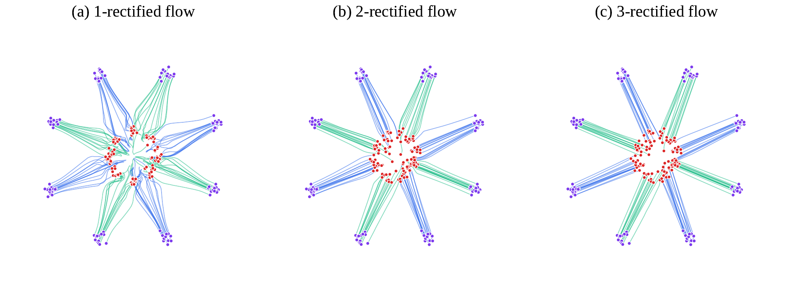

# 5.4 (Optional) Properties of the Canonical Affine Flow {#sec-optimal-canonical}

Given two endpoint distributions $p_0=p_{\mathrm{src}}$ and $p_1=p_{\mathrm{tgt}}$, a natural and widely used choice for defining the conditional path in flow matching (FM) ([Lipman et al., 2022](../../references.md#ref-lipman2022flow)) and rectified flow (RF) ([Liu et al., 2022](../../references.md#ref-liu2022flow)) is the linear interpolation

$$
a_t = 1 - t, \qquad b_t = t,
$$

which yields the interpolant

$$
\mathbf{x}_t = (1 - t)\mathbf{x}_0 + t \mathbf{x}_1,
\qquad \mathbf{x}_0 \sim p_{\mathrm{src}},\ \mathbf{x}_1 \sim p_{\mathrm{tgt}}.
$$

Under this choice, the training objective simplifies to

$$
\mathbb{E}_{t \sim \mathcal{U}[0,1]}
\mathbb{E}_{\mathbf{x}_0, \mathbf{x}_1}
\left[ \bigl\|\mathbf{v}_{\boldsymbol{\phi}}(\mathbf{x}_t, t) - (\mathbf{x}_1 - \mathbf{x}_0)\bigr\|_2^2 \right].
$$

This linear flow enjoys several appealing properties. In particular, it admits an iterative refinement scheme, known as *`Reflow`*, which progressively straightens the path between distributions while preserving the marginals.

## 5.4.1 Rectifying Flows: From Noisy Guesses to Structured Pairings {#subsec-rectify}

**Why Change the Coupling?** Under the independent coupling

$$
\pi({\mathbf{x}}_0,{\mathbf{x}}_1)
=
p_{\mathrm{src}}({\mathbf{x}}_0)
p_{\mathrm{tgt}}({\mathbf{x}}_1),
$$

each conditional interpolation $(1-t){\mathbf{x}}_0+t{\mathbf{x}}_1$ is a straight line. As emphasized in [Section 5.4](04-canonical-affine-flow.md#sec-optimal-canonical), however, the corresponding marginal velocity averages directions from many unrelated endpoint pairs, so the induced marginal ODE trajectories need not be straight. Such curved marginal dynamics can be harder to integrate accurately with only a few numerical steps.

Rectification addresses this issue by changing the endpoint coupling. A learned ODE transports each source sample to a model-generated endpoint, producing a dependent coupling that is subsequently used to define a new conditional interpolation.

**Rectify the Flow via Dependent Coupling.** Rather than relying on arbitrary pairings, we use a pre-trained diffusion model ${\mathbf{v}}_{{\boldsymbol{\phi}}^\times}(\cdot,t)$ as the drift in a PF-ODE to *deterministically* transport each source point. Starting from ${\mathbf{z}}(0)={\mathbf{z}}_0 \sim p_{\text{src}}$, we integrate

$$
\frac{\mathop{}\!\mathrm{d} {\mathbf{z}}(t)}{\mathop{}\!\mathrm{d} t} = {\mathbf{v}}_{{\boldsymbol{\phi}}^\times}({\mathbf{z}}(t),t), \qquad t \in [0,1],
$$

to obtain $\hat{\mathbf{z}}_1 := {\mathbf{z}}(1)$ positioned near the data space learned from the pre-trained model. The resulting pair $({\mathbf{z}}_0,\hat{\mathbf{z}}_1)$ forms a *dependent coupling*: it follows a structured, model-guided path rather than an arbitrary interpolation. This idea extends naturally to affine reference paths of the form ${\mathbf{x}}_t = a_t {\mathbf{x}}_0 + b_t {\mathbf{x}}_1$, where ${\mathbf{x}}_0 \sim p_{\text{src}}$ and ${\mathbf{x}}_1 \sim p_{\text{tgt}}$.

<section class="book-algorithm" id="alg-rectify" aria-labelledby="alg-rectify-title" markdown="1">

Algorithm 2: Rectify Operation

**Input:** Reference path $\{{\mathbf{x}}_t\}_{t\in[0,1]}$ (e.g. ${\mathbf{x}}_t=a_t{\mathbf{x}}_0+b_t{\mathbf{x}}_1$)

1

**Pre-Train Diffusion.** Fit ${\mathbf{v}}_{{\boldsymbol{\phi}}^\times}$ on the chosen path by minimizing

$$
{\boldsymbol{\phi}}^\times \in \arg\min_{{\boldsymbol{\phi}}}
\mathbb{E}_{t,{\mathbf{x}}_0,{\mathbf{x}}_1} \left[\Big\|{\mathbf{v}}_{{\boldsymbol{\phi}}}({\mathbf{x}}_t,t)-\frac{\mathop{}\!\mathrm{d} {\mathbf{x}}_t}{\mathop{}\!\mathrm{d} t}\Big\|_2^2\right].
$$

2

**Rectify.** Sample ${\mathbf{z}}_0 \sim p_{\text{src}}$ and integrate

$$
\frac{\mathop{}\!\mathrm{d} {\mathbf{z}}(t)}{\mathop{}\!\mathrm{d} t}={\mathbf{v}}_{{\boldsymbol{\phi}}^\times}({\mathbf{z}}(t),t),\qquad {\mathbf{z}}(0)={\mathbf{z}}_0,\quad t\in[0,1],
$$

to obtain $\hat{\mathbf{z}}_1={\mathbf{z}}(1)$ and the trajectory $\{{\mathbf{z}}(t)\}_{t\in[0,1]}$.

**Output:** Dependent (coherent) pair $({\mathbf{z}}_0,\hat{\mathbf{z}}_1)$ or the full trajectory.

</section>

**Why It Works: Marginal-Preserving Structure.** Let ${\boldsymbol{\Phi}}_{0\to t}$ denote the flow map generated by the above ODE defined by the pre-trained diffusion ${\mathbf{v}}_{{\boldsymbol{\phi}}^\times}$; then ${\mathbf{z}}(t)={\boldsymbol{\Phi}}_{0\to t}({\mathbf{z}}_0)$ and $\hat{\mathbf{z}}_1={\boldsymbol{\Phi}}_{0\to 1}({\mathbf{z}}_0)$. The `Rectify` procedure pairs each source point with its flow endpoint, giving the deterministic joint

$$
\pi_{\text{Rectify}}({\mathbf{z}}_0,{\mathbf{z}}_1)
= p_{\text{src}}({\mathbf{z}}_0) \delta \big({\mathbf{z}}_1-{\boldsymbol{\Phi}}_{0\to 1}({\mathbf{z}}_0)\big).
$$

We have two immediate consequences:

-   **Source Marginal is Preserved:** $\displaystyle \int \pi_{\text{Rectify}}({\mathbf{z}}_0,{\mathbf{z}}_1) \mathop{}\!\mathrm{d} {\mathbf{z}}_1 = p_{\text{src}}({\mathbf{z}}_0)$.

-   **Pushforward Along the Flow:** $\displaystyle ({\boldsymbol{\Phi}}_{0\to t})_{\#}p_{\text{src}}=\mathrm{Law}({\mathbf{z}}(t))$, i.e., the time–$t$ distribution is the pushforward of $p_{\text{src}}$ by ${\boldsymbol{\Phi}}_{0\to t}$.

If ${\mathbf{v}}_{{\boldsymbol{\phi}}^\times}$ matches the oracle drift of a given reference path ${\mathbf{x}}_t$, then all intermediate marginals coincide:

$$
\mathrm{Law}({\mathbf{z}}(t))=\mathrm{Law}({\mathbf{x}}_t),\quad \text{for all }t\in[0,1],
\quad\text{and}\quad
({\boldsymbol{\Phi}}_{0\to 1})_{\#}p_{\mathrm{src}}=p_{\mathrm{tgt}}.
$$

**Summary.** Rectification replaces the independent endpoint coupling with a coupling induced by the learned flow. Under repeated `Reflow`, this can produce marginal transport that is progressively easier to integrate with few numerical steps.

For the canonical path, repeatedly applying `Rectify` (“*`Reflow`*”) further straightens trajectories without increasing transport cost, making training still easier.

## 5.4.2 `Reflow`: Iteratively Straightening Flows {#subsec-reflow-def}

**Why `Reflow`?** Independent pairings often induce irregular and meandering ODE trajectories between $p_{\text{src}}$ and $p_{\text{tgt}}$, which increase discretization error and variance during simulation. This raises a natural question:

**Question 5.4.1**

Can we learn couplings that induce transport paths that are closer to straight lines between the two distributions, while still preserving the correct marginals?

This motivates *`Reflow`*: repeatedly apply `Rectify` to update the coupling so that successive flows become easier to integrate.

**Core Idea: Recursive Straightening via `Rectify`.**

Start from the canonical interpolation on the product coupling $\pi^{(0)}:=p_{\text{src}}({\mathbf{x}}_0)p_{\text{tgt}}({\mathbf{x}}_1)$,

$$
{\mathbf{x}}_t=(1-t){\mathbf{x}}_0+t{\mathbf{x}}_1.
$$

Applying `Rectify` replaces the independent pairing with a dependent one $({\mathbf{z}}_0,\hat{\mathbf{z}}_1)$ induced by the learned ODE. Repeating this procedure, known as *`Reflow`*, tends to produce straighter trajectories that are easier to integrate accurately with a small number of numerical steps. The precise straightening guarantee is discussed later in [Section 5.4.3](04-canonical-affine-flow.md#subsec-reflow-properties).

**The `Reflow` Procedure.** Each iteration performs two steps:

-   **Re-Fit Flow:** Train a new velocity field from samples of the current coupling:

    

    $$
    \begin{aligned}
    \boldsymbol{\phi}_{k+1} &= \arg\min_{\boldsymbol{\phi}} \mathcal{L}\left(\boldsymbol{\phi}\Big\vert \pi^{(k)}\right), \quad \text{where}  \\ \mathcal{L}\left(\boldsymbol{\phi}\Big\vert \pi^{(k)}\right) &:= \mathbb{E}_{t, ({\mathbf{z}}_0^{(k)}, \hat{\mathbf{z}}_1^{(k)})\sim \pi^{(k)}} \left[\left\|{\mathbf{v}}_{\boldsymbol{\phi}}({\mathbf{z}}_t, t) - (\hat{\mathbf{z}}_1^{(k)} - {\mathbf{z}}_0^{(k)})\right\|^2\right]
    \end{aligned}
    \tag{5.4.1}
    $$

    with ${\mathbf{z}}_t = (1-t){\mathbf{z}}_0^{(k)} + t\hat{\mathbf{z}}_1^{(k)}$.

-   **Generate New Coupling:** Solve the learned ODE starting from new source samples ${\mathbf{z}}_0^{(k+1)} \sim p_{\text{src}}$:

    $$
    \hat{\mathbf{z}}_1^{(k+1)} \gets {\mathbf{z}}_0^{(k+1)} + \int_0^1 {\mathbf{v}}_{\boldsymbol{\phi}_{k+1}}({\mathbf{z}}(t), t) \mathrm{d}t,
    $$

    and define the updated coupling:

    $$
    \pi^{(k+1)}({\mathbf{z}}_0, {\mathbf{z}}_1) := p_{\text{src}}({\mathbf{z}}_0) \delta\left({\mathbf{z}}_1 - \hat{\mathbf{z}}_1^{(k+1)}\right).
    $$

In other words, `Reflow` can be viewed as repeatedly applying the `Rectify` operator, producing a sequence of progressively refined couplings:

$$
\begin{aligned}
\pi^{(k+1)} = \texttt{Rectify} \left(\pi^{(k)}\right)
\end{aligned}
\tag{5.4.2}
$$

so that both the flow and the coupling evolve together, yielding progressively more stable transport paths.

## 5.4.3 Properties of `Reflow` {#subsec-reflow-properties}

Two key theoretical properties drive the usefulness of `Reflow`: it reduces transport cost and it straightens the trajectories.

**I. `Reflow` Never Increases Transport Cost.** Let $c({\mathbf{y}})$ be a convex cost function (e.g., $\|{\mathbf{y}}\|_2^p$ with $p \geq 1$). Each `Rectify` step forms a new coupling $({\mathbf{z}}_0, \hat{\mathbf{z}}_1)$ whose cost is no worse than the original:

**Proposition 5.4.1: `Rectify` May Reduce Transport Costs**

Assuming an ideal velocity field ${\mathbf{v}}^* = {\mathbf{v}}_{\boldsymbol{\phi}^\times}$, we have:

$$
\mathbb{E}\left[c\left(\hat{\mathbf{z}}_1 - {\mathbf{z}}_0\right)\right] \leq \mathbb{E}\left[c\left({\mathbf{x}}_1 - {\mathbf{x}}_0\right)\right].
$$

**Proof for Proposition.**

Follows from Jensen’s inequality. See [Liu et al. (2022)](../../references.md#ref-liu2022flow) for a full derivation.

Applying this result recursively shows that the `Reflow` process does not increase the transport cost.

**II. `Reflow` Straightens the Path.** Recursive application of `Reflow` promotes increasingly straight trajectories, although the straightness measure is not guaranteed to improve monotonically at every iteration. To measure this, define the *straightness functional* of a path $\mathbf{Y} = \{{\mathbf{y}}_t\}_{t\in[0,1]}$ as

$$
\mathcal{S}(\mathbf{Y}) := \int_0^1 \mathbb{E}\left[\left\|{\mathbf{y}}_1 - {\mathbf{y}}_0 - \frac{\mathrm{d}{\mathbf{y}}_t}{\mathrm{d}t} \right\|_2^2 \right]  \mathrm{d}t.
$$

If $\mathcal{S}(\mathbf{Y}) = 0$, then $\mathbf{Y}$ is exactly a straight line.

**Proposition 5.4.2: `Reflow` Straightens the Stochastic Path**

For rectified paths ${\mathbf{Z}}^{(k)}$, we have:

$$
\min_{k \in \{0,\dots,K\}} \mathcal{S}({\mathbf{Z}}^{(k)}) \leq \frac{\mathbb{E}\left[\|{\mathbf{x}}_1 - {\mathbf{x}}_0\|^2\right]}{K}.
$$

**Proof for Proposition.**

See Theorem 3.7 of [Liu et al. (2022)](../../references.md#ref-liu2022flow).

**Figure 5.11:** **Illustration of `Reflow`.** Paths become progressively straighter with `Rectify` procedure.

Source: Adapted from [Liu et al. (2022)](../../references.md#ref-liu2022flow).

The FM or RF formulation with linear interpolation kernels, together with the `Reflow` procedure, provides a simpler training objective and a practical method for refining stochastic couplings. For theoretical details, we refer readers to ([Liu et al., 2022](../../references.md#ref-liu2022flow); [Liu, 2022](../../references.md#ref-liu2022rectified)).

**III. Connection to Optimal Transport.** Lastly, we note that straight-line couplings are not necessarily optimal in the sense of optimal transport (OT). This involves some terminology that will be introduced in [Section 7.2](../07-optimal-transport/02-transport-problem-setups.md#sec-ot-intro); we therefore refer readers who are not familiar with OT to that section.

A hallmark of quadratic-cost optimal transport is that particles travel along straight lines: a particle at ${\mathbf{x}}_0$ moves to ${\mathbf{T}}({\mathbf{x}}_0)$ via ${\mathbf{x}}_t = (1 - t){\mathbf{x}}_0 + t {\mathbf{T}}({\mathbf{x}}_0)$, where ${\mathbf{T}}$ is the optimal transport map. However, not every map ${\mathbf{S}}$ generating such straight-line paths, i.e., ${\mathbf{x}}_t = (1 - t){\mathbf{x}}_0 + t {\mathbf{S}}({\mathbf{x}}_0)$, is optimal. The map ${\mathbf{S}}$ yields the optimal flow only if it minimizes the Monge cost $\mathbb{E}[\|{\mathbf{x}}_0 - {\mathbf{S}}({\mathbf{x}}_0)\|^2]$. Thus, while straight-line paths are necessary, they are not sufficient; optimality also depends on the correct endpoint map ${\mathbf{T}}$.

**Example: Straight Couplings Need Not Be Optimal**

Let $p_{\text{src}} = p_{\text{tgt}} = \mathcal{N}(\boldsymbol{0}, {\mathbf{I}})$. For the cost $c({\mathbf{x}}, {\mathbf{y}}) = \|{\mathbf{x}} - {\mathbf{y}}\|^p$ with $p > 0$, the $c$-optimal coupling is the identity coupling $\pi^{*}$, where $\pi^{*}$ is the law of $({\mathbf{x}}, {\mathbf{x}})$ with ${\mathbf{x}} \sim p_{\text{src}}$.

Now consider the coupling $\pi_{{\mathbf{A}}}$ defined as the law of $({\mathbf{x}}, {\mathbf{A}} {\mathbf{x}})$, where ${\mathbf{x}} \sim p_{\text{src}}$ and ${\mathbf{A}}$ is a rotation matrix satisfying ${\mathbf{A}}^\top {\mathbf{A}} = {\mathbf{I}}$, $\det({\mathbf{A}}) = 1$, ${\mathbf{A}} \neq {\mathbf{I}}$, and $-1$ is not an eigenvalue. Then $\pi_{{\mathbf{A}}}$ is a valid coupling of $p_{\text{src}}$ and $p_{\text{tgt}}$, and corresponds to straight-line paths between ${\mathbf{x}}$ and ${\mathbf{A}} {\mathbf{x}}$, but it is not $c$-optimal for any twice-differentiable strictly convex cost $c$ with invertible Hessian. The suboptimality arises from the rotational transformation. As discussed in [Equation (7.5.2)](../07-optimal-transport/05-probability-flow-odes-and-optimal-transport.md#eq-reflow-loss-gradient), even removing the rotation may not lead to an optimal coupling.

We will continue exploring the connection to OT in [Section 7.5.2](../07-optimal-transport/05-probability-flow-odes-and-optimal-transport.md#subsec-ot-linear-reflow).
