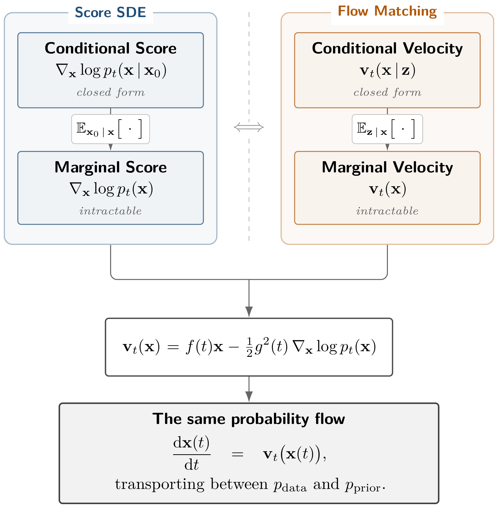

# 5. Flow-Based Perspective: From NFs to Flow Matching {#ch-flow-based}

> *Everything flows.*
>
> — Heraclitus

The *change-of-variables formula*, a cornerstone of probability theory ([Tabak and Vanden-Eijnden, 2010](../../references.md#ref-tabak2010density); [Turner, 2013](../../references.md#ref-tabak2013family)), takes on new life in modern generative modeling. In [Chapter 4](../04-score-sde-framework/index.md#ch-score-sde), we saw that the Fokker–Planck equation describes how probability densities evolve under a diffusion process, and that the same marginal density evolution can also be realized deterministically through the associated PF-ODE. This naturally suggests studying generative modeling directly from the viewpoint of deterministic probability transport.

**Change-of-Variables Formula of Densities.** Given an invertible transformation ${\mathbf{f}}$, the density of ${\mathbf{x}}={\mathbf{f}}({\mathbf{z}})$, where ${\mathbf{z}}\sim p_{\mathrm{prior}}$, is

$$
\begin{aligned}
p({\mathbf{x}})
=
p_{\mathrm{prior}}({\mathbf{z}})
\left|
\det
\frac{\partial {\mathbf{f}}^{-1}({\mathbf{x}})}{\partial {\mathbf{x}}}
\right|,
\qquad
\text{where }
{\mathbf{z}}={\mathbf{f}}^{-1}({\mathbf{x}}).
\end{aligned}
\tag{5.0.1}
$$

This deceptively simple formula enables bidirectional transport of samples and densities when ${\mathbf{f}}$ is tractable, forming the foundation of Normalizing Flows, which we introduce in [Section 5.1](01-normalizing-flows-and-neural-odes.md#sec-flow-based-method). But what happens when this transformation is viewed continuously in time?

In this chapter, we follow this idea from Normalizing Flows to Neural ODEs and then to Flow Matching. The key connection to [Chapter 4](../04-score-sde-framework/index.md#ch-score-sde) is especially important. In Score SDEs, the learned score is used to construct the velocity field of the PF-ODE. Flow Matching instead learns a velocity field directly. For the same diffusion probability path, these provide two views of the same deterministic probability flow.

A useful mental picture for this chapter is therefore, where both rely on the same conditioning principle:

**Figure 5.1:** **Score SDEs and Flow Matching.** Both frameworks train on the closed-form *conditional* quantity in the top row. Averaging it over the conditioning variable (vertical arrows) gives the intractable *marginal* quantity below, which is what the trained model recovers. The columns differ only in which quantity that is. On a diffusion path the score determines the velocity through the conversion in the middle, so both routes end at the same ODE; Flow Matching learns that velocity directly and needs neither endpoint to be Gaussian.

Source: Created by the authors.

Flow Matching carries this principle beyond the usual Gaussian diffusion setting. It can construct continuous transport between more general source and target distributions from which samples are available, provided that the chosen conditional probability paths can be sampled efficiently and their conditional velocities can be computed tractably.

To support a solid understanding of this chapter, we provide in [Appendix B](../../appendices/b-density-evolution/index.md#app-continuity) an intuitive, self-contained overview of the different forms of the change-of-variables principle, progressing from the ordinary change-of-variables formula to the continuity equation and, with stochastic dynamics, to the Fokker–Planck equation.

**After this chapter, you will be able to...**

-   connect Normalizing Flows, Neural ODEs, and Flow Matching through the common idea of transporting probability distributions, from discrete invertible transformations to continuous-time velocity fields;

-   recognize the key analogy with the Score SDE framework in [Chapter 4](../04-score-sde-framework/index.md#ch-score-sde): for the same diffusion probability path, Score SDEs learn a score that determines the PF-ODE velocity, whereas Flow Matching can learn that velocity field directly; in both cases, an intractable marginal target can be learned through tractable conditional targets;

-   understand the continuity equation as the density-level rule that connects an ODE velocity field to the evolution of its probability distribution;

-   understand how Flow Matching extends this conditional strategy beyond Gaussian diffusion paths to transport between general source and target distributions from which samples are available, while retaining simulation-free training through tractable conditional paths and velocities;

-   distinguish the prescribed probability path $\{p_t\}_{t\in[0,1]}$ from the particular velocity field, coupling, and particle trajectories used to realize it, and understand why different flows can share the same marginal distributions;

-   understand the two complementary ways of constructing tractable conditional flows: starting from a conditional probability path and deriving its velocity, or starting from a conditional flow map and deriving its velocity along trajectories.

**Reader route.** Readers already comfortable with Normalizing Flows and Neural ODEs may skim [Section 5.1](01-normalizing-flows-and-neural-odes.md#sec-flow-based-method) and begin with [Section 5.2.1](02-flow-matching-framework.md#subsec-lesson-score). For a first pass, focus on the connection between the Score SDE and Flow Matching views, the continuity equation, and the conditional-to-marginal velocity construction. The detailed path constructions and optional theoretical properties can be revisited afterward.

Continue with the sections below and the [references](../../references.md#references).

[5.1 Flow-Based Models: Normalizing Flows and Neural ODEs](01-normalizing-flows-and-neural-odes.md#sec-flow-based-method)

[5.2 Flow Matching Framework](02-flow-matching-framework.md#sec-flow-matching-framework)

[5.3 Constructing Probability Paths and Velocities Between Distributions](03-probability-paths-and-velocities.md#sec-instance-fm)

[5.4 (Optional) Properties of the Canonical Affine Flow](04-canonical-affine-flow.md#sec-optimal-canonical)

[5.5 Closing Remarks](05-closing-remarks.md#sec-ch5-cr)

[Section 5.1](01-normalizing-flows-and-neural-odes.md#sec-flow-based-method)

[Section 5.2](02-flow-matching-framework.md#sec-flow-matching-framework)

[Section 5.2.2](02-flow-matching-framework.md#subsec-fm-framework)

[Equation (5.1.9)](01-normalizing-flows-and-neural-odes.md#eq-instant-change-of-var)
