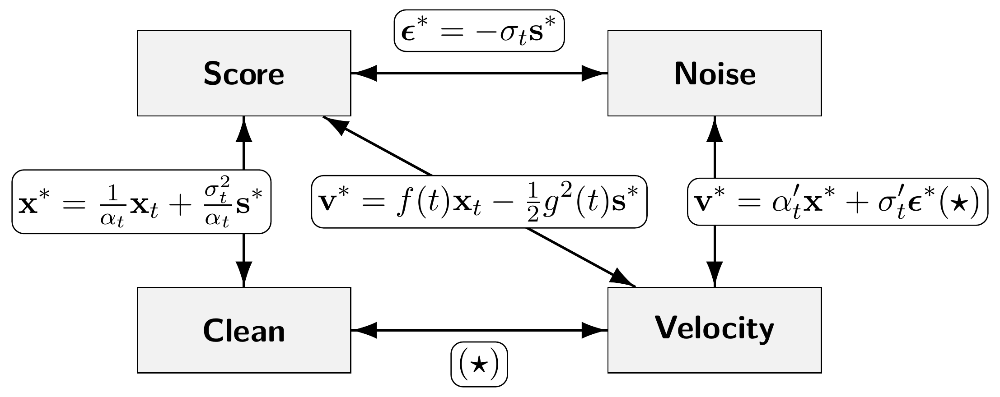

# 6.3 Equivalence in Diffusion Models {#sec-equivalent-parametrizations}

Many formulations of diffusion models look different because they use different prediction types, training objectives, noise schedules, or continuous-time dynamics. In this section, we clarify in what precise sense these formulations can be equivalent at the exact theoretical level, and how their behavior can still differ for learned models in practice.

At the exact or oracle level, several notions of equivalence will appear:

-   **Predictions.** Given the noisy observation ${\mathbf{x}}_t$ and the forward schedule, clean-data, noise, score, and velocity oracles contain the same information and can be converted into one another algebraically.

-   **Training Objectives.** Squared-error objectives written in different prediction types can differ by positive time-dependent factors while sharing the same pointwise oracle minimizer. These factors determine how strongly different noise levels are weighted during training.

-   **Affine Forward Process.** At the particle level, affine forward processes

    $$
    {\mathbf{x}}_t=\alpha_t{\mathbf{x}}_0+\sigma_t{\boldsymbol{\epsilon}}
    $$

    can be related to canonical affine forms through state rescaling and a corresponding canonical coordinate. When this coordinate evolves monotonically with time, the relation also defines a time reparameterization.

-   **Marginal Density Paths.** At the density level, different deterministic and stochastic dynamics can produce the same marginal path $\{p_t\}_{t\in[0,T]}$. Their sample trajectories may differ, while the evolution of $p_t$ is governed by the corresponding continuity or Fokker-Planck equation.

We develop these connections from prediction to sampling. [Section 6.3.1](03-equivalent-parameterizations.md#subsec-four-equiv-para) first relates the four common oracle prediction types and their training losses. [Section 6.3.2](03-equivalent-parameterizations.md#subsec-pf-ode-different-para) then shows how these predictions lead to different expressions of the same oracle PF–ODE. Next, [Section 6.3.3](03-equivalent-parameterizations.md#subsec-all-flows-are-equiv) relates affine probability paths to canonical linear and trigonometric forms. Finally, [Section 6.3.4](03-equivalent-parameterizations.md#subsec-concept-why-v-affine) develops additional intuition for the canonical linear schedule and velocity prediction, including their implications for training and numerical integration.

These exact relationships provide a common mathematical foundation, while the practical choices remain meaningful. Finite neural networks may approximate equivalent oracle quantities differently, and loss weighting, optimization, model architecture, and numerical integration can lead to different training and sampling behavior.

## 6.3.1 Four Prediction Types Are Equivalent {#subsec-four-equiv-para}

We begin by analyzing the design choices for component (B) in [Equation (6.2.5)](02-training-objectives.md#eq-general-dm-loss-d).

We have seen that the four prediction types are not independent choices but different views of the same underlying quantity. For example, noise and clean predictions are directly related ([Section 2.2.4](../02-variational-perspective/02-ddpm.md#subsec-ddpm-prediction)), as are score and noise predictions ([Section 3.4](../03-score-based-perspective/04-noise-conditional-score-networks.md#sec-smld)). This recurring pattern points to a deeper principle: all four parameterizations are algebraically equivalent and can be converted into one another through simple transformations. To make this connection precise, we state the following proposition, illustrated in [Figure 6.1](03-equivalent-parameterizations.md#fig-equiv-parametrizations), following ([Kingma et al., 2021](references.md#ref-kingma2021variational)).

**Proposition 6.3.1: Equivalence of Parametrizations**

Let the optimal predictions minimizing their respective objectives be

$$
\boldsymbol{\epsilon}^*({\mathbf{x}}_t,t) , \quad {\mathbf{x}}^*({\mathbf{x}}_t,t), \quad {\mathbf{s}}^*({\mathbf{x}}_t,t) , \quad {\mathbf{v}}^*({\mathbf{x}}_t,t),
$$

corresponding to noise, clean, score, and velocity parameterizations. These satisfy the following equivalences:

$$
\begin{aligned}
\boldsymbol{\epsilon}^*({\mathbf{x}}_t,t) &= -\sigma_t {\mathbf{s}}^*({\mathbf{x}}_t,t), \\
{\mathbf{x}}^*({\mathbf{x}}_t,t) &= \frac{1}{\alpha_t} {\mathbf{x}}_t
+ \frac{\sigma_t^2}{\alpha_t} {\mathbf{s}}^*({\mathbf{x}}_t,t), \\
{\mathbf{v}}^*({\mathbf{x}}_t,t) &= \alpha_t' {\mathbf{x}}^* + \sigma_t' \boldsymbol{\epsilon}^*
= f(t){\mathbf{x}}_t - \frac{1}{2} g^2(t){\mathbf{s}}^*({\mathbf{x}}_t,t).
\end{aligned}
\tag{6.3.1}
$$

Here, $f(t)$ and $g(t)$ are related to $\alpha_t$ and $\sigma_t$ via [Lemma 4.5.1](../04-score-sde-framework/05-accumulated-perturbation-kernels.md#forward-sde). Moreover, these minimizers satisfy the identities given in [Equation (6.2.1)](02-training-objectives.md#eq-noise-def) and [Equation (6.2.2)](02-training-objectives.md#eq-clean-def) and [Equation (6.2.3)](02-training-objectives.md#eq-score-def) and [Equation (6.2.4)](02-training-objectives.md#eq-velocity-def).

**Proof for Proposition.**

The proof is similar to that of [Theorem 4.3.1](../04-score-sde-framework/03-training-and-sampling.md#dsm-minimizer), which analyzes the global optimum of various matching losses under the DSM objective. See [Section D.4](../../appendices/d-supplementary-proofs/index.md#app-sec-equiv-para) for details.

**Figure 6.1:** **Equivalent relations among the four oracle parameterizations.** Each oracle prediction can be converted into the others using the forward schedule and the observed state ${\mathbf{x}}_t$. For example, ${\mathbf{v}}^*=\alpha_t'{\mathbf{x}}^*+\sigma_t'\boldsymbol{\epsilon}^*$, while ${\mathbf{x}}$- and ${\boldsymbol{\epsilon}}$-predictions satisfy ${\mathbf{x}}_t=\alpha_t{\mathbf{x}}^*+\sigma_t\boldsymbol{\epsilon}^*$.

Source: Created by the authors.

The proposition is most naturally understood as an equivalence of *oracle information*. At any noise level, knowing one oracle prediction, together with the noisy observation ${\mathbf{x}}_t$ and the forward schedule, determines the others through the identities in [Equation (6.3.1)](03-equivalent-parameterizations.md#eq-predictions-equivalence). For example, the score determines the posterior-mean clean prediction, and either of these determines the PF-ODE velocity. Thus, at the oracle level, these parameterizations contain the same information about the underlying diffusion process.

For a learned model, however, one must distinguish this oracle equivalence from the quantity predicted directly by the neural network. One may choose any of

$$
\boldsymbol{\epsilon}_{\boldsymbol{\phi}}({\mathbf{x}}_t,t),
\quad
{\mathbf{x}}_{\boldsymbol{\phi}}({\mathbf{x}}_t,t),
\quad
{\mathbf{s}}_{\boldsymbol{\phi}}({\mathbf{x}}_t,t),
\quad
{\mathbf{v}}_{\boldsymbol{\phi}}({\mathbf{x}}_t,t)
$$

as the network output. Once one prediction is taken as primary, the others can be defined through the same algebraic conversions as in [Equation (6.3.1)](03-equivalent-parameterizations.md#eq-predictions-equivalence). In particular, for a trained model with parameters $\boldsymbol{\phi}^\times$, these converted predictions are exactly consistent by construction; for example,

$$
{\mathbf{x}}
=
\alpha_t
{\mathbf{x}}_{\boldsymbol{\phi}^\times}({\mathbf{x}},t)
+
\sigma_t
{\boldsymbol{\epsilon}}_{\boldsymbol{\phi}^\times}({\mathbf{x}},t).
$$

These conversions are useful both during and after training. For instance, a noise prediction can be converted into a score for reverse-SDE sampling or into a velocity for PF-ODE sampling.

The network prediction parameterization should also be distinguished from the *training loss*. As discussed in component (B) of [Equation (6.2.5)](02-training-objectives.md#eq-general-dm-loss-d), the quantity output by the network need not be the quantity on which the loss is evaluated: the prediction may first be converted into another parameterization before computing the objective. Such a conversion generally changes a squared-error objective by a time-dependent weighting, as shown later in [Equation (6.3.6)](03-equivalent-parameterizations.md#eq-s-e-x-v-equi).

These distinctions matter for finite neural networks. Although the oracle targets are information-equivalent, directly predicting different quantities leads the network to represent and optimize different functions, and the corresponding objectives may weight noise levels differently. Consequently, models trained independently under different prediction parameterizations need not produce identical empirical predictions or identical PF-ODEs. The equivalence in this proposition therefore concerns the information carried by the ideal oracle predictions; the network output parameterization and the training objective remain separate and meaningful design choices.

## 6.3.2 PF-ODE in Different Parameterizations {#subsec-pf-ode-different-para}

The PF-ODE admits several equivalent parameterizations (score, noise, denoised, and velocity). Although interchangeable in principle, the choice has practical consequences: it changes the stiffness of the vector field, the behavior of discretization error, and the ease of optimization. For fast sampling with advanced ODE solvers (see [Chapter 9](../09-numerical-solvers/index.md#ch-numerical-solvers)), practitioners often work with ${\boldsymbol{\epsilon}}$ or ${\mathbf{x}}$ prediction because they align well with solver inputs and reduce error accumulation. For training generators that use only a few function evaluations (see [Chapter 11](../11-fast-generators/index.md#ch-fast-scratch)), ${\mathbf{x}}$ or ${\mathbf{v}}$ prediction often yields smoother objectives and better step to step consistency.

We write the PF-ODE under each parameterization and make the conversions explicit using [Equation (6.3.1)](03-equivalent-parameterizations.md#eq-predictions-equivalence). The results are collected in the following proposition.

**Proposition 6.3.2: PF-ODE in Different Parameterizations**

Let $\alpha_t$ and $\sigma_t$ be the forward perturbation schedules, and denote time derivatives by $\alpha_t' := \tfrac{\mathop{}\!\mathrm{d} \alpha_t}{\mathop{}\!\mathrm{d} t}$ and $\sigma_t' := \tfrac{\mathop{}\!\mathrm{d} \sigma_t}{\mathop{}\!\mathrm{d} t}$. Then the empirical PF-ODE admits the equivalent forms

$$
\begin{aligned}
    \frac{\mathop{}\!\mathrm{d} {\mathbf{x}}(t)}{\mathop{}\!\mathrm{d} t}
&= \frac{\alpha_t'}{\alpha_t} {\mathbf{x}}(t)
 - \sigma_t \left(\frac{\alpha_t'}{\alpha_t}-\frac{\sigma_t'}{\sigma_t}\right)
   \boldsymbol{\epsilon}^*({\mathbf{x}}(t), t) \\
&= \frac{\sigma_t'}{\sigma_t} {\mathbf{x}}(t)
 + \alpha_t \left(\frac{\alpha_t'}{\alpha_t}-\frac{\sigma_t'}{\sigma_t}\right)
   {\mathbf{x}}^*({\mathbf{x}}(t), t) \\
&= \frac{\alpha_t'}{\alpha_t} {\mathbf{x}}(t)
 + \sigma_t^{2} \left(\frac{\alpha_t'}{\alpha_t}-\frac{\sigma_t'}{\sigma_t}\right)
   {\mathbf{s}}^*({\mathbf{x}}(t), t) \\
   &= \alpha_t'{\mathbf{x}}^*({\mathbf{x}}(t), t) + \sigma_t' {\boldsymbol{\epsilon}}^*({\mathbf{x}}(t), t)\\
&= {\mathbf{v}}^*({\mathbf{x}}(t), t).
\end{aligned}
\tag{6.3.2}
$$

To see the Score SDE notation, we recall [Lemma 4.5.1](../04-score-sde-framework/05-accumulated-perturbation-kernels.md#forward-sde). If we set

$$
f(t) = \frac{\alpha_t'}{\alpha_t},
\quad
g^2(t) = \frac{\mathop{}\!\mathrm{d}}{\mathop{}\!\mathrm{d} t} \big(\sigma_t^2\big)
         - 2 \frac{\alpha_t'}{\alpha_t} \sigma_t^2
       = 2\sigma_t\sigma_t' - 2 \frac{\alpha_t'}{\alpha_t} \sigma_t^2,
$$

then the PF-ODE can be written in the familiar Score SDE form:

$$
\frac{\mathop{}\!\mathrm{d} {\mathbf{x}}(t)}{\mathop{}\!\mathrm{d} t}
= f(t) {\mathbf{x}}(t)  -  \frac{1}{2} g^2(t) {\mathbf{s}}^*({\mathbf{x}}(t),t).
$$

To give a concrete sense of how the PF-ODE is discretized for sampling, we will present in [Section 9.2](../09-numerical-solvers/02-ddim.md#sec-revisit-ddim) the update rule of a widely used diffusion-based ODE sampler, the DDIM scheme. This example will show how an Euler discretization naturally connects with the PF-ODE.

## 6.3.3 All Affine Flows Are Equivalent {#subsec-all-flows-are-equiv}

We next analyze the design choices for component (A) in [Equation (6.2.5)](02-training-objectives.md#eq-general-dm-loss-d).

**State-Level Equivalence.** A convenient canonical interpolation used in FM ([Lipman et al., 2022](references.md#ref-lipman2022flow)) and RF ([Liu, 2022](references.md#ref-liu2022rectified)) is

$$
{\mathbf{x}}_t^{\mathrm{FM}}=(1-t) {\mathbf{x}}_0+t {\boldsymbol{\epsilon}} = {\mathbf{x}}_{0}+t({\boldsymbol{\epsilon}}-{\mathbf{x}}_0),
$$

whose velocity is the constant vector ${\boldsymbol{\epsilon}}-{\mathbf{x}}_0$. The key point of this subsection is that the apparent simplicity of this choice is not essential: any affine interpolation

$$
{\mathbf{x}}_t=\alpha_t {\mathbf{x}}_0+\sigma_t {\boldsymbol{\epsilon}}
$$

can be written as a time–reparameterized and rescaled version of the canonical path. Define

$$
c(t):=\alpha_t+\sigma_t,
\qquad
\tau(t):=\frac{\sigma_t}{\alpha_t+\sigma_t}
\quad\big(c(t)\neq 0\big).
$$

A direct algebraic rewrite yields

$$
\begin{aligned}
{\mathbf{x}}_t
&=\alpha_t {\mathbf{x}}_0+\sigma_t {\boldsymbol{\epsilon}}
\\
&=\big(\alpha_t+\sigma_t\big) \left(\frac{\alpha_t}{\alpha_t+\sigma_t}{\mathbf{x}}_0+\frac{\sigma_t}{\alpha_t+\sigma_t}{\boldsymbol{\epsilon}}\right) \\
&=c(t) \left(\big(1-\tau(t)\big){\mathbf{x}}_0+\tau(t){\boldsymbol{\epsilon}}\right)
=c(t) {\mathbf{x}}_{\tau(t)}^{\mathrm{FM}}.
\end{aligned}
$$

Hence, whenever $c(t)\neq0$, every affine path can be represented pointwise as a scalar rescaling of the canonical path. If, in addition, $\tau(t)$ is continuous and strictly monotone over the time interval of interest, then $t\mapsto\tau(t)$ is also a genuine change of time variable, and the two paths are related by time reparameterization together with the rescaling $c(t)$. For the usual forward diffusion schedules, monotonic decay of the signal-to-noise ratio implies monotonic evolution of $\tau(t)$.

For the associated velocities, apply the chain rule to ${\mathbf{x}}_t=c(t){\mathbf{x}}_{\tau(t)}^{\mathrm{FM}}$:

$$
\begin{aligned}
{\mathbf{v}}({\mathbf{x}}_t,t)
&:= \frac{\mathop{}\!\mathrm{d}}{\mathop{}\!\mathrm{d} t}\left(\alpha_t{\mathbf{x}}_0 +\sigma_t {\boldsymbol{\epsilon}}\right)
\\&=\frac{\mathop{}\!\mathrm{d}}{\mathop{}\!\mathrm{d} t}\big(c(t){\mathbf{x}}_{\tau(t)}^{\mathrm{FM}}\big)
\\
&=c'(t) {\mathbf{x}}_{\tau(t)}^{\mathrm{FM}}+c(t) \tau'(t) \frac{\mathop{}\!\mathrm{d}}{\mathop{}\!\mathrm{d} s}{\mathbf{x}}^{\mathrm{FM}}_{s}\bigg|_{s=\tau(t)} \\
&=c'(t) {\mathbf{x}}_{\tau(t)}^{\mathrm{FM}}+c(t) \tau'(t) {\mathbf{v}}^{\mathrm{FM}} \left({\mathbf{x}}_{\tau(t)}^{\mathrm{FM}},\tau(t)\right),
\end{aligned}
$$

since ${\mathbf{v}}^{\mathrm{FM}}({\mathbf{x}}^{\mathrm{FM}}_{\tau},\tau)=-{\mathbf{x}}_0+{\boldsymbol{\epsilon}}$ along the canonical path.

We summarize the above derivation as a formal statement in the following proposition.

**Proposition 6.3.3: Equivalence of Affine Flows**

Let ${\mathbf{x}}_t^{\mathrm{FM}}=(1-t){\mathbf{x}}_0+t{\boldsymbol{\epsilon}}$ and ${\mathbf{x}}_t=\alpha_t{\mathbf{x}}_0+\sigma_t{\boldsymbol{\epsilon}}$, with $c(t):=\alpha_t+\sigma_t\neq0$ and $\tau(t):=\sigma_t/(\alpha_t+\sigma_t)$. Then

$$
\begin{aligned}
{\mathbf{x}}_t
&=
c(t){\mathbf{x}}_{\tau(t)}^{\mathrm{FM}},
\\
{\mathbf{v}}({\mathbf{x}}_t,t)
&=
c'(t){\mathbf{x}}_{\tau(t)}^{\mathrm{FM}}
+
c(t)\tau'(t)
{\mathbf{v}}^{\mathrm{FM}}
\left(
{\mathbf{x}}_{\tau(t)}^{\mathrm{FM}},\tau(t)
\right).
\end{aligned}
\tag{6.3.3}
$$

Thus, every affine interpolation with $c(t)\neq0$ admits this canonical state-level representation. When $\tau(t)$ is additionally continuous and strictly monotone, it can also be interpreted as a time reparameterization together with the scalar rescaling $c(t)$.

**Equivalence with Trigonometric Flow.** Another widely used affine flow is the trigonometric interpolation ([Salimans and Ho, 2021](references.md#ref-salimans2021progressive); [Albergo et al., 2023](references.md#ref-albergo2023stochastic); [Lu and Song, 2024](references.md#ref-lu2024simplifying)). As a concrete example, we also show that *any* affine flow can be expressed in this form. The trigonometric path is defined by

$$
\begin{aligned}
{\mathbf{x}}^{\mathrm{Trig}}_u := \cos(u) {\mathbf{x}}_0 + \sin(u){\boldsymbol{\epsilon}} .
\end{aligned}
\tag{6.3.4}
$$

Let $R_t := \sqrt{\alpha_t^2 + \sigma_t^2}$ and assume $R_t>0$. Choose an angle $\tau_t$ so that

$$
\cos \tau_t = \frac{\alpha_t}{R_t},
\qquad
\sin \tau_t = \frac{\sigma_t}{R_t}.
$$

Then every affine interpolation ${\mathbf{x}}_t=\alpha_t{\mathbf{x}}_0+\sigma_t{\boldsymbol{\epsilon}}$ admits a pointwise rescaled and re-timed trigonometric path:

$$
\begin{aligned}
{\mathbf{x}}_t
= \alpha_t{\mathbf{x}}_0+\sigma_t{\boldsymbol{\epsilon}}
= R_t \left(\frac{\alpha_t}{R_t}{\mathbf{x}}_0+\frac{\sigma_t}{R_t}{\boldsymbol{\epsilon}}\right)
= R_t {\mathbf{x}}^{\mathrm{Trig}}_{\tau_t}.
\end{aligned}
\tag{6.3.5}
$$

The pair $(\alpha_t,\sigma_t)$ is a point in the plane. Normalizing by $R_t$ places it on the unit circle, which fixes the angle $\tau_t$ and hence the state ${\mathbf{x}}^{\mathrm{Trig}}_{\tau_t}$; the radius $R_t$ gives the overall scale. If $\tau_t$ can additionally be chosen as a continuous and strictly monotone function of $t$ on the interval of interest, then this state-level representation also defines a genuine time reparameterization.

Differentiating ${\mathbf{x}}^{\mathrm{Trig}}_u$ with respect to $u$ gives its velocity,

$$
{\mathbf{v}}^{\mathrm{Trig}}_u = -\sin(u) {\mathbf{x}}_0 + \cos(u) {\boldsymbol{\epsilon}}.
$$

Through the same change of variables as in [Equation (6.3.5)](03-equivalent-parameterizations.md#eq-any-to-trig), this relation provides closed-form conversions for the velocity (and analogously for other parameterizations).

Summarizing the above discussion, we arrive at the following conclusion:

**Conclusion 6.3.1**

Regardless of the schedule $(\alpha_t,\sigma_t)$, including VE, VP (such as trigonometric), FM, or RF, affine interpolations are mutually convertible by a suitable change of time variable and a scalar rescaling.

**Training Objectives of Four Parameterizations.** Let ${\mathbf{x}}_t=\alpha_t {\mathbf{x}}_0+\sigma_t {\boldsymbol{\epsilon}}$ with $\sigma_t>0$ and differentiable $(\alpha_t,\sigma_t)$ such that $\alpha_t'\sigma_t-\alpha_t\sigma_t'\neq 0$. Consider the oracle targets

$$
{\boldsymbol{\epsilon}}^*({\mathbf{x}}_t,t)={\mathbb{E}}[{\boldsymbol{\epsilon}}|{\mathbf{x}}_t],\quad
{\mathbf{x}}_0^*({\mathbf{x}}_t,t)={\mathbb{E}}[{\mathbf{x}}_0|{\mathbf{x}}_t],\quad
{\mathbf{v}}^*({\mathbf{x}}_t,t)={\mathbb{E}}[\alpha_t'{\mathbf{x}}_0+\sigma_t'{\boldsymbol{\epsilon}}|{\mathbf{x}}_t].
$$

From [Proposition 6.3.1](03-equivalent-parameterizations.md#equi-para), they satisfy

$$
\nabla_{{\mathbf{x}}_t}\log p_t({\mathbf{x}}_t)
= -\frac{1}{\sigma_t} {\boldsymbol{\epsilon}}^*({\mathbf{x}}_t,t)
= \frac{\alpha_t}{\sigma_t^2} \left({\mathbf{x}}_0^*({\mathbf{x}}_t,t)-\frac{{\mathbf{x}}_t}{\alpha_t}\right),
\quad
{\mathbf{v}}^*=\alpha_t' {\mathbf{x}}_0^*+\sigma_t' {\boldsymbol{\epsilon}}^*.
$$

Under the head conversions

$$
{\mathbf{s}}_{{\boldsymbol{\phi}}} \equiv -\frac{1}{\sigma_t} {\boldsymbol{\epsilon}}_{{\boldsymbol{\phi}}}
\equiv \frac{\alpha_t}{\sigma_t^2} \left({\mathbf{x}}_{{\boldsymbol{\phi}}}-\frac{{\mathbf{x}}_t}{\alpha_t}\right),
$$

and the velocity-to-score conversion is

$$
{\mathbf{s}}_{{\boldsymbol{\phi}}}
= \frac{\alpha_t}{\sigma_t(\alpha_t'\sigma_t-\alpha_t\sigma_t')} {\mathbf{v}}_{{\boldsymbol{\phi}}}
- \frac{\alpha_t'}{\sigma_t(\alpha_t'\sigma_t-\alpha_t\sigma_t')} {\mathbf{x}}_t,
$$

the per–sample squared losses match up to time–dependent weights:

$$
\begin{aligned}
\big\|{\mathbf{s}}_{{\boldsymbol{\phi}}}-\nabla_{{\mathbf{x}}_t}\log p_t({\mathbf{x}}_t)\big\|_2^2
&=\frac{1}{\sigma_t^2} \big\|{\boldsymbol{\epsilon}}_{{\boldsymbol{\phi}}}-{\boldsymbol{\epsilon}}^*\big\|_2^2 \\
&=\frac{\alpha_t^2}{\sigma_t^4} \big\|{\mathbf{x}}_{{\boldsymbol{\phi}}}-{\mathbf{x}}_0^*\big\|_2^2 \\
&=\left(\frac{\alpha_t}{\sigma_t(\alpha_t'\sigma_t-\alpha_t\sigma_t')}\right)^{ 2}
\big\|{\mathbf{v}}_{{\boldsymbol{\phi}}}-{\mathbf{v}}^*\big\|_2^2 .
\end{aligned}
\tag{6.3.6}
$$

By [Proposition 6.3.3](03-equivalent-parameterizations.md#equiv-interpolation), any affine flow ${\mathbf{x}}_t=\alpha_t{\mathbf{x}}_0+\sigma_t{\boldsymbol{\epsilon}}$ is transferable to the canonical FM path via ${\mathbf{x}}_t=c(t){\mathbf{x}}^{\mathrm{FM}}_{\tau(t)}$ with $c(t)=\alpha_t+\sigma_t$ and $\tau(t)=\sigma_t/(\alpha_t+\sigma_t)$. Differentiating gives

$$
{\mathbf{v}}_{{\boldsymbol{\phi}}}({\mathbf{x}}_t,t)=c'(t){\mathbf{x}}^{\mathrm{FM}}_{\tau(t)}
+c(t)\tau'(t){\mathbf{v}}^{\mathrm{FM}}_{{\boldsymbol{\phi}}} \left({\mathbf{x}}_{\tau(t)}^{\mathrm{FM}},\tau(t)\right),
\qquad
{\mathbf{x}}_{\tau(t)}^{\mathrm{FM}}=\frac{{\mathbf{x}}_t}{c(t)},
$$

and the same relation holds for ${\mathbf{v}}^*$. Hence the velocity loss transforms by

$$
\begin{aligned}
\big\|{\mathbf{v}}_{{\boldsymbol{\phi}}}({\mathbf{x}}_t,t)-{\mathbf{v}}^*({\mathbf{x}}_t,t)\big\|_2^2
= \big(c(t) \tau'(t)\big)^2
\Big\|{\mathbf{v}}^{\mathrm{FM}}_{{\boldsymbol{\phi}}} \left(\frac{{\mathbf{x}}_t}{c(t)},\tau(t)\right)
-\big({\mathbf{v}}^{\mathrm{FM}}\big)^* \left(\frac{{\mathbf{x}}_t}{c(t)},\tau(t)\right)\Big\|_2^2.
\end{aligned}
$$

With the above observation, we arrive at the following conclusion:

**Conclusion 6.3.2**

Score, noise, clean, and velocity training objectives are theoretically equivalent up to time–dependent weights (and, for velocity, an affine head conversion involving ${\mathbf{x}}_t$) determined by $(\alpha_t,\sigma_t)$.

## 6.3.4 (Optional) Analysis of Parametrizations and the Canonical Flow {#subsec-concept-why-v-affine}

Even though we have shown in the previous sections that all four parameterizations are mathematically equivalent and can be transformed into one another, and that the forward affine noise-injection flow is equivalent to the canonical form

$$
{\mathbf{x}}_t^{\mathrm{FM}} = (1-t) {\mathbf{x}}_0 + t {\boldsymbol{\epsilon}},
$$

in this subsection we provide further intuition and analyze the potential advantages of using the ${\mathbf{v}}$-prediction parameterization together with this canonical affine flow.

This subsection asks a simple question: *how do different parameterizations and schedules shape what the model learns and how we sample?* We proceed in two conceptual perspectives:

-   **Regression Targets and Schedules.** We focus on why combining ${\mathbf{v}}$-prediction with the canonical linear schedule $(\alpha_t,\sigma_t)=(1-t,t)$ is natural: it keeps the conditional velocity target scale constant in time and removes the explicit schedule-curvature terms from the velocity decomposition.

-   **Solver Implications.** We examine how this parameterization interacts with numerical integration, while deferring the detailed solver analysis to [Chapter 9](../09-numerical-solvers/index.md#ch-numerical-solvers).

Before proceeding, we distinguish between two types of velocity fields to avoid ambiguity. The *conditional velocity*, which serves as a tractable training target, is defined as

$$
{\mathbf{v}}_t({\mathbf{x}}_t |{\mathbf{z}}) = {\mathbf{x}}_t' = \alpha_t' {\mathbf{x}}_0 + \sigma_t' {\boldsymbol{\epsilon}},
\quad \text{where } {\mathbf{z}} = ({\mathbf{x}}_0, {\boldsymbol{\epsilon}}),
$$

while the *oracle (marginalized) velocity*, used to move samples during inference of PF-ODE solving, is given by

$$
{\mathbf{v}}^*({\mathbf{x}}, t) = {\mathbb{E}}\big[{\mathbf{v}}_t(\cdot |{\mathbf{z}})  \big|  {\mathbf{x}}_t = {\mathbf{x}}\big].
$$

**Perspective 1: Why $(\alpha_t,\sigma_t)=(1-t,t)$ is a Natural Schedule.** Writing $\sigma_t:=\zeta(t)$ and $\alpha_t:=1-\zeta(t)$ for a time-varying $\zeta(t)$, the conditional velocity becomes

$$
{\mathbf{v}}_t({\mathbf{x}}_t |{\mathbf{z}})
=\zeta'(t)({\boldsymbol{\epsilon}}-{\mathbf{x}}_0),
\quad\text{where } {\mathbf{z}}=({\mathbf{x}}_0,{\boldsymbol{\epsilon}}).
$$

**Unit-Scale Regression Targets.** For the canonical schedule $\zeta(t)=t$, the conditional velocity ${\mathbf{v}}_t(\cdot |{\mathbf{z}})$ satisfies

$$
\begin{aligned}
\mathbb{E}\left[\|{\mathbf{v}}_t(\cdot |{\mathbf{z}})\|_2^2\right]
={\mathbb{E}}_{{\boldsymbol{\epsilon}}}\left\lVert{\boldsymbol{\epsilon}}\right\rVert_2^2+{\mathbb{E}}_{{\mathbf{x}}_0}\left\lVert{\mathbf{x}}_0\right\rVert^2_2 = D + \underbrace{\operatorname{Tr}\operatorname{Cov}[{\mathbf{x}}_0]}_{\text{total variance}}+\underbrace{\left\lVert{\mathbb{E}}{\mathbf{x}}_0\right\rVert^2_2}_{\text{mean}}.
\end{aligned}
\tag{6.3.7}
$$

Thus the expected target magnitude is constant in $t$. After standardizing the data to zero mean and identity covariance (i.e., $\operatorname{Cov}[{\mathbf{x}}_0]={\mathbf{I}}$), the two components $\alpha_t'{\mathbf{x}}_0$ and $\sigma_t'{\boldsymbol{\epsilon}}$ contribute comparably for all $t$, avoiding gradient explosion/vanishing near the endpoints. To see this, we consider the diffusion’s training objective:

$$
\mathcal{L}_{\mathrm{velocity}}({\boldsymbol{\phi}})
= {\mathbb{E}}_{t}  {\mathbb{E}}_{{\mathbf{x}}_0,{\boldsymbol{\epsilon}}}\left[\big\|{\mathbf{v}}_{{\boldsymbol{\phi}}}({\mathbf{x}}_t,t) - {\mathbf{v}}_t({\mathbf{x}}_t|{\mathbf{z}})\big\|_2^2
\right].
$$

By applying the chain rule, the gradient of this loss with respect to the model parameters ${\boldsymbol{\phi}}$ is

$$
\nabla_{{\boldsymbol{\phi}}}\mathcal{L}_{\mathrm{velocity}}({\boldsymbol{\phi}})
= 2  {\mathbb{E}}_{t}  {\mathbb{E}}_{{\mathbf{x}}_0,{\boldsymbol{\epsilon}}} \left[
  \partial_{{\boldsymbol{\phi}}}{\mathbf{v}}_{{\boldsymbol{\phi}}}({\mathbf{x}}_t,t)^{\top} \left({\mathbf{v}}_{{\boldsymbol{\phi}}}({\mathbf{x}}_t,t) - {\mathbf{v}}_t({\mathbf{x}}_t|{\mathbf{z}})\right)
\right].
$$

Thus the scale of the target $\|{\mathbf{v}}_t({\mathbf{x}}_t|{\mathbf{z}})\|_2$ influences gradient stability: if it collapses to $0$ (or blows up) at some $t$, gradients tend to vanish (or explode), all else equal. With the canonical choice $\zeta(t)=t$, [Equation (6.3.7)](03-equivalent-parameterizations.md#eq-unit-velocity) gives a $t$-independent target magnitude, so there is no endpoint ($t=0$ or $t=1$) collapse or blow-up arising from the regression signal (assuming ${\mathbb{E}}\|\partial_{{\boldsymbol{\phi}}}{\mathbf{v}}_{{\boldsymbol{\phi}}}({\mathbf{x}}_t,t)\|^2$ and any time-weights are controlled).

**Interplay of the Canonical Schedule and ${\mathbf{v}}$-Prediction.** Under the affine path ${\mathbf{x}}_t=\alpha_t {\mathbf{x}}_0+\sigma_t{\boldsymbol{\epsilon}}$, the oracle velocity decomposes as

$$
{\mathbf{v}}^*({\mathbf{x}}, t)=\alpha_t' {\mathbf{x}}^*({\mathbf{x}},t)+\sigma_t' {\boldsymbol{\epsilon}}^*({\mathbf{x}},t),
$$

with ${\mathbf{x}}^*={\mathbb{E}}[{\mathbf{x}}_0|{\mathbf{x}}_t={\mathbf{x}}]$ and ${\boldsymbol{\epsilon}}^*={\mathbb{E}}[{\boldsymbol{\epsilon}}|{\mathbf{x}}_t={\mathbf{x}}]$. Differentiating at fixed ${\mathbf{x}}$ gives

$$
\partial_t {\mathbf{v}}^*
=\underbrace{\alpha_t'' {\mathbf{x}}^*+\sigma_t'' {\boldsymbol{\epsilon}}^*}_{\text{schedule curvature}}
+ \alpha_t' \partial_t {\mathbf{x}}^*+\sigma_t' \partial_t {\boldsymbol{\epsilon}}^*.
$$

With the linear schedule $\alpha_t=1-t,\ \sigma_t=t$, the curvature terms vanish ($\alpha_t''=\sigma_t''=0$), so the time-variation of ${\mathbf{v}}^*$ primarily reflects the posterior evolution $(\partial_t {\mathbf{x}}^*,\partial_t {\boldsymbol{\epsilon}}^*)$ rather than the schedule. This effect is especially clean for ${\mathbf{v}}$-prediction: the coefficients $\alpha_t',\sigma_t'$ are constants ($-1$ and $+1$), avoiding extra $t$-dependent rescaling in the drift. By contrast, score-, ${\mathbf{x}}_0$, or ${\boldsymbol{\epsilon}}$-parameterizations often introduce ratios such as $\sigma_t'/\sigma_t$ or $\alpha_t'/\alpha_t$ that can vary sharply near the endpoints, even under a linear schedule. Hence, while not exclusive in principle, the linear $(1-t,t)$ schedule combined with $v$-prediction offers a particularly stable and transparent time dependence for the oracle velocity.

**Minimizing the Conditional Energy.** We next adopt a more theoretical perspective of optimal transport (see [Chapter 7](../07-optimal-transport/index.md#ch-ot-eot)). Here, the *conditional kinetic energy* quantifies the total expected motion of the conditional velocity along the forward path, that is, the amount of instantaneous movement (or kinetic effort) required to traverse from ${\mathbf{x}}_0$ to ${\boldsymbol{\epsilon}}$:

$$
\mathcal K[\zeta]
:=\int_0^1 {\mathbb{E}}_{{\mathbf{x}}_0,{\boldsymbol{\epsilon}}}\!\big[\|{\mathbf{v}}_t(\cdot |{\mathbf{z}})\|_2^2\big]\mathop{}\!\mathrm{d} t
=\Big(D+\operatorname{Tr}\operatorname{Cov}[{\mathbf{x}}_0]+\|{\mathbb{E}}{\mathbf{x}}_0\|_2^2\Big)
\int_0^1 \big(\zeta'(t)\big)^2\mathop{}\!\mathrm{d} t.
$$

Minimizing $\mathcal K[\zeta]$ therefore corresponds to finding the smoothest, least-energy path in expectation within the affine interpolation family

$$
{\mathbf{x}}_t=(1-\zeta(t)){\mathbf{x}}_0+\zeta(t){\boldsymbol{\epsilon}}.
$$

With the boundary conditions $\zeta(0)=0$ and $\zeta(1)=1$, the Euler–Lagrange equation $\zeta''(t)=0$ gives the minimizer $\zeta(t)=t$, corresponding to a straight conditional path. This means that, among all smooth schedules $\zeta$ in this family, the canonical flow $\zeta(t)=t$ is the most energy-efficient way to move from ${\mathbf{x}}_0$ to ${\boldsymbol{\epsilon}}$. We will revisit this point in [Proposition 7.5.1](../07-optimal-transport/05-probability-flow-odes-and-optimal-transport.md#ot-conditional-flow) for a more detailed treatment.

**Remark on the Energy of the Oracle Velocity.** The linear schedule $\zeta(t)=t$ always minimizes the *conditional* velocity energy derived above, but it need not minimize the energy of the marginalized oracle velocity ${\mathbf{v}}^*$. The reason is that the magnitude of ${\mathbf{v}}^*$ can vary along the probability path, so the energy-minimizing schedule may traverse different parts of the path at different speeds.

To make this dependence explicit, let

$$
{\mathbf{y}}_u=(1-u){\mathbf{x}}_0+u{\boldsymbol{\epsilon}},
\qquad u\in[0,1],
$$

where $u$ denotes position along the affine probability path, and define

$$
\mathbf{b}_u({\mathbf{y}})
:=
{\mathbb{E}}\!\left[{\boldsymbol{\epsilon}}-{\mathbf{x}}_0|{\mathbf{y}}_u={\mathbf{y}}\right],
\qquad
\kappa(u)
:=
{\mathbb{E}}_{{\mathbf{y}}_u}
\left[
\|\mathbf{b}_u({\mathbf{y}}_u)\|_2^2
\right].
$$

Here, $\kappa(u)$ measures the expected squared magnitude of the oracle velocity per unit movement along the path.

A schedule $u=\zeta(t)$ specifies how quickly this path is traversed. Since ${\mathbf{x}}_t={\mathbf{y}}_{\zeta(t)}$, the oracle velocity becomes

$$
{\mathbf{v}}^*({\mathbf{x}},t)
=
\zeta'(t)\mathbf{b}_{\zeta(t)}({\mathbf{x}}),
$$

with kinetic energy

$$
\mathcal{K}_{\mathrm{marg}}[\zeta]
=
\int_0^1
\kappa(\zeta(t))
\bigl(\zeta'(t)\bigr)^2
\mathop{}\!\mathrm{d} t.
$$

Assuming $\kappa(u)>0$ and sufficient regularity, minimizing this energy gives

$$
\kappa(\zeta(t))
\bigl(\zeta'(t)\bigr)^2
=
\text{constant},
\qquad\text{or equivalently}\qquad
\zeta'(t)
\propto
\frac{1}{\sqrt{\kappa(\zeta(t))}}.
$$

Thus, the energy-minimizing schedule moves more slowly where the oracle velocity has larger expected magnitude and faster where it has smaller magnitude.

Consequently, $\zeta(t)=t$ minimizes the marginal-velocity energy only when $\kappa(u)$ is constant along the path. This highlights the distinction from the conditional-velocity result above, where the linear schedule is always the constant-speed minimum-energy choice within the affine family.

**Perspective 2: Why Velocity Prediction Can Be Considered Natural for Sampling.**

Sampling with the PF-ODE ultimately requires its velocity field. This makes ${\mathbf{v}}$-prediction particularly direct: the network predicts the quantity that appears on the right-hand side of the ODE itself. By comparison, ${\mathbf{x}}$-, ${\boldsymbol{\epsilon}}$-, and ${\mathbf{s}}$-predictions encode the same oracle velocity through a combination of the current state and the network prediction.

At the oracle level, these are exactly convertible forms of the same ${\mathbf{v}}^*({\mathbf{x}},t)$ by [Equation (6.3.2)](03-equivalent-parameterizations.md#eq-clean-pf-ode); hence, the underlying oracle PF-ODE is unchanged by the choice of parameterization. Here, we focus on how the learned PF-ODE is expressed during sampling; the loss used to train the corresponding prediction can be chosen separately.

**PF-ODE under ${\mathbf{x}}$-, ${\boldsymbol{\epsilon}}$-, and ${\mathbf{s}}$-Predictions.** The first three identities in [Equation (6.3.2)](03-equivalent-parameterizations.md#eq-clean-pf-ode) share the form

$$
\frac{\mathop{}\!\mathrm{d}{\mathbf{x}}(t)}{\mathop{}\!\mathrm{d} t}
=
\underbrace{L(t){\mathbf{x}}(t)}_{\text{known linear term}}
+
\underbrace{{\mathbf{N}}_{\boldsymbol{\phi}^{\times}}({\mathbf{x}}(t),t)}_{\text{network-dependent term}},
$$

where $L(t)$ denotes the corresponding known scalar coefficient determined by the noise schedule, and ${\mathbf{N}}_{\boldsymbol{\phi}^{\times}}$ contains the appropriate time-dependent coefficient multiplying the clean, noise, or score prediction. For example, under ${\boldsymbol{\epsilon}}$-prediction,

$$
L(t)
=
\frac{\alpha_t'}{\alpha_t},
\qquad
{\mathbf{N}}_{\boldsymbol{\phi}^{\times}}({\mathbf{x}},t)
=
-\sigma_t
\left(
\frac{\alpha_t'}{\alpha_t}
-
\frac{\sigma_t'}{\sigma_t}
\right)
{\boldsymbol{\epsilon}}_{\boldsymbol{\phi}^{\times}}({\mathbf{x}},t).
$$

This form is useful for numerical integration because the known linear term can be handled analytically while the network-dependent term is approximated numerically. Exponential-integrator-based diffusion solvers such as DPM-Solver ([Lu et al., 2022](references.md#ref-lu2022dpm)) exploit precisely this structure. We develop this solver viewpoint in detail in [Chapter 9](../09-numerical-solvers/index.md#ch-numerical-solvers).

**PF-ODE under ${\mathbf{v}}$-Prediction.** With ${\mathbf{v}}$-prediction, the PF-ODE takes the direct and simple form

$$
\frac{\mathop{}\!\mathrm{d}{\mathbf{x}}(t)}{\mathop{}\!\mathrm{d} t}
=
{\mathbf{v}}_{\boldsymbol{\phi}^{\times}}({\mathbf{x}}(t),t)
\approx
{\mathbf{v}}^*({\mathbf{x}}(t),t).
$$

Thus, a single network evaluation directly provides the quantity required by a standard ODE solver, without first combining the prediction with a separate linear term.

The canonical linear schedule makes this connection especially transparent. For

$$
{\mathbf{x}}_t=(1-t){\mathbf{x}}_0+t{\boldsymbol{\epsilon}},
$$

a velocity prediction determines the corresponding endpoint predictions

$$
\widehat{{\mathbf{x}}}_0
=
{\mathbf{x}}_t-t{\mathbf{v}}_{\boldsymbol{\phi}^{\times}}({\mathbf{x}}_t,t),
\qquad
\widehat{{\boldsymbol{\epsilon}}}
=
{\mathbf{x}}_t+(1-t){\mathbf{v}}_{\boldsymbol{\phi}^{\times}}({\mathbf{x}}_t,t).
$$

Using this single prediction to move from $t$ to $s$ gives

$$
(1-s)\widehat{{\mathbf{x}}}_0+s\widehat{{\boldsymbol{\epsilon}}}
=
{\mathbf{x}}_t
+
(s-t){\mathbf{v}}_{\boldsymbol{\phi}^{\times}}({\mathbf{x}}_t,t),
$$

which is exactly the plain Euler update for the learned velocity field under the canonical linear schedule. Thus, the combination of ${\mathbf{v}}$-prediction and the linear schedule gives a particularly direct connection between the model prediction and numerical integration of the PF-ODE. We defer a detailed discussion of numerical solvers and more general schedules to [Chapter 9](../09-numerical-solvers/index.md#ch-numerical-solvers).

Taken together, ${\mathbf{v}}$-prediction directly provides the velocity required by the PF-ODE, whereas the other prediction types represent the same oracle dynamics through schedule-dependent transformations. This direct correspondence is the main sense in which velocity prediction can be considered natural for sampling.

**Conclusion.** While ${\mathbf{v}}$-prediction combined with the canonical linear schedule offers certain theoretical advantages, such as a constant target magnitude and the absence of schedule curvature, these properties do not necessarily make it universally superior. In practice, model performance depends on a range of interacting factors, including network architecture, normalization schemes, loss weighting over time, the choice of sampler and discretization steps, guidance strength, regularization strategy, data scaling, and overall training budget. Different datasets and objectives may favor alternative parameterizations or schedules, and the optimal configuration is ultimately an empirical question that should be resolved through validation and ablation studies.
