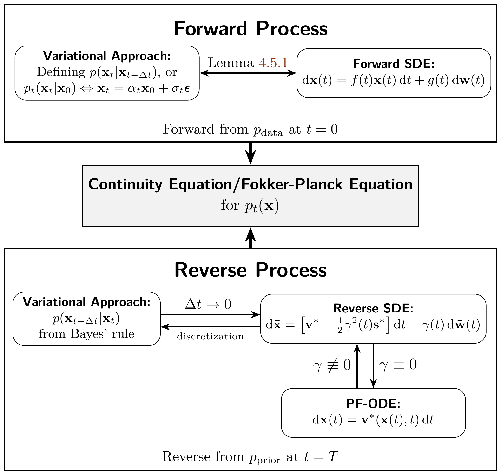

# 6.4 Beneath It All: The Fokker–Planck Equation {#sec-comparison-connection}

**Figure 6.2:** **Unified perspective connecting variational, SDE, and ODE formulations through the continuity equation, where all $p_t({\mathbf{x}})$ evolve under a shared dynamic.** The velocity field ${\mathbf{v}}^*({\mathbf{x}}, t) = f(t){\mathbf{x}} - \frac{1}{2}g^2(t){\mathbf{s}}^*({\mathbf{x}}, t)$ is governed by the score function ${\mathbf{s}}^*({\mathbf{x}}, t) := \nabla_{\mathbf{x}} \log p_t({\mathbf{x}})$. Coefficients $f(t)$, $g(t)$, $\sigma_t$, and $\alpha_t$ are pre-defined time-dependent functions, and $\gamma(t)$ is a tunable time-varying hyperparameter.

Source: Created by the authors.

In this section, we show that the three main perspectives of diffusion models—variational, score-based, and flow-based—are not separate constructions but arise from a single unifying principle: the continuity (Fokker–Planck) equation that governs density evolution under a chosen forward process.

First, we recall that the analysis in [Section 4.6](../04-score-sde-framework/06-fokker-planck-and-reverse-sde.md#eq-heuristic-fpe-sde) unifies the variational perspective, based on discrete kernels and Bayes’ rule, with the score-based SDE perspective of continuous dynamics. We establish this connection by showing that variational models act as consistent discretizations of the underlying forward and reverse SDEs. Specifically, the marginal densities calculated step-by-step via the discrete kernels evolve in a manner consistent with the Fokker–Planck equation that governs the continuous-time dynamics. This confirms that the two perspectives are fundamentally equivalent.

We then connect the flow-based and score-based views. In [Section 6.4.1](04-fokker-planck-connections.md#subsec-flow-score), we show that an ODE flow determines a density path whose marginals can always be realized by a family of stochastic processes. This places deterministic flows and stochastic SDEs within the same family.

Together, these results unify the three perspectives under one framework (see [Figure 6.2](04-fokker-planck-connections.md#fig-unified-framework)). At last, we conclude this chapter in [Section 6.5](05-closing-remarks.md#subsec-takeaway-dm-gaussianfm).

## 6.4.1 Connection of Flow-Based Approach and Score SDE {#subsec-flow-score}

A remarkable aspect of diffusion model lies in how different dynamic systems, deterministic or stochastic, can trace out the same evolution of probability distributions. In this section, we reveal a natural and elegant connection between ODE-based flows of [Section 5.2](../05-flow-based-perspective/02-flow-matching-framework.md#sec-flow-matching-framework) and Score SDEs. Specifically, we show that the velocity field defining a generative ODE can be transformed into a stochastic counterpart that follows the same Fokker-Planck dynamics, providing a principled bridge between deterministic interpolation and stochastic sampling. This offers us a continuous family of models, ranging from ODEs to SDEs, that generate the same data distribution path.

We consider the continuous-time setup where the perturbation kernel is given by

$$
p_t({\mathbf{x}}_t|{\mathbf{x}}_0) = \mathcal{N}({\mathbf{x}}_t; \alpha_t {\mathbf{x}}_0, \sigma_t^2 {\mathbf{I}}),
$$

where ${\mathbf{x}}_0 \sim p_{\mathrm{data}}$. This conditional distribution induces a marginal density path $p_t({\mathbf{x}}_t) = \mathbb{E}_{{\mathbf{x}}_0 \sim p_{\mathrm{data}}}[p({\mathbf{x}}_t|{\mathbf{x}}_0)]$ as usual, with $p_T\approx p_{\mathrm{prior}}$.

To match this density path, consider the ODE

$$
\begin{aligned}
\frac{\mathop{}\!\mathrm{d}{\mathbf{x}}(t)}{\mathop{}\!\mathrm{d} t} = \mathbf{v}_t({\mathbf{x}}(t)), \quad t \in [0,T],
\end{aligned}
\tag{6.4.1}
$$

where $\mathbf{v}_t({\mathbf{x}}) ={\mathbb{E}}\left[\alpha_t'{\mathbf{x}}_0+\sigma_t'{\boldsymbol{\epsilon}}|{\mathbf{x}}\right]$ is the oracle velocity as shown in [Equation (5.2.9)](../05-flow-based-perspective/02-flow-matching-framework.md#eq-marginal-oracle-velocity) (noting that time is flipped to follow the diffusion model convention). Integrating [Equation (6.4.1)](04-fokker-planck-connections.md#eq-ode-velocity) backward from ${\mathbf{x}}(T)\sim p_{\mathrm{prior}}$ yields samples from $p_0$.

Although this ODE suffices for generating high-quality samples, incorporating stochasticity may improve sample diversity. This motivates the following question:

**Question 6.4.1**

Is there an SDE whose dynamics, starting from $p_{\mathrm{prior}}$, yield the same marginal densities as the ODE in [Equation (6.4.1)](04-fokker-planck-connections.md#eq-ode-velocity)?

This statement affirms that there exists a family of reverse-time SDEs that induce the same marginal density path as the corresponding PF-ODE. The densities induced by these SDEs satisfy the same Fokker–Planck equation for this path, and therefore their one time marginals coincide with the prescribed interpolation $\{p_t\}_{t\in[0,T]}$[^1].

**Proposition 6.4.1: Reverse-Time SDEs Generate the Same Marginals as Interpolations**

Let $\gamma(t) \geq 0$ be an arbitrary time-dependent coefficient. Consider the reverse-time SDE, written in the original time variable $t$ and integrated backward from $T$ to $0$,

$$
\begin{aligned}
\mathop{}\!\mathrm{d} \bar{\mathbf{x}}(t)
    =
    \Big[
        {\mathbf{v}}^*(\bar{\mathbf{x}}(t), t)
        - \tfrac{1}{2}\gamma^2(t){\mathbf{s}}^*(\bar{\mathbf{x}}(t), t)
    \Big]\mathop{}\!\mathrm{d} t
    + \gamma(t)\mathop{}\!\mathrm{d}\bar{{\mathbf{w}}}(t),
    \qquad t:T\to 0 .
\end{aligned}
\tag{6.4.2}
$$

with terminal condition $\bar{\mathbf{x}}(T)\sim p_T$. Then this process $\{\bar{\mathbf{x}}(t)\}_{t\in[0,T]}$ matches the prescribed marginals $\{p_t\}_{t\in[0,T]}$ induced by the ODE’s density path. Here, ${\mathbf{s}}^*({\mathbf{x}},t):=\nabla_{{\mathbf{x}}}\log p_t({\mathbf{x}})$ is the score function, and it is related to the velocity field ${\mathbf{v}}^*({\mathbf{x}},t)$ by

$$
\begin{aligned}
{\mathbf{v}}^*({\mathbf{x}}, t)
    =
    f(t){\mathbf{x}}
    -
    \frac{1}{2}g^2(t){\mathbf{s}}^*({\mathbf{x}},t),
    \quad
    {\mathbf{s}}^*({\mathbf{x}},t)
    =
    \frac{1}{\sigma_t}
    \frac{\alpha_t{\mathbf{v}}^*({\mathbf{x}},t)-\alpha_t'{\mathbf{x}}}
    {\alpha_t'\sigma_t-\alpha_t\sigma_t'} .
\end{aligned}
\tag{6.4.3}
$$

**Proof for Proposition.**

The reverse-time Fokker–Planck equation, written with respect to the original time variable $t$ while the process is integrated backward, is

$$
\partial_t p_t
=
-\nabla\cdot
\Big(
\big[
{\mathbf{v}}^*
-
\tfrac{1}{2}\gamma^2{\mathbf{s}}^*
\big]p_t
\Big)
-
\tfrac{1}{2}\gamma^2\Delta p_t .
$$

Using the identity $\nabla\cdot({\mathbf{s}}^*p_t)=\Delta p_t$ since ${\mathbf{s}}^*=\nabla\log p_t$, the second-order terms cancel, yielding

$$
\partial_t p_t
=
-\nabla\cdot({\mathbf{v}}^*p_t),
$$

i.e., the first-order continuity equation associated with the PF-ODE. Hence the reverse-time SDE and the ODE induce the same marginal density path $\{p_t\}$. See Appendix A.2–A.3 of [Ma et al. (2024)](../../references.md#ref-ma2024sit).

At the oracle level of [Proposition 6.4.1](04-fokker-planck-connections.md#rev-sde-interpolant), $\gamma(t)$ can be chosen arbitrarily without changing the prescribed marginal density path: the $\gamma$-dependent drift and diffusion terms cancel exactly in the Fokker–Planck equation. Some representative choices are:

-   Setting $\gamma(t) = 0$ recovers the ODE in [Equation (6.4.1)](04-fokker-planck-connections.md#eq-ode-velocity).

-   When $\gamma(t) = g(t)$, [Equation (6.4.2)](04-fokker-planck-connections.md#eq-general-reverse-sde) becomes the reverse-time SDE in [Equation (4.1.6)](../04-score-sde-framework/01-score-sde-principles.md#eq-sde-backward), since the oracle velocity ${\mathbf{v}}({\mathbf{x}}, t)$ satisfies (see [Proposition 6.3.1](03-equivalent-parameterizations.md#equi-para)):

    $$
    {\mathbf{v}}^*({\mathbf{x}}, t) = f(t){\mathbf{x}} - \tfrac{1}{2}g^2(t){\mathbf{s}}^*({\mathbf{x}}, t).
    $$

-   Other choices for $\gamma(t)$ have been explored; e.g., [Ma et al. (2024)](../../references.md#ref-ma2024sit) select $\gamma(t)$ to minimize the KL gap between $p_{\mathrm{data}}$ and the $t=0$ density obtained by solving [Equation (6.4.2)](04-fokker-planck-connections.md#eq-general-reverse-sde) from $t=T$.

Following Score SDE, the trained velocity field ${\mathbf{v}}_{\boldsymbol{\phi}^\times}({\mathbf{x}}, t)$ can be converted into a parameterized score function ${\mathbf{s}}_{\boldsymbol{\phi}^\times}({\mathbf{x}}, t)$ via [Equation (6.4.3)](04-fokker-planck-connections.md#eq-score-velocity). Plugging this into [Equation (6.4.2)](04-fokker-planck-connections.md#eq-general-reverse-sde) defines an *empirical reverse-time SDE*, which can be sampled by numerically integrating from $t=T$ with $\bar{\mathbf{x}}(T) \sim p_{\mathrm{prior}}$.

This proposition highlights a remarkable flexibility of diffusion models: once a *marginal density path* $\{p_t\}_{t\in[0,T]}$ is induced by the forward process, it can be realized by an entire family of reverse-time dynamics, including the PF-ODE and the reverse-time SDEs

$$
\mathop{}\!\mathrm{d}\bar{\mathbf{x}}(t)
=
\big[
{\mathbf{v}}^*(\bar{\mathbf{x}},t)
-\tfrac12\gamma^2(t){\mathbf{s}}^*(\bar{\mathbf{x}},t)
\big]\mathop{}\!\mathrm{d} t
+
\gamma(t)\mathop{}\!\mathrm{d}\bar{\mathbf{w}}(t),
\quad
\gamma(t)\geq0,
$$

from $t=T$ to $t=0$. Although $\gamma(t)$ changes the stochastic dynamics of individual trajectories, the corresponding Fokker–Planck equations all reduce, for the prescribed density path, to the same governing density equation:

$$
\partial_t p_t
=
-\nabla_{{\mathbf{x}}}\cdot
\bigl({\mathbf{v}}^*({\mathbf{x}},t)p_t({\mathbf{x}})\bigr).
$$

Indeed, using ${\mathbf{s}}^*({\mathbf{x}},t)=\nabla_{{\mathbf{x}}}\log p_t({\mathbf{x}})$, the additional $\gamma$-dependent drift and diffusion terms cancel at the density level. Thus, $\gamma(t)$ controls the stochasticity of sample trajectories while preserving the same oracle one-time marginals, connecting the deterministic PF-ODE with a family of stochastic SDE counterparts, as illustrated in [Figure 6.2](04-fokker-planck-connections.md#fig-unified-framework).

[^1]: For completeness, a forward SDE representation (not needed here) is

    $$
    \mathop{}\!\mathrm{d} {\mathbf{x}}(t)=f(t) {\mathbf{x}}(t) \mathop{}\!\mathrm{d} t+g(t) \mathop{}\!\mathrm{d} {\mathbf{w}}(t),
    $$

    with $f(t)$ and $g(t)$ related to $(\alpha_t,\sigma_t)$ via [Equation (4.5.2)](../04-score-sde-framework/05-accumulated-perturbation-kernels.md#eq-kernel-sde-equiv).
