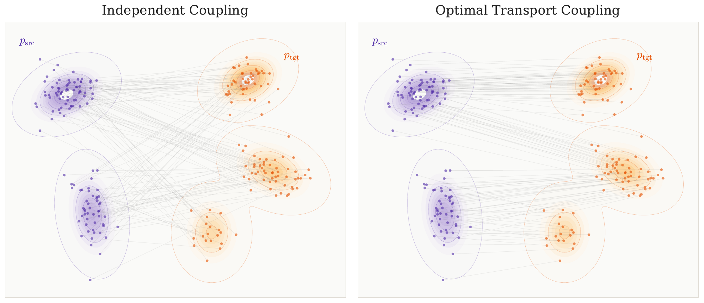
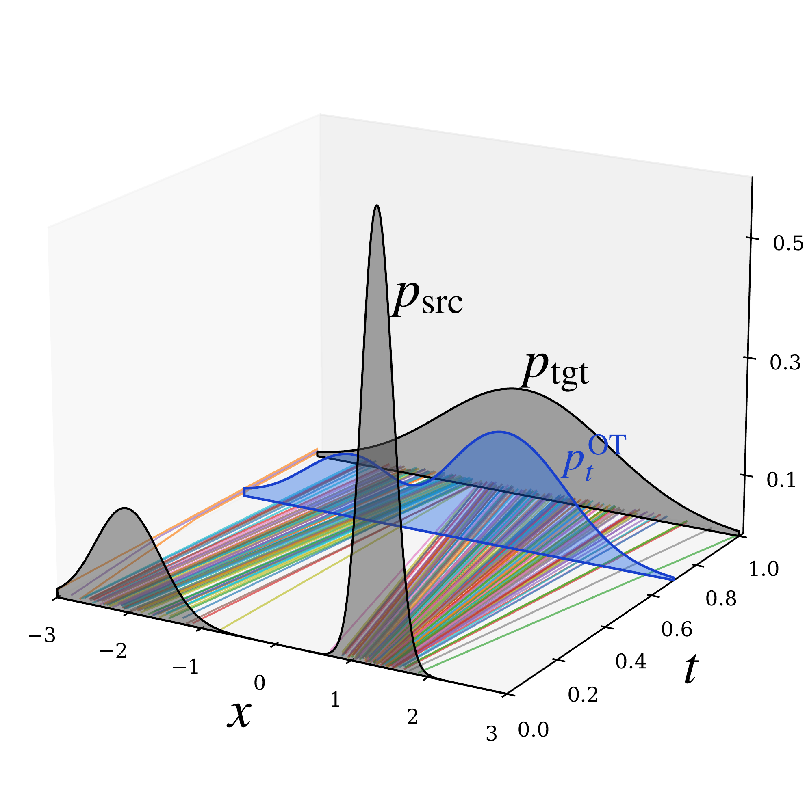
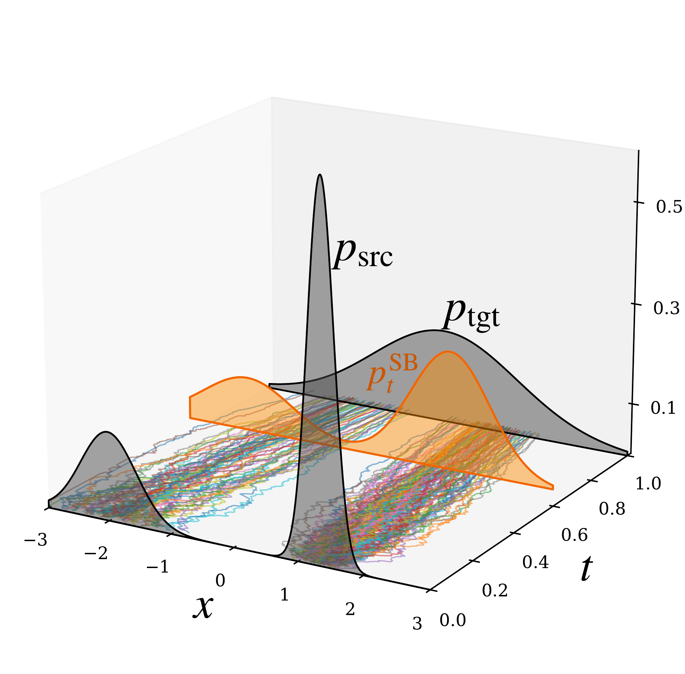

# 7.2 Taxonomy of the Problem Setups {#sec-ot-intro}

In this section, we introduce notions of what constitutes the most “efficient” or “optimal” way to transport mass from $p_{\mathrm{src}}$ to $p_{\mathrm{tgt}}$. These include classical optimal transport (OT) and its entropy-regularized variant, which admits an equivalent formulation known as the Schrödinger Bridge. This taxonomy provides background that will later clarify connections with diffusion models.

## 7.2.1 Optimal Transport (OT) {#subsec-optimal-transport}

**Figure 7.1:** **Two couplings between the same $p_{\mathrm{src}}$ and $p_{\mathrm{tgt}}$ in 2D.** Left: independent (random) pairing produces crossing paths with high cost. Right: the optimal transport coupling pairs nearby mass, avoiding crossings.

Source: Created by the authors with AI-assisted coding.

**Monge–Kantorovich (Static) Formulation of OT Problem.** We fix a cost function $c:{\mathbb{R}}^D\times{\mathbb{R}}^D\to{\mathbb{R}}$ that specifies the expense of sending probability mass from ${\mathbf{x}}$ to ${\mathbf{y}}$. The goal is to transform the source distribution $p_{\mathrm{src}}$ into the target distribution $p_{\mathrm{tgt}}$ as cheaply as possible.

To even define a cost, we must know which pairs $({\mathbf{x}},{\mathbf{y}})$ are matched. This role is played by a *coupling*: a joint distribution $\gamma$ on ${\mathbb{R}}^D\times{\mathbb{R}}^D$ whose marginals are $p_{\mathrm{src}}$ and $p_{\mathrm{tgt}}$. In other words, sampling $({\mathbf{x}},{\mathbf{y}})\sim\gamma$ means we match ${\mathbf{x}}$ from the source with ${\mathbf{y}}$ from the target. If $\gamma$ admits a density $\gamma({\mathbf{x}},{\mathbf{y}})$ with respect to Lebesgue measure, the marginal constraints read

$$
\int_{{\mathbb{R}}^D} \gamma({\mathbf{x}},{\mathbf{y}})\,\mathop{}\!\mathrm{d} {\mathbf{y}} = p_{\mathrm{src}}({\mathbf{x}}),
\qquad
\int_{{\mathbb{R}}^D} \gamma({\mathbf{x}},{\mathbf{y}})\,\mathop{}\!\mathrm{d} {\mathbf{x}} = p_{\mathrm{tgt}}({\mathbf{y}}).
$$

That is, integrating out ${\mathbf{y}}$ recovers the source density in ${\mathbf{x}}$, while integrating out ${\mathbf{x}}$ recovers the target density in ${\mathbf{y}}$.

We give two standard examples for illustration:

1.  **Discrete Supports.** If $p_{\mathrm{src}}$ and $p_{\mathrm{tgt}}$ are supported on finitely many points, a coupling is represented by a nonnegative matrix $(\gamma_{ij})$ whose row sums equal $p_{\mathrm{src}}(i)$ and column sums equal $p_{\mathrm{tgt}}(j)$. Each entry $\gamma_{ij}$ is the amount of mass sent from $i$ to $j$.

2.  **Deterministic Map.** If there exists a measurable map ${\mathbf{T}}$ with ${\mathbf{T}}_\#p_{\mathrm{src}}=p_{\mathrm{tgt}}$, then $\gamma=({\mathbf{I}},{\mathbf{T}})_\#p_{\mathrm{src}}$ is a deterministic coupling that moves each point ${\mathbf{x}}$ directly to ${\mathbf{T}}({\mathbf{x}})$.

Once a coupling $\gamma$ is fixed, the transport cost is simply the average unit cost under this plan:

$$
\int c({\mathbf{x}},{\mathbf{y}})\,\mathop{}\!\mathrm{d}\gamma({\mathbf{x}},{\mathbf{y}})
={\mathbb{E}}_{({\mathbf{x}},{\mathbf{y}})\sim\gamma}\!\big[c({\mathbf{x}},{\mathbf{y}})\big].
$$

In the discrete case, this reduces to $\sum_{i,j} c_{ij}\gamma_{ij}$, whereas in the continuous setting it becomes a double integral. In what follows, we will focus only on the continuous case.

The optimal transport problem is then to choose, among all admissible couplings, the one that minimizes this expected cost.

$$
\mathrm{OT}\big(p_{\mathrm{src}},p_{\mathrm{tgt}}\big)
:= \inf_{\gamma\in\Gamma(p_{\mathrm{src}},p_{\mathrm{tgt}})}
\int c({\mathbf{x}},{\mathbf{y}})\,\mathop{}\!\mathrm{d}\gamma({\mathbf{x}},{\mathbf{y}}),
\tag{7.2.1}
$$

where the feasible set simply enforces the marginal, or mass-conservation, constraints:

$$
\begin{aligned}
\Gamma(p_{\mathrm{src}},p_{\mathrm{tgt}})
= \Big\{\gamma \in &\mathcal{P}({\mathbb{R}}^D\times{\mathbb{R}}^D): \\
&\int \gamma({\mathbf{x}},{\mathbf{y}}) \mathop{}\!\mathrm{d} {\mathbf{y}} = p_{\mathrm{src}}({\mathbf{x}}),\,\,
\int \gamma({\mathbf{x}},{\mathbf{y}})\mathop{}\!\mathrm{d} {\mathbf{x}} = p_{\mathrm{tgt}}({\mathbf{y}})\Big\},
\end{aligned}
$$

where $\mathcal{P}({\mathbb{R}}^D\times{\mathbb{R}}^D)$ denotes the set of all probability measures on ${\mathbb{R}}^D\times{\mathbb{R}}^D$.

**A Special Case: Wasserstein-2 Distance.**

The Wasserstein-2 distance is a special case of the Monge–Kantorovich problem with the quadratic cost $c(\mathbf{x}, \mathbf{y}) = \|\mathbf{x} - \mathbf{y}\|^2$. It measures the distance between two probability distributions as follows:

$$
\begin{aligned}
\mathcal{W}_2^2(p_{\mathrm{src}}, p_{\mathrm{tgt}}) := \inf_{\gamma \in \Gamma(p_{\mathrm{src}}, p_{\mathrm{tgt}})} \mathbb{E}_{(\mathbf{x}, \mathbf{y}) \sim \gamma} \left[ \|\mathbf{x} - \mathbf{y}\|^2 \right].
\end{aligned}
$$

Under suitable assumptions on $p_{\mathrm{src}}$ and $p_{\mathrm{tgt}}$, Brenier’s theorem (see [Theorem 7.1](05-probability-flow-odes-and-optimal-transport.md#thm-brenier))[^1] guarantees that the optimal coupling $\gamma$ for the quadratic cost is concentrated on the graph of a deterministic map ${\mathbf{T}}:\mathbb{R}^D \rightarrow \mathbb{R}^D$. Consequently, the Wasserstein-2 distance can be equivalently expressed as[^2]:

$$
\mathcal{W}_2^2(p_{\mathrm{src}}, p_{\mathrm{tgt}}) = \inf_{\substack{{\mathbf{T}}:\mathbb{R}^D \rightarrow \mathbb{R}^D,\\ \text{ s.t. }{\mathbf{T}}\#p_{\mathrm{src}} = p_{\mathrm{tgt}}}} \mathbb{E}_{{\mathbf{x}} \sim p_{\mathrm{src}}} \left[ \| {\mathbf{T}}({\mathbf{x}}) - {\mathbf{x}} \|^2 \right].
\tag{7.2.2}
$$

Here, ${\mathbf{T}}\#p_{\mathrm{src}} = p_{\mathrm{tgt}}$ means that ${\mathbf{T}}$ pushes $p_{\mathrm{src}}$ forward to $p_{\mathrm{tgt}}$, i.e., ${\mathbf{T}}({\mathbf{x}}) \sim p_{\mathrm{tgt}}$ for ${\mathbf{x}} \sim p_{\mathrm{src}}$.

Thus, the Wasserstein-2 distance represents the minimal expected squared transport cost among all couplings or transport maps that match the given marginals. The optimal transport map denoted by ${\mathbf{T}}^*(\mathbf{x})$, known as the *Monge map*, yields the most efficient way to transform $p_{\mathrm{src}}$ into $p_{\mathrm{tgt}}$.

**Benamou–Brenier (Dynamic) Formulation of OT.**

**Figure 7.2:** **Illustration of dynamic view of OT.** The interpolation $p_t^{\mathrm{OT}}$ evolves continuously in time, providing the least-cost transport plan that deterministically maps $p_{\mathrm{src}}$ to $p_{\mathrm{tgt}}$ (the McCann’s displacement interpolation).

Source: Created by the authors.

Instead of mapping distributions directly in a static manner, as in the Monge–Kantorovich formulation, transport can also be modeled as a continuous-time flow:

$$
p_0 := p_{\mathrm{src}} \to p_t \to p_1 := p_{\mathrm{tgt}}, \quad t \in [0,1].
$$

This dynamic formulation of optimal transport, introduced by [Benamou and Brenier (2000)](references.md#ref-benamou2000computational), seeks a smooth velocity field ${\mathbf{v}}_t({\mathbf{x}})$ that describes how mass in $p_t({\mathbf{x}})$ evolves over time.

The Benamou–Brenier formulation[^3] shows that, for the quadratic cost $c({\mathbf{x}}, {\mathbf{y}}) = \|{\mathbf{x}} - {\mathbf{y}}\|_2^2$ (i.e., the $\mathcal{W}_2$ distance), the optimal value of the static OT problem in [Equation (7.2.1)](02-transport-problem-setups.md#eq-ot) is equal to the optimal value of the kinetic energy minimization problem:

$$
\mathcal{W}_2^2(p_{\mathrm{src}}, p_{\mathrm{tgt}}) = \min_{\substack{ (p_t, {\mathbf{v}}_t) \text{ s.t. }
        \partial_t p_t + \nabla \cdot (p_t {\mathbf{v}}_t) = 0, \\
        p_0 = p_{\mathrm{src}},\,\, p_1 = p_{\mathrm{tgt}}
    }}
    \int_0^1 \int_{\mathbb{R}^D} \|{\mathbf{v}}_t({\mathbf{x}})\|^2 p_t({\mathbf{x}}) \mathop{}\!\mathrm{d}{\mathbf{x}} \mathop{}\!\mathrm{d} t
\tag{7.2.3}
$$

where $p_t$ is a probability distribution on $\mathbb{R}^D$ for each $t \in [0,1]$. In particular, The optimal transport flow $p_t({\mathbf{x}})$ follows *McCann’s displacement interpolation*:

$$
{\mathbf{T}}_t^*({\mathbf{x}}) = (1 - t){\mathbf{x}} + t{\mathbf{T}}^*({\mathbf{x}}),
$$

where ${\mathbf{T}}^*({\mathbf{x}})$ is the OT map that transports $p_{\mathrm{src}}$ to $p_{\mathrm{tgt}}$. This linear interpolation moves mass along straight lines with constant velocity: $p_t = {\mathbf{T}}_t^*\#p_{\mathrm{src}}$ for each $t \in [0,1]$.

The optimal transport map ${\mathbf{T}}^*$ satisfies the *Monge–Ampère equation*:

$$
p_{\mathrm{tgt}}\left(\nabla \psi({\mathbf{x}})\right) \det\left(\nabla^2 \psi({\mathbf{x}})\right) = p_{\mathrm{src}}({\mathbf{x}}),
\tag{7.2.4}
$$

where ${\mathbf{T}}^*({\mathbf{x}}) = \nabla \psi({\mathbf{x}})$ for some convex function ${\boldsymbol{\psi}}$ by Brenier’s theorem. However, this nonlinear PDE is typically intractable for explicit solutions. Note that this is precisely the change-of-variables relation used by normalizing flows (c.f., [Equation (5.0.1)](../05-flow-based-perspective/index.md#eq-nf-change-of-var)): flows parametrize an invertible transport map with a tractable Jacobian determinant, but do not in general impose the gradient-of-potential structure ${\mathbf{T}}^*=\nabla\psi$; consequently, a trained flow can differ substantially from the Brenier/OT map.

## 7.2.2 Entropy-Regularized Optimal Transport (EOT) {#subsec-entropic-optimal-transport}

To motivate EOT concretely, consider empirical distributions built from samples. Suppose $p_{\mathrm{src}}$ is supported on points $\{{\mathbf{x}}^{(i)}\}_{i=1}^n \subset {\mathbb{R}}^D$ with weights $a_i$, and $p_{\mathrm{tgt}}$ on $\{{\mathbf{y}}^{(j)}\}_{j=1}^n \subset {\mathbb{R}}^D$ with weights $b_j$. A coupling is then an $n\times n$ nonnegative matrix $\gamma=(\gamma_{ij})$ whose row sums match $a$ and column sums match $b$. Each entry $\gamma_{ij}$ represents the amount of mass transported from ${\mathbf{x}}^{(i)}$ to ${\mathbf{y}}^{(j)}$[^4].

**Why Regularize OT?** Classical OT in this discrete setting (obtained by taking counting measures in the continuous formulation [Equation (7.2.1)](02-transport-problem-setups.md#eq-ot)) reduces to minimizing

$$
\min_{\gamma=(\gamma_{ij})}\sum_{i,j} C_{ij}\,\gamma_{ij},
$$

over all feasible couplings $\gamma=(\gamma_{ij})$, where $C_{ij} = c({\mathbf{x}}^{(i)},{\mathbf{y}}^{(j)})$ is the cost of moving one unit of mass from source point ${\mathbf{x}}^{(i)}$ to target point ${\mathbf{y}}^{(j)}$, for a prescribed ground cost $c:{\mathbb{R}}^D\times{\mathbb{R}}^D\to{\mathbb{R}}_{\ge 0}$ (e.g., $c({\mathbf{x}},{\mathbf{y}})=\|{\mathbf{x}}-{\mathbf{y}}\|_2^2$).

Two main issues arise:

1.  **Non-Uniqueness and Instability:** The minimizer $\gamma^*$ need not be unique. For example, if two transport plans achieve the same minimum cost, the solver may select either one. Consequently, small changes in the inputs $(a,b,C)$ (such as moving a sample, adjusting weights, or slightly perturbing costs) can cause abrupt jumps in the solution.

2.  **High Computational Cost:** The problem is a linear program with $n^2$ variables and $2n$ constraints. Practical solvers (e.g., Hungarian algorithm ([Kuhn, 1955](references.md#ref-kuhn1955hungarian); [Munkres, 1957](references.md#ref-munkres1957algorithms)), network simplex ([Peyré et al., 2019](references.md#ref-peyre2019computational))) typically scale as $\mathcal{O}(n^3)$, which is infeasible for large $n$.

To overcome these bottlenecks, EOT objective function introduces a regularization term to the classical OT problem, controlled by a parameter $\varepsilon > 0$:

$$
\begin{aligned}
        \text{EOT}_\varepsilon(p_{\mathrm{src}}, p_{\mathrm{tgt}}) &:= \min_{\gamma \in \Gamma(p_{\mathrm{src}}, p_{\mathrm{tgt}})} \int c({\mathbf{x}},  {\mathbf{y}})  \mathop{}\!\mathrm{d}\gamma({\mathbf{x}}, {\mathbf{y}})
        + \varepsilon \mathcal{D}_{\text{KL}}\left(\gamma \Vert M \right).
\end{aligned}
\tag{7.2.5}
$$

The reference measure $M$ is typically chosen as the product of the marginals, $p_{\mathrm{src}} \otimes p_{\mathrm{tgt}}$. The KL divergence term is directly related to the Shannon entropy of the transport plan $\gamma$:

$$
\mathcal{D}_{\text{KL}}(\gamma \,\Vert\, p_{\mathrm{src}} \otimes p_{\mathrm{tgt}}) = -\mathcal{H}(\gamma) + \text{Constant},
$$

where $\mathcal{H}(\gamma) := -\int \gamma({\mathbf{x}}, {\mathbf{y}}) \log \gamma({\mathbf{x}}, {\mathbf{y}}) \mathop{}\!\mathrm{d} {\mathbf{x}} \mathop{}\!\mathrm{d} {\mathbf{y}}$.

The addition of this regularization term yields several theoretical and practical advantages, which we briefly outline below:

**Why Entropy Regularizer Helps?**

1.  **Mass Spreading.** Since $t\mapsto t\log t$ is convex and grows rapidly for large $t$, minimizing $\int \gamma\log\gamma$ penalizes *peaky* couplings (some $\gamma({\mathbf{x}},{\mathbf{y}})$ very large, most near zero). For fixed total mass $\int \gamma=1$, it favors plans where $\gamma({\mathbf{x}},{\mathbf{y}})$ is more evenly distributed over $({\mathbf{x}},{\mathbf{y}})\in\mathbb{R}^D\times\mathbb{R}^D$. Equivalently, maximizing Shannon entropy promotes higher “uncertainty” (diffuseness).

2.  **Strict Convexity and Uniqueness.** Because $\mathcal{H}$ is strictly concave, the objective in [Equation (7.2.5)](02-transport-problem-setups.md#eq-eot-epsilon) is strictly convex in $\gamma$, yielding a *unique* minimizer $\gamma^*_\varepsilon$ that depends continuously on $(p_{\mathrm{src}},p_{\mathrm{tgt}},c)$.

3.  **Sinkhorn Form and Positivity.** Under mild conditions[^5], the optimizer has the *Schrödinger/Sinkhorn form*

    $$
    \gamma^*_\varepsilon({\mathbf{x}},{\mathbf{y}}) = u({\mathbf{x}})\, \exp \bigl(-\tfrac{c({\mathbf{x}},{\mathbf{y}})}{\varepsilon}\bigr)  \,v({\mathbf{y}})p_{\mathrm{src}}({\mathbf{x}}) p_{\mathrm{tgt}}({\mathbf{y}}),
    $$

    for positive scaling functions $u,v$ (unique up to a global factor). In practice, the continuous formulation is approximated with finite samples, reducing EOT to a finite (sampled) Sinkhorn iteration. The entropic objective is strictly convex, and the scaling (Sinkhorn/IPFP) algorithm solves it efficiently ([Sinkhorn, 1964](references.md#ref-sinkhorn1964relationship); [Cuturi, 2013](references.md#ref-cuturi2013sinkhorn)). For a dense problem with $n$ support points per marginal (an $n\times n$ kernel), each Sinkhorn iteration costs $\mathcal{O}(n^2)$ time and $\mathcal{O}(n^2)$ memory, making the method more scalable and practical ([Altschuler et al., 2017](references.md#ref-altschuler2017near)).

4.  **Limits in $\varepsilon$.** As $\varepsilon \to 0$, the optimal plan $\gamma^*_\varepsilon$ becomes increasingly concentrated, approaching a (possibly singular) classical OT coupling (we will revisit this connection in [Section 7.3.2](03-relationships-between-formulations.md#subsec-eot-ot)). As $\varepsilon$ increases, $\gamma^*_\varepsilon$ gradually spreads out and approaches the independent coupling $p_{\mathrm{src}}\otimes p_{\mathrm{tgt}}$.

## 7.2.3 Schrödinger Bridge (SB) {#subsec-sb}

**KL Formulation of SB.** The Schrödinger Bridge (SB) problem, introduced by Erwin Schrödinger in the 1930s, asks the following question. Suppose particles move according to some simple reference dynamics, such as Brownian motion. Now imagine that we observe the particles at two times: at $t=0$ their distribution is $p_{\mathrm{src}}$, and at $t=1$ it is $p_{\mathrm{tgt}}$. Among all possible stochastic processes that connect these two distributions, which one deviates the least from the reference dynamics? Here “deviation” is measured by the KL divergence, so the solution to the SB problem is the most likely way to deform Brownian motion into a process that satisfies the prescribed boundary conditions.

To make this precise, let ${\mathbf{x}}_{0:T}:=\{{\mathbf{x}}_t\}_{t\in[0,T]}$ denote a complete trajectory of the process. We write $P$ for the *law of trajectories*, that is, the probability distribution over entire sample paths. The time-$t$ marginal of $P$ is denoted by $p_t$ (or $P_t$), which describes the distribution of the state ${\mathbf{x}}_t$ at a single time. Formally, for a measurable set $A\subseteq\mathbb R^D$,

$$
p_t(A) = P({\mathbf{x}}_t \in A).
$$

In other words, $p_t$ can be viewed as the empirical distribution obtained by sampling many full trajectories from $P$ and then collecting the states at time $t$—for instance, as a histogram if the state is one-dimensional.

Consider a reference diffusion $\{{\mathbf{x}}_t\}_{t\in[0,T]}$ governed by the SDE

$$
\begin{aligned}
\mathop{}\!\mathrm{d} {\mathbf{x}}_t  =  {\mathbf{f}}({\mathbf{x}}_t,t)\,\mathop{}\!\mathrm{d} t  +  g(t)\,\mathop{}\!\mathrm{d} {\mathbf{w}}_t,
\end{aligned}
\tag{7.2.6}
$$

where ${\mathbf{f}}\colon {\mathbb{R}}^D\times[0,T]\!\to\!{\mathbb{R}}^D$, $g\colon[0,T]\!\to\!{\mathbb{R}}$, and $\{{\mathbf{w}}_t\}_{t\in[0,T]}$ is a standard Brownian motion. Let $R$ denote the *path law* (joint distribution) of the full trajectory ${\mathbf{x}}_{0:T}:=\{{\mathbf{x}}_t\}_{t\in[0,T]}$, and let $R_0$ denote the initial marginal of the reference process; this $R$ will serve as the *reference* trajectory distribution.

With this notation, the SB problem seeks a trajectory law $P$ that is closest to $R$ in KL divergence while matching the prescribed endpoint marginals:

$$
\begin{aligned}
\mathrm{SB}(p_{\mathrm{src}}, p_{\mathrm{tgt}})
    := \min_{P}\, \mathcal{D}_{\mathrm{KL}}(P\|R)
    \quad \text{s.t.} \quad P_0 = p_{\mathrm{src}},\;\; P_T = p_{\mathrm{tgt}}.
\end{aligned}
\tag{7.2.7}
$$

The optimizer $P^*$ depends on the chosen reference process $R$.

**Stochastic Control View of SB.**

**Figure 7.3:** **Illustration of stochastic control view of SB.** The bridge seeks the stochastic path that deviates least from the reference while connecting $p_{\mathrm{src}}$ and $p_{\mathrm{tgt}}$.

Source: Created by the authors.

Rather than optimizing over arbitrary path distributions $P$ in [Equation (7.2.7)](02-transport-problem-setups.md#eq-sb-epsilon-general), a more tractable approach is to take the reference dynamics as an anchor and allow it to drift. This is done by introducing a time-dependent drift ${\mathbf{v}}_t({\mathbf{x}}_t)$, which perturbs the reference process and generates a family of candidate trajectory distributions. The resulting dynamics take the form of a *controlled diffusion*:

$$
\mathop{}\!\mathrm{d} {\mathbf{x}}_t
    = \bigl[{\mathbf{f}}({\mathbf{x}}_t,t) + {\mathbf{v}}_t({\mathbf{x}}_t)\bigr]\mathop{}\!\mathrm{d} t + g(t) \mathop{}\!\mathrm{d} {\mathbf{w}}_t,
$$

where ${\mathbf{v}}_t:{\mathbb{R}}^D\to{\mathbb{R}}^D$ is the drift to be optimized later ([Equation (7.2.8)](02-transport-problem-setups.md#eq-sb-kinetic)). Under standard integrability conditions (e.g., Novikov’s condition) and by Girsanov’s theorem (see [Section C.2.1](../../appendices/c-ito-calculus/index.md#subsec-girsanov)), the KL divergence between the controlled law $P$ and the reference $R$ admits the dynamic (kinetic) form

$$
\begin{aligned}
\mathcal{D}_{\mathrm{KL}}(P\|R)
    &=
    \mathcal{D}_{\mathrm{KL}}(p_{\mathrm{src}}\|R_0)
    +
    {\mathbb{E}}_{P}\!\left[
    \frac{1}{2}\int_0^T
    \frac{\|{\mathbf{v}}_t({\mathbf{x}}_t)\|^2}{g^2(t)}
    \mathop{}\!\mathrm{d} t
    \right]
    \\
    &=
    \mathcal{D}_{\mathrm{KL}}(p_{\mathrm{src}}\|R_0)
    +
    \frac{1}{2}\int_0^T\!\int_{{\mathbb{R}}^D}
    \frac{\|{\mathbf{v}}_t({\mathbf{x}})\|^2}{g^2(t)}
    p_t({\mathbf{x}})\mathop{}\!\mathrm{d}{\mathbf{x}}\mathop{}\!\mathrm{d} t .
\end{aligned}
$$

where $p_t$ is the time–$t$ marginal of ${\mathbf{x}}_t$ under the controlled process. The second equality follows from the law of total expectation. Since $P_0=p_{\mathrm{src}}$ is fixed in the SB problem, the first term is constant with respect to the control and may therefore be omitted from the optimization. In particular, it vanishes when $R_0=p_{\mathrm{src}}$.

Hence, the SB problem can be reformulated as minimizing the expected control energy over all admissible drifts ${\mathbf{v}}_t$ that steer the process from $p_{\mathrm{src}}$ at $t=0$ to $p_{\mathrm{tgt}}$ at $t=T$ ([Dai Pra, 1991](references.md#ref-dai1991stochastic); [Pra and Pavon, 1990](references.md#ref-pra1990markov); [Pavon and Wakolbinger, 1991](references.md#ref-pavon1991free); [Chen et al., 2016](references.md#ref-chen2016relation)). Since the initial marginal is fixed to $p_{\mathrm{src}}$, we may take the reference process to have $R_0=p_{\mathrm{src}}$ without changing the optimizer; then $\mathcal{D}_{\mathrm{KL}}(p_{\mathrm{src}}\|R_0)=0$. This leads to the *stochastic control formulation*:

$$
\begin{aligned}
\mathrm{SB}(p_{\mathrm{src}}, p_{\mathrm{tgt}})
=
\min_{\substack{
\mathbf{v}_t \text{ s.t. }
\mathop{}\!\mathrm{d} {\mathbf{x}}_t =
\left[{\mathbf{f}}({\mathbf{x}}_t,t)+\mathbf{v}_t({\mathbf{x}}_t)\right]\mathop{}\!\mathrm{d} t
+g(t)\mathop{}\!\mathrm{d}{\mathbf{w}}_t,\\
{\mathbf{x}}_0\sim p_{\mathrm{src}},\,
{\mathbf{x}}_T\sim p_{\mathrm{tgt}}
}}
\frac{1}{2}
\int_0^T\int_{\mathbb{R}^D}
\frac{\left\lVert{\mathbf{v}}_t({\mathbf{x}})\right\rVert^2}{g^2(t)}
p_t({\mathbf{x}})\mathop{}\!\mathrm{d}{\mathbf{x}}\mathop{}\!\mathrm{d} t .
\end{aligned}
\tag{7.2.8}
$$

Importantly, the endpoint distributions $p_{\mathrm{src}}$ and $p_{\mathrm{tgt}}$ are arbitrary; the control ${\mathbf{v}}_t$ is chosen precisely to “bridge” the reference dynamics between these marginals while staying as close as possible (in KL divergence) to the reference process $R$.

**A Special Brownian Reference.** [Equation (7.2.8)](02-transport-problem-setups.md#eq-sb-kinetic) resembles the Benamou–Brenier formulation of OT in [Equation (7.2.3)](02-transport-problem-setups.md#eq-bb-ot), especially when the reference process $R^\varepsilon$ (with $\varepsilon>0$) is chosen to be a Brownian motion[^6]:

$$
\mathop{}\!\mathrm{d} {\mathbf{x}}_t = \sqrt{\varepsilon}\,\mathop{}\!\mathrm{d}{\mathbf{w}}_t,
$$

so that ${\mathbf{f}} \equiv \mathbf{0}$ and $g(t) \equiv \sqrt{\varepsilon}$.

In this setting, the SB problem seeks a path distribution $P$ that stays closest (in KL divergence) to the Brownian reference $R^\varepsilon$, while matching the endpoint marginals:

$$
\begin{aligned}
\mathrm{SB}_\varepsilon(p_{\mathrm{src}}, p_{\mathrm{tgt}})
    := \min_{P} \mathcal{D}_{\mathrm{KL}}(P \| R^\varepsilon)
    \quad \text{s.t.} \quad P_0 = p_{\mathrm{src}}, \;\; P_T = p_{\mathrm{tgt}}.
\end{aligned}
\tag{7.2.9}
$$

The equivalent stochastic control formulation then becomes

$$
\begin{aligned}
    \mathrm{SB}_\varepsilon(p_{\mathrm{src}}, p_{\mathrm{tgt}})
    = \min_{\substack{
        {\mathbf{v}}_t \text{ s.t. } \mathop{}\!\mathrm{d} {\mathbf{x}}_t = {\mathbf{v}}_t({\mathbf{x}}_t)\,\mathop{}\!\mathrm{d} t + \sqrt{\varepsilon}\,\mathop{}\!\mathrm{d} {\mathbf{w}}_t, \\
        {\mathbf{x}}_0 \sim p_{\mathrm{src}},\;\; {\mathbf{x}}_T \sim p_{\mathrm{tgt}}
    }}
    \frac{1}{2\varepsilon}\int_0^T \!\!\int_{{\mathbb{R}}^D}
        \|{\mathbf{v}}_t({\mathbf{x}})\|^2 \, p_t({\mathbf{x}})\,\mathop{}\!\mathrm{d} {\mathbf{x}}\,\mathop{}\!\mathrm{d} t,
\end{aligned}
\tag{7.2.10}
$$

where $p_t$ denotes the time–$t$ marginal of diffusion driven by the drift ${\mathbf{v}}_t$:

$$
\mathop{}\!\mathrm{d} {\mathbf{x}}_t = {\mathbf{v}}_t({\mathbf{x}}_t)\,\mathop{}\!\mathrm{d} t + \sqrt{\varepsilon}\,\mathop{}\!\mathrm{d} {\mathbf{w}}_t.
$$

**Why We Need to Specify a Reference Distribution?** Classical OT does not require a reference path distribution because the prescribed ground cost already tells us how expensive it is to pair a source point with a target point. The optimization therefore compares admissible couplings directly through this cost. In the SB problem, however, we compare entire stochastic trajectories rather than only their endpoints. We therefore need a reference path measure $R$ that specifies what the uncontrolled dynamics would normally look like. The quantity $\mathcal{D}_{\mathrm{KL}}(P\|R)$ then measures how much an admissible process $P$ must deviate from these reference dynamics in order to satisfy the prescribed endpoint distributions.

**Coupled PDE Characterization.** A convenient way to describe the SB solution is through two space–time potentials $\Psi(x,t)$ and $\widehat{\Psi}(x,t)$. Let $p_t^{\mathrm{SB}}$ denote the marginal at time $t\in[0,T]$ of the optimal trajectory law $P^*$ in [Equation (7.2.7)](02-transport-problem-setups.md#eq-sb-epsilon-general). Then one has the symmetric factorization ([Dai Pra, 1991](references.md#ref-dai1991stochastic))

$$
\begin{aligned}
p_t^{\mathrm{SB}}(x) = \Psi(x,t) \widehat{\Psi}(x,t),
\end{aligned}
\tag{7.2.11}
$$

where $\Psi$ and $\widehat{\Psi}$ solve the (linear) *Schrödinger system* ([Caluya and Halder, 2021](references.md#ref-caluya2021wasserstein); [Chen et al., 2021](references.md#ref-chen2021stochastic); [Chen et al., 2022](references.md#ref-chenlikelihood)):

$$
\begin{aligned}
\frac{\partial \Psi}{\partial t}(\mathbf{x},t)
  &= -\nabla_{\mathbf{x}} \Psi(\mathbf{x},t) \cdot {\mathbf{f}}(\mathbf{x},t)
     - \frac{g^2(t)}{2}\,\Delta_\mathbf{x} \Psi(\mathbf{x},t),  \\
\frac{\partial \widehat{\Psi}}{\partial t}(\mathbf{x},t)
  &= -\nabla_{\mathbf{x}}\!\cdot\!\bigl(\widehat{\Psi}(\mathbf{x},t)\,{\mathbf{f}}(\mathbf{x},t)\bigr)
     + \frac{g^2(t)}{2}\,\Delta_\mathbf{x}\widehat{\Psi}(\mathbf{x},t)
\\ \text{subject to}\quad
\Psi(\mathbf{x},0)&\,\widehat{\Psi}(\mathbf{x},0) = p_{\mathrm{src}}(\mathbf{x}),
\quad
\Psi(\mathbf{x},T)\,\widehat{\Psi}(\mathbf{x},T) = p_{\mathrm{tgt}}(\mathbf{x}).
\end{aligned}
\tag{7.2.12}
$$

**Forward-Time Schrödinger Bridge SDE.** Once $\Psi$ is known, the optimal dynamics is the reference diffusion tilted by the space–time factor $\Psi$:

$$
\begin{aligned}
\mathop{}\!\mathrm{d} {\mathbf{x}}_t = \bigl[{\mathbf{f}}({\mathbf{x}}_t, t) + g^2(t)\,\nabla_{\mathbf{x}} \log \Psi({\mathbf{x}}_t, t)\bigr]\mathop{}\!\mathrm{d} t
+ g(t)\mathop{}\!\mathrm{d} {\mathbf{w}}_t, \quad {\mathbf{x}}_0 \sim p_{\mathrm{src}}.
\end{aligned}
\tag{7.2.13}
$$

Let $Q$ denote the trajectory law of [Equation (7.2.13)](02-transport-problem-setups.md#eq-sb-forward-sde) (so $Q_0=p_{\mathrm{src}}$ and $Q_T=p_{\mathrm{tgt}}$ by [Equation (7.2.11)](02-transport-problem-setups.md#eq-sb-symmetry) and [Equation (7.2.12)](02-transport-problem-setups.md#eq-pde-schrodinger)). Then *$Q=P^*$* and the minimizer ${\mathbf{v}}^*$ to [Equation (7.2.8)](02-transport-problem-setups.md#eq-sb-kinetic) is (see ([Chen et al., 2021](references.md#ref-chen2021stochastic))’s Section 4.6):

$$
{\mathbf{v}}_t^{*}({\mathbf{x}}) = g^2(t) \nabla_{\mathbf{x}} \log \Psi({\mathbf{x}},t).
$$

That is, drift correction $g^2\nabla_{\mathbf{x}}\log\Psi$ is precisely the minimal KL perturbation of the reference needed to match the endpoint marginals.

**Reverse-Time Schrödinger Bridge SDE.** The same optimal path law can be generated reverse in time. A convenient way to see the form of the reverse-time drift is to conceptually use the standard time-reversal identity for diffusions:

$$
{\mathbf{b}}^{-}({\mathbf{x}},t)={\mathbf{b}}^{+}({\mathbf{x}},t)-g^2(t)\nabla_{\mathbf{x}}\log p_t^{\mathrm{SB}}({\mathbf{x}}),
$$

where ${\mathbf{b}}^{+}={\mathbf{f}}+g^2\nabla\log\Psi$ and $p_t=\Psi\,\widehat{\Psi}$. This gives

$$
{\mathbf{b}}^{-}({\mathbf{x}},t)={\mathbf{f}}({\mathbf{x}},t)-g^2(t) \nabla_{\mathbf{x}}\log \widehat{\Psi}({\mathbf{x}},t).
$$

Thus the reverse-time SDE reads

$$
\begin{aligned}
\mathop{}\!\mathrm{d} {\mathbf{x}}_t
= \Big[{\mathbf{f}}({\mathbf{x}}_t,t) - g^2(t) \nabla_{{\mathbf{x}}}\log \widehat{\Psi}({\mathbf{x}}_t,t)\Big]\mathop{}\!\mathrm{d} t
+ g(t)\,\mathop{}\!\mathrm{d} \bar{{\mathbf{w}}}_t, \quad {\mathbf{x}}_T \sim p_{\mathrm{tgt}} .
\end{aligned}
\tag{7.2.14}
$$

Equivalently, reparametrizing time by ${\mathbf{y}}_\tau := {\mathbf{x}}_{T-\tau}$ so that $\tau$ increases from $0$ to $T$. Then ${\mathbf{y}}_\tau$ evolves forward in $\tau$ from ${\mathbf{y}}_0 \sim p_{\mathrm{tgt}}$ as

$$
\begin{aligned}
    \mathop{}\!\mathrm{d} {\mathbf{y}}_\tau
= \big[-{\mathbf{f}}({\mathbf{y}}_\tau,T-\tau) + g^2(T-\tau) \nabla_{{\mathbf{y}}}\log \widehat{\Psi}({\mathbf{y}}_\tau,T-\tau)\big]\mathop{}\!\mathrm{d} \tau
+ g(T-\tau) \mathop{}\!\mathrm{d} {\mathbf{w}}_\tau.
\end{aligned}
\tag{7.2.15}
$$

Both the forward and reverse descriptions yield the same optimal path law $P^*$ which are linked by

$$
\nabla\log p_t^{\mathrm{SB}}=\nabla\log\Psi+\nabla\log\widehat\Psi,
\qquad
{\mathbf{b}}^{-}={\mathbf{b}}^{+}-g^2\,\nabla\log p_t^{\mathrm{SB}},
$$

so their marginals coincide with $p_t^{\mathrm{SB}}$ at every time. The additional drift terms $g^2\nabla\log\Psi$ (forward) and $-\,g^2\nabla\log\widehat{\Psi}$ (reverse-time) act as control forces that steer the reference diffusion to match the endpoint marginals while staying closest to the reference in relative entropy.

**Practical Obstacles to the Coupled PDE Approach.** To construct the generative process based on [Equation (7.2.14)](02-transport-problem-setups.md#eq-sb-backward-sde), one must solve the coupled PDEs in [Equation (7.2.12)](02-transport-problem-setups.md#eq-pde-schrodinger) to obtain the backward Schrödinger potential $\widehat{\Psi}$. However, these PDEs are notoriously difficult to solve, even in low-dimensional settings, which makes their direct application in generative modeling challenging. To circumvent this, several works have proposed alternative strategies: leveraging Score SDE techniques to iteratively solve each half-bridge problem ($p_{\mathrm{tgt}} \leftarrow p_{\mathrm{src}}$ and $p_{\mathrm{tgt}} \rightarrow p_{\mathrm{src}}$) ([De Bortoli et al., 2021](references.md#ref-de2021diffusion)); optimizing surrogate likelihood bounds ([Chen et al., 2022](references.md#ref-chenlikelihood); [Liu et al., 2023](references.md#ref-liu20232)); or designing simulation-free training based on an analytical solution of the posterior ${\mathbf{x}}_t \vert {\mathbf{x}}_0, {\mathbf{x}}_T$ for sample pairs $({\mathbf{x}}_0, {\mathbf{x}}_T) \sim p_{\mathrm{src}} \otimes p_{\mathrm{tgt}}$ ([Liu et al., 2023](references.md#ref-liu20232)). We do not delve into the technical details here but briefly discuss the connection between diffusion models and SB in [Section 7.4](04-diffusion-sdes-and-schrodinger-bridges.md#sec-dm-and-sb).

## 7.2.4 Global Pushforwards and Local Dynamics: An OT Analogy for DGMs {#subsec-global-pushforwards-local-dynamics}

From the optimal-transport viewpoint (in [Equation (7.2.1)](02-transport-problem-setups.md#eq-ot)), one can leverage deep generative models to learn a transport (pushforward) map from a simple prior to the data, i.e., ${\mathbf{G}}_{\boldsymbol{\phi}\#}p_{\mathrm{prior}} \approx p_{\mathrm{data}}$. Although ${\mathbf{G}}_{\boldsymbol{\phi}}$ generally does not coincide with the optimal transport map (except in works ([Genevay et al., 2018](references.md#ref-genevay2018learning); [Onken et al., 2021](references.md#ref-onken2021ot)) that impose an OT objective under suitable conditions), the Benamou–Brenier formulation (in [Equation (7.2.3)](02-transport-problem-setups.md#eq-bb-ot)) provides a complementary, dynamic perspective. Rather than directly learning a single global map, it describes transport as a continuous flow generated by a time-dependent local vector field, tracing a smooth path between $p_{\mathrm{prior}}$ and $p_{\mathrm{data}}$. This dynamic formulation parallels the relationship between the static Schrödinger Bridge problem (in [Equation (7.2.7)](02-transport-problem-setups.md#eq-sb-epsilon-general)) and its stochastic-control counterpart (in [Equation (7.2.8)](02-transport-problem-setups.md#eq-sb-kinetic)), where the optimal coupling is realized as a controlled diffusion process. A similar analogy emerges in generative modeling: standard DGMs such as GANs or VAEs learn a global pushforward map, whereas diffusion models learn a time-dependent local vector field that drives the generative dynamics.

[^1]: Brenier’s theorem is about the existence and structure of the optimal transport map for quadratic cost. In particular, if $p_{\mathrm{src}}$ does not give mass to sets of dimension at most $D-1$, then an optimal transport map ${\mathbf{T}}^*$ uniquely exists.

[^2]: There are three commonly used formulations of the $\mathcal{W}_2$ distance: the Monge formulation (based on an optimal transport map), the Kantorovich formulation (based on couplings), and the Benamou–Brenier dynamic formulation (see [Equation (7.2.3)](02-transport-problem-setups.md#eq-bb-ot)). These are equivalent under appropriate regularity conditions.

[^3]: Benamou–Brenier formulation describes how to compute the $\mathcal{W}_2$ distance by minimizing kinetic energy over continuous paths of measures and velocities.

[^4]: Empirical (discrete) measures provide a principled proxy for continuous distributions. When the ground cost is $c(x,y)=d(x,y)^p$ (so the OT value equals $W_p^p$) and the measures have finite $p$th moments, the empirical measures converge to the population in $W_p$ with quantitative rates; see [Fournier and Guillin (2015)](references.md#ref-fournier2015rate) and the overview in [Peyré et al. (2019)](references.md#ref-peyre2019computational).

[^5]: We assume that $c<\infty$ holds $p_{\mathrm{src}}\otimes p_{\mathrm{tgt}}$-almost everywhere, and that the marginal kernel integrals are finite and positive. For simplicity, we focus on the case where $\gamma^*_\varepsilon$, $p_{\mathrm{src}}$, and $p_{\mathrm{tgt}}$ admit densities with respect to the Lebesgue measure.

[^6]: This resemblance can be made precise. In an equivalent time-symmetric fluid-dynamic formulation, if $\tilde{{\mathbf{v}}}_t$ denotes the current velocity satisfying the continuity equation $\partial_t \rho_t + \nabla \cdot (\rho_t \tilde{{\mathbf{v}}}_t)=0$, then the Brownian-reference SB objective ([Equation (7.2.10)](02-transport-problem-setups.md#eq-sb-epsilon-kinetic)) can be written as a Benamou–Brenier-type kinetic term, up to a conventional constant factor, plus a Fisher information term:

    $$
    \int_0^T\!\!\int
    \left[
    \frac{1}{2}\|\tilde{{\mathbf{v}}}_t({\mathbf{x}})\|^2
    +
    \frac{\varepsilon^2}{8}\|\nabla_{{\mathbf{x}}}\log \rho_t({\mathbf{x}})\|^2
    \right]\rho_t({\mathbf{x}})\,\mathop{}\!\mathrm{d}{\mathbf{x}}\,\mathop{}\!\mathrm{d} t.
    $$

    Thus, in the Brownian-reference / quadratic-cost case, entropic OT can be viewed as a Fisher-information-regularized version of dynamic OT; see Problem 4.6 in [Chen et al. (2021)](references.md#ref-chen2021stochastic).
