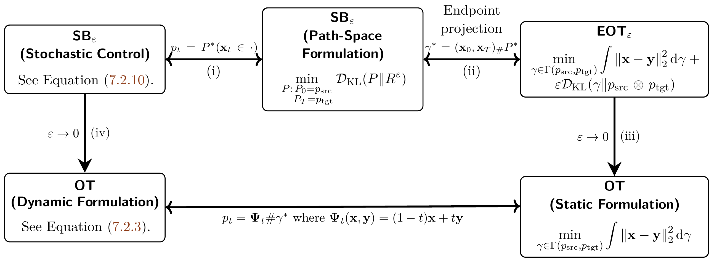
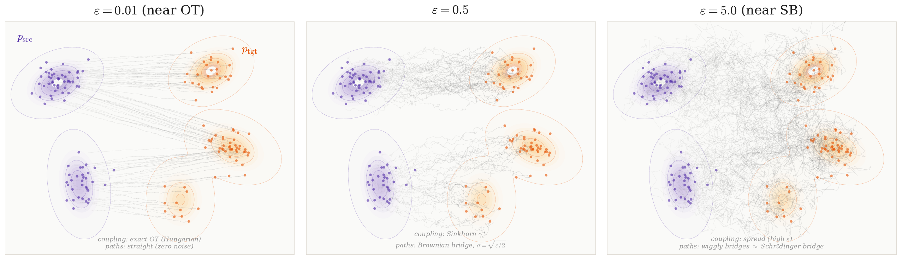

# 7.3 Relationship of Variant Optimal Transport Formulations {#sec-relation-ot}

**Figure 7.4:** **Relationship between variants of optimal transport with $c({\mathbf{x}},{\mathbf{y}})=\|{\mathbf{x}}-{\mathbf{y}}\|_2^2$ and Reference $R^\varepsilon$ in SB.** We summarize the relationships: (i) the stochastic-control and path-space KL formulations of $\mathrm{SB}_\varepsilon$ are equivalent; (ii) for the Brownian reference with the corresponding quadratic-cost normalization, the endpoint projection of $\mathrm{SB}_\varepsilon$ yields $\mathrm{EOT}_\varepsilon$; (iii) $\mathrm{EOT}_\varepsilon$ converges to static OT as $\varepsilon\to0$; and (iv) the appropriately rescaled Brownian-reference Schrödinger problem converges to dynamic OT as $\varepsilon\to0$.

Source: Created by the authors.

Figure links: [Equation (7.2.10)](02-transport-problem-setups.md#eq-sb-epsilon-kinetic) and [Equation (7.2.3)](02-transport-problem-setups.md#eq-bb-ot).

Before delving into the technical details, it is helpful to clarify how the different formulations of optimal transport and its entropic regularizations are connected. At a high level, these problems can be viewed as related (see [Figure 7.4](03-relationships-between-formulations.md#fig-ot-dm) for their diagram for connection):

-   **(i)** **Path-Space SB $\Longleftrightarrow$ Stochastic-Control SB.** The path-space KL formulation of $\mathrm{SB}_\varepsilon$ and its stochastic-control formulation describe the same bridge problem relative to the chosen reference process (see [Section 7.2.3](02-transport-problem-setups.md#subsec-sb)).

-   **(ii)** **Brownian-Reference SB $\Longleftrightarrow$ EOT$_\varepsilon$.** For the Brownian reference

    $$
    \mathop{}\!\mathrm{d} {\mathbf{x}}_t=\sqrt{\varepsilon}\,\mathop{}\!\mathrm{d}{\mathbf{w}}_t,
    $$

    with the corresponding quadratic-cost normalization, the endpoint coupling induced by the optimal SB path law solves the associated $\mathrm{EOT}_\varepsilon$ problem (see [Section 7.3.1](03-relationships-between-formulations.md#subsec-sb-eot)).

-   **(iii)** **EOT$_\varepsilon$ $\longrightarrow$ Static OT.** As $\varepsilon\to0$, the entropy-regularized endpoint coupling approaches the corresponding classical OT problem, and the optimal values converge to the OT value under the assumptions discussed in [Section 7.3.2](03-relationships-between-formulations.md#subsec-eot-ot).

-   **(iv)** **SB$_\varepsilon$ $\longrightarrow$ Dynamic OT.** Under the corresponding small-noise scaling, the Brownian-reference Schrödinger problem converges as $\varepsilon\to0$ to the Benamou–Brenier dynamic formulation of OT (see [Section 7.3.3](03-relationships-between-formulations.md#subsec-sb-ot)).

Together, these non-trivial relationships provide a compact view across stochastic control, entropy-regularized, and classical OT frameworks.

**Figure 7.5:** **Effect of the regularization parameter $\varepsilon$ on entropic optimal transport (connections (iii) and (iv)).** As $\varepsilon$ increases, two things change simultaneously: the coupling $\gamma^*_\varepsilon$ spreads mass to more distant targets, and the transport paths become increasingly stochastic. Left ($\varepsilon=0.01$): paths are nearly straight and each source point maps to a single nearby target, recovering classical OT. Center ($\varepsilon=0.5$): paths acquire visible fluctuations and the coupling begins to spread. Right ($\varepsilon=2.5$): paths are highly stochastic, approaching the Schrödinger bridge regime; in the limit $\varepsilon\to\infty$, the coupling degenerates to the independent product $p_{\mathrm{src}}\otimes p_{\mathrm{tgt}}$. The couplings are computed via the Sinkhorn algorithm (Hungarian algorithm for $\varepsilon\to 0$); conditional on endpoints, the paths are Brownian bridges with diffusion coefficient $\sigma=\sqrt{\varepsilon/2}$ from the Mikami duality ([Section 7.3.1](03-relationships-between-formulations.md#subsec-sb-eot)).

Source: Created by the authors with AI-assisted coding.

## 7.3.1 SB and EOT are (Dual) Equivalent {#subsec-sb-eot}

In this section, we present two complementary perspectives showing that SB are essentially equivalent to EOT. Unlike classical optimal transport, which produces a single deterministic map, SB yields a *stochastic* flow of particles: mass is transported probabilistically, with marginals evolving under diffusion-like dynamics.

From the static viewpoint, SB coincides with EOT, where the goal is to find a coupling between the two endpoint distributions that balances transport cost with entropy. From the dynamic viewpoint, SB describes a controlled diffusion process that remains as close as possible to a simple reference (such as Brownian motion) while still matching the desired endpoints. Each perspective independently establishes the equivalence, providing two consistent ways to understand SB/EOT as canonical formulations of distribution-to-distribution transformation.

**Static Schrödinger Bridge.** Let

$$
\widetilde R^\varepsilon({\mathbf{x}},{\mathbf{y}})
  := \frac{1}{Z_\varepsilon}\,e^{-c({\mathbf{x}},{\mathbf{y}})/\varepsilon}\,p_{\mathrm{src}}({\mathbf{x}})\,p_{\mathrm{tgt}}({\mathbf{y}}),
$$

with normalizing constant

$$
Z_\varepsilon := \iint e^{-c({\mathbf{x}}, {\mathbf{y}})/\varepsilon}\, p_{\mathrm{src}}({\mathbf{x}})\, p_{\mathrm{tgt}}({\mathbf{y}})\,\mathrm d{\mathbf{x}}\,\mathrm d{\mathbf{y}}.
$$

Then, for any admissible coupling $\gamma\in\Gamma(p_{\mathrm{src}},p_{\mathrm{tgt}})$, a direct computation gives

$$
\int c\, \mathrm d\gamma
+\varepsilon \mathcal{D}_\mathrm{KL}\!\bigl(\gamma \Vert p_{\mathrm{src}}\!\otimes\!p_{\mathrm{tgt}}\bigr)
=
\varepsilon \mathcal{D}_\mathrm{KL}\!\bigl(\gamma \Vert \widetilde R^\varepsilon\bigr)
-\varepsilon\log Z_\varepsilon.
$$

Therefore,

$$
\begin{aligned}
    \min_{\gamma\in\Gamma(p_{\mathrm{src}},p_{\mathrm{tgt}})}
  \Bigl\{\int c \,\mathrm d\gamma
  + \varepsilon \mathcal{D}_\mathrm{KL}\!\bigl(\gamma \Vert p_{\mathrm{src}}\!\otimes\!p_{\mathrm{tgt}}\bigr)\Bigr\}
  = \varepsilon \min_{\gamma\in\Gamma(p_{\mathrm{src}},p_{\mathrm{tgt}})}
  &\mathcal{D}_\mathrm{KL}\!\bigl(\gamma \Vert \widetilde R^\varepsilon\bigr)
  \\&-\varepsilon\log Z_\varepsilon,
\end{aligned}
\tag{7.3.1}
$$

so the entropic OT problem is equivalent, up to an additive constant, to the static Schrödinger Bridge problem

$$
\min_{\gamma\in\Gamma(p_{\mathrm{src}},p_{\mathrm{tgt}})}
\mathcal{D}_\mathrm{KL}(\gamma\Vert \widetilde R^\varepsilon).
$$

**Dynamic Equivalence (Brownian Reference).** We can also understand this equivalence from a dynamical viewpoint. A classical result ([Mikami and Thieullen, 2006](references.md#ref-mikami2006duality)) states that entropic OT with quadratic cost

$$
c({\mathbf{x}},{\mathbf{y}})=\frac{\|{\mathbf{y}}-{\mathbf{x}}\|^2}{2T}
$$

is affinely equivalent to the SB problem where the reference path law $R^\varepsilon$ is Brownian motion on $[0,T]$,

$$
\mathrm{d}{\mathbf{x}}_t=\sqrt{\varepsilon}\,\mathrm{d}{\mathbf{w}}_t.
$$

Here, “affinely equivalent” means the optimal values differ by a positive scaling and an additive constant (independent of the decision variable), so the minimizers coincide. In particular, let $P^*$ be the optimal path distribution for SB. The key connection to EOT is obtained by looking only at the two endpoints of this optimal stochastic process. If ${\mathbf{x}}_{[0:T]}\sim P^*$, then the endpoint pair $({\mathbf{x}}_0,{\mathbf{x}}_T)$ induces the coupling

$$
\gamma^*:=({\mathbf{x}}_0,{\mathbf{x}}_T)_\#P^*,
$$

and $\gamma^*$ is an optimal transport plan for the corresponding EOT problem.

Conversely, starting from an optimal EOT coupling $\gamma^*$, we may first sample a pair of endpoints $({\mathbf{x}}_0,{\mathbf{x}}_T)\sim\gamma^*$ and then, conditioned on these endpoints, sample a trajectory from the reference diffusion conditioned to connect ${\mathbf{x}}_0$ to ${\mathbf{x}}_T$. Mixing these conditional diffusion paths according to $\gamma^*$ recovers the optimal SB path distribution $P^*$.

In words, the optimal stochastic process from the dynamic SB problem induces the optimal endpoint coupling of the static EOT problem. Conversely, the optimal EOT coupling specifies how the endpoints should be paired, while the reference diffusion specifies the optimal stochastic path between each paired set of endpoints.

The key idea to derive this fact is that the KL divergence over paths can be broken down according to the endpoints, which means the Schrödinger bridge problem reduces to a KL divergence just over the joint distribution of $({\mathbf{x}}_0,{\mathbf{x}}_T)$. For Brownian motion the transition density between ${\mathbf{x}}$ and ${\mathbf{y}}$ has a Gaussian form, so its negative log is quadratic:

$$
-\varepsilon\log p_T({\mathbf{y}}\mid{\mathbf{x}})=\frac{\|{\mathbf{y}}-{\mathbf{x}}\|^2}{2T}+\text{const}.
$$

This shows that the endpoint KL is exactly the same as the entropic OT objective with quadratic cost, up to an irrelevant constant.

**SB with General Reference Determines the Endpoint EOT Cost.** The connection between SB and EOT is not restricted to Brownian motion. For a general well-posed reference process, its transition law tells us how “natural” it is under the reference dynamics to move from ${\mathbf{x}}$ at time $0$ to ${\mathbf{y}}$ at time $T$. Endpoint pairs that are unlikely under the reference should therefore carry a larger transport cost.

More precisely, let $p_T({\mathbf{y}}|{\mathbf{x}})$ denote the transition density of the reference process over $[0,T]$. Up to a scaling and additive terms that depend only on the fixed endpoint marginals, the corresponding endpoint cost takes the form

$$
c({\mathbf{x}},{\mathbf{y}})
\propto
-\log p_T({\mathbf{y}}|{\mathbf{x}}).
$$

Thus, at the level of endpoint couplings, the reference dynamics induce the cost used by the corresponding EOT problem: likely transitions receive smaller cost, while unlikely transitions receive larger cost.

The full reference process contains additional information beyond this endpoint cost. Once an endpoint pair $({\mathbf{x}},{\mathbf{y}})$ is selected, the reference dynamics also determine the conditional stochastic paths used to connect those endpoints. In this sense, EOT determines how the endpoints are optimally paired, while SB additionally describes the stochastic transport between each paired set of endpoints.

## 7.3.2 EOT$_\varepsilon$ is Reduced to OT as $\varepsilon\to 0$ {#subsec-eot-ot}

Let $\gamma^*_\varepsilon$ denote the optimal plan for $\mathrm{EOT}_\varepsilon$, and let $\gamma^*$ denote an optimal plan of the unregularized OT problem in [Equation (7.2.1)](02-transport-problem-setups.md#eq-ot). Under standard assumptions, as $\varepsilon\to0$ the EOT optimal values converge to the OT value, and any limiting entropic optimal plan is OT-optimal; when the OT optimizer is unique, the optimal plans converge to $\gamma^*$.

This convergence result is both fundamental and practically important. One of the reasons is that the entropy-regularized OT problem $\mathrm{EOT}_\varepsilon$ admits efficient numerical solutions via algorithms such as Sinkhorn. Thus, the result provides theoretical justification for using $\mathrm{EOT}_\varepsilon$ with small $\varepsilon$ as a computationally tractable proxy for the classical OT problem in [Equation (7.2.1)](02-transport-problem-setups.md#eq-ot), even when the cost function $c({\mathbf{x}}, {\mathbf{y}})$ is more general than the quadratic case.

**Theorem 7.3.1: (Informal) EOT$_\varepsilon$ Converges to OT.**

Under standard assumptions ensuring the entropic OT limit, as $\varepsilon \to 0$, the optimal values converge:

$$
\lim_{\varepsilon \to 0}
\mathrm{EOT}_\varepsilon(p_{\mathrm{src}}, p_{\mathrm{tgt}})
=
\mathrm{OT}(p_{\mathrm{src}}, p_{\mathrm{tgt}}).
$$

Moreover, any limiting optimal plan is an optimal coupling of the unregularized OT problem. In particular, when the OT optimizer is unique, the entropic optimal plans converge to that optimizer.

**Proof for Theorem.**

For a rigorous proof, we refer to the literature ([Mikami and Thieullen, 2008](references.md#ref-mikami2008optimal); [Peyré et al., 2019](references.md#ref-peyre2019computational)). Below we provide a heuristic derivation of the value convergence.

Let us denote the corresponding optimal values by

$$
V_\varepsilon := \mathrm{EOT}_\varepsilon(p_{\mathrm{src}}, p_{\mathrm{tgt}}), \quad
V_0 := \mathrm{OT}(p_{\mathrm{src}}, p_{\mathrm{tgt}})
$$

for notational simplicity.

The elementary upper-bound argument below applies when an OT-optimal coupling has finite relative entropy with respect to $p_{\mathrm{src}}\otimes p_{\mathrm{tgt}}$. In general, the rigorous value convergence can be established by approximating optimal couplings with finite-entropy couplings, or more systematically through $\Gamma$-convergence arguments.

**Upper Bound.** By optimality of $\gamma^*_\varepsilon$, its value $V_\varepsilon$ is bounded by the cost of using the plan $\gamma^*$:

$$
V_\varepsilon \leq \int c  \mathop{}\!\mathrm{d}\gamma^* + \varepsilon \mathcal{D}_{\text{KL}}(\gamma^* \| p_{\mathrm{src}} \otimes p_{\mathrm{tgt}}).
$$

Assuming the KL term is a finite constant $K$, we get $V_\varepsilon \leq V_0 + \varepsilon K$. Taking the limit superior yields $\limsup_{\varepsilon \to 0} V_\varepsilon \leq V_0$.

**Lower Bound.** Since the KL-divergence is non-negative, $V_\varepsilon \geq \int c \mathop{}\!\mathrm{d}\gamma^*_\varepsilon$. By definition of $V_0$ as the minimal transport cost, any plan’s cost is at least $V_0$, so $\int c \mathop{}\!\mathrm{d}\gamma^*_\varepsilon \geq V_0$. This implies $V_\varepsilon \geq V_0$ for all $\varepsilon > 0$, and thus $\liminf_{\varepsilon \to 0} V_\varepsilon \geq V_0$.

Combining the upper and lower bounds shows the convergence of the optimal value, $\lim_{\varepsilon \to 0} V_\varepsilon = V_0$. The corresponding convergence of optimal plans requires additional compactness arguments: any limiting plan is OT-optimal, and full convergence follows when the OT optimizer is unique.

## 7.3.3 SB$_\varepsilon$ is Reduced to OT as $\varepsilon\to 0$ {#subsec-sb-ot}

For direct comparison with [Equation (7.2.3)](02-transport-problem-setups.md#eq-bb-ot), we rescale time so that $T=1$ throughout this subsection. For each $\varepsilon > 0$, let $\mathbf{v}_t^\varepsilon$ be a minimizer of the SB problem as in [Equation (7.2.10)](02-transport-problem-setups.md#eq-sb-epsilon-kinetic), and let $p_t^\varepsilon$ be the marginal distribution of the controlled SDE $\mathbf{x}_t$ induced by $\mathbf{v}_t^\varepsilon$. Then $p_t^\varepsilon$ satisfies the associated Fokker–Planck equation. In contrast, denote by $(p_t^0, \mathbf{v}_t^0)$ a minimizer of the Benamou–Brenier formulation of optimal transport (see [Equation (7.2.3)](02-transport-problem-setups.md#eq-bb-ot)).

The following theorem[^1] states that as $\varepsilon \to 0$, the SB problem converges to the OT problem. This result is practically important for reasons similar to those in [Theorem 7.3.1](03-relationships-between-formulations.md#thm-eot-ot). The objective $\mathrm{SB}_\varepsilon$ can be efficiently solved using Sinkhorn type algorithms, yielding a numerically tractable and differentiable proxy for optimal transport. This is especially valuable in high dimensional or large scale settings, where direct solvers (e.g., based on the Benamou–Brenier formulation) become computationally expensive.

**Theorem 7.3.2: (Informal) SB$_\varepsilon$ Converges to OT.**

As $\varepsilon \to 0$, we have:

$$
\lim_{\varepsilon \to 0}
2\varepsilon\,\mathrm{SB}_\varepsilon
(p_{\mathrm{src}},p_{\mathrm{tgt}})
=
\mathcal{W}_2^2(p_{\mathrm{src}},p_{\mathrm{tgt}}),
$$

where OT is of the Benamou–Brenier formulation as in [Equation (7.2.3)](02-transport-problem-setups.md#eq-bb-ot). Moreover, under suitable compactness and regularity assumptions, the marginals $p_t^\varepsilon$ and the corresponding velocity fields $\mathbf{v}_t^\varepsilon$ converge, in the appropriate weak sense, along subsequences to a limiting pair $(p_t^0,\mathbf{v}_t^0)$ that solves the Benamou–Brenier problem. In particular, when the Benamou–Brenier minimizer is unique, the optimal Schrödinger dynamics converge to this OT solution in the corresponding limiting sense.

**Proof for Theorem.**

A full rigorous proof of the convergence result is beyond our scope; we refer the reader to [Léonard (2012)](references.md#ref-leonard2012schrodinger) and [Léonard (2014)](references.md#ref-leonard2014survey) for detailed derivations. Nevertheless, we can heuristically understand why this convergence may hold.

In the stochastic control formulation of the SB problem [Equation (7.2.10)](02-transport-problem-setups.md#eq-sb-epsilon-kinetic), the controlled SDE is given by:

$$
\mathop{}\!\mathrm{d} {\mathbf{x}}_t = \mathbf{v}_t^\varepsilon({\mathbf{x}}_t)\,\mathop{}\!\mathrm{d} t + \sqrt{\varepsilon}\,\mathop{}\!\mathrm{d} \mathbf{w}_t.
$$

As $\varepsilon \to 0$, the noise term vanishes, and the SDE formally approaches a deterministic ODE:

$$
\mathop{}\!\mathrm{d} {\mathbf{x}}_t = \mathbf{v}_t^0({\mathbf{x}}_t)\,\mathop{}\!\mathrm{d} t.
$$

Together with [Equation (7.2.10)](02-transport-problem-setups.md#eq-sb-epsilon-kinetic), this suggests that the appropriately rescaled SB objective converges to the Benamou–Brenier action:

$$
\lim_{\varepsilon \to 0}
2\varepsilon\,\mathrm{SB}_\varepsilon
(p_{\mathrm{src}},p_{\mathrm{tgt}})
=
\mathcal{W}_2^2(p_{\mathrm{src}},p_{\mathrm{tgt}}).
$$

In parallel, the marginal density $p_t^\varepsilon$ satisfies the Fokker-Planck equation:

$$
\partial_t p_t^\varepsilon + \nabla \cdot \left(p_t^\varepsilon \mathbf{v}_t^\varepsilon\right) = \frac{\varepsilon}{2}\,\Delta p_t^\varepsilon.
$$

Again, as $\varepsilon \to 0$, the diffusion term vanishes, and the equation formally reduces to the continuity equation:

$$
\partial_t p_t^0 + \nabla \cdot \left(p_t^0 \mathbf{v}_t^0\right) = 0.
$$

Until now, we have presented the fundamental equivalences (under their respective assumptions) between EOT and SB, as well as their important connection to OT through a limiting process, illustrated in [Figure 7.4](03-relationships-between-formulations.md#fig-ot-dm). Next, we will explore how diffusion models connect to these concepts.

[^1]: A rigorous formulation uses $\Gamma$-convergence of the appropriately rescaled Schrödinger functionals. Together with suitable compactness assumptions, this yields convergence of optimal values and corresponding limit points of minimizers. Since this requires more technical background, we omit the details here and state only the conceptual result.
