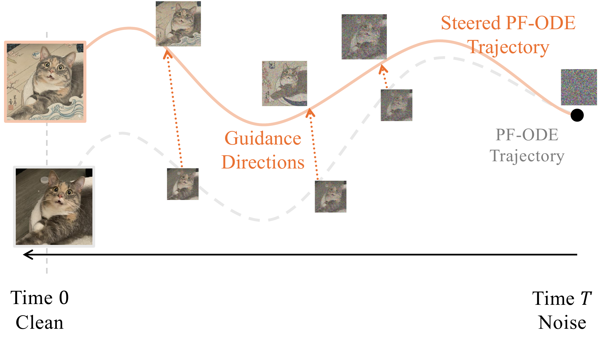

# 8.1 Prologue {#sec-prologue-guidance}

**Figure 8.1:** **Illustration of steered diffusion sampling.** Reverse-time PF-ODE sampling begins from pure noise at the right ($t = T$) and gradually evolves toward a clean sample at the left ($t = 0$). During this process, time-dependent guidance directions, weighted by $w_t$, modify the unconditional score field and steer the trajectory toward the desired attribute (Japanese painting style) while the sample is progressively refined from coarse to fine detail.

Source: Created by the authors.

The generation process of diffusion models proceeds in a coarse-to-fine manner, providing a flexible framework for controllable generation. At each step, a small amount of noise is removed and the sample becomes clearer, gradually revealing more structure and detail. This property enables control over the generation process: by adding a guidance term to the learned, time-dependent velocity field, we can steer the generative trajectory to reflect user intent.

A principled foundation for guidance-based sampling in diffusion models is the Bayesian decomposition of the conditional score. For each noise level $t$,

$$
\begin{aligned}
\nabla_{{\mathbf{x}}_t}\log p_t({\mathbf{x}}_t |{\mathbf{c}})
=
\underbrace{\nabla_{{\mathbf{x}}_t}\log p_t({\mathbf{x}}_t)}_{\text{unconditional direction}}
+
\underbrace{\nabla_{{\mathbf{x}}_t}\log p_t({\mathbf{c}} |{\mathbf{x}}_t)}_{\text{guidance direction}}.
\end{aligned}
\tag{8.1.1}
$$

This identity shows that the exact conditional reverse dynamics are obtained by adding the guidance term $\nabla_{{\mathbf{x}}_t}\log p_t({\mathbf{c}}|{\mathbf{x}}_t)$ on top of the unconditional score. We will see later on that classifier guidance ([Dhariwal and Nichol, 2021](references.md#ref-dhariwal2021diffusion)) estimates this term directly, classifier-free guidance ([Ho and Salimans, 2021](references.md#ref-ho2021classifier)) estimates it implicitly as the difference between jointly learned conditional and unconditional scores, and more general training-free methods may instead use a task-specific surrogate guidance direction.

With the exact conditional score, the PF-ODE becomes

$$
\begin{aligned}
    \frac{\mathop{}\!\mathrm{d} \mathbf{x}(t)}{\mathop{}\!\mathrm{d} t} &= f(t)\mathbf{x}(t) - \frac{1}{2} g^2(t) \underbrace{\nabla_{{\mathbf{x}}_t} \log p_t({\mathbf{x}}(t) |{\mathbf{c}})}_{\text{conditional score}} \\
    &= f(t)\mathbf{x}(t) - \frac{1}{2} g^2(t) \Big[ \nabla_{{\mathbf{x}}_t} \log p_t({\mathbf{x}}(t)) + \nabla_{{\mathbf{x}}_t} \log p_t({\mathbf{c}} |{\mathbf{x}}(t)) \Big].
\end{aligned}
\tag{8.1.2}
$$

With exact scores and exact integration, these dynamics recover $p_0({\mathbf{x}}_0|{\mathbf{c}})$ when initialized from the corresponding terminal marginal $p_T({\mathbf{x}}_T|{\mathbf{c}})$. In standard diffusion constructions, the terminal noising is chosen so that $p_T({\mathbf{x}}_T|{\mathbf{c}})$ is approximately matched by the usual condition-independent prior.

We formulate the discussion below in score prediction for clarity. Since the standard ${\mathbf{x}}$-, ${\boldsymbol{\epsilon}}$-, score-, and ${\mathbf{v}}$-prediction parameterizations are related by time-dependent linear transformations wherever these conversions are well-defined, the same guidance correction can be expressed in the other parameterizations using the relationships in [Equation (6.3.1)](../06-unified-perspective/03-equivalent-parameterizations.md#eq-predictions-equivalence).

**Instantiations of the Guidance Direction.**

1.  **Classifier Guidance (CG).** In [Section 8.2](02-classifier-guidance.md#sec-cg), classifier guidance (CG) trains a time-conditional classifier $p_{{\boldsymbol{\psi}}}({\mathbf{c}} | {\mathbf{x}}_t, t)$ on noised data ${\mathbf{x}}_t$ (obtained by corrupting clean labeled samples at level $t$). At sampling time, its input gradient provides the guidance term:

    $$
    \nabla_{{\mathbf{x}}_t}\log p_{{\boldsymbol{\psi}}}({\mathbf{c}} | {\mathbf{x}}_t, t)
     \approx  \nabla_{{\mathbf{x}}_t}\log p_t({\mathbf{c}} | {\mathbf{x}}_t),
    $$

    which is then added to the unconditional score ([Dhariwal and Nichol, 2021](references.md#ref-dhariwal2021diffusion)).

2.  **Classifier-Free Guidance (CFG).** In [Section 8.3](03-classifier-free-guidance.md#sec-cfg), CFG directly trains a single conditional model

    $$
    {\mathbf{s}}_{{\boldsymbol{\phi}}}({\mathbf{x}}_t,t,{\mathbf{c}}) \approx \nabla_{{\mathbf{x}}_t}\log p_t({\mathbf{x}}_t|{\mathbf{c}}),
    $$

    where the unconditional model is learned jointly by randomly replacing the condition with a special null token for a fraction of the training steps.

3.  **Training-Free (Surrogate) Guidance.** Under the standard forward noising construction, we first draw $({\mathbf{x}}_0,{\mathbf{c}})\sim p_{\mathrm{data}}$ and then sample ${\mathbf{x}}_t\sim p_t(\cdot|{\mathbf{x}}_0)$, where the forward kernel does not depend additionally on ${\mathbf{c}}$. Thus ${\mathbf{c}}\perp{\mathbf{x}}_t\mid{\mathbf{x}}_0$[^1]. Consequently,

    $$
    p_t({\mathbf{c}}|{\mathbf{x}}_t)
    =
    \int
    p({\mathbf{c}}|{\mathbf{x}}_0)\,
    p({\mathbf{x}}_0|{\mathbf{x}}_t)\,
    \mathrm d{\mathbf{x}}_0.
    $$

    This posterior average is generally intractable, motivating training-free methods that instead construct a task-specific surrogate guidance direction.

    In [Section 8.4.1](04-training-free-guidance.md#subsec-tfg), training-free (loss-based) guidance avoids evaluating the conditional likelihood $p_t({\mathbf{c}}|{\mathbf{x}}_t)$ directly. Instead, it starts from an off-the-shelf loss $\ell({\mathbf{x}}_t,{\mathbf{c}};t)$ that measures how well the current sample satisfies the desired condition, with smaller loss indicating better agreement. From this loss, we define the positive *guidance potential*

    $$
    {\mathbf{h}}_t({\mathbf{x}}_t;{\mathbf{c}})
    :=
    \exp\big(-\tau\,\ell({\mathbf{x}}_t,{\mathbf{c}};t)\big),
    \qquad \tau>0.
    $$

    Thus, lower-loss samples receive larger potential values. We denote the corresponding *guidance direction* by

    $$
    \mathcal{G}_t({\mathbf{x}}_t,{\mathbf{c}})
    :=
    \nabla_{{\mathbf{x}}_t}\log {\mathbf{h}}_t({\mathbf{x}}_t;{\mathbf{c}})
    =
    -\tau\nabla_{{\mathbf{x}}_t}\ell({\mathbf{x}}_t,{\mathbf{c}};t).
    $$

    Classifier guidance fits naturally into the same picture. At the population level, its guidance potential is

    $$
    {\mathbf{h}}_t({\mathbf{x}}_t;{\mathbf{c}})
    =
    p_t({\mathbf{c}}|{\mathbf{x}}_t),
    $$

    which is approximated in practice by the learned classifier $p_{{\boldsymbol{\psi}}^\times}({\mathbf{c}}|{\mathbf{x}}_t,t)$. Equivalently, the learned classifier corresponds to the loss

    $$
    \ell({\mathbf{x}}_t,{\mathbf{c}};t)
    =
    -\log p_{{\boldsymbol{\psi}}^\times}({\mathbf{c}}|{\mathbf{x}}_t,t),
    \qquad \tau=1.
    $$

At the population level, the three constructions above share the same additive guidance template. Given a positive potential ${\mathbf{h}}_t({\mathbf{x}}_t;{\mathbf{c}})$ and guidance strength $w_t\geq0$, define the guided score field

$$
\begin{aligned}
{\mathbf{s}}^{\mathrm{guide}}({\mathbf{x}}_t,t,{\mathbf{c}};w_t)
:=
\nabla_{{\mathbf{x}}_t}\log p_t({\mathbf{x}}_t)
+
w_t\mathcal{G}_t({\mathbf{x}}_t,{\mathbf{c}}).
\end{aligned}
\tag{8.1.3}
$$

For loss-based guidance, $\mathcal{G}_t({\mathbf{x}}_t,{\mathbf{c}}) =-\tau\nabla_{{\mathbf{x}}_t}\ell({\mathbf{x}}_t,{\mathbf{c}};t)$. For exact classifier guidance, $\mathcal{G}_t({\mathbf{x}}_t,{\mathbf{c}}) =\nabla_{{\mathbf{x}}_t}\log p_t({\mathbf{c}}|{\mathbf{x}}_t)$; classifier-free guidance expresses the same population guidance direction through the difference between conditional and unconditional scores.

At each fixed time $t$, [Equation (8.1.3)](01-prologue.md#eq-generic-guided-score) is, whenever normalizable, the score of the tilted density

$$
\widetilde p_t^{\mathrm{tilt}}({\mathbf{x}}_t|{\mathbf{c}})
\propto
p_t({\mathbf{x}}_t){\mathbf{h}}_t({\mathbf{x}}_t;{\mathbf{c}})^{w_t}.
$$

This gives a useful energy interpretation: the base density favors samples supported by the diffusion model, while the potential reweights them toward the desired condition.

In practice, the corresponding learned or surrogate version of [Equation (8.1.3)](01-prologue.md#eq-generic-guided-score) is inserted into the reverse-time dynamics. Importantly, the tilted density above is only a fixed-time interpretation: the family $\{\widetilde p_t^{\mathrm{tilt}}(\cdot|{\mathbf{c}})\}_t$ need not coincide with the marginals generated by the guided sampler. Consequently, for a generic loss or guidance schedule, integrating the guided PF-ODE from $T$ to $0$ does not in general produce samples distributed according to $\widetilde p_0^{\mathrm{tilt}}(\cdot|{\mathbf{c}})$. The additional cross-time consistency required for this interpretation to hold is discussed in [Section 8.4.2](04-training-free-guidance.md#subsec-guided-marginal-path).

The effect of guidance on the sampling trajectory is illustrated in [Figure 8.1](01-prologue.md#fig-guidance). The same principle can also be applied on top of an already conditional model, allowing additional control signals to modify its sampling dynamics.

**From Control to Better Alignment with Direct Preference Optimization.**

Strong control can be on-condition but off-preference: a sample may satisfy the conditioning signal (e.g., the prompt) yet deviate from what humans actually prefer. We formalize this by tilting the conditional target at $t=0$ by a preference rating:

$$
\widetilde p_0^{\mathrm{tilt}}({\mathbf{x}}_0|{\mathbf{c}})
\propto
p_0({\mathbf{x}}_0|{\mathbf{c}})
\exp\bigl(
\lambda_{\mathrm{pref}} r({\mathbf{x}}_0,{\mathbf{c}})
\bigr),
\qquad
\lambda_{\mathrm{pref}}>0,
$$

where $r({\mathbf{x}}_0,{\mathbf{c}})$ is a scalar alignment rating for a clean sample ${\mathbf{x}}_0$ and condition ${\mathbf{c}}$, with larger values indicating stronger preference, and $\lambda_{\mathrm{pref}}$ controls the strength of the preference reweighting. In the KL-regularized formulation introduced later, the optimizer takes this form with the reference policy as the base distribution and $\lambda_{\mathrm{pref}}=1/\beta$.

Existing methods for achieving such steerability typically collect human labels of the relative quality of model generations and fine-tune the conditional diffusion model to align with these preferences, often through reinforcement learning from human feedback (RLHF). However, RLHF is a complex and often unstable procedure: it first fits a reward model to capture human preferences, and then fine-tunes the conditional diffusion model with reinforcement learning to maximize this estimated reward while constraining policy drift from the original model.

This naturally raises the question: *can we remove the reward model training stage altogether?* We address this with Diffusion-DPO ([Wallace et al., 2024](references.md#ref-wallace2024diffusion)), an adaptation of Direct Preference Optimization ([Rafailov et al., 2023](references.md#ref-rafailov2023direct)) originally developed for large language models. As described in [Section 8.5](05-preference-alignment.md#sec-rlhf-dpo), Diffusion-DPO learns the preference tilt directly from pairwise choices, so the conditional diffusion model is fine-tuned to align to preferences without a separate reward model.

[^1]: Indeed,

    $$
    p_t({\mathbf{c}}|{\mathbf{x}}_t)
    =
    \int
    p({\mathbf{c}},{\mathbf{x}}_0|{\mathbf{x}}_t)\,\mathrm d{\mathbf{x}}_0
    =
    \int
    p({\mathbf{c}}|{\mathbf{x}}_0,{\mathbf{x}}_t)\,
    p({\mathbf{x}}_0|{\mathbf{x}}_t)\,\mathrm d{\mathbf{x}}_0.
    $$

    Because the standard forward kernel satisfies $p_t({\mathbf{x}}_t|{\mathbf{x}}_0,{\mathbf{c}})=p_t({\mathbf{x}}_t|{\mathbf{x}}_0)$, we have $p({\mathbf{c}}|{\mathbf{x}}_0,{\mathbf{x}}_t)=p({\mathbf{c}}|{\mathbf{x}}_0)$, which yields the expression below.
