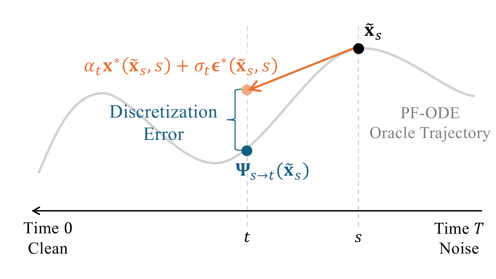

# 9.2 DDIM {#sec-revisit-ddim}

*Denoising Diffusion Implicit Models* (DDIM) ([Song et al., 2020](../../references.md#ref-song2020denoising)) is one of the earliest and most widely used methods for accelerating diffusion sampling. Although DDIM was originally introduced from a probabilistic perspective, its deterministic update also admits a particularly clean interpretation through the PF-ODE. We therefore introduce DDIM here under the common numerical ODE-solving umbrella of this chapter, and defer its original variational perspective to [Section 9.2.3](02-ddim.md#subsec-ddim).

The Prologue in [Section 9.1](01-prologue.md#sec-prologue-solvers) leaves us with a concrete numerical question: once the known schedule-dependent factors have been retained analytically, how should we approximate the neural prediction inside the remaining integral? DDIM takes the simplest possible answer: *use its value at the beginning of the step*. We first derive the resulting update, and then clarify its relation to classical Euler integration and to the higher-order diffusion solvers introduced later.

## 9.2.1 DDIM as a First-Order Diffusion Solver {#subsec-ddim-different-para}

Consider one sampling step from starting point[^1] $\tilde{\mathbf{x}}_s$ at time $s$ to $t<s$. Under noise prediction, [Equation (9.1.7)](01-prologue.md#eq-variation-of-constants) gives the exact empirical PF-ODE flow

$$
\begin{aligned}
\widetilde{\boldsymbol{\Psi}}_{s\to t}(\tilde{\mathbf{x}}_s)
=
\mathcal E(s\shortrightarrow t)\tilde{\mathbf{x}}_s
+
\frac{1}{2}
\int_s^t
\frac{g^2(\tau)}{\sigma_\tau}
\mathcal E(\tau\shortrightarrow t)
{\boldsymbol{\epsilon}}_{\boldsymbol{\phi}^\times}({\mathbf{x}}_\tau,\tau)
\mathop{}\!\mathrm{d}\tau .
\end{aligned}
$$

The schedule-dependent factors are known analytically; the only unknown quantity inside the integral is the neural prediction ${\boldsymbol{\epsilon}}_{\boldsymbol{\phi}^\times}({\mathbf{x}}_\tau,\tau)$ evaluated along the unknown trajectory.

From the PF-ODE viewpoint, deterministic DDIM uses the simplest first-order approximation: it holds the noise prediction fixed at its value at the beginning of the step,

$$
{\boldsymbol{\epsilon}}_{\boldsymbol{\phi}^\times}({\mathbf{x}}_\tau,\tau)
\approx
{\boldsymbol{\epsilon}}_{\boldsymbol{\phi}^\times}(\tilde{\mathbf{x}}_s,s),\quad\text{for}\quad \tau\in[t,s],
$$

while retaining the known schedule-dependent factors inside the integral. This gives

$$
\begin{aligned}
\tilde{\mathbf{x}}_t
=
\mathcal E(s\shortrightarrow t)\tilde{\mathbf{x}}_s
+
\left[
\frac{1}{2}
\int_s^t
\frac{g^2(\tau)}{\sigma_\tau}
\mathcal E(\tau\shortrightarrow t)
\mathop{}\!\mathrm{d}\tau
\right]
{\boldsymbol{\epsilon}}_{\boldsymbol{\phi}^\times}(\tilde{\mathbf{x}}_s,s).
\end{aligned}
$$

Using $f(t)=\alpha_t'/\alpha_t$, the integrating factor simplifies to $\mathcal E(s\shortrightarrow t)=\alpha_t/\alpha_s$. The remaining schedule-dependent coefficient also has a convenient closed form: $\tfrac{1}{2}\tfrac{g^2(\tau)}{\sigma_\tau} \mathcal E(\tau\shortrightarrow t) = \alpha_t \tfrac{\mathop{}\!\mathrm{d}}{\mathop{}\!\mathrm{d}\tau} \bigl(\tfrac{\sigma_\tau}{\alpha_\tau}\bigr)$. Therefore, once the neural prediction is held fixed over the step, the remaining integral can be evaluated exactly from the noise schedule.

**Proposition 9.2.1: DDIM as a First-Order Factored EI Update**

For $s>t$, deterministic DDIM gives

$$
\begin{aligned}
\tilde{\mathbf{x}}_t
=
\frac{\alpha_t}{\alpha_s}\tilde{\mathbf{x}}_s
+
\alpha_t
\left(
\frac{\sigma_t}{\alpha_t}
-
\frac{\sigma_s}{\alpha_s}
\right)
{\boldsymbol{\epsilon}}_{\boldsymbol{\phi}^\times}(\tilde{\mathbf{x}}_s,s).
\end{aligned}
\tag{9.2.1}
$$

**Proof for Proposition.**

The result follows by integrating $\frac{\mathop{}\!\mathrm{d}}{\mathop{}\!\mathrm{d}\tau}(\sigma_\tau/\alpha_\tau)$ from $s$ to $t$.

The approximation made by DDIM is therefore very specific: the known schedule evolution is retained over the full interval, while only the change of the neural prediction is neglected.

There is an analogous derivation under clean-data prediction. The exact empirical PF-ODE flow can be written as

$$
\begin{aligned}
\widetilde{\boldsymbol{\Psi}}_{s\to t}(\tilde{\mathbf{x}}_s)
=
\frac{\sigma_t}{\sigma_s}\tilde{\mathbf{x}}_s
+
\sigma_t
\int_s^t
\frac{\mathop{}\!\mathrm{d}}{\mathop{}\!\mathrm{d}\tau}
\left(
\frac{\alpha_\tau}{\sigma_\tau}
\right)
{\mathbf{x}}_{\boldsymbol{\phi}^\times}({\mathbf{x}}_\tau,\tau)
\mathop{}\!\mathrm{d}\tau.
\end{aligned}
$$

Using the same first-order approximation as above, we hold ${\mathbf{x}}_{\boldsymbol{\phi}^\times}({\mathbf{x}}_\tau,\tau)$ fixed at its value at time $s$. The remaining schedule-dependent integral is then evaluated exactly, giving

$$
\tilde{\mathbf{x}}_t
=
\frac{\sigma_t}{\sigma_s}\tilde{\mathbf{x}}_s
+
\alpha_s
\left(
\frac{\alpha_t}{\alpha_s}
-
\frac{\sigma_t}{\sigma_s}
\right)
{\mathbf{x}}_{\boldsymbol{\phi}^\times}(\tilde{\mathbf{x}}_s,s).
$$

Thus, freezing either the noise prediction in the noise-prediction PF-ODE or the clean-data prediction in the clean-data PF-ODE produces the same DDIM update. This correspondence will reappear later in DPM-Solver and DPM-Solver`++`, which build higher-order approximations from the noise- and clean-data-prediction formulations, respectively.

**Equivalent Forms and Interpretation.** At the oracle level, the standard prediction targets are pointwise algebraically equivalent through [Equation (6.3.1)](../06-unified-perspective/03-equivalent-parameterizations.md#eq-predictions-equivalence). Therefore, the deterministic DDIM update derived above from noise prediction can be rewritten at the starting point $s$ in terms of clean-data or score prediction without changing the finite-step update. The following corollary collects these equivalent expressions.

**Corollary 9.2.1: Equivalent Forms of the Deterministic DDIM Update**

Let $s>t$, and consider a state $\tilde{\mathbf{x}}_s$ at time $s$. The oracle deterministic DDIM update admits the equivalent expressions

$$
\begin{aligned}
\tilde{\mathbf{x}}_t
&=
\frac{\alpha_t}{\alpha_s}\tilde{\mathbf{x}}_s
+
\alpha_t
\left(
\frac{\sigma_t}{\alpha_t}
-
\frac{\sigma_s}{\alpha_s}
\right)
{\boldsymbol{\epsilon}}^*(\tilde{\mathbf{x}}_s,s)
\\
&=
\frac{\sigma_t}{\sigma_s}\tilde{\mathbf{x}}_s
+
\alpha_s
\left(
\frac{\alpha_t}{\alpha_s}
-
\frac{\sigma_t}{\sigma_s}
\right)
{\mathbf{x}}^*(\tilde{\mathbf{x}}_s,s)
\\
&=
\frac{\alpha_t}{\alpha_s}\tilde{\mathbf{x}}_s
+
\sigma_s^2
\left(
\frac{\alpha_t}{\alpha_s}
-
\frac{\sigma_t}{\sigma_s}
\right)
{\mathbf{s}}^*(\tilde{\mathbf{x}}_s,s)
\\
&=
\alpha_t
\underset{\substack{
\approx{\mathbf{x}}_{\boldsymbol{\phi}^\times}\\
\text{estimated clean}
}}{
\underbrace{{\mathbf{x}}^*(\tilde{\mathbf{x}}_s,s)}
}
+
\sigma_t
\underset{\substack{
\approx{\boldsymbol{\epsilon}}_{\boldsymbol{\phi}^\times}\\
\text{estimated noise}
}}{
\underbrace{{\boldsymbol{\epsilon}}^*(\tilde{\mathbf{x}}_s,s)}
}.
\end{aligned}
\tag{9.2.2}
$$

The last identity in [Equation (9.2.2)](02-ddim.md#eq-ddim-update-all) gives a particularly intuitive view of DDIM. Starting from $\tilde{\mathbf{x}}_s$, DDIM keeps the clean and noise estimates inferred at time $s$ fixed and recombines them using the target schedule coefficients:

$$
\tilde{\mathbf{x}}_t
=
\alpha_t{\mathbf{x}}^*(\tilde{\mathbf{x}}_s,s)
+
\sigma_t{\boldsymbol{\epsilon}}^*(\tilde{\mathbf{x}}_s,s).
$$

This mirrors the shared-noise coupling of the forward Gaussian path, ${\mathbf{x}}_\tau=\alpha_\tau{\mathbf{x}}_0+\sigma_\tau{\boldsymbol{\epsilon}}$: conditioned on a fixed pair $({\mathbf{x}}_0,{\boldsymbol{\epsilon}})$, moving from one time to another changes only the coefficients $(\alpha_\tau,\sigma_\tau)$. DDIM applies the same idea using the clean and noise estimates available at the beginning of the step.

At the conditional level, where ${\mathbf{x}}_0$ and ${\boldsymbol{\epsilon}}$ are fixed, this recombination follows the corresponding shared-noise path exactly. At the marginal level, however, ${\mathbf{x}}^*(\tilde{\mathbf{x}}_s,s)$ and ${\boldsymbol{\epsilon}}^*(\tilde{\mathbf{x}}_s,s)$ are posterior estimates inferred from $\tilde{\mathbf{x}}_s$. Consequently, a finite DDIM step is generally an approximation to the marginal PF-ODE flow, rather than an exact draw from $p_t$.

**Figure 9.1:** **Finite-step DDIM versus the empirical PF-ODE flow.** Starting from $\tilde{\mathbf{x}}_s$, the empirical PF-ODE evolves continuously to $\widetilde{\boldsymbol{\Psi}}_{s\to t}(\tilde{\mathbf{x}}_s)$, whereas DDIM retains the start-time neural prediction over the whole interval while evolving the known schedule analytically. Their discrepancy is the one-step discretization error in [Equation (9.2.3)](02-ddim.md#eq-ddim-local-defect).

Source: Created by the authors.

**Why Does the Prediction Held Fixed Matter?** At any fixed state and time, the standard prediction parameterizations are algebraically equivalent through [Equation (6.3.1)](../06-unified-perspective/03-equivalent-parameterizations.md#eq-predictions-equivalence). A finite-step solver, however, introduces an additional approximation by holding one chosen prediction fixed over an interval. Such a freezing approximation is preserved under a change of parameterization only when the converted prediction also remains constant along the resulting approximate trajectory.

DDIM provides a particularly clean example. Let

$$
\widehat{\mathbf{x}}_0
:=
{\mathbf{x}}_{\boldsymbol{\phi}^\times}(\tilde{\mathbf{x}}_s,s),
\qquad
\widehat{\boldsymbol{\epsilon}}
:=
{\boldsymbol{\epsilon}}_{\boldsymbol{\phi}^\times}(\tilde{\mathbf{x}}_s,s),
$$

where, if only one quantity is directly predicted by the model, the other is defined by the algebraic conversion in [Equation (6.3.1)](../06-unified-perspective/03-equivalent-parameterizations.md#eq-predictions-equivalence). Hence, by construction, $\tilde{\mathbf{x}}_s=\alpha_s\widehat{\mathbf{x}}_0+\sigma_s\widehat{\boldsymbol{\epsilon}}$.

Holding this start-time clean/noise pair fixed defines the DDIM interpolation over the entire step:

$$
\tilde{\mathbf{x}}_\tau^{\mathrm{DDIM}}
=
\alpha_\tau\widehat{\mathbf{x}}_0
+
\sigma_\tau\widehat{\boldsymbol{\epsilon}},
\qquad
\tau\in[t,s].
$$

This requires no additional model evaluations: once $(\widehat{\mathbf{x}}_0,\widehat{\boldsymbol{\epsilon}})$ is fixed at time $s$, the schedule coefficients $(\alpha_\tau,\sigma_\tau)$ are known for every intermediate $\tau$. At $\tau=s$ the expression recovers the starting state, while at $\tau=t$ it gives the DDIM update. The intermediate values simply describe the finite-step trajectory induced by the DDIM approximation.

The special role of noise and clean-data prediction is now immediate. Along this trajectory,

$$
\frac{
\tilde{\mathbf{x}}_\tau^{\mathrm{DDIM}}
-
\sigma_\tau\widehat{\boldsymbol{\epsilon}}
}{
\alpha_\tau
}
=
\widehat{\mathbf{x}}_0,
\qquad
\frac{
\tilde{\mathbf{x}}_\tau^{\mathrm{DDIM}}
-
\alpha_\tau\widehat{\mathbf{x}}_0
}{
\sigma_\tau
}
=
\widehat{\boldsymbol{\epsilon}}.
$$

Thus, the algebraically converted clean and noise predictions remain constant together along the DDIM trajectory. Consequently, holding ${\boldsymbol{\epsilon}}_{\boldsymbol{\phi}^\times}({\mathbf{x}}_\tau,\tau) \approx{\boldsymbol{\epsilon}}_{\boldsymbol{\phi}^\times}(\tilde{\mathbf{x}}_s,s)$ or holding ${\mathbf{x}}_{\boldsymbol{\phi}^\times}({\mathbf{x}}_\tau,\tau) \approx{\mathbf{x}}_{\boldsymbol{\phi}^\times}(\tilde{\mathbf{x}}_s,s)$ leads to the same DDIM update. In this sense, $\widehat{\mathbf{x}}_0$ and $\widehat{\boldsymbol{\epsilon}}$ are the two fixed components of the DDIM shared-noise path, while $(\alpha_\tau,\sigma_\tau)$ provide the known time-dependent weights.

However, score and velocity behave differently. DDIM keeps the inferred clean/noise pair $(\widehat{\mathbf{x}}_0,\widehat{\boldsymbol{\epsilon}})$ fixed, but the score and velocity obtained from this pair generally change with time.

For example, converting the fixed (at time $s$) noise estimate to score prediction at an intermediate time $\tau$ gives

$$
{\mathbf{s}}(\tilde{\mathbf{x}}_\tau^{\mathrm{DDIM}},\tau)
=
-\frac{\widehat{\boldsymbol{\epsilon}}}{\sigma_\tau}
=
\frac{\sigma_s}{\sigma_\tau}
{\mathbf{s}}_{\boldsymbol{\phi}^\times}(\tilde{\mathbf{x}}_s,s).
$$

Thus, even though $\widehat{\boldsymbol{\epsilon}}$ is fixed, its corresponding score generally varies with $\tau$ through the factor $1/\sigma_\tau$. Directly imposing

$$
{\mathbf{s}}_{\boldsymbol{\phi}^\times}({\mathbf{x}}_\tau,\tau)
\approx
{\mathbf{s}}_{\boldsymbol{\phi}^\times}(\tilde{\mathbf{x}}_s,s),
\qquad
\tau\in[t,s],
$$

therefore makes a different finite-step approximation and generally yields a different first-order factored solver. Similarly, the fixed clean/noise pair induces the velocity

$$
\frac{\mathop{}\!\mathrm{d}}{\mathop{}\!\mathrm{d}\tau}
\tilde{\mathbf{x}}_\tau^{\mathrm{DDIM}}
=
\alpha_\tau'\widehat{\mathbf{x}}_0
+
\sigma_\tau'\widehat{\boldsymbol{\epsilon}}.
$$

This velocity generally changes with $\tau$ because the schedule derivatives $\alpha_\tau'$ and $\sigma_\tau'$ change. Holding the raw velocity prediction fixed instead, ${\mathbf{v}}_{\boldsymbol{\phi}^\times}({\mathbf{x}}_\tau,\tau) \approx {\mathbf{v}}_{\boldsymbol{\phi}^\times}(\tilde{\mathbf{x}}_s,s)$, gives plain Euler in the original diffusion time; its relation to DDIM is discussed in [Section 9.2.2](02-ddim.md#subsec-ddim-classical-euler).

**Remark.**

Prediction parameterizations are pointwise algebraically equivalent, but finite-step freezing need not commute with a time-dependent conversion. DDIM keeps a consistent start-time clean/noise pair fixed; the corresponding score and complete velocity generally vary over the step. Hence directly freezing the raw score or velocity defines a different first-order method. The velocity case is quantified in [Section 9.2.2](02-ddim.md#subsec-ddim-classical-euler).

## 9.2.2 Relation to Euler-Type Methods {#subsec-ddim-classical-euler}

The discussion above shows that DDIM is a first-order method, but its relation to the classical Euler method requires some care. Once the known diffusion schedule is separated from the learned prediction, different first-order schemes arise depending on *what is held fixed over a finite step*.

We compare three one-evaluation constructions:

1.  *plain Euler*, which holds the complete PF-ODE velocity fixed;

2.  *exponential Euler*, which treats the known linear propagation analytically but holds the remaining coefficient-weighted residual fixed;

3.  *DDIM*, which keeps the start-time clean/noise estimates fixed while retaining their finite-step evolution under the known diffusion schedule.

These distinctions are easiest to see from two equivalent views of the same DDIM update. The clean/noise form makes its difference from plain Euler transparent, whereas the factored semilinear form clarifies its relation to exponential Euler. We then identify the remaining discretization error and show the precise sense in which DDIM itself can be viewed as an Euler method after a schedule-aligned change of coordinates.

**DDIM versus Plain Euler.** DDIM and plain Euler use the same start-time model information, but propagate it differently over a finite step. Plain Euler locally approximates the complete PF-ODE velocity, whereas DDIM retains the finite-step evolution of the known diffusion schedule while holding the model prediction fixed. Consequently, for smooth schedules, the two updates agree to first order and generally differ by terms of order $\mathcal O((\Delta s)^2)$. We make this difference explicit below.

Consider one backward step from time $s$ to $t<s$, with $\Delta s:=s-t>0$, and suppose the start-time clean and noise predictions are algebraically consistent:

$$
\tilde{\mathbf{x}}_s
=
\alpha_s
{\mathbf{x}}_{\boldsymbol{\phi}^\times}(\tilde{\mathbf{x}}_s,s)
+
\sigma_s
{\boldsymbol{\epsilon}}_{\boldsymbol{\phi}^\times}(\tilde{\mathbf{x}}_s,s).
$$

The corresponding empirical PF-ODE velocity at time $s$ is

$$
{\mathbf{v}}_{\boldsymbol{\phi}^\times}(\tilde{\mathbf{x}}_s,s)
=
\alpha_s'
{\mathbf{x}}_{\boldsymbol{\phi}^\times}(\tilde{\mathbf{x}}_s,s)
+
\sigma_s'
{\boldsymbol{\epsilon}}_{\boldsymbol{\phi}^\times}(\tilde{\mathbf{x}}_s,s).
$$

Plain Euler holds this complete velocity fixed over the step, $\tau\in[t,s]$, and gives:

$$
\tilde{\mathbf{x}}_t^{\mathrm{Euler}}
=
\tilde{\mathbf{x}}_s
-
\Delta s\,
{\mathbf{v}}_{\boldsymbol{\phi}^\times}(\tilde{\mathbf{x}}_s,s).
$$

By contrast, DDIM keeps the clean/noise-prediction pair at the starting time fixed, while evolving the known schedule coefficients from $(\alpha_s,\sigma_s)$ to $(\alpha_t,\sigma_t)$:

$$
\tilde{\mathbf{x}}_t^{\mathrm{DDIM}}
=
\tilde{\mathbf{x}}_s
+
(\alpha_t-\alpha_s)
{\mathbf{x}}_{\boldsymbol{\phi}^\times}(\tilde{\mathbf{x}}_s,s)
+
(\sigma_t-\sigma_s)
{\boldsymbol{\epsilon}}_{\boldsymbol{\phi}^\times}(\tilde{\mathbf{x}}_s,s).
$$

Their exact finite-step difference is therefore

$$
\begin{aligned}
\tilde{\mathbf{x}}_t^{\mathrm{DDIM}}
-
\tilde{\mathbf{x}}_t^{\mathrm{Euler}}
={}&
\left[
\alpha_t-\alpha_s+\Delta s\,\alpha_s'
\right]
{\mathbf{x}}_{\boldsymbol{\phi}^\times}(\tilde{\mathbf{x}}_s,s)
+
\left[
\sigma_t-\sigma_s+\Delta s\,\sigma_s'
\right]
{\boldsymbol{\epsilon}}_{\boldsymbol{\phi}^\times}(\tilde{\mathbf{x}}_s,s).
\end{aligned}
$$

For smooth schedules,

$$
\alpha_t-\alpha_s+\Delta s\,\alpha_s'
=
\tfrac{(\Delta s)^2}{2}\alpha_s''
+
\mathcal O((\Delta s)^3), \quad
\sigma_t-\sigma_s+\Delta s\,\sigma_s'
=
\tfrac{(\Delta s)^2}{2}\sigma_s''
+
\mathcal O((\Delta s)^3).
$$

Hence,

$$
\begin{aligned}
\tilde{\mathbf{x}}_t^{\mathrm{DDIM}}
-
\tilde{\mathbf{x}}_t^{\mathrm{Euler}}
=
\tfrac{(\Delta s)^2}{2}
\left[
\alpha_s''
{\mathbf{x}}_{\boldsymbol{\phi}^\times}(\tilde{\mathbf{x}}_s,s)
+
\sigma_s''
{\boldsymbol{\epsilon}}_{\boldsymbol{\phi}^\times}(\tilde{\mathbf{x}}_s,s)
\right]
+
\mathcal O((\Delta s)^3).
\end{aligned}
$$

Thus, DDIM and plain Euler agree to first order but generally differ over a finite step. Plain Euler replaces the finite schedule changes $(\alpha_t-\alpha_s,\sigma_t-\sigma_s)$ by their local linearizations, whereas DDIM retains the finite schedule evolution analytically.

A useful special case follows immediately. If both $\alpha_\tau$ and $\sigma_\tau$ are *affine in $\tau$ over $[t,s]$*, then

$$
\alpha_t-\alpha_s=-\Delta s\,\alpha_s',
\qquad
\sigma_t-\sigma_s=-\Delta s\,\sigma_s',
$$

so DDIM and plain Euler coincide exactly. This includes, for example, the schedules (see also discussion in [Section 6.3.4](../06-unified-perspective/03-equivalent-parameterizations.md#subsec-concept-why-v-affine))

$$
(\alpha_t,\sigma_t)=(1,t)\quad \text{and}\quad (\alpha_t,\sigma_t)=(1-t,t) .
$$

Thus, the finite-step distinction between the two methods is driven by the nonlinearity of the known schedule in the original diffusion time.

**DDIM versus Exponential Euler.** The comparison above used the clean/noise representation to show how DDIM differs from plain Euler in the original diffusion time. We now return to the semilinear representation from the prologue to distinguish DDIM from conventional exponential Euler. The difference is simple: both methods retain the known linear evolution analytically, but they hold different quantities fixed inside the remaining integral.

Under noise prediction, the factored PF-ODE in [Equation (9.1.4)](01-prologue.md#eq-general-semilinear-pfode) has

$$
a(\tau)=f(\tau),
\qquad
b(\tau)=\frac{g^2(\tau)}{2\sigma_\tau},
\qquad
{\mathbf{N}}_{\boldsymbol{\phi}^\times}
=
{\boldsymbol{\epsilon}}_{\boldsymbol{\phi}^\times}.
$$

Its exact variation-of-constants formula contains the model-dependent term

$$
b(\tau){\boldsymbol{\epsilon}}_{\boldsymbol{\phi}^\times}({\mathbf{x}}_\tau,\tau).
$$

Conventional exponential Euler treats this coefficient-weighted quantity as a single residual and holds the whole residual fixed at the beginning of the step:

$$
b(\tau){\boldsymbol{\epsilon}}_{\boldsymbol{\phi}^\times}({\mathbf{x}}_\tau,\tau)
\approx
b(s){\boldsymbol{\epsilon}}_{\boldsymbol{\phi}^\times}(\tilde{\mathbf{x}}_s,s), \quad\tau\in[t,s]
$$

It therefore gives

$$
\tilde{\mathbf{x}}_t^{\mathrm{ExpEuler}}
=
\mathcal E(s\shortrightarrow t)\tilde{\mathbf{x}}_s
+
b(s)
\left[
\int_s^t
\mathcal E(\tau\shortrightarrow t)
\mathop{}\!\mathrm{d}\tau
\right]
{\boldsymbol{\epsilon}}_{\boldsymbol{\phi}^\times}(\tilde{\mathbf{x}}_s,s).
$$

DDIM uses the finer factorization emphasized in the prologue. Since $b(\tau)$ is known from the diffusion schedule, it remains inside the integral; only the neural prediction is held fixed:

$$
{\boldsymbol{\epsilon}}_{\boldsymbol{\phi}^\times}({\mathbf{x}}_\tau,\tau)
\approx
{\boldsymbol{\epsilon}}_{\boldsymbol{\phi}^\times}(\tilde{\mathbf{x}}_s,s).
$$

Hence,

$$
\tilde{\mathbf{x}}_t^{\mathrm{DDIM}}
=
\mathcal E(s\shortrightarrow t)\tilde{\mathbf{x}}_s
+
\left[
\int_s^t
\mathcal E(\tau\shortrightarrow t)b(\tau)
\mathop{}\!\mathrm{d}\tau
\right]
{\boldsymbol{\epsilon}}_{\boldsymbol{\phi}^\times}(\tilde{\mathbf{x}}_s,s).
$$

The finite-step difference between the two updates therefore comes entirely from the known coefficient $b(\tau)$:

$$
\tilde{\mathbf{x}}_t^{\mathrm{DDIM}}
-
\tilde{\mathbf{x}}_t^{\mathrm{ExpEuler}}
=
\left[
\int_s^t
\mathcal E(\tau\shortrightarrow t)
\bigl(b(\tau)-b(s)\bigr)
\mathop{}\!\mathrm{d}\tau
\right]
{\boldsymbol{\epsilon}}_{\boldsymbol{\phi}^\times}(\tilde{\mathbf{x}}_s,s).
$$

For smooth $b$,

$$
\tilde{\mathbf{x}}_t^{\mathrm{DDIM}}
-
\tilde{\mathbf{x}}_t^{\mathrm{ExpEuler}}
=
\frac{(\Delta s)^2}{2}
b'(s)
{\boldsymbol{\epsilon}}_{\boldsymbol{\phi}^\times}(\tilde{\mathbf{x}}_s,s)
+
\mathcal O((\Delta s)^3).
$$

Thus, DDIM and conventional exponential Euler agree to first order. The only difference is that exponential Euler freezes $b(\tau)$ at $b(s)$ together with the neural prediction, while DDIM keeps the known variation of $b(\tau)$. Therefore, the two updates coincide exactly whenever $b(\tau)$ is constant over the step, including the constant-$b$ setting used in the Prologue example.

Together with the preceding plain-Euler comparison, the three first-order rules differ only in how much known structure is retained before making the constant approximation on $\tau\in[t,s]$:

$$
\begin{array}{rcl}
\text{Plain Euler}
&:&
f(\tau){\mathbf{x}}_\tau+b(\tau){\boldsymbol{\epsilon}}_\tau
\;\approx\;
f(s)\tilde{\mathbf{x}}_s+b(s)\widehat{\boldsymbol{\epsilon}},
\\[4pt]
\text{Exponential Euler}
&:&
b(\tau){\boldsymbol{\epsilon}}_\tau
\;\approx\;
b(s)\widehat{\boldsymbol{\epsilon}},
\\[4pt]
\text{DDIM}
&:&
{\boldsymbol{\epsilon}}_\tau
\;\approx\;
\widehat{\boldsymbol{\epsilon}},
\end{array}
$$

where $\widehat{\boldsymbol{\epsilon}} := {\boldsymbol{\epsilon}}_{\boldsymbol{\phi}^\times}(\tilde{\mathbf{x}}_s,s)$. All three use the same single neural-network evaluation at the beginning of the step. Plain Euler approximates the complete velocity; exponential Euler first retains the known linear propagation; DDIM additionally retains the known coefficient $b(\tau)$ and approximates only the neural prediction.

This hierarchy concerns which analytically known terms are preserved, rather than a universal ordering of one-step errors. Its main numerical consequence is that the remaining approximation in DDIM can be isolated entirely to the variation of the neural prediction, as we show next.

**What Error Does Each Method Still Make?** The comparisons above describe how the three numerical updates differ from one another. We now compare each update with the exact empirical PF-ODE flow. For this local-error analysis, suppose the step starts from an exact empirical state ${\mathbf{x}}_s$ at time $s$.

For plain Euler, the exact empirical flow can be written in the direct velocity form as

$$
\widetilde{\boldsymbol{\Psi}}_{s\to t}({\mathbf{x}}_s)
=
{\mathbf{x}}_s
+
\int_s^t
{\mathbf{v}}_{\boldsymbol{\phi}^\times}({\mathbf{x}}_\tau,\tau)
\mathop{}\!\mathrm{d}\tau.
$$

Since plain Euler holds the complete velocity fixed at its start-time value, its exact one-step defect is

$$
\begin{aligned}
\widetilde{\boldsymbol{\Psi}}_{s\to t}({\mathbf{x}}_s)
-
\tilde{\mathbf{x}}_t^{\mathrm{Euler}}
=
\int_s^t
\Big[
{\mathbf{v}}_{\boldsymbol{\phi}^\times}({\mathbf{x}}_\tau,\tau)
-
{\mathbf{v}}_{\boldsymbol{\phi}^\times}({\mathbf{x}}_s,s)
\Big]
\mathop{}\!\mathrm{d}\tau.
\end{aligned}
$$

For exponential Euler, the known linear propagation is already treated analytically, but the coefficient-weighted residual $b(\tau){\boldsymbol{\epsilon}}_{\boldsymbol{\phi}^\times}({\mathbf{x}}_\tau,\tau)$ is held fixed. Hence

$$
\begin{aligned}
\widetilde{\boldsymbol{\Psi}}_{s\to t}({\mathbf{x}}_s)
-
\tilde{\mathbf{x}}_t^{\mathrm{ExpEuler}}
=
\int_s^t
\mathcal E(\tau\shortrightarrow t)
\Big[
b(\tau)
{\boldsymbol{\epsilon}}_{\boldsymbol{\phi}^\times}({\mathbf{x}}_\tau,\tau)
-
b(s)
{\boldsymbol{\epsilon}}_{\boldsymbol{\phi}^\times}({\mathbf{x}}_s,s)
\Big]
\mathop{}\!\mathrm{d}\tau.
\end{aligned}
$$

Finally, DDIM retains both the known linear propagation and the known coefficient $b(\tau)$, and holds only the neural prediction fixed:

$$
\begin{aligned}
\widetilde{\boldsymbol{\Psi}}_{s\to t}({\mathbf{x}}_s)
-
\tilde{\mathbf{x}}_t^{\mathrm{DDIM}}
=
\int_s^t
\mathcal E(\tau\shortrightarrow t)b(\tau)
\Big[
{\boldsymbol{\epsilon}}_{\boldsymbol{\phi}^\times}({\mathbf{x}}_\tau,\tau)
-
{\boldsymbol{\epsilon}}_{\boldsymbol{\phi}^\times}({\mathbf{x}}_s,s)
\Big]
\mathop{}\!\mathrm{d}\tau.
\end{aligned}
\tag{9.2.3}
$$

These identities reveal the relevant notion of smoothness for each first-order scheme. If the corresponding quantity varies slowly along the exact empirical trajectory, then the one-step approximation is accurate. More precisely, with $\Delta s:=s-t$, standard smoothness gives

$$
\begin{aligned}
\left\|
\widetilde{\boldsymbol{\Psi}}_{s\to t}({\mathbf{x}}_s)
-
\tilde{\mathbf{x}}_t^{\mathrm{Euler}}
\right\|
&\le
\frac{(\Delta s)^2}{2}
\sup_{\tau\in[t,s]}
\left\|
\tfrac{\mathop{}\!\mathrm{d}}{\mathop{}\!\mathrm{d}\tau}
{\mathbf{v}}_{\boldsymbol{\phi}^\times}({\mathbf{x}}_\tau,\tau)
\right\|,
\\
\left\|
\widetilde{\boldsymbol{\Psi}}_{s\to t}({\mathbf{x}}_s)
-
\tilde{\mathbf{x}}_t^{\mathrm{ExpEuler}}
\right\|
&\le
\frac{(\Delta s)^2}{2}
\sup_{\tau\in[t,s]}
\left|
\mathcal E(\tau\shortrightarrow t)
\right|\cdot
\sup_{\tau\in[t,s]}
\left\|
\tfrac{\mathop{}\!\mathrm{d}}{\mathop{}\!\mathrm{d}\tau}
\left[
b(\tau)
{\boldsymbol{\epsilon}}_{\boldsymbol{\phi}^\times}({\mathbf{x}}_\tau,\tau)
\right]
\right\|,
\\
\left\|
\widetilde{\boldsymbol{\Psi}}_{s\to t}({\mathbf{x}}_s)
-
\tilde{\mathbf{x}}_t^{\mathrm{DDIM}}
\right\|
&\le
\frac{(\Delta s)^2}{2}
\sup_{\tau\in[t,s]}
\left|
\mathcal E(\tau\shortrightarrow t)b(\tau)
\right| \cdot
\sup_{\tau\in[t,s]}
\left\|
\tfrac{\mathop{}\!\mathrm{d}}{\mathop{}\!\mathrm{d}\tau}
{\boldsymbol{\epsilon}}_{\boldsymbol{\phi}^\times}({\mathbf{x}}_\tau,\tau)
\right\|.
\end{aligned}
$$

Under the usual smoothness and stability assumptions, all three methods are *globally first order* and require only one neural-network evaluation per step. Moreover, each method is exact on a step when the quantity it holds fixed is in fact constant along the exact empirical trajectory: the complete PF-ODE velocity for plain Euler, the coefficient-weighted residual $b(\tau){\boldsymbol{\epsilon}}_{\boldsymbol{\phi}^\times}({\mathbf{x}}_\tau,\tau)$ for exponential Euler, and the noise prediction ${\boldsymbol{\epsilon}}_{\boldsymbol{\phi}^\times}({\mathbf{x}}_\tau,\tau)$ for DDIM.

Accordingly, there is no universal error ordering among the three methods: each is most accurate when the quantity it holds fixed varies slowly over the step. DDIM is particularly well suited to regimes where the neural prediction changes slowly but the known diffusion schedule changes appreciably, since it retains the latter analytically. Exploiting more known structure can therefore reduce discretization error, but does not guarantee a smaller error on every individual step.

The errors discussed here are numerical discretization errors relative to the empirical PF-ODE; model mismatch between the empirical and oracle PF-ODEs is a separate source of error.

**A Precise Euler Interpretation of DDIM.** Although DDIM and plain Euler agree to first order, they generally give different finite-step updates in the original state ${\mathbf{x}}$ and diffusion time $t$. There is, however, an exact Euler interpretation after a schedule-aligned change of both the state and the time coordinate.

Under noise prediction, define

$$
{\mathbf{y}}_t
:=
\frac{{\mathbf{x}}_t}{\alpha_t},
\qquad
\rho_t
:=
\frac{\sigma_t}{\alpha_t}.
$$

The two transformations play complementary roles. The state normalization ${\mathbf{x}}_t\mapsto{\mathbf{x}}_t/\alpha_t$ factors out the known signal scaling $\alpha_t$, while the new clock $\rho_t=\sigma_t/\alpha_t$ measures progress by the noise-to-signal ratio rather than by the original diffusion time.

To see this first at the conditional level, consider a fixed pair $({\mathbf{x}}_0,{\boldsymbol{\epsilon}})$ in the Gaussian perturbation path

$$
{\mathbf{x}}_t
=
\alpha_t{\mathbf{x}}_0+\sigma_t{\boldsymbol{\epsilon}},
\qquad
{\boldsymbol{\epsilon}}\sim\mathcal N(\mathbf 0,\mathbf I).
$$

Here, ${\boldsymbol{\epsilon}}$ is a fixed latent noise realization, not a neural prediction. The transformed state satisfies

$$
{\mathbf{y}}_t
=
\frac{{\mathbf{x}}_t}{\alpha_t}
=
{\mathbf{x}}_0+\rho_t{\boldsymbol{\epsilon}}.
$$

Hence, along this particular conditional path,

$$
\frac{\mathop{}\!\mathrm{d}{\mathbf{y}}}{\mathop{}\!\mathrm{d}\rho}
=
{\boldsymbol{\epsilon}}.
$$

Thus, for fixed $({\mathbf{x}}_0,{\boldsymbol{\epsilon}})$, the known schedule dependence becomes affine in the transformed coordinate $\rho$.

The corresponding empirical PF-ODE has the same coordinate structure, but the fixed latent noise ${\boldsymbol{\epsilon}}$ is replaced by the learned, state-dependent noise prediction. Using [Equation (9.1.5)](01-prologue.md#eq-noise-pf-ode),

$$
\frac{\mathop{}\!\mathrm{d}{\mathbf{x}}_t}{\mathop{}\!\mathrm{d} t}
=
\frac{\alpha_t'}{\alpha_t}{\mathbf{x}}_t
+
\left(
\sigma_t'
-
\frac{\alpha_t'}{\alpha_t}\sigma_t
\right)
{\boldsymbol{\epsilon}}_{\boldsymbol{\phi}^\times}({\mathbf{x}}_t,t),
$$

we obtain

$$
\begin{aligned}
\frac{\mathop{}\!\mathrm{d}{\mathbf{y}}_t}{\mathop{}\!\mathrm{d} t}
=
\frac{1}{\alpha_t}
\left(
\frac{\mathop{}\!\mathrm{d}{\mathbf{x}}_t}{\mathop{}\!\mathrm{d} t}
-
\frac{\alpha_t'}{\alpha_t}{\mathbf{x}}_t
\right)=
\frac{\mathop{}\!\mathrm{d}\rho_t}{\mathop{}\!\mathrm{d} t}\,
{\boldsymbol{\epsilon}}_{\boldsymbol{\phi}^\times}({\mathbf{x}}_t,t).
\end{aligned}
\tag{9.2.4}
$$

Hence, on any interval where $\alpha_t>0$ and $\rho_t$ is strictly monotone, we may use $\rho$ as the time coordinate. Writing $t=t(\rho)$ and defining the transformed neural field

$$
\bar{{\boldsymbol{\epsilon}}}_{\boldsymbol{\phi}^\times}({\mathbf{y}},\rho)
:=
{\boldsymbol{\epsilon}}_{\boldsymbol{\phi}^\times}
\bigl(
\alpha_{t(\rho)}{\mathbf{y}},
t(\rho)
\bigr),
$$

the empirical PF-ODE becomes

$$
\frac{\mathop{}\!\mathrm{d}{\mathbf{y}}}{\mathop{}\!\mathrm{d}\rho}
=
\bar{{\boldsymbol{\epsilon}}}_{\boldsymbol{\phi}^\times}({\mathbf{y}},\rho).
\tag{9.2.5}
$$

The spatial and temporal dependence of the model therefore remains present; it is simply expressed in the transformed variables $({\mathbf{y}},\rho)$.

Explicit Euler applied to [Equation (9.2.5)](02-ddim.md#eq-ddim-coordinate-ode-rho) from $\rho_s$ to $\rho_t$ gives

$$
\tilde{\mathbf{y}}_t
=
\tilde{\mathbf{y}}_s
+
(\rho_t-\rho_s)
\bar{{\boldsymbol{\epsilon}}}_{\boldsymbol{\phi}^\times}(\tilde{\mathbf{y}}_s,\rho_s).
$$

Since

$$
\bar{{\boldsymbol{\epsilon}}}_{\boldsymbol{\phi}^\times}(\tilde{\mathbf{y}}_s,\rho_s)
=
{\boldsymbol{\epsilon}}_{\boldsymbol{\phi}^\times}(\tilde{\mathbf{x}}_s,s),
$$

substituting ${\mathbf{y}}={\mathbf{x}}/\alpha$ and $\rho=\sigma/\alpha$ yields

$$
\tilde{\mathbf{x}}_t
=
\frac{\alpha_t}{\alpha_s}\tilde{\mathbf{x}}_s
+
\alpha_t
\left(
\frac{\sigma_t}{\alpha_t}
-
\frac{\sigma_s}{\alpha_s}
\right)
{\boldsymbol{\epsilon}}_{\boldsymbol{\phi}^\times}(\tilde{\mathbf{x}}_s,s),
$$

which is exactly the deterministic DDIM update.

**Coordinate Choice Is Part of the Numerical Method**

An invertible change of state and time coordinates gives an equivalent representation of the same continuous ODE solution. A finite-step discretization, however, is generally not invariant to that representation: “change coordinates and then apply Euler” need not equal “apply Euler and then change coordinates”.

The numerical significance is that a suitable coordinate system can absorb analytically known parts of the dynamics before discretization. In DDIM, ${\mathbf{x}}/\alpha$ removes the known signal scaling and $\rho=\sigma/\alpha$ absorbs the corresponding schedule-dependent time scaling, leaving the transformed neural field $\bar{{\boldsymbol{\epsilon}}}_{\boldsymbol{\phi}^\times}({\mathbf{y}},\rho)$ as the quantity approximated by Euler. Thus DDIM generally differs from plain Euler in $({\mathbf{x}},t)$, while it is exactly explicit Euler in the schedule-aligned coordinates $({\mathbf{y}},\rho)$.

A dual construction holds under clean-data prediction. Normalizing the state by $\sigma_t$ and using $\alpha_t/\sigma_t$ as the time coordinate gives

$$
\frac{\mathop{}\!\mathrm{d}}{\mathop{}\!\mathrm{d} t} \left( \frac{{\mathbf{x}}_t}{\sigma_t} \right) = \frac{\mathop{}\!\mathrm{d}}{\mathop{}\!\mathrm{d} t} \left( \frac{\alpha_t}{\sigma_t} \right) {\mathbf{x}}_{\boldsymbol{\phi}^\times}({\mathbf{x}}_t,t),
$$

so the clean-data form of DDIM is likewise explicit Euler in its corresponding schedule-aligned coordinates.

This *state–time change-of-coordinates viewpoint* also previews the role of coordinate choice in higher-order diffusion solvers. DPM-Solver, developed later in [Section 9.4](04-dpm-solver.md#sec-dpm), uses the half-log SNR

$$
\lambda_t
:=
\log\frac{\alpha_t}{\sigma_t},
$$

which is directly related to DDIM’s Euler clock:

$$
\rho_t
=
\frac{\sigma_t}{\alpha_t}
=
e^{-\lambda_t},
\qquad
\mathop{}\!\mathrm{d}\rho
=
-e^{-\lambda}\mathop{}\!\mathrm{d}\lambda.
$$

Therefore, the exact transformed equation

$$
\frac{\mathop{}\!\mathrm{d}{\mathbf{y}}}{\mathop{}\!\mathrm{d}\rho}
=
\bar{{\boldsymbol{\epsilon}}}_{\boldsymbol{\phi}^\times}({\mathbf{y}},\rho)
$$

can equivalently be integrated as

$$
{\mathbf{y}}_t
=
{\mathbf{y}}_s
-
\int_{\lambda_s}^{\lambda_t}
e^{-\lambda}
\hat{{\boldsymbol{\epsilon}}}_{\boldsymbol{\phi}^\times}
(\hat{\mathbf{x}}_\lambda,\lambda)
\mathop{}\!\mathrm{d}\lambda,
$$

with the usual $\lambda$-parameterized model notation introduced later in [Section 9.4](04-dpm-solver.md#sec-dpm).

At first order, holding the neural prediction fixed while retaining the known change-of-variable weight gives the same finite-step update, so DPM-Solver-1 is exactly DDIM. Beyond first order, however, the coordinate in which the state–time-dependent neural prediction is approximated becomes part of the numerical method. DPM-Solver uses $\lambda$ because it yields an exponentially weighted integral with convenient higher-order expansions.

## 9.2.3 (Optional) The Original Variational Perspective on DDIM {#subsec-ddim}

The PF-ODE perspective above explains deterministic DDIM as a numerical solver. Historically, however, DDIM was introduced from the variational viewpoint of DDPM. Its starting question is different: *does the denoising objective uniquely determine how noisy states at different times must be coupled?*

**Revisiting DDPM’s Variational View.** Recall that DDPM introduces a fixed Markovian inference process whose one-time perturbation marginals take the Gaussian form

$$
p_t({\mathbf{x}}_t|{\mathbf{x}}_0)
=
\mathcal N
\bigl(
{\mathbf{x}}_t;
\alpha_t{\mathbf{x}}_0,
\sigma_t^2{\mathbf{I}}
\bigr).
$$

The corresponding variational derivation involves tractable conditionals such as $p({\mathbf{x}}_t|{\mathbf{x}}_s,{\mathbf{x}}_0)$ for $t<s$, while the learned reverse model used for generation cannot condition directly on the unknown clean sample ${\mathbf{x}}_0$ and instead relies on the diffusion-model prediction.

The key observation behind DDIM concerns the denoising objective. We recall that a noise-prediction DDPM loss can be written as

$$
{\mathbb{E}}_t
{\mathbb{E}}_{{\mathbf{x}}_0,{\boldsymbol{\epsilon}}}
\left[
\left\|
{\boldsymbol{\epsilon}}_{\boldsymbol{\phi}}
\bigl(
\alpha_t{\mathbf{x}}_0+\sigma_t{\boldsymbol{\epsilon}},t
\bigr)
-
{\boldsymbol{\epsilon}}
\right\|_2^2
\right],
$$

which depends on the inference process through the one-time marginals $p_t({\mathbf{x}}_t|{\mathbf{x}}_0)$, rather than through the full joint coupling of ${\mathbf{x}}_1,\ldots,{\mathbf{x}}_T$ conditioned on ${\mathbf{x}}_0$.

**Original DDIM Motivation.** The central observation behind DDIM is that the denoising training objective does not uniquely determine how noisy states at different times are coupled. For a fixed clean sample ${\mathbf{x}}_0$, the usual denoising surrogate is determined by the one-time perturbation marginals $p_t({\mathbf{x}}_t|{\mathbf{x}}_0)$, whereas many different joint processes across time can share exactly the same marginals. DDIM exploits this freedom: it preserves the perturbation marginals used during training, while changing the coupling between different noise levels.

Concretely, for any $t<s$, consider a conditional transition ${\color{orange}\pi({\mathbf{x}}_t|{\mathbf{x}}_s,{\mathbf{x}}_0)}$. We require it to be *one-step marginally consistent*:

$$
\begin{aligned}
\int
{\color{orange}\pi({\mathbf{x}}_t|{\mathbf{x}}_s,{\mathbf{x}}_0)}
\,p_s({\mathbf{x}}_s|{\mathbf{x}}_0)
\mathop{}\!\mathrm{d}{\mathbf{x}}_s
=
p_t({\mathbf{x}}_t|{\mathbf{x}}_0).
\end{aligned}
\tag{9.2.6}
$$

In words, if ${\mathbf{x}}_s\sim p_s(\cdot|{\mathbf{x}}_0)$, then applying the chosen transition once produces ${\mathbf{x}}_t\sim p_t(\cdot|{\mathbf{x}}_0)$. Hence, the marginal distribution at each noise level is preserved even though the dependence between ${\mathbf{x}}_s$ and ${\mathbf{x}}_t$ may be changed.

The Bayesian reverse posterior induced by the original Markovian DDPM forward process is one valid choice of such a transition,[^2] but it is not uniquely determined by the marginals. DDIM instead allows other marginal-consistent couplings, including transitions directly between widely separated noise levels. This is the probabilistic reason that the same trained denoiser can be reused on a coarser sampling grid with skipped intermediate times.

**Derivation of Discrete-Time DDIM.** We now make the coupling freedom above explicit for the Gaussian perturbation model

$$
p_t({\mathbf{x}}_t|{\mathbf{x}}_0)
:=
\mathcal{N}
\bigl(
{\mathbf{x}}_t;
\alpha_t{\mathbf{x}}_0,
\sigma_t^2\mathbf{I}
\bigr),
\qquad
{\mathbf{x}}_0\sim p_{\mathrm{data}}.
$$

The goal is to construct, for any $t<s$, a conditional transition ${\color{orange}\pi({\mathbf{x}}_t|{\mathbf{x}}_s,{\mathbf{x}}_0)}$ that satisfies the marginal-consistency condition in [Equation (9.2.6)](02-ddim.md#eq-ddim-reverse-kernel-def), without requiring it to coincide with the Bayesian posterior associated with the original Markov forward process.

A natural choice is the Gaussian family

$$
\begin{aligned}
{\color{orange}\pi({\mathbf{x}}_t|{\mathbf{x}}_s,{\mathbf{x}}_0)}
=
\mathcal{N}
\bigl(
{\mathbf{x}}_t;\,
a_{t,s}{\mathbf{x}}_0+b_{t,s}{\mathbf{x}}_s,\,
c_{t,s}^2\mathbf{I}
\bigr),
\end{aligned}
\tag{9.2.7}
$$

where $(a_{t,s},b_{t,s},c_{t,s})$ determine how the state at time $s$, the clean sample, and newly injected noise are combined.

To impose marginal consistency, first draw

$$
{\mathbf{x}}_s
=
\alpha_s{\mathbf{x}}_0+\sigma_s{\boldsymbol{\epsilon}}',
\qquad
{\boldsymbol{\epsilon}}'\sim\mathcal{N}(\mathbf{0},\mathbf{I}),
$$

and then draw ${\mathbf{x}}_t$ from [Equation (9.2.7)](02-ddim.md#eq-ddim-reverse-kernel-param). Equivalently,

$$
\begin{aligned}
{\mathbf{x}}_t
&=
a_{t,s}{\mathbf{x}}_0
+
b_{t,s}{\mathbf{x}}_s
+
c_{t,s}{\boldsymbol{\epsilon}}
\\
&=
a_{t,s}{\mathbf{x}}_0
+
b_{t,s}
\bigl(
\alpha_s{\mathbf{x}}_0+\sigma_s{\boldsymbol{\epsilon}}'
\bigr)
+
c_{t,s}{\boldsymbol{\epsilon}}
\\
&=
\bigl(
a_{t,s}+b_{t,s}\alpha_s
\bigr){\mathbf{x}}_0
+
\sqrt{
b_{t,s}^2\sigma_s^2+c_{t,s}^2
}\,
{\boldsymbol{\epsilon}}'',
\end{aligned}
\tag{9.2.8}
$$

where ${\boldsymbol{\epsilon}}$ and ${\boldsymbol{\epsilon}}'$ are independent standard Gaussian variables, and ${\boldsymbol{\epsilon}}''$ is a standard Gaussian representing their normalized linear combination.

For the resulting marginal to equal the prescribed perturbation marginal ${\mathbf{x}}_t \sim p_t({\mathbf{x}}_t|{\mathbf{x}}_0) = \mathcal{N} \bigl( {\mathbf{x}}_t; \alpha_t{\mathbf{x}}_0, \sigma_t^2\mathbf{I} \bigr)$, the means and variances must agree. Therefore,

$$
\begin{aligned}
\alpha_t
&=
a_{t,s}+b_{t,s}\alpha_s,
\\
\sigma_t^2
&=
b_{t,s}^2\sigma_s^2+c_{t,s}^2.
\end{aligned}
$$

The important point is that these are only two constraints on the three coefficients $(a_{t,s},b_{t,s},c_{t,s})$. Hence, the prescribed marginals do *not* determine a unique transition between $s$ and $t$. We may choose $c_{t,s}$ as a free parameter, with $0\leq c_{t,s}\leq\sigma_t$, and solve for the remaining coefficients. Choosing the nonnegative branch gives

$$
\begin{aligned}
b_{t,s}
&=
\frac{
\sqrt{\sigma_t^2-c_{t,s}^2}
}{
\sigma_s
},
\qquad
a_{t,s}
=
\alpha_t-\alpha_s b_{t,s}.
\end{aligned}
\tag{9.2.9}
$$

The nonnegative choice of $b_{t,s}$ gives the standard DDIM coupling.

Substituting [Equation (9.2.9)](02-ddim.md#eq-ddim-coefficients) into [Equation (9.2.7)](02-ddim.md#eq-ddim-reverse-kernel-param) yields

$$
\begin{aligned}
{\color{orange}\pi({\mathbf{x}}_t|{\mathbf{x}}_s,{\mathbf{x}}_0)}
=
\mathcal{N}
\left(
{\mathbf{x}}_t;\,
\alpha_t{\mathbf{x}}_0
+
\frac{
\sqrt{\sigma_t^2-c_{t,s}^2}
}{
\sigma_s
}
\bigl(
{\mathbf{x}}_s-\alpha_s{\mathbf{x}}_0
\bigr),
\,
c_{t,s}^2\mathbf{I}
\right).
\end{aligned}
\tag{9.2.10}
$$

This expression makes the coupling freedom explicit. The term ${\mathbf{x}}_s-\alpha_s{\mathbf{x}}_0$ is the noise component already present in ${\mathbf{x}}_s$, while $c_{t,s}$ controls how much *new* Gaussian noise is introduced in the transition from $s$ to $t$. Varying $c_{t,s}$ therefore changes the coupling between the two noise levels while preserving the same target marginal $p_t({\mathbf{x}}_t|{\mathbf{x}}_0)$.

**Remark.**

The chosen transition ${\color{orange}\pi({\mathbf{x}}_t|{\mathbf{x}}_s,{\mathbf{x}}_0)}$ is generally different from the Bayesian posterior associated with the original Markov forward process. That posterior is recovered by one particular choice of $c_{t,s}$, discussed below. Other choices define different marginal-consistent couplings, including the deterministic DDIM coupling obtained when $c_{t,s}=0$.

**DDIM Sampler (Step $s\to t$).** The marginal-consistent kernel ${\color{orange}\pi({\mathbf{x}}_t|{\mathbf{x}}_s,{\mathbf{x}}_0)}$ in [Equation (9.2.10)](02-ddim.md#eq-ddim-reverse-kernel-result) still conditions on the unknown clean sample ${\mathbf{x}}_0$. During generation, DDIM replaces ${\mathbf{x}}_0$ by the clean-data estimate obtained from the pre-trained diffusion model. Under ${\boldsymbol{\epsilon}}$-prediction, we define

$$
{\mathbf{x}}_{\boldsymbol{\phi}^\times}({\mathbf{x}}_s,s)
:=
\frac{
{\mathbf{x}}_s
-
\sigma_s{\boldsymbol{\epsilon}}_{\boldsymbol{\phi}^\times}({\mathbf{x}}_s,s)
}{
\alpha_s
},
$$

and use the plug-in transition

$$
p_{\boldsymbol{\phi}^\times}({\mathbf{x}}_t|{\mathbf{x}}_s)
:=
{\color{orange}\pi
\bigl(
{\mathbf{x}}_t
\,\big|\,
{\mathbf{x}}_s,
{\mathbf{x}}_{\boldsymbol{\phi}^\times}({\mathbf{x}}_s,s)
\bigr)}.
$$

Substituting this estimate into [Equation (9.2.10)](02-ddim.md#eq-ddim-reverse-kernel-result) yields

$$
{\mathbf{x}}_t
=
\frac{\alpha_t}{\alpha_s}{\mathbf{x}}_s
+
\left(
\sqrt{\sigma_t^2-c_{t,s}^2}
-
\frac{\alpha_t}{\alpha_s}\sigma_s
\right)
{\boldsymbol{\epsilon}}_{\boldsymbol{\phi}^\times}({\mathbf{x}}_s,s)
+
c_{t,s}{\boldsymbol{\epsilon}}_t,
\qquad
{\boldsymbol{\epsilon}}_t\sim\mathcal{N}(\mathbf{0},\mathbf{I}).
$$

Thus, the model prediction determines the estimated clean/noise content carried from $s$ to $t$, while the free coefficient $c_{t,s}\in[0,\sigma_t]$ controls how much *new* Gaussian noise is injected during the step.

To interpret this degree of freedom, it is useful to compare with the original Markov forward process. For $t<s$, define

$$
\alpha_{s|t}
:=
\frac{\alpha_s}{\alpha_t},
\qquad
\sigma_{s|t}^2
:=
\sigma_s^2-\alpha_{s|t}^2\sigma_t^2,
$$

so that

$$
p({\mathbf{x}}_s|{\mathbf{x}}_t)
=
\mathcal{N}
\bigl(
{\mathbf{x}}_s;
\alpha_{s|t}{\mathbf{x}}_t,
\sigma_{s|t}^2\mathbf I
\bigr).
$$

Gaussian conditioning gives the corresponding posterior variance

$$
\operatorname{Var}
\bigl(
{\mathbf{x}}_t|{\mathbf{x}}_s,{\mathbf{x}}_0
\bigr)
=
\frac{\sigma_t^2}{\sigma_s^2}
\sigma_{s|t}^2\mathbf I.
$$

This identifies the DDPM posterior as one particular member of the marginal-consistent family above and makes the role of $c_{t,s}$ explicit:

-   **DDPM Step (Posterior Variance).** Choosing

    $$
    c_{t,s}
    =
    \frac{\sigma_t}{\sigma_s}\sigma_{s|t}
    $$

    matches the posterior variance of the original Markov forward process. Together with the nonnegative branch in [Equation (9.2.9)](02-ddim.md#eq-ddim-coefficients), the conditional kernel ${\color{orange}\pi({\mathbf{x}}_t|{\mathbf{x}}_s,{\mathbf{x}}_0)}$ then coincides with the Bayesian posterior $p({\mathbf{x}}_t|{\mathbf{x}}_s,{\mathbf{x}}_0)$ of that process.

-   **Deterministic DDIM ($\eta=0$).** At the opposite extreme, setting $c_{t,s}=0$ removes all newly injected noise. The practical update becomes

    $$
    {\mathbf{x}}_t
    =
    \frac{\alpha_t}{\alpha_s}{\mathbf{x}}_s
    +
    \left(
    \sigma_t
    -
    \frac{\alpha_t}{\alpha_s}\sigma_s
    \right)
    {\boldsymbol{\epsilon}}_{\boldsymbol{\phi}^\times}({\mathbf{x}}_s,s),
    $$

    which is exactly the deterministic DDIM update derived earlier from the PF-ODE.

    At the conditional level, its shared-noise interpretation is especially simple: if ${\mathbf{x}}_s=\alpha_s{\mathbf{x}}_0+\sigma_s{\boldsymbol{\epsilon}}$, then the deterministic transition gives

    $$
    {\mathbf{x}}_t
    =
    \alpha_t{\mathbf{x}}_0+\sigma_t{\boldsymbol{\epsilon}}.
    $$

    Thus, no new noise is introduced; the same pair $({\mathbf{x}}_0,{\boldsymbol{\epsilon}})$ is carried across the step while only the known schedule coefficients change.

-   **Interpolation.** More generally, define

    

    $$
    \begin{aligned}
    c_{t,s}
    =
    \eta\,
    \frac{\sigma_t}{\sigma_s}\,
    \sigma_{s|t},
    \qquad
    \eta\in[0,1].
    \end{aligned}
    \tag{9.2.11}
    $$

    The parameter $\eta$ continuously controls the stochasticity of the transition: $\eta=0$ gives deterministic DDIM, whereas $\eta=1$ matches the posterior variance of the corresponding DDPM Markov transition.

Hence, the DDIM family separates two ingredients that are fixed differently: the perturbation marginals are kept unchanged, while the coupling between successive noise levels can be varied through $c_{t,s}$. Deterministic DDIM corresponds to preserving the existing shared noise across the step, whereas the DDPM posterior choice injects the amount of additional randomness prescribed by the original Markov forward process.

**Connection to Conditional Flow Matching.** The deterministic DDIM construction above also provides a simple connection to conditional flow matching (CFM) in [Section 5.2](../05-flow-based-perspective/02-flow-matching-framework.md#sec-flow-matching-framework). The key is to distinguish two objects associated with the same conditional Gaussian path: its *finite-time map* and its *instantaneous velocity*. DDIM is related to the former, whereas CFM is built from the latter.

Condition on a clean sample ${\mathbf{x}}_0$ and consider the shared-noise path

$$
{\mathbf{x}}_\tau
=
\alpha_\tau{\mathbf{x}}_0
+
\sigma_\tau{\boldsymbol{\epsilon}}.
$$

For fixed $({\mathbf{x}}_0,{\boldsymbol{\epsilon}})$, this is an exact conditional trajectory through the Gaussian perturbation marginals $p_\tau({\mathbf{x}}_\tau|{\mathbf{x}}_0)$.

**Finite-Time View: the Conditional DDIM Map.** Suppose the trajectory is at ${\mathbf{x}}_s$ at time $s$. Since the same ${\boldsymbol{\epsilon}}$ is retained, eliminating it from ${\mathbf{x}}_s=\alpha_s{\mathbf{x}}_0+\sigma_s{\boldsymbol{\epsilon}}$ gives the exact conditional map

$$
{\boldsymbol{\Psi}}_{s\to t}({\mathbf{x}}_s|{\mathbf{x}}_0)
=
\frac{\sigma_t}{\sigma_s}{\mathbf{x}}_s
+
\left(
\alpha_t
-
\alpha_s\frac{\sigma_t}{\sigma_s}
\right){\mathbf{x}}_0.
$$

This map is exact *conditioned on ${\mathbf{x}}_0$*. It is not yet the practical DDIM sampler, because ${\mathbf{x}}_0$ is unknown during generation. Replacing ${\mathbf{x}}_0$ by its start-time model prediction gives precisely the deterministic DDIM update derived above.

**Infinitesimal-Time View: the CFM Conditional Velocity.** Instead of asking where the conditional path moves over a finite interval, we may ask for its instantaneous direction. Differentiating ${\mathbf{x}}_t=\alpha_t{\mathbf{x}}_0+\sigma_t{\boldsymbol{\epsilon}}$ gives

$$
\frac{\mathop{}\!\mathrm{d}{\mathbf{x}}_t}{\mathop{}\!\mathrm{d} t}
=
\alpha_t'{\mathbf{x}}_0+\sigma_t'{\boldsymbol{\epsilon}}.
$$

Using

$$
{\boldsymbol{\epsilon}}
=
\frac{{\mathbf{x}}-\alpha_t{\mathbf{x}}_0}{\sigma_t},
$$

the same velocity can be written as a function of the current state:

$$
{\mathbf{v}}_t^*({\mathbf{x}}|{\mathbf{x}}_0)
=
\frac{\sigma_t'}{\sigma_t}{\mathbf{x}}
+
\left(
\alpha_t'
-
\alpha_t\frac{\sigma_t'}{\sigma_t}
\right){\mathbf{x}}_0.
$$

This is the conditional velocity associated with the Gaussian probability path in conditional flow matching.

CFM then connects this conditional velocity to the marginal dynamics by averaging over the posterior uncertainty about ${\mathbf{x}}_0$ at the current state:

$$
\begin{aligned}
{\mathbf{v}}^*({\mathbf{x}},t)
&:=
{\mathbb{E}}_{{\mathbf{x}}_0\sim p({\mathbf{x}}_0|{\mathbf{x}}_t={\mathbf{x}})}
\left[
{\mathbf{v}}_t^*({\mathbf{x}}|{\mathbf{x}}_0)
\right]
\\
&=
\frac{\sigma_t'}{\sigma_t}{\mathbf{x}}
+
\left(
\alpha_t'
-
\alpha_t\frac{\sigma_t'}{\sigma_t}
\right)
{\mathbf{x}}^*({\mathbf{x}},t)
\\
&=
\alpha_t'{\mathbf{x}}^*({\mathbf{x}},t)
+
\sigma_t'{\boldsymbol{\epsilon}}^*({\mathbf{x}},t),
\end{aligned}
$$

where we used

$$
{\mathbf{x}}^*({\mathbf{x}},t)
=
{\mathbb{E}}[{\mathbf{x}}_0|{\mathbf{x}}_t={\mathbf{x}}],
\qquad
{\mathbf{x}}
=
\alpha_t{\mathbf{x}}^*({\mathbf{x}},t)
+
\sigma_t{\boldsymbol{\epsilon}}^*({\mathbf{x}},t).
$$

The resulting ${\mathbf{v}}^*({\mathbf{x}},t)$ is exactly the oracle marginal PF-ODE velocity.

**DDIM and CFM**

The same conditional Gaussian path gives two views: DDIM uses its finite-time map after replacing the unknown ${\mathbf{x}}_0$ by a model prediction, while CFM uses its instantaneous conditional velocity. Posterior averaging the latter gives the marginal PF-ODE velocity.

This connection is exact at the level of the conditional path and its instantaneous velocity. It does *not* imply that a finite DDIM step is the exact marginal PF-ODE flow: DDIM keeps the prediction inferred at the beginning of the step fixed, whereas the exact marginal PF-ODE velocity changes continuously with the evolving state.

[^1]: Throughout this chapter, $\tilde{{\mathbf{x}}}_s$ denotes the state at time level $s$ used to initialize the current solver step, typically obtained from a previous numerical step. The tilde distinguishes it from ${\mathbf{x}}_s$, which denotes an oracle sample from the exact diffusion distribution, either ${\mathbf{x}}_s \sim p_s$ or, conditioned on ${\mathbf{x}}_0$, ${\mathbf{x}}_s \sim p_s(\,\cdot \mid {\mathbf{x}}_0)$. Hence, $\tilde{{\mathbf{x}}}_s$ need not be exactly distributed according to $p_s$.

[^2]: For the Markov forward process, ${\mathbf{x}}_0\to{\mathbf{x}}_t\to{\mathbf{x}}_s$ with $t<s$, the conditional posterior $p({\mathbf{x}}_t|{\mathbf{x}}_s,{\mathbf{x}}_0)$ satisfies

    $$
    p_t({\mathbf{x}}_t|{\mathbf{x}}_0)
    =
    \int
    p({\mathbf{x}}_t|{\mathbf{x}}_s,{\mathbf{x}}_0)
    \,p_s({\mathbf{x}}_s|{\mathbf{x}}_0)
    \mathop{}\!\mathrm{d}{\mathbf{x}}_s
    $$

    by the law of total probability.
