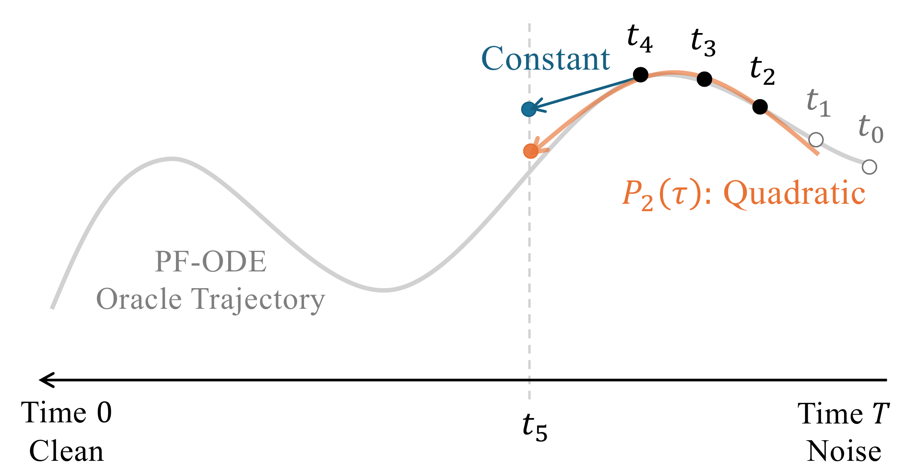

# 9.3 DEIS {#sec-exponential}

In the factored exponential-integrator formula ([Equation (9.1.7)](01-prologue.md#eq-variation-of-constants)),

$$
\int_s^t
\frac{g^2(\tau)}{2\sigma_\tau}\,
\mathcal E(\tau\shortrightarrow t)\,
{\boldsymbol{\epsilon}}_{\boldsymbol{\phi}^\times}({\mathbf{x}}_\tau,\tau)
\mathop{}\!\mathrm{d}\tau,
$$

all schedule-dependent factors are known; the only unknown quantity along the trajectory is the neural prediction ${\boldsymbol{\epsilon}}_{\boldsymbol{\phi}^\times}({\mathbf{x}}_\tau,\tau)$. DDIM makes the simplest first-order approximation by holding this prediction fixed at the beginning of the step,

$$
{\boldsymbol{\epsilon}}_{\boldsymbol{\phi}^\times}({\mathbf{x}}_\tau,\tau)
\approx
{\boldsymbol{\epsilon}}_{\boldsymbol{\phi}^\times}({\mathbf{x}}_s,s),
\qquad
\tau\in[t,s].
$$

This approximation can become inaccurate over larger steps when the neural prediction varies appreciably along the trajectory.

DEIS ([Zhang and Chen, 2022](references.md#ref-zhang2022fast)) improves on this idea without introducing additional model evaluations within the current step. Inspired by classical multistep methods such as Adams–Bashforth (see [Section A.1.5](../../appendices/a-differential-equations/01-ordinary-differential-equations.md#app-de-solver-examples)), it reuses model predictions from previous completed steps as *anchors* and fits a polynomial that extrapolates their recent variation into the next step. The polynomial then replaces the unknown neural prediction inside the integral, while the known schedule-dependent weight $\tfrac{g^2(\tau)}{2\sigma_\tau} \mathcal E(\tau\shortrightarrow t)$ is retained analytically. Thus, DEIS extends the constant approximation of DDIM to a higher-order multistep polynomial approximation.

From the classical numerical viewpoint, DEIS is therefore an Adams–Bashforth-type multistep method within the factored exponential-integrator framework: previous neural evaluations provide the higher-order information, while the known diffusion dynamics are retained in the weighted integral.

We first review the polynomial extrapolation used to construct this approximation in [Section 9.3.1](03-deis.md#subsec-poly-extrapolation), then derive the resulting DEIS update in [Section 9.3.2](03-deis.md#subsec-deis-lagrange). Finally, [Section 9.3.3](03-deis.md#sec-ddim-deis) shows that the constant, degree-zero case recovers DDIM.

## 9.3.1 Background: Polynomial Extrapolation {#subsec-poly-extrapolation}

Before deriving DEIS, we briefly review the polynomial construction it uses to reuse previous model evaluations. The idea is simple: first fit a polynomial through several known values, and then evaluate that polynomial beyond the most recent anchor to predict how the quantity may continue to change. Thus, the polynomial is an *interpolant* at the known anchors and acts as an *extrapolant* over the next solver step.

**From Anchors to a Polynomial Extrapolant.** Suppose a time-varying quantity is known at $n{+}1$ distinct times,

$$
(\tau_0,{\mathbf{Y}}_0),\;
(\tau_1,{\mathbf{Y}}_1),\;
\ldots,\;
(\tau_n,{\mathbf{Y}}_n),
\qquad
\tau_0<\tau_1<\cdots<\tau_n,
$$

where each ${\mathbf{Y}}_j$ may be vector-valued. We would like to construct the simplest smooth curve that exactly matches these observed values and can then be continued beyond the most recent anchor. The unique polynomial of degree at most $n$ passing through all anchors is the *Lagrange interpolant*

$$
P_n(\tau)
=
\sum_{j=0}^{n}
\ell_j(\tau)\,{\mathbf{Y}}_j,
$$

with basis functions

$$
\ell_j(\tau)
:=
\prod_{\substack{k=0\\k\neq j}}^{n}
\frac{\tau-\tau_k}{\tau_j-\tau_k}.
$$

The construction of $\ell_j$ is simple: every factor makes it vanish at one of the other anchors, while the denominator normalizes its value to $1$ at $\tau_j$. Hence,

$$
\ell_j(\tau_k)=\delta_{jk},
$$

and therefore

$$
P_n(\tau_j)={\mathbf{Y}}_j,
\qquad
j=0,\ldots,n.
$$

Moreover,

$$
\sum_{j=0}^{n}\ell_j(\tau)=1.
$$

Thus, $P_n(\tau)$ is a time-dependent linear combination of the observed anchors: at each anchor time it reproduces exactly the corresponding value, while between or beyond the anchors the polynomial combines them to describe the local trend suggested by their variation. In DEIS, we will use this same curve beyond the most recent anchor, turning the interpolant into an *extrapolant* for the next solver step.

The lowest-order cases illustrate the construction:

**Example.**

**$n=0$ (Constant).** With one anchor, the polynomial simply keeps the most recent value fixed:

$$
P_0(\tau)={\mathbf{Y}}_0.
$$

**$n=1$ (Linear).** With two anchors, the polynomial is the straight line joining them:

$$
P_1(\tau)
=
\frac{\tau-\tau_1}{\tau_0-\tau_1}{\mathbf{Y}}_0
+
\frac{\tau-\tau_0}{\tau_1-\tau_0}{\mathbf{Y}}_1.
$$

**$n=2$ (Quadratic).** With three anchors, the interpolant becomes

$$
P_2(\tau)
=
\ell_0(\tau){\mathbf{Y}}_0
+
\ell_1(\tau){\mathbf{Y}}_1
+
\ell_2(\tau){\mathbf{Y}}_2,
$$

which can additionally capture local curvature in the observed values.

In DEIS, the anchors will be neural predictions from previous completed sampling steps. The polynomial matches those stored predictions exactly and is then extrapolated beyond the most recent anchor over the next reverse-time interval.

## 9.3.2 DEIS: Lagrange Polynomial Approximation of the PF-ODE Integral {#subsec-deis-lagrange}

Let $n \ge 0$ be the chosen polynomial degree. At step $i$, DEIS approximates the unknown map $\tau \mapsto {\boldsymbol{\epsilon}}_{{\boldsymbol{\phi}}^\times}({\mathbf{x}}_\tau,\tau)$ over the next reverse-time interval $[t_i,t_{i-1}]$ using a degree-$n$ Lagrange polynomial constructed from past model outputs. This polynomial is then substituted into the exponential–integrator update ([Equation (9.1.7)](01-prologue.md#eq-variation-of-constants)) to obtain $\tilde{{\mathbf{x}}}_{t_i}$. The intuition is that, instead of holding the neural prediction constant as in DDIM, DEIS uses its recent history to capture how it is changing over time.

**Figure 9.2:** **Illustration of DEIS as a multistep method.** With three past anchors at $t_2,t_3,t_4$, DEIS builds a quadratic curve through the model outputs and extrapolates it over the step from $t_4$ to $t_5$. The extrapolating polynomial is then integrated against the known diffusion-dependent weight, capturing variation of the neural prediction that is neglected by the constant approximation used by DDIM.

Source: Created by the authors.

A degree-$n$ update needs $n{+}1$ anchors. When they are available (*sufficient history*, $i \ge n{+}1$), we use the full degree-$n$ scheme. During the initial steps (*insufficient history*, $i \le n$), we use the highest feasible degree, $i{-}1$, and increase it as more anchors become available. We treat these two cases below.

**Case I: $i = n+1,\dots,M$ (Sufficient History).** With sufficient history, DEIS reuses the last $n{+}1$ model evaluations as anchors,

$$
(\tau_j,{\mathbf{Y}}_j) := \bigl(t_{i-1-j}, \boldsymbol{\epsilon}_{\boldsymbol{\phi}^\times}(\tilde{{\mathbf{x}}}_{t_{i-1-j}},t_{i-1-j})\bigr),
\quad j=0,\dots,n.
$$

Viewing $\tau\mapsto\boldsymbol{\epsilon}_{\boldsymbol{\phi}^\times}({\mathbf{x}}_\tau,\tau)$ as a smooth function along the trajectory, we construct the degree-$n$ Lagrange polynomial

$$
P_n(\tau)
=
\sum_{j=0}^{n}
\underbrace{\Bigl[\prod_{\substack{k=0\\k\neq j}}^{n}
\frac{\tau - t_{i-1-k}}{\,t_{i-1-j} - t_{i-1-k}\,}\Bigr]}_{=:~\ell_j^{(i)}(\tau)}
\boldsymbol{\epsilon}_{\boldsymbol{\phi}^\times}\bigl(\tilde{\mathbf x}_{t_{i-1-j}}, t_{i-1-j}\bigr)
$$

which by construction satisfies $P_n(\tau_j)={\mathbf{Y}}_j$ for each anchor:

$$
P_n\bigl(\tau_j\bigr)
= {\mathbf{Y}}_j =
\boldsymbol{\epsilon}_{\boldsymbol{\phi}^\times}\bigl(\tilde{\mathbf x}_{t_{i-1-j}}, t_{i-1-j}\bigr),
\quad
 j=0,\ldots,n.
$$

Each $\ell_j^{(i)}$ satisfies

$$
\ell_j^{(i)}\bigl(t_{i-1-m}\bigr)
=
\begin{cases}
1,&m=j,\\
0,&m\neq j.
\end{cases}
$$

The polynomial is then extrapolated beyond the most recent anchor $t_{i-1}$ over the new step:

$$
\boldsymbol{\epsilon}_{\boldsymbol{\phi}^\times}({\mathbf{x}}_\tau,\tau) \approx
P_n(\tau)=\sum_{j=0}^{n}\ell_j^{(i)}(\tau)
\boldsymbol{\epsilon}_{\boldsymbol{\phi}^\times}\bigl(\tilde{{\mathbf{x}}}_{t_{i-1-j}}, t_{i-1-j}\bigr),
\quad \tau \in [t_i,t_{i-1}].
$$

We then substitute $P_n(\tau)$ for ${\boldsymbol{\epsilon}}_{\boldsymbol{\phi}^\times}({\mathbf{x}}_\tau,\tau)$ in the exponential–integrator formula ([Equation (9.1.7)](01-prologue.md#eq-variation-of-constants)):

$$
\begin{aligned}
\int_{t_{i-1}}^{t_i}
\frac{g^2(\tau)}{2\sigma_\tau}
\mathcal{E}(\tau\to t_i)
{\boldsymbol{\epsilon}}_{\boldsymbol{\phi}^\times}({\mathbf{x}}_\tau,\tau)\mathop{}\!\mathrm{d}\tau
&\approx
\sum_{j=0}^{n}
\underbrace{
\int_{t_{i-1}}^{t_i}
\frac{g^2(\tau)}{2\sigma_\tau}
\mathcal{E}(\tau\to t_i)
\ell_j^{(i)}(\tau)\mathop{}\!\mathrm{d}\tau
}_{=:~C_{i,j}}
\\
&\qquad\cdot
{\boldsymbol{\epsilon}}_{\boldsymbol{\phi}^\times}
(\tilde{\mathbf{x}}_{t_{i-1-j}},t_{i-1-j}).
\end{aligned}
$$

The coefficients

$$
C_{i,j}
:=
\frac{1}{2}
\int_{t_{i-1}}^{t_i}
\frac{g^2(\tau)}{\sigma_\tau}
\mathcal{E}(\tau\to t_i)
\ell_j^{(i)}(\tau)\mathop{}\!\mathrm{d}\tau
$$

depend only on the noise schedule and the chosen time grid and can therefore be precomputed. For schedules admitting suitable antiderivatives, these coefficients are available in closed form; otherwise they can be evaluated numerically to high accuracy.

Integrating the linear part exactly with $\mathcal{E}(t_{i-1}\to t_i)$ gives the *AB-DEIS-$n$* update

$$
\tilde{\mathbf{x}}_{t_i}
=
\mathcal{E}(t_{i-1}\to t_i)\tilde{\mathbf{x}}_{t_{i-1}}
+
\sum_{j=0}^{n}
C_{i,j}
{\boldsymbol{\epsilon}}_{\boldsymbol{\phi}^\times}
(\tilde{\mathbf{x}}_{t_{i-1-j}},t_{i-1-j}).
$$

For the local truncation statements below, let $h$ denote a characteristic local step size and assume neighboring step ratios remain bounded. Under standard smoothness assumptions on the model prediction along the empirical trajectory and regularity of the schedule-dependent weight, the full-history degree-$n$ construction has formal order $n+1$, with one-step local defect $\mathcal O(h^{n+2})$.

**Case II: $i=1,\dots,n$ (Insufficient History).** During the initial steps, only $i$ past model evaluations are available. We therefore use all available anchors and set the polynomial degree to $i{-}1$:

$$
P_{i-1}(\tau)
=
\sum_{j=0}^{i-1}
\ell_j^{(i)}(\tau)
\boldsymbol{\epsilon}_{\boldsymbol{\phi}^\times}\bigl(\tilde{\mathbf x}_{t_{i-1-j}},  t_{i-1-j}\bigr),
$$

where $\ell_j^{(i)}$ is the Lagrange basis of degree $i{-}1$ built on the nodes at time $\{t_{i-1}, t_{i-2},\ldots,t_{0}\}$. This matches all available anchors and transitions into the full-history formula once $i\ge n{+}1$.

This is the standard warm-start situation for a multistep method. The first step uses a constant approximation, the second uses a linear extrapolation, the third uses a quadratic extrapolation, and so on, until the target degree $n$ becomes available.

**Example: Special Cases of Lagrange Polynomials**

**Degree $0$ (one anchor):**

$$
P_0(\tau) = \boldsymbol{\epsilon}_{\boldsymbol{\phi}^\times}(\tilde{\mathbf{x}}_{t_{i-1}}, t_{i-1}).
$$

This holds the neural prediction fixed at its start-of-step value, exactly as in the first-order DDIM approximation.

**Degree $1$ (two anchors):** the Lagrange polynomial is a linear map passing through the two pre-specified anchors.

$$
P_1(\tau)
=
\underbrace{\frac{\tau - t_{i-2}}{t_{i-1} - t_{i-2}}}_{\displaystyle \ell_{i-1}(\tau)}
\,\boldsymbol{\epsilon}_{\boldsymbol{\phi}^\times}(\tilde{\mathbf{x}}_{t_{i-1}}, t_{i-1})
 +
\underbrace{\frac{\tau - t_{i-1}}{t_{i-2} - t_{i-1}}}_{\displaystyle \ell_{i-2}(\tau)}
\,\boldsymbol{\epsilon}_{\boldsymbol{\phi}^\times}(\tilde{\mathbf{x}}_{t_{i-2}}, t_{i-2}).
$$

Here $\ell_{i-1}(\tau)$ and $\ell_{i-2}(\tau)$ are the Lagrange basis weights. They satisfy the interpolation conditions $P_1(t_{i-1})=\boldsymbol{\epsilon}_{\boldsymbol{\phi}^\times}(\tilde{\mathbf{x}}_{t_{i-1}}, t_{i-1})$ and $P_1(t_{i-2})=\boldsymbol{\epsilon}_{\boldsymbol{\phi}^\times}(\tilde{\mathbf{x}}_{t_{i-2}}, t_{i-2})$, with $\ell_{i-1}(\tau)+\ell_{i-2}(\tau)=1$.

**Summary of AB-DEIS-$n$ Update.** Combining the sufficient-history and warm-start cases gives the *AB-DEIS-$n$* update[^1] Here, $n$ is the target polynomial degree, using up to $n{+}1$ past evaluations:

$$
\begin{aligned}
\tilde{\mathbf{x}}_{t_i}
= \mathcal{E}(t_{i-1} \to t_i)\,\tilde{\mathbf{x}}_{t_{i-1}}
+ \sum_{j=0}^{\min\{n,\, i-1\}} C_{i,j}\,{\boldsymbol{\epsilon}}_{\boldsymbol{\phi}^\times}(\tilde{\mathbf{x}}_{t_{i-1-j}},\,t_{i-1-j}),
\end{aligned}
$$

with coefficients

$$
\begin{aligned}
C_{i,j}
:= \frac{1}{2} \int_{t_{i-1}}^{t_i}
\frac{g^2(\tau)}{\sigma_\tau}\,\mathcal{E}(\tau \to t_i)\,
\Bigg[\prod_{\substack{k=0\\k\neq j}}^{\min\{n,\, i-1\}}
\frac{\tau - t_{i-1-k}}{\,t_{i-1-j} - t_{i-1-k}\,}\Bigg]\,d\tau.
\end{aligned}
$$

When $i\ge n{+}1$ (sufficient history), $\min\{n,\,i-1\}=n$, and the full-history degree-$n$ step has one-step local truncation error $\mathcal O(h^{n+2})$ under the assumptions above, corresponding to a method of order $n+1$.

During warm start ($i\le n$), the degree is $i-1$, so the one-step local truncation error is $\mathcal O(h^{i+1})$, and the corresponding step is formally of order $i$. Thus, the order increases from $1$ at the first step and reaches the full order $n+1$ once $n+1$ anchors are available. As with standard multistep methods, lower-order warm-start steps do not by themselves establish a global order-$(n+1)$ guarantee; such a guarantee also requires stability and starting values of sufficient accuracy.

Very large $n$ can degrade numerical behavior because high-degree extrapolation becomes increasingly sensitive to the spacing of the anchors, errors in the stored model predictions, and stability considerations. Relatively small polynomial degrees are therefore preferred in practice.

As we will see in the following subsection, the special case $n{=}0$ reduces exactly to deterministic DDIM, i.e., the first-order factored exponential-integrator update.

## 9.3.3 DDIM = AB-DEIS-0 {#sec-ddim-deis}

The connection to DDIM becomes immediate at degree $n=0$. In this case, the Lagrange polynomial is constant, so DEIS uses only the most recent model prediction throughout the next step. The corresponding coefficient simplifies to

$$
C_{i0} = \frac{1}{2} \int_{t_{i-1}}^{t_{i}} \frac{g^2(\tau)}{\sigma_\tau} \mathcal{E}(\tau \shortrightarrow t_i)   \mathrm{d}\tau.
$$

Substituting into the update formula yields the zeroth-order AB-DEIS scheme:

$$
\begin{aligned}
\tilde{\mathbf{x}}_{t_{i}} &=  \mathcal{E}(t_{i-1} \shortrightarrow t_{i})\tilde{\mathbf{x}}_{t_{i-1}} + C_{i0} \boldsymbol{\epsilon}_{\boldsymbol{\phi}^\times}(\tilde{\mathbf{x}}_{t_{i-1}}, t_{i-1})\\
  &=e^{\int_{t_{i-1}}^{t_{i}}f(u)\mathop{}\!\mathrm{d} u} \tilde{\mathbf{x}}_{t_{i-1}} + \Big( \int_{t_{i-1}}^{t_{i}} \frac{g^2(\tau)}{2\sigma_\tau} e^{\int_{\tau}^{t_{i}}f(u)\mathop{}\!\mathrm{d} u}   \mathrm{d}\tau
\Big) \boldsymbol{\epsilon}_{\boldsymbol{\phi}^\times}(\tilde{\mathbf{x}}_{t_{i-1}}, t_{i-1}).
\end{aligned}
\tag{9.3.1}
$$

This is exactly the same first-order factored approximation used by deterministic DDIM: the neural prediction is held fixed at $t_{i-1}$, while the known integrating factor and schedule-dependent coefficient remain inside the integral and are propagated over the full step. Hence, AB-DEIS-0 and DDIM are not merely first-order equivalent; they give the same finite-step update.

**Proposition 9.3.1: DDIM = AB-DEIS-0**

[Equation (9.3.1)](03-deis.md#eq-deis-0) is identical to the DDIM update in [Equation (9.2.1)](02-ddim.md#eq-ddim-euler).

This also clarifies the role of DEIS in the solver hierarchy. We remark that the index “$0$” refers to the *polynomial degree*, not the numerical order: AB-DEIS-0 is still a first-order method. Higher-degree DEIS keeps the same analytic treatment of the known diffusion dynamics but replaces this constant prediction by polynomial extrapolation from additional past model evaluations. Thus, DDIM is the degree-zero base case from which the DEIS multistep construction naturally extends.

Later, in [Section 9.5.4](05-dpm-solver-plus-plus.md#subsec-dpm-solver--multi), we will encounter another route to a multistep diffusion solver; that is, DPM-Solver`++`(2M). It starts from a local Taylor expansion of the data prediction in log-SNR time and recycles previous model evaluations through a backward finite difference to estimate the required derivative. Although its representation and derivation differ from those of DEIS, both methods use past model evaluations to capture the variation of the neural prediction without introducing additional within-step stages. We return to this connection in [Section 9.5.5](05-dpm-solver-plus-plus.md#subsec-dpm-deis), where we compare the two constructions more explicitly.

[^1]: “AB” refers to the Adams–Bashforth multistep principle, here applied within the exponential-integrator formulation ([Hochbruck and Ostermann, 2010](references.md#ref-hochbruck2010exponential)).
