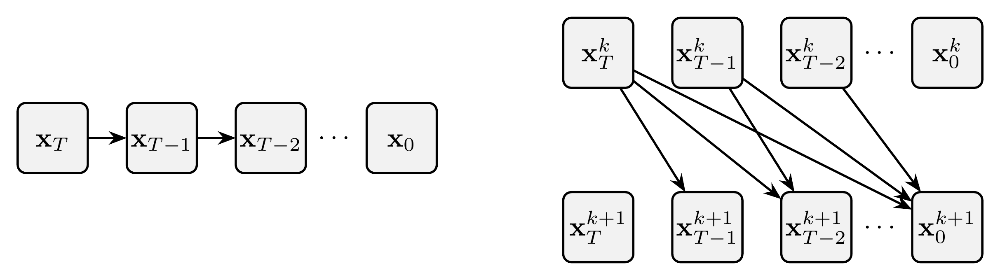
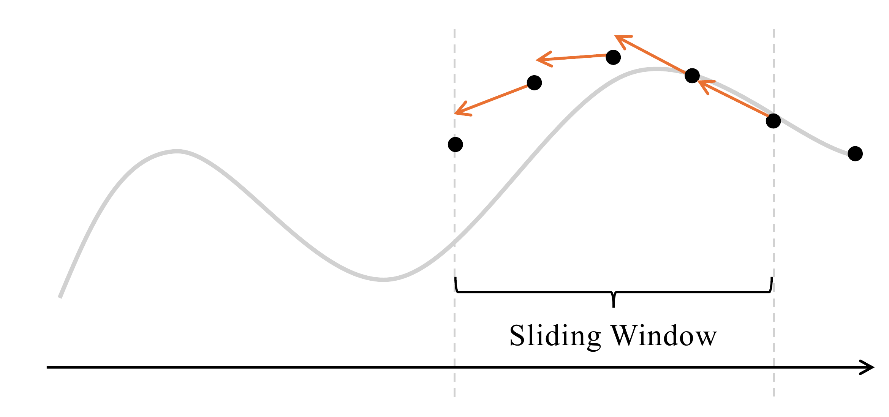
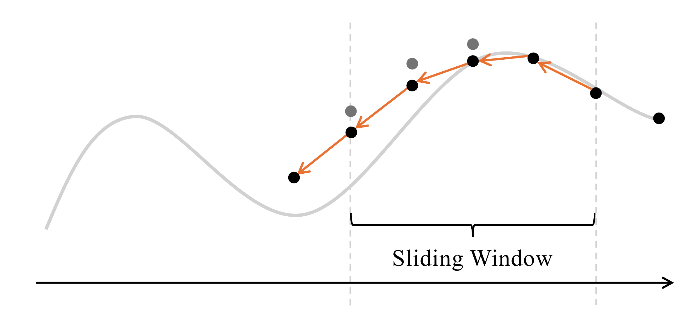
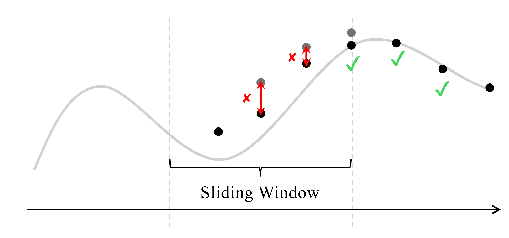

# 9.6 (Optional) ParaDiGMs {#sec-picard}

**Figure 9.3:** **Comparisons of two computation graphs.** Left: conventional time-stepping ODE solving, where the solution is propagated sequentially across time. Right: Picard iteration, which enables parallel computation by updating all time nodes simultaneously using the results from the previous iteration, thereby avoiding the strictly sequential nature of time-stepping.

Source: Adapted from [Shih et al. (2023)](references.md#ref-shih2023parallel).

**(a)** Sequential sampling by time-stepping estimation in generation process.

**(b)** Picard iterations with skip dependencies.

## 9.6.1 From Time-Stepping to Time-Parallel Solver {#time-parallel-solver}

In the previous sections, we focused on the time–stepping approach, which estimates the trajectory by evolving from the prior time $T$ toward an arbitrary $t\in[0,T]$. Let

$$
{\mathbf{v}}_{{\boldsymbol{\phi}}^\times}({\mathbf{x}},t):={\mathbf{f}}({\mathbf{x}}, t) - \frac{1}{2}g^2(t) {\mathbf{s}}_{{\boldsymbol{\phi}}^\times}({\mathbf{x}},t)
$$

denote the empirical PF–ODE drift from a pre-trained diffusion model. The exact evolution from $T$ to any intermediate time $t$ is:

$$
\widetilde{\boldsymbol{\Psi}}_{T\to t}\big({\mathbf{x}}(T)\big)
    =
    {\mathbf{x}}(T)
    + \int_{T}^{t}{\mathbf{v}}_{{\boldsymbol{\phi}}^\times}\big({\mathbf{x}}(\tau),\tau\big)\mathop{}\!\mathrm{d}\tau,
    \quad {\mathbf{x}}(T)\sim p_{\mathrm{prior}}.
\tag{9.6.1}
$$

Time–stepping schemes approximate this integral using discrete updates based on past timesteps.

In this section, we turn to the *time–parallel* approach, exemplified by *ParaDiGMS*, which builds on classical Picard iteration to enable parallel integration across time. The key idea behind ParaDiGMS is to *trade computational resources for faster simulation*.

## 9.6.2 Methodology of ParaDiGMS {#methodology}

**From Trajectories to Picard Iteration as a Fixed-Point Update.** Fix the initial state of reverse-time sampling,

$$
{\mathbf{x}}_T\sim p_{\mathrm{prior}}.
$$

The integral expression in [Equation (9.6.1)](06-paradigms.md#eq-picard-t-to-t) can be viewed as a map that takes an entire candidate trajectory and produces an updated one. Formally, given any path $\{{\mathbf{y}}(\tau)\}_{\tau\in[0,T]}$, define

$$
(\mathcal{L}[{\mathbf{y}}(\cdot)])(t)
=
{\mathbf{x}}_T
+
\int_T^t
{\mathbf{v}}_{{\boldsymbol{\phi}}^\times}\big({\mathbf{y}}(\tau),\tau\big)\mathop{}\!\mathrm{d}\tau,
\qquad
t\in[0,T].
$$

That is, $\mathcal{L}$ keeps the initial state ${\mathbf{x}}_T$ fixed and updates the rest of the trajectory using the velocity evaluated along the candidate path.

A solution trajectory ${\mathbf{x}}^*(\cdot)$ of the empirical PF-ODE with ${\mathbf{x}}^*(T)={\mathbf{x}}_T$ is precisely a *fixed point* of this map:

$$
{\mathbf{x}}^*(t)
=
\mathcal{L}[{\mathbf{x}}^*(\cdot)](t)
=
{\mathbf{x}}_T
+
\int_T^t
{\mathbf{v}}_{{\boldsymbol{\phi}}^\times}\big({\mathbf{x}}^*(\tau),\tau\big)\mathop{}\!\mathrm{d}\tau.
$$

Thus, instead of constructing the trajectory strictly one time step after another, we may search for an entire trajectory that is consistent with this integral equation.

Starting from an initial guess ${\mathbf{x}}^{(0)}(\cdot)$ satisfying ${\mathbf{x}}^{(0)}(T)={\mathbf{x}}_T$, for example the constant path ${\mathbf{x}}^{(0)}(t)\equiv{\mathbf{x}}_T$, Picard iteration repeatedly applies this map:

$$
\begin{aligned}
{\mathbf{x}}^{(k+1)}(t)
=
\mathcal{L}[{\mathbf{x}}^{(k)}(\cdot)](t)
=
{\mathbf{x}}_T
+
\int_T^t
{\mathbf{v}}_{{\boldsymbol{\phi}}^\times}
\big({\mathbf{x}}^{(k)}(\tau),\tau\big)\mathop{}\!\mathrm{d}\tau,
\end{aligned}
\tag{9.6.2}
$$

with $k=0,1,2,\ldots$. Each iteration evaluates the velocity along the previous trajectory and uses these evaluations to update the trajectory at all time points.

**Discrete Picard on a $T$ to $0$ Grid.** To turn [Equation (9.6.2)](06-paradigms.md#eq-picard-iter-t-to-t) into a practical algorithm, we place a uniform, decreasing grid on $[0,T]$ by choosing a step count $M$, setting $\Delta t := T/M$, and defining

$$
t_j := T - j \Delta t,
\quad j=0,1,\ldots,M,
$$

so $t_0=T$ and $t_M=0$. Denote sampled iterates by

$$
{\mathbf{x}}^{(k)}_j := {\mathbf{x}}^{(k)}(t_j).
$$

Because the grid runs reversely in time, the integral from $T$ to $t_j$ has negative orientation. Approximating it by left endpoints on the partition $\{[t_{i+1},t_i]\}_{i=0}^{j-1}$ gives

$$
\int_{T}^{t_j}{\mathbf{v}}_{{\boldsymbol{\phi}}^\times}({\mathbf{x}}^{(k)}(\tau), \tau) \mathop{}\!\mathrm{d}\tau
 \approx
- \Delta t \sum_{i=0}^{j-1} {\mathbf{v}}_{{\boldsymbol{\phi}}^\times}\big({\mathbf{x}}^{(k)}_{i}, t_i\big),
$$

since each small integral over $[t_{i+1},t_i]$ equals $- \int_{t_i}^{t_{i+1}} \cdot\mathop{}\!\mathrm{d}\tau$. Substituting this approximation into [Equation (9.6.2)](06-paradigms.md#eq-picard-iter-t-to-t) yields the discrete Picard update

$$
{\mathbf{x}}^{(k+1)}_j
=
{\mathbf{x}}_T
-
\Delta t
\underbrace{
\sum_{i=0}^{j-1}
{\mathbf{v}}_{{\boldsymbol{\phi}}^\times}
\big({\mathbf{x}}^{(k)}_i,t_i\big)
}_{\substack{\text{cumulative sum}\\\text{of drifts}}},
\qquad
j=1,\ldots,M.
\tag{9.6.3}
$$

This scheme is simple and parallel-friendly: each drift evaluation ${\mathbf{v}}_{{\boldsymbol{\phi}}^\times} \big({\mathbf{x}}^{(k)}_i,t_i\big)$ depends only on the previous iterate at the same time node $t_i$, so all $i=0,\dots,j - 1$ evaluations can be computed independently across the grid. The integral is then recovered by a cumulative sum, performed either serially or via a parallel *prefix-sum (scan/sliding windows)*.

**Sliding Windows and Parallel Evaluation.**

**Figure 9.4:** Compute the drift of ${\mathbf{x}}^{(k)}_{\ell:\ell+p}$ on a batch window of size $p=4$, in parallel

**Figure 9.5:** Update the values to ${\mathbf{x}}^{(k+1)}_{\ell:\ell+p}$ using the cumulative drift of points in the window

**Figure 9.6:** Determine how far to slide the window forward, based on the error $\lVert {\mathbf{x}}^{(k+1)}_i - {\mathbf{x}}^{(k)}_i \rVert^2$.

Source: Adapted from [Shih et al. (2023)](references.md#ref-shih2023parallel).

The discrete Picard update [Equation (9.6.3)](06-paradigms.md#eq-discrete-picard-decreasing) expresses each ${\mathbf{x}}^{(k+1)}_j$ as the fixed initial value ${\mathbf{x}}_T$ minus a cumulative sum of drifts. To limit memory and exploit parallel hardware, it is convenient to apply the same idea locally on short, sliding blocks of indices.

Fix a window length $p$ and a left index $\ell$; the window then covers $j=\ell,\ldots,\ell+p$ with $t_\ell>t_{\ell+1}>\cdots>t_{\ell+p}$. During iteration $k$:

**Step 1. Parallel Drift Evaluation on the Window.** Compute, in parallel and using only the previous iterate,

$$
{\mathbf{v}}_{{\boldsymbol{\phi}}^\times} \big({\mathbf{x}}^{(k)}_{\ell+i}, t_{\ell+i}\big),
\quad i=0,1,\ldots,p-1.
$$

These are the $p$ local increments needed to advance from the left edge $t_\ell$ across the window.

**Step 2. Left–Anchored Cumulative Updates.** Form the windowed updates by anchoring at $j=\ell$ and accumulating the drift across subintervals:

$$
{\mathbf{x}}^{(k+1)}_{\ell+j+1}
 =
{\mathbf{x}}^{(k)}_{\ell}
 - \Delta t \sum_{i=0}^{j}
{\mathbf{v}}_{{\boldsymbol{\phi}}^\times} \big({\mathbf{x}}^{(k)}_{\ell+i}, t_{\ell+i}\big),
\quad j=0,1,\ldots,p-1.
\tag{9.6.4}
$$

This is the local, windowed counterpart of [Equation (9.6.3)](06-paradigms.md#eq-discrete-picard-decreasing), with the current left-boundary value ${\mathbf{x}}^{(k)}_\ell$ serving as the anchor for the window. The minus sign reflects the decreasing time direction. The inner sum is a prefix sum over the windowed drifts, so all partial sums can be produced efficiently on parallel hardware.

**Step 3. Progress Control and Window Advance.** Having formed the left–anchored cumulative updates on the current window (Step 2), we now decide how far to slide that window. We measure local convergence by the pointwise Picard change

$$
\mathtt{error}_j
:=
\big\|{\mathbf{x}}^{(k+1)}_{\ell+j}-{\mathbf{x}}^{(k)}_{\ell+j}\big\|^2,
\quad j=1,\ldots,p-1,
$$

and compare it against prescribed tolerances $\mathtt{tol}_{\ell+j}$. That is, $\mathtt{error}_j$ measures how much the iterate at node $\ell+j$ changed during the last Picard update. If this number is small, it indicates local agreement between the two successive approximations and hence local convergence of the fixed-point iteration at that node. If it is large, that node has not settled yet and needs more Picard smoothing.

The *stride* is chosen as the first index in the window that fails this test (or the full window length $p$ if none fail):

$$
\mathtt{stride}
:=
\min\Big(\,\{\,j\ge 1:\ \mathtt{error}_j>\mathtt{tol}_{\ell+j}\,\}\ \cup\ \{p\}\Big).
$$

We then slide the window by setting $\ell \leftarrow \ell+\mathtt{stride}$. In words: we accept all nodes from the left edge up to (but not including) the first one that has not converged; if all nodes have converged, we accept the entire window. We then slide the window by that many accepted nodes, $\ell \leftarrow \ell+\mathtt{stride}$, and continue. This advances by at most the window length $p$, never skipping any node that has not met its tolerance. If sliding would overrun the grid end $M$, we truncate the window to $p \leftarrow \min\{p,\,M-\ell\}$ and proceed.

When the window moves forward it uncovers new time nodes that have no values yet. To start Picard iteration there, we simply copy the value from the left boundary of the window and use it as an initial guess. This “constant extrapolation” is cheap and stable, and will be corrected by later updates. If desired, one can replace it by more accurate guesses, such as linear or polynomial extrapolations from past points.

This completes the procedure of ParaDiGMS. We summarize the algorithm in [Algorithm 8](06-paradigms.md#alg-paradigms).

<section class="book-algorithm" id="alg-paradigms" aria-labelledby="alg-paradigms-title" markdown="1">

Algorithm 8: ParaDiGMS with Sliding Windows

**Input:** Drift ${\mathbf{v}}_{{\boldsymbol{\phi}}^\times}({\mathbf{x}},t)$; $\{t_j\}_{j=0}^{M}$; window length $p$; $\{\mathtt{tol}_j\}_{j=1}^{M}$

**Output:** Approximate trajectory $\{{\mathbf{x}}^{(k)}_j\}_{j=0}^{M}$ with ${\mathbf{x}}^{(k)}_M$ at $t=0$

1

$k \gets 0$, $\ell \gets 0$

2

Sample ${\mathbf{x}}^{(0)}_0 \sim p_{\mathrm{prior}}$; set ${\mathbf{x}}^{(0)}_j \gets {\mathbf{x}}^{(0)}_0$ for $j=1,\ldots,\min(p,M)$

▷ *constant extrapolation*

3

**while** $\ell &lt; M$ **do**

4

$J \gets \min(p, M-\ell)$  ▷ *current window length*

5

**Step 1: Parallel**

6

For $i=0,\ldots,J-1$: $g_i \gets {\mathbf{v}}_{{\boldsymbol{\phi}}^\times} \big({\mathbf{x}}^{(k)}_{\ell+i},\, t_{\ell+i}\big)$

▷ *drifts from previous iterate (Picard freezing)*

7

Compute prefix sums $S_j \gets \sum_{i=0}^{j} g_i$ for $j=0,\ldots,J-1$

▷ *scan over windowed drifts*

8

**Step 2: Cumulative Updates**

9

For $j=0,\ldots,J-1$: $\displaystyle {\mathbf{x}}^{(k+1)}_{\ell+j+1} \gets {\mathbf{x}}^{(k)}_{\ell} - \Delta t\, S_j$

▷ *left-anchored update; cf. [Equation (9.6.4)](06-paradigms.md#eq-window-update)*

10

**Step 3: Progress Control and Window Advance**

11

For $j=1,\ldots,J-1$: $\mathtt{error}_j \gets \big\Vert {\mathbf{x}}^{(k+1)}_{\ell+j}-{\mathbf{x}}^{(k)}_{\ell+j}\big\Vert ^2$

▷ *pointwise Picard change*

12

$\displaystyle \mathtt{stride} \gets \min \Big(\,\{\,j\in\{1,\ldots,J-1\}:~\mathtt{error}_j&gt;\mathtt{tol}_{\ell+j}\,\}\ \cup\ \{J\}\Big)$

13

**Initialize New Nodes**

14

For $r=1,\ldots,\min\{\mathtt{stride},\,M-\ell-J\}$: ${\mathbf{x}}^{(k+1)}_{\ell+J+r} \gets {\mathbf{x}}^{(k+1)}_{\ell+J}$

▷ *constant extrapolation into newly exposed indices*

15

$\ell \gets \ell + \mathtt{stride}$; $k \gets k+1$

16

**end while**

17

**return** $\{{\mathbf{x}}^{(k)}_j\}_{j=0}^{M}$

</section>

## 9.6.3 Relation to Time-Stepping Solvers {#time-stepping-solvers}

**Selection of Sliding Window Size.** To understand the role of the window size, first consider the smallest choice $p=1$. In this case, there is no time parallelism, and the method reduces to its sequential base update. For the left-endpoint discretization in [Equation (9.6.4)](06-paradigms.md#eq-window-update), this is simply a plain Euler step.

More generally, ParaDiGMS specifies how computations across different time points can be parallelized, while the numerical update used at each step can be chosen separately. For example, the Euler update can be replaced by DDIM or DPM-Solver, giving ParaDDIM or ParaDPMSolver. Increasing $p$ then exposes more time points to parallel computation without changing the underlying time grid or the total number of steps $M$. Picard iteration repeatedly corrects these states toward consistency with the chosen base solver, with convergence controlled by the prescribed local tolerances.

**Compatibility with Higher–Order Solvers (e.g., DPM).** The Picard framework determines how states at different time points are updated and evaluated in parallel, while the numerical rule used to approximate each step can be chosen separately.

For example, instead of the left-endpoint rule in [Equation (9.6.4)](06-paradigms.md#eq-window-update), we may use the trapezoidal rule:

$$
\begin{aligned}
{\mathbf{x}}^{(k+1)}_{\ell+j+1}
=
{\mathbf{x}}^{(k)}_{\ell}
-\Delta t\Bigg[
\tfrac{1}{2}
{\mathbf{v}}_{{\boldsymbol{\phi}}^\times}
\big({\mathbf{x}}^{(k)}_{\ell},t_{\ell}\big)
+
\sum_{i=1}^{j}
{\mathbf{v}}_{{\boldsymbol{\phi}}^\times}
\big({\mathbf{x}}^{(k)}_{\ell+i},t_{\ell+i}\big)
+
\tfrac{1}{2}
{\mathbf{v}}_{{\boldsymbol{\phi}}^\times}
\big({\mathbf{x}}^{(k)}_{\ell+j+1},t_{\ell+j+1}\big)
\Bigg],
\end{aligned}
$$

where $j=0,\ldots,p-1$. For $j=0$, this is the familiar one-step trapezoidal update using the two endpoint drifts. For larger $j$, the same rule accumulates the trapezoidal contributions across the window. Since all drifts are evaluated using the previous Picard iterate, they can still be computed in parallel, while the interior contributions can be accumulated with a prefix sum.

More generally, ParaDiGMS can use an existing sequential sampler such as DDIM or DPM-Solver as its base discretization. In that case, the Picard update is constructed from the corresponding base-solver increment rather than from the trapezoidal formula above. The precise form depends on the chosen solver, since higher-order methods may use intermediate stages or previous model evaluations.

For a ParaDiGMS construction based on a given sequential solver, exact fixed-point convergence recovers the corresponding sequential discrete trajectory. With a finite stopping tolerance, the final result also contains a remaining fixed-point iteration error in addition to the discretization error of the base solver.
