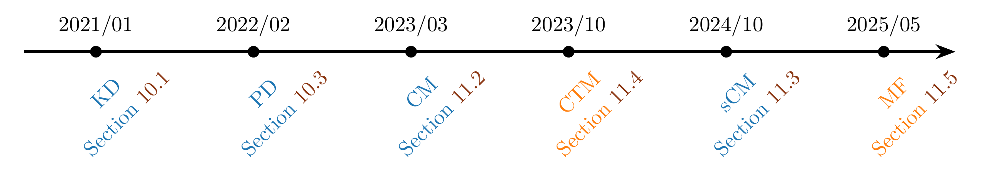
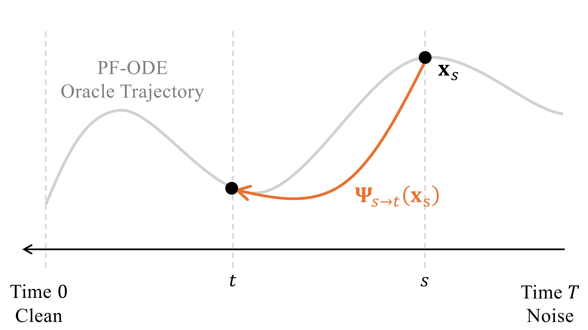

# 11.1 Prologue {#sec-fast-scratch-prologue}

**Figure 11.1:** **Timeline of diffusion-based methods for learning flow maps.** The underlying flow map is the classical ODE solution map; the dates shown here refer only to modern machine-learning methods that distill, approximate, or learn this map. We use blue for the special case ${\color{#1F77B4}{\boldsymbol{\Psi}}_{s\to 0}}$ and orange for the general map ${\color{#FF7F0E}{\boldsymbol{\Psi}}_{s\to t}}$.

Source: Created by the authors.

Figure links: [Section 10.1](../10-distillation/01-prologue.md#sec-distillation-prologue) · [Section 10.3](../10-distillation/03-progressive-distillation.md#sec-pd) · [Section 11.2](02-discrete-consistency-models.md#sec-discrete-cm) · [Section 11.4](04-consistency-trajectory-models.md#sec-ctm) · [Section 11.3](03-continuous-consistency-models.md#sec-conti-cm) · [Section 11.5](05-mean-flow.md#sec-mf).

**Motivation of Flow Map Models.** In [Chapter 10](../10-distillation/index.md#ch-distillation) we showed how the inaccessible regression target in the oracle flow-map loss $\mathcal{L}_{\mathrm{oracle}}({\boldsymbol{\theta}})$ (see [Equation (10.1.4)](01-prologue.md#eq-general-cm-loss-rep)) can be estimated by distilling knowledge from a pre-trained diffusion model to obtain few-step generators. This route is effective and practical: a two-stage pipeline can be engineered for robustness and often remains competitive in both data and compute efficiency.

In this chapter, we shift focus to a broader challenge at the core of deep generative modeling: *Can we establish a standalone generative principle that enables stable, scalable, and efficient training, fast sampling, and generation that can be easily steered by user intentions, without relying on a pre-trained model?* Designing such standalone principles lies at the center of generative modeling.

Diffusion models offer a useful design principle: start with a continuous-time forward process that gradually transforms data into a simple prior (noise) as a reference, and frame the modeling task as learning the reverse-time transport that restores this process to match the desired marginal distributions. This time-dependent formulation also makes it easier to steer the generation process at intermediate steps, compared to one-shot generative maps. Specializing to diffusion-motivated methods, this leads to the question:

**Question 11.1.1**

Can we learn the flow map ${\boldsymbol{\Psi}}_{s\to t}(\cdot)$ with a network ${\mathbf{G}}_{\boldsymbol{\theta}}(\cdot,s,t)$ (a *flow map model*) without access to pre-trained models, while maintaining high-fidelity generation?

**Figure 11.2:** **Illustration of the flow map.** Starting from any state ${\mathbf{x}}_s$ at time $s$, the flow map ${\boldsymbol{\Psi}}_{s \to t}$ transports it to the corresponding point on the same PF-ODE oracle trajectory at time $t$.

Source: Created by the authors.

This chapter develops methods toward this goal, organized around a single objective that also underlies distillation and provides a unified view of flow-map formulations ([Boffi et al., 2025](../../references.md#ref-boffi2024flow); [Hu et al., 2025](../../references.md#ref-hu2025cmt)):

$$
\mathcal{L}_{\mathrm{oracle}}({\boldsymbol{\theta}})
  := \mathbb{E}_{s,t}\,\mathbb{E}_{{\mathbf{x}}_s \sim p_s}\Big[
     w(s,t)  d\big({\mathbf{G}}_{\boldsymbol{\theta}}({\mathbf{x}}_s,s,t),  {\boldsymbol{\Psi}}_{s\to t}({\mathbf{x}}_s)\big)
  \Big].
\tag{10.1.4}
$$

Here $s,t$ are sampled from some time distribution (e.g., uniform), $w(s,t) \ge 0$ assigns weights to the time pairs $(s,t)$, and $d(\cdot,\cdot)$ is a discrepancy measure such as the squared $\ell_2$ norm. The oracle flow map ${\boldsymbol{\Psi}}_{s\to t}$ represents the ideal transformation that takes a state ${\mathbf{x}}_s$ at time $s$ and transports it directly to time $t$:

$$
{\boldsymbol{\Psi}}_{s\to t}({\mathbf{x}}_s) = {\mathbf{x}}_s + \int_s^t {\mathbf{v}}^*({\mathbf{x}}_u,u)\,\mathrm{d}u,
$$

where the oracle drift is given as

$$
{\mathbf{v}}^*({\mathbf{x}}_u,u) = {\mathbb{E}} \left[\alpha_u'{\mathbf{x}}_0+ \sigma_u'{\boldsymbol{\epsilon}} | {\mathbf{x}}_u\right],
$$

while equivalent parametrizations are also possible (see [Chapter 6](../06-unified-perspective/index.md#ch-unified-perspective)), with common choices including the ${\mathbf{x}}$-prediction and ${\mathbf{v}}$-prediction forms.

At the optimum of the oracle loss, the learned model recovers the true flow map exactly:

$$
{\mathbf{G}}^*({\mathbf{x}}_s, s, t) = {\boldsymbol{\Psi}}_{s\to t}({\mathbf{x}}_s), \quad \text{for all }\, s,t, \text{ and }\, {\mathbf{x}}_s \sim p_s.
$$

Because the flow map ${\boldsymbol{\Psi}}_{s\to t}$ cannot be expressed in closed form, it must be approximated. One option, discussed in [Chapter 10](../10-distillation/index.md#ch-distillation), is to rely on a pre-trained diffusion model. Alternatively, as we will see in this chapter, new and more tractable surrogates can be introduced. For clarity, existing approaches can be broadly categorized according to whether the training procedure queries a teacher during the loop: *distillation*, which explicitly calls a teacher model, and *training from scratch*, which avoids teacher calls by constructing self-contained surrogates.

Building on this principled objective, we now turn to systematic approaches for learning flow map models, with the aim of developing methods that are practical while also producing generations that more accurately reflect the true data distribution and are computationally efficient. We begin with a high-level introduction to this paradigm.

**Special Flow Map: Consistency Functions.** *Consistency Models* ([Song et al., 2023](../../references.md#ref-song2023consistency)) represent one of the earliest pioneering approaches to flow-map learning. They learn a few-step denoiser ${\mathbf{f}}_{\boldsymbol{\theta}}(\cdot,s)$ that approximates the special case of the flow map to the origin:

$$
{\boldsymbol{\Psi}}_{s\to 0}(\cdot), \qquad s \in (0,T].
$$

The key idea is that every state ${\mathbf{x}}_s$ is mapped to the time-$0$ endpoint ${\boldsymbol{\Psi}}_{s\to 0}({\mathbf{x}}_s)$ of the PF-ODE trajectory passing through it. Formally, the oracle training objective for the CM family ([Song et al., 2023](../../references.md#ref-song2023consistency); [Song and Dhariwal, 2024](../../references.md#ref-songimproved); [Geng et al., 2024](../../references.md#ref-geng2024consistency); [Lu and Song, 2024](../../references.md#ref-lu2024simplifying)) is

$$
\begin{aligned}
\mathcal{L}_{\mathrm{oracle}\text{-}\mathrm{CM}}({\boldsymbol{\theta}})
    := {\mathbb{E}}_{s} {\mathbb{E}}_{{\mathbf{x}}_s\sim p_s} \left[ w(s)  d \left({\mathbf{f}}_{\boldsymbol{\theta}}({\mathbf{x}}_s,s), {\boldsymbol{\Psi}}_{s\to 0}({\mathbf{x}}_s)\right)\right].
\end{aligned}
\tag{11.1.0}
$$

In practice, however, the oracle ${\boldsymbol{\Psi}}_{s\to 0}({\mathbf{x}}_s)$ is unavailable. It is therefore replaced by a *stop-gradient* target, denoted as ${\mathbf{f}}_{{\boldsymbol{\theta}}^-}$, taken from a slightly earlier step ${\boldsymbol{\Psi}}_{s\to s-\Delta s}({\mathbf{x}}_s)$ on the same trajectory:

$$
{\boldsymbol{\Psi}}_{s\to 0}({\mathbf{x}}_s) \approx {\mathbf{f}}_{{\boldsymbol{\theta}}^-} \left({\boldsymbol{\Psi}}_{s\to s-\Delta s}({\mathbf{x}}_s),\,s-\Delta s\right), \quad \Delta s > 0,
$$

where ${\boldsymbol{\Psi}}_{s\to s-\Delta s}({\mathbf{x}}_s)$ itself must also be approximated. Two practical strategies are available: (i) *distillation*, which relies on a pre-trained diffusion model, and (ii) *training from scratch*, which uses a one-point estimate without teacher guidance.

**General Flow Map.** Two representative approaches are the *Consistency Trajectory Model* (CTM) and *Mean Flow* (MF).

**Consistency Trajectory Models.** *Consistency Trajectory Model* (CTM) 
 ([Kim et al., 2024](../../references.md#ref-kim2023consistency)) is the first work to learn the general flow map ${\boldsymbol{\Psi}}_{s\to t}$ for arbitrary start and end times, and can be viewed as a concrete instance under the unified objective of [Equation (10.1.4)](01-prologue.md#eq-general-cm-loss-rep). CTM adopts an Euler-inspired parametrization by expressing the oracle flow map as

$$
\begin{aligned}
{\boldsymbol{\Psi}}_{s\to t}({\mathbf{x}}_s)
:= {\mathbf{x}}_s + \int_s^t {\mathbf{v}}^*({\mathbf{x}}_u,u)\mathop{}\!\mathrm{d} u
= \frac{t}{s} {\mathbf{x}}_s
+ \frac{s-t}{s}
\underbrace{\Big[{\mathbf{x}}_s + \frac{s}{s-t} \int_s^t {\mathbf{v}}^*({\mathbf{x}}_u,u) \mathop{}\!\mathrm{d} u\Big]}_{\approx~{\mathbf{g}}_{{\boldsymbol{\theta}}}},
\end{aligned}
$$

which motivates the neural parameterization

$$
{\mathbf{G}}_{{\boldsymbol{\theta}}}({\mathbf{x}}_s,s,t)
:= \frac{t}{s}\,{\mathbf{x}}_s + \frac{s-t}{s}\,{\mathbf{g}}_{\boldsymbol{\theta}}({\mathbf{x}}_s,s,t),
$$

where ${\mathbf{g}}_{\boldsymbol{\theta}}$ is a neural network trained so that ${\boldsymbol{\Psi}}_{s\to t}({\mathbf{x}}_s)\approx {\mathbf{G}}_{{\boldsymbol{\theta}}}({\mathbf{x}}_s,s,t)$.

Since the oracle ${\boldsymbol{\Psi}}_{s\to t}({\mathbf{x}}_s)$ is inaccessible, CTM trains against a *stop-gradient* target evaluated at an intermediate time $u$:

$$
{\boldsymbol{\Psi}}_{s\to t}({\mathbf{x}}_s)
 \approx
{\mathbf{G}}_{{\boldsymbol{\theta}}^-} \big({\boldsymbol{\Psi}}_{s\to u}({\mathbf{x}}_s),\,u,\,t\big),
\qquad u\in[t,s],
$$

where the intermediate state ${\boldsymbol{\Psi}}_{s\to u}({\mathbf{x}}_s)$ is approximated in one of two ways: (i) *distillation*, which uses a few-step solver applied to a pre-trained diffusion teacher, or (ii) *training from scratch*, which constructs a self-induced teacher directly through the ${\mathbf{G}}_{\boldsymbol{\theta}}$ parametrization.

**Mean Flow.** Mean Flow (MF) ([Geng et al., 2025](../../references.md#ref-geng2025mean)) builds on flow matching by modeling the *average drift* over an interval $[t,s]$ (with $t\le s$):

$$
{\mathbf{h}}_{{\boldsymbol{\theta}}}({\mathbf{x}}_s,s,t)
 \approx
{\mathbf{h}}^*({\mathbf{x}}_s,s,t)
:= \frac{1}{\,t-s\,}\int_s^t {\mathbf{v}}^*({\mathbf{x}}_u,u)\,\mathop{}\!\mathrm{d} u,
$$

also aligning with [Equation (10.1.4)](01-prologue.md#eq-general-cm-loss-rep). Differentiating the identity

$$
(t-s)\,{\mathbf{h}}^*({\mathbf{x}}_s,s,t)  =  \int_s^t {\mathbf{v}}^*({\mathbf{x}}_u,u)\,\mathop{}\!\mathrm{d} u
$$

with respect to $s$ yields a self-referential relation that motivates the MF objective

$$
\mathcal{L}_{\mathrm{MF}}({\boldsymbol{\theta}})
:= {\mathbb{E}}_s\,{\mathbb{E}}_{{\mathbf{x}}_s\sim p_s} \Big[w(s)\,\big\|
{\mathbf{h}}_{{\boldsymbol{\theta}}}({\mathbf{x}}_s,s,t)-{\mathbf{h}}_{{\boldsymbol{\theta}}^-}^{\mathrm{tgt}}({\mathbf{x}}_s,s,t)
\big\|_2^2\Big],
$$

with stop-gradient target

$$
{\mathbf{h}}_{{\boldsymbol{\theta}}^-}^{\mathrm{tgt}}({\mathbf{x}}_s,s,t)
:= {\mathbf{v}}^*({\mathbf{x}}_s,s)  -  (s-t) \left((\partial_{\mathbf{x}} {\mathbf{h}}_{{\boldsymbol{\theta}}^-})\,{\mathbf{v}}^*({\mathbf{x}}_s,s) + \partial_s {\mathbf{h}}_{{\boldsymbol{\theta}}^-}\right).
$$

In practice, the oracle velocity ${\mathbf{v}}^*({\mathbf{x}}_s,s)$ must also be approximated. Two common strategies are: (i) *distillation*, which leverages a pre-trained diffusion model trained with flow matching, or (ii) *training from scratch*, which uses the one-point conditional velocity $\alpha'_s\,{\mathbf{x}}_0+\sigma'_s\,{\boldsymbol{\epsilon}}$ derived from the forward corruption process ${\mathbf{x}}_s = \alpha_s {\mathbf{x}}_0+\sigma_s {\boldsymbol{\epsilon}}$.

**Relationship Between CTM and MF.** CTM and MF approximate the same path integral but parameterize different surrogates of it:

$$
\begin{aligned}
{\boldsymbol{\Psi}}_{s\to t}({\mathbf{x}}_s)
&:= {\mathbf{x}}_s  +  \int_s^t {\mathbf{v}}^*({\mathbf{x}}_u,u)\,\mathop{}\!\mathrm{d} u
\\[2pt]
&= \frac{t}{s}\,{\mathbf{x}}_s
 +  \frac{s-t}{s}\,
\underbrace{\Big[{\mathbf{x}}_s + \frac{s}{\,s-t\,} \int_s^t {\mathbf{v}}^*({\mathbf{x}}_u,u)\,\mathop{}\!\mathrm{d} u\Big]}_{\approx~{\mathbf{g}}_{{\boldsymbol{\theta}}} }
\\[4pt]
&= {\mathbf{x}}_s  +  (t-s)\,
\underbrace{\Big[\frac{1}{\,t-s\,} \int_s^t {\mathbf{v}}^*({\mathbf{x}}_u,u)\,\mathop{}\!\mathrm{d} u\Big]}_{\approx~{\mathbf{h}}_{{\boldsymbol{\theta}}} }.
\end{aligned}
$$

In words, CTM learns a *slope displacement* through ${\mathbf{g}}_{\boldsymbol{\theta}}$, while MF learns the *average drift* ${\mathbf{h}}_{\boldsymbol{\theta}}$; both are consistent ways to approximate the same integral that defines ${\boldsymbol{\Psi}}_{s\to t}$.

**What Happens Next?** We begin with the CM family, which focuses on the specific flow map ${\boldsymbol{\Psi}}_{s\to 0}$. This part covers both its discrete time origin in [Section 11.2](02-discrete-consistency-models.md#sec-discrete-cm) and its continuous time extension in [Section 11.3](03-continuous-consistency-models.md#sec-conti-cm). We then move on to the general flow map and provide a detailed discussion of two key representatives, CTM and MF. Their parameterizations, training strategies, and practical approximations are presented in [Section 11.4](04-consistency-trajectory-models.md#sec-ctm) and [Section 11.5](05-mean-flow.md#sec-mf), respectively.

We remark that the *Elucidating Diffusion Model* (EDM) introduced in [Section D.6](../../appendices/d-supplementary-proofs/06-edm.md#sec-edm) offers systematic guidelines for designing the network parameterization of the ${\mathbf{x}}$-prediction model and has demonstrated strong empirical performance. Although this section can be considered optional, the EDM formulation serves as a valuable foundation for CM-style models.

For clarity of exposition later on, we do not strictly follow the chronological order in which these approaches appeared. Instead, we organize the discussion by conceptual relationships. Nevertheless, to acknowledge originality and respect chronology, we provide the historical timeline in [Figure 11.1](01-prologue.md#fig-timeline).
