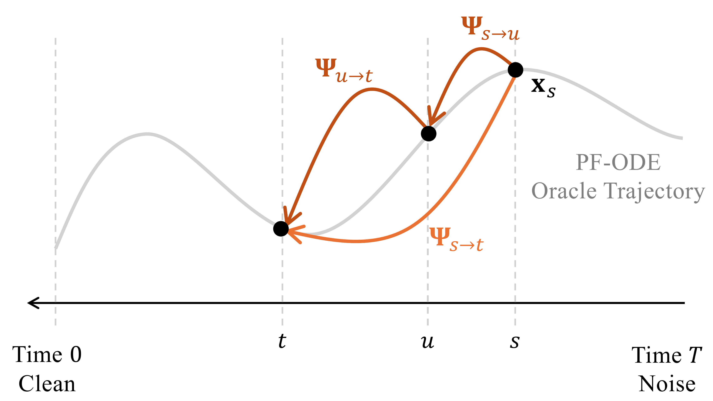

# 11.2 Special Flow Map: Consistency Model in Discrete Time {#sec-discrete-cm}

**An Important Principle of Flow Maps: The Semigroup Property.**

**Figure 11.3:** **Illustration of the flow map semigroup property.** This property states that transitioning from $s$ to $u$ and then from $u$ to $t$ is equivalent to transitioning directly from $s$ to $t$.

Source: Created by the authors.

Consistency Models (introduced in [Section 11.2](02-discrete-consistency-models.md#sec-discrete-cm) and [Section 11.3](03-continuous-consistency-models.md#sec-conti-cm)) and their generalization, the Consistency Trajectory Model ([Section 11.4](04-consistency-trajectory-models.md#sec-ctm)), define their regression targets by exploiting a key mathematical structure of flow maps. This structure is the fundamental *semigroup property*:

$$
\begin{aligned}
{\boldsymbol{\Psi}}_{u\to t}\circ {\boldsymbol{\Psi}}_{s\to u}={\boldsymbol{\Psi}}_{s\to t},
       \,\,\,
       {\boldsymbol{\Psi}}_{s\to s}={\mathbf{I}}, \quad \text{for all }\, s, u, t \in [0,T].
\end{aligned}
\tag{11.2.1}
$$

Intuitively, this means that if we first evolve a state from $s$ to $u$ (through ${\boldsymbol{\Psi}}_{s\rightarrow u}$) and then from $u$ to $t$ (through ${\boldsymbol{\Psi}}_{u\rightarrow t}$), we end up at exactly the same point as if we had evolved directly from $s$ to $t$. This is nothing more than the basic principle of ODE solving[^1]: once the starting point of a flow is specified, its future evolution is completely determined, and it follows a single well-defined path. Whether we follow this path in one long step or divide it into smaller intervals, we still move along the same trajectory and arrive at the same final state.

To build further intuition for the semigroup property, consider the solution trajectory $\{{\mathbf{x}}(s)\}_{s \in [0,T]}$ of the PF-ODE

$$
\begin{aligned}
\frac{\mathop{}\!\mathrm{d} {\mathbf{x}}(\tau)}{\mathop{}\!\mathrm{d} \tau} = {\mathbf{v}}^*({\mathbf{x}}(\tau), \tau),
\end{aligned}
$$

with a fixed initial condition ${\mathbf{x}}(T)$ at time $T$, solved backward in time. If we fix the terminal time at $t=0$, the corresponding flow map can be written more simply as

$$
{\mathbf{f}}^*(\cdot, s) := {\boldsymbol{\Psi}}_{s\to 0}(\cdot),
$$

which is referred to as the *consistency function*. By construction, this function inherits several fundamental properties directly from the semigroup identity of [Equation (11.2.1)](02-discrete-consistency-models.md#eq-semi-group) with $t=0$:

1.  **Global Consistency:** every point along the trajectory maps to the same clean endpoint,

    $$
    {\mathbf{f}}^*({\mathbf{x}}(s), s) = {\mathbf{x}}(0), \quad \text{for all }\, s \in [0,T].
    $$

    This is because

    $$
    \begin{aligned}
    {\mathbf{f}}^*({\mathbf{x}}(s),s)
    &= {\boldsymbol{\Psi}}_{s\to 0}\big({\boldsymbol{\Psi}}_{0\to s}({\mathbf{x}}(0))\big)
    = \big({\boldsymbol{\Psi}}_{s\to 0}\circ {\boldsymbol{\Psi}}_{0\to s}\big)({\mathbf{x}}(0))
    \\&= {\boldsymbol{\Psi}}_{0\to 0}({\mathbf{x}}(0))
    = {\mathbf{x}}(0).
    \end{aligned}
    $$

2.  **Self Consistency:** any two points along the same trajectory must give identical outputs,

    

    $$
    \begin{aligned}
    {\mathbf{f}}^*({\mathbf{x}}(s), s) = {\mathbf{f}}^*({\mathbf{x}}(u), u), \quad \text{for all }\, s, u \in [0,T].
    \end{aligned}
    \tag{11.2.2}
    $$

    This is a direct re-interpretation of the semigroup identity: $\Psi_{s\rightarrow 0}\circ\Psi_{0\rightarrow s}=\Psi_{u\rightarrow 0}\circ\Psi_{0\rightarrow u}$.

3.  **Local Consistency:** the consistency function is invariant with respect to $s$ when evaluated along the trajectory,

    

    $$
    \begin{aligned}
    \frac{\mathop{}\!\mathrm{d}}{\mathop{}\!\mathrm{d} s}\,{\mathbf{f}}^*({\mathbf{x}}(s),s) = 0,
            \qquad {\mathbf{f}}^*({\mathbf{x}}(0),0) = {\mathbf{x}}(0).
    \end{aligned}
    \tag{11.2.3}
    $$

    This follows from global consistency, which states that ${\mathbf{f}}^*({\mathbf{x}}(s), s)$ does not change with $s$ along the trajectory.

The three properties are all equivalent. Each states that along any solution trajectory $s\mapsto {\mathbf{x}}(s)$, the flow-to-origin/consistency map ${\mathbf{f}}^*({\mathbf{x}}(s),s)={\boldsymbol{\Psi}}_{s\to 0}({\mathbf{x}}(s))$ yields the same terminal point ${\mathbf{x}}(0)$, independent of the starting time.

**Goal of Consistency Models.** A CM aims to train a neural network ${\mathbf{f}}_{\boldsymbol{\theta}} \colon \mathbb{R}^D \times [0,T] \to \mathbb{R}^D$ to approximate the special flow map ${\boldsymbol{\Psi}}_{s\to 0}$, i.e., consistency function[^2]. The key idea is to enforce consistency along PF-ODE trajectories: states lying on the same ODE trajectory should map to the same time-$0$ endpoint (more precisely, this corresponds to the special case $t=0$ and $u=s-\Delta s$ in [Equation (11.2.1)](02-discrete-consistency-models.md#eq-semi-group)).

There are, however, multiple ways to realize this goal. The choice depends on whether a pre-trained diffusion model is available and whether training is carried out in a discrete-time or continuous-time regime. We begin by summarizing these variants in [Table 11.1](02-discrete-consistency-models.md#tb-consistency-methods) and illustrating their objectives in [Figure 11.4](03-continuous-consistency-models.md#fig-cd-ct-loss-distill). The subsequent sections ([Section 11.2](02-discrete-consistency-models.md#sec-discrete-cm) and [Section 11.3](03-continuous-consistency-models.md#sec-conti-cm)) then gradually develop the details of each approach.

**Table 11.1: Training Objectives of Consistency Models**

<table markdown="1" style="display: table; overflow: visible;">
<tr markdown="1">
<th markdown="block">

</th>
<th markdown="block">

**Distillation**

</th>
<th markdown="block">

**From Scratch**

</th>
</tr>
<tr markdown="1">
<td markdown="block">

**Discrete-time**

</td>
<td markdown="block">

[Equation (11.2.4)](02-discrete-consistency-models.md#eq-cd-discrete-approx-n)

</td>
<td markdown="block">

[Equation (11.2.6)](02-discrete-consistency-models.md#eq-ct-discrete-approx-n)

</td>
</tr>
<tr markdown="1">
<td markdown="block">

**Continuous-time**

</td>
<td markdown="block">

[Equation (11.3.5)](03-continuous-consistency-models.md#eq-cd-continuous-time)

</td>
<td markdown="block">

[Equation (11.3.6)](03-continuous-consistency-models.md#eq-ct-continuous-time)

</td>
</tr>
</table>

## 11.2.1 Discrete-Time Approximations for Learning a Consistency Function {#subsec-approx-cm}

In principle, a consistency function can be learned by minimizing the oracle loss [Equation (11.1.0)](01-prologue.md#eq-oracle-cm):

$$
\mathcal{L}_{\mathrm{oracle}\text{-}\mathrm{CM}}({\boldsymbol{\theta}})
    := {\mathbb{E}}_{s} {\mathbb{E}}_{{\mathbf{x}}_s\sim p_s} \left[ w(s)  d \left({\mathbf{f}}_{\boldsymbol{\theta}}({\mathbf{x}}_s,s), {\boldsymbol{\Psi}}_{s\to 0}({\mathbf{x}}_s)\right)\right].
$$

This objective enforces that every noisy sample ${\mathbf{x}}_s$ is mapped back to its clean endpoint ${\boldsymbol{\Psi}}_{s\to 0}({\mathbf{x}}_s)$.

The challenge is that the oracle map ${\boldsymbol{\Psi}}_{s\to 0}({\mathbf{x}}_s)$ is not available in practice. To overcome this, [Song et al. (2023)](references.md#ref-song2023consistency) exploit the *semigroup property*: any noisy state and its consecutive step along the same PF-ODE trajectory must map to the same clean endpoint. Concretely, the oracle target is replaced by a *stop-gradient* target taken from a slightly earlier point on the trajectory:

$$
\begin{aligned}
{\boldsymbol{\Psi}}_{s\to 0}({\mathbf{x}}_s)
    &= {\boldsymbol{\Psi}}_{s-\Delta s \to 0} \left({\boldsymbol{\Psi}}_{s\to s-\Delta s}({\mathbf{x}}_s)\right) \\
    &\approx {\mathbf{f}}_{{\boldsymbol{\theta}}^-} \left({\boldsymbol{\Psi}}_{s\to s-\Delta s}({\mathbf{x}}_s),\,s-\Delta s\right),
    \qquad \Delta s > 0,
\end{aligned}
$$

where $\boldsymbol{\theta}^-$ are parameters under the stop-gradient operator. A further difficulty is that the intermediate state ${\boldsymbol{\Psi}}_{s\to s-\Delta s}({\mathbf{x}}_s)$ has no closed form either and must itself be approximated. Two practical regimes have been proposed:

**With Pre-trained Diffusion Model (Consistency Distillation).** Suppose we have access to a pre-trained diffusion model. Consistency Distillation (CD) leverages the teacher model to approximate the intermediate state ${\boldsymbol{\Psi}}_{s\to s-\Delta s}({\mathbf{x}}_s)$ by simulating only a single backward ODE step:

$$
{\boldsymbol{\Psi}}_{s\to s-\Delta s}({\mathbf{x}}_s)  \approx  \mathtt{Solver}_{s \to s-\Delta s}({\mathbf{x}}_s).
$$

More concretely, a pre-trained diffusion model provides an estimate of the score function ${\mathbf{s}}_{\boldsymbol{\phi}^\times}({\mathbf{x}}_s, s) \approx \nabla_{{\mathbf{x}}_s}\log p_s({\mathbf{x}}_s)$. Using this, one can perform a one-step DDIM update from ${\mathbf{x}}_s$ to obtain an approximation of the state at $s' = s-\Delta s$:

$$
\begin{aligned}
{\boldsymbol{\Psi}}_{s\to s-\Delta s}({\mathbf{x}}_s)
    &\approx \frac{\alpha_{s'}}{\alpha_s}\,{\mathbf{x}}_s
    + \sigma_s^2 \left( \frac{\alpha_{s'}}{\alpha_s} - \frac{\sigma_{s'}}{\sigma_s} \right)\nabla_{{\mathbf{x}}_s}\log p_s({\mathbf{x}}_s) \\
    &\approx \frac{\alpha_{s'}}{\alpha_s}\,{\mathbf{x}}_s
    + \sigma_s^2 \left( \frac{\alpha_{s'}}{\alpha_s} - \frac{\sigma_{s'}}{\sigma_s} \right){\mathbf{s}}_{\boldsymbol{\phi}^\times}({\mathbf{x}}_s, s) \\
    &:= \tilde{{\mathbf{x}}}_{s'}^{\boldsymbol{\phi}^\times}.
\end{aligned}
$$

Combining this construction with the stop-gradient target yields a practical *discrete-time* proxy for the oracle loss $\mathcal{L}_{\mathrm{oracle}\text{-}\mathrm{CM}}({\boldsymbol{\theta}})$. Formally, over a partition $0 = s_1 < s_2 < \cdots < s_N = T$, the CD training objective is given by

$$
\begin{aligned}
\mathcal{L}_{\text{CD}}^N(\boldsymbol{\theta}, \boldsymbol{\theta}^-; \boldsymbol{\phi}^\times)
    := {\mathbb{E}}_{{\mathbf{x}}_0, {\boldsymbol{\epsilon}}, i} \Big[\, \omega(s_i)\,
    d\big({\mathbf{f}}_{\boldsymbol{\theta}}({\mathbf{x}}_{s_{i+1}}, s_{i+1}),\,
          {\mathbf{f}}_{\boldsymbol{\theta}^-}(\tilde{{\mathbf{x}}}_{s_i}^{\boldsymbol{\phi}^\times}, s_i)\big)\Big].
\end{aligned}
\tag{11.2.4}
$$

Here, $\omega(\cdot)$ is a time-dependent weight, $d(\cdot,\cdot)$ is a distance measurement, and $\boldsymbol{\theta}^-$ indicates stop-gradient parameters, which prevent collapse to trivial solutions (e.g., constant predictions).

**Without Pre-Trained Diffusion Model (Consistency Training).** When no pre-trained diffusion model is available, the oracle score $\nabla_{{\mathbf{x}}}\log p_s({\mathbf{x}}_s)$ can still be estimated directly using a simple one-point approximation (albeit with high variance). Recall that it admits the conditional expectation form:

$$
\begin{aligned}
\nabla_{{\mathbf{x}}_s} \log p_s({\mathbf{x}}_s)
    &= {\mathbb{E}}_{{\mathbf{x}}_0 \sim p({\mathbf{x}}_0|{\mathbf{x}}_s)} \left[ \nabla_{{\mathbf{x}}_s}\log p({\mathbf{x}}_s|{\mathbf{x}}_0) \right] \\
    &= {\mathbb{E}}_{{\mathbf{x}}_0 \sim p({\mathbf{x}}_0|{\mathbf{x}}_s)} \left[ -\frac{{\mathbf{x}}_s - \alpha_s {\mathbf{x}}_0}{\sigma_s^2} \right].
\end{aligned}
$$

The identity above suggests a simple one-sample estimator. If ${\mathbf{x}}_s$ is obtained from a paired sample $({\mathbf{x}}_0,{\boldsymbol{\epsilon}})$ via ${\mathbf{x}}_s = \alpha_s {\mathbf{x}}_0 + \sigma_s {\boldsymbol{\epsilon}}$, then

$$
\widehat{\nabla_{{\mathbf{x}}}\log p_s}({\mathbf{x}}_s)
:=-\frac{\boldsymbol\epsilon}{\sigma_s}
=-\frac{{\mathbf{x}}_s-\alpha_s {\mathbf{x}}_0}{\sigma_s^2}
$$

serves as an *unbiased* estimator of the score at ${\mathbf{x}}_s$ (conditionally unbiased with respect to $p({\mathbf{x}}_0|{\mathbf{x}}_s)$). It corresponds exactly to the *conditional score* used as the regression target in denoising score matching.

Plugging this estimate into the DDIM one-step update from $s$ to $s' = s-\Delta s$ (see [Equation (9.2.2)](../09-numerical-solvers/02-ddim.md#eq-ddim-update-all)) yields

$$
\begin{aligned}
    {\boldsymbol{\Psi}}_{s\to s'}({\mathbf{x}}_s)
&\approx
\frac{\alpha_{s'}}{\alpha_s}\,{\mathbf{x}}_s
+ \sigma_s^2 \left(\frac{\alpha_{s'}}{\alpha_s}-\frac{\sigma_{s'}}{\sigma_s}\right)\nabla_{{\mathbf{x}}_s}\log p_s({\mathbf{x}}_s) && \text{(DDIM)}
\\
&\approx
\frac{\alpha_{s'}}{\alpha_s}\,{\mathbf{x}}_s
+ \sigma_s^2 \left(\frac{\alpha_{s'}}{\alpha_s}-\frac{\sigma_{s'}}{\sigma_s}\right)\widehat{\nabla_{{\mathbf{x}}_s}\log p_s}({\mathbf{x}}_s) && \text{(1-pt score)}
\\
&=
\frac{\alpha_{s'}}{\alpha_s}\,{\mathbf{x}}_s
-\left(\frac{\alpha_{s'}}{\alpha_s}-\frac{\sigma_{s'}}{\sigma_s}\right)({\mathbf{x}}_s-\alpha_s{\mathbf{x}}_0)
\\
&= \alpha_{s'}{\mathbf{x}}_0+\sigma_{s'}{\boldsymbol{\epsilon}},
\end{aligned}
\tag{11.2.5}
$$

where[^3] ${\mathbf{x}}_0$ is the same data sample and ${\boldsymbol{\epsilon}}$ is the same Gaussian noise used to construct ${\mathbf{x}}_s$.

This leads to a teacher-free discrete-time surrogate of the oracle objective $\mathcal{L}_{\mathrm{oracle}\text{-}\mathrm{CM}}$, written as

$$
\begin{aligned}
\mathcal{L}_{\text{CT}}^N(\boldsymbol{\theta}, \boldsymbol{\theta}^-)
    := {\mathbb{E}}_{{\mathbf{x}}_0, {\boldsymbol{\epsilon}}, i} \left[
       \omega(s_i)\, d \left({\mathbf{f}}_{\boldsymbol{\theta}}({\mathbf{x}}_{s_{i+1}}, s_{i+1}),\,
       {\mathbf{f}}_{\boldsymbol{\theta}^-}({\mathbf{x}}_{s_i}, s_i)\right)
    \right],
\end{aligned}
\tag{11.2.6}
$$

with ${\mathbf{x}}_{s_i} = \alpha_{s_i}{\mathbf{x}}_0 + \sigma_{s_i}{\boldsymbol{\epsilon}}$ and ${\mathbf{x}}_{s_{i+1}} = \alpha_{s_{i+1}}{\mathbf{x}}_0 + \sigma_{s_{i+1}}{\boldsymbol{\epsilon}}$.

Using $\alpha_{s'}{\mathbf{x}}_0+\sigma_{s'}{\boldsymbol{\epsilon}}$ directly as an approximation of ${\boldsymbol{\Psi}}_{s\to s'}({\mathbf{x}}_s)$ without expectation introduces high variance[^4]. Recall, however, the analogous conditional-expectation argument in denoising score matching (see [Section 6.1](../06-unified-perspective/01-conditioning-tricks.md#sec-conditional-trick)). Here, the one-point state estimate is unbiased before it is passed through the nonlinear target network and discrepancy, so the resulting losses need not agree exactly. Conditioning on ${\mathbf{x}}_s$, the first-order error cancels in expectation; under suitable smoothness and moment assumptions, the remaining discrepancy is $\mathcal{O}(\Delta s^2)$, as formalized below.

**Theorem 11.2.1: CM-CT Equivalence up to Error $\mathcal{O}(\Delta s^2)$**

Let $s' := s - \Delta s$, and define

$$
\begin{aligned}
\mathcal{L}_{\mathrm{CM}}({\boldsymbol{\theta}},{\boldsymbol{\theta}}^-)
&:= {\mathbb{E}}_{s,{\mathbf{x}}_0,{\boldsymbol{\epsilon}}} \big[w(s)\,d\big({\mathbf{f}}_{{\boldsymbol{\theta}}}({\mathbf{x}}_s,s), {\mathbf{f}}_{{\boldsymbol{\theta}}^-}({\mathbf{x}}_{s'}^{\mathrm{DDIM}},s')\big)\big],\\
\mathcal{L}_{\mathrm{CT}}({\boldsymbol{\theta}},{\boldsymbol{\theta}}^-)
&:= {\mathbb{E}}_{s,{\mathbf{x}}_0,{\boldsymbol{\epsilon}}} \big[w(s) d\big({\mathbf{f}}_{{\boldsymbol{\theta}}}({\mathbf{x}}_s,s), {\mathbf{f}}_{{\boldsymbol{\theta}}^-}({\mathbf{x}}_{s'},s')\big)\big],
\end{aligned}
$$

where

$$
{\mathbf{x}}_{s'}^{\mathrm{DDIM}}
:= \frac{\alpha_{s'}}{\alpha_s}{\mathbf{x}}_s
+ \sigma_s^2 \left(\frac{\alpha_{s'}}{\alpha_s}-\frac{\sigma_{s'}}{\sigma_s}\right)\nabla_{{\mathbf{x}}_s}\log p_s({\mathbf{x}}_s)
$$

is the oracle DDIM update. Both ${\mathbf{x}}_s = \alpha_s{\mathbf{x}}_0 + \sigma_s{\boldsymbol{\epsilon}}$ and ${\mathbf{x}}_{s'} = \alpha_{s'}{\mathbf{x}}_0 + \sigma_{s'}{\boldsymbol{\epsilon}}$ share the same pair $({\mathbf{x}}_0,{\boldsymbol{\epsilon}})$ with ${\mathbf{x}}_0 \sim p_{\mathrm{data}}$ and ${\boldsymbol{\epsilon}} \sim \mathcal{N}(\boldsymbol{0},{\mathbf{I}})$. Then,

$$
\mathcal{L}_{\mathrm{CM}}({\boldsymbol{\theta}},{\boldsymbol{\theta}}^-)
= \mathcal{L}_{\mathrm{CT}}({\boldsymbol{\theta}},{\boldsymbol{\theta}}^-) + \mathcal{O}(\Delta s^2).
$$

**Proof for Theorem.**

First, note that the DDIM update with the oracle score equals the conditional mean,

$$
{\mathbf{x}}_{s'}^{\mathrm{DDIM}} = {\mathbb{E}}[{\mathbf{x}}_{s'} | {\mathbf{x}}_s],
$$

which can also be verified from [Equation (11.2.5)](02-discrete-consistency-models.md#eq-one-pt-score) by taking the expectation over $p(\cdot|{\mathbf{x}}_s)$. Next, perform a Taylor expansion of

$$
d({\mathbf{f}}_{{\boldsymbol{\theta}}}({\mathbf{x}}_s,s), {\mathbf{f}}_{{\boldsymbol{\theta}}^-}(\cdot,s'))
$$

around ${\mathbf{x}}_{s'}^{\mathrm{DDIM}}={\mathbb{E}}[{\mathbf{x}}_{s'}|{\mathbf{x}}_s]$. The one-point update recovers ${\mathbf{x}}_{s'}=\alpha_{s'}{\mathbf{x}}_0+\sigma_{s'}{\boldsymbol{\epsilon}}$ pathwise for the same $({\mathbf{x}}_0,{\boldsymbol{\epsilon}})$. Since

$$
{\mathbb{E}}[{\mathbf{x}}_{s'}-{\mathbf{x}}_{s'}^{\mathrm{DDIM}}\mid{\mathbf{x}}_s]=0,
$$

the linear Taylor term vanishes after conditioning on ${\mathbf{x}}_s$. Under the smoothness and moment assumptions described above, the remaining expected Taylor remainder is $\mathcal{O}(\Delta s^2)$. Hence, $\mathcal{L}_{\mathrm{CT}} =\mathcal{L}_{\mathrm{CM}}+\mathcal{O}(\Delta s^2)$. A detailed derivation is provided in [Section D.5](../../appendices/d-supplementary-proofs/05-fast-generators.md#app-sec-flow-map).

In summary, CD leverages a teacher model for initialization and supervision, which often stabilizes optimization and reduces variance. In contrast, Consistency Training (CT) requires no pre-trained model and can therefore be trained entirely from scratch. Despite this difference, CT serves as a fully standalone generative model.

**Practical Considerations.** In practice, [Song et al. (2023)](references.md#ref-song2023consistency) adopt the EDM formulation of [Karras et al. (2022)](references.md#ref-karras2022elucidating) (see [Section D.6](../../appendices/d-supplementary-proofs/06-edm.md#sec-edm)) with the forward corruption kernel ${\mathbf{x}}_s = {\mathbf{x}}_0 + s \boldsymbol{\epsilon}$, and use the neural network parameterization proposed therein (cf. [Equation (D.6.1)](../../appendices/d-supplementary-proofs/06-edm.md#eq-d-parametrization)):

$$
{\mathbf{f}}_{\boldsymbol{\theta}}({\mathbf{x}}, s)
    = c_{\mathrm{skip}}(s) {\mathbf{x}}
      + c_{\mathrm{out}}(s)\,
        {\mathbf{F}}_{\boldsymbol{\theta}} \left(c_{\mathrm{in}}(s)\,{\mathbf{x}},\, c_{\mathrm{noise}}(s)\right),
$$

where ${\mathbf{F}}_{\boldsymbol{\theta}}$ is a neural network and the coefficients follow [Equation (D.6.5)](../../appendices/d-supplementary-proofs/06-edm.md#eq-edm-simple-coefficients). This parameterization has the important boundary property

$$
{\mathbf{f}}_{\boldsymbol{\theta}}({\mathbf{x}}, 0) = {\mathbf{x}},
$$

which enforces consistency at time zero and ensures the network output matches its input when no noise is present.

## 11.2.2 Sampling with Consistency Model {#subsec-cm-sampling}

Once a consistency model ${\mathbf{f}}_{\boldsymbol{\theta}^\times}$ is trained, either in continuous or discrete time, it can be used to generate samples in a single step or a few steps. The algorithm is summarized in [Algorithm 9](02-discrete-consistency-models.md#alg-cm-sampling).

**One-Step Generation.** Given an initial latent $\hat{{\mathbf{x}}}_T$ sampled from the prior distribution (in practice, $\mathcal{N}(\boldsymbol{0}, T^2{\mathbf{I}})$), a clean sample can be generated via a single function evaluation: ${\mathbf{f}}_{\boldsymbol{\theta}^\times}(\hat{{\mathbf{x}}}_T, T)$.

**Multi-Step Generation.** With pre-selected timesteps $T>\tau_1 > \tau_2 > \cdots > \tau_{M-1}=0$, start from initial noise $\hat{\mathbf{x}}_T$ and alternate between noise injection and large clean jumps via the consistency model at earlier time points, gradually refining the sample:

$$
\begin{aligned}
\hat{\mathbf{x}}_T \xrightarrow[\text{get a clean}]{\text{long jump}} {\mathbf{f}}_{\boldsymbol{\theta}^\times}(\hat{\mathbf{x}}_T, T)
    \xrightarrow[\text{to level $\tau_1$}]{\text{add noise}} \hat{\mathbf{x}}_{\tau_1}
    \xrightarrow[\text{get a clean}]{\text{long jump}} {\mathbf{f}}_{\boldsymbol{\theta}^\times}(\hat{\mathbf{x}}_{\tau_1}, \tau_1)
    \xrightarrow[\text{to level $\tau_2$}]{\text{add noise}} \cdots.
\end{aligned}
$$

<section class="book-algorithm" id="alg-cm-sampling" aria-labelledby="alg-cm-sampling-title" markdown="1">

Algorithm 9: CM’s Sampling with One-Step or Multi-Step Generation

**Input:** Consistency model ${\mathbf{f}}_{\boldsymbol{\theta}^\times}(\cdot, \cdot)$, sequence of time points $T&gt;\tau_1 &gt; \tau_2 &gt; \cdots &gt; \tau_{M-1}=0$, initial noise $\hat{{\mathbf{x}}}_T$

1

**if** one-step **then**

2

${\mathbf{x}} \leftarrow {\mathbf{f}}_{\boldsymbol{\theta}^\times}(\hat{{\mathbf{x}}}_T, T)$

3

**else**

4

${\mathbf{x}} \leftarrow {\mathbf{f}}_{\boldsymbol{\theta}^\times}(\hat{{\mathbf{x}}}_T, T)$

5

**for** $m=1$ **to** $M-1$ **do**

6

Sample $\boldsymbol{\epsilon} \sim \mathcal{N}(\boldsymbol{0}, \mathbf{I})$

7

$\hat{{\mathbf{x}}}_{\tau_m} \leftarrow \alpha_{\tau_m}{\mathbf{x}} + \sigma_{\tau_m} \boldsymbol{\epsilon}$

8

${\mathbf{x}} \leftarrow {\mathbf{f}}_{\boldsymbol{\theta}^\times}(\hat{{\mathbf{x}}}_{\tau_m}, \tau_m)$

9

**end for**

10

**end if**

**Output:** ${\mathbf{x}}$

</section>

[^1]: The semigroup property follows from the uniqueness theorem for ODE initial value problems (see [Appendix A](../../appendices/a-differential-equations/index.md#app-de)).

[^2]: The concept of a consistency function for an ODE generalizes to a function ${\mathbf{f}}({\mathbf{x}},t)$ for an SDE such that ${\mathbf{f}}({\mathbf{x}}_t,t)$ is a (local) martingale with respect to the SDE’s natural filtration, i.e.

    $$
    {\mathbb{E}}[{\mathbf{f}}({\mathbf{x}}_t,t)|{\mathbf{x}}_s]={\mathbf{f}}({\mathbf{x}}_s,s),\quad\text{for all }\quad t\ge s.
    $$

    This generalization was proposed/observed in ([Daras et al., 2023](references.md#ref-daras2023consistent); [Lai et al., 2023](references.md#ref-lai2023fp)), and the theoretical connections are summarized in ([Lai et al., 2023](references.md#ref-lai2023equivalence)).

[^3]: The last identity follows directly from the forward corruption process ${\mathbf{x}}_s=\alpha_s {\mathbf{x}}_0+\sigma_s {\boldsymbol{\epsilon}}$ by elementary algebra.

[^4]: The one-point (conditional) score estimate $\widehat{\nabla_{{\mathbf{x}}}\log}p_s({\mathbf{x}}_s)$ can be viewed as a one-sample Monte Carlo estimator, which is *conditionally unbiased* given ${\mathbf{x}}_s$: averaging this estimator over the (generally intractable) clean posterior $p(\cdot|{\mathbf{x}}_s)$ recovers the true score as

    $$
    \nabla_{{\mathbf{x}}_s}\log p_s({\mathbf{x}}_s)
    = {\mathbb{E}}_{{\mathbf{x}}_0\sim p(\cdot|{\mathbf{x}}_s)}
     \left[\widehat{\nabla_{{\mathbf{x}}}\log}p_s({\mathbf{x}}_s)\right].
    $$
