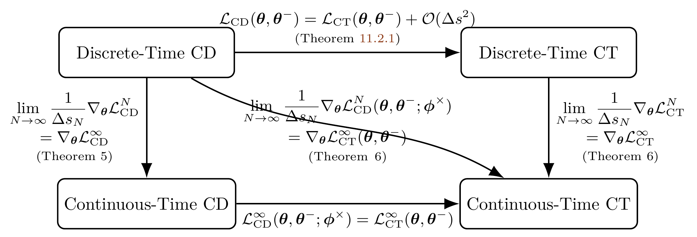

# 11.3 Special Flow Map: Consistency Model in Continuous Time {#sec-conti-cm}

We now move beyond the discrete-time setting of consistency models and consider a continuous-time perspective. Unlike the discrete approach, which fixes a time grid and trains only on those sampled points, the continuous formulation treats the flow map as defined for all times. This shift eliminates the dependence on an arbitrary discretization and provides a more principled alignment with the underlying dynamics. It also helps reduce the approximation errors that naturally arise from discretized integration, and ensures consistency is enforced globally rather than only at selected steps.

## 11.3.1 Continuous-Time Consistency Model {#subsec-conti-ct}

To motivate the continuous time formulation, we first revisit [Equation (11.2.3)](02-discrete-consistency-models.md#eq-cm-diff), which describes the condition under which time derivatives can be taken. Using the chain rule, we arrive at

$$
\begin{aligned}
        &\frac{\mathop{}\!\mathrm{d} }{\mathop{}\!\mathrm{d} s} {\mathbf{f}}^*({\mathbf{x}}(s), s) = 0 \\
    \Longleftrightarrow\,\,
    &\left(\nabla_{{\mathbf{x}}} {\mathbf{f}}^*\right)({\mathbf{x}}(s), s) \cdot
    \underbrace{\frac{\mathop{}\!\mathrm{d} }{\mathop{}\!\mathrm{d} s} {\mathbf{x}}(s)}_{\text{ODE velocity}} +
    \left(\frac{\partial }{\partial s} {\mathbf{f}}^*\right)({\mathbf{x}}(s), s) = 0,
\end{aligned}
\tag{11.3.1}
$$

where the trajectory ${\mathbf{x}}(s)$ follows the PF-ODE

$$
\begin{aligned}
\frac{\mathop{}\!\mathrm{d} }{\mathop{}\!\mathrm{d} s}{\mathbf{x}}(s) =  {\mathbf{v}}^*({\mathbf{x}}(s), s).
\end{aligned}
$$

This relationship shows that the consistency function ${\mathbf{f}}^*$ remains constant along any solution trajectory of the ODE. The velocity field ${\mathbf{v}}^*$ can be estimated in practice either from a pre-trained diffusion model (when such a model is available) or from a direct one-point approximation, such as $\alpha_s' {\mathbf{x}}_0 + \sigma_s' {\boldsymbol{\epsilon}}$, as explained in [Section 11.2](02-discrete-consistency-models.md#sec-discrete-cm).

[Equation (11.3.1)](03-continuous-consistency-models.md#eq-conti-ct-motivation) suggests a natural continuous-time characterization of consistency along PF-ODE trajectories. One possible approach is to enforce this differential condition directly by minimizing the residual, in a manner similar to physics-informed neural networks (PINNs) ([Raissi, 2018](../../references.md#ref-raissi2018deep); [Boffi et al., 2025](../../references.md#ref-boffi2024flow)):

$$
\begin{aligned}
\min_{\boldsymbol{\theta}}
\mathbb{E}_{s,{\mathbf{x}}_s\sim p_s}
\left[
\left\|
\partial_s{\mathbf{f}}_{\boldsymbol{\theta}}({\mathbf{x}}_s,s)
+
\big(\partial_{{\mathbf{x}}}{\mathbf{f}}_{\boldsymbol{\theta}}({\mathbf{x}}_s,s)\big)
{\mathbf{v}}^*({\mathbf{x}}_s,s)
\right\|_2^2
\right].
\end{aligned}
$$

In practice, however, [Song et al. (2023)](../../references.md#ref-song2023consistency) and [Lu and Song (2024)](../../references.md#ref-lu2024simplifying) employ teacher-based consistency objectives rather than directly optimizing this residual. This motivates asking whether the discrete consistency loss admits a meaningful infinitesimal counterpart as $\Delta s \to 0$. The proposition below shows that, at the comparison point where the stop-gradient target coincides with the online network, the scaled discrete-time gradient converges to the gradient of a continuous-time objective:

$$
\begin{aligned}
\mathcal{L}_{\mathrm{CM}}^{\Delta s}({\boldsymbol{\theta}},{\boldsymbol{\theta}}^-)
:= {\mathbb{E}} \left[\omega(s) \big\|
{\mathbf{f}}_{{\boldsymbol{\theta}}}({\mathbf{x}}_s,s) -
{\mathbf{f}}_{{\boldsymbol{\theta}}^-} \big({\boldsymbol{\Psi}}_{s\to s-\Delta s}({\mathbf{x}}_s), s-\Delta s\big)
\big\|_2^2\right].
\end{aligned}
\tag{11.3.2}
$$

For a uniform partition underlying [Equation (11.2.4)](02-discrete-consistency-models.md#eq-cd-discrete-approx-n) and [Equation (11.2.6)](02-discrete-consistency-models.md#eq-ct-discrete-approx-n), let

$$
\Delta s_N:=\frac{T}{N-1}.
$$

Then $\Delta s_N\to0$ as $N\to\infty$, so the infinitesimal limit in [Equation (11.3.2)](03-continuous-consistency-models.md#eq-cm-discrete) corresponds to refining these discrete objectives.

We summarize this key idea in the following proposition.

**Proposition 11.3.1: Continuous-Time Consistency Training**

The following convergence result holds at $\boldsymbol{\theta}=\boldsymbol{\theta}^-$:

$$
\begin{aligned}
\left.\lim_{\Delta s\to 0}\frac{1}{\Delta s}\nabla_{{\boldsymbol{\theta}}}\mathcal{L}_{\mathrm{CM}}^{\Delta s}(\boldsymbol{\theta}, \boldsymbol{\theta}^-)\right|_{\boldsymbol{\theta}=\boldsymbol{\theta}^-}
    =
    \left.\nabla_{\boldsymbol{\theta}} \mathcal{L}^\infty_{\mathrm{CM}}(\boldsymbol{\theta}, \boldsymbol{\theta}^-)\right|_{\boldsymbol{\theta}=\boldsymbol{\theta}^-}.
\end{aligned}
$$

Here,

$$
\begin{aligned}
\mathcal{L}^\infty_{\mathrm{CM}}(\boldsymbol{\theta},\boldsymbol{\theta}^-)
    :=
    \mathbb{E}_{s,{\mathbf{x}}_0,\boldsymbol{\epsilon}}\left[
    2\omega(s)\,
    {\mathbf{f}}_{\boldsymbol{\theta}}^\top({\mathbf{x}}_s, s)\cdot
    \frac{\mathop{}\!\mathrm{d} }{\mathop{}\!\mathrm{d} s}{\mathbf{f}}_{\boldsymbol{\theta}^-}({\mathbf{x}}_s, s)
    \right],
\end{aligned}
$$

and the total differentiation identity is

$$
\begin{aligned}
\frac{\mathop{}\!\mathrm{d}}{\mathop{}\!\mathrm{d} s}{\mathbf{f}}_{{\boldsymbol{\theta}}^-}({\mathbf{x}}_s,s)
    =
    \partial_s {\mathbf{f}}_{{\boldsymbol{\theta}}^-}({\mathbf{x}}_s,s)
    + \big(\partial_{{\mathbf{x}}}{\mathbf{f}}_{{\boldsymbol{\theta}}^-}({\mathbf{x}}_s,s)\big){\mathbf{v}}^*({\mathbf{x}}_s,s).
\end{aligned}
\tag{11.3.3}
$$

**Proof for Proposition.**

A first-order Taylor expansion of the stop-gradient target around $({\mathbf{x}}_s, s)$ shows that the loss $\mathcal{L}_{\mathrm{CM}}^{\Delta s}$ behaves, up to $\mathcal{O}(\Delta s^2)$, like an inner product between the student update $\nabla_{{\boldsymbol{\theta}}}{\mathbf{f}}_{{\boldsymbol{\theta}}}({\mathbf{x}}_s,s)$ and the tangent change $\tfrac{\mathop{}\!\mathrm{d}}{\mathop{}\!\mathrm{d} s}{\mathbf{f}}_{{\boldsymbol{\theta}}^-}({\mathbf{x}}_s,s)$. Evaluating at $\boldsymbol{\theta}=\boldsymbol{\theta}^-$ removes the zeroth-order discrepancy term, so the scaled gradient satisfies

$$
\left.\lim_{\Delta s\to 0}\frac{1}{\Delta s}\nabla_{{\boldsymbol{\theta}}}\mathcal{L}_{\mathrm{CM}}^{\Delta s}\right|_{\boldsymbol{\theta}=\boldsymbol{\theta}^-}
=
\left.\nabla_{{\boldsymbol{\theta}}}{\mathbb{E}}\left[
2\omega(s)\,
{\mathbf{f}}_{{\boldsymbol{\theta}}}^\top({\mathbf{x}}_s,s)\cdot
\frac{\mathop{}\!\mathrm{d}}{\mathop{}\!\mathrm{d} s}{\mathbf{f}}_{{\boldsymbol{\theta}}^-}({\mathbf{x}}_s,s)
\right]\right|_{\boldsymbol{\theta}=\boldsymbol{\theta}^-},
$$

which is the claimed identity. We defer the proof to [Section D.5](../../appendices/d-supplementary-proofs/05-fast-generators.md#app-sec-flow-map).

The result above is written under the gradient operator $\nabla_{\boldsymbol{\theta}}$ so that terms involving $\boldsymbol{\theta}^-$ vanish, since $\boldsymbol{\theta}^-$ is treated as constant under stop-gradient. Note that $\tfrac{\mathop{}\!\mathrm{d}}{\mathop{}\!\mathrm{d} s}{\mathbf{f}}_{{\boldsymbol{\theta}}^-}({\mathbf{x}}_s,s)$ denotes the total derivative along the oracle trajectory, rather than a simple partial time derivative.

In summary, the continuous-time consistency model can be trained using the gradient of the following pseudo-objective (ignoring the factor $2$):

$$
\begin{aligned}
\mathcal{L}^\infty_{\mathrm{CM}}(\boldsymbol{\theta},\boldsymbol{\theta}^-) := \mathbb{E}_{s,{\mathbf{x}}_0, \boldsymbol{\epsilon}}\left[\omega(s){\mathbf{f}}_{\boldsymbol{\theta}}^\top({\mathbf{x}}_s, s) \cdot \frac{\mathop{}\!\mathrm{d} }{\mathop{}\!\mathrm{d} s} {\mathbf{f}}_{\boldsymbol{\theta}^-}({\mathbf{x}}_s, s) \right].
\end{aligned}
\tag{11.3.4}
$$

## 11.3.2 Training Continuous-Time Consistency Model {#training-continuous-time-consistency-model}

Similar to the discrete-time case discussed in [Section 11.2.1](02-discrete-consistency-models.md#subsec-approx-cm), we now clarify the practical approximation of the tangent term in [Equation (11.3.4)](03-continuous-consistency-models.md#eq-conti-ct-loss), which involves the inaccessible oracle velocity ${\mathbf{v}}^*$:

$$
\begin{aligned}
\frac{\mathop{}\!\mathrm{d}}{\mathop{}\!\mathrm{d} s}{\mathbf{f}}_{{\boldsymbol{\theta}}^-}({\mathbf{x}}_s,s)
    = \partial_s {\mathbf{f}}_{{\boldsymbol{\theta}}^-}({\mathbf{x}}_s,s)
    + \big(\partial_{{\mathbf{x}}}{\mathbf{f}}_{{\boldsymbol{\theta}}^-}({\mathbf{x}}_s,s)\big)\,{\mathbf{v}}^*({\mathbf{x}}_s,s).
\end{aligned}
$$

After training a continuous-time CM, sampling follows the same procedure as in the discrete time case ([Section 11.2.2](02-discrete-consistency-models.md#subsec-cm-sampling)).

**Continuous-Time Consistency Distillation.** If a pre-trained diffusion model is available such that ${\mathbf{v}}_{\boldsymbol{\phi}^\times} \approx {\mathbf{v}}^*$, then the tangent vector $\tfrac{\mathop{}\!\mathrm{d}}{\mathop{}\!\mathrm{d} s}{\mathbf{f}}_{{\boldsymbol{\theta}}^-}({\mathbf{x}}_s,s)$ in [Equation (11.3.3)](03-continuous-consistency-models.md#eq-total-diff) can be approximated by the surrogate

$$
\begin{aligned}
\frac{\mathop{}\!\mathrm{d}}{\mathop{}\!\mathrm{d} s}{\mathbf{f}}_{{\boldsymbol{\theta}}^-}({\mathbf{x}}_s,s)
     \approx
    \partial_s {\mathbf{f}}_{{\boldsymbol{\theta}}^-}({\mathbf{x}}_s,s)
    + \big(\partial_{{\mathbf{x}}}{\mathbf{f}}_{{\boldsymbol{\theta}}^-}({\mathbf{x}}_s,s)\big)\,
      {\mathbf{v}}_{\boldsymbol{\phi}^\times}({\mathbf{x}}_s,s).
\end{aligned}
\tag{11.3.5}
$$

We denote the resulting objective as $\mathcal{L}^\infty_{\mathrm{CM}}(\boldsymbol{\theta},\boldsymbol{\theta}^-;\boldsymbol{\phi}^\times)$. Accordingly, [Proposition 11.3.1](03-continuous-consistency-models.md#continuous-time-ct) can be restated as

$$
\lim_{N\to\infty}
\frac{1}{\Delta s_N}\,\nabla_{\boldsymbol{\theta}}\,
\mathcal{L}_{\mathrm{CD}}^{N}(\boldsymbol{\theta},\boldsymbol{\theta}^-;\boldsymbol{\phi}^\times)
=
\nabla_{\boldsymbol{\theta}}\,
\mathcal{L}_{\mathrm{CD}}^{\infty}(\boldsymbol{\theta},\boldsymbol{\theta}^-;\boldsymbol{\phi}^\times).
$$

**Continuous-Time Consistency Training (from Scratch).** On the other hand, if a pre-trained diffusion model is not available, the oracle velocity ${\mathbf{v}}^*$ can be approximated using the one point conditional estimate $\alpha_s'{\mathbf{x}}_0 + \sigma_s'{\boldsymbol{\epsilon}}$. In this case, the tangent vector $\tfrac{\mathop{}\!\mathrm{d}}{\mathop{}\!\mathrm{d} s}{\mathbf{f}}_{{\boldsymbol{\theta}}^-}({\mathbf{x}}_s,s)$ in [Equation (11.3.3)](03-continuous-consistency-models.md#eq-total-diff) is replaced by the surrogate

$$
\begin{aligned}
\frac{\mathop{}\!\mathrm{d}}{\mathop{}\!\mathrm{d} s}{\mathbf{f}}_{{\boldsymbol{\theta}}^-}({\mathbf{x}}_s,s)
     \approx
    \partial_s {\mathbf{f}}_{{\boldsymbol{\theta}}^-}({\mathbf{x}}_s,s)
    + \big(\partial_{{\mathbf{x}}}{\mathbf{f}}_{{\boldsymbol{\theta}}^-}({\mathbf{x}}_s,s)\big)
      \left(\alpha_s'{\mathbf{x}}_0 + \sigma_s'{\boldsymbol{\epsilon}}\right).
\end{aligned}
\tag{11.3.6}
$$

We denote the resulting objective as $\mathcal{L}^\infty_{\mathrm{CT}}(\boldsymbol{\theta},\boldsymbol{\theta}^-)$, which corresponds to the training from scratch setting. Accordingly, [Proposition 11.3.1](03-continuous-consistency-models.md#continuous-time-ct) can be restated as

$$
\lim_{N\to\infty}
\frac{1}{\Delta s_N}\,\nabla_{\boldsymbol{\theta}}
\mathcal{L}_{\mathrm{CT}}^{N}(\boldsymbol{\theta},\boldsymbol{\theta}^-)
=
\nabla_{\boldsymbol{\theta}}
\mathcal{L}_{\mathrm{CT}}^{\infty}(\boldsymbol{\theta},\boldsymbol{\theta}^-).
$$

So far, we have introduced all the fundamental approaches listed in [Table 11.1](02-discrete-consistency-models.md#tb-consistency-methods) to realize the learning of the consistency function ${\boldsymbol{\Psi}}_{s\to 0}$. To provide a clearer overview, [Figure 11.4](03-continuous-consistency-models.md#fig-cd-ct-loss-distill) summarizes the relationships among the different loss functions for training consistency functions. The figure also indicates whether each method relies on a pre-trained diffusion model and distinguishes between continuous time and discrete time objectives.

**Figure 11.4:** **Diagram showing relationships between discrete/continuous-time CD and CT under the $\ell_2$ distance metric: $d({\mathbf{x}},{\mathbf{y}})=\|{\mathbf{x}}-{\mathbf{y}}\|_2^2$.** The marked theorems follow the labeling in ([Song et al., 2023](../../references.md#ref-song2023consistency)). Whenever the theorems involve CT, we assume a perfect score: ${\mathbf{s}}_{\boldsymbol{\phi}^\times}({\mathbf{x}}, t) \equiv \nabla_{\mathbf{x}} \log p_t({\mathbf{x}})$. $\mathcal{L}^\infty_{\text{CT}}$ is defined in [Equation (11.3.4)](03-continuous-consistency-models.md#eq-conti-ct-loss), while $\mathcal{L}^\infty_{\text{CD}}$ is defined in [Equation (11.3.5)](03-continuous-consistency-models.md#eq-cd-continuous-time).

Source: Created by the authors.

Figure link: [Theorem 11.2.1](02-discrete-consistency-models.md#thm-ct-cm).

However, the tangent vector $\tfrac{\mathop{}\!\mathrm{d} }{\mathop{}\!\mathrm{d} s}{\mathbf{f}}_{\boldsymbol{\theta}^-}$ often causes instability during training. In the following optional section, we present techniques from *Simplifying, Stabilizing and Scaling Continuous Time Consistency Models* (sCM) ([Lu and Song, 2024](../../references.md#ref-lu2024simplifying)) that mitigate these issues.

## 11.3.3 (Optional) Practical Considerations of Continuous-Time CT {#practical-considerations}

Our interest lies in the training from scratch scenario, since it yields a standalone generative model that does not rely on external pre-trained diffusion models. Hence, we focus our discussion on the continuous time case.

In practice, however, training directly with [Equation (11.3.4)](03-continuous-consistency-models.md#eq-conti-ct-loss) is often unstable, as the term $\tfrac{\mathop{}\!\mathrm{d}}{\mathop{}\!\mathrm{d} s}{\mathbf{f}}_{\boldsymbol{\theta}^-}$ can exhibit large or unbounded time derivatives, leading to exploding gradients during optimization. To overcome this, suitable parameterizations and stabilization strategies are typically required ([Geng et al., 2025](../../references.md#ref-geng2025consistency); [Lu and Song, 2024](../../references.md#ref-lu2024simplifying)). As summarized in [Section 6.2.2](../06-unified-perspective/02-training-objectives.md#subsec-summary-disentagle), the main factors that influence stable training include the *diffusion process*, *parameterization choices*, *time weighting function*, and *time sampling distribution*, all of which should be carefully designed and disentangled also in continuous-time CM.

**Diffusion Process.** Instead of using the standard diffusion parameterization ${\mathbf{x}}_s = \alpha_s {\mathbf{x}}_0 + \sigma_s \boldsymbol{\epsilon}$ with $\boldsymbol{\epsilon} \sim \mathcal{N}(\boldsymbol{0}, {\mathbf{I}})$, [Lu and Song (2024)](../../references.md#ref-lu2024simplifying) adopt a trigonometric schedule. This schedule, although mathematically equivalent to the original form (as shown in [Equation (6.3.4)](../06-unified-perspective/03-equivalent-parameterizations.md#eq-trig-para)), provides a cleaner structure and a better separation in the training objective, which contributes to improved stability during training [^1]. In addition, they incorporate the standard deviation $\sigma_{\mathrm{d}}$ of the data distribution $p_{\mathrm{data}}$, in line with EDM’s design in [Section D.6.1](../../appendices/d-supplementary-proofs/06-edm.md#subsec-d-design-edm):

$$
\begin{aligned}
{\mathbf{x}}_s := \cos(s) {\mathbf{x}}_0 + \sin(s) {\mathbf{z}}, \quad \text{where } {\mathbf{z}} \sim \mathcal{N}(\boldsymbol{0}, \sigma_{\mathrm{d}}^2 {\mathbf{I}}).
\end{aligned}
\tag{11.3.7}
$$

This formulation is fully general. For any diffusion process of the form ${\mathbf{x}}_s = \alpha_s {\mathbf{x}}_0 + \sigma_s \boldsymbol{\epsilon}$ with $\boldsymbol{\epsilon} \sim \mathcal{N}(\boldsymbol{0}, {\mathbf{I}})$, we can equivalently write:

$$
{\mathbf{x}}_s = \alpha_s {\mathbf{x}}_0 + \frac{\sigma_s}{\sigma_\mathrm{d}} \cdot (\sigma_{\mathrm{d}} \boldsymbol{\epsilon}),
$$

by defining ${\mathbf{z}} := \sigma_{\mathrm{d}} \boldsymbol{\epsilon}$, $\alpha'_s := \alpha_s$, and $\sigma'_s := \frac{\sigma_s}{\sigma_{\mathrm{d}}}$. The transformed pair $(\alpha'_s, \sigma'_s)$ can then be mapped to the trigonometric form $(\cos(s), \sin(s))$ using the normalization described in [Equation (6.3.5)](../06-unified-perspective/03-equivalent-parameterizations.md#eq-any-to-trig).

**Parametrizations.** By considering the analogous principles of EDM in [Section D.6.1](../../appendices/d-supplementary-proofs/06-edm.md#subsec-d-design-edm), [Lu and Song (2024)](../../references.md#ref-lu2024simplifying) propose the following parametrization for the neural network similar to [Equation (D.6.1)](../../appendices/d-supplementary-proofs/06-edm.md#eq-d-parametrization):

$$
\begin{aligned}
{\mathbf{f}}_{\boldsymbol{\theta}}({\mathbf{x}}, s) := c_{\mathrm{skip}}(s){\mathbf{x}} + c_{\mathrm{out}}(s){\mathbf{F}}_{\boldsymbol{\theta}}\left(c_{\mathrm{in}}(s){\mathbf{x}}, c_{\mathrm{noise}}(s)\right).
\end{aligned}
$$

Here, $c_{\mathrm{skip}}(s)$, $c_{\mathrm{out}}(s)$, and $c_{\mathrm{in}}(s)$ can be derived using the same criteria presented in [Section D.6.1](../../appendices/d-supplementary-proofs/06-edm.md#subsec-d-design-edm) (see Appendix B of [Lu and Song (2024)](../../references.md#ref-lu2024simplifying) for detailed derivations), and are given by

$$
c_{\mathrm{skip}}(s) = \cos(s), \quad c_{\mathrm{out}}(s) = -\sigma_{\mathrm{d}} \sin(s), \quad c_{\mathrm{in}}(s) \equiv \frac{1}{\sigma_{\mathrm{d}}}.
$$

This is considered along with the default choice $c_{\mathrm{noise}}(s) = s$, where $\partial_s c_{\mathrm{noise}}(s)$ is bounded to ensure training stability, as will be discussed around [Equation (11.3.10)](03-continuous-consistency-models.md#eq-ds-decomposition). This leads to the following parametrization under the trigonometric schedule:

$$
\begin{aligned}
{\mathbf{f}}_{\boldsymbol{\theta}}({\mathbf{x}}, s) = \cos(s){\mathbf{x}} - \sin(s)\sigma_{\mathrm{d}}{\mathbf{F}}_{\boldsymbol{\theta}}\left(\frac{{\mathbf{x}}}{\sigma_{\mathrm{d}}}, c_{\mathrm{noise}}(s)\right).
\end{aligned}
\tag{11.3.8}
$$

We note that this parametrization also ensures that the neural network always satisfies the boundary condition ${\mathbf{f}}_{\boldsymbol{\theta}}({\mathbf{x}}, 0) \equiv {\mathbf{x}}$ for all ${\mathbf{x}}$, which is an essential property of a consistency function.

**Techniques for Stabilizing Tangent Training.** Under the trigonometric schedule and the network parametrization described in [Equation (11.3.8)](03-continuous-consistency-models.md#eq-trig-nn), the gradient of the loss in [Equation (11.3.4)](03-continuous-consistency-models.md#eq-conti-ct-loss) becomes

$$
\begin{aligned}
\nabla_{\boldsymbol{\theta}}\mathcal{L}^\infty_{\text{CT}}(\boldsymbol{\theta},\boldsymbol{\theta}^-)  =\nabla_{\boldsymbol{\theta}} \mathbb{E}_{s, {\mathbf{x}}_0, \boldsymbol{\epsilon}} \left[ -\omega(s) \sigma_{\mathrm{d}} \sin(s) {\mathbf{F}}_{\boldsymbol{\theta}}^\top\left( \frac{{\mathbf{x}}_s}{\sigma_{\mathrm{d}}}, s \right) \cdot \frac{\mathop{}\!\mathrm{d} {\mathbf{f}}_{\boldsymbol{\theta}^-}}{\mathop{}\!\mathrm{d} s} ({\mathbf{x}}_s, s) \right].
\end{aligned}
\tag{11.3.9}
$$

In theory, training with the gradient update in [Equation (11.3.9)](03-continuous-consistency-models.md#eq-conti-ct-loss-trig) may be sufficient to learn a consistency function. However, [Lu and Song (2024)](../../references.md#ref-lu2024simplifying) empirically observed that the training process can become unstable in practice due to the behavior of the tangent function, given by

$$
\begin{aligned}
&\underbrace{\frac{\mathop{}\!\mathrm{d} {\mathbf{f}}_{\boldsymbol{\theta}^-}({\mathbf{x}}_s, s)}{\mathop{}\!\mathrm{d} s}}_{\textbf{A.}}
= \\&-\cos(s) \left( \sigma_{\mathrm{d}} {\mathbf{F}}_{\boldsymbol{\theta}^-}\left( \frac{{\mathbf{x}}_s}{\sigma_{\mathrm{d}}}, s \right) - \frac{\mathop{}\!\mathrm{d} {\mathbf{x}}_s}{\mathop{}\!\mathrm{d} s} \right) - \sin(s) \left( {\mathbf{x}}_s + \sigma_{\mathrm{d}} \frac{\mathop{}\!\mathrm{d} {\mathbf{F}}_{\boldsymbol{\theta}^-}}{\mathop{}\!\mathrm{d} s}\left( \frac{{\mathbf{x}}_s}{\sigma_{\mathrm{d}}}, c_{\mathrm{noise}}(s) \right) \right).
\end{aligned}
$$

In particular, instability was observed in the term

$$
\begin{aligned}
\underbrace{\sin(s) \frac{\mathop{}\!\mathrm{d} {\mathbf{F}}_{\boldsymbol{\theta}^-}}{\mathop{}\!\mathrm{d} s}\left( \frac{{\mathbf{x}}_s}{\sigma_{\mathrm{d}}}, c_{\mathrm{noise}}(s) \right)}_{\textbf{B.}}
= \sin(s) \nabla_{{\mathbf{x}}_s} {\mathbf{F}}_{\boldsymbol{\theta}^-} \frac{\mathop{}\!\mathrm{d} {\mathbf{x}}_s}{\mathop{}\!\mathrm{d} s}
+ \sin(s) \partial_s {\mathbf{F}}_{\boldsymbol{\theta}^-}.
\end{aligned}
$$

More specifically, the instability arises from the component

$$
\begin{aligned}
\sin(s) \partial_s {\mathbf{F}}_{\boldsymbol{\theta}^-} = \sin(s) \underbrace{\frac{\partial c_{\mathrm{noise}}(s)}{\partial s} \cdot \frac{\partial \text{emb}(c_{\mathrm{noise}})}{\partial c_{\mathrm{noise}}}}_{\textbf{C.}} \cdot \frac{\partial {\mathbf{F}}_{\boldsymbol{\theta}^-}}{\partial \text{emb}(c_{\mathrm{noise}})}.
\end{aligned}
\tag{11.3.10}
$$

Here, we follow a common practice in the DM and CM literature by applying a positional or Fourier embedding, denoted by $\text{emb}(\cdot)$, to the time variable $c_{\mathrm{noise}}(s)$:

$$
s \mapsto c_{\mathrm{noise}}(s) \mapsto \text{emb}(c_{\mathrm{noise}}(s)) \mapsto {\mathbf{F}}_{\boldsymbol{\theta}^-}\left( \frac{{\mathbf{x}}_s}{\sigma_{\mathrm{d}}}, \text{emb}(c_{\mathrm{noise}}(s)) \right).
$$

Therefore, some additional empirical techniques are introduced to mitigate the instability:

-   **A. Tangent Normalization.** Explicitly normalize the tangent function by replacing $\frac{\mathop{}\!\mathrm{d} }{\mathop{}\!\mathrm{d} s}{\mathbf{f}}_{\theta^-}$ with $\frac{\frac{\mathop{}\!\mathrm{d} }{\mathop{}\!\mathrm{d} s} {\mathbf{f}}_{\theta^-}}{\left\| \frac{\mathop{}\!\mathrm{d} }{\mathop{}\!\mathrm{d} s} {\mathbf{f}}_{\theta^-} \right\|_2 + c}$, where $c>0$ is a constant set empirically. Alternatively, clipping the tangent within $[-1, 1]$ can also effectively cap its variance.

-   **B. Tangent Warm-Up.** Since the term $\sin(s)({\mathbf{x}}_s + \sigma_{\mathrm{d}} \frac{\mathop{}\!\mathrm{d} }{\mathop{}\!\mathrm{d} s}{\mathbf{F}}_{\boldsymbol{\theta}^-})$ may induce instability, an optional technique can be applied by replacing the coefficient $\sin(s)$ with $r \cdot \sin(s)$, where $r$ linearly increases from 0 to 1 over the first few training iterations.

-   **C. Time Embedding.** In light of the derivative chain in [Equation (11.3.10)](03-continuous-consistency-models.md#eq-ds-decomposition), [Lu and Song (2024)](../../references.md#ref-lu2024simplifying) opted for a smaller magnitude parameter to control the derivative $\frac{\partial \text{emb}(c_{\mathrm{noise}})}{\partial c_{\mathrm{noise}}}$. For a similar reason, $c_{\mathrm{noise}}(s) = s$ is chosen, where $\partial_s c_{\mathrm{noise}}(s)=1$, a bounded constant.

On top of these, architectural changes for improved normalization (for stability) and efficient JVP-based computation of $\frac{\mathop{}\!\mathrm{d}}{\mathop{}\!\mathrm{d} s}{\mathbf{f}}_{\theta^-}$ are often necessary, but beyond our scope.

**Time-Weighting Function.** Manual design of the time-weighting function $\omega(s)$ may lead to suboptimal performance. To address this, following a similar approach to EDM-2 ([Karras et al., 2024](../../references.md#ref-karras2024analyzing)), [Lu and Song (2024)](../../references.md#ref-lu2024simplifying) learn an adaptive weighting function $\omega_{\boldsymbol{\varphi}}(s)$ to balance the training loss variance across different times $s$ (see [Equation (11.3.11)](03-continuous-consistency-models.md#eq-effect-adaptive-wgt) for the desired outcome).

To elaborate further, we observe that the objective function in [Equation (11.3.9)](03-continuous-consistency-models.md#eq-conti-ct-loss-trig) takes the form

$$
\mathbb{E}_{s, {\mathbf{x}}_0, \boldsymbol{\epsilon}} \left[{\mathbf{F}}_{\boldsymbol{\theta}}^\top {\mathbf{y}} \right],\quad\text{with}\quad {\mathbf{y}}=-\omega(s) \sigma_{\mathrm{d}} \sin(s)\frac{\mathop{}\!\mathrm{d} {\mathbf{f}}_{\boldsymbol{\theta}^-}}{\mathop{}\!\mathrm{d} s}.
$$

Since ${\mathbf{y}}$ is a vector independent of $\boldsymbol{\theta}$, [Equation (11.3.9)](03-continuous-consistency-models.md#eq-conti-ct-loss-trig) is equivalent to

$$
\begin{aligned}
\nabla_{\boldsymbol{\theta}} \mathbb{E}_{s, {\mathbf{x}}_0, \boldsymbol{\epsilon}} \left[{\mathbf{F}}_{\boldsymbol{\theta}}^\top {\mathbf{y}} \right]
    = \frac{1}{2} \nabla_{\boldsymbol{\theta}} \mathbb{E}_{s, {\mathbf{x}}_0, \boldsymbol{\epsilon}} \left\| {\mathbf{F}}_{\boldsymbol{\theta}} - {\mathbf{F}}_{\boldsymbol{\theta}^-} + {\mathbf{y}} \right\|_2^2.
\end{aligned}
$$

Based on this observation, [Lu and Song (2024)](../../references.md#ref-lu2024simplifying) propose additionally training an adaptive weighting network $\omega_{\boldsymbol{\varphi}}(s)$ to estimate the loss norm, formulated as the following minimization problem:

$$
\begin{aligned}
\min_{\boldsymbol{\varphi}} \mathbb{E}_{s, {\mathbf{x}}_0, \boldsymbol{\epsilon}} \left[ \frac{e^{\omega_{\boldsymbol{\varphi}}(s)}}{D} \left\| {\mathbf{F}}_{\boldsymbol{\theta}} - {\mathbf{F}}_{\boldsymbol{\theta}^-} + {\mathbf{y}} \right\|_2^2 - \omega_{\boldsymbol{\varphi}}(s) \right].
\end{aligned}
$$

To understand the effect of the adaptive weighting, observe that the optimal solution $\omega^*(s)$ (obtained by taking the partial derivative of the above objective with respect to $\omega_{\boldsymbol{\varphi}}$) satisfies

$$
\begin{aligned}
\mathbb{E}_{{\mathbf{x}}_0,\boldsymbol{\epsilon}}
    \left[
    \frac{e^{\omega^*(s)}}{D}
    \left\|
    {\mathbf{F}}_{\boldsymbol{\theta}}
    - {\mathbf{F}}_{\boldsymbol{\theta}^-}
    + {\mathbf{y}}
    \right\|_2^2
    \right]
    = 1,
    \qquad \text{for almost every } s.
\end{aligned}
\tag{11.3.11}
$$

That is, for an unconstrained pointwise weighting function, the expected rescaled loss is normalized separately at each time $s$. As a result, the adaptive weighting effectively reduces the variance of the training loss across different time steps, leading to more balanced and stable training.

**Time Sampling Distribution.** [Lu and Song (2024)](../../references.md#ref-lu2024simplifying) opt to sample $\tan(s)$ from a log-normal proposal distribution ([Karras et al., 2022](../../references.md#ref-karras2022elucidating)), that is,

$$
\begin{aligned}
\log\big(\sigma_{\mathrm{d}} \tan(s)\big) \sim \mathcal{N}(\cdot;P_{\text{mean}}, P_{\text{std}}^2).
\end{aligned}
\tag{11.3.12}
$$

Here, $P_{\text{mean}}$ and $P_{\text{std}}$ are two hyper-parameters. Following [Lu and Song (2024)](../../references.md#ref-lu2024simplifying), we can use the prior weighting

$$
\omega(s)=\frac{1}{\sigma_{\mathrm{d}}\tan(s)},
$$

so that

$$
-\omega(s)\sigma_{\mathrm{d}}\sin(s)
\frac{\mathop{}\!\mathrm{d}{\mathbf{f}}_{\boldsymbol{\theta}^-}}{\mathop{}\!\mathrm{d} s}
=
-\cos(s)\frac{\mathop{}\!\mathrm{d}{\mathbf{f}}_{\boldsymbol{\theta}^-}}{\mathop{}\!\mathrm{d} s}.
$$

**Summary of Training Objective.** In summary of the aforementioned discussion, the final training loss is expressed as:

$$
\begin{aligned}
&\mathcal{L}_{\text{sCM}}(\boldsymbol{\theta}, \boldsymbol{\varphi})
    := \\&\mathbb{E}_{s, {\mathbf{x}}_0, \boldsymbol{\epsilon}} \left[
    \frac{e^{\omega_{\boldsymbol{\varphi}}(s)}}{D}
    \left\|
    {\mathbf{F}}_{\boldsymbol{\theta}}\left(\frac{{\mathbf{x}}_s}{\sigma_{\mathrm{d}}}, s\right)
    - {\mathbf{F}}_{\boldsymbol{\theta}^-}\left(\frac{{\mathbf{x}}_s}{\sigma_{\mathrm{d}}}, s\right)
    - \cos(s) \frac{\mathop{}\!\mathrm{d} {\mathbf{f}}_{\boldsymbol{\theta}^-}}{\mathop{}\!\mathrm{d} s}\left({\mathbf{x}}_s, s\right)
    \right\|_2^2
    - \omega_{\boldsymbol{\varphi}}(s)
    \right].
\end{aligned}
$$

Here, $s$ is sampled according to [Equation (11.3.12)](03-continuous-consistency-models.md#eq-s-dist), and ${\mathbf{x}}_s$ is computed via [Equation (11.3.7)](03-continuous-consistency-models.md#eq-trig-scm). The model trained with this loss is referred to as *sCM*, and its training procedure is summarized in [Algorithm 10](03-continuous-consistency-models.md#alg-scm).

<section class="book-algorithm" id="alg-scm" aria-labelledby="alg-scm-title" markdown="1">

Algorithm 10: Training of Continuous-time Consistency Models (sCM)

**Input:** dataset $\mathcal{D}$ with std. $\sigma_{\mathrm{d}}$, pre-trained DM $\mathbf{F}_{\text{pretrain}}$ with parameter $\boldsymbol{\theta}_{\text{pretrain}}$, model $\mathbf{F}_{\boldsymbol{\theta}}$, weighting $\omega_{\boldsymbol{\varphi}}$, learning rate $\eta$, proposal $(P_{\text{mean}}, P_{\text{std}})$, constant $c$, warmup iteration $H$

1

**Init:** $\boldsymbol{\theta} \gets \boldsymbol{\theta}_{\text{pretrain}}$, Iters $\gets 0$

2

**repeat**

3

${\mathbf{x}}_0 \sim \mathcal{D}$, $\mathbf{z} \sim \mathcal{N}(\boldsymbol{0}, \sigma_{\mathrm{d}}^2 \mathbf{I})$, $\tau \sim \mathcal{N}(P_{\text{mean}}, P_{\text{std}}^2)$, $s \gets \arctan\left(\frac{e^\tau}{\sigma_{\mathrm{d}}}\right)$

4

${\mathbf{x}}_s \gets \cos(s) {\mathbf{x}}_0 + \sin(s) \mathbf{z}$

5

**if** consistency training **then**

6

$\frac{\mathop{}\!\mathrm{d}{\mathbf{x}}_s}{\mathop{}\!\mathrm{d} s} \gets \cos(s) \mathbf{z} - \sin(s) {\mathbf{x}}_0$

7

**else**

8

$\frac{\mathop{}\!\mathrm{d}{\mathbf{x}}_s}{\mathop{}\!\mathrm{d} s} \gets \sigma_{\mathrm{d}} \mathbf{F}_{\text{pretrain}}\left(\frac{{\mathbf{x}}_s}{\sigma_{\mathrm{d}}}, s\right)$

9

**end if**

10

$r \gets \min\left(1, \frac{\text{Iters}}{H}\right)$  ▷ *Tangent warmup*

11

${\mathbf{w}} \gets - \cos^2(s) (\sigma_{\mathrm{d}} \mathbf{F}_{\boldsymbol{\theta}}^{-} - \frac{\mathop{}\!\mathrm{d}{\mathbf{x}}_s}{\mathop{}\!\mathrm{d} s}) - r \cos(s) \sin(s) \left({\mathbf{x}}_s + \sigma_{\mathrm{d}} \frac{\mathop{}\!\mathrm{d}\mathbf{F}_{\boldsymbol{\theta}^-}}{\mathop{}\!\mathrm{d} s}\right)$

12

${\mathbf{w}} \gets \frac{{\mathbf{w}}}{\Vert {\mathbf{w}}\Vert  + c}$  ▷ *Tangent normalization*

13

$\mathcal{L}_{\text{sCM}}(\boldsymbol{\theta}, \boldsymbol{\varphi}) \gets\frac{e^{\omega_{\boldsymbol{\varphi}}(s)}}{D} \left\lVert \mathbf{F}_{\boldsymbol{\theta}}\left( \frac{{\mathbf{x}}_s}{\sigma_{\mathrm{d}}}, s\right) - \mathbf{F}_{\boldsymbol{\theta}^{-}}\left( \frac{{\mathbf{x}}_s}{\sigma_{\mathrm{d}}}, s\right) - {\mathbf{w}} \right\rVert^2_2 - \omega_{\boldsymbol{\varphi}}(s)$

▷ *Adaptive weighting*

14

$(\boldsymbol{\theta}, \boldsymbol{\varphi}) \gets (\boldsymbol{\theta}, \boldsymbol{\varphi}) - \eta \nabla_{\boldsymbol{\theta}, \boldsymbol{\varphi}} \mathcal{L}_{\text{sCM}}(\boldsymbol{\theta}, \boldsymbol{\varphi})$

15

Iters $\gets$ Iters + 1

16

**until** convergence

</section>

[^1]: Intuitively, both the trigonometric functions and their derivatives are bounded, which helps prevent scale explosion in terms like $\frac{\mathop{}\!\mathrm{d}}{\mathop{}\!\mathrm{d} s} {\mathbf{f}}_{\boldsymbol{\theta}^-}$. A detailed discussion is provided later.
