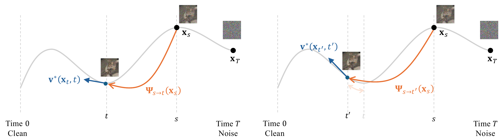
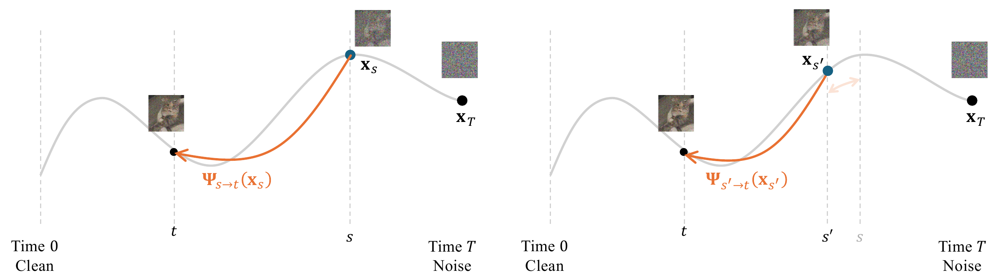

# 11.6 Closing Remarks {#sec-ch11-cr}

This final chapter has brought our exploration full circle: from slow iterative diffusion samplers to fast few-step generators (learned from scratch). The common object behind the methods in this chapter is the oracle flow map introduced in [Equation (10.1.4)](01-prologue.md#eq-general-cm-loss-rep):

$$
{\boldsymbol{\Psi}}_{s\to t}({\mathbf{x}}_s)
=
{\mathbf{x}}_s+\int_s^t {\mathbf{v}}^*({\mathbf{x}}_\tau,\tau)\,\mathop{}\!\mathrm{d} \tau.
$$

Learning this map replaces many small numerical updates by one or a few learned jumps.

At this point, it is useful to step back from the individual algorithms. Knowledge Distillation ([Section 10.1](../10-distillation/01-prologue.md#sec-distillation-prologue)), Progressive Distillation ([Section 10.3](../10-distillation/03-progressive-distillation.md#sec-pd)), CM ([Section 11.2](02-discrete-consistency-models.md#sec-discrete-cm)), CTM ([Section 11.4](04-consistency-trajectory-models.md#sec-ctm)), and MF ([Section 11.5](05-mean-flow.md#sec-mf)) were introduced through different training constructions, but they all exploit, explicitly or implicitly, the same ODE solution-map structure.

The flow map itself is a classical object from differential equations and dynamical systems, with closely related particle-based and field-based descriptions in continuum and fluid mechanics; see [Equation (4.2.2)](../04-score-sde-framework/02-matching-marginals.md#eq-flow-map-def) and the surrounding historical discussion. Here, we use three classical descriptions of the same ODE flow, namely the *semigroup*, *Lagrangian*, and *Eulerian* views, as an organizing lens for the modern learning methods developed above [^1]

**Semigroup View: Split the Trip.** As introduced in [Equation (11.2.1)](02-discrete-consistency-models.md#eq-semi-group), the finite-step identity is

$$
{\boldsymbol{\Psi}}_{u\to t}\big({\boldsymbol{\Psi}}_{s\to u}({\mathbf{x}}_s)\big)
=
{\boldsymbol{\Psi}}_{s\to t}({\mathbf{x}}_s).
$$

As illustrated in [Figure 11.3](02-discrete-consistency-models.md#fig-semigroup), the intuition is the same as traveling along a fixed route: going from $s$ to $u$ and then from $u$ to $t$ lands at the same point as going directly from $s$ to $t$. Within this view, KD learns the full transition ${\boldsymbol{\Psi}}_{T\to0}$, PD compresses two adjacent teacher steps into one student step, CM learns the special anytime-to-clean map ${\boldsymbol{\Psi}}_{s\to0}$, and CTM extends the same composition principle to the general map ${\boldsymbol{\Psi}}_{s\to t}$.

**(a)** Base ending time $t$.

**(b)** Moved ending time $t'$.

**Figure 11.7:** **Lagrangian consistency of flow maps.** The starting state–time pair $({\mathbf{x}}_s,s)$ is fixed, and the ending time is moved from $t$ to $t'$. The output of the flow map moves along the same PF-ODE trajectory, and its infinitesimal change equals the ODE velocity: $\partial_t {\boldsymbol{\Psi}}_{s\to t}({\mathbf{x}}_s) = {\mathbf{v}}^*({\boldsymbol{\Psi}}_{s\to t}({\mathbf{x}}_s),t)$.

Source: Adapted from [Dieleman (2026)](references.md#ref-dieleman2026flowmaps).

**Lagrangian View: Move the Ending Point.** Fix the starting state–time pair $({\mathbf{x}}_s,s)$ and vary the ending time $t$. The ending point then moves along the same trajectory:

$$
\partial_t {\boldsymbol{\Psi}}_{s\to t}({\mathbf{x}}_s)
=
{\mathbf{v}}^*({\boldsymbol{\Psi}}_{s\to t}({\mathbf{x}}_s),t).
$$

The name “Lagrangian” follows the classical particle viewpoint: we track the ending point along the trajectory as the ending time changes. Infinitesimally, the ending point moves with the local ODE velocity evaluated at that point.

**Eulerian View: Move the Starting Point.** Fix the ending time $t$ and slide the starting point along the same trajectory. The ending point at time $t$ remains fixed:

$$
\frac{\mathop{}\!\mathrm{d}}{\mathop{}\!\mathrm{d} s}{\boldsymbol{\Psi}}_{s\to t}({\mathbf{x}}_s)=0.
$$

Since $\frac{\mathop{}\!\mathrm{d}}{\mathop{}\!\mathrm{d} s}{\mathbf{x}}_s={\mathbf{v}}^*({\mathbf{x}}_s,s)$, the chain rule gives

$$
\partial_s{\boldsymbol{\Psi}}_{s\to t}({\mathbf{x}}_s)
+
\big(\partial_{{\mathbf{x}}}{\boldsymbol{\Psi}}_{s\to t}\big)({\mathbf{x}}_s){\mathbf{v}}^*({\mathbf{x}}_s,s)
=
0.
$$

The term “Eulerian” invokes the classical field-based viewpoint: Here, the ending time $t$ is fixed, while the starting state–time pair $({\mathbf{x}}_s,s)$ moves along the same ODE trajectory; the ending point at time $t$ therefore remains unchanged. For CM, the ending time is fixed at $t=0$, so the ending point is the clean sample:

$$
{\mathbf{f}}^*({\mathbf{x}}_s,s)={\boldsymbol{\Psi}}_{s\to0}({\mathbf{x}}_s).
$$

Thus, [Equation (11.3.1)](03-continuous-consistency-models.md#eq-conti-ct-motivation) is the starting-time consistency condition for the special flow map studied in [Section 11.2](02-discrete-consistency-models.md#sec-discrete-cm) and [Section 11.3](03-continuous-consistency-models.md#sec-conti-cm).

This view also recaps the relationship between CTM and MF from [Section 11.5.3](05-mean-flow.md#subsec-equivalence-ctm-mf). Both approximate the same path integral

$$
{\boldsymbol{\Psi}}_{s\to t}({\mathbf{x}}_s)
=
{\mathbf{x}}_s+\int_s^t{\mathbf{v}}^*({\mathbf{x}}_\tau,\tau)\,\mathop{}\!\mathrm{d}\tau,
$$

but expose different trainable surrogates. CTM represents the ending point through a displacement-style parameterization, while MF represents the same ending point through the average drift

$$
{\mathbf{h}}^*({\mathbf{x}}_s,s,t)
=
\frac{1}{t-s}\int_s^t{\mathbf{v}}^*({\mathbf{x}}_\tau,\tau)\,\mathop{}\!\mathrm{d}\tau.
$$

Substituting

$$
{\boldsymbol{\Psi}}_{s\to t}({\mathbf{x}}_s)={\mathbf{x}}_s+(t-s){\mathbf{h}}^*({\mathbf{x}}_s,s,t)
$$

into the Eulerian starting-time identity yields

$$
{\mathbf{h}}^*({\mathbf{x}}_s,s,t)
=
{\mathbf{v}}^*({\mathbf{x}}_s,s)
-
(s-t)
\left[
\partial_s{\mathbf{h}}^*({\mathbf{x}}_s,s,t)
+
(\partial_{{\mathbf{x}}}{\mathbf{h}}^*)({\mathbf{x}}_s,s,t){\mathbf{v}}^*({\mathbf{x}}_s,s)
\right].
$$

This is the basic Mean Flow identity: the average drift over a long interval is the instantaneous drift at the starting point, corrected by how the average drift changes as the starting point slides along the same trajectory.

**(a)** Base starting time $s$.

**(b)** Moved starting time $s'$.

**Figure 11.8:** **Eulerian consistency of flow maps.** The ending time $t$ is fixed, while the starting time is moved from $s$ to $s'$. Since the corresponding starting points lie on the same PF-ODE trajectory, the ending point remains unchanged: ${\boldsymbol{\Psi}}_{s\to t}({\mathbf{x}}_s)={\boldsymbol{\Psi}}_{s'\to t}({\mathbf{x}}_{s'})$. Infinitesimally, this gives $\frac{\mathop{}\!\mathrm{d}}{\mathop{}\!\mathrm{d} s}{\boldsymbol{\Psi}}_{s\to t}({\mathbf{x}}_s)=0$, or equivalently $\partial_s{\boldsymbol{\Psi}}_{s\to t}({\mathbf{x}}_s) +(\partial_{{\mathbf{x}}}{\boldsymbol{\Psi}}_{s\to t})({\mathbf{x}}_s){\mathbf{v}}^*({\mathbf{x}}_s,s)=0$.

Source: Adapted from [Dieleman (2026)](references.md#ref-dieleman2026flowmaps).

**Mathematical Equivalence of the Three Perspectives.** For an exact ODE flow, the semigroup, Lagrangian, and Eulerian identities all express the same simple principle: under standard existence, uniqueness, and smoothness assumptions, an ODE determines a unique trajectory through each state–time pair. That is, once a state at a given time is fixed, there is only one path to follow. The semigroup view splits this path into consecutive pieces, the Lagrangian view follows its ending point as the ending time changes, and the Eulerian view moves the starting point along the same path while keeping the ending point fixed. Thus, the three identities are equivalent descriptions of the same ODE flow ([Arnold, 1988](references.md#ref-arnold1988geometrical); [Chorin and Marsden, 1993](references.md#ref-chorin1993mathematical)). Their connection becomes especially clear by viewing the semigroup identity as the finite-interval statement, and the Lagrangian and Eulerian identities as its two infinitesimal forms, obtained by shrinking a short interval near the ending time or near the starting time, respectively.

The semigroup identity gives the finite-interval form of this principle:

$$
{\boldsymbol{\Psi}}_{u\to t}\big({\boldsymbol{\Psi}}_{s\to u}({\mathbf{x}}_s)\big)
    =
    {\boldsymbol{\Psi}}_{s\to t}({\mathbf{x}}_s),
    \qquad
    {\boldsymbol{\Psi}}_{s\to s}={\mathbf{I}} .
$$

The two differential views are obtained by shrinking one of the two intervals.

**Ending-Time Limit: the Lagrangian Identity.** Fix the starting state–time pair $({\mathbf{x}}_s,s)$ and shrink the final segment of the trip. For $\Delta t>0$,

$$
{\boldsymbol{\Psi}}_{t\to t-\Delta t}
    \big({\boldsymbol{\Psi}}_{s\to t}({\mathbf{x}}_s)\big)
    =
    {\boldsymbol{\Psi}}_{s\to t-\Delta t}({\mathbf{x}}_s).
$$

Let ${\mathbf{x}}_t:={\boldsymbol{\Psi}}_{s\to t}({\mathbf{x}}_s)$. A first-order expansion of the short flow gives

$$
{\boldsymbol{\Psi}}_{t\to t-\Delta t}({\mathbf{x}}_t)
    =
    {\mathbf{x}}_t-\Delta t\,{\mathbf{v}}^*({\mathbf{x}}_t,t)
    +\mathcal{O}\big((\Delta t)^2\big).
$$

Therefore,

$$
\frac{
    {\boldsymbol{\Psi}}_{s\to t-\Delta t}({\mathbf{x}}_s)
    -
    {\boldsymbol{\Psi}}_{s\to t}({\mathbf{x}}_s)}
    {-\Delta t}
    =
    {\mathbf{v}}^*({\mathbf{x}}_t,t)
    +\mathcal{O}(\Delta t).
$$

Taking $\Delta t\to0$ yields the Lagrangian identity

$$
\partial_t{\boldsymbol{\Psi}}_{s\to t}({\mathbf{x}}_s)
    =
    {\mathbf{v}}^*\big({\boldsymbol{\Psi}}_{s\to t}({\mathbf{x}}_s),t\big).
$$

Thus, when the starting state–time pair $({\mathbf{x}}_s,s)$ is fixed and the ending time changes, the ending point moves with the ODE velocity evaluated at that point.

**Starting-Time Limit: the Eulerian Identity.** Now fix the ending time $t$ and move the starting state–time pair backward by a short interval $\Delta s>0$ along the same trajectory:

$$
{\mathbf{x}}_{s-\Delta s}
    :=
    {\boldsymbol{\Psi}}_{s\to s-\Delta s}({\mathbf{x}}_s)
    =
    {\mathbf{x}}_s-\Delta s\,{\mathbf{v}}^*({\mathbf{x}}_s,s)
    +\mathcal{O}\big((\Delta s)^2\big).
$$

The semigroup identity gives

$$
{\boldsymbol{\Psi}}_{s-\Delta s\to t}({\mathbf{x}}_{s-\Delta s})
    =
    {\boldsymbol{\Psi}}_{s\to t}({\mathbf{x}}_s).
$$

Expanding the left-hand side in both the starting state and the starting time gives

$$
{\boldsymbol{\Psi}}_{s-\Delta s\to t}({\mathbf{x}}_{s-\Delta s})
    =
    {\boldsymbol{\Psi}}_{s\to t}({\mathbf{x}}_s)
    -
    \Delta s\,
    \big(\partial_{{\mathbf{x}}}{\boldsymbol{\Psi}}_{s\to t}\big)({\mathbf{x}}_s){\mathbf{v}}^*({\mathbf{x}}_s,s)
    -
    \Delta s\,
    \partial_s{\boldsymbol{\Psi}}_{s\to t}({\mathbf{x}}_s)
    +
    \mathcal{O}\big((\Delta s)^2\big).
$$

Comparing with the semigroup identity and dividing by $-\Delta s$ gives

$$
\partial_s{\boldsymbol{\Psi}}_{s\to t}({\mathbf{x}}_s)
    +
    \big(\partial_{{\mathbf{x}}}{\boldsymbol{\Psi}}_{s\to t}\big)({\mathbf{x}}_s){\mathbf{v}}^*({\mathbf{x}}_s,s)
    =
    \mathcal{O}(\Delta s).
$$

Taking $\Delta s\to0$ yields the Eulerian identity

$$
\partial_s{\boldsymbol{\Psi}}_{s\to t}({\mathbf{x}}_s)
    +
    \big(\partial_{{\mathbf{x}}}{\boldsymbol{\Psi}}_{s\to t}\big)({\mathbf{x}}_s){\mathbf{v}}^*({\mathbf{x}}_s,s)
    =
    0.
$$

Here, the ending time $t$ is fixed, while the starting state–time pair moves along the same trajectory. The ending point therefore remains unchanged.

**Recovering the Flow Map from Either Differential Identity.** Conversely, either differential identity together with the boundary condition ${\boldsymbol{\Psi}}_{s\to s}={\mathbf{I}}$ recovers the same flow map. The Lagrangian identity evolves the ending point from ${\boldsymbol{\Psi}}_{s\to s}({\mathbf{x}}_s)={\mathbf{x}}_s$. The Eulerian identity says that ${\boldsymbol{\Psi}}_{\tau\to t}({\mathbf{x}}_\tau)$ is constant along the characteristic ${\mathbf{x}}_\tau={\boldsymbol{\Psi}}_{s\to \tau}({\mathbf{x}}_s)$, hence

$$
{\boldsymbol{\Psi}}_{s\to t}({\mathbf{x}}_s)
    =
    {\boldsymbol{\Psi}}_{t\to t}({\mathbf{x}}_t)
    =
    {\mathbf{x}}_t.
$$

Although these perspectives are equivalent at the oracle level, they lead to different practical algorithms once approximations are introduced: one must choose which identity to enforce, where to place stop-gradient targets, how to sample time pairs, and how to parameterize the map.

**Closing.** The central shift explored in this chapter is from learning a local velocity field to learning finite pieces of its ODE solution map. A conventional diffusion sampler repeatedly evaluates the local field and numerically integrates it. A flow-map model instead amortizes part of this integration during training, so that a long interval can be traversed with one or a few network evaluations.

This creates a direct route to fast generation, but moves difficulty from sampling into learning. The model must approximate a more global object, and its success depends on the parameterization of the map, the construction of tractable targets, the sampling and weighting of time pairs, and the stabilization of optimization.

Viewed in this way, flow-map learning is not a new dynamical concept but a modern learning strategy built around a classical one. It preserves the trajectory-based foundation of diffusion models while enlarging the design space for efficient generation. The objective is no longer only to integrate the generative ODE more efficiently at inference time, but to learn useful finite-time transitions of its solution map directly.

[^1]: In modern generative modeling, [Boffi et al. (2025)](references.md#ref-boffi2024flow) bring together structural ideas that already appear across PD, CM, CTM, and MF, and use them to describe the learning of diffusion PF-ODE flow maps in a common language. The main ingredients therefore largely come from these existing lines of work. Our presentation and illustrations in this part are also informed by the exposition of [Dieleman (2026)](references.md#ref-dieleman2026flowmaps).
