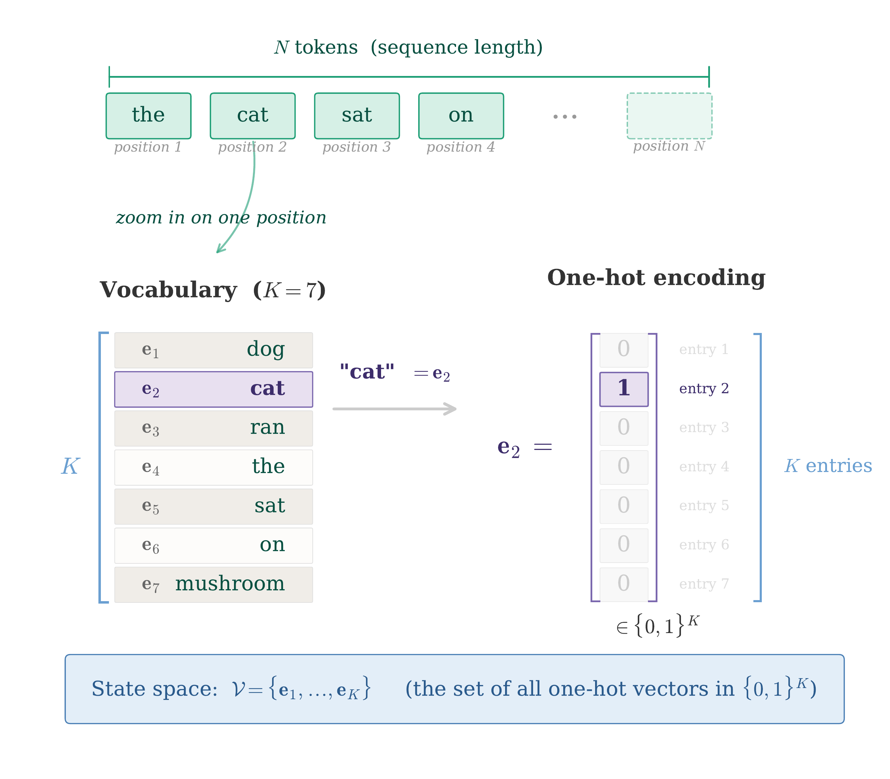
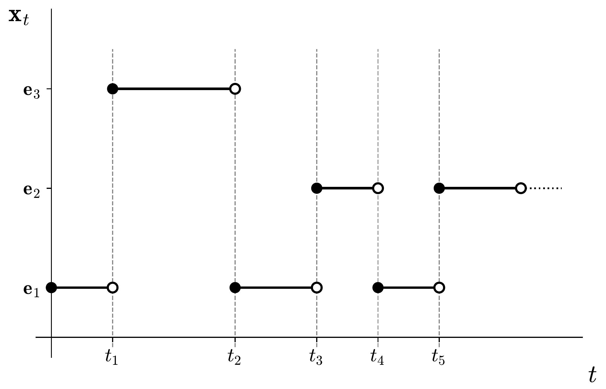
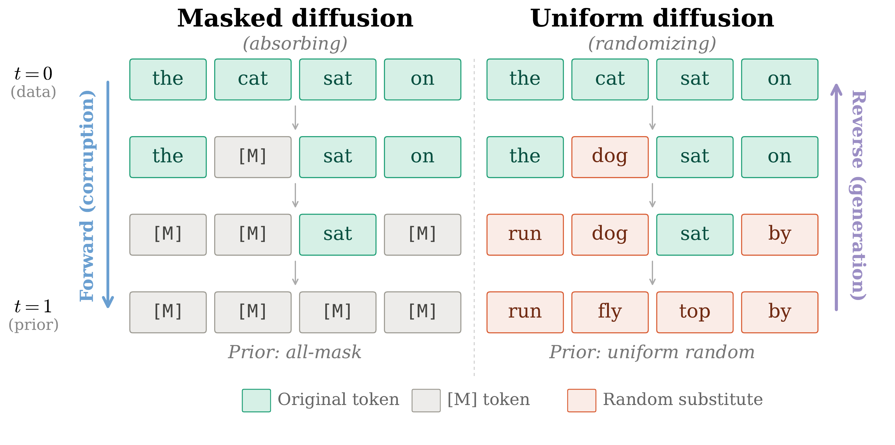

# 12.2 Beyond Continuous States: Probability Evolution on Discrete Spaces {#sec-epilogue-discrete}

So far, every model in this book has operated under a common structural assumption: the state on which the generative dynamics acts lives in a continuous Euclidean space ${\mathbb{R}}^D$. Whether the entries of ${\mathbf{x}}$ represent pixel intensities, audio samples, or continuous latent variables, the mathematics is the same: particles move along continuous trajectories governed by an ODE or SDE, and the probability density evolves through the continuity or Fokker–Planck equation. The framework rests on the differential structure of ${\mathbb{R}}^D$: gradients and divergences are defined through derivatives, and deterministic dynamics can be described by differentiable trajectories generated by vector fields.

This distinction is about the modeling state, not about the raw modality. Discrete observations can also be handled by first choosing a continuous code and a readout. For a raw symbol $a$, let ${\mathbf{E}}(a)\in{\mathbb{R}}^d$ be its code, and let ${\mathbf{D}}$ map codes back to symbols, or more generally to a categorical distribution:

$$
\text{raw discrete symbol } a
\;\xrightarrow{\;{\mathbf{E}}\;}\;
\text{continuous code } {\mathbf{E}}(a)\in{\mathbb{R}}^d
\;\xrightarrow{\;{\mathbf{D}}\;}\;
\text{discrete readout}.
$$

The representation may be fixed, such as a one-hot, categorical-vector, or simplex-valued code ([Richemond et al., 2022](references.md#ref-richemond2022categorical)); on an injective codebook, the readout can be deterministic and may satisfy ${\mathbf{D}}({\mathbf{E}}(a))=a$. Alternatively, the representation may be learned, such as a token embedding or an autoencoder latent ([Li et al., 2022](references.md#ref-li2022diffusionlm); [Dieleman et al., 2022](references.md#ref-dieleman2022continuous)); then ${\mathbf{D}}$ is a learned readout and ${\mathbf{D}}\circ{\mathbf{E}}$ need not be exactly invertible. Once the representation is fixed, the diffusion is continuous-state: Gaussian noising in an ambient code space, or a geometry-adapted continuous process for a constrained code space, is handled by the continuous machinery developed earlier in the book. The finite-state route studied below is different: the evolving state itself remains discrete.

The present section studies the complementary case, where the state itself remains finite and discrete state throughout the forward and reverse processes. Many data types naturally fit this view: text is a sequence of vocabulary tokens, molecular graphs use finitely many atom and bond types, and protein sequences are strings over a finite alphabet. In such a finite state space there is no canonical infinitesimal displacement from one state to another, no smooth trajectory through token values, and no ordinary gradient with respect to the state itself. This raises a natural question:

**Question 12.2.1**

If diffusion is really about transporting probability mass, what does that idea become when the state space is finite?

The structural backbone remains the same, but the mathematical objects change. In continuous space, probability laws evolve under ODE/SDE dynamics through the continuity or Fokker–Planck equation. In a finite state space, probability mass moves between states according to Markov transition kernels or jump rates, and the law evolves by a finite-dimensional conservation law: the *master equation*, also called the Kolmogorov forward equation. At an abstract level, both settings follow the same recipe:

**Observation**

Choose a forward corruption process, understand its induced probability path, and learn a reverse transport mechanism.

In continuous Gaussian diffusion, this reverse mechanism appears as Gaussian reverse conditionals, scores, or velocity fields. In finite state spaces, it appears instead as reverse transition probabilities, probability ratios, or jump rates. These are different mathematical objects, but they play the same conceptual role.

The goal of this chapter is not to present one discrete diffusion algorithm as definitive. Instead, we develop a roadmap that should remain stable as the literature changes. The roadmap is organized by the object used to describe reverse transport: transition kernels, probability ratios, or jump rates. We proceed in four steps: discrete-time transitions ([Section 12.2.1](02-discrete-spaces.md#subsec-epilogue-dtmc)), their continuous-time limit ([Section 12.2.2](02-discrete-spaces.md#subsec-epilogue-ctmc)), three perspectives on reverse modeling that mirror the variational, score/ratio, and flow viewpoints of the continuous case ([Section 12.2.3](02-discrete-spaces.md#subsec-epilogue-three-views)), and a comparison highlighting what is genuinely different from the continuous setting ([Section 12.2.4](02-discrete-spaces.md#subsec-epilogue-genuine-diff)).

## 12.2.1 Discrete-Time Transitions {#subsec-epilogue-dtmc}

Consider a forward process over $K$ discrete categories, where $K$ includes any special corruption tokens, such as a mask token, required by the chosen forward process. Each state is represented as a *one-hot* column vector ${\mathbf{x}}\in\{0,1\}^{K}$ with exactly one entry equal to $1$; the set of all such vectors is[^1]

$$
\mathcal{V}
= \bigl\{{\mathbf{x}}\in\{0,1\}^{K}:\textstyle\sum_{i=1}^{K}x_i=1\bigr\}
= \{{\mathbf{e}}_1,\ldots,{\mathbf{e}}_K\}.
$$

We write ${\mathbf{e}}_i$ for the $i$-th standard basis vector, namely the one-hot encoding of category $i$. For example, each ${\mathbf{e}}_i$ can represent a token, a discrete latent code, an atom type, a bond type, or an amino acid.

For sequence data such as text or proteins, a sample consists of $N$ tokens, each taking values in a vocabulary of size $K$. The full state space is then $\mathcal{V}^N$, whose size grows exponentially with sequence length. In many discrete diffusion models, the *forward* corruption acts independently across positions, so the single-token Markov process is the basic local building block. We therefore focus first on one token, because it exposes the core probability-transport mechanism without notational overload. For full sequences, the same formulas apply to full configurations. If the forward corruption acts independently across positions, the conditional forward kernel factorizes positionwise.[^2] The learned reverse model, however, need not be independent across positions: a Transformer or graph neural network can observe the entire corrupted object and use global context to predict local or global reverse transitions.

**Figure 12.2:** **From sequences to one-hot states.** A data sample such as a text or protein sequence consists of $N$ tokens, each taking values in a finite alphabet or vocabulary of size $K$. This chapter focuses on the evolution of a single token among $K$ states. Zooming in on one position, here “cat”, the token is represented by the basis vector ${\mathbf{e}}_2$ and encoded as a one-hot vector in $\{0,1\}^K$, namely a $K$-dimensional vector whose second entry is $1$ and all other entries are $0$. The state space

$$
\mathcal{V}=\{{\mathbf{x}}\in\{0,1\}^K:\sum_{i=1}^K x_i=1\} =\{{\mathbf{e}}_1,\ldots,{\mathbf{e}}_K\}
$$

is the set of all such one-hot vectors. The ordering of the vocabulary entries is arbitrary and unrelated to the position of a token in the sequence.

Source: Created by the authors with AI-assisted coding.

At step $k$, the system occupies one of these $K$ states. We denote the scalar probability of being in state ${\mathbf{e}}_i$ by

$$
p_k(i) := \Pr({\mathbf{x}}_k={\mathbf{e}}_i),
\qquad i=1,\ldots,K.
$$

Collecting these scalar probabilities gives the marginal probability vector

$$
{\mathbf{p}}_k
:=
\bigl(p_k(1),\;\dots,\;p_k(K)\bigr)^\top
=
{\mathbb{E}}[{\mathbf{x}}_k]
\in \Delta^{K-1}\subset{\mathbb{R}}^K,
\qquad
\sum_{i=1}^K p_k(i)=1,
$$

where $\Delta^{K-1}:=\bigl\{{\mathbf{p}}\in{\mathbb{R}}^K:p_i\geq0,\; \sum_{i=1}^K p_i=1\bigr\}$ denotes the probability simplex. Equivalently, $\Pr({\mathbf{x}}_k={\mathbf{e}}_i)=p_k(i)$, or briefly ${\mathbf{x}}_k\sim\mathrm{Cat}({\mathbf{p}}_k)$.

Thus ${\mathbf{p}}_k$ is the full law of the discrete random state ${\mathbf{x}}_k$, while $p_k(i)$ is its $i$-th scalar entry. At continuous time we use the same convention:

$$
p_t(i):=\Pr({\mathbf{x}}_t={\mathbf{e}}_i),
\qquad
{\mathbf{p}}_t:=\bigl(p_t(1),\ldots,p_t(K)\bigr)^\top.
$$

The vector ${\mathbf{p}}_t$ is the discrete analogue of a density: it tells us how the total probability mass is distributed across the $K$ states.

Following the convention used throughout this book, bold lowercase letters (${\mathbf{p}}$, ${\mathbf{x}}$) denote vectors, bold uppercase letters (${\mathbf{P}}$, ${\mathbf{Q}}$) denote matrices, and unbolded indexed quantities such as $p_k(i)$, $[{\mathbf{P}}_k]_{ij}$, and $[{\mathbf{Q}}_t]_{ij}$ denote scalar entries. Unbolded $p$ with random variables as arguments, such as $p({\mathbf{x}}_{k-1}|{\mathbf{x}}_k)$, denotes a probability mass function or transition kernel under the fixed forward process; $p_{{\boldsymbol{\phi}}}$ denotes the learned reverse model.

How does the system move between states? A single transition step is specified by a *transition matrix* ${\mathbf{P}}_k \in {\mathbb{R}}^{K \times K}$. Its entry $[{\mathbf{P}}_k]_{ij}$ gives the probability that the system, currently in state ${\mathbf{e}}_i$, moves to state ${\mathbf{e}}_j$ in one step:

$$
[{\mathbf{P}}_k]_{ij} \;=\; \Pr({\mathbf{x}}_{k+1} = {\mathbf{e}}_j | {\mathbf{x}}_k = {\mathbf{e}}_i).
$$

Thus the full matrix has the following structure:

$$
{\mathbf{P}}_k \;=\;
\underbrace{
\begin{pmatrix}
[{\mathbf{P}}_k]_{11} & [{\mathbf{P}}_k]_{12} & \cdots & [{\mathbf{P}}_k]_{1K} \\
[{\mathbf{P}}_k]_{21} & [{\mathbf{P}}_k]_{22} & \cdots & [{\mathbf{P}}_k]_{2K} \\
\vdots & \vdots & \ddots & \vdots \\
[{\mathbf{P}}_k]_{K1} & [{\mathbf{P}}_k]_{K2} & \cdots & [{\mathbf{P}}_k]_{KK}
\end{pmatrix}
}_{\substack{\text{columns: next state } j}}
\quad
\left.
\vphantom{
\begin{pmatrix}
a \\ a \\ \vdots \\ a
\end{pmatrix}
}
\right\}
\text{ rows: current state } i.
$$

Reading across row $i$ answers: “given that the system is currently in state ${\mathbf{e}}_i$, what is the probability of landing in each possible next state?” Each row is therefore a probability distribution over destinations:

$$
[{\mathbf{P}}_k]_{ij} \geq 0
\quad \text{for all } i,j,
\qquad\qquad
\sum_{j=1}^{K} [{\mathbf{P}}_k]_{ij} = 1
\quad \text{for each } i.
$$

The non-negativity condition says every transition probability is valid, and the row-sum constraint says all mass leaving state ${\mathbf{e}}_i$ is accounted for: the system always ends up somewhere.

**How the Distribution Evolves.** With the transition matrix in hand, we now ask a basic question: if the system starts with distribution ${\mathbf{p}}_k$, what is the distribution after one step? The answer follows from simple probability accounting. The probability of being in state ${\mathbf{e}}_j$ after the transition is the total mass arriving at ${\mathbf{e}}_j$ from all possible source states:

$$
p_{k+1}(j) = \sum_{i=1}^K p_k(i)\,[{\mathbf{P}}_k]_{ij}.
\tag{12.2.1}
$$

Each term in the sum represents the mass initially at state ${\mathbf{e}}_i$, weighted by the probability of jumping from ${\mathbf{e}}_i$ to ${\mathbf{e}}_j$. In vector form, this becomes

$$
{\mathbf{p}}_{k+1} = {\mathbf{P}}_k^\top {\mathbf{p}}_k.
$$

Equivalently, the conditional distribution of the next state given the current one-hot state ${\mathbf{x}}_k$ is

$$
\Pr({\mathbf{x}}_{k+1} | {\mathbf{x}}_k)
= \mathrm{Cat}({\mathbf{x}}_{k+1};\,{\mathbf{P}}_k^\top\,{\mathbf{x}}_k),
$$

since ${\mathbf{P}}_k^\top\,{\mathbf{e}}_i$ extracts the $i$-th row of ${\mathbf{P}}_k$, which contains the transition probabilities from state ${\mathbf{e}}_i$.

A system evolving by this rule is called a *discrete-time Markov chain*: conditional on the current state ${\mathbf{x}}_k$, the distribution of ${\mathbf{x}}_{k+1}$ does not depend on the earlier states. This plays the finite-state role of the law-evolution formulas in continuous space. There, a bijection ${\boldsymbol{\Psi}}$ reshapes a density, and the Jacobian determinant compensates for local volume change. In a finite state space, there is no volume element to track. Instead, the transition matrix ${\mathbf{P}}_k$ directly specifies how much probability mass leaves each source state and arrives at each destination. The row-sum constraint guarantees that total probability is conserved, just as the divergence structure does in the continuity equation.

Repeating this over multiple steps, with transition matrices ${\mathbf{P}}_0, \dots, {\mathbf{P}}_{L-1}$, yields

$$
{\mathbf{p}}_L = {\mathbf{P}}_{L-1}^\top \cdots {\mathbf{P}}_1^\top {\mathbf{P}}_0^\top\, {\mathbf{p}}_0.
$$

This mirrors the multi-layer change-of-variable formula in [Equation (B.1.2)](../../appendices/b-density-evolution/01-change-of-variable.md#eq-cov-multi-layer-nolog). In the continuous deterministic setting, density evolution is accumulated through Jacobian determinants; here, the probability vector is propagated through successive Markov operators. The underlying idea is the same: probability mass is tracked through a sequence of prescribed transformations.

**Inverting a Single Step.** Given the forward machinery, it is natural to ask how a single transition can be reversed for generation. Suppose the system is observed in state ${\mathbf{e}}_j$ at step $k{+}1$. What is the probability that it was in state ${\mathbf{e}}_i$ at the previous step $k$? This is a direct application of Bayes’ rule:

$$
\begin{aligned}
\Pr({\mathbf{x}}_k = {\mathbf{e}}_i | {\mathbf{x}}_{k+1} = {\mathbf{e}}_j)
= \frac{\Pr({\mathbf{x}}_{k+1} = {\mathbf{e}}_j | {\mathbf{x}}_k = {\mathbf{e}}_i)\;\Pr({\mathbf{x}}_k = {\mathbf{e}}_i)}
        {\Pr({\mathbf{x}}_{k+1} = {\mathbf{e}}_j)}
= [{\mathbf{P}}_k]_{ij}\frac{p_k(i)}{p_{k+1}(j)},
\end{aligned}
\tag{12.2.2}
$$

whenever $p_{k+1}(j)>0$. This is the discrete-time reverse kernel associated with the forward transition ${\mathbf{P}}_k$ together with the current marginal law. Its form is intuitive: among all the ways that mass could have arrived at state ${\mathbf{e}}_j$, each source ${\mathbf{e}}_i$ contributes in proportion to how much mass was there, through $p_k(i)$, and how likely the jump was, through $[{\mathbf{P}}_k]_{ij}$. The numerator and denominator in [Equation (12.2.2)](02-discrete-spaces.md#eq-discrete-reverse-kernel) each have a clear interpretation:

-   **Numerator:** The term $[{\mathbf{P}}_k]_{ij}\,p_k(i)$ is the joint probability of being in state ${\mathbf{e}}_i$ at step $k$ and then jumping to ${\mathbf{e}}_j$ at step $k{+}1$.

-   **Denominator:** The term

    $$
    p_{k+1}(j) = \sum_{i'} p_k(i')\,[{\mathbf{P}}_k]_{i'j}
    $$

    is the total probability of arriving at state ${\mathbf{e}}_j$ from any source. It serves as the normalizing constant, ensuring that the reverse probabilities sum to one over $i$.

A crucial point is that the reverse kernel is *not* the matrix inverse of ${\mathbf{P}}_k$. A Markov transition may merge probability mass from many states into one state, and it need not be invertible as a linear map. The probabilistic reverse is instead a Bayesian inverse, and it depends not only on the forward transition matrix but also on the marginal distribution ${\mathbf{p}}_k$. This is exactly the difficulty faced in generative modeling: ${\mathbf{p}}_k$ is obtained by pushing the unknown data distribution through the forward process, so it is usually not available in closed form. The reverse-modeling perspectives below can be understood as different ways of representing or learning the missing information needed to implement this Bayesian inverse.

## 12.2.2 Continuous-Time Limit: The Master Equation {#subsec-epilogue-ctmc}

In the continuous-space story, shrinking the step size of composed bijections to zero yielded the continuity equation ([Section B.1.2](../../appendices/b-density-evolution/01-change-of-variable.md#subsec-cov-continuity-eq)). The same limiting idea works here. When the time steps become infinitesimally small, a discrete-time Markov chain becomes a continuous-time Markov chain (CTMC), and the distribution evolves according to the master equation.

**Figure 12.3:** **Illustration of a CTMC sample path.** Let the state space be $\mathcal{V}=\{{\mathbf{e}}_1,{\mathbf{e}}_2,{\mathbf{e}}_3\}$, labeled as $S_1,S_2,S_3$ on the vertical axis. The trajectory is piecewise constant: the process remains at ${\mathbf{x}}_t={\mathbf{e}}_i$ for a random holding time, then jumps instantaneously to another state ${\mathbf{e}}_j$ at times $t_1,t_2,\ldots$. Filled circles mark the state occupied immediately after each jump, and open circles the state just before the jump, reflecting the right-continuous convention. The dotted segment indicates continuation beyond the displayed window. These jump times and destinations are governed by the rate matrix ${\mathbf{Q}}_t$: from state ${\mathbf{e}}_i$, the process jumps to ${\mathbf{e}}_j$ ($j\neq i$) at instantaneous rate $[{\mathbf{Q}}_t]_{ij}$.

Source: Adapted from [Campbell et al. (2022)](references.md#ref-campbell2022continuous).

**Infinitesimal Transitions.** In the previous subsection, each transition matrix ${\mathbf{P}}_k$ described a full step from time $k$ to time $k{+}1$. Now imagine making these steps finer and finer. Let ${\mathbf{P}}_{t,\Delta t}$ denote the transition matrix that moves the system forward by a small duration $\Delta t$ starting at time $t$: its entry $[{\mathbf{P}}_{t,\Delta t}]_{ij}$ is the probability of moving from state ${\mathbf{e}}_i$ to state ${\mathbf{e}}_j$ during the interval $[t,\,t{+}\Delta t]$.

When $\Delta t$ is small, most mass stays put and only a small fraction jumps. This means ${\mathbf{P}}_{t,\Delta t}$ is close to the identity, and we can expand it as

$$
{\mathbf{P}}_{t,\Delta t}
\;=\; {\mathbf{I}} + {\mathbf{Q}}_t\,\Delta t + \mathcal{O}(\Delta t^2),
\tag{12.2.3}
$$

where ${\mathbf{Q}}_t \in {\mathbb{R}}^{K \times K}$ is the *rate matrix*, also called the generator, at time $t$. If ${\mathbf{Q}}_t$ is sufficiently regular in time, the remainder can be written as $\mathcal{O}(\Delta t^2)$ locally. The entries of ${\mathbf{Q}}_t$ are instantaneous *rates* rather than probabilities. Specifically:

-   $[{\mathbf{Q}}_t]_{ij} \geq 0$ for $i \neq j$: this is the rate at which the process jumps from state ${\mathbf{e}}_i$ to state ${\mathbf{e}}_j$. Multiplying by $\Delta t$ gives the leading-order jump probability over a short interval.

-   $[{\mathbf{Q}}_t]_{ii} = -\sum_{j \neq i} [{\mathbf{Q}}_t]_{ij}$: the diagonal entry is negative and records the total rate at which probability *leaves* state ${\mathbf{e}}_i$. This ensures that each row of ${\mathbf{Q}}_t$ sums to zero, which is the rate-level expression of probability conservation.[^3]

Reading off the expansion, the probability of jumping from ${\mathbf{e}}_i$ to ${\mathbf{e}}_j$ with $j\neq i$ during a short interval is approximately $[{\mathbf{Q}}_t]_{ij}\,\Delta t$, while the probability of staying at ${\mathbf{e}}_i$ is approximately $1 - \sum_{j \neq i} [{\mathbf{Q}}_t]_{ij}\,\Delta t$.

**Master Equation.** With infinitesimal transitions in hand, the continuous-time limit follows immediately. Substituting the expansion in [Equation (12.2.3)](02-discrete-spaces.md#eq-generator-expansion) into ${\mathbf{p}}_{t+\Delta t} = {\mathbf{P}}_{t,\Delta t}^\top\,{\mathbf{p}}_t$ and taking $\Delta t \to 0$ gives

$$
\frac{\mathop{}\!\mathrm{d}}{\mathop{}\!\mathrm{d} t}\,{\mathbf{p}}_t = {\mathbf{Q}}_t^\top\,{\mathbf{p}}_t.
\tag{12.2.4}
$$

This is the *master equation*, also known as the *Kolmogorov forward equation* for CTMCs ([Norris, 1998](references.md#ref-norris1998markov)). Recall that ${\mathbf{p}}_t$ is the probability vector whose $j$-th entry $p_t(j)$ gives the probability of being in state ${\mathbf{e}}_j$ at time $t$. Writing out the $j$-th component of [Equation (12.2.4)](02-discrete-spaces.md#eq-master-equation-vector) makes the meaning concrete:

$$
\frac{\mathop{}\!\mathrm{d}}{\mathop{}\!\mathrm{d} t}\,p_t(j)
= \underbrace{\sum_{i \neq j} p_t(i)\,[{\mathbf{Q}}_t]_{ij}}_{\text{inflow: mass arriving from other states}}
\;-\;
\underbrace{p_t(j)\sum_{\ell \neq j} [{\mathbf{Q}}_t]_{j\ell}}_{\text{outflow: mass departing to other states}}.
\tag{12.2.5}
$$

The rate of change of $p_t(j)$ is simply inflow minus outflow. This is probability conservation expressed as a differential equation.

**Comparison with the Continuity Equation.** In continuous space, the continuity equation

$$
\partial_t\,p_t({\mathbf{x}}) + \nabla \cdot
\big(p_t({\mathbf{x}})\,{\mathbf{v}}({\mathbf{x}},t)\big) = 0
$$

says that density changes are driven by the net flux of probability mass under the velocity field ${\mathbf{v}}$. The master equation says the same thing in finite-state language: $p_t(j)$ changes because of net probability flux governed by the rate matrix ${\mathbf{Q}}_t$. The velocity field and the rate matrix play analogous structural roles: both prescribe how probability mass is redistributed, and both enforce conservation. The main difference is geometric: in ${\mathbb{R}}^D$, mass flows through neighboring spatial locations; in a finite state space, mass jumps along allowed edges of a transition graph.

**Figure 12.4:** **Illustration of masked and uniform diffusion forward corruption and reverse generation.** The two examples shown here admit an interpolating marginal of the form $\Pr({\mathbf{x}}_t|{\mathbf{x}}_0)=\mathrm{Cat}({\mathbf{x}}_t;\alpha_t{\mathbf{x}}_0+(1-\alpha_t)\boldsymbol{\pi})$, where the limiting prior $\boldsymbol{\pi}$ and decay factor $\alpha_t$ are determined by the chosen forward rate matrix. In masked diffusion, tokens are absorbed into the mask state, with limiting prior $\boldsymbol{\pi}={\mathbf{m}}={\mathbf{e}}_K$. In uniform diffusion, tokens are repeatedly randomized, with limiting prior $\boldsymbol{\pi}_{\mathrm{unif}}=\frac{1}{K}\mathbf{1}$. Generation reverses the chosen corruption process, starting from the corresponding simple reference distribution, or from a close finite-time approximation to it.

Source: Created by the authors with AI-assisted coding.

**Forward Corruption.** Just as in the continuous case, we need a forward process that gradually destroys the structure of the data distribution and drives it toward a simple reference distribution that is easy to sample from. This is the discrete analogue of choosing a Gaussian noising process in continuous diffusion. The design goal is the same: the corruption should be progressive, analytically or computationally tractable, and strong enough that, by terminal time $T$, the data distribution has been largely washed out.

The rate matrix can be chosen in many ways. It may be uniform, absorbing, nearest-neighbor, graph-based, chemically structured, grammar-aware, or otherwise adapted to the data domain. The following two examples are therefore not meant to exhaust the taxonomy; they are canonical cases that make the mechanics transparent.

**Masked Diffusion (Absorbing).** Reserve the last category as a mask token, written ${\mathbf{m}} := {\mathbf{e}}_K$. Clean data ${\mathbf{x}}_0$ occupies one of the first $K{-}1$ categories, so $\langle{\mathbf{x}}_0,{\mathbf{m}}\rangle = 0$. The rate matrix is defined so that every ordinary state transitions to the mask state at rate $\beta(t)$, while the mask state never transitions out:

$$
[{\mathbf{Q}}_t]_{iK}=\beta(t),\qquad
[{\mathbf{Q}}_t]_{ii}=-\beta(t),\qquad
[{\mathbf{Q}}_t]_{ij}=0
\quad
\text{for } i<K,\; j\notin\{i,K\},
$$

and

$$
[{\mathbf{Q}}_t]_{Kj}=0
\quad
\text{for all } j.
$$

The idea is simple: each token is independently replaced by the mask at rate $\beta(t)$, and once masked it stays masked.

The forward marginal conditioned on a clean state ${\mathbf{x}}_0$ is

$$
\Pr({\mathbf{x}}_t | {\mathbf{x}}_0)
      = \mathrm{Cat}\bigl({\mathbf{x}}_t;\;
          \alpha_t\,{\mathbf{x}}_0 + (1-\alpha_t)\,{\mathbf{m}}\bigr),
$$

where

$$
\alpha_t
      =
      \exp\left(-\int_0^t\beta(s)\,\mathop{}\!\mathrm{d} s\right).
$$

At time $t$, the token equals its clean value ${\mathbf{x}}_0$ with probability $\alpha_t$ and is masked with probability $1-\alpha_t$. As time increases, more and more probability mass accumulates on the mask state. If $\int_0^T\beta(s)\mathop{}\!\mathrm{d} s$ is large, then $\alpha_T$ is small and the terminal distribution is close to the all-mask reference distribution.

**Uniform Diffusion.** Instead of erasing a token, this process gradually randomizes it. One convenient continuous-time normalization is to let a token jump to each of the other $K-1$ states at the same rate:

$$
[{\mathbf{Q}}_t]_{ij} = \frac{\beta(t)}{K - 1}
      \quad\text{for } i \neq j,
      \qquad
      [{\mathbf{Q}}_t]_{ii} = -\beta(t).
$$

The first formula says that from state ${\mathbf{e}}_i$, the token jumps to each alternative state at the same instantaneous rate. The second says that the total rate of leaving state ${\mathbf{e}}_i$ is $\beta(t)$.

The forward marginal again takes the interpolating form

$$
\Pr({\mathbf{x}}_t|{\mathbf{x}}_0)
      = \mathrm{Cat} \bigl({\mathbf{x}}_t;\;
          \alpha_t\,{\mathbf{x}}_0 + (1-\alpha_t)\,\boldsymbol{\pi}_{\mathrm{unif}}
        \bigr),
$$

where $\boldsymbol{\pi}_{\mathrm{unif}}=\tfrac{1}{K}\mathbf{1}\in{\mathbb{R}}^K$ is the uniform probability vector. Under the rate normalization above, the decay factor is

$$
\alpha_t
      =
      \exp\left(
      -\frac{K}{K-1}\int_0^t \beta(s)\,\mathop{}\!\mathrm{d} s
      \right).
$$

As time passes, repeated randomization washes out the structure of the data distribution and pushes it toward the uniform distribution on $\mathcal{V}$.

More generally, the forward process need not have the simple mixture form

$$
\Pr({\mathbf{x}}_t|{\mathbf{x}}_0)
= \mathrm{Cat}\bigl({\mathbf{x}}_t;\;\alpha_t{\mathbf{x}}_0+(1-\alpha_t)\boldsymbol{\pi}\bigr).
$$

That form is useful for intuition and appears in common masked and uniform constructions, but the Markov law-evolution viewpoint is more general: transition matrices govern discrete-time evolution, and rate matrices govern continuous-time evolution through the master equation. Structured discrete diffusion models can use transition rules that respect edit distance, graph adjacency, molecular validity, vocabulary structure, or other domain knowledge. In all cases, the same principle remains: the forward Markov process defines a probability path, and generation learns to move along that path in reverse.

## 12.2.3 Three Perspectives on Reverse Modeling {#subsec-epilogue-three-views}

Once the forward process and its law evolution are in place, the remaining task is the same as in the continuous case: learn a reverse process whose marginal distributions retrace the forward evolution in reverse time, turning simple reference samples into data. In Part B, we organized continuous diffusion models into three perspectives: variational ([Chapter 2](../02-variational-perspective/index.md#ch-variational)), score-based ([Chapter 3](../03-score-based-perspective/index.md#ch-score-based) and [Chapter 4](../04-score-sde-framework/index.md#ch-score-sde)), and flow-based ([Chapter 5](../05-flow-based-perspective/index.md#ch-flow-based)). The same three-way viewpoint carries over to the discrete setting, with one important caveat: these are not mutually exclusive schools or fixed paper categories. They are three ways of identifying what unknown object must be learned in order to reverse the probability path.

**Variational Perspective: Learn Reverse Transition Kernels.** In the continuous case ([Section 2.2](../02-variational-perspective/02-ddpm.md#sec-ddpm)), the variational viewpoint treats diffusion as a hierarchical latent-variable model. The forward process defines a chain of increasingly noisy latents, and the goal is to learn reverse transitions that undo the corruption one step at a time. The true reverse kernel $\Pr({\mathbf{x}}_{k-1}|{\mathbf{x}}_k)$ is intractable because it depends on the marginal law of ${\mathbf{x}}_k$, which involves the unknown data distribution. The key insight of DDPM is to condition on the clean sample ${\mathbf{x}}_0$: the forward posterior $\Pr({\mathbf{x}}_{k-1}|{\mathbf{x}}_k, {\mathbf{x}}_0)$ is Gaussian in closed form, and [Theorem 2.2.1](../02-variational-perspective/02-ddpm.md#thm-equiv-marginal-kl) shows that training against this conditional posterior is equivalent, up to terms independent of the learned reverse model, to training against the intractable marginal reverse kernel. The ELBO then decomposes into a sum of KL terms ([Equation (2.2.6)](../02-variational-perspective/02-ddpm.md#eq-ddpm-diffusion)), one per noise level, each asking the learned model to match a tractable forward posterior.

The same logic applies in the discrete setting. Write $p$ for the joint law obtained by drawing ${\mathbf{x}}_0$ from the data distribution and then applying the fixed forward chain, and write $p_{{\boldsymbol{\phi}}}$ for the learned reverse model. Consider a chain of corrupted one-hot states

$$
{\mathbf{x}}_0 \;\xrightarrow{\;{\mathbf{P}}_0\;}\; {\mathbf{x}}_1 \;\xrightarrow{\;{\mathbf{P}}_1\;}\;
\cdots \;\xrightarrow{\;{\mathbf{P}}_{L-1}\;}\; {\mathbf{x}}_L,
$$

where ${\mathbf{x}}_0$ is drawn from the data distribution and ${\mathbf{x}}_L$ is close to a simple reference distribution, such as all-mask or uniform. The transitions are now categorical rather than Gaussian, but the variational structure is the same:

-   The true reverse $p({\mathbf{x}}_{k-1}|{\mathbf{x}}_k)$ is intractable, because it depends on the marginal at step $k$.

-   Conditioning on ${\mathbf{x}}_0$ makes the forward posterior tractable via Bayes’ rule:

    $$
    p({\mathbf{x}}_{k-1}|{\mathbf{x}}_k, {\mathbf{x}}_0)
          =
          \frac{p({\mathbf{x}}_k|{\mathbf{x}}_{k-1})\;p({\mathbf{x}}_{k-1}|{\mathbf{x}}_0)}
                 {p({\mathbf{x}}_k|{\mathbf{x}}_0)},
    $$

    where every factor on the right is determined by the forward process.

-   Training against these conditional posteriors has the same optimal reverse kernel as training against the intractable marginal reverse kernels; the difference consists of terms independent of $p_{{\boldsymbol{\phi}}}$.

Schematically, the discrete diffusion ELBO contains denoising terms of the form

$$
{\mathbb{E}}_{p({\mathbf{x}}_{0:L})}
 \Big[
\mathcal{D}_{\mathrm{KL}} \big(
  p({\mathbf{x}}_{k-1}|{\mathbf{x}}_k, {\mathbf{x}}_0)
  \;\|\;
  p_{{\boldsymbol{\phi}}}({\mathbf{x}}_{k-1}|{\mathbf{x}}_k)
\big)
\Big],
\qquad k=1,\ldots,L.
$$

Depending on the exact model, the full ELBO also includes boundary terms such as the terminal prior term and the reconstruction term near $k=0$. The key point is that each denoising term asks the learned reverse kernel to match a tractable Bayesian posterior determined by the forward corruption.

Here $p_{{\boldsymbol{\phi}}}({\mathbf{x}}_{k-1}={\mathbf{e}}_i|{\mathbf{x}}_k={\mathbf{e}}_j)$ denotes the neural-network parameterized reverse transition probability: given that the system is in state ${\mathbf{e}}_j$ at step $k$, it gives the probability of having come from state ${\mathbf{e}}_i$ at step $k{-}1$. For each fixed ${\mathbf{e}}_j$, these values form a categorical distribution over previous states.

The main formal difference from continuous DDPM is that these KL divergences are finite sums over discrete states rather than closed-form Gaussian expressions. This reflects a special property of Gaussian distributions: the product of two Gaussian densities in the same variable is proportional to another Gaussian. In continuous DDPM, the forward posterior is computed by multiplying Gaussian factors, so the result is itself Gaussian and the KL divergence reduces to a simple algebraic expression involving only means and covariances ([Section 2.2](../02-variational-perspective/02-ddpm.md#sec-ddpm)). In the discrete setting, Bayes’ rule yields a categorical distribution instead, and each KL term is a sum over states. This sum is exact and conceptually simple, but for large vocabularies or full sequence spaces it may require structure, factorization, subsampling, or specialized parametrization.

A practical point about parametrization is also worth noting. The ELBO asks the learned reverse kernel $p_{{\boldsymbol{\phi}}}({\mathbf{x}}_{k-1}|{\mathbf{x}}_k)$ to match a Bayesian posterior, but it does not force one unique neural parametrization of that kernel. One common choice is a clean-state, or $x_0$-prediction, parametrization. The exact marginal reverse kernel satisfies the identity

$$
p({\mathbf{x}}_{k-1}|{\mathbf{x}}_k)
=
\sum_{a}
p({\mathbf{x}}_{k-1}|{\mathbf{x}}_k,{\mathbf{x}}_0={\mathbf{e}}_a)\,
p({\mathbf{x}}_0={\mathbf{e}}_a|{\mathbf{x}}_k),
$$

where the sum is over valid clean categories. This is simply marginalization over the unknown clean state. Since the posterior $p({\mathbf{x}}_0|{\mathbf{x}}_k)$ depends on the data distribution, it is not available in closed form. A model may therefore predict a clean-state distribution $\widehat p_{{\boldsymbol{\phi}}}({\mathbf{x}}_0|{\mathbf{x}}_k)$ and use it to define

$$
p_{{\boldsymbol{\phi}}}({\mathbf{x}}_{k-1}|{\mathbf{x}}_k)
:=
\sum_{a}
p({\mathbf{x}}_{k-1}|{\mathbf{x}}_k,{\mathbf{x}}_0={\mathbf{e}}_a)\,
\widehat p_{{\boldsymbol{\phi}}}({\mathbf{x}}_0={\mathbf{e}}_a|{\mathbf{x}}_k).
$$

If $\widehat p_{{\boldsymbol{\phi}}}({\mathbf{x}}_0|{\mathbf{x}}_k)$ were equal to the true posterior $p({\mathbf{x}}_0|{\mathbf{x}}_k)$, this mixture would recover the exact reverse kernel. In practice, it is a useful way to tie the learned reverse transition to the known forward posterior.

This clean-state parametrization is common in multinomial/D3PM-style discrete-time diffusion models ([Hoogeboom et al., 2021](references.md#ref-hoogeboom2021argmax); [Austin et al., 2021](references.md#ref-austin2021structured)), but it is not the definition of discrete diffusion. D3PM itself notes that one could instead predict the reverse logits directly, and later models use other structured parametrizations tailored to the forward process ([Sahoo et al., 2024](references.md#ref-sahoo2024simple)). Thus clean-state prediction should be viewed as one important parametrization of the variational perspective, not as the only way to model the reverse process.

**Score/Ratio Perspective: Learn Local Probability Comparisons.** In the continuous case ([Chapter 3](../03-score-based-perspective/index.md#ch-score-based) and [Chapter 4](../04-score-sde-framework/index.md#ch-score-sde)), the score-based viewpoint starts from a simple question: given a corrupted sample ${\mathbf{x}}_t \sim p_t$, what local information about the current density is needed to reverse the diffusion? The answer is the score function $\nabla_{{\mathbf{x}}}\log p_t({\mathbf{x}})$, which appears in the reverse-time SDE and the probability-flow ODE. Learning the score with a neural network therefore suffices for generation.

In a finite state space, there is no ambient Euclidean geometry, no ordinary notion of infinitesimal displacement, and no gradient with respect to the state. A sample does not move by taking a small Euclidean step; it changes by jumping from one state to another. So the score $\nabla_{{\mathbf{x}}}\log p_t({\mathbf{x}})$ has no direct literal analogue. But the reverse process must still answer an analogous question: *if the system is currently in state ${\mathbf{e}}_j$, how likely is each candidate source state ${\mathbf{e}}_i$ relative to it?*

**Deriving the Reverse Jump Rate.** To identify the needed quantity, consider a forward CTMC $\{{\mathbf{x}}_t\}_{0\leq t\leq T}$ with rate matrix ${\mathbf{Q}}_t$ and marginal ${\mathbf{p}}_t$. The entry $[{\mathbf{Q}}_t]_{ij}$ is the jump rate from state ${\mathbf{e}}_i$ to state ${\mathbf{e}}_j$. Over a short interval $\Delta t$, the probability of the infinitesimal forward event ${\mathbf{x}}_t={\mathbf{e}}_i$ and ${\mathbf{x}}_{t+\Delta t}={\mathbf{e}}_j$, for $i\neq j$, is approximately

$$
p_t(i)\,[{\mathbf{Q}}_t]_{ij}\,\Delta t.
$$

Now define the reverse-time process $\bar{{\mathbf{x}}}_s := {\mathbf{x}}_{T-s}$ for $0\leq s\leq T$. Its marginal at reverse time $s$ is $\bar{{\mathbf{p}}}_s={\mathbf{p}}_{T-s}$. If the reverse process has rate matrix $\bar{{\mathbf{Q}}}_s$, then the corresponding reverse jump from ${\mathbf{e}}_j$ to ${\mathbf{e}}_i$ must reproduce the same infinitesimal path probability in the reversed temporal order. Taking the limit $\Delta t\to 0$ gives the off-diagonal time-reversal formula

$$
[\bar{{\mathbf{Q}}}_s]_{ji}
= [{\mathbf{Q}}_{T-s}]_{ij}\;\frac{p_{T-s}(i)}{p_{T-s}(j)},
\qquad i \neq j,
\tag{12.2.6}
$$

whenever $p_{T-s}(j)>0$. Equivalently, if $t$ denotes the corresponding forward time and $\widetilde{{\mathbf{Q}}}_t$ denotes the reverse generator indexed by that forward time, then

$$
[\widetilde{{\mathbf{Q}}}_t]_{ji}
= [{\mathbf{Q}}_t]_{ij}\;\frac{p_t(i)}{p_t(j)},
\qquad i \neq j.
\tag{12.2.7}
$$

The diagonal entries are fixed by the row-sum-to-zero constraint,

$$
[\widetilde{{\mathbf{Q}}}_t]_{jj}
=
-\sum_{i\neq j}[\widetilde{{\mathbf{Q}}}_t]_{ji}.
$$

This is the standard time-reversal formula for CTMCs ([Kelly, 1979](references.md#ref-kelly1979reversibility); [Anderson, 2012](references.md#ref-anderson2012continuous)), applied to discrete diffusion by [Campbell et al. (2022)](references.md#ref-campbell2022continuous). The formula is understood only on states with positive marginal probability. Moreover, the reverse process only reverses probability flux along transitions allowed by the forward process: if $[{\mathbf{Q}}_t]_{ij}=0$, then the corresponding reverse rate from ${\mathbf{e}}_j$ to ${\mathbf{e}}_i$ is also zero. The statement is not an equilibrium detailed-balance assumption; it is a local time-reversal identity for infinitesimal path probabilities.

**The Ratio as a Discrete Analogue of the Score.** Now inspect [Equation (12.2.7)](02-discrete-spaces.md#eq-reverse-rate-discrete). The forward rate $[{\mathbf{Q}}_t]_{ij}$ is known, since the forward process is fixed by design. The unknown quantity is the ratio $p_t(i)/p_t(j)$, which compares how likely state ${\mathbf{e}}_i$ is relative to state ${\mathbf{e}}_j$ under the current marginal. In inner-product notation, $p_t(i) = \langle{\mathbf{p}}_t,{\mathbf{e}}_i\rangle$, so the ratio can be written as $\langle{\mathbf{p}}_t,{\mathbf{e}}_i\rangle / \langle{\mathbf{p}}_t,{\mathbf{e}}_j\rangle$.

Why is this a discrete analogue of the score? In continuous space, the score $\nabla_{{\mathbf{x}}}\log p_t({\mathbf{x}})$ measures how the log-density changes under an infinitesimal displacement. In a finite state space, the natural local comparison is instead across an allowed jump from one state to another. Along a jump from ${\mathbf{e}}_j$ to ${\mathbf{e}}_i$, the change in log-probability is

$$
\log p_t(i) - \log p_t(j)
= \log \frac{p_t(i)}{p_t(j)},
$$

a finite difference of log-probabilities, playing the role that a directional derivative of $\log p_t$ plays in ${\mathbb{R}}^D$. This comparison is naturally *edge-local*: the ratio is only needed for pairs of states connected by the forward jump structure. Thus, the discrete score is not a Euclidean vector field over $\mathbb{R}^D$; it is a collection of local probability comparisons along allowed transitions. For full sequences, the same statement applies with $i$ and $j$ replaced by full configurations, often neighboring configurations under a Hamming-type or graph-based transition structure.

**What the Network Learns.** In continuous score-based models, a neural network ${\mathbf{s}}_{\boldsymbol{\phi}}({\mathbf{x}}, t)$ is trained to approximate the score $\nabla_{{\mathbf{x}}}\log p_t({\mathbf{x}})$, and the learned score is plugged into the reverse-time SDE to generate samples. The discrete case follows the same logic at the level of information: the network must provide the time-dependent ratio information needed to determine reverse jump rates via [Equation (12.2.7)](02-discrete-spaces.md#eq-reverse-rate-discrete). Generation then proceeds by simulating the reverse-time Markov chain or CTMC using the learned transition probabilities or rates.

Different formulations represent this information in different ways. Ratio-based models such as SEDD ([Lou et al., 2024](references.md#ref-lou2024discrete)) estimate ratios $p_t(i)/p_t(j)$ or their log-forms using losses inspired by score matching. Other continuous-time formulations ([Campbell et al., 2022](references.md#ref-campbell2022continuous); [Sun et al., 2023](references.md#ref-sun2023scorebased)) learn equivalent reverse quantities through objectives such as matching conditional transition probabilities. The idea of treating local probability comparisons as a discrete analogue of the score is formalized by the *concrete score* of [Meng et al. (2022)](references.md#ref-meng2022concrete). Despite these differences in parametrization, the underlying principle is shared: learn the local probability comparisons required by time reversal, construct the reverse transitions or rates, and simulate backward.

**Flow Perspective: Learn a Discrete Transport Field.** In the continuous case ([Chapter 5](../05-flow-based-perspective/index.md#ch-flow-based)), the flow-based viewpoint takes a different route: instead of learning the score and reversing an SDE, one directly learns a velocity field ${\mathbf{v}}_t({\mathbf{x}})$ whose ODE flow transports a reference distribution to the data distribution. The training strategy is flow matching ([Section 5.2](../05-flow-based-perspective/02-flow-matching-framework.md#sec-flow-matching-framework)): the marginal velocity field is intractable, but a *conditional* velocity field ${\mathbf{v}}_t({\mathbf{x}} | {\mathbf{x}}_0)$, conditioned on a data or endpoint sample, is available in closed form. The marginal and conditional targets are related by

$$
{\mathbf{v}}_t({\mathbf{x}})
= {\mathbb{E}} \big[{\mathbf{v}}_t({\mathbf{x}} | {\mathbf{x}}_0) | {\mathbf{x}}_t = {\mathbf{x}}\big],
$$

an average over all possible conditioning variables given the current state. Computing this average explicitly would require knowing the continuous marginal density $p_t({\mathbf{x}})$. The key training trick ([Section 5.3.2](../05-flow-based-perspective/03-probability-paths-and-velocities.md#subsec-fm-instantiations)) is that, under squared-error regression, the conditional target has the same population minimizer as the intractable marginal target. Training therefore avoids explicit marginal computation by using samples from tractable conditional paths.

The discrete case follows the same idea, with rate matrices replacing velocity fields. Since a discrete state cannot move along a continuous trajectory through token space, the role of the velocity field is played by a rate matrix, also called a Markov generator, ${\mathbf{Q}}_t$. Recall that the entry $[{\mathbf{Q}}_t]_{ij}$ specifies the jump rate from state ${\mathbf{e}}_i$ to state ${\mathbf{e}}_j$; the actual probability mass sent from ${\mathbf{e}}_i$ to ${\mathbf{e}}_j$ per unit time is the flux

$$
J_t(i,j)=p_t(i)\,[{\mathbf{Q}}_t]_{ij}.
$$

In this sense, a rate matrix is a discrete transport field: it determines how probability mass is redistributed over time.

There is one important subtlety. A probability path $\{{\mathbf{p}}_t\}_{t\in[0,T]}$ does not uniquely determine a rate matrix. Many different generators can produce the same derivative $\mathop{}\!\mathrm{d}{\mathbf{p}}_t/\mathop{}\!\mathrm{d} t$ in the master equation, just as different transport fields can sometimes realize the same marginal evolution under different geometric constraints. A discrete flow-matching method therefore specifies not only a probability path, but also a rule for assigning conditional jump rates or probability currents along that path.

As in continuous flow matching, the marginal rate matrix is generally intractable, but conditional versions can often be made explicit. If we condition on an endpoint, for example a clean data state and/or a reference state, one can prescribe a conditional probability path and derive tractable conditional jump rates along that path. A neural network is then trained, under an appropriate proper loss, to predict the corresponding transition or rate information from corrupted samples. The marginal generator is recovered through the same conditional-expectation principle: average the conditional transport object over the unknown endpoint distribution given the current state, but learn this average by supervised regression or classification against conditional targets rather than computing it explicitly.

The parallel with continuous flow matching is therefore:

-   In continuous flow matching, the network is trained against a conditional velocity target; the marginal velocity emerges as the optimal predictor under the flow-matching loss.

-   In discrete flow matching, the network is trained against conditional transition or jump-rate targets; the marginal discrete transport field emerges by the analogous conditional-expectation mechanism.

In both cases, training avoids the intractable marginal law by working with tractable conditional paths and sampled intermediate states.

This perspective is developed by [Campbell et al. (2024)](references.md#ref-campbell2024generative) and [Gat et al. (2024)](references.md#ref-gat2024discrete) under the heading of discrete flow models or discrete flow matching. More broadly, the flow perspective should be read as a statement about *what object is learned*: a transport field on a discrete state space, represented by transitions, rates, or probability currents.

## 12.2.4 What Is Similar and What Is Genuinely Different? {#subsec-epilogue-genuine-diff}

The following table summarizes the parallel between continuous and discrete diffusion models. Reading across each row shows the same conceptual ingredient instantiated in two different settings:

**Table 12.1: **Continuous and discrete views of probability transport.** The same generative modeling ingredients appear in both continuous and finite discrete state spaces, but the mathematical objects change: densities become probability vectors, ODE/SDE dynamics become Markov chains or CTMCs, and reverse modeling is expressed through transition kernels, score/ratio information, or discrete transport fields.**

<table markdown="1" style="display: table; overflow: visible;">
<tr markdown="1">
<th markdown="block">

**State**

</th>
<th markdown="block">

**Continuous** $({\mathbf{x}} \in {\mathbb{R}}^D)$

</th>
<th markdown="block">

**Discrete** $({\mathbf{x}} \in \mathcal{V} \subset \{0,1\}^K)$

</th>
</tr>
<tr markdown="1">
<td markdown="block">

**Law**

</td>
<td markdown="block">

Density $p_t({\mathbf{x}})$

</td>
<td markdown="block">

Probability vector ${\mathbf{p}}_t \in \Delta^{K-1}$

</td>
</tr>
<tr markdown="1">
<td markdown="block">

**Sample Dynamics**

</td>
<td markdown="block">

ODE or SDE trajectories

</td>
<td markdown="block">

Markov-chain or CTMC jumps

</td>
</tr>
<tr markdown="1">
<td markdown="block">

**Law Evolution**

</td>
<td markdown="block">

Continuity or Fokker–Planck equation

</td>
<td markdown="block">

Transition-matrix propagation or master equation

</td>
</tr>
<tr markdown="1">
<td markdown="block">

**Transport Object**

</td>
<td markdown="block">

Velocity, drift, diffusion, or score field

</td>
<td markdown="block">

Transition kernel, rate matrix, ratio, or probability current

</td>
</tr>
<tr markdown="1">
<td markdown="block">

**Reference Law**

</td>
<td markdown="block">

Simple distribution, e.g. Gaussian

</td>
<td markdown="block">

Simple distribution, e.g. uniform or all-mask

</td>
</tr>
<tr markdown="1">
<th colspan="3" markdown="block">

**Three Perspectives on Reverse Modeling**

</th>
</tr>
<tr markdown="1">
<td markdown="block">

**Variational**

</td>
<td markdown="block">

ELBO with Gaussian or continuous transitions

</td>
<td markdown="block">

ELBO with categorical transitions

</td>
</tr>
<tr markdown="1">
<td markdown="block">

**Score/Ratio**

</td>
<td markdown="block">

Learn score $\nabla_{{\mathbf{x}}}\log p_t({\mathbf{x}})$

</td>
<td markdown="block">

Learn ratios or log-ratios, e.g. $p_t(i)/p_t(j)$

</td>
</tr>
<tr markdown="1">
<td markdown="block">

**Flow**

</td>
<td markdown="block">

Learn velocity field ${\mathbf{v}}_t({\mathbf{x}})$

</td>
<td markdown="block">

Learn transition, rate, or current field

</td>
</tr>
</table>

The parallel is clean, but the discrete setting is not simply the continuous theory with gradients replaced by ratios. Several deeper differences are worth highlighting.

**No Literal Inverse Map.** In a deterministic continuous normalizing flow, the reverse map is literally the inverse of the forward map. In a discrete Markov process, the forward kernel may merge mass from many states and need not be invertible. The reverse process is therefore not obtained by matrix inversion. It is a Bayesian or time-reversal construction that depends on the current marginal law. This is why reverse transition probabilities involve factors such as $p_k(i)/p_{k+1}(j)$, and reverse jump rates involve ratios such as $p_t(i)/p_t(j)$.

**Geometry and Sample Paths.** In continuous Euclidean space, individual samples evolve along continuous-time trajectories: ODE solutions are smooth, and SDE sample paths are continuous even though they are typically nowhere differentiable. This differential structure makes objects such as velocity fields, score functions, and divergences meaningful. In a finite state space, by contrast, an individual trajectory is a *pure-jump path*: it stays at one state for a random holding time and then jumps abruptly to another. What evolves smoothly is not the sample path itself, but the probability vector ${\mathbf{p}}_t$, which evolves continuously in time on the probability simplex according to the master equation. Discrete diffusion therefore still admits a unifying description at the level of probability evolution, but its sample-level dynamics are governed by jump processes rather than by continuous ODE/SDE paths in the data space.

**Forward Corruption Structure and Reverse Parametrization.** In discrete diffusion, the forward corruption process is often a substantive modeling choice. In continuous Gaussian diffusion, one may vary the schedules $\alpha_t$ and $\sigma_t$, but the forward kernel often remains Gaussian, so the main effect is to control the rate and scale of corruption. In discrete diffusion, by contrast, the transition rule itself can change: one may use uniform corruption, masking, nearest-neighbor transitions, graph-structured transitions, domain-specific transitions, or more general probability paths. As emphasized by D3PM ([Austin et al., 2021](references.md#ref-austin2021structured)), the forward process can therefore incorporate domain-specific inductive bias directly, and this in turn shapes the reverse generation problem.

This difference also changes the status of reverse parameterizations. In the Gaussian setting, common targets such as noise, denoised data, score, and velocity are linked by simple time-dependent affine transformations. In the discrete setting, reverse transition probabilities, clean-state predictors, probability ratios, and jump rates are connected through normalization, Bayes’ rule, and the chosen transition graph. They are related, but not merely interchangeable Gaussian-style reparameterizations. As a result, the variational, score/ratio, and flow descriptions are genuinely different views of the reverse problem, not just different names for the same algebraic target.

**Sampling Mechanism.** The sampling procedure also differs. In continuous diffusion, generation is usually implemented by numerically integrating an ODE or SDE over a chosen time grid. In discrete diffusion, generation means simulating a reverse Markov chain or CTMC. In discrete time, this amounts to sampling categorical reverse transitions. In continuous time, it may involve simulating jumps from learned rates, for example by event-based simulation or time discretization. Thus, the role played by numerical ODE/SDE solvers in continuous diffusion is replaced by categorical transition sampling or jump-process simulation in the discrete setting.

**Why Stop Here?** Our goal in this section is not to develop the full machinery of discrete diffusion models, but to identify the principle that remains invariant across state spaces. The key point is structural: in continuous spaces, distributional evolution is governed by change-of-variable principles and their differential forms, including the continuity equation and the Fokker–Planck equation. In discrete spaces, the corresponding role is played by Markov operators and the master equation. In both settings, the modeling logic is the same: define a forward corruption process, understand how it transports the distribution, and then learn a reverse transport mechanism for generation. This logic does not depend on whether the underlying state space is continuous or discrete.

What changes are the mathematical objects used to realize this program, not the program itself. In continuous spaces, one works with densities, gradients, velocity fields, and SDE or ODE dynamics. In discrete spaces, one works with probability vectors, transition kernels, jump rates, ratios, and probability currents. These differences matter technically, and they lead to distinct questions of parameterization, training, and sampling. But they do not alter the deeper conclusion: the probability-transport viewpoint is not tied to a particular state space, architecture, or paper lineage. It is a general organizing principle broad enough to encompass both continuous and discrete diffusion within a single conceptual framework.

[^1]: An equivalent formulation, standard in the CTMC and stochastic-processes literature ([Norris, 1998](references.md#ref-norris1998markov); [Kelly, 1979](references.md#ref-kelly1979reversibility)), represents each state as a scalar index $x\in\{1,\dots,K\}$, writes transition rates as $[{\mathbf{Q}}_t]_{ij}$, and the marginal as $p_t(x)$. The one-hot encoding adopted here is notationally equivalent but aligns more closely with the discrete diffusion literature ([Austin et al., 2021](references.md#ref-austin2021structured); [Sahoo et al., 2024](references.md#ref-sahoo2024simple); [Lou et al., 2024](references.md#ref-lou2024discrete)), where inner products such as $\langle{\mathbf{x}}_{{\boldsymbol{\phi}}},{\mathbf{x}}\rangle$ and matrix–vector products such as ${\mathbf{P}}^{\top}{\mathbf{x}}$ appear naturally in training objectives.

[^2]: The resulting marginal distribution over corrupted sequences generally need not factorize, because the clean-data distribution can contain dependencies across positions.

[^3]: This follows directly from the row-sum constraint on ${\mathbf{P}}_{t,\Delta t}$. Since each row of a transition matrix sums to $1$, substituting the expansion ${\mathbf{P}}_{t,\Delta t} = {\mathbf{I}} + {\mathbf{Q}}_t\,\Delta t + o(\Delta t)$ gives $1 + \Delta t \sum_{j} [{\mathbf{Q}}_t]_{ij} + o(\Delta t) = 1$, which forces $\sum_{j} [{\mathbf{Q}}_t]_{ij} = 0$. Separating the diagonal term yields $[{\mathbf{Q}}_t]_{ii} = -\sum_{j \neq i} [{\mathbf{Q}}_t]_{ij}$.
