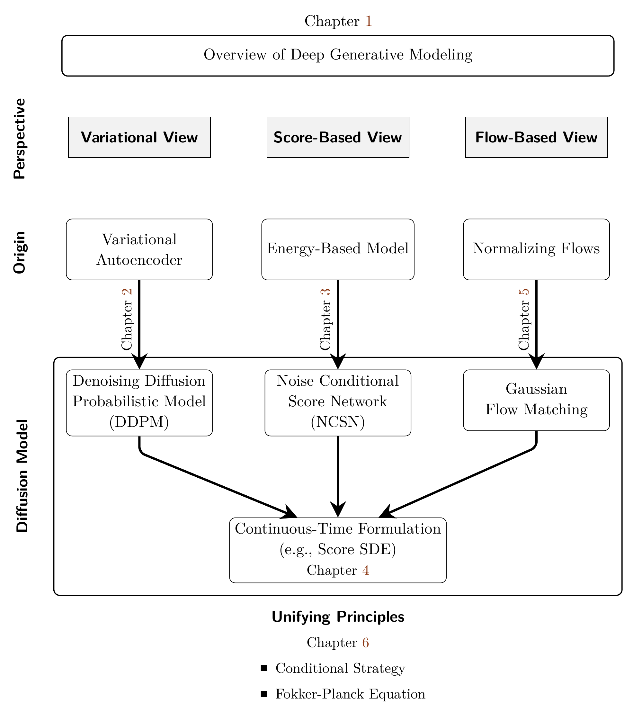

# Part II. Foundations and Perspectives of Diffusion Models {#part-ii}

<figure id="part-ii-roadmap" markdown="1">

</figure>

Web navigation (editorial): open the diagram at full resolution, or follow its chapter references: [Chapter 1](../chapters/01-deep-generative-modeling/index.md#ch-overview-dgm), [Chapter 2](../chapters/02-variational-perspective/index.md#ch-variational), [Chapter 3](../chapters/03-score-based-perspective/index.md#ch-score-based), [Chapter 4](../chapters/04-score-sde-framework/index.md#ch-score-sde), [Chapter 5](../chapters/05-flow-based-perspective/index.md#ch-flow-based), and [Chapter 6](../chapters/06-unified-perspective/index.md#ch-unified-perspective).

[Continue with A First Operational View of Diffusion Model Training and Sampling](operational-view.md#operational-view).
