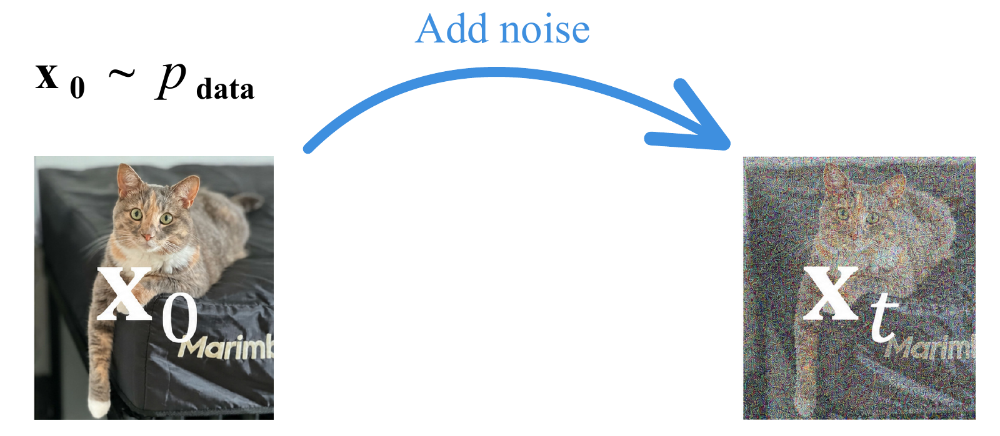
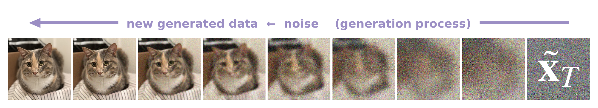

# A First Operational View of Diffusion Model Training and Sampling {#operational-view}

Before diving into the mathematics of diffusion models, let us first develop a simple operational view of how they are trained and how they generate samples.

The basic construction has two parts. First, we define a known corruption rule that can turn clean data into noisy observations at any chosen noise level. Second, we train a neural network to infer the clean signal from such a noisy observation. Once this prediction rule has been learned across many noise levels, it can also be used for generation. We start from a fresh noise sample and repeatedly apply the network while moving from high noise levels to lower ones. The result is a new sample that gradually acquires the structure of the data distribution.

**Message**

Create noisy data at many noise levels, learn to predict the clean signal, and generate by repeatedly applying this prediction from high noise to low.

**Creating Noisy Data.**

Let us make precise what a noisy version of the data actually means. Take a clean data sample

$$
{\mathbf{x}}_0\sim p_{\mathrm{data}},
$$

such as an image or any other kind of data we care about. We corrupt it at noise level $t$ by mixing in independent Gaussian noise<a class="footnote-ref" href="#fn:4" role="doc-noteref">4</a>:

$$
{\mathbf{x}}_t
=
\alpha_t{\mathbf{x}}_0+\sigma_t{\boldsymbol{\epsilon}},
\qquad
{\boldsymbol{\epsilon}}\sim\mathcal{N}(\boldsymbol{0},{\mathbf{I}}).
$$

Think of $\alpha_t$ and $\sigma_t$ as two knobs, fixed in advance, that set how much clean signal and how much noise enter the mix at noise level $t$.

The simplest possible choice, $\alpha_t=1$ and $\sigma_t=t$, gives

$$
{\mathbf{x}}_t={\mathbf{x}}_0+t{\boldsymbol{\epsilon}}.
$$

Now $t$ is literally a noise dial: turn it toward zero and ${\mathbf{x}}_t$ is nearly the clean sample; turn it up and the noise term $t{\boldsymbol{\epsilon}}$ increasingly takes over.

**Figure 1.3:** **Forward diffusion.** A clean sample $\mathbf{x}_0$ is corrupted to produce a noisy observation $\mathbf{x}_t$ at noise level $t$.

Source: Created by the authors.

More generally, every noise level $t$ defines a distribution $p_t$ over noisy samples. It is useful to think of $p_t$ as a *snapshot*: if we generated many noisy samples using the same value of $t$, their distribution would be $p_t$.

The schedule $(\alpha_t,\sigma_t)$ is chosen so that these snapshots move from clean data toward a simple noise distribution:

$$
p_0=p_{\mathrm{data}}
\qquad\longrightarrow\qquad
p_t
\qquad\longrightarrow\qquad
p_T\approx p_{\mathrm{prior}},
$$

where $p_{\mathrm{prior}}$ is typically a Gaussian distribution that is easy to sample from. Thus, the family

$$
\{p_t\}_{t\in[0,T]}
$$

describes how the distribution gradually changes as the noise level increases.

**Training: Learn to Predict the Clean Signal.**

With a way to corrupt data now in hand, training becomes almost mechanical, and it hinges on one key trick: because we are the ones corrupting the data, we always know the right answer. To build a single training example, we sample a clean datum ${\mathbf{x}}_0$, choose a noise level $t$, draw noise ${\boldsymbol{\epsilon}}$, and form

$$
{\mathbf{x}}_t
=
\alpha_t{\mathbf{x}}_0+\sigma_t{\boldsymbol{\epsilon}}.
$$

We manufactured ${\mathbf{x}}_t$ ourselves, so we already know exactly which clean ${\mathbf{x}}_0$ produced it.

The network, however, never sees ${\mathbf{x}}_0$ or ${\boldsymbol{\epsilon}}$ directly. It sees only the pair $({\mathbf{x}}_t,t)$, the corrupted observation and how corrupted it is. Its task is to guess the clean data behind it:

$$
{\mathbf{x}}_0^{\mathrm{pred}}
:=
{\mathbf{x}}_{{\boldsymbol{\phi}}}({\mathbf{x}}_t,t).
$$

Because we know the true target, we can score this guess and improve it using an ordinary squared-error loss:

$$
\left\|
{\mathbf{x}}_0^{\mathrm{pred}}-{\mathbf{x}}_0
\right\|_2^2.
$$

**Message**

In a nutshell: create a noisy observation with a known clean target, hide that target from the network, and train it to predict the target back.

Repeat this many times, over different data samples, noise draws, and noise levels, and a single network learns to make clean-data predictions across the entire range of corruption, from barely touched to nearly pure noise.

It is worth pausing on what this loss teaches the network to predict. Under squared error, the best possible prediction is

$$
{\mathbf{x}}_0^*({\mathbf{x}}_t,t)
=
{\mathbb{E}}[{\mathbf{x}}_0|{\mathbf{x}}_t,t].
$$

A noisy observation generally does not correspond to one unique clean sample. Several different clean samples could have produced a similar ${\mathbf{x}}_t$. This ambiguity exists at any nonzero noise level, but it becomes much stronger when the noise level is high. The network therefore learns to average over the clean samples that are plausible given the current noisy observation <a class="footnote-ref" href="#fn:5" role="doc-noteref">5</a>.

**Sampling: Start from Fresh Noise.**

Training leaves us with a network that is good at guessing clean data from noisy data. The next question is how to put that skill to use for generating something new.

Once training is finished, we freeze the network’s parameters and call them ${\boldsymbol{\phi}}^\times$. Generation now runs in the direction opposite to the one we have been describing: rather than starting at data and adding noise, it starts from noise alone,

$$
\tilde{{\mathbf{x}}}_T\sim p_{\mathrm{prior}}.
$$

We use a tilde to mark these generated states, $\tilde{{\mathbf{x}}}_t$, and keep them visually distinct from the training variables ${\mathbf{x}}_t$ produced by forward corruption.

This distinction matters more than it might first appear. The state $\tilde{{\mathbf{x}}}_T$ was not produced by secretly corrupting some real, hidden sample: there is no true ${\mathbf{x}}_0$ behind it waiting to be recovered. Generation is therefore not “rewinding a recording” of some specific corruption, because no such recording exists. Instead, at every noise level we simply ask the trained network what it currently believes the clean signal looks like, and use that belief to take one step back toward data.

Concretely, suppose we currently hold the state $\tilde{{\mathbf{x}}}_t$. Feeding it to the network gives a clean-data guess,

$$
{\mathbf{x}}_0^{\mathrm{pred}}
:=
{\mathbf{x}}_{{\boldsymbol{\phi}}^\times}(\tilde{{\mathbf{x}}}_t,t).
$$

For $t>0$, we can also compute an implied noise residual, defined as whatever is left over once the predicted signal is removed from the current state:

$$
{\boldsymbol{\epsilon}}_t^{\mathrm{pred}}
:=
\frac{
\tilde{{\mathbf{x}}}_t-\alpha_t{\mathbf{x}}_0^{\mathrm{pred}}
}{
\sigma_t
}.
$$

These two quantities are not independent guesses: by construction, they exactly reassemble the current state,

$$
\tilde{{\mathbf{x}}}_t
=
\alpha_t{\mathbf{x}}_0^{\mathrm{pred}}
+
\sigma_t{\boldsymbol{\epsilon}}_t^{\mathrm{pred}}.
$$

Here is the idea behind a single sampling step: keep the predicted signal and predicted noise as they are, but re-mix them using the coefficients for a slightly lower noise level $t-\Delta t$ in place of $t$:

$$
\tilde{{\mathbf{x}}}_{t-\Delta t}
=
\alpha_{t-\Delta t}{\mathbf{x}}_0^{\mathrm{pred}}
+
\sigma_{t-\Delta t}{\boldsymbol{\epsilon}}_t^{\mathrm{pred}}.
$$

Equivalently, this is a small update on top of the current state,

$$
\tilde{{\mathbf{x}}}_{t-\Delta t}
=
\tilde{{\mathbf{x}}}_t
+
(\alpha_{t-\Delta t}-\alpha_t){\mathbf{x}}_0^{\mathrm{pred}}
+
(\sigma_{t-\Delta t}-\sigma_t){\boldsymbol{\epsilon}}_t^{\mathrm{pred}}.
\tag{1.4.1}
$$

That is one step. We now feed the new state $\tilde{{\mathbf{x}}}_{t-\Delta t}$ back into the network, obtain an updated, usually different, clean-data prediction, and take another step down in noise. Sampling is exactly this loop, repeated from $t=T$ down to $t=0$.

**Message**

In a nutshell: start from fresh noise, predict the clean signal, step to a lower noise level, and predict again.

**Figure 1.4:** **Diffusion generation.** Starting from fresh noise $\tilde{\mathbf{x}}_T\sim p_{\mathrm{prior}}$, repeated model predictions construct a new sample as the noise level decreases.

Source: Created by the authors.

A natural question at this point: why not simply output that very first prediction ${\mathbf{x}}_0^{\mathrm{pred}}$ and stop? Because at high noise levels the current state carries very little information about clean structure, so the prediction is little more than a rough average over many plausible samples. Moving to a slightly lower noise level gives the network a slightly less ambiguous state to work from, so its next prediction can sharpen. Repeating this many times is what lets a genuinely detailed sample gradually emerge<a class="footnote-ref" href="#fn:6" role="doc-noteref">6</a>.

**A Simple Example.**

Let us make this tangible using our earlier running example where $\alpha_t=1$ and $\sigma_t=t$. Substituting into the update above gives

$$
\tilde{{\mathbf{x}}}_{t-\Delta t}
=
{\mathbf{x}}_0^{\mathrm{pred}}
+
(t-\Delta t)
\frac{
\tilde{{\mathbf{x}}}_t-{\mathbf{x}}_0^{\mathrm{pred}}
}{
t
},
$$

which rearranges into a simple weighted average,

$$
\tilde{{\mathbf{x}}}_{t-\Delta t}
=
\frac{t-\Delta t}{t}\tilde{{\mathbf{x}}}_t
+
\frac{\Delta t}{t}{\mathbf{x}}_0^{\mathrm{pred}}.
$$

In words, for small $\Delta t$ the next state is simply a blend of where we currently stand and where the network thinks we should end up.

So each step nudges the sample toward whatever the network currently predicts to be clean. The word *currently* is doing real work here: once we move, the network sees a new, less noisy state and typically changes its prediction. The final sample is therefore not the output of a single clean-data guess. It is built from an entire sequence of guesses, each one revised in light of the last.

**How this Connects to the Next Chapters?**

The clean-data prediction template developed here is only a first operational view. The basic pattern will remain the same throughout the book: during training, we create noisy observations from clean data and learn how to predict useful information from them; during generation, we start from fresh noise and use these learned predictions to construct a new sample over decreasing noise levels.

The following chapters explain this same process from different mathematical perspectives. [Chapter 2](../chapters/02-variational-perspective/index.md#ch-variational) connects DDPMs to latent-variable models, where the fixed noising process plays the role of an encoder and the learned reverse transitions play the role of a decoder. [Chapter 3](../chapters/03-score-based-perspective/index.md#ch-score-based) describes denoising through the score, which provides a direction for updating noisy samples. [Chapter 4](../chapters/04-score-sde-framework/index.md#ch-score-sde) moves from discrete noise levels to continuous time and describes generation through reverse-time stochastic dynamics. [Chapter 5](../chapters/05-flow-based-perspective/index.md#ch-flow-based) instead views generation as transporting samples along a continuous path from a simple prior toward the data distribution. Finally, [Chapter 6](../chapters/06-unified-perspective/index.md#ch-unified-perspective) explains how these viewpoints are connected.

The main takeaway is simple: diffusion models learn from noisy versions of data at many noise levels, and generation uses these learned predictions repeatedly to turn fresh noise into a new sample.

<ol start="4" markdown="1">
<li id="fn:4" markdown="block">

The formula ${\mathbf{x}}_t=\alpha_t{\mathbf{x}}_0+\sigma_t{\boldsymbol{\epsilon}}$ gives the accumulated corruption at a chosen noise level $t$ directly. In DDPMs and Score SDEs, the same marginal distribution at that level can also be obtained by adding noise through many smaller sequential steps; see [Section 2.2](../chapters/02-variational-perspective/02-ddpm.md#sec-ddpm) and [Chapter 4](../chapters/04-score-sde-framework/index.md#ch-score-sde). In the discrete DDPM notation introduced later, this accumulated corruption is written as

$$
{\mathbf{x}}_i
=
\bar{\alpha}_i{\mathbf{x}}_0
+
\sqrt{1-\bar{\alpha}_i^2}\,{\boldsymbol{\epsilon}}.
$$

<a class="footnote-backref" href="#fnref:4" aria-label="Back to footnote 4 in the text">↩</a>

</li>

<li id="fn:5" markdown="block">

When the noise level is clear from context, we will often shorten this to ${\mathbb{E}}[{\mathbf{x}}_0|{\mathbf{x}}_t]$.

<a class="footnote-backref" href="#fnref:5" aria-label="Back to footnote 5 in the text">↩</a>

</li>

<li id="fn:6" markdown="block">

We will later connect this deterministic update to DDIM sampling and its Euler-type interpretation ([Song et al., 2020](../references.md#ref-song2020denoising)) in [Section 9.2](../chapters/09-numerical-solvers/02-ddim.md#sec-revisit-ddim); the stochastic DDPM sampler is introduced in [Section 2.2](../chapters/02-variational-perspective/02-ddpm.md#sec-ddpm).

<a class="footnote-backref" href="#fnref:6" aria-label="Back to footnote 6 in the text">↩</a>

</li>

</ol>

