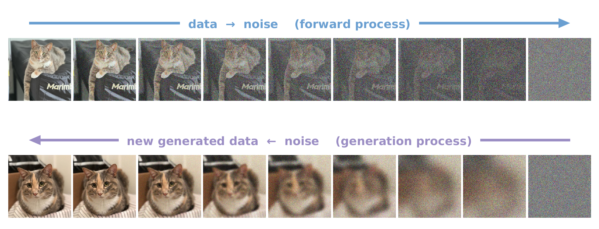
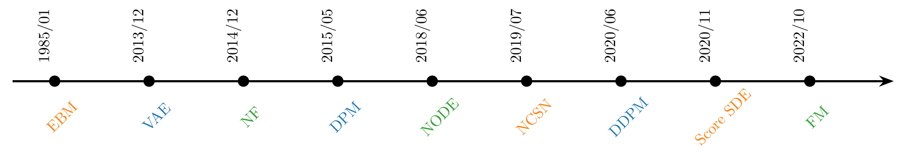
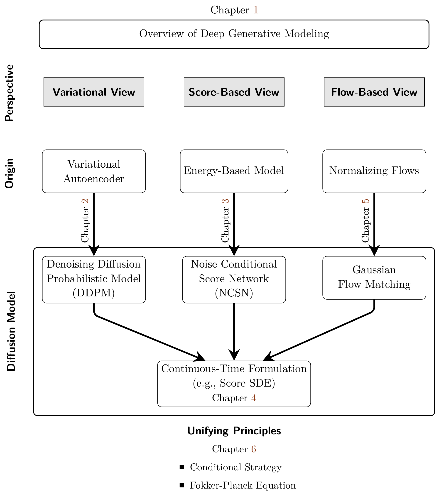

# Preface and Roadmap {#preface}

Diffusion models have rapidly become a central paradigm in generative modeling, with a vast body of work spanning machine learning, computer vision, natural language processing, and beyond. This literature is dispersed across communities and highlights different dimensions of progress, including theoretical foundations that concern modeling principles, training objectives, sampler design, and the mathematical ideas behind them; implementation advances that cover engineering practices and architectural choices; practical applications that adapt the models to specific domains or tasks; and system level optimizations that improve efficiency in computation, memory, and deployment.

This book sets out to provide a *principled foundation* of diffusion models, focusing on the following central themes:

-   We present the essential concepts and formulations that anchor diffusion model research, giving readers the core understanding needed to navigate the broader literature. We do not survey all variants or domain specific applications; instead we establish a stable conceptual foundation from which such developments can be understood.

-   Unlike classical generative models that learn a direct mapping from noise to data, diffusion models view generation as a gradual transformation over time, refining coarse structures into fine details. This central idea has been developed through three main perspectives, i.e., *variational*, *score-based*, and *flow-based* methods, which offer complementary ways to understand and implement diffusion modeling. We focus on the core principles and foundations of these formulations, aiming to trace the origins of their key ideas, clarify the relations among different formulations, and develop a coherent understanding that connects intuitive insight with rigorous mathematical formulation.

-   Building on these foundations, we examine how diffusion models can be further developed to generate samples more efficiently, provide greater control over the generative process, and inspire standalone forms of generative modeling grounded in the principles of diffusion.

This book is intended for researchers, graduate students, and practitioners who have a basic understanding of deep learning (for example, what a neural network is and how training works), or more specifically, deep generative modeling, and who wish to deepen their grasp of diffusion models beyond surface-level familiarity. By the end, readers will have a principled understanding of the foundations of diffusion modeling, the ability to interpret different formulations within a coherent framework, and the background needed to both apply existing models with confidence and pursue new research directions.

## Roadmap of This Book

This book systematically introduces the foundations of diffusion models, tracing them back to their core underlying principles.

### Suggested Reading Path.

We recommend reading this book in the presented order to build a comprehensive understanding. Sections marked as *Optional* can be skipped by readers already familiar with the fundamentals. For instance, those comfortable with deep generative models (DGM) may bypass the overview in [Chapter 1](../chapters/01-deep-generative-modeling/index.md#ch-overview-dgm). Similarly, prior knowledge of Variational Autoencoders ([Section 2.1](../chapters/02-variational-perspective/01-variational-autoencoder.md#sec-vae)), Energy-Based Models ([Section 3.1](../chapters/03-score-based-perspective/01-energy-based-models.md#sec-ebm)), or Normalizing Flows ([Section 5.1](../chapters/05-flow-based-perspective/01-normalizing-flows-and-neural-odes.md#sec-flow-based-method)) allows skipping these introductory sections. Other optional parts provide deeper insights into advanced or specialized topics and can be consulted as needed.

The book is organized into four main parts.

### Parts A & B: Foundations of Diffusion Models.

This section traces the origins of diffusion models by reviewing three foundational perspectives that have shaped the field[^1]. [Figure 3](preface.md#fig-part-b-roadmap) provides an overview of this part.

#### Part A: Introduction to Deep Generative Modeling (DGM).

We begin in [Chapter 1](../chapters/01-deep-generative-modeling/index.md#ch-overview-dgm) with a review of the fundamental goals of deep generative modeling. Starting from a collection of data examples, the aim is to build a model that can produce new examples that appear to come from the same underlying, and generally unknown, data distribution. Many approaches achieve this by learning how the data are distributed, either explicitly through a probability model or implicitly through a learned transformation. We then explain how such models represent the data distribution with neural networks, how they learn from examples, and how they generate new samples. The chapter concludes with a taxonomy of major generative frameworks, highlighting their central ideas and key distinctions.

#### Part B: Core Perspectives on Diffusion Models.

**Figure 1:** **Forward and reverse diffusion trajectories.** In the forward process (top), a real data sample is gradually corrupted by noise, passing through a sequence of intermediate noisy stages until it becomes indistinguishable from pure noise. In the reverse process (bottom), generation starts from a fresh noise sample and gradually removes noise to produce a new image. The reverse process is not about reconstructing a specific example seen during training. Instead, it begins from a fresh noise and gradually shapes it into a realistic new sample.

Source: Created by the authors.

Having outlined the general goals and mechanisms of deep generative modeling, we now turn to diffusion models, a class of methods that realize generation as a gradual transformation from noise to data (see [Figure 1](preface.md#fig-ill-forward-reverse)). The core idea is simple: a data sample can be progressively corrupted by adding noise until it becomes indistinguishable from pure randomness. This *forward process* moves different data samples into the same simple noise space, which is easy to sample from and serves as the starting point for generation. Along the way, it also creates a smooth sequence of intermediate noisy stages connecting data to noise. To generate, we draw a fresh noise sample from this space and gradually remove noise through a *reverse-time (generation) process*, eventually producing a new data sample. This reverse process does not recover one particular original example; instead, it starts from fresh noise and gradually turns it into realistic data. We examine three interconnected frameworks, each built on this same principle: a forward process that gradually adds noise, and a reverse-time process approximated by a sequence of models that gradually denoise:

-   **Variational View** ([Chapter 2](../chapters/02-variational-perspective/index.md#ch-variational)): Originating from Variational Autoencoders (VAEs) ([Kingma and Welling, 2013](../references.md#ref-kingma2013auto)), it frames diffusion as learning a denoising process through a variational objective, giving rise to Denoising Diffusion Probabilistic Models (DDPMs) ([Sohl-Dickstein et al., 2015](../references.md#ref-sohl2015deep); [Ho et al., 2020](../references.md#ref-ho2020denoising)).

-   **Score-Based View** ([Chapter 3](../chapters/03-score-based-perspective/index.md#ch-score-based)): Rooted in Energy-Based Models (EBMs) 
     ([Ackley et al., 1985](../references.md#ref-ackley1985learning)) and developed into Noise Conditional Score Networks (NCSN) ([Song and Ermon, 2019](../references.md#ref-song2019generative)). It learns the score function, the gradient of the log data density, which guides how to gradually remove noise from samples. In continuous time, [Chapter 4](../chapters/04-score-sde-framework/index.md#ch-score-sde) introduces the *Score SDE framework*, which describes this denoising process as a Stochastic Differential Equation (SDE) and its deterministic counterpart as an Ordinary Differential Equation (ODE). This view connects diffusion modeling with classical differential equation theory, providing a clear mathematical basis for analysis and algorithm design.

-   **Flow-Based View** ([Chapter 5](../chapters/05-flow-based-perspective/index.md#ch-flow-based)): Building on Normalizing Flows ([Rezende and Mohamed, 2015](../references.md#ref-rezende2015variational)) and generalized by Flow Matching ([Lipman et al., 2022](../references.md#ref-lipman2022flow)), this view models generation as a continuous transformation that transports samples from a simple prior toward the data distribution. The evolution is governed by a velocity field through an ODE, which explicitly defines how probability mass moves over time. This flow-based formulation naturally extends beyond prior-to-data generation to more general *distribution-to-distribution translation* problems, where one seeks to learn a flow connecting any pair of source and target distributions.

**Figure 2:** **Timeline of modern machine-learning perspectives on diffusion models.** Each group shares the same color.

- In [Chapter 2](../chapters/02-variational-perspective/index.md#ch-variational), Variational Autoencoder (VAE) ([Kingma and Welling, 2013](../references.md#ref-kingma2013auto)) $\to$ Diffusion Probabilistic Models (DPM) ([Sohl-Dickstein et al., 2015](../references.md#ref-sohl2015deep)) $\to$ DDPM ([Ho et al., 2020](../references.md#ref-ho2020denoising)).

- In [Chapter 3](../chapters/03-score-based-perspective/index.md#ch-score-based) and [Chapter 4](../chapters/04-score-sde-framework/index.md#ch-score-sde), Energy-Based Model (EBM) ([Ackley et al., 1985](../references.md#ref-ackley1985learning)) $\to$ Noise Conditional Score Network (NCSN) ([Song and Ermon, 2019](../references.md#ref-song2019generative)) $\to$ Score SDE ([Song et al., 2020](../references.md#ref-song2020score)).

- In [Chapter 5](../chapters/05-flow-based-perspective/index.md#ch-flow-based), Normalizing Flow (NF) ([Rezende and Mohamed, 2015](../references.md#ref-rezende2015variational)) $\to$ Neural ODE (NODE) ([Chen et al., 2018](../references.md#ref-chen2018neural)) $\to$ Flow Matching (FM) ([Lipman et al., 2022](../references.md#ref-lipman2022flow)).

Source: Created by the authors.

Although these perspectives may seem different at first, [Chapter 6](../chapters/06-unified-perspective/index.md#ch-unified-perspective) shows that they are deeply connected. Each uses a *conditioning strategy* that turns the learning objective into a tractable regression problem. At a deeper level, they all describe the same temporal evolution of probability distributions, from the prior toward the data. This evolution is governed by the *Fokker–Planck equation*, which can be viewed as the continuous-time change of variables for densities, ensuring consistency between the stochastic and deterministic formulations.

Since diffusion models can be viewed as approaches for transporting one distribution to another, [Chapter 7](../chapters/07-optimal-transport/index.md#ch-ot-eot) develops their connections to classical optimal transport and the Schrödinger bridge, interpreted as optimal transport with entropy regularization. We review both the static and dynamic formulations and explain their relations to the continuity equation and the Fokker–Planck perspective. This chapter is optional for readers focused on practical aspects, but it provides rigorous mathematical background and pointers to the classical literature for those who wish to study these links in depth.

**Figure 3:** **Part B. Unifying and Principled Perspectives on Diffusion Models.** This diagram visually connects classical generative modeling approaches—Variational Autoencoders, Energy-Based Models, and Normalizing Flows—with their corresponding diffusion model formulations. Each vertical path illustrates a conceptual lineage, culminating in the continuous-time framework. The three views (Variational, Score-Based, and Flow-Based) offer distinct yet mathematically equivalent interpretations.

Source: Created by the authors.

### Part C & D: Controlling and Accelerating the Diffusion Sampling.

With the foundational principles unified, we now turn to practical aspects of utilizing diffusion models for efficient generation. Sampling from a diffusion model corresponds to solving a differential equation. However, this procedure is typically computationally expensive. Parts C and D focus on improving generation quality, controllability, and efficiency through enhanced sampling and learned acceleration techniques.

#### Part C: Sampling from Diffusion Models.

The generation process of diffusion models exhibits a distinctive coarse-to-fine refinement: noise is removed step by step, yielding samples with increasingly coherent structure and detail. This property comes with trade-offs. On the positive side, it affords fine-grained control; by adding a guidance term to the learned, time-dependent velocity field, we can steer the ODE flow to reflect user intent and make sampling controllable. On the negative side, the required iterative integration makes sampling slow compared with single-shot generators. This part focuses on improving the generative process at inference time, without retraining.

-   **Steering Generation** ([Chapter 8](../chapters/08-guidance/index.md#ch-guidance))**:** Techniques such as classifier guidance and classifier-free guidance make it possible to condition the generation process on user-defined objectives or attributes. Building on this, we next discuss how the use of a preference dataset can further align diffusion models with such preferences.

-   **Fast Generation with Numerical Solvers** ([Chapter 9](../chapters/09-numerical-solvers/index.md#ch-numerical-solvers))**:** Sampling can be significantly accelerated using advanced numerical solvers that approximate the reverse process in fewer steps, reducing cost while preserving quality.

#### Part D: Learning Fast Generative Models.

Beyond improving existing sampling algorithms, we investigate how to directly learn fast generators that approximate the diffusion process.

-   **Distillation-Based Methods** ([Chapter 10](../chapters/10-distillation/index.md#ch-distillation)): This approach focuses on training a student model to imitate the behavior of a pre-trained, slow diffusion model (the teacher). Instead of reducing the teacher’s size, the goal is to reproduce its sampling trajectory or output distribution with far fewer integration steps, often only a few or even one.

-   **Learning from Scratch** ([Chapter 11](../chapters/11-fast-generators/index.md#ch-fast-scratch))**:** Since sampling in diffusion models can be seen as solving an ODE, this approach learns the solution map (i.e., the flow map) directly from scratch, without relying on a teacher model. The learned map can take noise directly to data, or more generally perform anytime-to-anytime jumps along the solution trajectory.

### Epilogue: Beyond Diffusion on Continuous State Spaces.

We close in [Chapter 12](../chapters/12-epilogue/index.md#ch-epilogue) by making explicit the principle that has guided the entire book. At its heart, diffusion modeling is not tied to one particular noise type, model class, or even to continuous state spaces. Rather, it is the study of how probability mass evolves under a prescribed time-dependent forward corruption process, and how that evolution can be reversed, approximated, or exploited for generation. In the continuous setting, this principle appears through the change-of-variable formula, the continuity equation, and the Fokker–Planck equation. In the discrete setting, the same structural role is played by transition kernels, continuous-time Markov chains, and the master equation.

This final chapter also shows that the three perspectives developed throughout the book, namely the variational, score-based, and flow-based viewpoints, extend beyond continuous data modeling. Even for discrete data such as text, protein sequences, and other token-based objects, one can formulate reverse modeling through variational objectives, score-like ratio or reverse-rate characterizations, and flow-like transport viewpoints. The mathematical objects change, but the underlying principles do not. In this way, the epilogue serves both as a conceptual culmination of the book and as an outlook toward a broader landscape of generative modeling.

### Appendices.

To ensure our journey is accessible to all, the appendices provide background for foundational concepts. [Appendix A](../appendices/a-differential-equations/index.md#app-de) offers a crash course on the differential equations that have become the language of diffusion models.

The core insight behind diffusion models, despite their varied perspectives and origins, lies in the *change-of-variables formula*. This foundation naturally extends to deeper concepts such as the *Fokker–Planck equation* and the *continuity equation*, which describe how probability densities transform and evolve under mappings defined by functions (discrete time) or differential equations (continuous time). [Appendix B](../appendices/b-density-evolution/index.md#app-continuity) offers a gentle introduction that bridges these foundational ideas to more advanced concepts. In [Appendix C](../appendices/c-ito-calculus/index.md#app-ito), we present two powerful but often overlooked tools underlying diffusion models: *Itô’s formula* and *Girsanov’s theorem*, which provide rigorous support for the Fokker–Planck equation and the reverse-time sampling process. Finally, [Appendix D](../appendices/d-supplementary-proofs/index.md#app-supplementary-proofs) gathers proofs of selected propositions and theorems discussed in the main chapters.

### What This Book Covers and What It Does Not.

We aim for durability. From a top-down viewpoint, this book begins with a single principle: construct continuous-time dynamics that transport a simple prior to the data distribution while ensuring that the marginal distribution at each time matches the marginal induced by a prescribed forward process from data to noise. From this principle, we develop the stochastic and deterministic flows that enable sampling, show how to steer the trajectory (guidance), and explain how to accelerate it (numerical solvers). We then study diffusion-motivated fast generators, including distillation methods and flow-map models. With these tools, readers can place new papers within a common template, understand why methods work, and design improved models.

We do not attempt to provide an exhaustive survey of the diffusion model literature, nor do we catalog architectures, training practices, hyperparameters, compare empirical results across methods, cover datasets and leaderboards, describe domain- or modality-specific applications, address system-level deployment, provide recipes for large-scale training, or discuss hardware engineering. These topics evolve rapidly and are better covered by focused surveys, open repositories, and implementation guides.

[^1]: We remark that our organization of the three perspectives on diffusion models is conceptual rather than chronological. For instance, *energy-based approaches* draw on a much longer history. Statistical mechanics connected probability with energy, while studies of Brownian motion and subsequent work described how probability distributions evolve over time  ([Gibbs, 1902](../references.md#ref-gibbs1902elementary); [Langevin, 1908](../references.md#ref-langevin1908brownian); [Fokker, 1914](../references.md#ref-fokker1914mittlere); [Planck, 1917](../references.md#ref-planck1917satz); [Kolmogoroff, 1931](../references.md#ref-kolmogorov1931)). Modern diffusion probabilistic models later brought related ideas into generative modeling and explicitly drew inspiration from nonequilibrium statistical physics  ([Sohl-Dickstein et al., 2015](../references.md#ref-sohl2015deep)). The three perspectives presented here should therefore be understood as modern ways of explaining diffusion models, rather than as a strict historical ordering of where their underlying ideas first arose.
