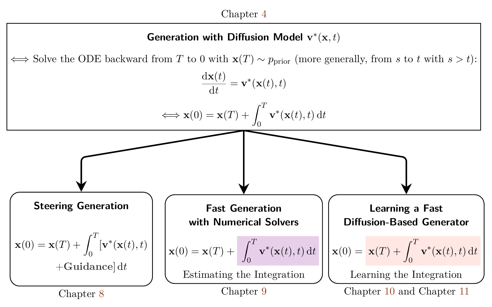

# Part III. Sampling of Diffusion Models {#part-iii}

<figure id="part-iii-roadmap" markdown="1">

</figure>

Web navigation (editorial): open the diagram at full resolution, or follow its chapter references: [Chapter 4](../chapters/04-score-sde-framework/index.md#ch-score-sde), [Chapter 8](../chapters/08-guidance/index.md#ch-guidance), [Chapter 9](../chapters/09-numerical-solvers/index.md#ch-numerical-solvers), [Chapter 10](../chapters/10-distillation/index.md#ch-distillation), and [Chapter 11](../chapters/11-fast-generators/index.md#ch-fast-scratch).
