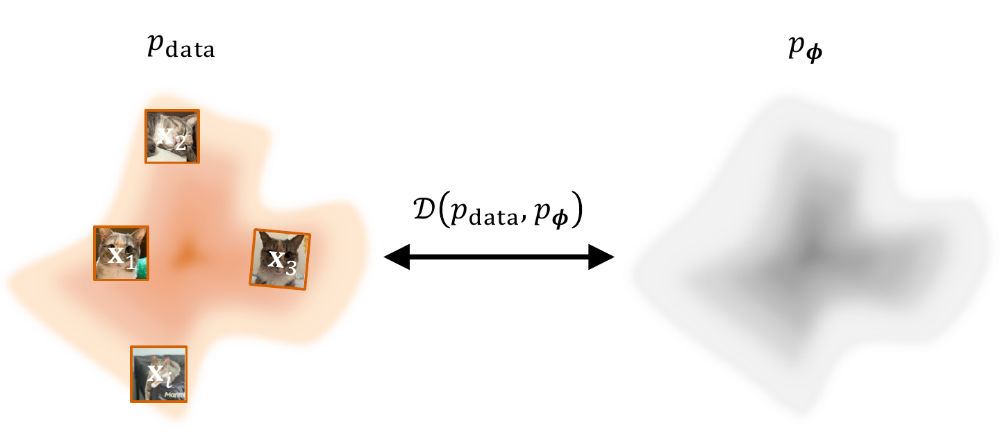

# 1.1 什么是深度生成建模？ {#sec-formulation-dgm}

深度生成模型以大量从未知复杂分布 $p_{\mathrm{data}}$ 中抽取的现实世界样本（如图像、文本）作为输入，输出一个训练好的神经网络，用它来参数化近似分布 $p_{{\boldsymbol{\phi}}}$。其目标有两个方面：

1.  **逼真生成：** 生成新颖、逼真且与真实数据难以区分的样本。

2.  **可控生成：** 对生成过程实现细粒度且可解释的控制。

本节介绍深度生成模型的基本概念和动机，为详细讨论其数学框架与实际应用做好准备。

## 1.1.1 数学设定 {#subsec-intro-math-setup}

假设我们有一个有限的样本集合 $\{{\mathbf{x}}^{(i)}\}_{i=1}^N$，例如图像、音频或文本。我们设想这些样本是从某个潜在的数据分布 $p_{\mathrm{data}}$ 中抽取的，但并不知道这一分布的显式形式。具体而言，我们只能观察到已有的训练样本；既没有 $p_{\mathrm{data}}$ 的公式，也没有直接从中任意抽取新样本的方法[^1]。

**深度生成建模的目标。** 因此，深度生成建模的目标是学习一个模型，使其能够生成统计特征与观测数据相似的*新*样本。对于参数为 $\boldsymbol{\phi}$ 的模型，我们将它所表示的分布记为 $p_{\boldsymbol{\phi}}$。训练完成后，我们将学到的参数记为 $\boldsymbol{\phi}^{\times}$，并希望在与生成有关的方面，

$$
p_{\boldsymbol{\phi}^{\times}}
    \approx
    p_{\mathrm{data}}.
$$

这个表达式应从概念上理解：由于数据有限、模型容量有限，且优化并不完美，我们并不期待两个分布完全相同。学到的模型应当捕捉数据分布中足够多的结构，从而生成逼真且多样的新样本。

模型训练完成后，生成就是抽取一个新样本

$$
{\mathbf{x}} \sim p_{\boldsymbol{\phi}^{\times}}.
$$

不同类别的生成模型提供了不同的实现机制。有些模型还允许我们计算它们赋予某个观测样本的密度值，另一些模型则主要通过采样过程来定义。之后讨论不同生成模型的训练方式时，这一区别会派上用场；目前，主要目标就是从数据中学习一个可供我们生成新样本的分布。

**图 1.1：** **深度生成建模的目标示意图。** 训练深度生成模型，本质上是在最小化模型分布 $p_{\boldsymbol{\phi}}$ 与未知数据分布 $p_{\mathrm{data}}$ 之间的差异。由于无法直接访问 $p_{\mathrm{data}}$，必须使用从中抽取的有限个独立同分布（i.i.d.）样本 ${\mathbf{x}}_i$ 来高效估计这一差异。

来源：由本书作者绘制。

**深度生成模型的训练。** 我们学习模型参数 $\boldsymbol{\phi}$，对应的模型族为 $\{p_{\boldsymbol{\phi}}\}$。学习通过最小化差异度量 $\mathcal{D}(p_{\mathrm{data}},p_{\boldsymbol{\phi}})$ 来实现：

$$
\begin{aligned}
\boldsymbol{\phi}^\ast \in \arg\min_{\boldsymbol{\phi}}\; \mathcal{D}(p_{\mathrm{data}},p_{\boldsymbol{\phi}}).
\end{aligned}
\tag{1.1.1}
$$

由于 $p_{\mathrm{data}}$ 未知，实际选用的 $\mathcal{D}$ 必须能够利用来自 $p_{\mathrm{data}}$ 的独立同分布样本进行高效估计。当模型容量足够时，$p_{\boldsymbol{\phi}^\ast}$ 可以很好地近似 $p_{\mathrm{data}}$。

**前向 KL散度与最大似然估计（MLE）。** 应当如何选择模型参数，使 $p_{\boldsymbol{\phi}}$ 接近 $p_{\mathrm{data}}$？当模型密度 $p_{\boldsymbol{\phi}}({\mathbf{x}})$ 可以计算时，一个自然的想法是让模型赋予观测数据较高的密度。这就引出了*最大似然估计*（maximum likelihood estimation，MLE）：选择 $\boldsymbol{\phi}$，使训练样本整体上获得较高的模型密度[^2]。

将这一思想形式化的一种标准方式，是使用（前向）KL散度[^3]

$$
\begin{aligned}
\mathcal{D}_{\mathrm{KL}}
\big(p_{\mathrm{data}}\|p_{\boldsymbol{\phi}}\big)
:=\;&
\int
p_{\mathrm{data}}({\mathbf{x}})
\log
\frac{p_{\mathrm{data}}({\mathbf{x}})}
     {p_{\boldsymbol{\phi}}({\mathbf{x}})}
\,\mathop{}\!\mathrm{d} {\mathbf{x}}
\\
=\;&
\mathbb{E}_{{\mathbf{x}}\sim p_{\mathrm{data}}}
\big[
\log p_{\mathrm{data}}({\mathbf{x}})
-
\log p_{\boldsymbol{\phi}}({\mathbf{x}})
\big].
\end{aligned}
$$

KL散度是不对称的，即

$$
\mathcal{D}_{\mathrm{KL}}
\big(p_{\mathrm{data}}\|p_{\boldsymbol{\phi}}\big)
\neq
\mathcal{D}_{\mathrm{KL}}
\big(p_{\boldsymbol{\phi}}\|p_{\mathrm{data}}\big).
$$

乍看之下，由于数据密度 $p_{\mathrm{data}}({\mathbf{x}})$ 未知，前向 KL散度似乎无法使用。然而，它可以分解为

$$
\begin{aligned}
\mathcal{D}_{\mathrm{KL}}
\big(p_{\mathrm{data}}\|p_{\boldsymbol{\phi}}\big)
=
\mathbb{E}_{{\mathbf{x}}\sim p_{\mathrm{data}}}
\left[
\log
\frac{p_{\mathrm{data}}({\mathbf{x}})}
     {p_{\boldsymbol{\phi}}({\mathbf{x}})}
\right]
=
-\mathbb{E}_{{\mathbf{x}}\sim p_{\mathrm{data}}}
\big[
\log p_{\boldsymbol{\phi}}({\mathbf{x}})
\big]
-
\mathcal{H}\big(p_{\mathrm{data}}\big),
\end{aligned}
$$

其中

$$
\mathcal{H}\big(p_{\mathrm{data}}\big)
:=
-\mathbb{E}_{{\mathbf{x}}\sim p_{\mathrm{data}}}
\big[
\log p_{\mathrm{data}}({\mathbf{x}})
\big]
$$

是数据分布的熵。关键在于，这一项不依赖于 $\boldsymbol{\phi}$。因此，尽管我们无法计算 $p_{\mathrm{data}}({\mathbf{x}})$ 本身，也不需要知道它就能优化模型参数。由此得到以下等价关系：

**引理 1.1.1：最小化 KL散度 $\Leftrightarrow$ MLE**

$$
\begin{aligned}
\min_{\boldsymbol{\phi}}\,
\mathcal{D}_{\mathrm{KL}}
\big(
p_{\mathrm{data}}
\,\|\,
p_{\boldsymbol{\phi}}
\big)
\;\Longleftrightarrow\;
\max_{\boldsymbol{\phi}}\,
\mathbb{E}_{{\mathbf{x}}\sim p_{\mathrm{data}}}
\big[
\log p_{\boldsymbol{\phi}}({\mathbf{x}})
\big].
\end{aligned}
\tag{1.1.2}
$$

用文字来说，最小化前向 KL散度，等价于使真实数据样本在模型下获得较高的对数似然。这正是最大似然估计。

在实践中，对 $p_{\mathrm{data}}$ 的期望用已有训练样本 $\{{\mathbf{x}}^{(i)}\}_{i=1}^{N}$ 来替代，并假定这些样本独立同分布地抽取自 $p_{\mathrm{data}}$。这样便得到经验负对数似然目标

$$
\begin{aligned}
\hat{\mathcal{L}}_{\mathrm{MLE}}(\boldsymbol{\phi})
:=
-\frac{1}{N}
\sum_{i=1}^{N}
\log p_{\boldsymbol{\phi}}\big({\mathbf{x}}^{(i)}\big),
\end{aligned}
$$

它可以通过小批量上的随机梯度进行优化。因此，MLE 只需要来自 $p_{\mathrm{data}}$ 的样本，无需计算未知的数据密度本身。

KL散度的方向很重要，因为它决定了*对差异求平均所依据的分布*。对于前向 KL散度，

$$
\mathcal{D}_{\mathrm{KL}}
\big(p_{\mathrm{data}}\|p_{\boldsymbol{\phi}}\big)
=
\mathbb{E}_{{\mathbf{x}}\sim p_{\mathrm{data}}}
\left[
\log
\frac{p_{\mathrm{data}}({\mathbf{x}})}
     {p_{\boldsymbol{\phi}}({\mathbf{x}})}
\right],
$$

期望是相对于数据分布计算的。因此，模型必须顾及 $p_{\mathrm{data}}$ 下会出现数据的区域。反向 KL散度 $\mathcal{D}_{\mathrm{KL}} (p_{\boldsymbol{\phi}}\|p_{\mathrm{data}})$ 则对模型分布中的样本求平均。

这一区别会带来一个重要结果。假设存在一个区域 $A$，它在数据分布下具有正概率，即 $p_{\mathrm{data}}(A)>0$，但模型在该区域赋予的密度为零，即 $p_{\boldsymbol{\phi}}({\mathbf{x}})=0$ 对 ${\mathbf{x}}\in A$ 成立。那么前向 KL散度将变为无穷大，因为在该区域上，

$$
\log
\frac{p_{\mathrm{data}}({\mathbf{x}})}
     {p_{\boldsymbol{\phi}}({\mathbf{x}})}
=
+\infty
$$

因此，如果模型完全遗漏了数据分布赋予概率质量的区域，最小化前向 KL散度就会对此施加强烈惩罚。这种行为通常称为*模式覆盖*（mode covering）。

**Fisher 散度。** Fisher 散度是（基于 score 的）扩散建模中的另一个重要概念（见[第 3 章](../03-score-based-perspective/index.md#ch-score-based)）。对于两个分布 $p$ 和 $q$，它定义为

$$
\begin{aligned}
\mathcal D_{\mathrm F}(p \|  q)
:=
\mathbb{E}_{\mathbf{x}\sim p} \left[
\left\|\nabla_{\mathbf x}\log p(\mathbf x)-\nabla_{\mathbf x}\log q(\mathbf x)\right\|_2^{2}
\right].
\end{aligned}
\tag{1.1.3}
$$

它衡量的是 *score 函数* $\nabla_{\mathbf x}\log p(\mathbf x)$ 与 $\nabla_{\mathbf x}\log q(\mathbf x)$ 之间的差异；这两个函数是指向概率更高区域的向量场。$\mathcal D_{\mathrm F}(p \| q)\ge 0$，且等号成立当且仅当 $p=q$ 几乎处处成立。由于 score 只依赖于对数密度的梯度，Fisher 散度不受归一化常数的影响。它构成了 *score 匹配*（[式（3.1.3）](../03-score-based-perspective/01-energy-based-models.md#eq-ebm-sm)和[式（3.2.1）](../03-score-based-perspective/02-score-based-models.md#eq-sm)）的基础；score 匹配通过学习对数密度的梯度来实现生成（基于 score 的模型）。在这一设定下，数据分布 $p=p_{\mathrm{data}}$ 作为目标，而模型 $q=p_{\boldsymbol{\phi}}$ 通过训练，使其 score 场与数据的 score 场一致。

**KL散度之外的度量。** 尽管 KL散度是衡量概率分布之间差异时最常用的度量，但它并不是唯一选择。不同散度反映了几何或统计意义上的不同差异，进而影响学习算法的优化动态。一大类这样的度量是 *$f$-散度*（[Csiszár, 1963](../../references.md#ref-csiszar1963informationstheoretische)）：

$$
\begin{aligned}
\mathcal{D}_f(p\|q)
=\int q({\mathbf{x}}) f \left(\frac{p({\mathbf{x}})}{q({\mathbf{x}})}\right)\mathop{}\!\mathrm{d} {\mathbf{x}},
\qquad f(1)=0,
\end{aligned}
\tag{1.1.4}
$$

其中 $f:\mathbb{R}_+ \to\mathbb{R}$ 是凸函数。通过改变 $f$，我们可以得到许多熟知的散度：

$$
\begin{aligned}
f(u)&=u\log u &&\Rightarrow&& \mathcal{D}_f=\mathcal{D}_{\mathrm{KL}}(p\|q)\quad\text{(forward KL)},\\
f(u)&=\tfrac12 \left[u\log u-(u+1)\log \tfrac{1+u}{2}\right] &&\Rightarrow&& \mathcal{D}_f=\mathcal{D}_{\mathrm{JS}}(p\|q)\quad\text{(Jensen--Shannon)},\\
f(u)&=\tfrac12|u-1| &&\Rightarrow&& \mathcal{D}_f=\mathcal{D}_{\mathrm{TV}}(p,q)\quad\text{(total variation)}.
\end{aligned}
$$

为清晰起见，下面给出它们的显式形式：

$$
\mathcal{D}_{\mathrm{JS}}(p\|q)=\tfrac12 \mathcal{D}_{\mathrm{KL}}\big(p\| \tfrac12(p+q)\big)+\tfrac12 \mathcal{D}_{\mathrm{KL}}\big(q\| \tfrac12(p+q)\big),
$$

以及

$$
\mathcal{D}_{\mathrm{TV}}(p,q)=\tfrac12 \int_{\mathbb{R}^D
} |p-q|\mathop{}\!\mathrm{d} {\mathbf{x}}
=\sup_{A\subset \mathbb{R}^D } |p(A)-q(A)|.
$$

直观地说，JS 散度给出了一个平滑、对称的度量，能够兼顾两个分布，并避免 KL散度中无界的惩罚（后文将会看到，它有助于解释生成对抗网络，即 GAN 框架）；全变差距离则刻画了两者之间可能出现的最大概率差异。

另一个视角来自*最优传输*（见[第 7 章](../07-optimal-transport/index.md#ch-ot-eot)），其代表是 Wasserstein 距离（见[式（7.2.2）](../07-optimal-transport/02-transport-problem-setups.md#eq-monge-formulation)）。它衡量的是将概率质量从一个分布搬运到另一个分布的最小代价。$f$-散度比较的是密度比，而 Wasserstein 距离依赖于样本空间的几何结构，即使 $p$ 和 $q$ 的支撑集不重叠，它仍然有意义。

每种散度都体现了分布间接近程度的一种不同含义，因此会带来不同的学习行为。在本专著后续的生成建模讨论中，当这些散度自然出现时，我们将再次讨论它们。

## 1.1.2 分布建模的挑战 {#challenges-in-modeling-distributions}

为了对复杂的数据分布建模，我们可以将概率密度函数 $p_{\mathrm{data}}$ 用参数为 $\boldsymbol{\phi}$ 的神经网络来参数化，得到一个记为 $p_{\boldsymbol{\phi}}$ 的模型。要使 $p_{\boldsymbol{\phi}}$ 成为有效的概率密度函数，它必须满足两个基本性质：

-   **(i)** **非负性：** $p_{\boldsymbol{\phi}}({\mathbf{x}}) \ge 0$ 对定义域内的所有 ${\mathbf{x}}$ 都成立。

-   **(ii)** **归一化：** 在整个定义域上的积分必须等于 1，即 $\int p_{\boldsymbol{\phi}}({\mathbf{x}}) \mathop{}\!\mathrm{d} {\mathbf{x}} = 1$。

网络可以自然地输出一个实数标量 $E_{{\boldsymbol{\phi}}}({\mathbf{x}}) \in {\mathbb{R}}$，其中 ${\mathbf{x}}$ 为输入。要将这个输出解释为有效密度，就必须对其进行变换，以满足条件 (i) 和 (ii)。一种实用做法是将 $E_{{\boldsymbol{\phi}}}\colon\mathbb{R}^D\to\mathbb{R}$ 视为定义了一个*未归一化*的密度，然后显式地保证上述性质成立。

**步骤 1：保证非负性。** 我们可以对神经网络的原始输出 $E_{\boldsymbol{\phi}}({\mathbf{x}})$ 应用一个非负函数，例如 $\left|E_{\boldsymbol{\phi}}({\mathbf{x}})\right|$ 或 $E^2_{\boldsymbol{\phi}}({\mathbf{x}})$，来保证模型输出始终非负。指数函数是一种标准且方便的选择。由此得到的未归一化密度 $\tilde{p}_{\boldsymbol{\phi}}({\mathbf{x}})$ 保证为正：

$$
\tilde{p}_{\boldsymbol{\phi}}({\mathbf{x}}) = \exp(E_{\boldsymbol{\phi}}({\mathbf{x}})).
$$

**步骤 2：保证归一化。** 函数 $\tilde{p}_{\boldsymbol{\phi}}({\mathbf{x}})$ 为正，但其积分不等于 1。为了得到有效的概率密度，我们必须将它除以其在整个空间上的积分。这样就得到了模型的最终形式：

$$
p_{\boldsymbol{\phi}}({\mathbf{x}}) = \frac{\tilde{p}_{\boldsymbol{\phi}}({\mathbf{x}})}{\int \tilde{p}_{\boldsymbol{\phi}}({\mathbf{x}}') \mathop{}\!\mathrm{d} {\mathbf{x}}'} = \frac{\exp(E_{\boldsymbol{\phi}}({\mathbf{x}}))}{\int \exp(E_{\boldsymbol{\phi}}({\mathbf{x}}')) \mathop{}\!\mathrm{d} {\mathbf{x}}'}.
$$

这个表达式中的分母称为*归一化常数*或*配分函数*，记作 $Z(\boldsymbol{\phi})$：

$$
Z(\boldsymbol{\phi}) := \int \exp(E_{\boldsymbol{\phi}}({\mathbf{x}}')) \mathop{}\!\mathrm{d} {\mathbf{x}}'.
$$

这一过程虽然给出了 $p_{\boldsymbol{\phi}}({\mathbf{x}})$ 的有效构造方式，却也引入了一个主要的计算难题。在大多数高维问题中，计算归一化常数 $Z(\boldsymbol{\phi})$ 所需的积分难以计算。这种计算困难是一个关键问题，推动了多种不同类别的深度生成模型的发展。

接下来的各节将介绍几种主要的深度生成建模方法。它们都旨在绕开这一归一化常数的计算，或降低计算它所需的成本。

[^1]: 这是机器学习中的常见假设。为简便起见，我们根据上下文，用符号 $p$ 表示概率分布或其概率密度函数／概率质量函数。

[^2]: 对于固定的观测样本 ${\mathbf{x}}$，将 $p_{\boldsymbol{\phi}}({\mathbf{x}})$ 视为模型参数 $\boldsymbol{\phi}$ 的函数时，这个量就称为*似然*。对于连续数据，$p_{\boldsymbol{\phi}}({\mathbf{x}})$ 是概率密度，而非恰好观测到 ${\mathbf{x}}$ 的概率。

[^3]: 所有积分均为 Lebesgue 意义下的积分；在计数测度下，它们退化为求和。
