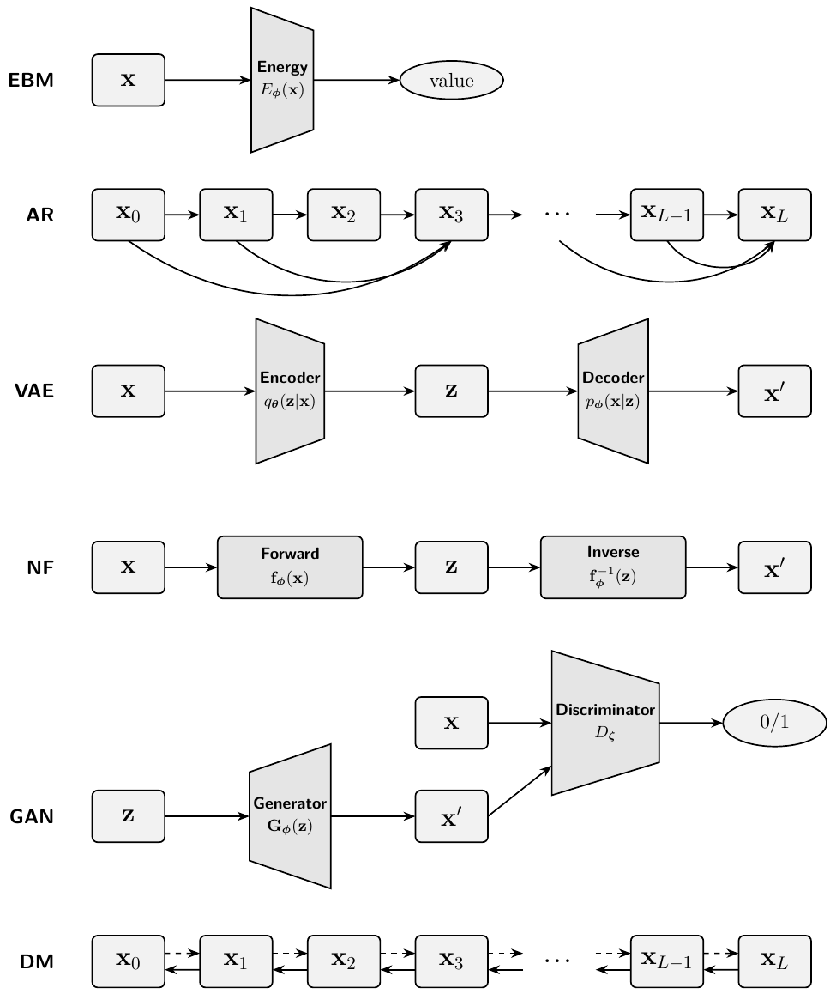

# 1.2 主要的深度生成模型 {#sec-examples-dgm}

**图 1.2：** **主要深度生成模型的计算图。** 从上到下：**EBM** 将输入 ${\mathbf{x}}$ 映射为标量能量；**AR** 按照因果依赖关系，从左到右生成序列 $\{{\mathbf{x}}_\ell\}_{\ell=0}^{L}$；**VAE** 将 ${\mathbf{x}}$ 编码为潜变量 ${\mathbf{z}}$，再解码得到重构结果 ${\mathbf{x}}'$；**NF** 应用可逆映射 ${\mathbf{f}}_{\boldsymbol{\phi}}$，在 ${\mathbf{x}}$ 与 ${\mathbf{z}}$ 之间进行变换，并使用 ${\mathbf{f}}_{\boldsymbol{\phi}}^{-1}$ 生成 ${\mathbf{x}}'$；**GAN** 将噪声 ${\mathbf{z}}$ 转换为样本 ${\mathbf{x}}'$，再与真实数据 ${\mathbf{x}}$ 比较，由判别器 $D_{\boldsymbol\zeta}$ 判断真伪；**DM** 通过多步去噪链 $\{{\mathbf{x}}_\ell\}_{\ell=0}^{L}$ 迭代地改进带噪样本。方框表示变量，梯形表示可学习的网络，椭圆表示标量；箭头表示计算流程。梯形用于表示改变维度的变换，矩形则表示变量或保持维度不变的映射。

来源：由作者绘制。

生成建模的一个主要挑战是学习具有较强表达能力的概率模型，使其能够捕捉高维数据丰富而复杂的结构。多年来，人们提出了多种建模策略，在计算可行性、表达能力和训练效率之间作出不同的权衡。本节将介绍其中一些对该领域产生了重大影响的策略，并在[图 1.2](02-examples.md#fig-ebm-ar-vae-nf-gan-dm-unified) 中比较它们的计算图。

**基于能量的模型（EBM）。** EBM（[Ackley et al., 1985](../../references.md#ref-ackley1985learning); [LeCun et al., 2006](../../references.md#ref-lecun2006tutorial)）通过能量函数 $E_{\boldsymbol{\phi}}({\mathbf{x}})$ 定义概率分布，为概率更高的数据点赋予更低的能量。数据点的概率定义为：

$$
p_{\boldsymbol{\phi}}({\mathbf{x}}) := \frac{1}{Z({\boldsymbol{\phi}})} \exp(-E_{\boldsymbol{\phi}}({\mathbf{x}})),
$$

其中

$$
Z({\boldsymbol{\phi}}) = \int \exp(-E_{\boldsymbol{\phi}}({\mathbf{x}})) \mathop{}\!\mathrm{d}{\mathbf{x}}
$$

是配分函数。训练 EBM 通常需要最大化数据的对数似然。然而，这需要借助相应技术，解决配分函数难以计算所带来的计算挑战。在后续章节中，我们将介绍扩散模型如何提供另一种方法：从*对数密度的梯度*生成数据。该梯度不依赖于归一化常数，因此能够绕开配分函数的计算。

**自回归模型。** 深度自回归（AR）模型（[Frey et al., 1995](../../references.md#ref-frey1995does); [Larochelle and Murray, 2011](../../references.md#ref-larochelle2011neural); [Uria et al., 2016](../../references.md#ref-uria2016neural)）建立在一个简单而有力的观察之上：利用*概率的链式法则*，任意联合分布都可以分解为一系列条件分布的乘积。对于变量 $\mathbf{x}=(x_1,\ldots,x_D)$ 的一个给定排列，数据分布满足

$$
p_{\mathrm{data}}(\mathbf{x})
    =
    \prod_{i=1}^{D}
    p_{\mathrm{data}}(x_i | \mathbf{x}_{<i}),
    \qquad
    \mathbf{x}_{<i}=(x_1,\ldots,x_{i-1}).
$$

这一分解是精确的恒等式，并不需要作出建模假设：对于变量的任意给定排列，任何联合分布都可以这样分解。

困难在于，真实的条件分布 $p_{\mathrm{data}}(x_i|\mathbf{x}_{<i})$ 是未知的。因此，AR 模型以相同的分解形式对模型进行参数化，

$$
p_{\boldsymbol{\phi}}(\mathbf{x})
    =
    \prod_{i=1}^{D}
    p_{\boldsymbol{\phi}}(x_i|\mathbf{x}_{<i}),
$$

并使用 Transformer 等神经网络，根据数据近似这些条件分布。例如，对于离散数据，网络可以通过 softmax 输出一个类别分布；对于连续数据，网络则可以输出某个可计算的条件密度的参数。由于每个条件分布都是归一化的，它们的乘积便自动定义了一个归一化的联合分布。

这一构造也使基于似然的训练格外简单。对于数据样本 $\mathbf{x}$，对数似然可分解为

$$
\log p_{\boldsymbol{\phi}}(\mathbf{x})
    =
    \sum_{i=1}^{D}
    \log p_{\boldsymbol{\phi}}(x_i|\mathbf{x}_{<i}),
$$

因此，可以直接通过最大似然训练模型，等价地，也可以最小化负对数似然。训练时可以获得已经观测到的前序变量 $\mathbf{x}_{<i}$，因此通常能够并行计算其中许多条件预测。

不过，生成过程本身仍然是顺序进行的：

$$
x_1 \sim p_{\boldsymbol{\phi}}(x_1),
    \qquad
    x_2 \sim p_{\boldsymbol{\phi}}(x_2| x_1),
    \qquad
    \ldots,
    \qquad
    x_D \sim p_{\boldsymbol{\phi}}(x_D|\mathbf{x}_{<D}).
$$

因此，AR 模型能够提供可计算的精确似然，并灵活地进行密度建模，但采样需要逐个生成变量，所以对于长序列，计算代价可能很高。AR 模型仍然是基于似然的生成模型中的一类基础模型，也是许多现代序列模型和语言模型的基础。

**变分自编码器（VAE）。** VAE（[Kingma and Welling, 2013](../../references.md#ref-kingma2013auto)）通过引入潜变量 ${\mathbf{z}}$ 来捕捉数据 ${\mathbf{x}}$ 中的隐藏结构，从而扩展了经典的自编码器。VAE 并不直接学习 ${\mathbf{x}}$ 与 ${\mathbf{z}}$ 之间的映射，而是采用概率视角：它同时学习*编码器* $q_{{\boldsymbol{\theta}}}({\mathbf{z}}|{\mathbf{x}})$ 和*解码器* $p_{{\boldsymbol{\phi}}}({\mathbf{x}}|{\mathbf{z}})$，前者近似给定数据时潜变量的未知分布，后者根据这些潜变量重构数据。为了使训练可行，VAE 最大化真实对数似然的一个可计算替代目标，称为证据下界（Evidence Lower Bound，ELBO）：

$$
\mathcal{L}_{\text{ELBO}}({\boldsymbol{\theta}}, {\boldsymbol{\phi}}; {\mathbf{x}}) 
    = \mathbb{E}_{q_{{\boldsymbol{\theta}}}({\mathbf{z}} | {\mathbf{x}})} \left[ \log p_{{\boldsymbol{\phi}}}({\mathbf{x}} | {\mathbf{z}}) \right] 
    - \mathcal D_{\mathrm{KL}} \left( q_{{\boldsymbol{\theta}}}({\mathbf{z}} | {\mathbf{x}}) \,\|\, p_{\mathrm{prior}}({\mathbf{z}}) \right).
$$

这里，第一项鼓励准确重构数据，第二项则通过使潜变量的分布接近简单的先验分布 $p_{\mathrm{prior}}({\mathbf{z}})$（通常为 Gaussian 分布）来对潜变量进行正则化。

VAE 为结合神经网络与潜变量模型提供了一种有理论依据的方法，至今仍是应用最广泛的基于似然的方法之一。不过，它也面临一些实际挑战，例如生成样本的清晰度有限，以及训练中的异常现象（如解码器倾向于忽略潜变量）。尽管存在这些局限，VAE 仍为包括扩散模型在内的后续进展奠定了重要基础。

**归一化流。** 经典的基于流的生成模型包括归一化流（NF）（[Rezende and Mohamed, 2015](../../references.md#ref-rezende2015variational)），以及基于神经常微分方程（NODE）的连续时间对应模型（[Chen et al., 2018](../../references.md#ref-chen2018neural)）。它们旨在通过可逆算子学习双射 ${\mathbf{f}}_{\boldsymbol{\phi}}$，将简单潜变量分布 ${\mathbf{z}}$ 与复杂数据分布 ${\mathbf{x}}$ 联系起来。这一目标可以通过一系列双射变换实现（NF），也可以通过将变换建模为常微分方程实现（NODE）。这些模型利用“密度的变量替换公式”进行最大似然估计（MLE）训练：

$$
\log p_{\boldsymbol{\phi}}({\mathbf{x}}) = \log p({\mathbf{z}}) + \log \left| \det \frac{\partial {\mathbf{f}}_{\boldsymbol{\phi}}^{-1}({\mathbf{x}})}{\partial {\mathbf{x}}} \right|,
$$

其中 ${\mathbf{f}}_{\boldsymbol{\phi}}$ 表示将 ${\mathbf{z}}$ 映射到 ${\mathbf{x}}$ 的可逆变换。NF 使用 Jacobian 行列式可计算的可逆变换，对归一化密度进行显式建模。归一化常数通过变量替换公式以解析方式被吸收，使似然能够精确且可行地计算。

尽管概念优雅，经典的基于流的模型在实践中仍常有局限。例如，NF 通常需要对网络架构施加较强的限制，以保证双射性；NODE 则可能因为求解 ODE 的计算开销而出现训练效率低下的问题。两种方法在扩展到高维数据时都面临挑战。在后续章节中，我们将介绍扩散模型与这些经典流方法的联系，以及扩散模型如何在它们的基础上发展。

**生成对抗网络（GAN）。** GAN（[Goodfellow et al., 2014](../../references.md#ref-goodfellow2014generative)）由两个相互竞争的神经网络组成：生成器 ${\mathbf{G}}_{\boldsymbol{\phi}}$ 和判别器 $D_{\boldsymbol{\zeta}}$。生成器旨在生成逼真的样本 ${\mathbf{G}}_{\boldsymbol{\phi}}({\mathbf{z}})$，所用输入是随机噪声 ${\mathbf{z}} \sim p_{\mathrm{prior}}$；判别器则试图区分真实样本 ${\mathbf{x}}$ 与生成样本 ${\mathbf{G}}_{\boldsymbol{\phi}}({\mathbf{z}})$。GAN 的目标函数可以写为：

$$
\min_{{\mathbf{G}}_{\boldsymbol{\phi}}} \max_{D_{\boldsymbol{\zeta}}} \underbrace{\mathbb{E}_{{\mathbf{x}} \sim p_{\mathrm{data}}({\mathbf{x}})}[\log D_{\boldsymbol{\zeta}}({\mathbf{x}})]}_{\text{real}} + \underbrace{\mathbb{E}_{{\mathbf{z}} \sim p_{\mathrm{prior}}({\mathbf{z}})}\left[\log(1 - D_{\boldsymbol{\zeta}}\left({\mathbf{G}}_{\boldsymbol{\phi}}({\mathbf{z}}))\right)\right]}_{\text{fake}}.
$$

GAN 不定义显式的密度函数，因此完全绕开了似然估计。它们着重生成能够逼近数据分布的样本，无须计算归一化常数。

从散度的视角来看，判别器隐式地度量真实数据分布 $p_{\mathrm{data}}$ 与生成器分布 $p_{{\mathbf{G}}_{{\boldsymbol{\phi}}}}$ 之间的差异，其中 $p_{{\mathbf{G}}_{{\boldsymbol{\phi}}}}$ 表示生成样本 ${\mathbf{G}}_{{\boldsymbol{\phi}}}({\mathbf{z}})$ 的分布，这些样本由噪声 ${\mathbf{z}} \sim p_{\mathrm{prior}}$ 得到。对于固定的生成器 ${\mathbf{G}}_{{\boldsymbol{\phi}}}$，最优判别器为

$$
\frac{p_{\mathrm{data}}({\mathbf{x}})}{p_{\mathrm{data}}({\mathbf{x}}) + p_{{\mathbf{G}}_{{\boldsymbol{\phi}}}}({\mathbf{x}})},
$$

此时，生成器的最小化问题化为

$$
\min_{{\mathbf{G}}_{{\boldsymbol{\phi}}}} \; 2\,\mathcal{D}_\mathrm{JS} \left(p_{\mathrm{data}} \,\|\, p_{{\mathbf{G}}_{\boldsymbol{\phi}}}\right) - \log 4.
$$

这里，$\mathcal{D}_\mathrm{JS}$ 表示 Jensen–Shannon 散度，其定义为

$$
\mathcal{D}_\mathrm{JS}(p \,\|\, q) 
    := \tfrac{1}{2} \mathcal{D}_\mathrm{KL} \left(p \,\middle\|\, \tfrac{p+q}{2}\right) 
    + \tfrac{1}{2} \mathcal{D}_\mathrm{KL} \left(q \,\middle\|\, \tfrac{p+q}{2}\right).
$$

这表明，GAN 隐式地最小化 $\mathcal{D}_\mathrm{JS}(p_{\mathrm{data}} \,\|\, p_{{\mathbf{G}}_{\boldsymbol{\phi}}})$。更一般地，$f$-GAN（[Nowozin et al., 2016](../../references.md#ref-nowozin2016f)）等扩展方法进一步推广了这一视角，表明对抗训练可以最小化一族 $f$-散度，从而将 GAN 与其他生成模型置于同一个散度最小化框架中。

虽然 GAN 能够生成高质量数据，但其极小极大训练过程的不稳定性广为人知，往往需要精心设计的架构和工程技术才能获得令人满意的性能。不过，GAN 后来又作为辅助组件得到重新应用，用于增强其他生成模型，尤其是扩散模型。
