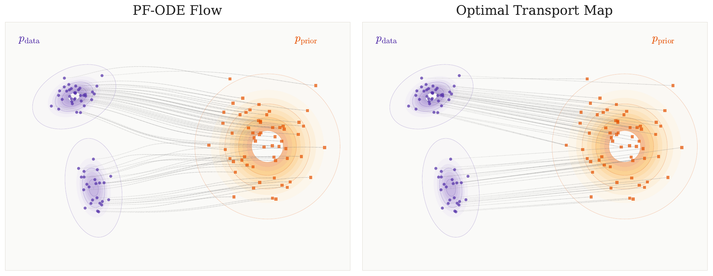

# 7.5 扩散模型的 ODE 是 OT 问题的最优映射吗？ {#sec-pfode-ot}

本节关注二次代价下的最优传输问题。

## 7.5.1 PF-ODE 流一般并非最优传输 {#subsec-pfode-not-optimal}

一个自然的问题是：扩散过程诱导的确定性流映射，是否等于二次代价下的最优传输映射？一般而言，答案是否定的，而且在 Gaussian 设定中已有显式反例。具体来说，[Tanana (2017)](../../references.md#ref-tanana2017comparison) 表明，对于使用更一般 Gaussian 参考过程的扩散流，即使端点分布是 Gaussian 分布，得到的确定性传输映射也可能与 Brenier 最优传输映射不同。由于这一设定下两个映射都有显式表达式，可以直接验证它们的差异。

下面介绍 [Lavenant and Santambrogio (2022)](../../references.md#ref-lavenant2022flow) 在标准 Gaussian Ornstein–Uhlenbeck 设定下给出的更强构造，这一设定与扩散模型直接相关。他们的论证针对更广泛的初始分布建立了非最优性，并从结构上说明相应 PF-ODE 流映射为何不必是最优传输映射。

**图 7.6：** 比较二维空间中从 $p_{\mathrm{data}}$ 到 $p_{\mathrm{prior}}$ 的 PF-ODE 流映射与真实 OT 映射。右：通过 Hungarian algorithm 精确计算的二次代价 OT 映射。左：积分 PF-ODE 得到的流映射。两个映射明显不同，说明 PF-ODE 通常无法恢复最优传输映射。

来源：作者通过 AI 辅助编程绘制。

**设定。** 考虑一个 VP SDE，具体为 Ornstein–Uhlenbeck 过程，它将光滑初始密度 $p_0$ 演化至标准 Gaussian 分布 $\mathcal{N}(\boldsymbol{0}, {\mathbf{I}})$：

$$
\mathop{}\!\mathrm{d} {\mathbf{x}}(t) = -{\mathbf{x}}(t) \mathop{}\!\mathrm{d} t + \sqrt{2} \mathop{}\!\mathrm{d} {\mathbf{w}}(t), \quad {\mathbf{x}}(0) \sim p_0.
$$

相应的 PF-ODE 为

$$
\frac{\mathop{}\!\mathrm{d} \mathbf{S}_t({\mathbf{x}})}{\mathop{}\!\mathrm{d} t} = -\mathbf{S}_t({\mathbf{x}}) - \nabla \log p_t(\mathbf{S}_t({\mathbf{x}})), \quad \mathbf{S}_0({\mathbf{x}}) = {\mathbf{x}}.
$$

这里，$\mathbf{S}_t$ 表示将 $p_0$ 推前到边缘分布 $p_t$ 的流映射：

$$
\left(\mathbf{S}_t\right) \# p_0 = p_t,
\quad\text{that is,}\quad
p_t({\mathbf{y}}) = \int_{\mathbb{R}^D} \delta({\mathbf{y}} - \mathbf{S}_t({\mathbf{x}}))   p_0({\mathbf{x}}) \mathop{}\!\mathrm{d} {\mathbf{x}}.
$$

这些密度 $p_t$ 按照 Fokker–Planck 方程演化：

$$
\frac{\partial p_t}{\partial t} = \nabla \cdot ({\mathbf{x}} p_t) + \Delta p_t.
$$

它等价于具有如下速度场的连续性方程：

$$
{\mathbf{v}}_t({\mathbf{x}}) = -{\mathbf{x}} - \nabla \log p_t({\mathbf{x}}),
$$

其流由 $\mathbf{S}_t({\mathbf{x}})$ 给出。换言之，PF-ODE 可以写为：

$$
\frac{\mathop{}\!\mathrm{d} \mathbf{S}_t({\mathbf{x}})}{\mathop{}\!\mathrm{d} t} = {\mathbf{v}}_t\left(\mathbf{S}_t({\mathbf{x}})\right).
$$

当 $t \to \infty$ 时，该映射将初始分布传输到先验：

$$
\mathbf{S}_\infty \# p_0 = \mathcal{N}(\boldsymbol{0}, {\mathbf{I}}) =: p_{\text{prior}}.
$$

**[Lavenant and Santambrogio (2022)](../../references.md#ref-lavenant2022flow) 论证的目标。**

[Lavenant and Santambrogio (2022)](../../references.md#ref-lavenant2022flow) 没有直接判断终端映射 $\mathbf{S}_\infty$ 从 $p_0$ 到 Gaussian 分布的传输是否最优，而是构造特定初始分布 $p_0$，并考察整个 PF-ODE 轨迹。他们的关键观察是，沿流的某个时刻可能不再具有最优性。

他们考虑中间边缘分布 $p_t = \mathbf{S}_t \# p_0$，并将从 $p_{t_0}$ 到 Gaussian 分布的剩余传输映射定义为

$$
\mathbf{T}_{t \to \infty} := \mathbf{S}_\infty \circ \mathbf{S}_{t}^{-1}, \quad \text{for all } t\geq 0.
$$

论证的核心是：对于精心选定的 $p_0$，存在某个时刻 $t_0 \geq 0$，使得 $\mathbf{T}_{t_0 \to \infty}$ 不是从新的起始分布 $p_{t_0}$ 到 $\mathcal{N}(\boldsymbol{0}, {\mathbf{I}})$ 的二次代价最优传输映射。

这一结果说明，PF-ODE 流一般不会给出最优传输映射，且对于某些初始分布，最优性可能失效。

**一些工具。** [Lavenant and Santambrogio (2022)](../../references.md#ref-lavenant2022flow) 的论证关键依赖于以下结果，即 *Brenier 定理*：

**定理 7.1：非正式的 Brenier 定理**

设 $\nu_1, \nu_2$ 是 $\mathbb{R}^D$ 上具有光滑密度的两个概率分布。光滑映射 ${\mathbf{T}} : \mathbb{R}^D \to \mathbb{R}^D$ 是从 $\nu_1$ 到 $\nu_2$ 的（二次代价）最优传输，当且仅当 ${\mathbf{T}} = \nabla u$，其中 $u$ 是某个凸函数。此时，$\mathrm{D} {\mathbf{T}}$ 对称且半正定，$u$ 满足 Monge–Ampère 方程：

$$
\det \mathrm{D}^2 u(\mathbf{x}) = \frac{\nu_1(\mathbf{x})}{\nu_2(\nabla u(\mathbf{x}))}.
$$

证明还隐含使用了以下事实，后文不再反复说明：*一个映射是两个分布之间的最优传输，当且仅当它的逆映射是反方向的最优传输*。

**证明概要：PF-ODE 一般不是 OT 映射。** [Lavenant and Santambrogio (2022)](../../references.md#ref-lavenant2022flow) 使用反证法：假设对每个 $t\ge0$，映射

$$
\mathbf{T}_t  =  \mathbf{S}_t \circ \mathbf{S}_\infty^{-1}
$$

都是从 $\mathcal{N}(\boldsymbol{0},{\mathbf{I}})$ 到 $p_t$ 的二次代价最优传输映射。

**步骤 1：Brenier 定理。** 根据 Brenier 定理，任何从 Gaussian 分布出发的最优传输映射，其 Jacobian 矩阵都必须对称且半正定。因此，

$$
\mathrm{D} \mathbf{T}_t({\mathbf{x}}) = \mathrm{D} \mathbf{S}_t(\mathbf{S}_\infty^{-1}({\mathbf{x}})) \mathrm{D} (\mathbf{S}_\infty^{-1})({\mathbf{x}})
$$

对所有 $t$ 和 ${\mathbf{x}}$ 都必须对称。这里，$\mathrm{D} \mathbf{T}_t({\mathbf{x}})$ 表示关于 ${\mathbf{x}}$ 的全微分。

**步骤 2：对对称条件求时间导数。** 关于时间求导：

$$
\frac{\partial}{\partial t} \mathrm{D}\mathbf{T}_t({\mathbf{x}})
= \left( \frac{\partial}{\partial t} \mathrm{D} \mathbf{S}_t \right)(\mathbf{S}_\infty^{-1}({\mathbf{x}})) \mathrm{D} (\mathbf{S}_\infty^{-1})({\mathbf{x}}).
$$

由于对所有 $t$ 都具有对称性，这个导数也保持对称。

利用流 ODE（对 ${\mathbf{x}}$ 求导），得到：

$$
\frac{\partial (\mathrm{D}\mathbf{S}_t)}{\partial t}
= \mathrm{D}{\mathbf{v}}_t(\mathbf{S}_t) \cdot \mathrm{D}\mathbf{S}_t
= \left( -{\mathbf{I}} - \mathrm{D}^2 \log p_t(\mathbf{S}_t) \right) \cdot \mathrm{D}\mathbf{S}_t.
$$

结合以上结果可知

$$
\left( -{\mathbf{I}} - \mathrm{D}^2 \log p_t(\mathbf{S}_t) \right) \cdot\mathrm{D}\mathbf{S}_t \cdot \mathrm{D} (\mathbf{S}_\infty^{-1})
$$

对所有 $t\geq 0$ 都对称。

在 $t = 0$ 时，有 $\mathbf{S}_0 = {\mathbf{I}}$ 和 $\mathrm{D}\mathbf{S}_0 = {\mathbf{I}}$，从而：

$$
\left( -{\mathbf{I}} - \mathrm{D}^2 \log p_0(\mathbf{S}_\infty^{-1}({\mathbf{x}})) \right) \cdot \mathrm{D} (\mathbf{S}_\infty^{-1})({\mathbf{x}}) \quad \text{is symmetric}.
$$

**步骤 3：可交换条件。** 由于假设 $\mathbf{T}_0 = \mathbf{S}_\infty^{-1}$ 最优，其 Jacobian 矩阵 $D\mathbf{T}_0 = \mathrm{D}(\mathbf{S}_\infty^{-1})$ 对称。此外，Hessian 矩阵 $\mathrm{D}^2\log p_0$ 也对称。回顾一下，两个对称矩阵的乘积对称，当且仅当它们可交换。因此，对所有 $\mathbf{x}\in\mathbb{R}^D$，

$$
\mathrm{D}^2\log p_0\bigl(\mathbf{S}_\infty^{-1}(\mathbf{x})\bigr)
\quad\text{must commute with}\quad
\mathrm{D}(\mathbf{S}_\infty^{-1})(\mathbf{x}) .
$$

令 $\mathbf{y}=\mathbf{S}_\infty^{-1}(\mathbf{x})$，得到等价条件：对所有 ${\mathbf{y}}\in\mathbb{R}^D$，

$$
\mathrm{D}^2\log p_0(\mathbf{y})
\quad\text{must commute with}\quad
\mathrm{D}\mathbf{S}_\infty(\mathbf{y}) .
$$

现在将此条件转化为更易计算的形式。由于 $\mathbf{S}_\infty$ 是 $p_0$ 与 $\mathcal{N}(\boldsymbol{0},{\mathbf{I}})$ 之间的最优传输，Brenier 定理保证 $\mathbf{S}_\infty = \nabla u$，其中 $u$ 是某个凸函数。由 Monge–Ampère 方程可得：

$$
\log p_0({\mathbf{y}}) = \log \det(\mathrm{D}^2 u({\mathbf{y}})) - \frac{1}{2} \|\nabla u({\mathbf{y}})\|^2 + \text{Constant}.
$$

条件变为（取 $\mathrm{D}{\mathbf{S}}_\infty = \mathrm{D}^2 u$）：

$$
\begin{aligned}
\mathrm{D}^2 \left(\log \det \mathrm{D}^2 u - \frac{1}{2} \|\nabla u\|^2\right)
\quad\text{must commute with}\quad
\mathrm{D}^2 u.
\end{aligned}
\tag{7.5.1}
$$

这给出了 $\mathbf{T}_t$ 最优的一个必要条件。

**步骤 4：构造反例。** 下面说明如何利用这一必要条件导出矛盾。

假设能够构造一个凸函数 $u$，使得

$$
\mathrm{D}^2 \left( \log \det \mathrm{D}^2 u(\mathbf{x}) - \frac{1}{2} \lvert \nabla u(\mathbf{x}) \rvert^2 \right)
$$

与 $\mathrm{D}^2 u(\mathbf{x})$ 对某个 $\mathbf{x} \in \mathbb{R}^D$ 不可交换。定义 $p_0 = (\nabla u)^{-1} \# \mathcal{N}(\boldsymbol{0}, {\mathbf{I}})$，由 Brenier 定理可知 $\nabla u$ 是从 $p_0$ 到 $\mathcal{N}(\boldsymbol{0}, {\mathbf{I}})$ 的最优传输。但[式 (7.5.1)](05-probability-flow-odes-and-optimal-transport.md#eq-necessary-ot)中的条件不成立，从而产生矛盾。因此，我们的目标是构造这样的函数。考虑

$$
u(\mathbf{x}) = \frac{1}{2} \|\mathbf{x}\|^2 + \varepsilon \phi(\mathbf{x}), \quad \text{for a small } \varepsilon.
$$

则 $\mathrm{D}^2 u(\mathbf{0}) = {\mathbf{I}} + \varepsilon \mathrm{D}^2 \phi(\mathbf{0})$，且 $\mathbf{x} = \mathbf{0}$ 处的可交换条件要求 $\mathrm{D}^2 \phi(\mathbf{0})$ 与 $\mathrm{D}^2 (\Delta \phi)(\mathbf{0})$ 可交换。

例如，在 $\mathbb{R}^2$ 中，选择

$$
\phi(x_1, x_2) = x_1 x_2 + x_1^4
$$

就得到一个反例，其中 Hessian 矩阵 $\mathrm{D}^2 \log p_0$ 与 Jacobian 矩阵 $\mathrm{D}^2 u$ 不可交换。

这一矛盾说明，$\mathbf{T}_t$ 不可能对所有 $t \geq 0$ 都最优。因此，存在某个 $t_0 \geq 0$，使得映射 $\mathbf{T}_{t_0 \to \infty}$ 不最优。

## 7.5.2 标准线性流与 Reflow 能否得到 OT 映射？ {#subsec-ot-linear-reflow}

我们已经看到，PF-ODE（尤其在 VP 型前向核下）一般不是 OT 映射。一个自然的问题是：

**问题 7.5.1**

线性插值流 $(1-t){\mathbf{x}}_0 + t {\mathbf{x}}_1$，取 ${\mathbf{x}}_0\sim p_{\mathrm{src}}$ 和 ${\mathbf{x}}_1\sim p_{\mathrm{tgt}}$，应用于独立耦合 $\pi({\mathbf{x}}_0, {\mathbf{x}}_1) = p_{\mathrm{src}}({\mathbf{x}}_0)p_{\mathrm{tgt}}({\mathbf{x}}_1)$ 时，是否能恢复 OT 映射？

答案是否定的。

不过，将线性路径与给定耦合结合，可以为真实 OT 代价提供一个实用上界。在所有可能路径中，线性插值给出的这一上界最紧，下面将作说明。

**标准线性流与最优传输。** 关注二次代价下的最优传输，考虑[式 (7.2.1)](02-transport-problem-setups.md#eq-ot)的等价形式，即[式 (7.2.3)](02-transport-problem-setups.md#eq-bb-ot)中的 Benamou–Brenier 表述：

$$
\mathcal{K}\left(p_{\mathrm{src}}, p_{\mathrm{tgt}}\right) :=  \min_{\substack{ (p_t, {\mathbf{v}}_t) \text{ s.t. }
        \partial_t p_t + \nabla \cdot (p_t {\mathbf{v}}_t) = 0, \\
        p_0 = p_{\mathrm{src}},\,\, p_1 = p_{\mathrm{tgt}}
    }}
    \int_0^1 \int_{\mathbb{R}^D} \|{\mathbf{v}}_t({\mathbf{x}})\|^2 p_t({\mathbf{x}}) \mathop{}\!\mathrm{d}{\mathbf{x}} \mathop{}\!\mathrm{d} t.
$$

静态 Monge 表述（[式 (7.2.2)](02-transport-problem-setups.md#eq-monge-formulation)）需要求解 Monge–Ampère 方程（[式 (7.2.4)](02-transport-problem-setups.md#eq-monge-ampere)）来计算最优映射，而 Benamou–Brenier 问题在引入动量场 ${\mathbf{m}}_t := p_t {\mathbf{v}}_t$ 后可以重新表述为凸问题。不过，将这一凸问题在 $\mathbb{R}^D$ 的网格上离散化，在高维中仍然难以计算。

尽管 Benamou–Brenier 表述一般难以求解，[Liu (2022)](../../references.md#ref-liu2022rectified) 和 [Lipman et al. (2024)](../../references.md#ref-lipman2024flow) 揭示，其动能具有一个实用上界。具体做法是将搜索限制在更简单的*条件流*族中，其中每条路径由固定端点 $({\mathbf{x}}_0, {\mathbf{x}}_1)$ 确定，这些端点从源分布与目标分布的耦合 $\pi_{0,1}$ 中采样。在这个*条件流*族中，标准线性插值成为最优选择，形式化陈述如下。

**命题 7.5.1：通过条件流给出 OT 动能的上界**

令 $\pi_{0,1}$ 为 $p_{\mathrm{src}}$ 与 $p_{\mathrm{tgt}}$ 之间的任意耦合。

-   **(1)** 对任何连接端点的条件流 $\boldsymbol{\Psi}_t({\mathbf{x}}_0, {\mathbf{x}}_1)$，其期望路径能量都是动能的上界：

    $$
    \mathcal{K}\left(p_{\mathrm{src}}, p_{\mathrm{tgt}}\right) \le \mathbb{E}_{({\mathbf{x}}_0, {\mathbf{x}}_1) \sim \pi_{0,1}} \left[ \int_0^1 \|\boldsymbol{\Psi}'_t({\mathbf{x}}_0, {\mathbf{x}}_1)\|^2 \mathop{}\!\mathrm{d} t \right].
    $$

-   **(2)** 使右侧上界最小的唯一条件流 $\boldsymbol{\Psi}^*_t$ 是线性插值路径：

    $$
    \boldsymbol{\Psi}^*_t({\mathbf{x}}_0, {\mathbf{x}}_1) = (1 - t) {\mathbf{x}}_0 + t {\mathbf{x}}_1.
    $$

    代入这一最优路径，得到最紧形式的上界：

    $$
    \mathcal{K}\left(p_{\mathrm{src}}, p_{\mathrm{tgt}}\right) \le \mathbb{E}_{({\mathbf{x}}_0, {\mathbf{x}}_1) \sim \pi_{0,1}} \|{\mathbf{x}}_1 - {\mathbf{x}}_0\|^2.
    $$

**命题证明。**

证明先直接应用 Jensen 不等式及条件期望的塔式性质，然后利用 Euler–Lagrange 方程求解简化后的变分问题；完整论证参见 [Lipman et al., 2024](../../references.md#ref-lipman2024flow) 的第 4.7 节。

换言之，线性插值 $\boldsymbol{\Psi}^*_t$（即 Flow Matching 和 Rectified Flow 使用的前向核）对于任意选定耦合 $\pi_{0,1}$，都最小化了真实动能的一个上界。

需要强调，在这一条件流类别中的最优性，并不保证边缘分布层面的全局最优性。

**Reflow 与最优传输。** 两个分布之间最简单的传输方案，是使用简单独立耦合，将样本以直线连接起来。但可以证明，这种方法并不最优；问题出在初始点配对效率低，而不在直线路径本身。

Reflow 过程可能提供一种建设性的解决途径。它是专门用于纠正这种配对的迭代算法，且每一步都保证代价不增加（[Liu et al., 2022](../../references.md#ref-liu2022flow)）。这一性质说明 Reflow 会系统地将传输方案推向更优的配置，也自然引出了关于其收敛性的核心问题。

**问题 7.5.2**

如果反复应用 `Rectify` 算子，会发生什么？得到的传输方案序列能否收敛到最优方案，或者 Reflow 过程的不动点是否给出 OT 映射？

一般情况下，答案是否定的。下面说明可能出现的问题。回顾 Reflow 过程，它通过以下更新迭代改进 $p_{\mathrm{src}}$ 与 $p_{\mathrm{tgt}}$ 之间的耦合：

$$
\pi^{(k+1)} = \texttt{Rectify}(\pi^{(k)}),
$$

以乘积耦合 $\pi^{(0)} := p_{\mathrm{src}}({\mathbf{x}}_0) p_{\mathrm{tgt}}({\mathbf{x}}_1)$ 初始化。更精确地，$\texttt{Rectify}$ 按如下方式输出更新后的耦合 $\pi^{(k+1)}$：在每次迭代 $k = 0, 1, 2, \ldots$ 中，通过下式学习速度场 ${\mathbf{v}}_t^{(k)}$：

$$
{\mathbf{v}}_t^{(k)} \in \operatorname*{arg\,min}_{{\mathbf{u}}_t} \, \mathcal{L}({\mathbf{u}}_t\big\vert\pi^{(k)}),
$$

其中，$\mathcal{L}({\mathbf{u}}_t\big\vert\pi^{(k)})$ 是[式 (5.4.1)](../05-flow-based-perspective/04-canonical-affine-flow.md#eq-reflow-loss)定义的损失（例如 RF 或 FM 损失）。为简化记号，这里对速度场采用非参数表述，而不使用其他上下文中的参数化形式 $\boldsymbol{\phi}$。更新后的耦合为：

$$
\pi^{(k+1)}({\mathbf{x}}_0, {\mathbf{x}}_1) := p_{\mathrm{src}}({\mathbf{x}}_0)\, \delta\big({\mathbf{x}}_1 - \boldsymbol{\Psi}_1^{(k)}({\mathbf{x}}_0)\big),
$$

其中，$\boldsymbol{\Psi}_1^{(k)}$ 表示时刻 $t=1$ 的解映射，由积分 ${\mathbf{v}}_t^{(k)}$、采用初始条件 ${\mathbf{x}}_0$ 得到。

[Liu et al., 2022](../../references.md#ref-liu2022flow) 指出，对于耦合 $\pi$（它连接 $p_{\mathrm{src}}$ 与 $p_{\mathrm{tgt}}$），存在最小化 Reflow 损失的速度场 ${\mathbf{v}}_t$，即满足 $\mathcal{L}({\mathbf{v}}_t |\pi) = 0$，不一定意味着传输最优。

受 Benamou–Brenier 框架启发——在该框架中，已知最优传输速度是势函数的梯度——[Liu (2022)](../../references.md#ref-liu2022rectified) 提出附加约束：速度场 ${\mathbf{v}}_t$ 应为势场。因此，将[式 (5.4.1)](../05-flow-based-perspective/04-canonical-affine-flow.md#eq-reflow-loss)中的目标修改为将 ${\mathbf{v}}_t$ 限制在梯度向量场（也称势流）的空间中：

$$
\begin{aligned}
{\mathbf{w}}_t^{(k)} \in \operatorname*{arg\,min}_{\substack{{\mathbf{u}}_t:\, {\mathbf{u}}_t=\nabla\varphi \\ \text{for some }\varphi\colon\mathbb{R}^D\to\mathbb{R}}} \, \mathcal{L}({\mathbf{u}}_t\big\vert\pi^{(k)}),
\end{aligned}
\tag{7.5.2}
$$

其余过程与 `Rectify` 相同。将相应算子记为 $\texttt{Rectify}_{\perp}$，以强调向无旋向量场的投影。

令 $\pi$ 为 $p_{\mathrm{src}}$ 与 $p_{\mathrm{tgt}}$ 之间的耦合。[Liu et al. (2022)](../../references.md#ref-liu2022flow) 猜想以下刻画最优性的条件等价：

-   **(i)** $\pi$ *是最优传输耦合。*

-   **(ii)** $\pi$ *是势场矫正算子的不动点：*

    $$
    \pi = \texttt{Rectify}_{\perp}(\pi).
    $$

-   **(iii)** *存在梯度速度场 ${\mathbf{v}}_t = \nabla \varphi_t$，使矫正损失为零：*

    $$
    \mathcal{L}({\mathbf{v}}_t |\pi) = 0.
    $$

然而，[Hertrich et al. (2025)](../../references.md#ref-hertrich2025relation) 给出了两类反例：

1.  当中间分布 $p_t$ 的支撑集不连通时，可以找到 $\texttt{Rectify}_{\perp}$ 的不动点，其 Reflow 损失为零、速度场为梯度场，却仍无法产生最优耦合。

2.  即使两个端点分布都是 Gaussian 分布，也存在损失任意小、但与最优耦合的偏离任意大的耦合。

因此，尽管 Rectified Flow 可以产生强大的生成模型，但作为最优传输求解器，其可靠性仍然有限。这凸显了生成建模与严格的最优传输理论之间的重要差距，也为二者交汇处的进一步研究留下了空间。

最后，传输代价并不总与下游表现相关；因此，计算精确的最优传输映射不一定带来更好的实际结果。不过，最优传输的各种变体仍是许多科学与工程问题的基础。扩散模型为探索这些挑战提供了强大的框架。
