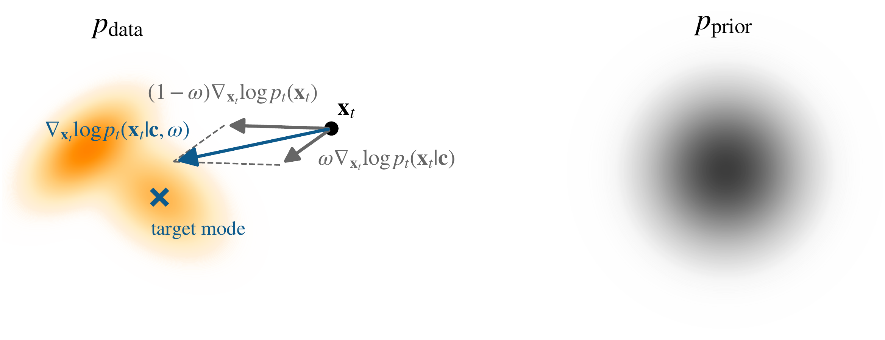

# 8.3 无分类器引导 {#sec-cfg}

## 8.3.1 无分类器引导的基础 {#foundation-of-classifier-free-guidance}

**图 8.2：** **CFG 示意图。** 引导方向是条件 score $\nabla_{{\mathbf{x}}_t}\log p_t({\mathbf{x}}_t|{\mathbf{c}})$ 与无条件 score $\nabla_{{\mathbf{x}}_t}\log p_t({\mathbf{x}}_t)$ 的线性组合，由 $\omega$ 控制。对于 $0\leq\omega\leq1$，它在两个方向之间插值；对于 $\omega>1$，它沿条件方向超出条件 score 进行外推。所得向量场用于引导采样轨迹，使其趋向条件信号。

来源：作者绘制。

*无分类器引导*（CFG）（[Ho and Salimans, 2021](../../references.md#ref-ho2021classifier)）通过条件与无条件 score 表达分类器引导方向，从而无需单独训练分类器。Bayes 法则给出

$$
\begin{aligned}
\nabla_{{\mathbf{x}}_t}\log p_t({\mathbf{c}}|{\mathbf{x}}_t)
=
\nabla_{{\mathbf{x}}_t}\log p_t({\mathbf{x}}_t|{\mathbf{c}})
-
\nabla_{{\mathbf{x}}_t}\log p_t({\mathbf{x}}_t).
\end{aligned}
\tag{8.3.1}
$$

将这一恒等式代入[式 (8.2.3)](02-classifier-guidance.md#eq-cg-omega)，得到 oracle CFG 场

$$
\begin{aligned}
{\mathbf{s}}^{\mathrm{CFG}}({\mathbf{x}}_t,t,{\mathbf{c}};\omega)
&:=
\nabla_{{\mathbf{x}}_t}\log p_t({\mathbf{x}}_t)
+
\omega
\left(
\nabla_{{\mathbf{x}}_t}\log p_t({\mathbf{x}}_t|{\mathbf{c}})
-
\nabla_{{\mathbf{x}}_t}\log p_t({\mathbf{x}}_t)
\right)
\\
&=
\omega
\underbrace{\nabla_{{\mathbf{x}}_t}\log p_t({\mathbf{x}}_t|{\mathbf{c}})}_{\text{conditional score}}
+
(1-\omega)
\underbrace{\nabla_{{\mathbf{x}}_t}\log p_t({\mathbf{x}}_t)}_{\text{unconditional score}}.
\end{aligned}
\tag{8.3.2}
$$

当 score 精确时，[式 (8.3.2)](03-classifier-free-guidance.md#eq-cfg-model) 与[式 (8.2.3)](02-classifier-guidance.md#eq-cg-omega)在代数上是同一个引导场。在 $\omega=1$ 时，它退化为精确条件 score。对于其他引导强度，应区分它在固定时刻的倾斜密度解释与引导动力学生成的边缘分布，详见[第 8.4.2 节](04-training-free-guidance.md#subsec-guided-marginal-path)。

超参数 $\omega$ 同样在控制条件信息的影响方面起关键作用（这里取 $\omega \ge 0$）：

-   在 $\omega = 0$ 时，模型表现为无条件扩散模型，完全忽略条件。

-   在 $\omega = 1$ 时，模型使用条件 score，不施加额外引导。

-   对于 $\omega > 1$，模型更重视条件 score，减少无条件 score 的影响，从而增强与 ${\mathbf{c}}$ 的一致性，但通常会降低多样性。

## 8.3.2 CFG 的训练与采样 {#training-and-sampling-of-cfg}

**通过 CFG 联合训练无条件与条件扩散模型。** CFG 要求扩散模型经过训练，能够同时支持条件与无条件预测。CFG 使用单个模型 ${\mathbf{s}}_{\boldsymbol{\phi}}({\mathbf{x}}_t,t,{\mathbf{c}})$，并在训练中随机将条件输入替换为空标记 $\emptyset$，而不分别训练两个模型：

-   输入为空时，模型学习无条件预测 ${\mathbf{s}}_{\boldsymbol{\phi}}({\mathbf{x}}_t,t,\emptyset)$；

-   使用原始条件时，模型学习条件预测 ${\mathbf{s}}_{\boldsymbol{\phi}}({\mathbf{x}}_t,t,{\mathbf{c}})$。

空条件的使用概率为 $p_\mathrm{uncond}$，这是由用户指定的条件丢弃概率。完整训练过程见[算法 4](03-classifier-free-guidance.md#alg-cfg-training)，并与[算法 3](03-classifier-free-guidance.md#alg-no-cfg-training)中的标准无条件训练并列展示。引导权重 $\omega$ 仅在采样时引入，不属于这一训练目标。

<section class="book-algorithm" id="alg-no-cfg-training" aria-labelledby="alg-no-cfg-training-title" markdown="1">

算法 3：无条件扩散模型

1

**Repeat**

2

${\mathbf{x}} \sim p_{\text{data}}({\mathbf{x}})$

3

$t \sim \mathcal{U}[0, T]$

4

$\boldsymbol{\epsilon} \sim \mathcal{N}(\mathbf{0}, \mathbf{I})$

5

${\mathbf{x}}_t = \alpha_t {\mathbf{x}} + \sigma_t \boldsymbol{\epsilon}$

6

针对以下目标执行梯度更新：

$\nabla_{\boldsymbol{\phi}} \left\Vert  {\mathbf{s}}_{\boldsymbol{\phi}}({\mathbf{x}}_t, t) - {\mathbf{s}} \right\Vert ^2$

7

**until** 收敛

</section>

<section class="book-algorithm" id="alg-cfg-training" aria-labelledby="alg-cfg-training-title" markdown="1">

算法 4：条件扩散模型的 CFG

**输入：** $p_\mathrm{uncond}$: 将条件丢弃以进行无条件训练的概率

1

**Repeat**

2

$({\mathbf{x}}, {\mathbf{c}}) \sim p_{\text{data}}({\mathbf{x}}, {\mathbf{c}})$

3

${\mathbf{c}} \gets \emptyset$ ，概率为 $p_\mathrm{uncond}$

4

$t \sim \mathcal{U}[0, T]$

5

$\boldsymbol{\epsilon} \sim \mathcal{N}(\mathbf{0}, \mathbf{I})$

6

${\mathbf{x}}_t = \alpha_t {\mathbf{x}} + \sigma_t \boldsymbol{\epsilon}$

7

针对以下目标执行梯度更新：

$\nabla_{\boldsymbol{\phi}} \left\Vert  {\mathbf{s}}_{\boldsymbol{\phi}}({\mathbf{x}}_t, t, {\mathbf{c}}) - {\mathbf{s}} \right\Vert ^2$

8

**until** 收敛

</section>

**使用 CFG 进行条件采样。**

通过[算法 4](03-classifier-free-guidance.md#alg-cfg-training)训练模型 ${\mathbf{s}}_{\boldsymbol{\phi}^\times}({\mathbf{x}}_t,t,{\mathbf{c}})$ 后，CFG 构造学习到的引导场

$$
\begin{aligned}
{\mathbf{s}}_{\mathrm{model}}^{\mathrm{CFG}}({\mathbf{x}}_t,t,{\mathbf{c}};\omega)
&:=
\omega
\underbrace{{\mathbf{s}}_{\boldsymbol{\phi}^\times}({\mathbf{x}}_t,t,{\mathbf{c}})}_{\text{conditional score estimate}}
+
(1-\omega)
\underbrace{{\mathbf{s}}_{\boldsymbol{\phi}^\times}({\mathbf{x}}_t,t,\emptyset)}_{\text{unconditional score estimate}}
\\
&\approx
{\mathbf{s}}^{\mathrm{CFG}}({\mathbf{x}}_t,t,{\mathbf{c}};\omega).
\end{aligned}
\tag{8.3.3}
$$

采样时，将逆时间 SDE 或 PF-ODE 中的无条件 score 估计替换为 ${\mathbf{s}}_{\mathrm{model}}^{\mathrm{CFG}}$。因此，CFG 通过组合学习到的条件与无条件 score 估计，定义修改后的采样场。

这一表述可以通过调整 $\omega$ 实现可控生成，在训练后以简单方式权衡条件强度与样本多样性，无需单独训练分类器或无条件扩散模型。
