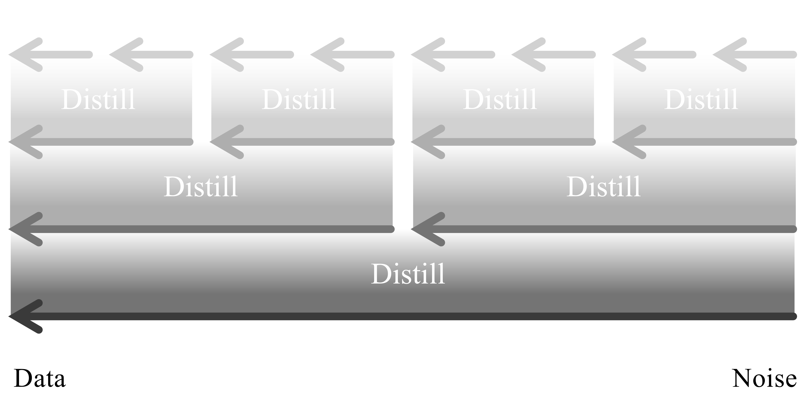

# 10.3 Progressive Distillation {#sec-pd}

Progressive Distillation（PD）（[Salimans and Ho, 2021](../../references.md#ref-salimans2021progressive)）包含两个过程，二者共同使扩散模型能够更高效地学习 PF-ODE 轨迹。其关键思想是逐步减少高质量采样所需的积分步数，同时保持对教师轨迹的忠实。

-   **蒸馏操作：** 将基于预训练教师模型（最初为扩散模型）的确定性采样器（例如 DDIM）蒸馏为学生模型，使学生仅用一半的采样步数复现同一轨迹。

-   **渐进操作：** 迭代重复这一蒸馏过程，每次将步数减半，直到学生能够在较小的固定预算内（通常为 $1$—$4$ 步）生成高质量样本。

**图 10.1：** **Progressive Distillation（PD）示意图。** 在每一轮中，训练学生模型，使其单个步骤复现教师两个相邻步骤的效果。该过程将 $N$ 个教师步骤蒸馏为 $N/2$ 个学生步骤；反复执行后，轨迹长度逐次减半，直至达到所需步数。箭头表示在从噪声到数据的过程中，如何将教师的多步转移压缩为更少的学生步骤。

来源：作者绘制。

我们先在[第 10.3.1 节](03-progressive-distillation.md#subsec-pd-distillation)介绍 PD 的蒸馏操作，再在[第 10.3.2 节](03-progressive-distillation.md#subsec-pd-training)概述完整的训练流程。[第 10.3.4 节](03-progressive-distillation.md#subsec-pd-guidance)介绍针对 CFG 引导的扩展。

## 10.3.1 PD 中的蒸馏操作 {#subsec-pd-distillation}

本节固定采用 ${\mathbf{x}}$ 预测参数化下的 DDIM 作为时间步进规则，并仍用 $\mathtt{Solver}_{s \to t}$ 表示将当前教师的 ${\mathbf{x}}$ 去噪器代入 DDIM 后得到的确定性映射。

在 PD 的第一轮中（教师为预训练扩散模型），这等同于通过 DDIM 对扩散 PF-ODE 进行积分；在后续轮次中（教师为上一轮的学生），$\mathtt{Solver}_{s \to t}$ 仅表示当前教师诱导的 DDIM 转移，不再是原始的扩散 PF-ODE。

蒸馏步骤如下：从含噪输入 ${\mathbf{x}}_s$（干净数据的扰动版本，${\mathbf{x}}_s = \alpha_s {\mathbf{x}}_0 + \sigma_s \boldsymbol{\epsilon}$）出发，训练学生预测目标 ${\color{orange}\tilde{\mathbf{x}}}$，使单个学生步骤 $s\!\to\! t$ 复现教师的两个连续步骤 $s\!\to\! u\!\to\! t$。令 ${\mathbf{x}}_{\boldsymbol{\phi}^\times}({\mathbf{x}},\tau)$ 表示这一轮教师的 ${\mathbf{x}}$ 预测去噪器。连续应用两次教师诱导的 DDIM 转移，得到

$$
\tilde{\mathbf{x}}_u := \mathtt{Solver}_{s\to u}\!\left({\mathbf{x}}_s;\,{\mathbf{x}}_{\boldsymbol{\phi}^\times}\right),
\qquad
\tilde{\mathbf{x}}_t := \mathtt{Solver}_{u\to t}\!\left(\tilde{\mathbf{x}}_u;\,{\mathbf{x}}_{\boldsymbol{\phi}^\times}\right).
$$

这里采用[公式 (10.1.3)](01-prologue.md#eq-solver)的记号，表示从 $s$ 到 $t$ 的确定性转移映射（起点为 ${\mathbf{x}}_s$），该映射通过将 ${\mathbf{x}}_{\boldsymbol{\phi}^\times}$ 代入 DDIM 得到。

**问题 10.3.1**

应当选取怎样的伪干净值 ${\color{orange}\tilde{\mathbf{x}}}$（对应时刻 $s$），才能使求解器得到相同的输出 $\tilde{\mathbf{x}}_t$，无论是直接跨越 $s \to t$，还是沿 $s \to u \to t$ 推进？具体而言，求满足下式的 ${\color{orange}\tilde{\mathbf{x}}}$：

$$
\tilde{\mathbf{x}}_t = \mathtt{Solver}_{s\to t}\left({\mathbf{x}}_s; {\color{orange}\tilde{\mathbf{x}}}\right).
$$

得到 ${\color{orange}\tilde{\mathbf{x}}}$ 的闭式表达式后，我们训练学生模型 ${\mathbf{f}}_{\boldsymbol{\theta}}({\mathbf{x}}_s, s)$（这里同样是一个 ${\mathbf{x}}$ 预测模型），通过最小化以下目标来近似“两步合一”的目标 ${\color{orange}\tilde{\mathbf{x}}}$：

$$
\begin{aligned}
\min_{\boldsymbol{\theta}} {\mathbb{E}}_s
\mathbb{E}_{{\mathbf{x}}_s\sim p_s}\!\left[w(\lambda_s)\,\big\|{\mathbf{f}}_{\boldsymbol{\theta}}({\mathbf{x}}_s, s) - {\color{orange}\tilde{\mathbf{x}}}\big\|_2^2\right].
\end{aligned}
\tag{10.3.1}
$$

下面将说明，使用 DDIM 规则可以通过初等代数得到 ${\color{orange}\tilde{\mathbf{x}}}$ 的闭式表达式（注意，该结果同时适用于离散时间和连续时间）：

**引理 10.3.1：DDIM 的两步合一目标 ${\color{orange}\tilde{\mathbf{x}}}$**

从初始条件 ${\mathbf{x}}_s$ 出发，若选择 DDIM 作为求解器，则“两步合一”的目标 ${\color{orange}\tilde{\mathbf{x}}}$ 可计算为

$$
\begin{aligned}
{\color{orange}\tilde{\mathbf{x}}}
    &=\frac{\sigma_s}{\alpha_t\sigma_s - \alpha_s\sigma_t} \tilde{\mathbf{x}}_t - \frac{\sigma_t}{\alpha_t\sigma_s - \alpha_s\sigma_t} {\mathbf{x}}_s.
\end{aligned}
$$

这里，$\tilde{\mathbf{x}}_t$ 通过从 $s \to u \to t$ 出发，连续两次应用 DDIM（[公式 (9.2.2)](../09-numerical-solvers/02-ddim.md#eq-ddim-update-all)）得到：

$$
\begin{aligned}
s \to u: & \quad    && \tilde{\mathbf{x}}_u = \frac{\sigma_u}{\sigma_s}{\mathbf{x}}_s + \alpha_s \left(\frac{\alpha_u}{\alpha_s} - \frac{\sigma_u}{\sigma_s} \right){\mathbf{x}}_{\boldsymbol{\phi}^\times}({\mathbf{x}}_s, s)  \\
    u \to t: & \quad    && \tilde{\mathbf{x}}_t = \frac{\sigma_t}{\sigma_u}\tilde{\mathbf{x}}_u + \alpha_u \left(\frac{\alpha_t}{\alpha_u} - \frac{\sigma_t}{\sigma_u} \right){\mathbf{x}}_{\boldsymbol{\phi}^\times}(\tilde{\mathbf{x}}_u, u).
\end{aligned}
$$

**引理的证明。**

$\tilde{\mathbf{x}}_t$ 必须与从 $s$ 到 $t$ 的单步 DDIM 结果 $\tilde{\mathbf{x}}_t'$ 匹配，后者可表示为：

$$
s \to t: \quad \tilde{\mathbf{x}}_t' = \frac{\sigma_t}{\sigma_s}{\mathbf{x}}_s + \alpha_s \left(\frac{\alpha_t}{\alpha_s} - \frac{\sigma_t}{\sigma_s} \right) {\color{orange}\tilde{\mathbf{x}}}.
$$

令 $\tilde{\mathbf{x}}_t'$ 与 $\tilde{\mathbf{x}}_t$ 相等，即可解出 ${\color{orange}\tilde{\mathbf{x}}}$ 关于 $\tilde{\mathbf{x}}_t$、$s$ 和 $t$ 的表达式：

$$
\begin{aligned}
&\tilde{\mathbf{x}}_t = \tilde{\mathbf{x}}_t'  \\
    \Longleftrightarrow\,\, & \tilde{\mathbf{x}}_t = \frac{\sigma_t}{\sigma_s}{\mathbf{x}}_s + \alpha_s \left(\frac{\alpha_t}{\alpha_s} - \frac{\sigma_t}{\sigma_s} \right) {\color{orange}\tilde{\mathbf{x}}}  \\
    \Longleftrightarrow\,\, & {\color{orange}\tilde{\mathbf{x}}} =  \frac{\tilde{\mathbf{x}}_t - \frac{\sigma_t}{\sigma_s}{\mathbf{x}}_s}{\alpha_s \left(\frac{\alpha_t}{\alpha_s} - \frac{\sigma_t}{\sigma_s} \right)}  \\
    \Longleftrightarrow\,\, & {\color{orange}\tilde{\mathbf{x}}} = \frac{\sigma_s}{\alpha_t\sigma_s - \alpha_s\sigma_t} \tilde{\mathbf{x}}_t - \frac{\sigma_t}{\alpha_t\sigma_s - \alpha_s\sigma_t} {\mathbf{x}}_s.
\end{aligned}
\tag{10.3.2}
$$

利用这一公式，PD 计算时刻 $s$ 的伪干净目标，使其单步 DDIM 更新 $s\!\to\!t$ 恰好到达两步输出 $\tilde{\mathbf{x}}_t$。

**实际使用的离散时间网格与损失。** 在实践中，我们固定递减网格 $t_0=T>t_1>\cdots>t_N=0$，并简记 $s:=t_k$、$u:=t_{k+1}$、$t:=t_{k+2}$。教师提供单步映射 $\mathtt{Teacher}_{t_k\to t_{k+1}}$，学生则学习一个跨越两步的映射，使其匹配教师映射的复合：

$$
\mathtt{Student}_{t_k\to t_{k+2}}
 \approx
\mathtt{Teacher}_{t_{k+1}\to t_{k+2}}
\circ
\mathtt{Teacher}_{t_{k}\to t_{k+1}}.
$$

对于标准的减半调度，假设 $N$ 为偶数，并采样三元组 $(s,u,t)=(t_k,t_{k+1},t_{k+2})$，其中 $k\in\{0,2,\ldots,N-2\}$。[公式 (10.3.1)](03-progressive-distillation.md#eq-pd-optimization)的目标变为

$$
\min_{\boldsymbol{\theta}}
\mathbb{E}_{\,k \sim \mathcal{U}\{0,2,\ldots,N{-}2\}}
\mathbb{E}_{\,{\mathbf{x}}_{t_k}\sim p_{t_k}}\!
\Big[
  w(\lambda_{t_k})\,
  \big\|
  {\mathbf{f}}_{\boldsymbol{\theta}}({\mathbf{x}}_{t_k},t_k) - {\color{orange}\tilde{\mathbf{x}}}^{(k)}
  \big\|_2^2
\Big],
$$

其中教师的两步目标 ${\color{orange}\tilde{\mathbf{x}}}^{(k)}$ 通过[引理 10.3.1](03-progressive-distillation.md#pd-ddim)计算。如果网格均匀，可以写成 $t_k = T(1 - k/N)$，从而

$$
s = T\Big(1 - \frac{k}{N}\Big),\quad
u = T\Big(1 - \frac{k+1}{N}\Big),\quad
t = T\Big(1 - \frac{k+2}{N}\Big),
$$

对应于大小为 $\Delta s = T/N$ 的等距时间步。

## 10.3.2 PD 的完整训练流程与采样 {#subsec-pd-training}

通过[公式 (10.3.1)](03-progressive-distillation.md#eq-pd-optimization)在局部配对的片段上训练后，$\mathtt{Student}$ 不再沿原始网格的每个区间逐一推进。每个学到的步骤覆盖两个连续的 $\mathtt{Teacher}$ 步骤，因此 $\mathtt{Student}$ 隔一个时间点前进一步：

$$
t_0 \to t_2 \to t_4 \to \cdots \to t_N,
$$

从而走完相同的时间范围 $[0,T]$ 仅需 $N/2$ 次转移。完成这一阶段后，训练好的 $\mathtt{Student}$ 取代 $\mathtt{Teacher}$，成为新的去噪器模型。随后在更粗的网格上重复这一过程（时间步长加倍），形成如下序列：

$$
N \;\to\; N/2 \;\to\; N/4 \;\to\; \cdots,
$$

直至达到所需的推理步数。每次迭代中，新的 $\mathtt{Student}$ 都由更新后的 $\mathtt{Teacher}$ 初始化。这种迭代减半保持整体时间范围不变，同时逐步压缩生成过程的时间分辨率。

**采样。** 推理时，以当前 $\mathtt{Student}$ 作为去噪器，使用（DDIM）求解器，在训练确定的较粗网格上推进。第一轮后采用“跨越两步”的跳跃（$t_0 \to t_2 \to \cdots \to t_N$），下一轮后采用“跨越四步”（$t_0 \to t_4 \to \cdots \to t_N$），依此类推，每轮将采样步数减半，同时保持起止时刻不变。

## 10.3.3 补充讨论：局部半群匹配与推广到其他求解器的可能性 {#local-semigroup-matching}

**将 Progressive Distillation 理解为局部半群匹配。** 在统一目标[公式 (10.1.4)](01-prologue.md#eq-general-cm-loss)中，不可直接计算的 oracle 目标 ${\boldsymbol{\Psi}}_{s\to 0}$ 被教师诱导的替代目标所取代，后者利用了 ODE 流的*半群性质*（后文[公式 (11.2.1)](../11-fast-generators/02-discrete-consistency-models.md#eq-semi-group)将详细说明）：从 $s$ 演化到 $t$，应当等价于先从 $s$ 到任一中间时刻 $u$，再从 $u$ 到 $t$，

$$
{\boldsymbol{\Psi}}_{s\to t} = {\boldsymbol{\Psi}}_{u\to t}\circ{\boldsymbol{\Psi}}_{s\to u}.
$$

PD 通过训练学生的单步映射，使其匹配教师两个相邻单步片段的复合，在局部施加这一要求：

$$
\begin{aligned}
{\mathbb{E}}_{s}{\mathbb{E}}_{{\mathbf{x}}_s\sim p_s}
  \big\|
    \underbrace{{\mathbf{G}}_{{\boldsymbol{\theta}}}({\mathbf{x}}_s, s, s-2\Delta s)}_{\text{student one-step}}
    -
    \underbrace{\mathtt{Solver}_{s-\Delta s\to s-2\Delta s}\big(\mathtt{Solver}_{s\to s-\Delta s}({\mathbf{x}}_s)\big)}_{\text{teacher two-step composition}}
  \big\|_2^2.
\end{aligned}
\tag{10.3.3}
$$

当教师求解器能够准确近似底层 ODE 流时，[公式 (10.3.3)](03-progressive-distillation.md#eq-pd-local)中的复合近似满足短递减网格上的相应半群关系（取 $s>u>t$，其中 $u=s-\Delta s$ 且 $t=s-2\Delta s$）：

$$
\begin{aligned}
{\boldsymbol{\Psi}}_{s\to s-2\Delta s}
  &= {\boldsymbol{\Psi}}_{s-\Delta s\to s-2\Delta s}\circ{\boldsymbol{\Psi}}_{s\to s-\Delta s}
  \\&\approx
  \mathtt{Solver}_{s-\Delta s\to s-2\Delta s}\circ \mathtt{Solver}_{s\to s-\Delta s},
\end{aligned}
$$

因此训练只需要较短的教师轨迹片段，无须从时刻 $s$ 一直完整推进到 $0$。

为与[公式 (10.1.4)](01-prologue.md#eq-general-cm-loss)中的少步去噪器视角相联系，将学生的少步映射定义为所学跳跃映射的复合：

$$
\underbrace{{\mathbf{G}}_{{\boldsymbol{\theta}}}({\mathbf{x}}_s, s, 0)}_{\text{few-step denoiser}}
=
\big({\mathbf{G}}_{{\boldsymbol{\theta}}}(\,\cdot\,, 2\Delta s, 0)\circ\cdots\circ {\mathbf{G}}_{{\boldsymbol{\theta}}}(\,\cdot\,, s, s-2\Delta s)\big)({\mathbf{x}}_s).
$$

从概念上看，[公式 (10.3.3)](03-progressive-distillation.md#eq-pd-local)为以下全局回归提供了高效的*局部替代*：

$$
{\mathbb{E}}_{s,{\mathbf{x}}_s}\Big\|{\mathbf{G}}_{{\boldsymbol{\theta}}}({\mathbf{x}}_s,s,0)\;-\;(\mathtt{Solver})^{\circ}_{s\to 0}({\mathbf{x}}_s)\Big\|_2^2,
$$

其中 $(\mathtt{Solver})^{\circ}_{s\to 0}$ 表示教师从 $s$ 到 $0$ 的完整复合，所用网格步长为 $\Delta s$，该复合作为 ${\boldsymbol{\Psi}}_{s\to 0}$ 的替代。

**能否使用其他求解器？** 上文采用 ${\mathbf{x}}$ 预测参数化下的 DDIM 作为具体的 PF-ODE 采样器。基本的蒸馏原则更为一般：教师的若干细步产生目标终点，再训练学生，使其用一个较粗的步骤到达同一终点。

只要粗步求解器的更新能够对学生网络的预测求逆，就可以得到上述闭式伪目标。对于 DDIM，更新是单个 ${\mathbf{x}}$ 预测值的仿射函数，因此这一求逆过程具有解析形式。同样的思想也适用于单步更新允许类似求逆的其他求解器。

对于更复杂的求解器，这种针对单个输出的求逆可能不可行。多阶段方法使用多次网络计算，多步方法依赖先前的求解器状态，隐式方法则需要求解耦合方程。在这些情况下，可以转而计算学生粗步的终点，并直接与教师细步产生的终点匹配，如[公式 (10.3.3)](03-progressive-distillation.md#eq-pd-local)所示；可行时，通过学生求解器进行反向传播。由于一个粗步本身可能需要多次神经函数计算，时间步数减少并不一定意味着 NFE 按相同比例减少。

对于随机采样器，在固定或耦合教师与学生使用的随机抽样后，也可采用同样的逐路径逻辑。若没有这种耦合，各条轨迹的终点未必相同，此时合适的目标通常是分布匹配，而非逐路径匹配。

## 10.3.4 带引导的 PD {#subsec-pd-guidance}

[Meng et al. (2023)](../../references.md#ref-meng2023distillation) 提出了用于蒸馏无分类器引导（CFG）扩散模型的两阶段流程：（1）将*引导蒸馏*到以引导权重为输入的单个网络中；（2）应用 *Progressive Distillation（PD）* 减少采样步数。他们在像素空间和潜空间（例如 Stable Diffusion）中都验证了这一流程。

**第一阶段蒸馏：蒸馏引导。** 令 ${\mathbf{x}}_{\boldsymbol{\phi}^\times}({\mathbf{x}}_s, s, {\mathbf{c}})$ 表示（预训练）条件扩散模型在“${\mathbf{x}}$ 预测”参数化下的输出（即干净数据估计），对应时刻 $s$ 和条件 ${\mathbf{c}}$；条件也可以为空，即 ${\mathbf{c}}=\emptyset$（无条件分支）。[公式 (8.3.3)](../08-guidance/03-classifier-free-guidance.md#eq-cfg-model-nn)中以 $\omega$ 加权的 CFG 组合可写为

$$
{\mathbf{x}}_{\boldsymbol{\phi}^\times}^{\,\omega}({\mathbf{x}}_s, s, {\mathbf{c}})
   := (1+\omega)\,{\mathbf{x}}_{\boldsymbol{\phi}^\times}({\mathbf{x}}_s, s, {\mathbf{c}})
      - \omega\,{\mathbf{x}}_{\boldsymbol{\phi}^\times}({\mathbf{x}}_s, s, \emptyset),
\tag{10.3.4}
$$

其中 $\omega \sim p_\omega(\omega)$，所用的 CFG 权重分布记为 $p_\omega$，通常取 $p_\omega(\omega)=\mathcal{U}[\omega_{\min},\omega_{\max}]$。

第一阶段引入新模型 ${\mathbf{x}}_{\boldsymbol{\theta}_1}({\mathbf{x}}_s, s, {\mathbf{c}}, \omega)$，直接以 $\omega$ 为输入，并通过有监督回归学习复现 CFG 输出 ${\mathbf{x}}_{\boldsymbol{\phi}^\times}^{\,\omega}({\mathbf{x}}_s, s, {\mathbf{c}})$：

$$
\min_{\boldsymbol{\theta}_1}\;
\mathbb{E}_{\omega\sim p_\omega, s, {\mathbf{x}}\sim p_{\mathrm{data}}, {\mathbf{x}}_s \sim p({\mathbf{x}}_s\mid {\mathbf{x}})}
\lambda(s)
\big\|{\mathbf{x}}_{\boldsymbol{\theta}_1}({\mathbf{x}}_s, s, {\mathbf{c}}, \omega)-{\mathbf{x}}_{\boldsymbol{\phi}^\times}^{\omega}({\mathbf{x}}_s, s, {\mathbf{c}})\big\|_2^2.
$$

这里，$\lambda(s)$ 是依赖调度的标准权重；每次迭代采样 $\omega$，使单个网络学会在任意引导强度下模拟 CFG。

**第二阶段蒸馏：PD。** 第一阶段的模型 ${\mathbf{x}}_{\boldsymbol{\theta}_1}({\mathbf{x}}_s, s, {\mathbf{c}}, \omega)$ 作为 PD 的教师，按照[第 10.3.2 节](03-progressive-distillation.md#subsec-pd-training)的方法，逐步蒸馏为采样步数更少的学生 ${\mathbf{x}}_{\boldsymbol{\theta}_2}({\mathbf{x}}_s, s, {\mathbf{c}}, \omega)$。每次迭代将步数减半（例如 $N \to N/2 \to N/4 \to \cdots$）。
