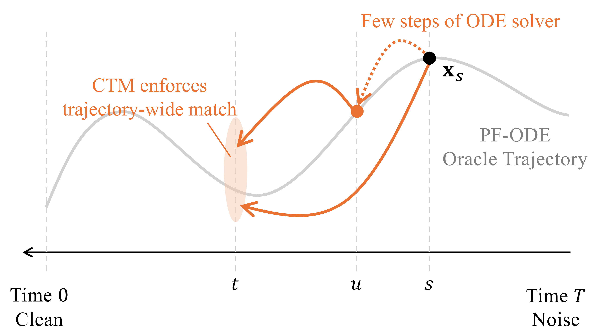
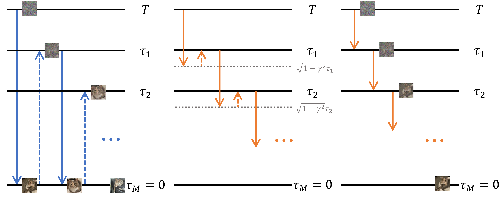

# 11.4 一般流映射：Consistency Trajectory Model {#sec-ctm}

Consistency Trajectory Model（CTM）（[Kim et al., 2024](../../references.md#ref-kim2023consistency)）是最早学习*一般*流映射 ${\boldsymbol{\Psi}}_{s\to t}$ 的方法之一。

**CTM 的实际设定。** 与 CM 方法族类似，CTM 最初沿用 EDM（[Karras et al., 2022](../../references.md#ref-karras2022elucidating)）的表述（[第 D.6 节](../../appendices/d-supplementary-proofs/06-edm.md#sec-edm)），使用 ${\mathbf{x}}$ 预测形式的 PF-ODE，噪声调度取 $\alpha_t = 1$ 和 $\sigma_t = t$。在此设定下，PF-ODE 变为

$$
\begin{aligned}
\frac{\mathop{}\!\mathrm{d} {\mathbf{x}}(\tau)}{\mathop{}\!\mathrm{d} \tau}
    = \frac{{\mathbf{x}}(\tau) - {\mathbb{E}}[{\mathbf{x}}|{\mathbf{x}}(\tau)]}{\tau}.
\end{aligned}
$$

从 ${\mathbf{x}}_s$ 出发，由时刻 $s$ 逆向演化到终止时刻 $t\le s$，相应的流映射（解）可等价地写为

$$
\begin{aligned}
{\mathbf{x}}_s + \int_s^t
    \frac{{\mathbf{x}}_\tau - {\mathbb{E}}[{\mathbf{x}} |{\mathbf{x}}_\tau]}{\tau}\, \mathop{}\!\mathrm{d} \tau.
\end{aligned}
$$

CTM 采用受 Euler 方法启发的参数化：对 PF-ODE 应用单步 Euler 求解器[^1]，得到

$$
{\mathbf{x}}_{s\to t}^{\mathrm{Euler}}
= {\mathbf{x}}_s - (s-t)\,\frac{{\mathbf{x}}_s - {\mathbb{E}}[{\mathbf{x}}|{\mathbf{x}}_s]}{s}
= \frac{t}{s}\,{\mathbf{x}}_s + \Big(1 - \frac{t}{s}\Big){\mathbb{E}}[{\mathbf{x}}|{\mathbf{x}}_s],
$$

其中 ${\mathbf{x}}_{s\to t}^{\mathrm{Euler}}$ 近似时刻 $t$ 的解，给定的状态为 ${\mathbf{x}}_s$，对应时刻 $s$。

EDM 设定提供了一个简单示例，但 CTM 也允许更广泛的噪声调度，由任意线性 Gaussian 前向核 $(\alpha_t, \sigma_t)$ 定义，并以 ${\mathbf{v}}$ 预测形式表示 PF-ODE：

$$
{\boldsymbol{\Psi}}_{s\to t}({\mathbf{x}}_s)
= {\mathbf{x}}_s + \int_s^t {\mathbf{v}}^*({\mathbf{x}}_u,u) \mathop{}\!\mathrm{d} u.
$$

下面的讨论将聚焦于这一一般表述。

## 11.4.1 用于灵活转移学习的 CTM 参数化 {#ctm-parametrization}

遵循上述 PF-ODE 的单步 Euler 求解器，CTM 将 oracle 流映射 ${\boldsymbol{\Psi}}_{s\to t}$ 改写为输入 ${\mathbf{x}}_s$ 与残差函数 ${\mathbf{g}}^*$ 的凸组合：

$$
\begin{aligned}
{\boldsymbol{\Psi}}_{s\to t}({\mathbf{x}}_s)
:= {\mathbf{x}}_s + \int_s^t {\mathbf{v}}^*({\mathbf{x}}_u,u) \mathop{}\!\mathrm{d} u
= \frac{t}{s}\,{\mathbf{x}}_s
+ \frac{s-t}{s}
\underbrace{\Big[{\mathbf{x}}_s + \frac{s}{s-t} \int_s^t {\mathbf{v}}^*({\mathbf{x}}_u,u) \mathop{}\!\mathrm{d} u\Big]}_{=:~{\mathbf{g}}^*}.
\end{aligned}
$$

其中残差项 $\mathbf{g}^*$ 定义为

$$
\begin{aligned}
\mathbf{g}^*(\mathbf{x}_{s}, s, t) &:= {\mathbf{x}}_s + \frac{s}{s-t} \int_s^t {\mathbf{v}}^*({\mathbf{x}}_u,u)\mathop{}\!\mathrm{d} u.
\end{aligned}
\tag{11.4.1}
$$

由此得到神经网络参数化

$$
\begin{aligned}
{\mathbf{G}}_{{\boldsymbol{\theta}}}({\mathbf{x}}_s,s,t)
:= \frac{t}{s}\,{\mathbf{x}}_s + \frac{s-t}{s}\,{\mathbf{g}}_{{\boldsymbol{\theta}}}({\mathbf{x}}_s,s,t),
\end{aligned}
\tag{11.4.2}
$$

其中 ${\mathbf{g}}_{{\boldsymbol{\theta}}}$ 是以实现 ${\mathbf{g}}_{{\boldsymbol{\theta}}} \approx {\mathbf{g}}^*$ 为目标的神经网络，因此通过训练使 ${\mathbf{G}}_{{\boldsymbol{\theta}}}({\mathbf{x}}_s,s,t)$ 近似 oracle 流映射：

$$
{\mathbf{G}}_{{\boldsymbol{\theta}}}({\mathbf{x}}_s,s,t) \approx {\boldsymbol{\Psi}}_{s\to t}({\mathbf{x}}_s).
$$

因此，CTM 自然符合[公式 (10.1.4)](01-prologue.md#eq-general-cm-loss-rep)的一般一致性映射框架，该框架将学到的映射与 oracle 流映射对齐。

此外，这一表述天然满足初始条件

$$
{\mathbf{G}}_{{\boldsymbol{\theta}}}({\mathbf{x}}_s,s,s)={\mathbf{x}}_s,
$$

训练时无须显式施加该条件。

**CTM 参数化的优点。** ${\mathbf{g}}^*$ 的一个关键特征在以下极限中显现：令 $t$ 趋近于 $s$（即终止时刻与起始时刻相同），则有

**命题 11.4.1：${\mathbf{g}}^*$ 的性质**

1.  **恢复扩散模型：**

    $$
    {\mathbf{g}}^*({\mathbf{x}}_s, s, s)=\lim_{t\rightarrow s}\mathbf{g}^*(\mathbf{x}_{s},s,t)={\mathbf{x}}_s - s{\mathbf{v}}^*({\mathbf{x}}_s,s).
    $$

2.  **积分表示：**

    $$
    \mathbf{g}^*(\mathbf{x}_{s},s,t)={\mathbf{x}}_s - s{\mathbf{v}}^*({\mathbf{x}}_s,s)+\mathcal{O}(\vert t-s\vert).
    $$

**命题的证明。**

根据 ${\mathbf{g}}^*$ 的定义，可得

$$
\begin{aligned}
\lim_{t\rightarrow s}\mathbf{g}^*(\mathbf{x}_{s},s,t)=\mathbf{x}_{s}-s\lim_{t\rightarrow s}\frac{1}{t-s}\int_{s}^{t}{\mathbf{v}}^*(\mathbf{x}_{\tau}, \tau)\mathop{}\!\mathrm{d} \tau={\mathbf{x}}_s - s{\mathbf{v}}^*({\mathbf{x}}_s,s).
\end{aligned}
$$

这证明了第一个恒等式。对于第二个结论，由 Taylor 展开可得

$$
\begin{aligned}
\mathbf{g}^*(\mathbf{x}_{s},s,t)&=\mathbf{x}_{s}-\frac{s}{s-t}\int_{t}^{s}{\mathbf{v}}^*({\mathbf{x}}_\tau, \tau)\mathop{}\!\mathrm{d} \tau\\
    &=\mathbf{x}_{s}-\frac{s}{s-t}\bigg[ (s-t){\mathbf{v}}^*({\mathbf{x}}_s, s) + \mathcal{O}((t-s)^{2}) \bigg]\\
    &={\mathbf{x}}_s - s{\mathbf{v}}^*({\mathbf{x}}_s,s)+\mathcal{O}(\vert t-s\vert).
\end{aligned}
$$

根据这一命题，可以得出

1.  估计 ${\mathbf{g}}^*$ 不仅能够近似从 $s$ 到 $t$ 的有限时间转移（对应 $s \ge t$），还能近似从 $s$ 到 $s$ 的*无穷小*转移，后者由瞬时速度 ${\mathbf{v}}^*$ 刻画。

2.  $\mathbf{g}^*(\mathbf{x}_{s},s,t)$ 可以理解为一个类似去噪器的量，再加上 Taylor 展开的残差项。

因此，利用[公式 (11.4.2)](04-consistency-trajectory-models.md#eq-ctm-para-1)中 CTM 的参数化，学习 $\mathbf{G}_{\boldsymbol{\theta}} \approx {\boldsymbol{\Psi}}_{s\to t}$（其中 $t<s$），除去非零因子 $(s-t)/s$ 后，就对应于学习 $\mathbf{g}_{\boldsymbol{\theta}} \approx \mathbf{g}^*$，从而通过 $\mathbf{G}_{\boldsymbol{\theta}}$ 获得长距离跳跃能力。此外，$\mathbf{g}^*$ 的对角值通过下式编码扩散模型的瞬时速度：

$$
{\mathbf{v}}^*({\mathbf{x}}_s,s)
=
\frac{{\mathbf{x}}_s-{\mathbf{g}}^*({\mathbf{x}}_s,s,s)}{s},
$$

这可以用下文介绍的扩散模型损失直接监督。因此，CTM 的参数化为学习有限时间转移和局部扩散动力学提供了统一框架，将流映射模型的长距离跳跃能力与对扩散模型瞬时动力学的访问相结合。

接下来两节首先介绍 CTM 的一致性损失（[第 11.4.2 节](04-consistency-trajectory-models.md#subsec-ctm-consistency)），它同时支持蒸馏与从头训练，并通过施加半群性质实现 $\mathbf{G}_{\boldsymbol{\theta}}(\cdot, s, t) \approx {\boldsymbol{\Psi}}_{s\to t}(\cdot, s, t)$。随后介绍辅助损失（[第 11.4.3 节](04-consistency-trajectory-models.md#subsec-ctm-auxiliary)），这些损失自然源于[公式 (11.4.2)](04-consistency-trajectory-models.md#eq-ctm-para-1)的参数化，包括扩散模型损失和 GAN 损失，能进一步显著提高 CTM 的表现。

## 11.4.2 CTM 中的一致性损失 {#subsec-ctm-consistency}

CTM 旨在近似 oracle 解映射

$$
\mathbf{G}_{\boldsymbol{\theta}}(\cdot, s, t) \approx {\boldsymbol{\Psi}}_{s\to t}(\cdot, s, t),
$$

对任意 $s \ge t$ 均成立。由于 oracle ${\boldsymbol{\Psi}}_{s\to t}$ 通常没有可用的闭式表达式，CTM 通过施加*半群性质*（[公式 (11.2.1)](02-discrete-consistency-models.md#eq-semi-group)）构造可行的回归目标：对于任意 $s \ge u \ge t$，

$$
{\boldsymbol{\Psi}}_{u\to t}\circ {\boldsymbol{\Psi}}_{s\to u} = {\boldsymbol{\Psi}}_{s\to t}.
$$

根据是否有可用的预训练扩散模型，可以采用不同方式近似流映射 ${\boldsymbol{\Psi}}_{s\to t}$。以下始终假设 $s \ge u \ge t \in [0,T]$。

**通过蒸馏训练。** 假设已有能输出 ${\mathbf{v}}_{\boldsymbol{\phi}^\times}({\mathbf{x}}_s, s) \approx {\mathbf{v}}^*({\mathbf{x}}_s, s)$ 的预训练扩散模型。那么，可以用以下经验动力学近似 PF-ODE：

$$
\begin{aligned}
\frac{\mathop{}\!\mathrm{d} {\mathbf{x}}(\tau)}{\mathop{}\!\mathrm{d} \tau}
= {\mathbf{v}}_{\boldsymbol{\phi}^\times}({\mathbf{x}}_\tau, \tau).
\end{aligned}
\tag{11.4.3}
$$

CTM 训练 $\mathbf{G}_{\boldsymbol{\theta}}$，使其匹配应用于这一经验 ODE 的数值求解器 $\mathtt{Solver}_{s\to t}({\mathbf{x}}_s;\boldsymbol{\phi}^\times)$，后者充当 oracle 的可计算替代：

$$
\mathbf{G}_{\boldsymbol{\theta}}({\mathbf{x}}_s, s, t)
\approx \mathtt{Solver}_{s\to t}({\mathbf{x}}_s;\boldsymbol{\phi}^\times)
\approx {\boldsymbol{\Psi}}_{s\to t}({\mathbf{x}}_s, s, t).
$$

如果教师足够强，求解器可以在离散化误差范围内恢复 ${\boldsymbol{\Psi}}_{s\to t}$，因此最优学生与真实目标非常接近（见（[Kim et al., 2024](../../references.md#ref-kim2023consistency)）的命题 3 和命题 4）。

不过，在训练循环中求解整个区间 $[t,s]$ 的成本可能很高，尤其当 $s$ 与 $t$ 相距较远时。为提高效率并提供更平滑的信号，CTM 引入*软一致性匹配*，将半群性质转化为可执行操作。如[图 11.5](04-consistency-trajectory-models.md#fig-ill-models)所示，CTM 比较时刻 $t$ 的两种预测：学生的直接输出 $\mathbf{G}_{\boldsymbol{\theta}}({\mathbf{x}}_s, s, t)$，以及混合教师与学生的路径，后者先让教师从 $s$ 推进到随机的 $u \sim \mathcal{U}[t,s)$，再让学生从 $u$ 跳到 $t$：

$$
\mathbf{G}_{\boldsymbol{\theta}^-} \big(\mathtt{Solver}_{s\to u}({\mathbf{x}}_s;\boldsymbol{\phi}^\times),\, u,\, t\big).
$$

训练学生使其匹配这一复合预测：

$$
\begin{aligned}
\underbrace{\mathbf{G}_{\boldsymbol{\theta}}({\mathbf{x}}_s, s, t)}_{\approx\, {\boldsymbol{\Psi}}_{s\to t}({\mathbf{x}}_s)}
 \approx
\underbrace{\mathbf{G}_{\boldsymbol{\theta}^-} \big(\mathtt{Solver}_{s\to u}({\mathbf{x}}_s;\boldsymbol{\phi}^\times), u, t\big)}_{\approx\, {\boldsymbol{\Psi}}_{u\to t}({\boldsymbol{\Psi}}_{s\to u}({\mathbf{x}}_s))},
\end{aligned}
\tag{11.4.4}
$$

其中 $\boldsymbol{\theta}^-$ 是 $\mathbf{G}_{\boldsymbol{\theta}}$ 的停止梯度副本。

改变 $u$，CTM 便能在全局监督与局部监督之间插值：

-   **全局一致性**（$u=t$）：对教师在整个区间 $s\to t$ 上求解，因此目标退化为时刻 $t$ 的完整教师转移。

-   **局部一致性**（$u=s-\Delta s$）：学生从 $s$ 附近的短教师步骤中学习；当 $t=0$ 时，这退化为一致性蒸馏。

为在对齐轨迹的同时增强样本质量，使用停止梯度的学生将两种预测都映射到时刻 $0$，并用特征空间度量 $d$ 比较：

$$
\begin{aligned}
{\mathbf{x}}_{\mathrm{est}}({\mathbf{x}}_s,s,t) &:= \mathbf{G}_{\boldsymbol{\theta}^-} \big(\mathbf{G}_{\boldsymbol{\theta}}({\mathbf{x}}_s,s,t),\, t,\, 0\big),\\
{\mathbf{x}}_{\mathrm{target}}({\mathbf{x}}_s,s,u,t) &:= \mathbf{G}_{\boldsymbol{\theta}^-} \big(
\mathbf{G}_{\boldsymbol{\theta}^-}(\mathtt{Solver}_{s\to u}({\mathbf{x}}_s;\boldsymbol{\phi}^\times), u, t),\, t,\, 0\big).
\end{aligned}
$$

CTM 的一致性损失为

$$
\begin{aligned}
\mathcal{L}_{\mathrm{consist}}(\boldsymbol{\theta}; \boldsymbol{\phi}^\times)
:=
\mathbb{E}_{s \in [0,T]}\mathbb{E}_{t \in [0,s]}\mathbb{E}_{u \in [t,s)}
\mathbb{E}_{{\mathbf{x}}_0}\mathbb{E}_{{\mathbf{x}}_s |{\mathbf{x}}_0}
\Big[ d\big({\mathbf{x}}_{\mathrm{est}}, {\mathbf{x}}_{\mathrm{target}}\big) \Big],
\end{aligned}
\tag{11.4.5}
$$

它鼓励学生匹配经验 PF-ODE 的解，同时保持生成质量。

**从头训练。** 利用 CTM 的特殊参数化（[命题 11.4.1](04-consistency-trajectory-models.md#ctm-g-para)(i)），

$$
{\mathbf{g}}^*({\mathbf{x}}_\tau, \tau, \tau)
= {\mathbf{x}}_\tau - \tau\,{\mathbf{v}}^*({\mathbf{x}}_\tau,\tau)
 \implies
{\mathbf{v}}^*({\mathbf{x}}_\tau,\tau)
= \frac{{\mathbf{x}}_\tau - {\mathbf{g}}^*({\mathbf{x}}_\tau, \tau, \tau)}{\tau}.
$$

因此，可以将 oracle 残差函数 ${\mathbf{g}}^*(\cdot,\tau,\tau)$ 替换为 CTM 自身的估计 ${\mathbf{g}}_{\boldsymbol{\theta}^-}(\cdot,\tau,\tau)$，用于 $\tau \in (0,T]$，得到由自身诱导的经验 PF-ODE：

$$
\begin{aligned}
\frac{\mathop{}\!\mathrm{d} {\mathbf{x}}(\tau)}{\mathop{}\!\mathrm{d} \tau}
= \frac{{\mathbf{x}}(\tau) - {\mathbf{g}}_{\boldsymbol{\theta}^-} \left({\mathbf{x}}(\tau),\tau,\tau\right)}{\tau}.
\end{aligned}
\tag{11.4.6}
$$

随后求解这一由自身诱导的 ODE，构造可计算的转移目标：

$$
\mathbf{G}_{\boldsymbol{\theta}}({\mathbf{x}}_s, s, t)
\approx \mathtt{Solver}_{s\to t}({\mathbf{x}}_s;\boldsymbol{\theta}^-).
$$

只有当对角估计 ${\mathbf{g}}_{\boldsymbol{\theta}^-}(\cdot,\tau,\tau)$ 准确恢复目标局部动力学时，这一目标才会接近 oracle 流映射。下文介绍的扩散模型损失为这一局部量提供直接监督。

与蒸馏情形[公式 (11.4.4)](04-consistency-trajectory-models.md#eq-soft)一样，对 $[t,s]$ 完整积分可能成本高昂，尤其当 $s$ 与 $t$ 相距较远时。因此，CTM 施加半群性质，以获得更短的监督路径：

$$
\underbrace{\mathbf{G}_{\boldsymbol{\theta}}({\mathbf{x}}_s, s, t)}_{\approx\, {\boldsymbol{\Psi}}_{s\to t}({\mathbf{x}}_s)}
 \approx
\underbrace{\mathbf{G}_{\boldsymbol{\theta}^-} \big(\mathtt{Solver}_{s\to u}({\mathbf{x}}_s;\boldsymbol{\theta}^-),\, u,\, t\big)}_{\approx\, {\boldsymbol{\Psi}}_{u\to t}({\boldsymbol{\Psi}}_{s\to u}({\mathbf{x}}_s))},
$$

其中 $u \sim \mathcal{U}[t,s)$，且 $\boldsymbol{\theta}^-$ 是学生的停止梯度副本。相对于蒸馏，唯一的变化是将外部教师 ${\mathbf{v}}_{\boldsymbol{\phi}^\times}$ 替换为自身诱导的教师 ${\mathbf{g}}_{\boldsymbol{\theta}^-}$。

为结合轨迹匹配与样本质量，使用停止梯度的学生将两种预测都映射到时刻 $0$，并在特征空间中比较。无需任何预训练模型的目标为

$$
\hat{{\mathbf{x}}}_{\mathrm{target}}
:= \mathbf{G}_{\boldsymbol{\theta}^-} \big(
\mathbf{G}_{\boldsymbol{\theta}^-}(\mathtt{Solver}_{s\to u}({\mathbf{x}}_s;\boldsymbol{\theta}^-),\, u,\, t),\, t,\, 0\big),
$$

用其替换[公式 (11.4.5)](04-consistency-trajectory-models.md#eq-ctm-consist-distill)中的 ${\mathbf{x}}_{\mathrm{target}}$，得到：

$$
\begin{aligned}
\mathcal{L}_{\mathrm{consist}}(\boldsymbol{\theta}; {\boldsymbol{\theta}}^-)
:=
\mathbb{E}_{s \in [0,T]}\mathbb{E}_{t \in [0,s]}\mathbb{E}_{u \in [t,s)}
\mathbb{E}_{{\mathbf{x}}_0}\mathbb{E}_{{\mathbf{x}}_s |{\mathbf{x}}_0}
\Big[ d\big({\mathbf{x}}_{\mathrm{est}}, \hat{\mathbf{x}}_{\mathrm{target}}\big) \Big],
\end{aligned}
\tag{11.4.7}
$$

从概念上看，这是 CTM 内部的自蒸馏：模型自己提供短时间范围的教师信号，学生则学习完整转移。

**图 11.5：** **CTM 半群性质示意图。** 对于任意 $s \ge u \ge t$，CTM 施加 ${\mathbf{G}}_{{\boldsymbol{\theta}}}({\mathbf{x}}_s, s, t) \approx {\mathbf{G}}_{{\boldsymbol{\theta}}^-} \big(\mathtt{Solver}_{s\to u}({\mathbf{x}}_s), u , t\big)$，即一个短求解器片段 $s \to u$ 后接 CTM 到 $t$ 的“跳跃”，应与直接的 CTM 映射 $s\to t$ 匹配。求解器可以使用预训练扩散模型，也可以使用 CTM 自身诱导的教师。

来源：改编自 [Kim et al. (2024)](../../references.md#ref-kim2023consistency)。

## 11.4.3 CTM 中的辅助损失 {#subsec-ctm-auxiliary}

（自）蒸馏的表现可能不及教师，因为它只针对教师生成的目标优化，缺少真实数据的直接监督。CTM 则能自然纳入由数据驱动的正则项，例如在目标中加入去噪 score 匹配和对抗（GAN）项（[Goodfellow et al., 2014](../../references.md#ref-goodfellow2014generative)），以更好地学习流映射。

**自然整合扩散损失。** 扩散模型损失（更准确地说，是条件流匹配损失；见[公式 (5.2.10)](../05-flow-based-perspective/02-flow-matching-framework.md#eq-fm-cfm)）可以自然整合到 CTM 中，并提供固定的回归目标，帮助学习流映射模型。为说明这一点，注意有

$$
{\mathbf{v}}^*({\mathbf{x}}_s, s)
= \frac{{\mathbf{x}}_s - {\mathbf{g}}^*({\mathbf{x}}_s, s, s)}{s},
\qquad
{\mathbf{g}}^*({\mathbf{x}}_s, s, s) \approx {\mathbf{g}}_{{\boldsymbol{\theta}}}({\mathbf{x}}_s, s, s).
$$

这通过 ${\mathbf{g}}_{{\boldsymbol{\theta}}}$ 自然诱导了速度参数化：

$$
{\mathbf{v}}_{{\boldsymbol{\theta}}}({\mathbf{x}}_s, s)
:= \frac{1}{s}\bigl({\mathbf{x}}_s - {\mathbf{g}}_{{\boldsymbol{\theta}}}({\mathbf{x}}_s, s, s)\bigr).
$$

使用线性 Gaussian 路径

$$
{\mathbf{x}}_s = \alpha_s {\mathbf{x}}_0 + \sigma_s {\boldsymbol{\epsilon}},
\qquad
{\mathbf{x}}_0 \sim p_{\mathrm{data}},
{\boldsymbol{\epsilon}} \sim \mathcal N(0, \mathbf I),
$$

扩散模型损失可写为

$$
\begin{aligned}
\mathcal L_{\mathrm{DM}}({\boldsymbol{\theta}})
&:=
{\mathbb{E}}_{{\mathbf{x}}_0, {\boldsymbol{\epsilon}}, s}
\Bigl[
w(s)
\bigl\|
 {\mathbf{v}}_{{\boldsymbol{\theta}}}({\mathbf{x}}_s, s) - \left(\alpha_s' {\mathbf{x}}_0 + \sigma_s' {\boldsymbol{\epsilon}}\right)
\bigr\|_2^2
\Bigr].
\end{aligned}
\tag{11.4.8}
$$

$\mathcal L_{\mathrm{DM}}$ 通过显式监督沿轨迹的小幅跳跃，提高 $t$ 接近 $s$ 时的准确性。在这一情形下，[公式 (11.4.2)](04-consistency-trajectory-models.md#eq-ctm-para-1)中的因子 $1-\tfrac{t}{s}$ 趋近于零，可能削弱梯度、减缓学习；$\mathcal L_{\mathrm{DM}}$ 提供更强的局部信号，使训练稳定。

从概念上看，[公式 (11.4.5)](04-consistency-trajectory-models.md#eq-ctm-consist-distill)和[公式 (11.4.7)](04-consistency-trajectory-models.md#eq-ctm-consist-scratch)施加轨迹匹配（零阶），[公式 (11.4.8)](04-consistency-trajectory-models.md#eq-ctm-dsm)则施加斜率匹配（一阶）。

**（可选）GAN 损失。** 虽然一致性损失和扩散模型损失能提供较强的回归信号，但可能产生过于平滑的输出。因此，CTM 可以选择加入对抗项，通过将生成器分布与数据分布对齐，鼓励更清晰、更逼真的样本。使用判别器 $D_{\boldsymbol{\zeta}}$ 区分真实样本 ${\mathbf{x}}_{0}\sim p_{\mathrm{data}}$ 与生成样本 ${\mathbf{x}}_{\mathrm{est}}({\mathbf{x}}_{s},s,t)$，目标为

$$
\begin{aligned}
&\mathcal{L}_{\mathrm{GAN}}(\boldsymbol{\theta}, \boldsymbol{\zeta}) := \\ &\mathbb{E}_{\mathbf{x}_0} \big[\log D_{\boldsymbol{\zeta}}(\mathbf{x}_0)\big] + \mathbb{E}_{s \in [0, T]} \mathbb{E}_{t \in [0, s]} \mathbb{E}_{\mathbf{x}_0} \mathbb{E}_{\mathbf{x}_s \vert \mathbf{x}_0} \big[\log (1 - D_{\boldsymbol{\zeta}}( \mathbf{x}_{\mathrm{est}}(\mathbf{x}_s, s, t)))\big],
\end{aligned}
$$

其中最大化 $D_{\boldsymbol{\zeta}}$，最小化 ${\mathbf{G}}_{\boldsymbol{\theta}}$。直观上，判别器充当一种自适应感知距离，鼓励逼真的细节。理论上，GAN 项推动 $p_{\mathrm{data}}$ 与 ${\mathbf{G}}_{\boldsymbol{\theta}}$ 诱导的模型分布之间的分布匹配（Jensen–Shannon 散度）（[Goodfellow et al., 2014](../../references.md#ref-goodfellow2014generative)），从而可能使保真度超过教师。

**CTM 的整体目标。** CTM 将（自）蒸馏、扩散和 GAN 损失统一在同一个训练框架中：

$$
\begin{aligned}
\mathcal{L}_{\mathrm{CTM}}(\boldsymbol{\theta},\boldsymbol{\zeta})
:=  \mathcal{L}_{\mathrm{consist}}(\boldsymbol{\theta};  \boldsymbol{\phi}^\times/\boldsymbol{\theta}^-)
+ \lambda_{\mathrm{DM}} \mathcal{L}_{\mathrm{DM}}(\boldsymbol{\theta})
+ \lambda_{\mathrm{GAN}} \mathcal{L}_{\mathrm{GAN}}(\boldsymbol{\theta},\boldsymbol{\zeta}),
\end{aligned}
$$

其中教师既可以是外部预训练模型 $\boldsymbol{\phi}^\times$，也可以是自身诱导的教师 $\boldsymbol{\theta}^-$。回归形式的组成部分 $\mathcal{L}_{\mathrm{consist}}$ 和 $\mathcal{L}_{\mathrm{DM}}$ 充当较强的正则项，可选的 GAN 项则在不牺牲稳定性的情况下改善细微细节（[Kim et al., 2024](../../references.md#ref-kim2024pagoda)）。

## 11.4.4 使用 CTM 灵活采样 {#flexible-sampling}

CTM 学习一般流映射 ${\boldsymbol{\Psi}}_{s\to t}$，适用于任意 $s>t$，意味着它支持任意时刻之间的转移。这一性质支持灵活的采样策略。例如，CTM 提出 *$\gamma$ 采样*，用超参数 $\gamma$ 控制生成时的随机性。此外，CTM 可以复用为扩散模型开发的标准推理技术，例如基于 ODE 的求解器和精确似然计算。

下文固定用于采样的离散时间网格为 $T=\tau_0 > \tau_1 > \tau_2 > \cdots > \tau_{M}=0$。

<section class="book-algorithm" id="alg-gamma" aria-labelledby="alg-gamma-title" markdown="1">

算法 11：CTM 的 $\gamma$ 采样

**输入：** 训练好的 CTM $\mathbf{G}_{\boldsymbol{\theta}^\times}$、$\gamma\in[0,1]$、$T=\tau_0&gt;\tau_1 &gt; \tau_2 &gt; \cdots &gt; \tau_{M}=0$。

1

从 $\mathbf{x}_{\tau_{0}}\sim p_{\mathrm{prior}}=\mathcal{N}(\boldsymbol{0}, T^2{\mathbf{I}})$ 出发

2

**for** $n=0$ to $M-1$ **do**

3

$\tilde{\tau}_{n+1}\leftarrow \sqrt{1-\gamma^{2}}\tau_{n+1}$

4

去噪 $\mathbf{x}_{\tilde{\tau}_{n+1}}\leftarrow \mathbf{G}_{\boldsymbol{\theta}^\times}(\mathbf{x}_{\tau_{n}},\tau_{n},\tilde{\tau}_{n+1})$

5

扩散 $\mathbf{x}_{\tau_{n+1}}\leftarrow\mathbf{x}_{\tilde{\tau}_{n+1}}+\gamma \tau_{n+1}\boldsymbol{\epsilon}$，其中 $\boldsymbol{\epsilon}\sim\mathcal{N}(\boldsymbol{0}, {\mathbf{I}})$

6

**end for**

**输出：** $\mathbf{x}_{\tau_{M}}$

</section>

**$\gamma$ 采样的方法。** CTM 的 $\gamma$ 采样引入统一的采样器族，源于对一般流映射模型的学习。它涵盖已有方法，例如 CM 的多步采样（见[算法 9](02-discrete-consistency-models.md#alg-cm-sampling)），以及在概念上类似 ODE 求解器的时间步进式采样。参数 $\gamma$ 直接控制生成过程中的语义变化程度，使 $\gamma$ 采样成为一种灵活、能够适应任务需求的策略，适用于多种下游应用。

**图 11.6：** **$\gamma$ 采样示意图，展示不同的 $\gamma$ 取值。** 该过程交替进行网络计算去噪与反向加噪，$(\tau_{n}\xrightarrow{\text{Denoise}} \sqrt{1-\gamma^{2}}\tau_{n+1}\xrightarrow{\text{Noisify}} \tau_{n+1})_{n=0}^{M-1}$。最左侧展示 $\gamma=1$，对应完全随机的情形。最右侧展示 $\gamma=0$，对应完全确定性的情形。中间展示 $\gamma\in(0,1)$ 的中间取值，在这两个极端之间插值。

来源：改编自 [Kim et al. (2024)](../../references.md#ref-kim2023consistency)。

-   [图 11.6](04-consistency-trajectory-models.md#fig-gamma-sampling)（左）：当 $\gamma=1$ 时，它与 CM 引入的多步采样一致（即特殊流映射 ${\boldsymbol{\Psi}}_{s\to 0}$），具有完全随机性，改变步数时会产生语义变化。

-   [图 11.6](04-consistency-trajectory-models.md#fig-gamma-sampling)（右）：当 $\gamma=0$ 时，它退化为完全确定性的时间步进，估计 PF-ODE 的解轨迹。$\gamma$ 采样在 $\gamma=0$ 时，与传统的基于 ODE 的时间步进采样有一个关键区别：CTM 避免了数值求解器的离散化误差。

-   [图 11.6](04-consistency-trajectory-models.md#fig-gamma-sampling)（中）：当 $0 < \gamma < 1$ 时，$\gamma$ 采样允许在采样中注入可控程度的随机性，从而在两个极端之间插值。

需要强调的是，取值 $\gamma\in[0,1)$ 需要一般流映射 ${\boldsymbol{\Psi}}_{s\to t}$，而特殊情形 $\gamma=1$ 退化为 CM 风格的多步采样，只需要 ${\boldsymbol{\Psi}}_{s\to0}$。

**$\gamma$ 采样分析。** CTM 在实验中观察到，CM 的多步采样一旦步数 $M \geq 4$，质量便会下降。为解释这一现象，CTM 分析了底层原因：当 $\gamma \neq 0$ 时，每次神经网络“跳跃”都会引入小幅不匹配，随着模型反复将状态映射到零时刻，这些不匹配会累积。误差累积解释了为何长程多步运行的表现可能较差。下面的命题将这一思想形式化。

**命题 11.4.2：（非正式表述）两步 $\gamma$ 采样**

 令 $\tau\in(0,T)$，且 $\gamma \in [0,1]$。令 $p_{\boldsymbol{\theta}^{*},2}$ 表示使用最优 CTM 的 $\gamma$ 采样器所得的密度，转移序列为 $T\rightarrow\sqrt{1-\gamma^2}\tau\rightarrow \tau \rightarrow 0$，从 $p_T$ 出发。那么

$$
\begin{aligned}
\mathcal D_{\mathrm{TV}}\big( p_{\mathrm{data}}, p_{\boldsymbol{\theta}^{*},2} \big)         = \mathcal{O}\left(\sqrt{T-\sqrt{1-\gamma^2}\tau+ \tau}  \right).
\end{aligned}
$$

这里，$\mathcal{D}_{\mathrm{TV}}$ 表示分布间的全变差（见[公式 (1.1.4)](../01-deep-generative-modeling/01-what-is-deep-generative-modeling.md#eq-f-div)）。

**命题的证明。**

采样步数为 $M$ 的一般情形，参见 [Kim et al. (2024)](../../references.md#ref-kim2023consistency) 的定理 8。

上述定理的启示可概括如下：

-   **当** $\gamma = 1$（对应 CM 的多步采样）**时：** 该方法迭代执行从 $\tau_n$ 到 $0$ 的长距离转移，每一步 $n$ 都如此。这会导致如下量级的误差累积：

    $$
    \begin{aligned}
    \mathcal{O}\left(\sqrt{T + \tau_1 + \cdots + \tau_M}\right).
    \end{aligned}
    $$

-   **当** $\gamma = 0$（对应 CTM 的确定性多步采样）**时：** 转移之间的这种时间重叠被消除，从而避免误差累积，并得到更紧的界 $\mathcal{O}(\sqrt{T})$。在实验中，CTM 在 $\gamma = 0$ 时能较好地权衡采样速度与样本质量：增加采样步数会提高生成质量，而不会引入不稳定。

**CTM 支持扩散推理。** 凭借[公式 (11.4.2)](04-consistency-trajectory-models.md#eq-ctm-para-1)的参数化，CTM 通过 ${\mathbf{g}}_{\boldsymbol{\theta}}$ 直接学习 score 函数（或去噪器），因此兼容最初为扩散模型开发的推理技术。例如，可以计算精确似然（[第 4.3.2 节](../04-score-sde-framework/03-training-and-sampling.md#subsec-sde-sample)），也可以使用 DDIM 或 DPM 等高级采样器（[第 9 章](../09-numerical-solvers/index.md#ch-numerical-solvers)）生成，只需使用 ${\mathbf{g}}_{\boldsymbol{\theta}}(\cdot, s, s)$。

[^1]: 对于关于时间为仿射形式的调度，例如 $(\alpha_t,\sigma_t)=(1,t)$ 或 $(1-t,t)$，扩散时间上的普通 Euler 步与确定性 DDIM 更新完全一致。对于一般调度，两者仅在一阶上相同。相关讨论见[第 9.2.2 节](../09-numerical-solvers/02-ddim.md#subsec-ddim-classical-euler)。
