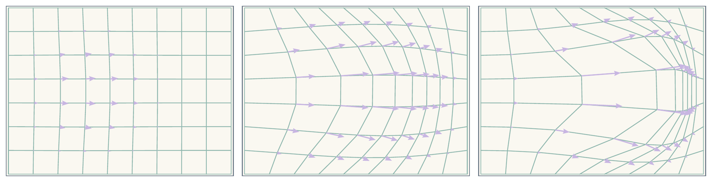
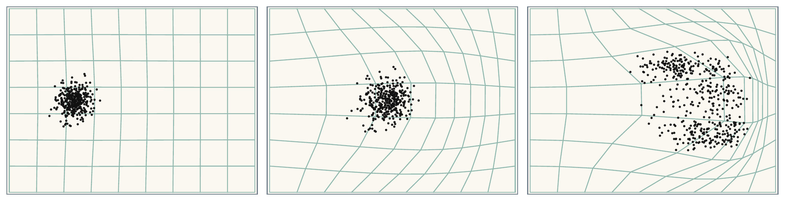
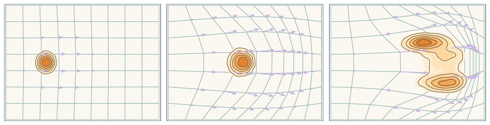

# 12.1 密度输运的基础框架 {#sec-epilogue-backbone}

本书沿着两条紧密相关的路线展开。第一条是*扩散模型本身*，包括变分、基于 score 和基于流的表述，它们从不同数学角度描述概率分布如何演化，以及如何逆转这一演化以进行生成。第二条是*受扩散启发的快速生成器*，其中最具代表性的是流映射模型；它们建立在同一输运视角之上，但旨在学习更直接、更高效的生成器。尽管形式不同，这些方法都植根于一个共同思想：生成建模本质上是*输运概率质量*的问题。从 Gaussian 噪声等简单参考分布出发，我们希望构造一个过程，将它逐渐连接到复杂的数据分布。

这一视角的价值在于，它将注意力从单个模型族转向一个更根本的问题：*当底层样本按照给定动力学移动时，概率分布如何演化？* 回答这一问题的数学语言是变量变换公式及其连续时间扩展。在这个意义上，变量变换原则不只是技术工具，也是扩散模型及其启发的快速生成器共同的概念基础。

**共同的三步结构。** 从总体上看，本书研究的方法都遵循相同的简单模式：

1.  定义一个前向过程，将数据逐渐移向简单的参考分布。

2.  通过适当的分布演化方程，理解概率分布如何在这一过程中变化。

3.  学习一个生成机制，通过逆转、近似或以其他方式利用这一演化来产生样本。

不同表述之间的差异，在于前向过程的选择、分布演化方程的数学形式，以及生成机制的参数化与训练方式。

**变量变换的层级。** 在[附录 B](../../appendices/b-density-evolution/index.md#app-continuity)中，我们从确定性双射到随机微分方程，系统地发展了一系列变量变换公式。这里有必要回顾这一过程，因为它揭示了同一输运原则的多种形式。

**(a)** 向量场示意图。箭头表示推动粒子在空间中运动的速度，底层网格也随之发生形变。

**(b)** 粒子云动力学。预先定义的向量场产生流，将粒子从初始状态输运出去。

**(c)** 密度演化。粒子随着向量场平流运动，密度等高线也相应发生形变，反映流如何重塑底层分布。

**图 12.1：** **向量场作用下的粒子与密度动力学示意图。** 各列从左到右展示连续的时间快照。

来源：改编自 [Lipman et al. (2024)](../../references.md#ref-lipman2024flow)。

1.  **单个双射。** 光滑可逆映射 ${\boldsymbol{\Psi}}:{\mathbb{R}}^D\to{\mathbb{R}}^D$ 将密度 $p_0$ 变换为 $p_1$，公式为

    $$
    p_1({\mathbf{x}}_1)
        =
        p_0\bigl({\boldsymbol{\Psi}}^{-1}({\mathbf{x}}_1)\bigr)
        \left|\det \partial_{{\mathbf{x}}_1}{\boldsymbol{\Psi}}^{-1}({\mathbf{x}}_1)\right|.
    $$

    Jacobian 行列式记录局部体积变化：映射拉伸空间时，密度降低；映射压缩空间时，密度升高。

2.  **双射的复合。** 将多个双射串联，令 ${\mathbf{x}}_k={\boldsymbol{\Psi}}_k({\mathbf{x}}_{k-1})$，得到

    $$
    \log p_L({\mathbf{x}}_L)
        =
        \log p_0({\mathbf{x}}_0)
        -
        \sum_{k=1}^L
        \log\left|\det \partial_{{\mathbf{x}}_{k-1}}{\boldsymbol{\Psi}}_k({\mathbf{x}}_{k-1})\right|.
    $$

    这是归一化流背后的基本原则。更重要的是，它已经揭示了核心思想：一旦指定粒子运动，密度的演化也随之确定。

3.  **连续时间确定性流（ODE）。** 取无穷小步长极限，得到连续性方程：

    $$
    \frac{\partial p_t({\mathbf{x}})}{\partial t}
        +
        \nabla\cdot\bigl(p_t({\mathbf{x}})\,{\mathbf{v}}({\mathbf{x}},t)\bigr)
        =
        0,
    $$

    其中粒子按照下式演化：

    $$
    \frac{\mathop{}\!\mathrm{d} {\mathbf{x}}(t)}{\mathop{}\!\mathrm{d} t} = {\mathbf{v}}({\mathbf{x}}(t),t).
    $$

    这是质量守恒的连续时间表达。概率质量不会产生或消失，只会在速度场 ${\mathbf{v}}$ 的作用下流经空间。

4.  **连续时间随机流（SDE）。** 加入 Brownian 噪声，得到 Fokker–Planck 方程：

    $$
    \frac{\partial p_t({\mathbf{x}})}{\partial t}
        =
        -\nabla\cdot\bigl({\mathbf{v}}({\mathbf{x}},t)\,p_t({\mathbf{x}})\bigr)
        +
        \frac{1}{2}g^2(t)\,\Delta p_t({\mathbf{x}}),
    $$

    它对应于随机动力学

    $$
    \mathop{}\!\mathrm{d}{\mathbf{x}}(t) = {\mathbf{v}}({\mathbf{x}}(t),t)\mathop{}\!\mathrm{d} t + g(t)\mathop{}\!\mathrm{d}{\mathbf{w}}(t).
    $$

    第一项描述由漂移产生的定向输运，第二项则刻画噪声诱导的随机扩散。

这些公式彼此相连。多层变量变换规则是在重复确定性变换下进行输运的离散时间形式。它的无穷小确定性极限给出连续性方程；加入随机扰动后得到 Fokker–Planck 方程。每一层都扩展前一层，同时保留同一个底层原则：概率质量守恒，概率分布随之调整，以反映底层动力学如何推动样本在空间中运动。

从这一视角出发，更容易理解本书主要表述各自的位置。变分方法通过时间网格上的去噪转移描述生成；基于 score 的方法使用随机动力学，学习支配逆时间 SDE 的 score 场；基于流的方法使用确定性输运，学习一个速度场，使其诱导的边缘分布遵循给定的中间分布族。快速生成器同样建立在这一基础之上，但寻求更直接地利用已学输运进行高效采样。

因此，扩散建模更适合被理解为一种*设计原则*：指定前向输运过程，理解其诱导的概率分布演化，再在这一结构上构造生成器，而非局限于某种网络结构或噪声调度下的单个算法。有了这一视角，许多看似不同的方法便成为同一思想的自然变体。

随之而来的一个自然问题是：这一原则能否扩展到连续状态空间之外？下一节将给出肯定答案。
